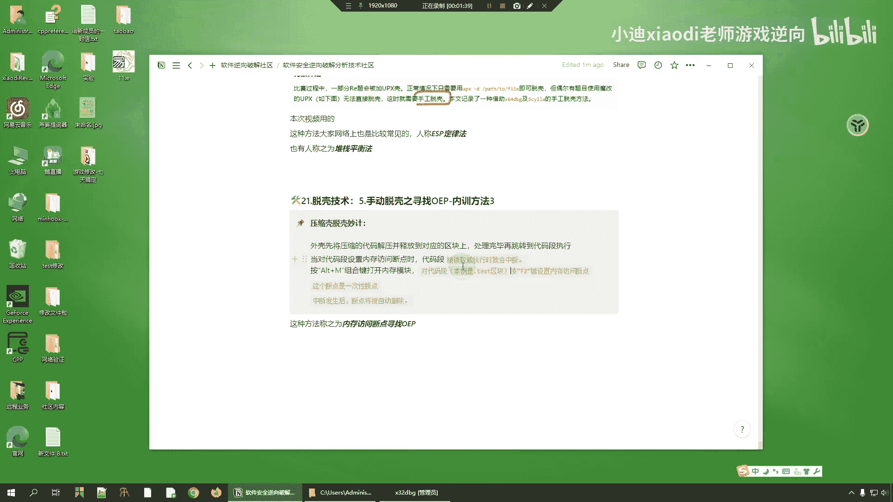
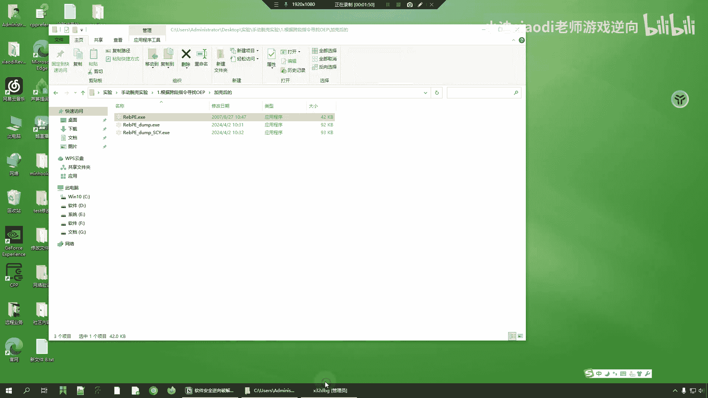
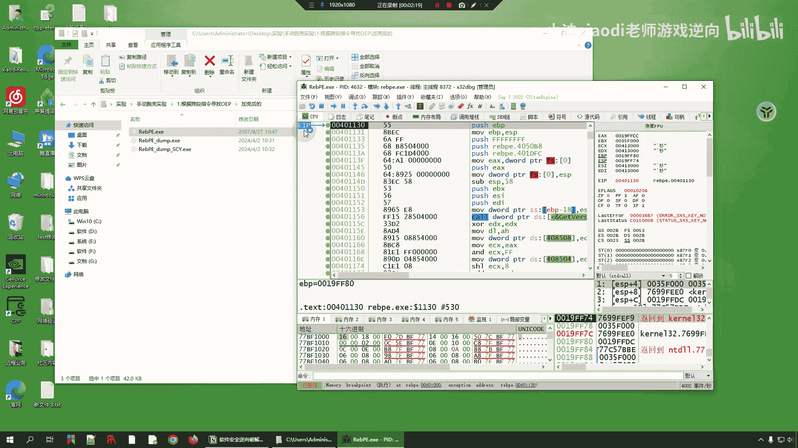
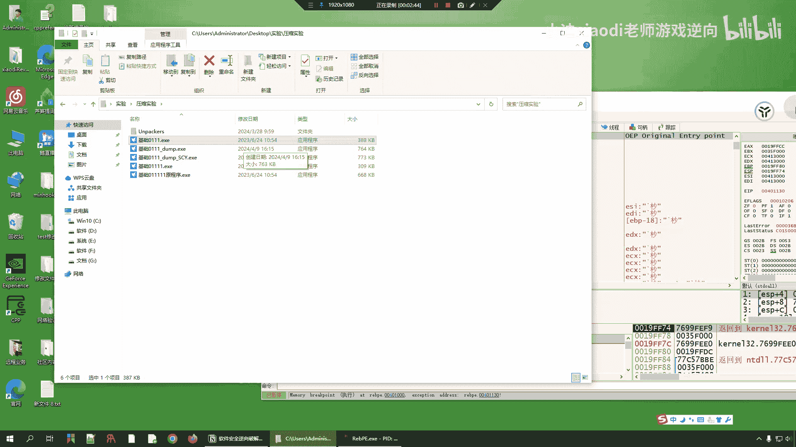
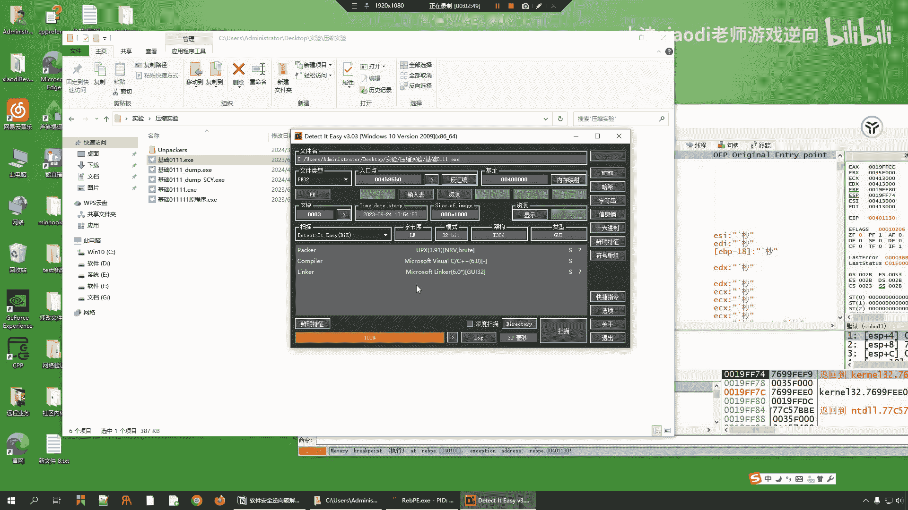
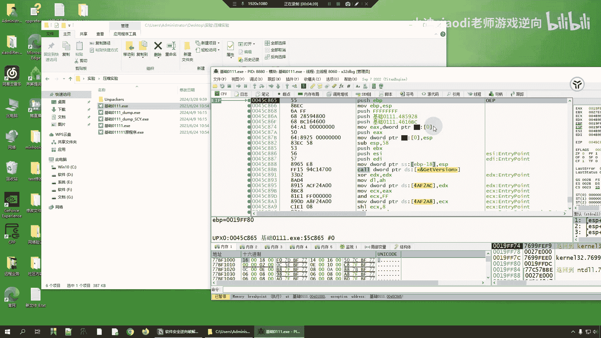
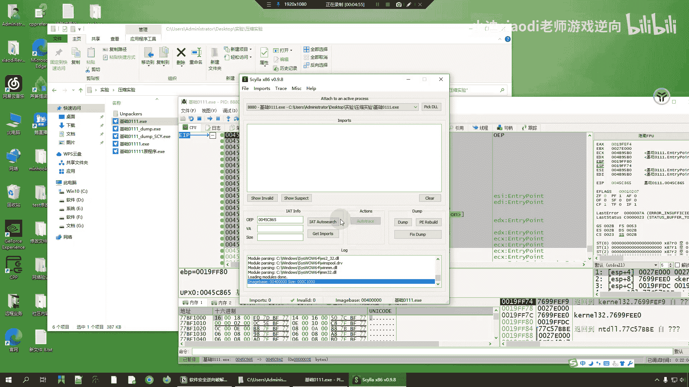
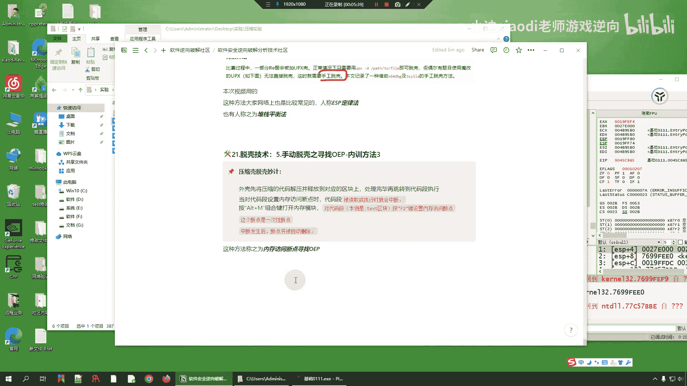

# 脱壳技术：第5章：手动脱壳之寻找OEP-内训方法3

## 🎯 概述

在本节课中，我们继续学习压缩壳的脱壳技巧。上一课我们介绍了多种断点的综合使用场景和区别，这一课我们聚焦一种非常实用的方法——通过内存访问断点来寻找OEP。OEP是原始入口点，找到它之后，我们才能完成转储和修复，最终把壳脱掉。这个方法特别适合压缩壳，因为压缩壳在解压完成后会跳转到原始代码段执行，抓住这个特点，我们就能让程序自己跑到OEP，省去手动单步跟踪的麻烦。

## 🔄 压缩壳的执行流程

首先，让我们回顾一下压缩壳的执行流程。压缩壳在程序运行时，会先做一件事：把压缩过的代码解压。这个解压过程是必须的，因为原始代码如果不恢复，程序就无法正常运行。你想象一下，如果QQ或微信这种社交软件被加壳后没法正常聊天，那加壳还有什么意义呢？所以，外壳必须先解压，把原始代码恢复出来。



解压完成之后，外壳会把数据释放到对应的区块上。这些区块包括原来的代码段、数据段、只读数据段和资源段。外壳把这些内容统统解压，然后释放归类。处理完毕之后，外壳会跳转到代码段去执行原始程序逻辑。因为程序原来的代码必须运行，否则整个程序就废了。这个过程可以用下面的伪代码清晰地表示出来：

```text
外壳执行流程：
1. 解压压缩的代码
2. 将解压后的数据释放到各个区块（代码段、数据段、只读数据段、资源段）
3. 跳转到代码段，从OEP开始执行原始程序
```

## 🎯 内存访问断点的原理





我们最终的目的是寻找OEP。找到OEP之后，就可以进行转储，然后进行修复，最终完成脱壳。那么，怎么利用内存访问断点来寻找OEP呢？如果对内存访问断点还不太理解，不用着急，后面的课程还会继续补充。简单说，断点就是让程序暂停的一个点，以前我们经常用F2设置普通断点，而内存访问断点是一种更特殊的断点，它会监控特定内存区域的访问动作。

关键在于：当我们对代码段设置内存访问断点时，只要代码段被读取或执行，就会立刻中断。也就是说，当外壳完成解压并跳转到代码段的那一刻，调试器就会把程序停下来。这时，程序恰好停在OEP附近，我们就能轻松找到OEP。这个触发条件可以用一句话概括：程序一旦访问代码段，调试器就暂停运行。用逻辑表达式表示就是：



```text
if (访问代码段) then 暂停程序
```

## 🧪 方法一：简单场景下的操作步骤

我们先来看一个比较简单的实验程序。这个程序是典型的压缩壳，操作起来非常直观。整个过程不需要复杂的分析，只需要按照以下步骤来操作：



- 将实验程序拖入调试器（比如OllyDbg）。
- 点击“内存布局”窗口，找到标记为“可执行代码”的代码段。
- 点击该代码段，然后按F2键，此时会设置一个内存访问断点。你会看到提示“在此处设置内存断点”。
- 切换回CPU窗口，直接点击“运行”。
- 程序运行后，等待片刻，调试器会自动停在OEP的位置。

看，这个过程非常自动化。你不需要手动单步跟踪，只需要下一个断点，然后让它自己跑。程序停下来后，你就可以使用插件的“脱壳”功能，一键完成脱壳。这个方法是不是很简单？不过要注意，等待的时候不要着急，给程序一点时间。

## 🧪 方法二：UPX壳的耐心等待

接下来，我们提高一点难度，看一个UPX壳的例子。有的同学可能会觉得上面的例子太简单，想挑战一下更复杂的。好，我们就来看一个比较有“脾气”的壳。我们用一个实验程序，先用DIE工具探测一下，可以看到它是一个UPX 3.91的壳。这个壳很常见，但它的段名比较特殊。把它拖进调试器后，点击内存布局，你可能会有点惊讶：怎么没有常见的.text段呢？这里只有三个段，分别是UPS0、UPSX1和一个资源段。这种情况下，我们该怎么办呢？



其实很简单，一共就三个段，资源段不用试，因为它的内容显示是资源，不是可执行代码。剩下两个段，二选一，总能试出来。我们直接在第一个段（UPS0）上下一个F2断点。操作方式是一样的：点击该段，按F2，然后切换到CPU窗口。接下来，点击运行。你会发现调试器状态显示“运行中”，然后等了几秒钟，可能没有动静。这时候有些同学就心急了，以为这个方法行不通，于是放弃。我要告诉你：心急吃不了热豆腐。学逆向必须学会坚持，学会等待，要有耐心，在电脑前坐得住。稍等一会儿，程序就会自动停在OEP的位置。



这个等待时间可能有点久，具体多久跟程序本身有关，也跟电脑配置有关。比如视频录制时从4:15一直等到4:17，大概等了两分钟。你可以趁这个时间暂停视频，做点别的事，比如和小女朋友聊聊天，或者喝口水。最后，程序终于停了。你看，我可没有动，没有任何操作，程序自己停在了OEP位置。之前我们还打了一个标签，写了一个注释“OEP”。现在就可以点击插件，进行脱壳了。是不是感觉很有成就感？

## 📝 总结



本节课中，我们一起学习了使用内存访问断点寻找OEP的方法。这种方法适用于压缩壳的场景，因为压缩壳解压后会跳转到代码段执行。我们在代码段设置内存访问断点，当代码段被读取或执行时就会中断，从而停在OEP。可能执行时间有点长，需要耐心等待。有的同学等不及，就错过了一种既省力又高效的方法。实际上，你只需要下好断点，让它自动跑，其他什么都不用管。课后可以自己动手试一试，加深对这个方法的理解。掌握了这个技巧，以后遇到压缩壳就能轻松找到OEP了。好了，我们下节课再见。
