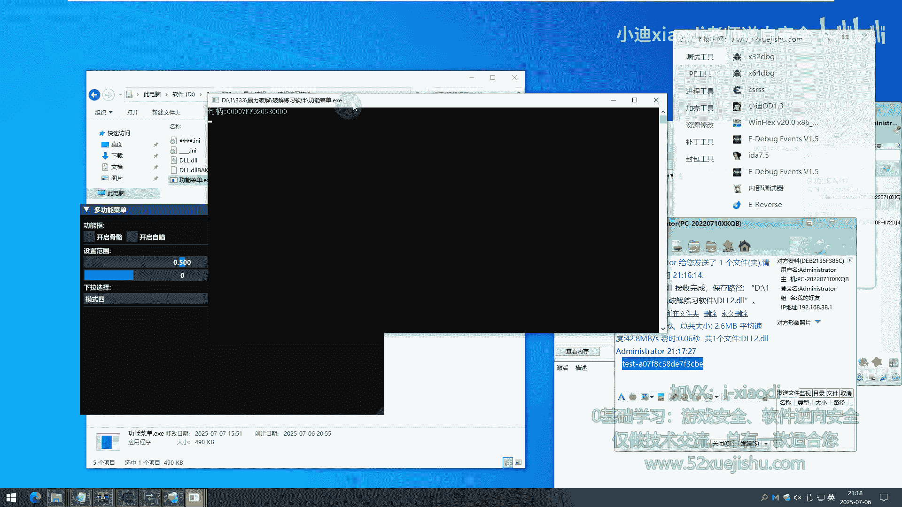
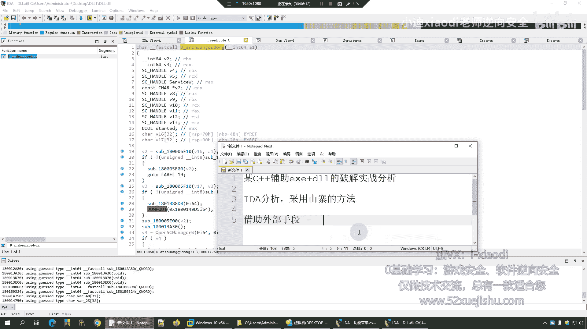
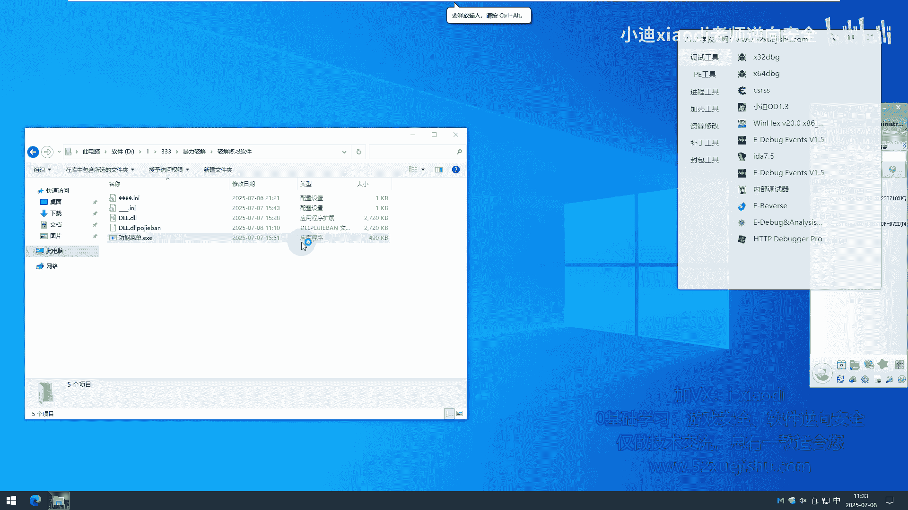
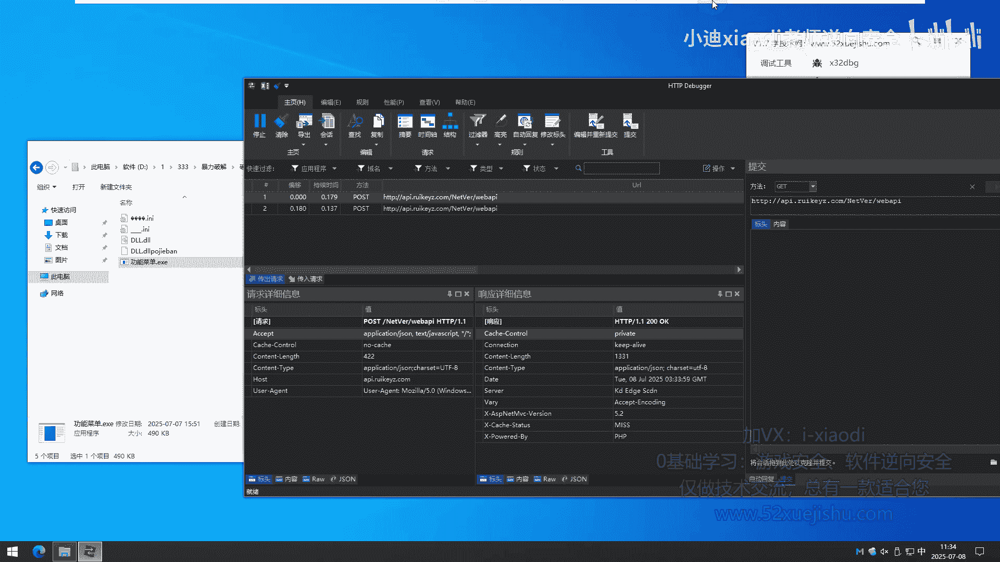
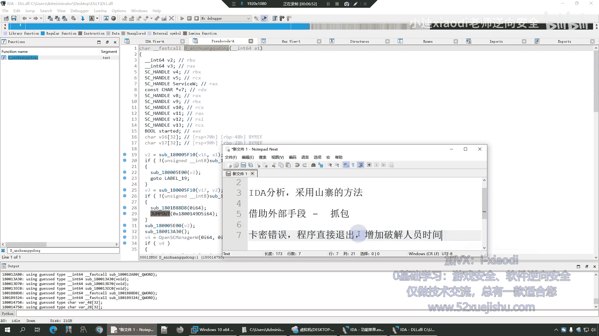
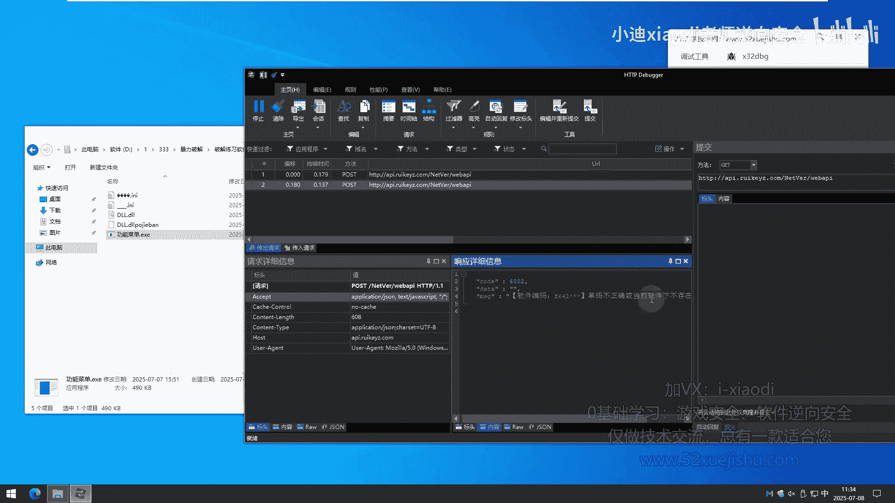
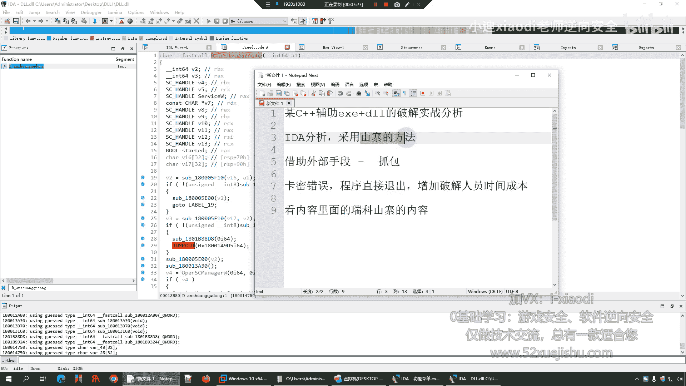
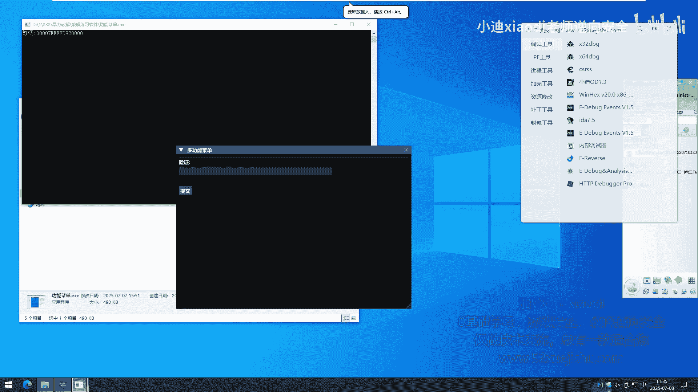
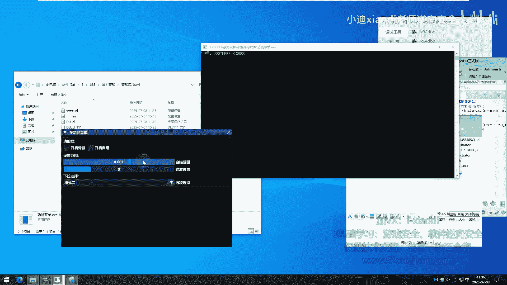
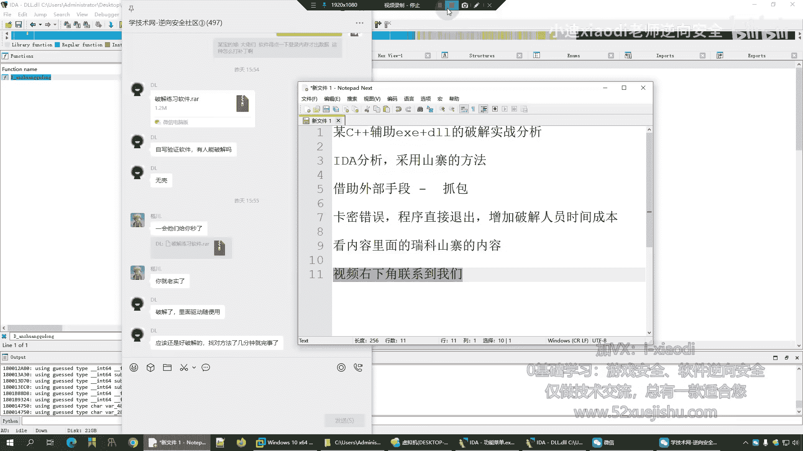

🛡️ 游戏外挂逆向分析：第一章：解密卡密验证与IDA Pro实战

在本节课中，我们将一起学习如何对一个游戏外挂程序进行逆向分析，彻底弄清它的卡密验证是怎么被破解的。我们会从外挂的文件夹结构开始，一步步分析主程序（EXE）和动态链接库（DLL），然后通过网络抓包定位到它的验证服务器，最后用“山寨”的方式把验证平台变成自己的，从而实现任意卡密都能通过验证。这个过程涉及软件安全、网络安全以及CTF比赛中常见的分析思路，非常适合刚接触逆向的新手朋友。大家不用担心看不懂，我会用最直白的大白话，把每一步都讲得清清楚楚。

### 🎬 破解后的效果



先来看一下破解后的效果。运行这个被破解的程序，界面会直接显示“验证成功”。这个时候，辅助的所有功能就都被释放出来了，模式一、模式二、模式三、模式四全部可以正常点亮。不仅如此，像“开启骨骼”和“开启增描”这些功能选项也都能够正常使用。换句话说，整个辅助已经被我们成功破开了，没有任何限制。下面的时间，我们就来简单讲一讲，当初是怎么一步步分析出来的。

### 📁 分析程序文件结构

在正式动手之前，我们先一起看一下这个程序的文件夹里到底有哪些文件。只有搞清楚了程序的组成结构，我们才知道该从哪里入手。通常来说，这种外挂程序不会只有一个单独的文件，而是由好几个文件配合工作。下面我们就来分别认识一下这些文件。

以下是程序文件夹中的主要文件构成：

- 配置文件：这个文件里面存放的是程序在加载过程中，或者说运行过程中所需要用到的一些重要配置。举个例子，提示一、提示二里的文字内容，还有提示框的风格、大小、颜色等等，都是在这里设置的。其实这些配置信息本身并不涉及核心逻辑，属于无关痛痒的部分。

- 应用程序（EXE）：这个文件就是程序的主入口。它的文件后缀是 `.exe`，也就是可执行文件。当我们双击它的时候，系统就会把这段程序跑起来。在逆向中，很多关键代码都藏在这个文件里，不过这个程序看起来不太一样。

- 应用程序扩展（DLL）：这个文件的后缀是 `.dll`，它的全称叫 Dynamic Link Library，也就是动态链接库。它是一个动态加载的扩展模块，通常会被 EXE 文件在运行的时候加载起来，从而给主程序增加一些额外的功能。那么核心的逻辑到底写在哪里？一般来说，真正干活的代码都会写在这个 DLL 里面，而 EXE 往往只负责加载 DLL，起一个“搬运工”的作用。当然，这些只是我们根据文件构成的初步推测，具体是不是这样，还需要用工具去验证。

简单总结一下，外挂程序的基本组成可以写成下面这个公式：

```text
外挂程序 = EXE加载器 + DLL核心功能 + 网络验证平台
```

EXE 负责把 DLL 加载起来，DLL 负责实现真正的功能，而网络验证平台则负责检查你输入的卡密是否合法。后面我们会看到，这三个部分分别对应不同的分析方向。

### 🔍 用IDA分析主程序

既然知道了 EXE 会加载 DLL，我们自然要先从 EXE 开始分析。因为任何一个外挂程序，总得有一个入口把事情串联起来。我们打开 IDA Pro，直接把 EXE 文件拖进去，然后点击 OK。这个时候，IDA 会弹出一个提示，告诉我们缺少一个 PDB 文件。这个 PDB 文件是什么？其实就是程序在开发的时候生成的一个调试信息文件，里面保存着函数名、变量名、行号等有用的调试数据。正常情况下，IDA 会默认加载 PDB 文件来辅助分析，但是如果没有找到，它就会弹窗提示。弹窗里通常会显示这个 PDB 文件在作者电脑上的原始路径。我们注意到路径里写着类似“C++功能菜单 x64 release”的字样，从中也能看出这个外挂作者的命名习惯还有很大的提升空间。好的，不管这些，我们点击确定，等待 IDA 把程序加载完。

加载完毕以后，我们会发现这个程序的结构其实非常简单。在入口函数也就是主函数的位置，它直接就开始干活了。我们不需要逐条看汇编指令，直接按下 F5 键，让 IDA 帮我们把代码转换成 C 语言风格的伪代码，这样看起来就清楚多了。那么这段代码究竟干了些什么？它的逻辑大概可以概括成下面这个流程。

以下是主程序的核心逻辑伪代码：

```c
HMODULE hDll = LoadLibrary("外挂核心.dll");  // 加载动态链接库

if (hDll != NULL)
{
    printf("DLL 句柄: %p\n", hDll);  // 打印加载成功后的句柄

    FARPROC install   = GetProcAddress(hDll, "安装驱动");
    FARPROC uninstall = GetProcAddress(hDll, "卸载驱动");

    if (install != NULL)
    {
        install();  // 调用安装驱动函数
    }
}
```

上面这段代码告诉我们，程序运行后第一件事就是加载 DLL。加载完成以后，它会判断返回的句柄是不是空的，也就是判断 DLL 是否加载成功。如果成功了，就会把这个句柄打印出来，所以我们刚才在运行程序的时候，能看到一条打印出来的句柄信息。接着，它又从 DLL 里找到了两个函数的地址，一个叫“安装驱动”，一个叫“卸载驱动”。这两个函数应该就是核心中的核心了，特别是“安装驱动”这个函数，如果安装驱动失败，那么辅助基本上不会产生任何效果。因此，这个位置就可以看作是我们整个破解工作的一个核心切入点。

### 🧩 剖析DLL：定位安装驱动

既然找到了切入点，那我们当然不能放过这个 DLL。接下来，我们回到 IDA，把刚才那个 DLL 文件也直接拖进去，点击 OK。同样，IDA 又弹出了一个 PDB 缺失的提示。从提示的路径里我们可以隐约看到，作者的项目似乎是放在一个“2025年6月30号垃圾项目”之类的文件夹里，这个命名风格也是相当随意了。不管它，我们继续等待加载完成。加载完之后，我们会看到这个 DLL 里面函数的数量非常庞大，有一万多个。左侧窗口列出的都是一个个函数。面对这么多函数，我们该怎么办？很简单，直接搜索。我们要找的就是“安装驱动”这个名字。在搜索框里输入之后，很快就能定位到核心的那一个函数，也就是安装驱动的地方。我们还是一样，按下 F5 键，把它的伪代码调出来。

以下是 DLL 中安装驱动函数的逻辑伪代码：



```c
BOOL InstallDriver()
{
    if (CreateService(...))  // 创建系统服务
    {
        MessageBox(NULL, "驱动安装成功", "提示", MB_OK);
        return TRUE;
    }
    else
    {
        MessageBox(NULL, "验证失败", "错误", MB_OK);
        exit(0);  // 退出程序
        return FALSE;
    }
}
```



从这段代码中可以看到，这个函数首先会创建一个系统服务，如果创建成功，就提示“驱动安装成功”。如果创建失败，它就会弹出一个错误提示。这个错误提示应该就是通过某个校验函数触发的。而且要注意，这个位置可能还存在一个二次校验的逻辑，比如提示“验证失败”或者“启动服务失败”之类的信息。如果我们想要破解它，直接找到这个判断分支，把校验的部分干掉就可以了。不过事情还没有这么简单。安装驱动成功并不代表辅助就直接开启了，因为这个程序还有一层登录界面，需要输入卡密才能继续。这个登录界面到底藏在哪里？如果不在 DLL 里，我们又该去哪里找？这时候，我们就需要借助一些外部手段了。

### 🌐 网络验证与抓包



考虑到这个程序是一个网络验证的程序，最好的办法就是先抓包看看它的网络通信过程。抓包工具可以帮我们捕获程序发出去的数据包，并判断协议类型。我们首先来看一下它到底用的是不是 HTTP 协议。于是我们运行程序，先把抓包工具打开。程序运行起来后，界面正常弹了出来。我们在卡密输入框里随便填一些内容，然后点击提交按钮，结果程序立刻就退出了。为什么会退出？因为当它发现卡密验证失败后，就主动把进程结束了。这种设计在商业外挂里非常常见，目的就是增加破解者的时间成本，让破解人员不得不一遍一遍地调试，浪费大量精力。我们这里看到的现象是“卡密错误，程序直接退出”，这显然就是一种典型的对抗手段。



既然它是网络验证，那我们就仔细看一下抓到的包。我们发现，这个程序走的认证接口来自一个叫“瑞科”的网络验证平台。听到这个名字，大家是不是觉得有点熟悉？这类平台比较容易处理，因为我们可以直接山寨整个平台。什么意思？验证平台上的所有相关信息，包括用户数据、卡密数据、验证逻辑等等，都已经被相关教程整理在资料里了。平台返回的提示，比如“代码不正确”或者“软件下不存在此账号”，也全都写在数据包中，一目了然。我们只需要按照资料里的方法，把瑞科平台山寨一份，然后把平台上原本的合法用户信息全部替换成我们自己的信息，就可以了。

以下是破解前后验证流程的对比：



- 原版验证流程：程序把卡密发送到瑞科平台，平台在数据库中查询，如果查询不到，就返回错误提示，程序显示“卡密错误”并退出。



- 破解后验证流程：程序把卡密发送到我们自己搭建的山寨平台，山寨平台的数据库里随便一个伪造的卡密都能通过查询，于是返回“验证成功”，程序继续运行。

用公式来表示的话，两个流程可以写成：



```text
原版：卡密 → 瑞科平台数据库 → 校验失败 → 程序退出
破解：卡密 → 山寨平台数据库 → 校验成功 → 功能解锁
```

### 🏴 山寨验证平台



为了验证山寨效果，我们可以把原版和替换后的程序放在一起对比。在没有替换的版本中，程序使用的是原版平台。而在替换后的版本中，程序已经和我们自己的山寨平台连上了。我们可以在山寨平台里随便填一长串字符作为卡密，然后点击“是”，程序没有任何报错，说明已经没问题了。接着我们再把这个卡密填到登录界面里，这时候就能很明显地判断出当前跑的这个辅助到底是破解过的还是原版的。因为破解过的卡密长度通常是比较长的，而原版卡密一般不会超过 20 个字符，所以一眼就能看出区别。填好卡密之后，我们点击提交按钮，神奇的事情发生了，驱动居然安装成功了。点击确定，程序首先弹出提示一，上面写着“验证成功”，然后模式一、模式二、模式三、模式四全部解锁，一切正常。整个破解到这里就算完美完成了。

### 🎯 总结

说到这里，本单元的所有核心内容就差不多讲完了。最后补充一句，关于更详细的山寨过程、其他隐藏信息以及 IDA 工具的各种用法，大家可以通过视频右下角的联系方式加入我们的学习群来了解。顺便说一下，今天用来演示的这个程序，其实就是我们群里面自己开发、自己写的，并不是什么商业外挂。之所以录制这个案例，主要是想通过它给大家说明，面对一个卡密验证的外挂程序，逆向分析应该从哪里下手，以及如何一步步把它破解掉。希望大家听了这节课，以后再遇到类似的程序时，心里能有个大概的思路。



好了，本节课中我们一起学习了从程序文件结构到网络验证破解的完整流程。我们首先认识了 EXE 和 DLL 的分工，接着使用 IDA Pro 定位到了安装驱动的关键函数，然后通过网络抓包发现验证平台是瑞科，最后通过山寨平台替换用户数据，成功让任意卡密都验证通过。整个过程涵盖了软件安全、网络安全和逆向工程的基础知识。如果你对相关内容感兴趣，欢迎在视频右下角找到我们，我们下期再见，拜拜。
