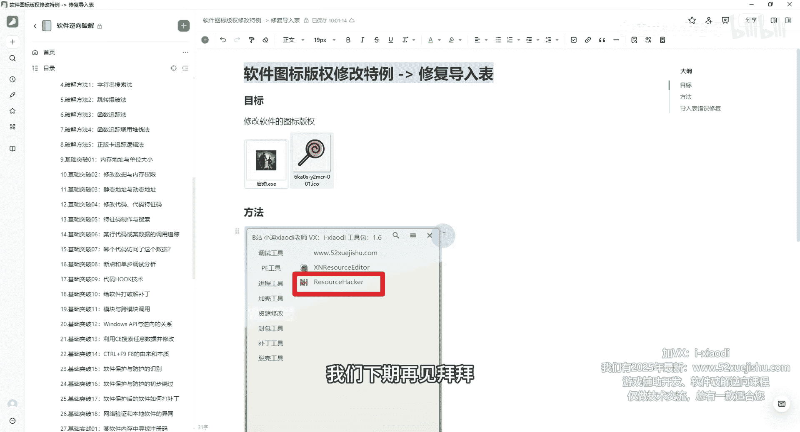

# 软件图标版权修改与导入表修复实战：00：课程概述 🧭

在本节课中，我们将要学习软件图标版权修改的一个特例，并涉及导入表修复。本教程由小迪老师讲解。软件图标不只是简单标识，它代表软件脸面，也是知识产权体现。课程先看目标程序，把老人牵小孩图标改成棒棒糖图标；再使用 Resource Hacker 做常规替换；程序闪退后分析 PE 文件结构；随后修复导入表、资源区段、PE 头部与尾部数据；最后运行验证。原文标题还标注了软件黑客、逆向破解、网络验证、Crackme、山寨、封包、游戏安全、软件安全、网络安全、CTF 比赛必备基础等标签，本教程只围绕图标修改与导入表修复做技术交流。

上一节概述了课程内容，本节先确认目标程序与免责声明。在计算机和网络安全世界里，软件图标不仅仅是一个简单标识，它代表软件的脸面，更是一种知识产权的体现。今天的内容仅限用于技术交流，不要拿去做违法的事情。

> 本教程内容仅限技术交流，请勿用于违法用途。

以下是本节需要确认的目标信息。

- 目标程序运行起来后，左上角图标和程序原本图标都是老人牵小孩的样子。
- 目标是把图标改成棒棒糖图标。
- 常规修改方法非常简单，就是用工具包里的 Resource Hacker 工具修改程序图标。

完成目标确认后，下一节我们看看常规图标替换操作方法。


# 软件图标版权修改与导入表修复实战：01：目标程序与免责声明 🎯


上一节确认了目标程序与免责声明，本节继续补充目标程序的特征。目标程序运行起来后，左上角图标和程序原本的图标都像是一个老人牵着一个小孩。目标是把图标改成棒棒糖图标。常规修改方法非常简单，使用工具包里的 Resource Hacker 修改程序图标即可。下面进入具体操作。


以下是图标替换前的准备操作。

- 打开工具包。
- 打开 Resource Hacker。
- 把原程序拖进 Resource Hacker。
- 看到 Icon Group（原文口播为 ic group），这就是程序原本的图标，也就是老人牵小孩图标。

准备好工具和原程序后，下一节开始执行图标替换。

# 软件图标版权修改与导入表修复实战：02：用 Resource Hacker 替换图标 🍭

上一节准备好 Resource Hacker 和原程序，本节看看常规图标替换方法。常规修改方法很简单，按步骤替换图标并保存即可。完成替换后，我们还会尝试运行程序，观察是否正常。

以下是使用 Resource Hacker 替换图标的具体步骤。

- 在 Icon Group 上鼠标右键，点击 Replace Icon 替换图标。
- 点击 Open file，找到新的棒棒糖图标，选择新图标，点击打开。
- 点击 Replace 替换，图标替换完成。
- 替换完成后还需要保存修改后的文件。
- 点击另存为（原文口播为 CY），随便起一个名字，把程序保存下来。

保存后可以看到程序图标果然变了。尝试运行程序，程序运行起来后闪退，说明程序已经损坏，损坏后程序不能正常运行。下一节我们分析闪退原因和 PE 文件结构。

# 软件图标版权修改与导入表修复实战：03：闪退原因与 PE 结构检查 🧱


上一节替换图标后程序闪退，本节分析原因。其原因在于程序结构被破坏，这个结构的术语叫 PE 文件结构，是 Windows 程序特有的一种结构。原教程展示了 PE 结构图，结构图就长这个样子。可以用下面的关系理解 PE 文件结构和导入表。


```text
PE 文件结构 = DOS 头 + PE 头 + 节表 + 节数据
导入表（Import Directory） -> 程序运行依赖的动态链接库列表
```

简单说，PE 结构可以理解为 Windows 程序的外壳和目录，外壳记录程序如何加载，目录记录程序依赖哪些 DLL。接下来要定位结构哪里被破坏。以下是定位损坏点时的观察步骤。

- 打开 PE 工具里名为 StudyPE（原文口播为 sstardy p）的工具并运行。
- 把原程序拖过来，点击数据表。
- 再打开一份 StudyPE（原文口播为 star），把修改后的程序拖进来，也打开数据表。
- 观察导入表（Import Directory，原文口播为 port directory）位置存在差异：原程序这边有数据，修改后的程序这里数据丢失。
- 导入表位置左边是程序运行所依赖的动态链接库和依赖文件，修改后的程序里所有动态链接库都丢失了。
- 区段里 Resource 区段的 `wa size` 和 `re size` 都不太对劲，这里也是需要修复的地方。

定位到导入表丢失和资源区段大小异常后，下一节先修复导入表和资源区段。

# 软件图标版权修改与导入表修复实战：04：修复导入表与资源区段 🛠️

上一节定位到导入表丢失和资源区段大小异常，本节修复这些位置。修复方法非常简单，直接把相关值改成和原程序一模一样即可。可以用下面的条件表示修复目标。

```text
修复条件：
Resource 区段的大小（修改后） = Resource 区段的大小（原程序）
导入表数据（修改后） = 导入表数据（原程序）
```


以下是修复导入表与资源区段的基本操作。

- 在工具里把修改后的 Resource 区段 `wa size`、`re size` 改成和原程序一模一样。
- 点击另存为，随便起一个名字保存，例如“修复资源表”，点击保存。
- 此时运行程序还是运行不起来，说明程序还有一些损坏，需要继续修复剩下的损坏。

完成导入表和资源区段修复后，程序仍不能运行，下一节继续修复 PE 头部与尾部数据。

# 软件图标版权修改与导入表修复实战：05：修复 PE 头部与尾部数据 🧩

上一节修复导入表和资源区段后程序仍不能运行，本节继续修复 PE 头部与尾部数据。首先打开调试工具里边的工具，把程序拖进去，再打开一份，把修改后的程序拖进去。重点观察 PE 字段开头的位置，也就是圈住的位置，这一块是 PE 文件头部。如果观察仔细，会发现这一行有点问题。只需把这一行的数据从原程序拷贝过来，就可以实现程序修复。可以用下面的伪代码理解修复过程。

```text
原程序同一行数据 -> 复制十六进制数据 -> 粘贴到修改后程序同一行 -> 写入 -> 确定
0F -> 10
原程序尾部数据（包含 50） -> 复制十六进制数据 -> 粘贴到修改后程序尾部（从 50 / 00 处）-> 写入 -> 确定 -> 文件增大仍继续
```

以下是继续修复 PE 头部与尾部数据的具体步骤。

- 在原程序中选中这一行，鼠标右键点击编辑，复制选块，选择十六进制数据。
- 切换到修改后的程序，找到同样的一行，粘贴，写入，点击确定，这一块修复完成。
- 还可以看到这一行数字 `1015` 出现问题，需要把 `0F` 改成 `10`。
- 现在拖到最后面，修改后的程序这里是空白，再看原来的程序，这里都有数据，说明这里也有损坏。
- 把这一片数据包括 `50` 全部选中，鼠标右键点击编辑，复制十六进制数据。
- 从 `50` 处粘贴过来，修改后这里是 `00`，写入，点击确定。
- 工具提示文件会增大，仍继续吗，点击是，此时程序跟以前的程序一模一样。
- 点击保存，点击是。

完成这些修复后，下一节直接运行程序验证结果，并做课程总结。

# 软件图标版权修改与导入表修复实战：06：运行验证与课程总结 ✅

上一节完成剩余修复，本节运行验证并总结。直接把这个程序运行一下，会惊奇地发现程序运行成功。同时，程序运行的图标和原本文件夹内的图标都已经实现修改。以下是本节验证结果与课程总结要点。


- 程序运行成功。
- 程序运行图标和文件夹内图标都实现修改。
- 本次内容是软件图标版权修改的一个特例，涉及导入表修复。
- 希望今天的内容能够带来一定启发；如果想学习软件安全镜像（原文为镜象），欢迎联系我们，下期再见。



本节课中我们一起学习了软件图标版权修改与导入表修复的完整流程：先用 Resource Hacker 替换图标，再分析闪退原因和 PE 文件结构，随后修复导入表、资源区段、PE 头部与尾部数据，最后运行验证成功。本节内容属于软件安全与逆向基础实战，仅限技术交流。

