# 🧩 软件破解逆向之软件标题修改：01：课程概述与需求背景

在本节课中我们将要学习软件窗口标题文字和版本号的修改思路，了解一个带壳程序在修改标题时为什么会有难度，以及视频中如何通过补丁方式实现自定义标题和版本号效果。课程内容整理自视频 BV1BH4y1K7wZ-，视频主题包括软件破解逆向、软件标题修改、exe 软件标题版权修改，以及“可保存、无视加壳”的说明。对初学者来说，可以先把这件事理解成给程序换门牌：程序原来显示别人的引擎名称和版本号，现在要改成自己的引擎名称和版本号。从学习顺序看，先弄清楚需求，再理解加壳带来的难点，后面看效果和问题就会更容易。

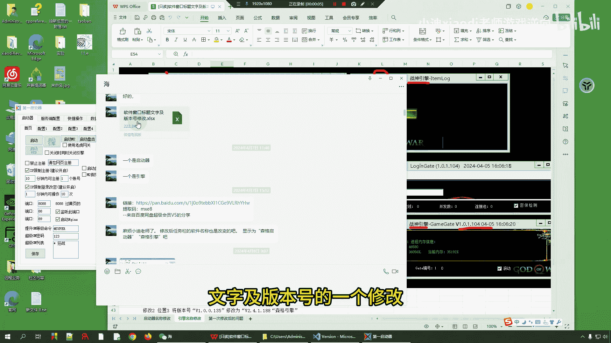

以下是本次课程要处理的核心目标：

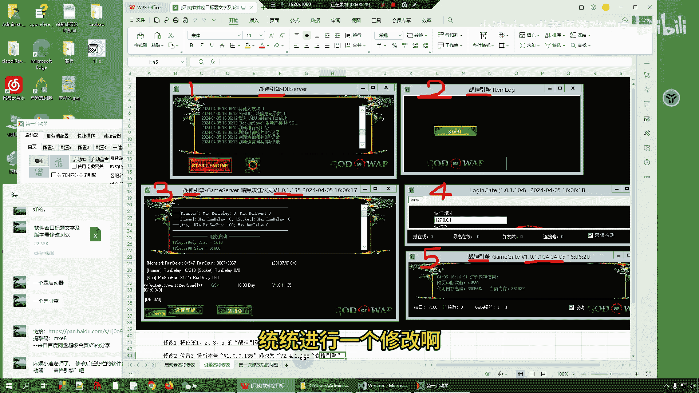

- 修改软件窗口标题文字。
- 修改软件版本号。
- 把别人的引擎名字替换成自己的引擎名字。
- 把原版本号替换成自己的版本号。
- 对窗口标题和版本号一起进行修改。

\[
\text{修改目标}:\quad
(\text{原窗口标题},\ \text{原版本号})
\longrightarrow
(\text{自定义窗口标题},\ \text{自定义版本号})
\]

小迪老师最近接到一个单子，需求是修改软件窗口标题文字及版本号。客户提供的程序是一些游戏服务端，或者说与游戏相关的一些程序。客户要求把别人的引擎名字替换成自己的引擎名字，同时把版本号替换成自己的版本号，并且这两项要一起修改。如果读者也有版权修改相关需求，可以联系作者，作者这边提供相应的技术支持。了解了需求之后，我们进入下一节，看看目标程序和加壳情况。

# 🎯 软件破解逆向之软件标题修改：02：目标程序与加壳情况

上一节我们说明了这次修改的核心需求，本节中我们来看看目标程序本身以及它的加壳情况。这个程序同样加了壳，视频中以 DDserv 为例进行查看。加壳可以直白地理解成给程序套了一层外壳，外壳会保护原程序，所以直接改标题会更麻烦。探测后确认，它使用的是 VMPpro，属于 VMP 壳，也是加了强壳的程序。视频中展示的这些文件都加了强壳，例如画面中查看的那个文件。这样的情况给标题修改带来了很大难度，但视频中仍然实现了修改。

以下是视频中确认的程序与加壳信息：

- 示例程序：DDserv。
- 程序类型：游戏服务端或游戏相关程序。
- 壳类型：VMPpro。
- 壳属性：VMP 壳、强壳。
- 观察结果：相关文件都加了强壳。

```text
程序类型：游戏服务端 / 游戏相关程序
示例文件：DDserv
壳类型：VMPpro（VMP 强壳）
观察现象：相关文件均带壳
修改难点：加壳提高标题与版本号修改难度
```

知道程序带 VMPpro 强壳之后，就能理解为什么标题修改不是简单改一个字符串。视频中也提到，所有文件都加了强壳，这给修改带来难度，但最终还是做出了效果。接下来我们看实际修改效果，以及第一次补丁之后出现的问题。

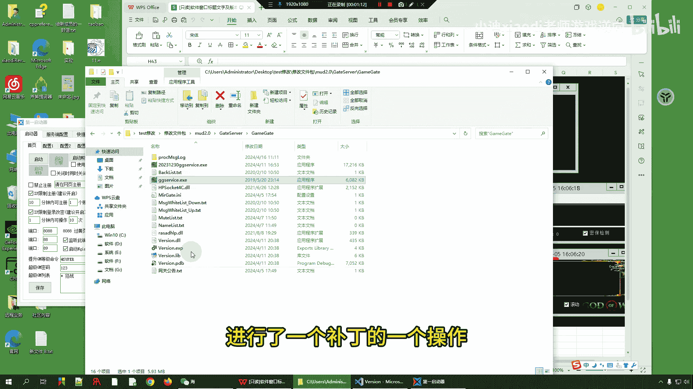

# 🧱 软件破解逆向之软件标题修改：03：修改效果与第一次补丁问题

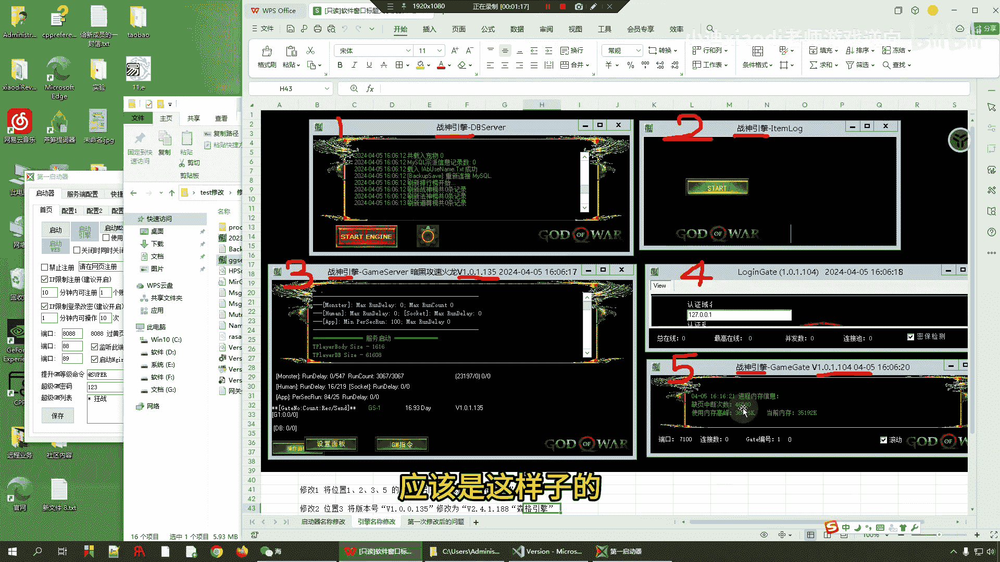

上一节确认了程序带 VMPpro 强壳，本节中我们来看看视频里改出来的效果，以及第一次修改后遇到的问题。视频中对 G 执行了补丁操作。JJ 登录之后应当显示类似 1.01 的版本信息，可以看到原程序的版本号类似 1.01。运行修改后的程序，标题就变成了森格引擎，也就是把原来的诞引擎修改成了森格引擎，版本号显示类似 2.4。界面中还会显示运行时间和日期，视频录制时间是 4 月 16 日 11 点。

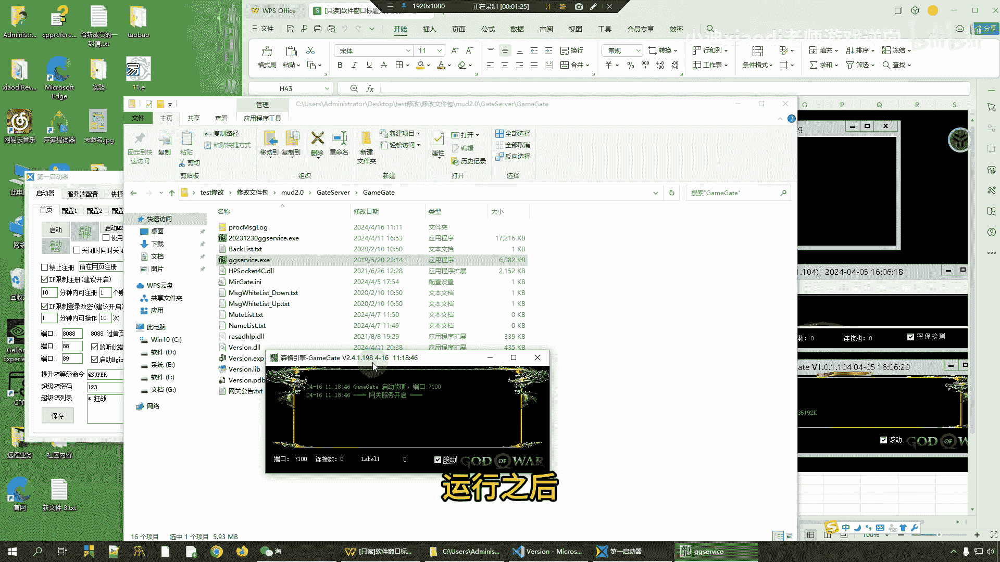

以下是第一次修改后出现的现象与问题：

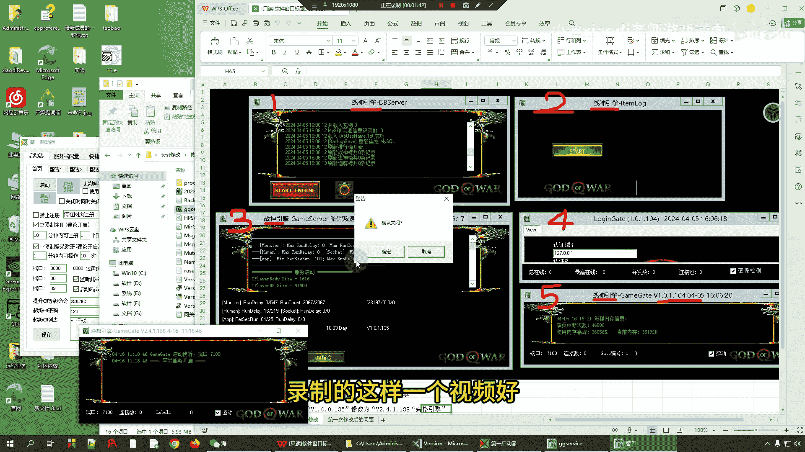

- 第一次修改之后出现了一些问题。
- 程序刚打开时显示 DBserv。
- 程序运行时还会加载一些内容，视频中提出会加载什么的问题。
- 当时还没有打补丁，视频稍后演示打补丁。
- 运行时程序会加载这些内容，打补丁后不再出现。
- 后期也对这个问题进行了解决。
- 视频暂停并展示该现象。

```text
第一次补丁后的现象：
程序打开 -> 显示 DBserv
程序运行 -> 加载一些内容
打补丁后 -> 不再出现该加载现象
后续处理 -> 后期进行解决
```

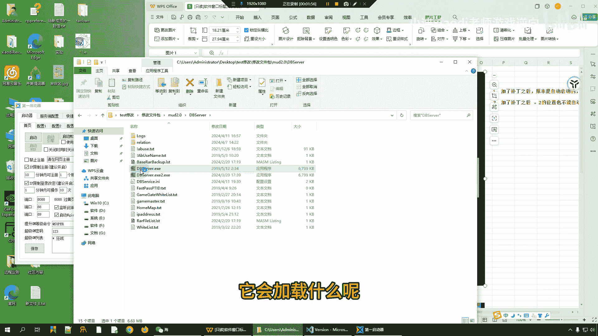

现在问题已经处理好，补丁已经打好，最终采用的方法是劫持补丁。如果想学习这种方法，或者想自己学习版权修改，可以跟着作者一起学习并联系作者。如果有对应需求，也可以直接找作者。既然第一次补丁有问题，就需要继续分析，下一节看最终方案和验证结果。

# 🛠️ 软件破解逆向之软件标题修改：04：最终方案与效果验证

上一节我们看到了第一次补丁后的异常，本节中我们来看看最终采用的劫持补丁和效果验证。这是作者做好的补丁，补丁处理好后运行程序，可以看到标题变成了森格引擎。运行时程序不会自动弹出内容，也不会自动出现列表，这是第一次加补丁之后出现的问题。随后作者进行了分析，通过分析原程序，基本实现了正确修改。接着启动外部程序，作者这边没有安装外部程序，点击启动引擎测试最终效果。作者一共更改了两个程序，其中一个 DB server，主要看它的效果即可。现在程序可以正常读取文件，这个视频用于分享。

以下是最终采用的方案和验证结果：

- 最终方法：劫持补丁。
- 补丁状态：已经打好。
- 运行效果：标题变成森格引擎。
- 验证方式：运行程序，查看窗口标题与版本号。
- 目标显示：森格引擎，版本类似 2.4。
- 文件读取：程序可以正常读取文件。
- 更改数量：一共更改了两个程序，其中一个 DB server。

```text
最终方法：劫持补丁
验证方式：运行程序 -> 查看窗口标题与版本号
目标显示：森格引擎，版本类似 2.4
附加验证：程序可以正常读取文件
更改对象：两个程序，其中一个为 DB server
```

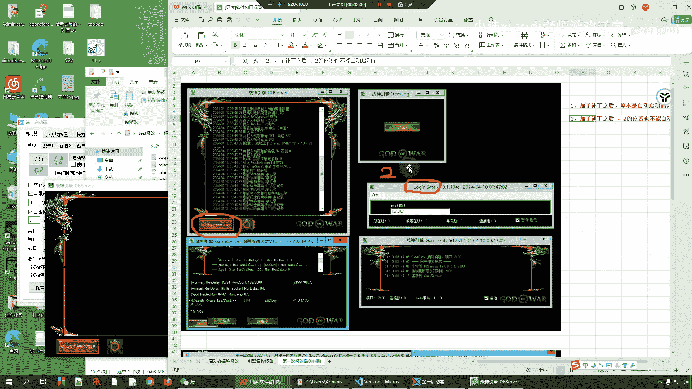

从验证结果看，窗口标题、引擎名称和版本号都达到了预期效果，程序也能正常读取文件。效果验证完成后，最后说明学习建议、需求沟通和后续关注方向。

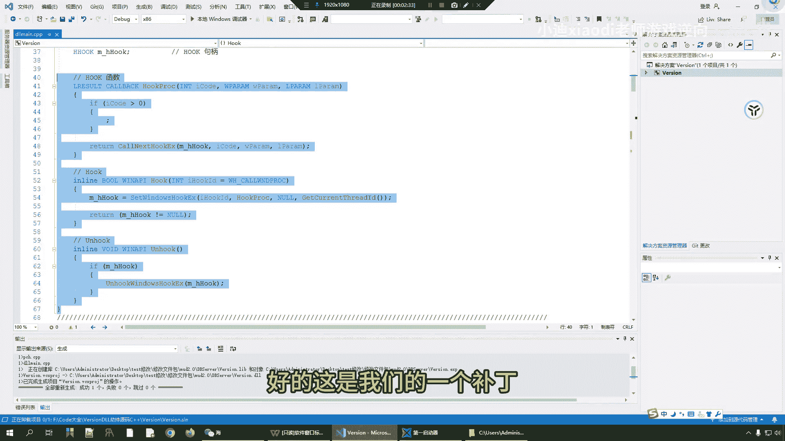

# 📚 软件破解逆向之软件标题修改：05：学习建议与联系说明

上一节我们确认最终方案能够实现修改效果，本节中我们来看看学习周期、需求沟通和后续关注方向。如果读者有这种需求，完全没有问题，难度不在话下。学习周期会比较快，如果只学习这种标题修改，大约一星期就可以实现。大家可以关注软件安全逆向项目的一些内容。视频也提到，想学习这种方法，或者想自己学习版权修改，欢迎跟着作者一块学习，都可以联系作者；如果有对应需求，也可以直接找作者。

以下是学习周期、需求沟通和后续关注内容的说明：

- 有相关需求可以联系作者。
- 作者提供相应技术支持。
- 学习周期比较快。
- 只学习标题修改，大约一星期可以实现。
- 可以跟着作者一起学习版权修改。
- 可以关注软件安全逆向项目的内容。
- 有对应需求可以直接找作者。

```text
学习建议：
目标：学习软件标题与版本号修改
周期：只学标题修改约一星期
沟通：有需求可联系作者
关注：软件安全逆向项目相关内容
```

以上是学习与需求说明，最后对整节课做总结。视频到这里也接近尾声，本期内容到这里，下期再见。

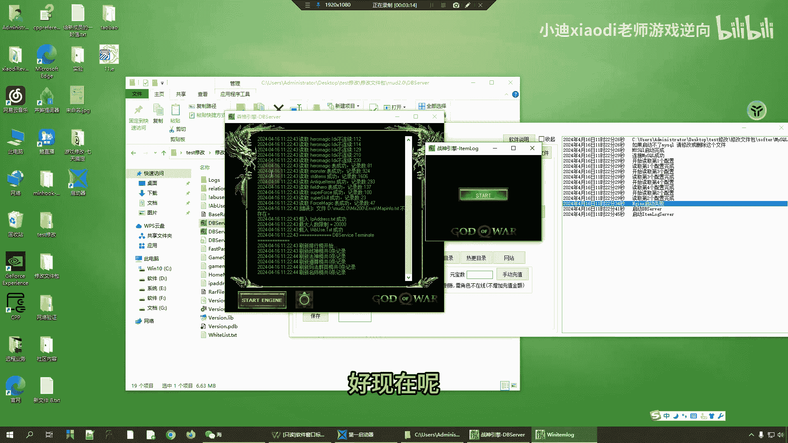

# ✅ 软件破解逆向之软件标题修改：06：课程总结

前面几节分别介绍了需求、加壳、效果、问题和方案，本节中我们对课程内容做一个总结。本节课中我们一起学习了软件窗口标题文字与版本号的修改案例，了解了客户想把别人的引擎名字替换成自己的引擎名字，把版本号替换成自己的版本号，并且两项一起修改。课程中还看到目标程序 DDserv 使用 VMPpro 强壳，相关文件都加了强壳，给标题修改带来难度，但视频仍然实现了修改效果。视频中对 G 执行补丁操作，JJ 登录后原版本信息类似 1.01，修改后显示森格引擎、版本类似 2.4，界面还显示运行时间和日期，录制时间为 4 月 16 日 11 点。第一次修改后出现程序打开显示 DBserv、运行时加载内容等问题，后期进行了解决，最终采用劫持补丁，并验证程序可以正常读取文件。作者一共更改了两个程序，其中一个 DB server。学习周期方面，只学习标题修改大约一星期可以实现，有相关需求可以联系作者，也可以关注软件安全逆向项目内容。本期内容到这里，下期再见。

以下是本节课的核心收获：

- 软件窗口标题和版本号可以一起修改。
- 加壳程序会增加修改难度，但并非完全不能处理。
- VMPpro 属于 VMP 强壳。
- 第一次补丁后可能出现加载内容或列表异常。
- 最终方案采用劫持补丁。
- 修改后要运行程序验证标题、版本号和文件读取效果。
- 学习标题修改的周期大约为一星期。

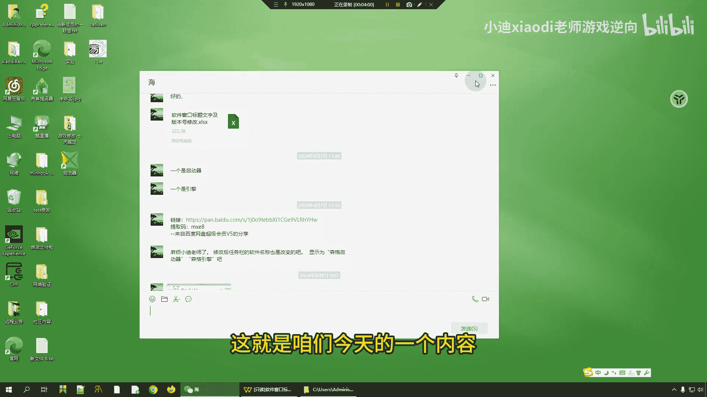

```text
课程回顾：
需求 -> 替换引擎名称与版本号
难点 -> VMPpro 强壳
问题 -> 第一次补丁后出现加载异常
方案 -> 劫持补丁
结果 -> 显示森格引擎、版本类似 2.4，程序可正常读取文件
```

