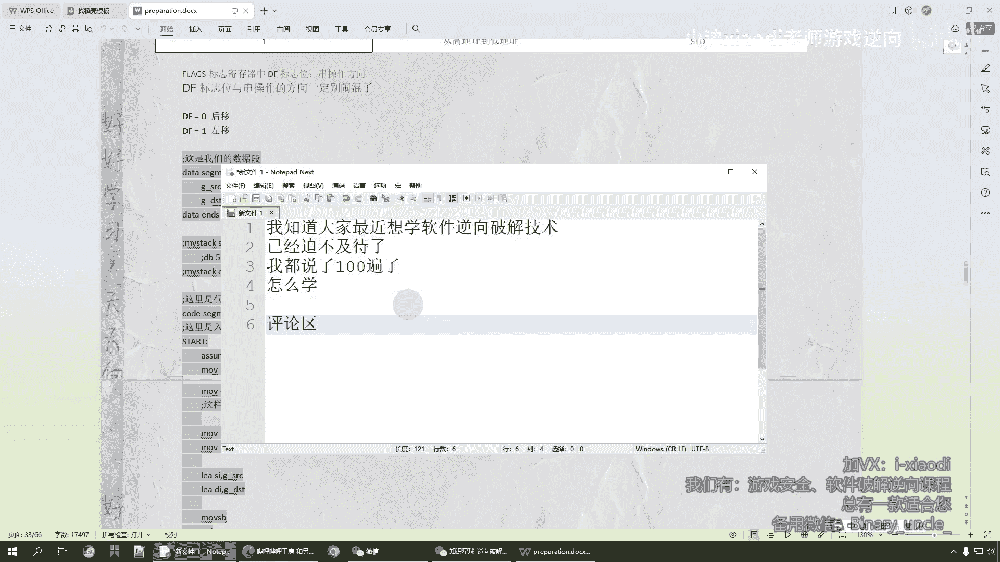

# 📘 软件破解逆向工程师2023学习指南：01：如何选择学习路径与社区

在本节课中，我们将要学习小迪老师关于软件破解逆向工程师2023如何学习、如何选择学习社区的内容。小迪老师在开头做了自我介绍，并说明很多人最近迫不及待想学软件逆向破解技术，关于怎么学这样一门技术，小迪老师已经说明过一百遍，本次内容必须认真听。本次内容也回答一个视频里应该选择哪类社区的问题。如果确实想学习这门技术，并把技术踏踏实实学在手里，就需要加入软件安全逆向破解社区。下面从学习目标、社区资源和行动方式几个方面展开。

## 🧭 软件破解逆向工程师2023学习指南：01.1：学习目标与社区选择

上一节概述了本次教程的主题，本节中我们来看看学习目标和社区选择。一个好社区能够带给学习者的东西，可以用下面的公式概括。

```text
社区价值 = 融洽交流群 + 学习成果与疑问讨论 + 内部最新工具包 + 内部原创视频课程 + 随堂实验程序 + 详细课件
```

这个公式很直白，社区不是只提供一个聊天场所，而是把交流、工具、课程、实验和课件组合成一套学习支持。对初学者来说，这种组合能减少摸索时间，让学习过程更有方向。以下是社区能够提供给学习者的核心内容。

- 一个交流氛围十分融洽的逆向破解交流群。  
- 在交流群中可以畅所欲言，讨论自己的学习成果和学习疑问。  
- 社区提供内部最新的工具包。  
- 社区提供内部配套的最新原创视频课程。  
- 社区提供最新的随堂实验程序和课件。  

上面这些内容覆盖了交流、资料、课程和练习几个方面。上一节说明了社区价值，本节中我们进一步看看课件为什么做得详细，以及详细课件对学习有什么帮助。

## 📚 软件破解逆向工程师2023学习指南：01.2：课件与学习资料的作用


前面介绍了社区资源，本节中我们来看看课件与学习资料的作用。社区课件非常详细，全部内容都是逐字编写，目前已经写了17000字。课件做得这么详细，目的很明确，就是让大家能够更好地学习和成长。换句话说，详细课件是为了降低理解门槛，让初学者能沿着文字、视频和实验一步步推进。以下是课件详细化带来的主要作用。

- 帮助学习者更清楚地理解知识点。  
- 配合随堂实验程序进行练习。  
- 配合原创视频课程形成完整学习链路。  
- 让学习者在遇到疑问时能回到课件中查找说明。  


这些作用最终都指向同一个目标：把软件逆向破解技术真正学会并掌握。上一节说明了资料作用，本节中我们来看看行动建议和加入方式。

## 🚀 软件破解逆向工程师2023学习指南：01.3：行动建议与加入方式

通过前面的内容，我们已经了解社区资源和课件价值，本节中我们来看看具体行动建议。如果确实想学习软件逆向破解技术，就不要再犹豫。可以直接点击评论区，当前正在折扣。下单之后直接联系相关人员，就可以加入交流群。这里的核心逻辑可以用下面的伪代码表示。

```text
if 想学习软件逆向破解技术:
    点击评论区()
    享受当前折扣()
    完成下单()
    联系社区()
    加入交流群()
    开始学习()
```

这段伪代码很直白地说明了从想学到开始学的路径。对初学者而言，关键不是停留在犹豫阶段，而是按照明确步骤进入学习环境，再结合交流群、工具包、视频课程、实验程序和课件推进学习。最后用一句话概括：想学软件逆向破解技术，就把技术踏踏实实学在手里，并选择能提供完整资源的社区。



## ✅ 软件破解逆向工程师2023学习指南：01.4：本节总结

本节课中我们一起学习了小迪老师关于软件破解逆向工程师2023学习路径的说明。我们了解了学习目标、社区选择、交流群价值、内部工具包、原创视频课程、随堂实验程序、详细课件以及加入方式。核心结论是：真正想学软件逆向破解技术，就要踏实学习，并加入能够提供交流氛围和完整学习资源的社区。当前可以通过评论区了解折扣，下单后联系加入交流群。我们下节再见，拜拜。😊

