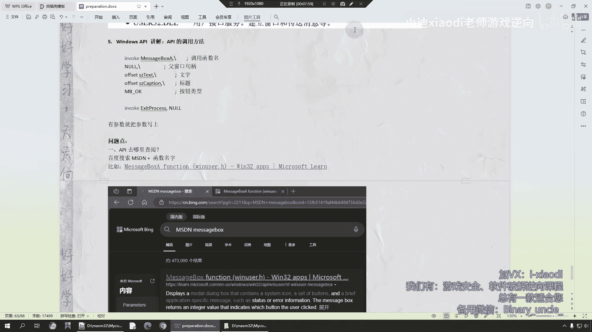

## 软件破解逆向工程师反汇编技术：第1章：Windows API调用方法 🛠️


在本节课中，我们将学习Windows API的调用方法。本教程由小金老师讲解。API的调用方法并不复杂，我们将其分为五个问题，以有问有答的形式来介绍。这五个问题分别是：API去哪里查阅、API那么多怎么记、怎么使用API、函数库的位置在哪里，以及一个课后作业。希望通过本节课的学习，初学者能够掌握在Windows环境下调用API的基本流程。


### 🔍 第一个问题：API去哪里查阅？


查阅API的方法非常简单。你只需要在百度搜索框中输入“MSDN”加上函数的名字就可以了。例如，如果我们要了解`MessageBoxA`这个函数怎么使用，就可以使用必应或者百度搜索“MSDN MessageBoxA”。输入“MSDN mesbox”也是可以的，搜索结果都会给出这个API的使用方法。关于`MessageBoxA`和`MessageBoxW`之间的差异和区别，我们将在后面的课程中专门讲解。


查到结果后，我们会得到一个网页。在搜索结果中点击进入这个网页，就可以看到这个API的具体使用方法。如果网页是英文的，你看不懂怎么办？解决方法也很简单：在网页上点击鼠标右键，选择“翻译为中文”。这样，网页上大部分重要的文字都会被翻译成汉字，理解起来就容易多了。


### 🧠 第二个问题：API那么多，怎么去记？


解决了查阅问题，我们再来看看记忆问题。很多初学者可能会担心API数量庞大，记不住。其实你不需要把所有的API都记下来，慢慢积累就可以了。例如，今天你积累了“弹出信息框”这个功能对应的API是`MessageBoxA`。之前我们也看到过它的演示：打开程序所在文件夹，运行，程序会弹出一个信息框。这就是这个函数的功能，也是这个函数实现的效果。你不用一次性记住所有API，今天积累一个，明天积累一个，每天积累一些就可以了。所谓“不积跬步，无以至千里”，学习API也是同样的道理。

### 🛠️ 第三个问题：怎么使用API？

知道了去哪查，也知道了怎么记，现在来看看具体怎么用。使用方法很简单：查看文档，并把文档翻译成中文。以`MessageBoxA`这个信息框函数为例，我们先来看看它的函数原型：

```c
int MessageBoxA(
  HWND hWnd,
  LPCSTR lpText,
  LPCSTR lpCaption,
  UINT uType
);
```

下面是`MessageBoxA`函数的参数说明：

- `hWnd`：所有者窗口的句柄。
- `lpText`：要显示的消息字符串。
- `lpCaption`：对话框的标题字符串。
- `uType`：控制对话框内容和行为的标志。


我们来看一下第一个参数。第一个参数的类型是`HWND`，它表示要创建的消息框的所有者窗口的句柄。文档中说，如果此参数为`NULL`，则消息框没有所有者窗口。对于一个简单的程序，我们暂时不知道句柄怎么填，所以第一个参数可以填`NULL`。


第二个参数，文档说明是“要显示的消息”。如果字符串由多行组成，则可以在每行之间使用回车符或换行符来分隔行。这个参数是一个字符串。字符串好不好定义呢？很好定义，你直接去定义一个字符串就可以了。例如，我们可以写“HelloWorld”或者其他你想显示的内容。


第三个参数是对话框的标题。文档说明，如果此参数为`NULL`，则默认标题为“Error”。这个标题怎么填呢？很简单，你需要注意文档中参数类型标注为`STR`。`STR`就是`string`的简写，看到`STR`就意味着这里需要填一个字符串。所以这个参数我们也可以填一个字符串，比如“提示”或者“小迪”之类的文字。

第四个参数控制对话框的内容和行为。文档说明，若要指示消息框中显示的按钮，请指定以下值。例如`MB_OK`表示消息框中包含一个“确定”按钮，`MB_HELP`表示包含“帮助”按钮。这些值在文档中都有明确说明。以`MB_OK`为例，我们在代码中直接写`MB_OK`，程序运行起来后，消息框就会显示“HelloWorld”和一个“确定”按钮。如果我们把它换成`MB_HELP`，重新生成并运行，消息框就会显示一个“帮助”按钮。点击“帮助”按钮没有任何效果，因为我们没有编写相应的处理代码。当然，任何参数你都可以自己去尝试。


### 📚 第四个问题：函数的库位置在哪里？

掌握了参数的含义，我们还需要知道这个函数在哪个库里。在API文档网页上，把页面拖到最下面，它会说明这个函数所在的库的位置。只需要看`Library`这一项就可以了。例如，`MessageBoxA`这个函数实际上来源于`user32.dll`。这个DLL把一些接口放到了库中。为了调用`MessageBoxA`，我们必须在代码中包含`user32.lib`和`user32.inc`。具体代码如下：

```asm
include user32.inc
includelib user32.lib
```

这两行代码的由来就是这样：因为要用到这个函数，所以要包含这两个文件。关于这两行的具体用法，我们后面的课程也会详细说明。现在只需要知道，因为包含了这两个文件，所以这个函数才能正常使用。


还有一个函数叫`ExitProcess`，这也留给大家作为课后作业。请自己查阅一下`ExitProcess`函数需要用到哪些库。其实答案已经出来了：它需要`kernel32.dll`和`kernel32.lib`。因此，这就是`kernel32.lib`和`kernel32.inc`这两行代码的由来。可以看到，每一行代码都是有具体原因的，不是我们随随便便就把它包进去的。


### 📝 总结




本节课我们一起学习了Windows API的调用方法。一开始，我们了解了API去哪里查阅——通过搜索引擎搜索“MSDN+函数名”；接着，我们知道了API不需要死记硬背，慢慢积累即可；然后，我们以`MessageBoxA`为例，详细讲解了如何通过翻译文档来理解函数的各个参数；最后，我们学会了如何查找函数对应的库文件。希望大家回去之后，一定要自己动手把今天的内容过一遍，自己查一遍，这样才能加深印象。这节课的内容就到这里，我们下期再见。

