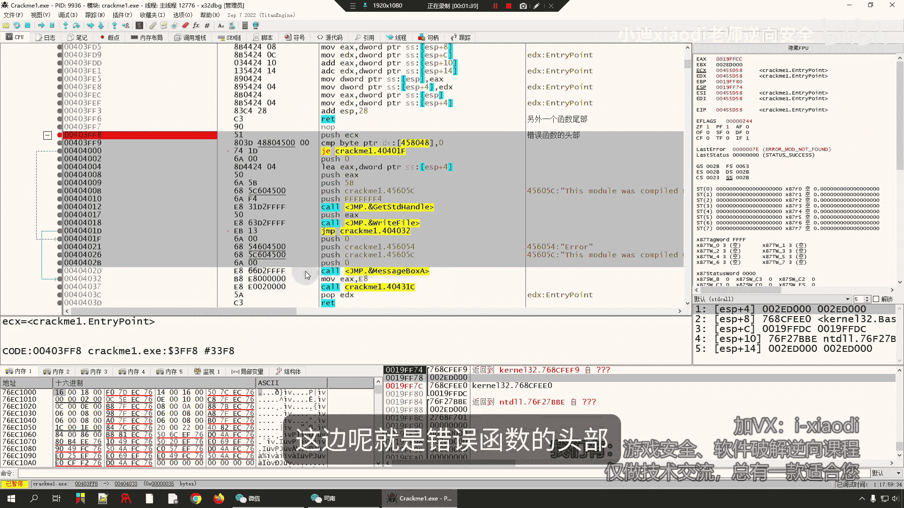
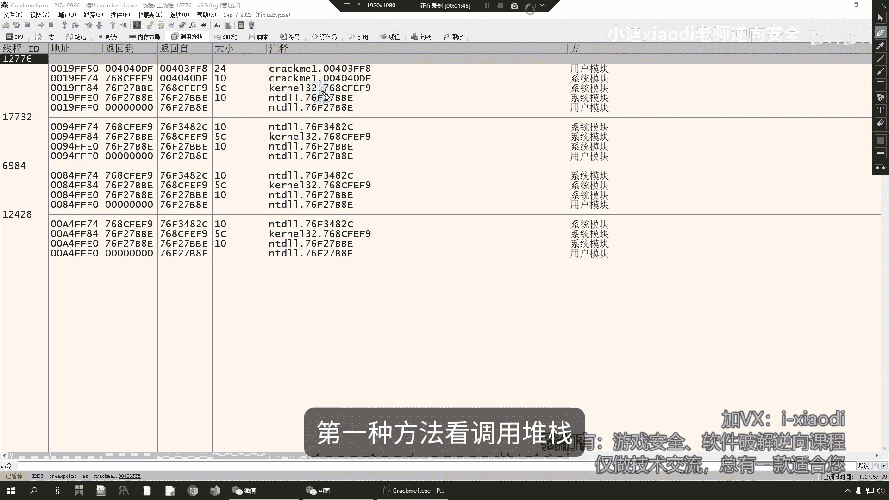
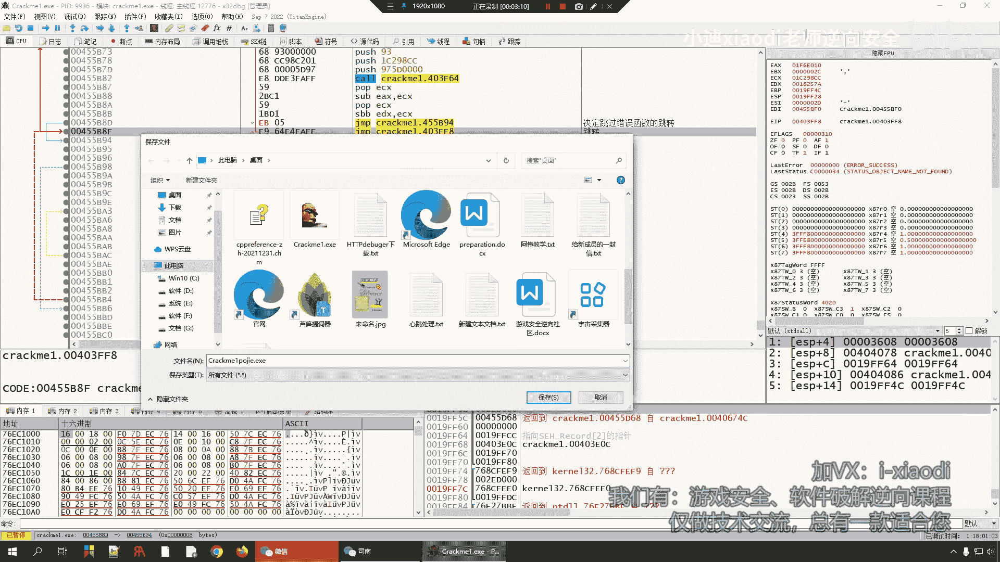
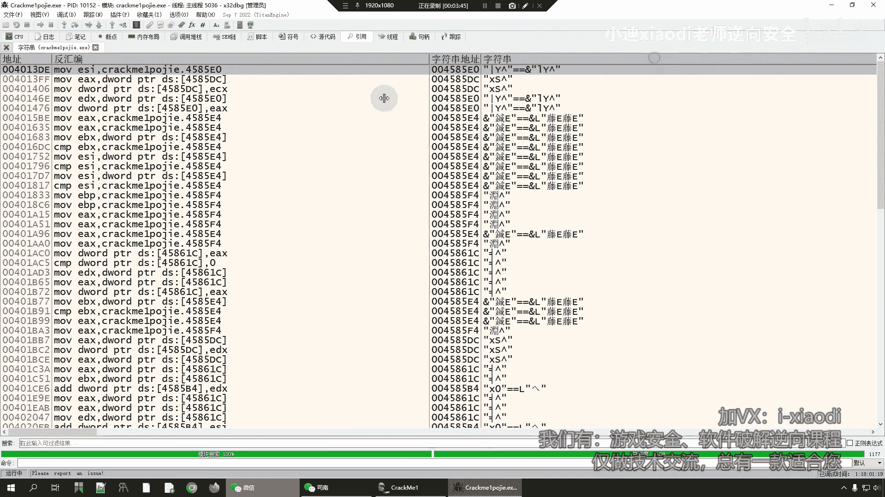
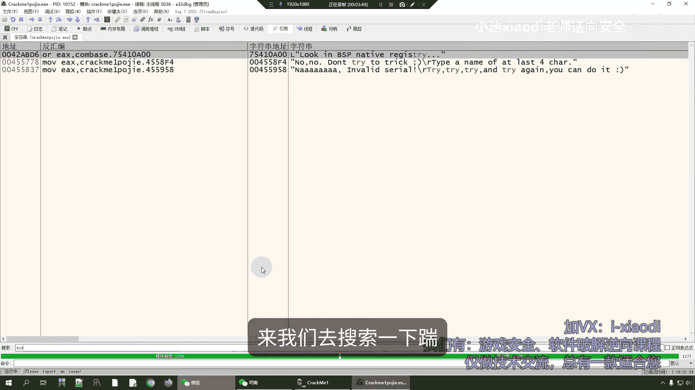
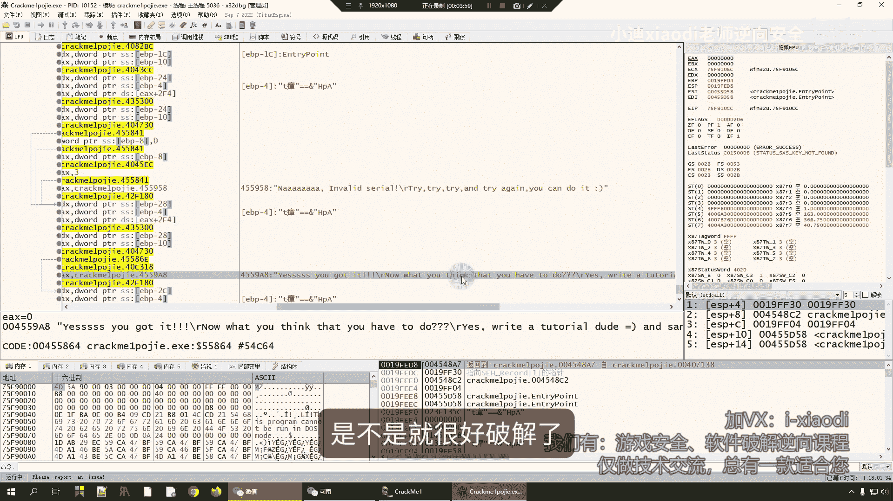

# 🛠️ 软件逆向破解教程：01：软件过期破解与本地逆向分析

在本节课中我们将要学习一个本地软件过期提示的逆向破解流程。课程以一个大学生同学的期末大作业程序为例，从查壳、运行观察、字符串定位、断点调试、调用堆栈分析、查找引用、修改跳转、打补丁验证，到字符串搜索和后续分析思路，完整走一遍初学者可以理解的操作路线。

这个案例的核心目标可以用下面的公式概括：

```text
破解目标 = 定位过期判断分支 + 修改跳转逻辑 + 应用补丁 + 运行验证
```

本教程会尽量用大白话解释每一步在做什么，以及为什么要这样做。需要说明的是，这类技术只适合用于学习、授权测试和自己程序的调试分析，不要用于未授权的软件。

## 🧭 软件逆向破解教程：01-1：程序背景与查壳分析

上一节我们对课程目标做了概述，本节中我们来看看这个程序的背景和初步检查。这个程序非常重要，它是这位同学的一个期末大作业，作者应该是一名大学生。拿到程序后，第一步不是急着改代码，而是先做基础检查，看清程序有没有加壳，程序类型大致是什么。

首先需要查壳，确认程序有没有壳。查看 `code` 区段后，判断它应是一个 D 程序，原文也显示它是一个 D 程序。继续查看区段可以发现，区段非常干净，这个程序没有壳。

查壳判断可以用下面的代码表示：

```text
查壳结果 = 区段干净 && 未发现壳特征
```

确认程序没有壳后，接下来直接运行观察行为。运行后程序会提示“这个东西过期了”，也就是已经过期。到这里，破解目的很明确，就是要把这个过期限制处理掉，让程序不再因为过期提示而阻断使用。

## 🎯 软件逆向破解教程：01-2：定位过期提示与字符串

上一节我们确认了程序没有壳，并且运行时会弹出过期提示。本节中我们来看看如何从错误弹窗出发，定位到内存中的相关字符串，再根据字符串找到调用它的代码。



定位错误提示的基本思路可以概括为下面这句话：

> 基本思路：先查找错误弹窗相关字符串，再根据字符串定位调用该字符串的代码。

在这个思路下，实际操作可以按以下步骤展开：



1. 打开调试工具，把程序直接拖进去。
2. 也可以先把已有修改全部还原到最原始状态，把之前的内容全部删除，再重新运行一遍。
3. 重新运行后，程序会出现一个错误弹窗。
4. 在调试器里右键选择“当前模块字符串”，尝试在内存中查找相关字符串。
5. 根据字符串继续找到调用该字符串的代码。

执行上述操作后，可以在字符串列表里找到错误相关的位置。这个位置有一个很诡异的点：如果更改一个跳转，让程序往下跳，结果是错误；如果不往下跳，结果还是错误。也就是说，不管怎么跳，它都会进入错误结果。这样处理会让人觉得很冤枉，因为单纯改一个方向并不能解决问题。

## 🔍 软件逆向破解教程：01-3：断点、调用堆栈与第一种方法

上一节我们找到了错误字符串附近的位置，也发现了单改跳转方向仍然会报错的问题。本节中我们来看看如何找到调用错误函数的位置，并分析第一种定位方法。

要找到调用这个函数的位置，可以在错误函数的头部打一个断点。这个位置就是错误函数的头部，运行程序后程序会断在这里。

程序断下后，第一种方法是查看调用堆栈。具体操作如下：

1. 点击“调用堆栈”。
2. 双击进入第一个调用位置。
3. 继续查看第二个调用位置，到达对应位置。

到达位置后会遇到一个问题：这个函数所在的位置内部内容特别多，东西非常多，看起来不容易明白。里面还有很多坑，每个函数内部又有很多坎。这样直接分析难度较高，因此第一种查看函数调用的方法可以先放弃。

## 🧩 软件逆向破解教程：01-4：查找引用与修改跳转打补丁



上一节我们尝试了调用堆栈方法，但因为函数内部太复杂而先放弃。本节中我们来看看第二种方法，也就是通过“查找引用”定位决定跳转的指令，并修改跳转后打补丁。

第二种方法是对着错误函数头部右键，选择“查找引用”，再选择“选定的地址”。这一步的目的是查看到底是谁引用了这个 `403FF8` 函数头部地址。选定地址后可以看到引用位置就在附近。

继续往上看，可以看到一个类似 `jmp` 的跳转，原文称为 GMP，它直接跳过去。再往上查看，会看到一个跳转，这个跳转就是决定是否跳过错误函数的跳转。因为这个跳转一旦跳过去，就会跳到错误函数的位置。

因此处理思路是让上面这个跳转跳过错误函数。调试器里的小箭头可以往下跳，表示可以跳过它。把这个跳转改成 `jmp`，原文称为 GMP，然后打一个补丁。这个程序是一个大学的期末大作业，接着对名称相关逻辑进行破解。


补丁应用成功后，运行走一遍验证。运行后可以看到破解成功。这个程序是俄罗斯套娃式结构，一层套一层。相关情况已经告诉原作者，让他回去自己研究。直接破解这个程序也可以，因为程序里有很多东西和关键提示可以作为参考。点击符号切换回来，可以继续查看这些内容。

补丁修改的核心逻辑可以用下面的代码表示：



```asm
; 原逻辑可能进入错误函数
; 修改为跳过错误函数
jmp 跳过错误函数
```



## 🧪 软件逆向破解教程：01-5：字符串验证与后续分析思路

上一节我们通过查找引用、修改跳转和打补丁完成了初步破解。本节中我们来看看如何用字符串和提示信息继续验证，并整理后续分析思路。



执行 `check` 检查后可以看到，`try try 踹` 相关内容也是错误的。查看它的字符串，里面肯定有相关字符串。继续搜索字符串，可以观察到相关字符串确实存在。

根据这些跳转逻辑继续处理，还可以看到类似 `yes, you got it` 的提示字符串。这些提示可以作为验证破解是否成功的参考。根据上面这些跳转逻辑再继续破解，就可以完成处理。这种基于跳转的破解方式比较容易操作，走到这一步说明已经成功。

本节课中我们一起学习了软件过期提示的本地逆向分析流程：先查壳确认程序没有壳，再运行观察过期提示，通过当前模块字符串定位错误信息，在错误函数头部打断点并查看调用堆栈，发现第一种方法分析困难后改用查找引用，定位 `403FF8` 函数头部的引用位置，找到决定跳过错误函数的跳转，把跳转改为 `jmp` 并打补丁，最后运行验证破解成功，并通过 `check`、`try try 踹`、`yes, you got it` 等字符串继续确认和参考。

今天的内容到这里结束，课件可以发给大家，这也是一次简单的答疑。想学习软件安全逆向的同学欢迎加入，下期再见。
