# 🧩 软件逆向分析实战：第01章：外挂卡密网络验证软件挂号分析

在本节课中，我们将要学习一个外挂卡密网络验证软件的挂号分析过程。课程围绕一个实际程序展开，先看程序的基本信息和封包表现，再从代码层面确认网络验证类型，最后给出山寨与后续分析的方向。原始分析发生北京时间凌晨2:01，处理方式是先挂个号，把程序放到桌面上，看看它是什么程序。下面从程序初检开始，逐步整理整个分析思路。

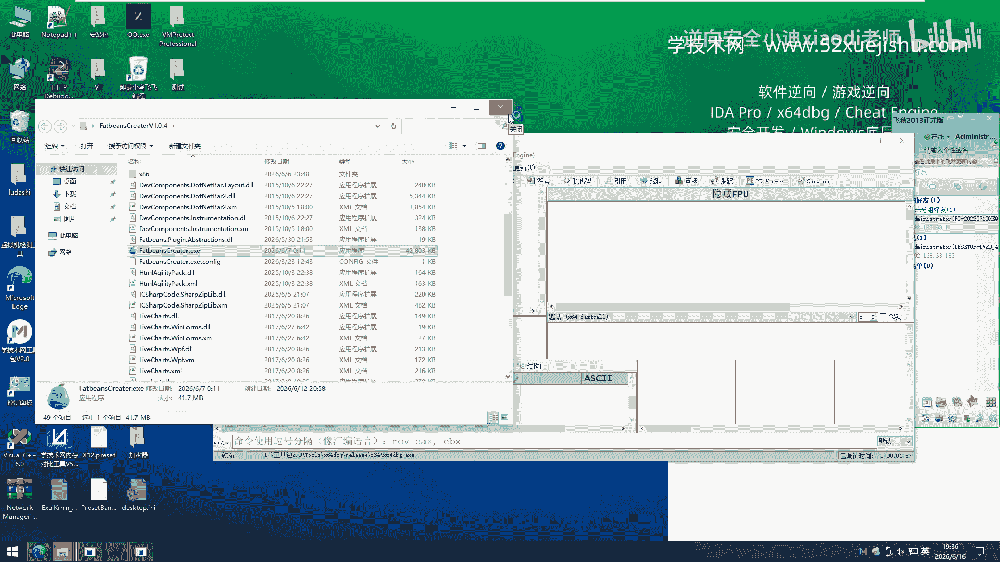

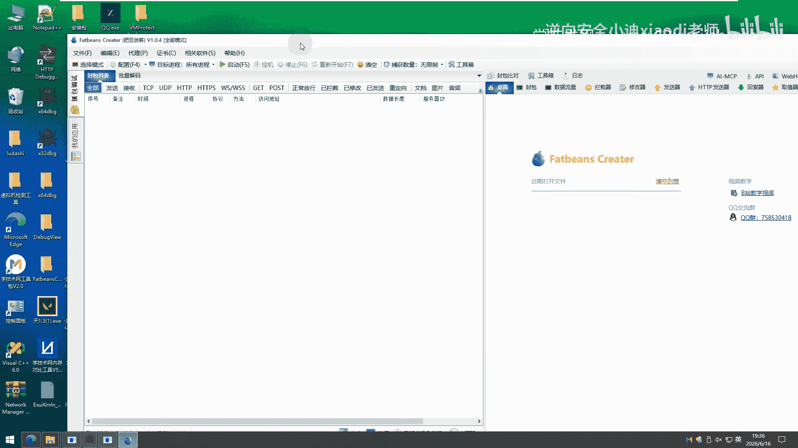

## 🕵️ 软件逆向分析实战：1.1：程序初检与抓包准备

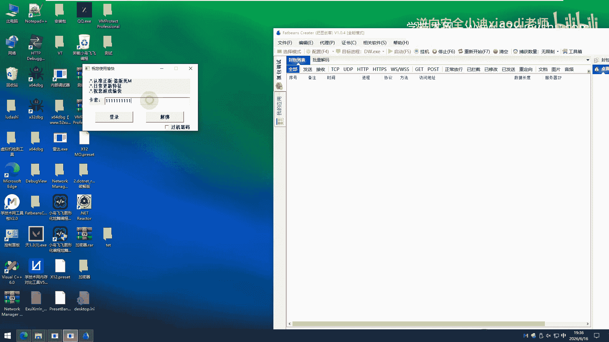

上一节概述了本节课的目标，本节中我们来看看程序初检和抓包准备。先看程序是多少位，打开PE解析工具，可以看到这是一个64位程序，并且带有一个VIP壳。原文判断一般来说不要紧，因此可以先继续观察程序行为。接着看程序类型，先抓一个包，发现不是HDP协议，于是考虑可能是其他协议，并检查它是不是已知协议。分析过程中稍作等待，然后把这个进程选上，用DW启动，点登录。此时出现卡号错误，同时开始有数据，说明登录流程已经触发了网络通信。

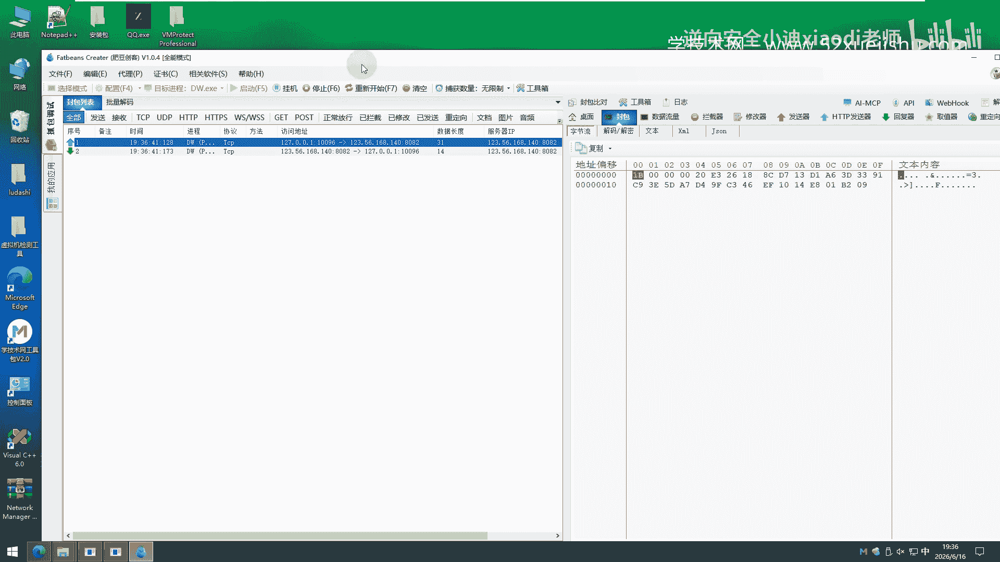

接下来观察封包数据。这个数据是自定义加密数据，数据长度不是特别长。这里需要重点看长度变化：封包长度伴随卡密长度变化，卡密越长，长度会变长，说明封包中提交了卡密信息。可以把卡密信息和可能的随机数加到封包中，再发送到服务器。服务器地址看起来是固定的，封包长度也固定，失败信息同样固定。原文据此判断，这说明封包可以伪造，但只能说有一定概率可以伪造。为了验证，两次抓包结果一样；过一分钟再试，记录到58559，时间2:04，数据仍然一模一样。因此判断这个封包有可能伪造，大概意思是有一张正版卡，就可以进行伪造尝试。以下是本节从封包角度整理出的关键观察，列表前先说明这些观察只是初步线索。

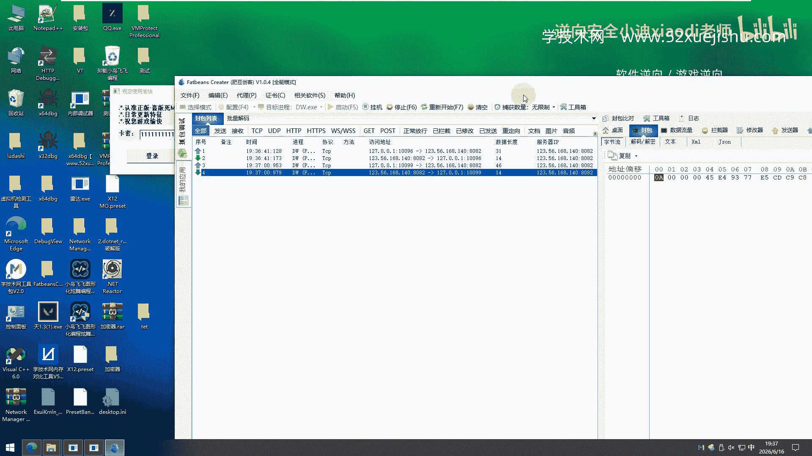

- 程序为64位，带有VIP壳，原文判断一般不要紧。
- 抓包发现不是HDP协议，需要继续判断是否为其他已知协议。
- 登录触发后出现卡号错误，并开始产生网络数据。
- 数据为自定义加密数据，长度不算特别长。
- 封包长度随卡密长度变长，说明其中包含提交的卡密信息。
- 卡密信息可能和随机数一起加入封包，再发送到固定服务器。
- 服务器地址固定，封包长度固定，失败信息固定。
- 两次封包一致，间隔一分钟后仍然一致，说明存在伪造可能性。
- 伪造前提是拿到一张正版卡，且只能认为有一定概率成功。

可以用下面的公式概括本节的封包思路，公式只是帮助理解，不代表完整协议格式。

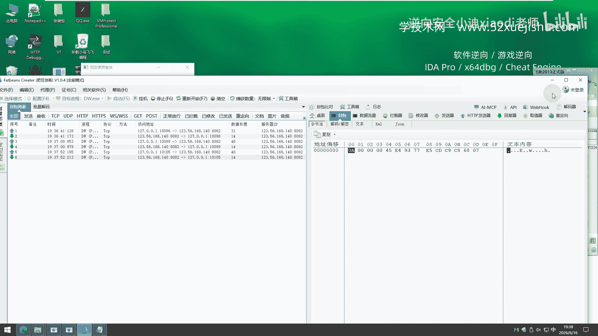

```text
封包 ≈ 固定服务器地址 + 自定义加密数据(卡密 + 随机数)
伪造条件 ≈ 一张正版卡 + 可复现的固定失败/成功封包
```

以上只是从封包角度观察软件，还没有进入代码内部。下一节中，我们将从代码分析角度继续看这个程序，并确认它使用的网络验证类型。

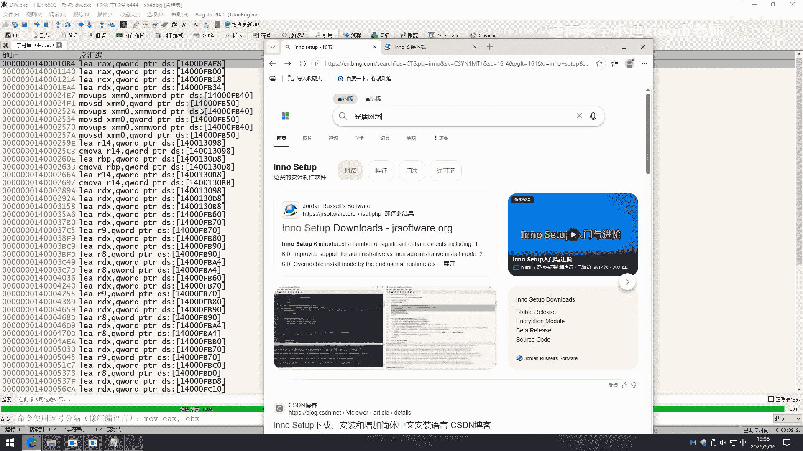

## 🔍 软件逆向分析实战：1.2：代码定位与光盾验证

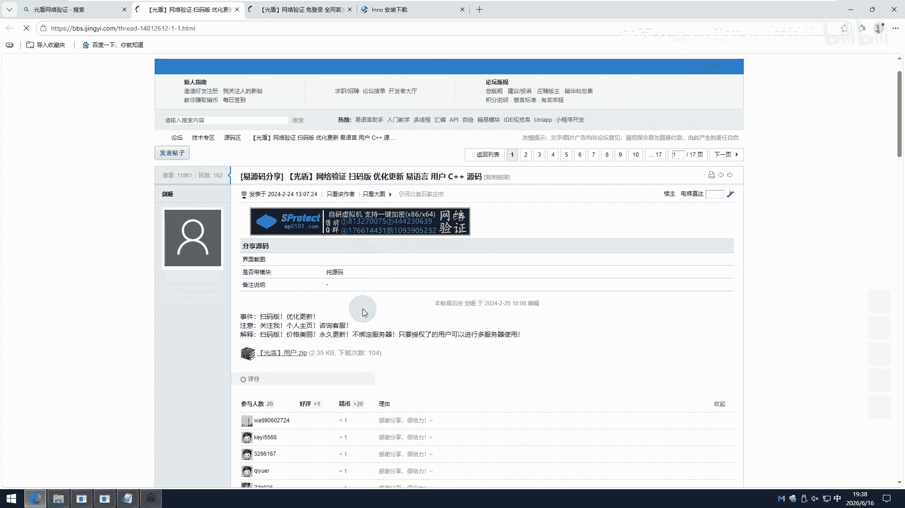

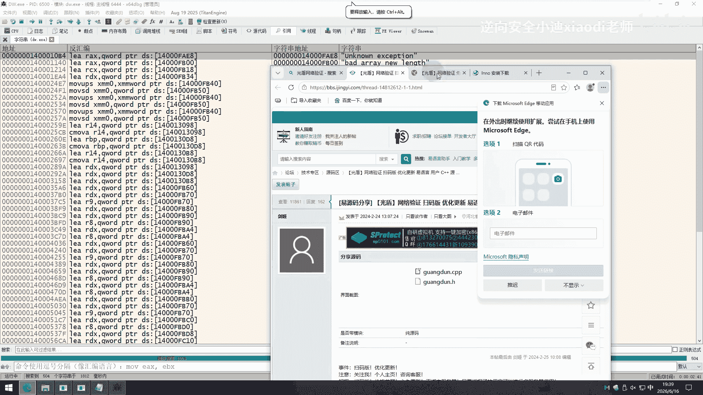

上一节我们介绍了封包抓取和伪造可能性的初步判断，本节中我们来看看如何从代码层面确认网络验证类型。操作上点击文件，点击附加，完成附加后点击符号，切换到程序的主模块，然后搜索“光盾”。搜索到光盾后，基本上可以验证这是一个光盾网络验证。光盾网络验证在网上实际上都能找到相关资料，它是一款支持扫码等功能的网络验证。对于这类程序，可以用山寨的方法去解决。原文在这里明确说“山寨”，也就是围绕网络验证的初始化参数和服务器地址做替换。

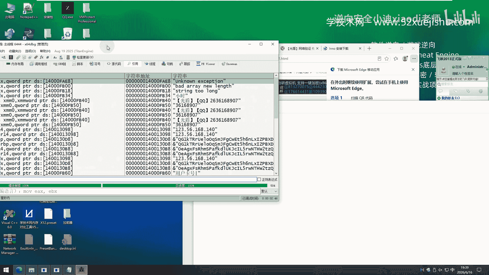

山寨怎么去做，原文给出的思路很简单：先看程序自己有没有IP，这个IP有可能和软件名相关，也可能是光盾初始化的一些数据。网络验证在初始化时，通常会带一些固定参数。原文猜测这些参数可能包括IP、版本号、加密K、签名盐或签名计算之类的内容，其中版本号只是猜测，因为原文作者没有用过光盾。可以用下面的公式表示初始化参数的大致组成。

```text
初始化参数 ≈ { IP, 版本号, 加密K, 签名参数 }
山寨方向：原IP -> 127.0.0.1
版本号 -> 自定义
加密K、签名参数 -> 替换成自己的
```

具体做法是把IP改成127.0.0.1，也就是本机地址；版本号可以自定义；加密K、签名密钥这类东西替换成自己的。原文提醒，需要看光盾怎么对接。作者没有用过光盾，所以这只是例子；大部分网络验证可能是这么初始化的，但光盾不一定完全一样，也可能使用其他方法。无论如何，当前已经确认它是光盾网络验证。原文还提到，联系光盾作者可能就能买到相关服务，需要买一份来对接；分析时看对方的QQ能不能对上，但光盾没有留下自己的QQ号，所以需要自己去找。总之，现在已经知道它是什么网络验证，走山寨是可以的，这个思路叫做网络验证的山寨。

为了便于初学者理解，可以把本节的判断过程整理成下面的列表，列表前先说明这些是确认光盾后的行动要点。

- 通过主模块搜索“光盾”，基本确认程序使用光盾网络验证。
- 光盾网络验证资料可以在网上找到，支持扫码等功能。
- 山寨的核心是处理初始化参数，不是直接硬改登录结果。
- 初始化参数可能包含IP、版本号、加密K、签名盐等。
- 将IP改为127.0.0.1，版本号自定义，加密K和签名参数换成自己的。
- 光盾的具体初始化方式不一定与示例相同，需要查光盾对接资料。
- 光盾作者可能提供购买和对接渠道，但原程序没有留下QQ，需要自己查找。
- 确认网络验证类型后，网络验证山寨是可行方向。

到这里，网络验证类型已经确认，山寨方向也已经明确。下一节中，我们回到登录流程，看看代码混淆情况以及为什么代码层面分析会遇到阻力。

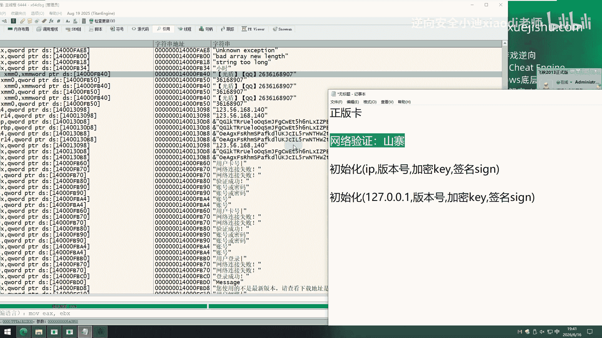

## 🧱 软件逆向分析实战：1.3：登录流程与混淆观察

上一节我们确认了光盾网络验证并讨论了山寨思路，本节中我们来看看登录流程和代码混淆情况。连接登录后断下来，可以看到用户的卡号。程序对卡号做了数据整理。查看RDX，RDX是返回的数据，原文提到跟W9有关，返回内容都是加密的。按F8回溯，发现这一带好像没有混淆；继续看FCGF8，也没有混淆，流程正常。原文据此判断，关键逻辑可能不在这里，或者这里可能是一个突破口。再返回后，卡密登录错误就弹出来了，说明这里有可能存在一些关键内容，但程序没有做最终校验。

如果继续从软件中拿卡密并进一步获取信息，可以利用GetWindowText函数。原文作者自己敲函数时出现过输入错误，先敲成TXT，后来改为GetWindowTextA。回车后点登录，程序断下来。此时回溯调用位置，发现调用处混淆了。混淆后代码没有办法分析，处于不可分析状态，因此GetWindowText这条线不能继续深入。程序也可能调用GetWindowTextLength来获取长度，于是检查它有没有获取长度；点登录后，没有发现获取长度，说明这条信息块路线也不行，估计相关信息块也被混淆了。原文还提到“A214位在my box”，随后重新来一遍，放开Ctrl，按F发一下，结果直接出现混淆。这说明在代码层面分析存在问题，应该回到网络验证山寨方向，并查找光盾相关内容。以下是本节整理出的登录流程与混淆观察，列表前先说明这些观察用于判断后续路线。

- 连接登录后断下，可以看到用户卡号。
- 程序会对卡号做数据整理。
- RDX中返回的数据与W9相关，内容经过加密。
- F8回溯时部分位置没有混淆，FCGF8一带也正常。
- 关键逻辑可能不在当前位置，也可能当前位置是突破口。
- 返回后弹出卡密登录错误，说明这里有可疑关键逻辑，但没有最终校验。
- 使用GetWindowText可以在登录时断下，但回溯调用处出现混淆。
- 混淆后的代码不可分析，GetWindowText路线受阻。
- 检查GetWindowTextLength也没有获取长度，信息块路线同样受阻。
- 重新操作并按F后直接出现混淆，说明代码层面分析有问题。
- 更合适的路线是网络验证山寨，并查找光盾相关资料。

可以用下面的代码示意本节涉及的函数调用，代码只表示分析关注点，不表示完整程序逻辑。

```c
GetWindowText(...);        // 获取窗口文本，可能用于读取卡密
GetWindowTextLength(...);  // 获取文本长度，原文检查后未发现有效结果
```

本节说明了一个重要现象：不是所有程序都适合直接从登录流程硬追。遇到混淆时，需要结合网络验证类型选择更省力的路线。下一节中，我们给出本次挂号的结论和注意事项，并对整节课做总结。

## 📌 软件逆向分析实战：1.4：挂号结论与注意事项

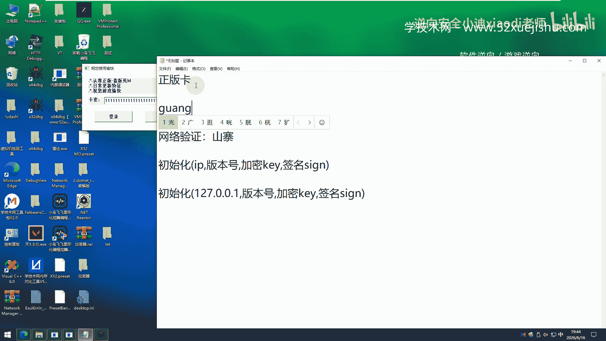

上一节我们分析了登录流程、函数调用和代码混淆，本节中我们来看看本次挂号的结论与注意事项。综合封包观察和代码定位，可以确认这个程序使用光盾网络验证。封包层面存在固定服务器、固定长度和固定失败信息，间隔一分钟后封包仍然一致，因此存在伪造可能性，但原文只认为有一定概率。代码层面尝试GetWindowText和GetWindowTextLength时遇到混淆，关键调用处不可分析，所以更应该走网络验证山寨路线，查找光盾的初始化与对接资料。挂号分析到这里就完成了。原文还说明，如果其他人也想挂号看软件，需要知道挂号是有费用的，并不是随随便便看软件，因为大家都很忙，没有那么多时间。该视频为全程实际录制，本段内容到此结束，下期再见。

本节课中，我们一起学习了外挂卡密网络验证软件的挂号分析流程。我们从凌晨2:01的实际操作开始，先看64位程序和VIP壳，再抓包观察自定义加密数据、卡密长度变化、固定服务器和固定失败信息，从而判断封包存在伪造可能性。随后从代码主模块搜索光盾，确认网络验证类型，并讨论通过修改IP、版本号、加密K和签名参数进行网络验证山寨的思路。最后检查登录流程中的GetWindowText与GetWindowTextLength，发现调用处存在混淆，代码层面分析受阻，因此确定后续应优先查找光盾资料并走山寨路线。以上内容保留了原文每一句分析的含义，并整理成适合初学者阅读的教程。

