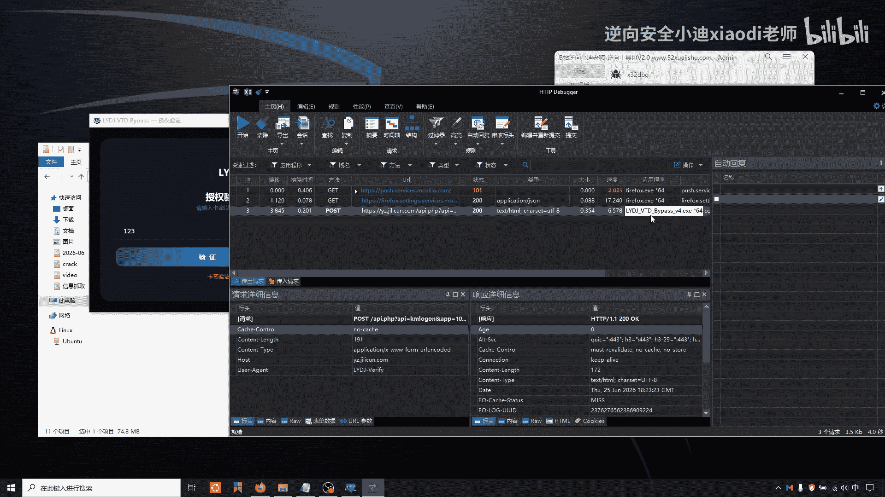
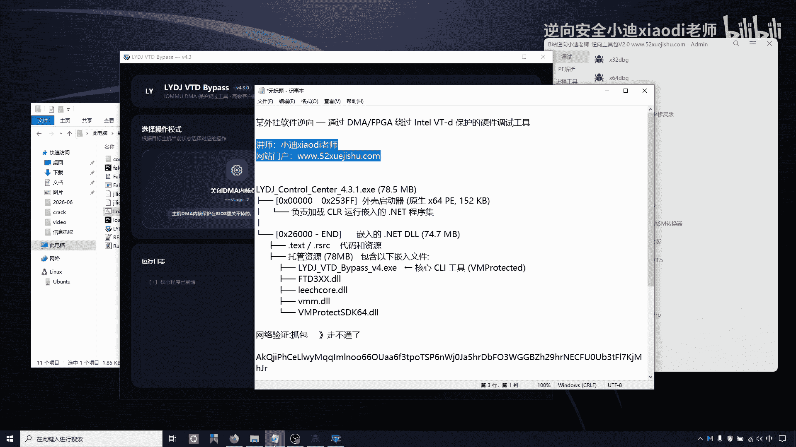
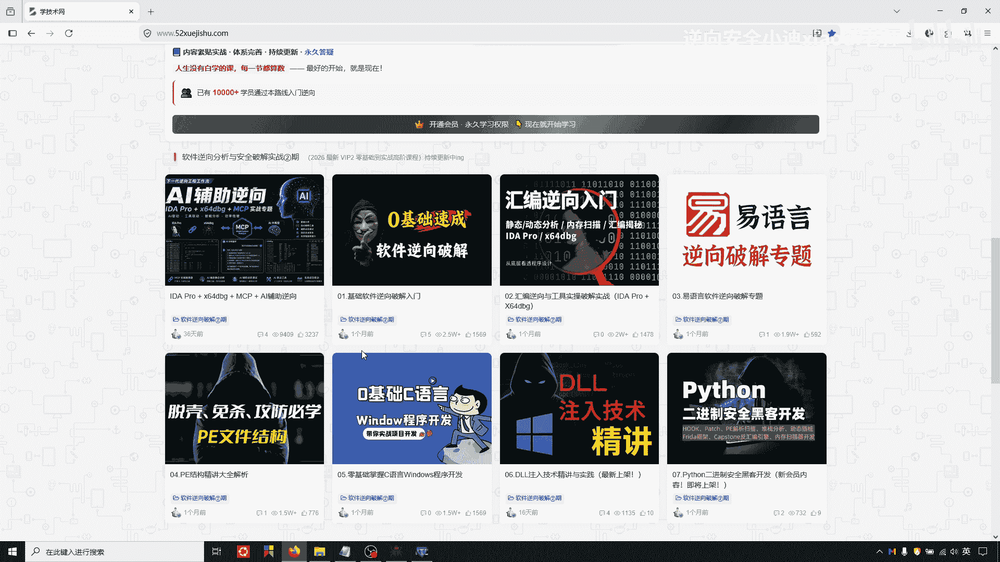
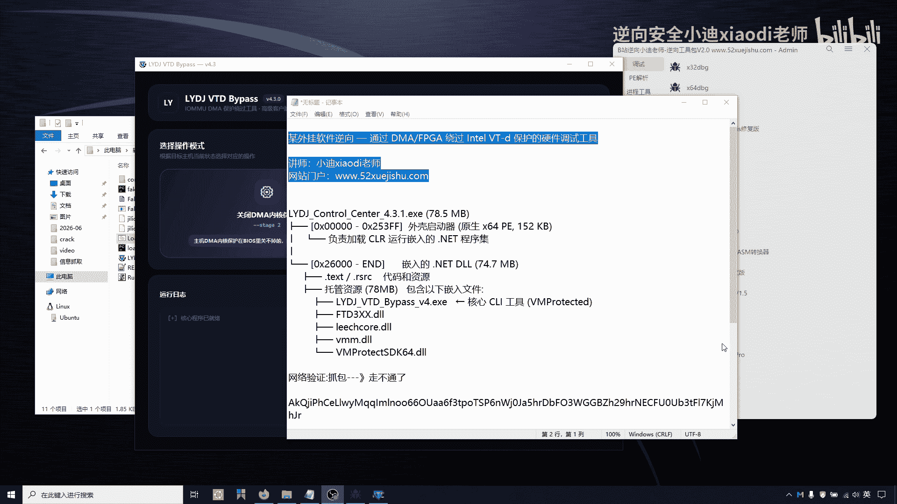

# 🧭 软件逆向破解：01：课程概述与案例导入

在本节课中，我们将要学习软件逆向破解的一个实战案例：某外挂软件的卡密网络验证分析与山寨绕过。课程会从运行目标程序、抓包分析、程序位数与编译器识别、动态附加与.NET程序识别，一直讲到替换服务器和伪造响应数据的基本思路。内容会尽量用大白话说明，让初学者也能理解逆向在日常生活和软件问题中的作用。

课程开始，小迪老师做自我介绍，并说明有不少同学会疑问：为什么有这么多人听逆向课程，逆向到底能做什么。实际上，逆向能够解决日常生活中很多与软件相关的小问题。本次要讲的案例就是某外挂软件逆向。该外挂通过 **DMA** 或 **FPGA** 去绕过 **Intel VT-d** 保护，属于一种硬件调试工具相关场景。本次课程由小迪老师讲解，网站门户为 **3W点52学技术点CO**。

拿到一个程序后，通常的分析入口是先观察它的运行表现，再判断它属于哪类验证、哪类程序。以下是本案例中需要先明确的关键信息：

- 案例对象是某外挂软件的卡密网络验证。
- 该外挂涉及通过 **DMA** 或 **FPGA** 绕过 **Intel VT-d** 保护。
- 讲师为小迪老师，网站门户为 **3W点52学技术点CO**。
- 分析目标程序时，先运行程序并观察提示，再决定后续分析路线。


---

# 🕸️ 软件逆向破解：02：运行程序与网络验证抓包

上一节我们介绍了课程背景和案例对象，本节中我们来看看目标程序运行后是什么表现，以及如何判断它是不是网络验证。当前展示的就是目标程序，先运行观察它的行为。

运行之后，程序提示“VT-d bypass 授权验证”，并提示输入卡密。点击验证后需要等待，验证速度较慢，随后程序提示卡密验证失败。有经验的读者会想到，这是一款网络验证。网络验证的基本流程可以用下面的形式描述：



```text
客户端 -> 网络验证服务器 -> 返回加密响应 -> 客户端判断卡密是否正确
```

网络验证可以尝试通过抓包形式去突破。于是打开 **HTTP Debugger Pro** 进行抓包。以下是抓包分析时的主要观察步骤：

- 点击验证后等待响应，界面可能暂时卡住，随后响应出现。
- 观察时一看请求链接，二看应用程序名称。
- 应用程序名称刚好和运行的程序名称对应，因此可以判断抓到的就是该程序。
- 查看响应内容，很多初学者会困惑，因为内容经过加密。
- 先查看第一次抓包，确认内容是否加密，结果是加密。
- 再点击验证进行第二次抓包，对比两次响应内容是否有差别。
- 两次响应的内容确实有一些不同，因此值得研究。
- 由于响应内容加密，无法直接通过网络封包突破，这条路线走不通。

---

# 🧰 软件逆向破解：03：程序位数与编译器识别

上一节我们确认了网络封包路线走不通，本节中我们来看看如何转向代码分析。分析代码前，需要先看程序是多少位，以及它由什么编译器和语言生成。打开 **PE 解析器**，将程序拖入，可以看到它是一个 **64 位 PE 文件**，文件类型显示为 **Microsoft Visual C++ 8.0 以上版本**。

为了进一步确认，可以借助其他工具查看，例如 **DIE** 和 **ExeInfoPE**。这两个工具比较新，查询结果也比较准确。将程序拖入后，工具显示它是 **x64 Microsoft Visual C++** 程序。另一个工具扫描起来比较慢，但结果比较认真，可以看到编译器是 **Microsoft Visual C++**，语言是 **C++**，工具是 **Visual Studio 2022**。总之，通过外部程序查看，可以判断它是一个 **64 位 C++ 程序**。相关识别结果可以用下面的形式概括：


```text
PE 解析结果：x64
编译器：Microsoft Visual C++
语言：C++
开发工具：Visual Studio 2022
```


确认程序是 64 位 C++ 程序后，动态分析代码可以使用 **x64dbg**。以下是动态附加时的基本操作顺序：

- 运行 **x64dbg**。
- 再运行目标程序。
- 在调试器中点击“文件”，再点击“附加”。
- 双击目标执行程序，随后点击符号。

---


# 🧩 软件逆向破解：04：动态附加与.NET程序识别


上一节我们完成了程序位数和编译器识别，本节中我们来看看动态附加后的现象，以及如何判断程序类型。附加之后，调试器里出现了非常多 **DLL**，但程序目录下并没有这些 DLL，这是一个非常怪异的点。同时，模块里面有很多 **System** 之类的名称，这说明它可能是一个 **.NET 程序**。有编程经验的读者会知道，这是一种托管的 .NET 程序，而且这种 .NET 程序比较特殊。

一般来说，碰到 .NET 程序，可以使用 **dnSpy** 去分析，需要找到 **dnSpy64**。将程序直接拖入 dnSpy 后，里面全是比较杂乱的内容，无法直接查看代码，因此需要用到课程中讲到的相关技术。.NET 托管程序与 dnSpy 的关系可以用下面的形式表示：


```text
.NET 托管程序 -> 使用 dnSpy64 反编译 -> 进一步分析代码逻辑
```


如果想学习相关技术，可以到课程提供的位置查看，相关入口可以在新标签页打开，也可以来我们这边了解。最后，课程会带大家查看破解成功后的效果。以下是本阶段需要记住的判断要点：

- 附加后出现大量 DLL，但目录中没有这些 DLL，属于异常现象。
- 模块中出现大量 **System** 名称，提示可能是 .NET 程序。
- .NET 程序通常是托管程序，分析时优先考虑 **dnSpy64**。
- dnSpy 拖入后内容杂乱，无法直接查看代码，需要结合课程技术继续分析。

---

# 🛠️ 软件逆向破解：05：山寨绕过思路与效果演示

上一节我们识别出程序与 .NET 托管程序相关，本节中我们来看看破解成功的基本思路和最终效果。要破解成功，一般可以进行“山寨”操作。因为这是网络验证，它会连接别人的服务器；连接别人服务器时，可以把别人的服务器替换成自己的服务器。替换之后，再把相关响应数据填充上。

填充数据的方法很直接：把它的源代码扒出来，把它的算法扒出来，然后自己伪造一套响应数据。伪造完成后，就可以登录。若软件代码中函数之间的校验没有那么强，甚至可以把校验相关的东西直接去掉，把相关代码删掉也可以，只需要做服务器和客户端之间的互通。山寨绕过的核心流程可以用下面的形式描述：

```text
原服务器 -> 替换为山寨服务器 -> 填充伪造响应数据 -> 客户端登录成功
```

最终效果演示中，只需要运行 **loader.bat**，随后出现微信界面。随意输入 **123**，点击验证，程序显示到期时间为 **2099-12-31**，此时已经进入软件内部。这个软件看起来非常高大上，价格大约是每个月 **600 元**。它涉及的技术就是软件安全逆向技术。以下是本节演示中需要关注的关键点：

- 网络验证可以通过替换服务器和填充响应数据进行山寨。
- 可以扒出源代码和算法，再伪造一套响应数据。
- 若函数间校验不强，可以删除校验代码，只保留服务器与客户端互通。
- 运行 **loader.bat** 后，输入任意卡密 **123**，显示到期时间 **2099-12-31**，即可进入软件。
- 该软件价格约为每月 **600 元**，案例体现了软件安全逆向的实际效果。


---




# ✅ 软件逆向破解：06：课程总结



上一节我们完成了山寨绕过思路和效果演示，本节中我们对整节课程做总结。本节课中我们一起学习了软件逆向破解的一个实战案例，包括目标程序运行、卡密网络验证判断、HTTP 抓包分析、响应内容加密观察、程序位数与编译器识别、x64dbg 动态附加、.NET 托管程序识别、dnSpy 分析入口，以及替换服务器和伪造响应数据的山寨绕过思路。课程还演示了运行 **loader.bat**、输入卡密 **123**、显示到期时间 **2099-12-31** 并进入软件的效果。



如果想学习相关知识，了解逆向内容到底是怎么回事，尤其是在 AI 时代，稍微学一点基础知识，再借助 AI 辅助实践也是可以的，课程中都有讲解相关内容。本次课程的全部内容到这里结束，想学习相关内容可以联系小迪老师，下集再见。

