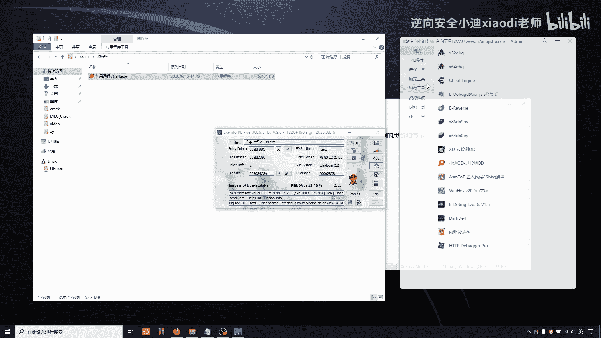
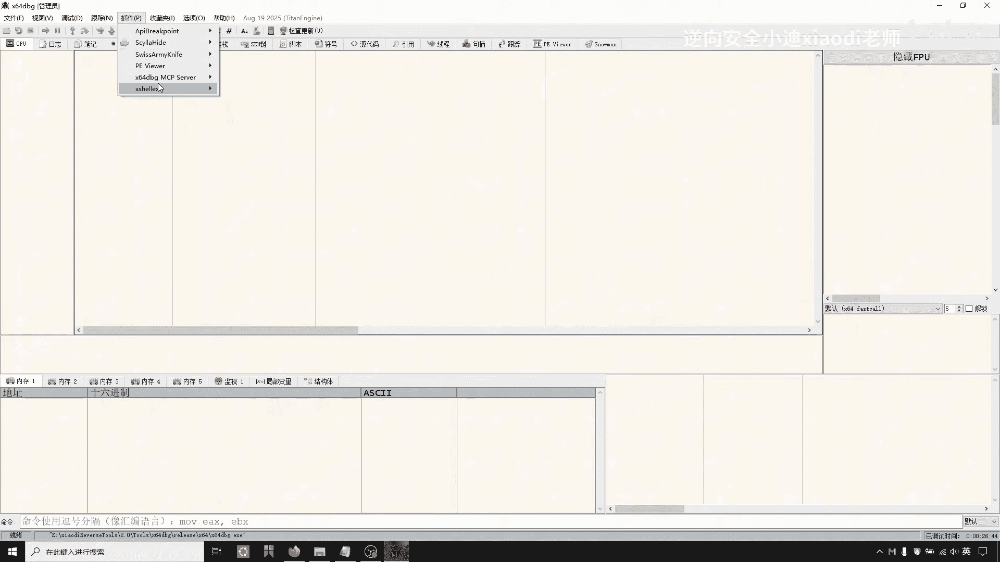
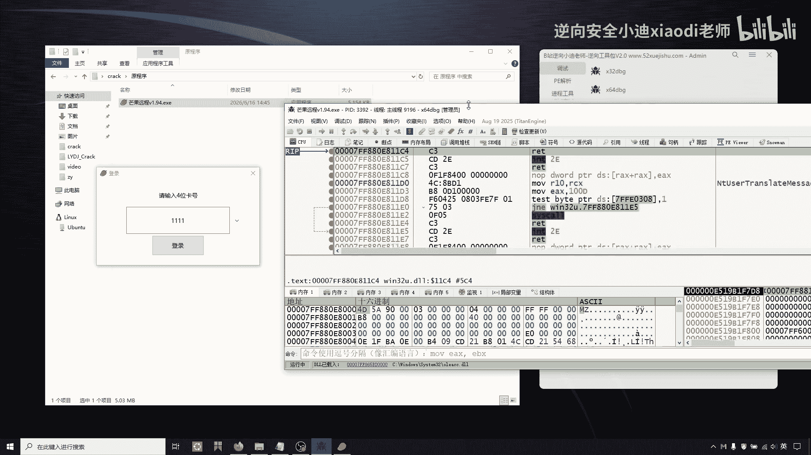
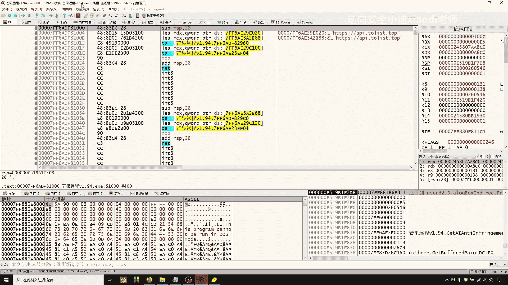
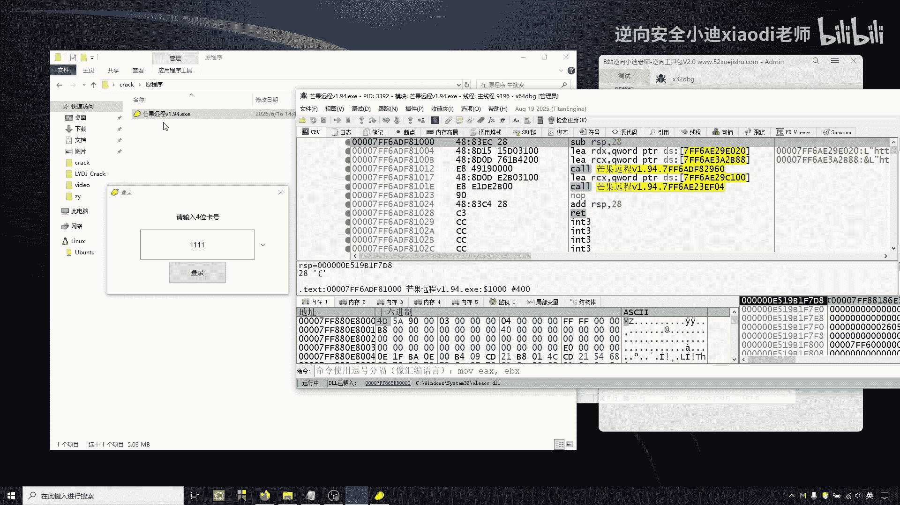
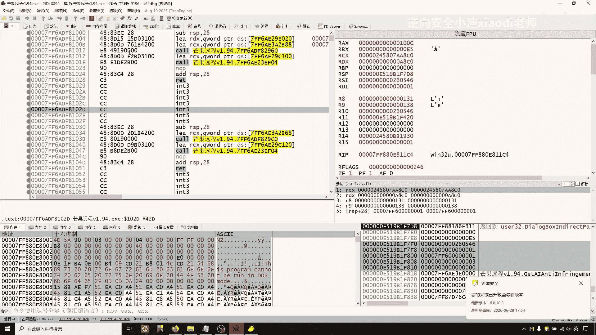
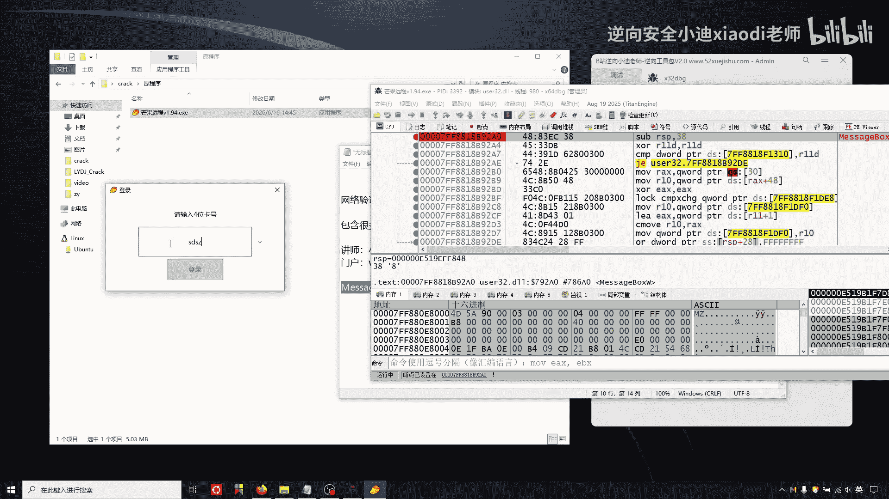
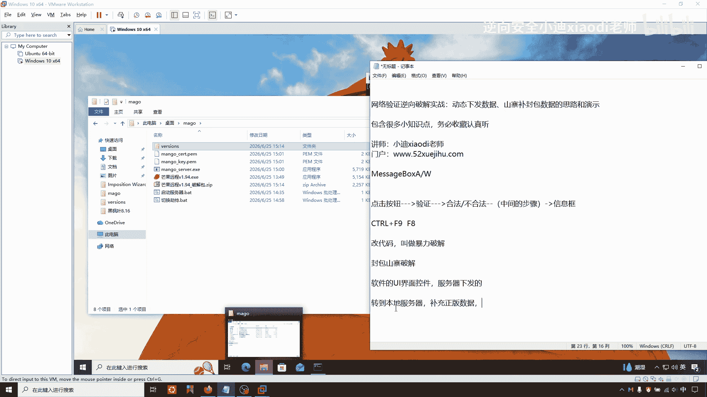
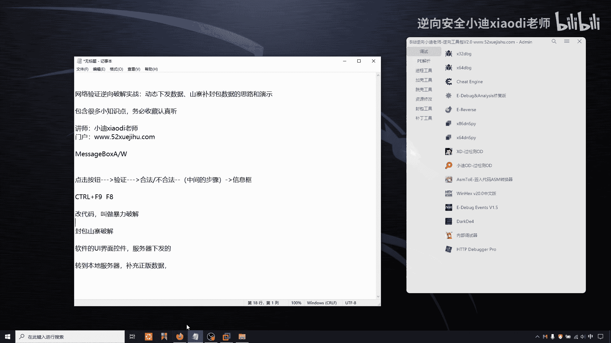

## 🧭 软件逆向破解：01：课程概述与逆向价值

大家好，我是小迪老师。在本节课中我们将要学习网络验证逆向破解实战，内容包括动态下发数据的分析思路、山寨补封包数据的思路和演示。本节课包含较多小知识点，建议收藏并认真听讲。下面先列出课程会覆盖的核心内容。

- 动态下发数据的分析思路。

- 山寨补封包数据的演示思路。

- 网络验证场景下的调试、定位和验证方法。

这些内容看起来分散，但都围绕同一个目标：先观察程序行为，再定位关键代码，最后验证修改或补包是否有效。对于初学者来说，可以先把它理解成一个公式：`逆向分析 = 观察行为 + 定位关键点 + 验证结果`。这个公式不复杂，后面所有操作都会围绕它展开。不少同学会疑惑：讲逆向为什么会有很多人听，逆向能做什么，这两个字有多大潜力。实际上，逆向能够解决日常生活中的一些小软件问题。例如，用户购买了一款软件并付了钱，但作者跑路，不再让用户使用软件；或者用户可能违反了作者的某些规则，软件不再允许使用。遇到这种情况，需要替天行道、行侠仗义，因此要用相关技术去突破限制。

上一节介绍了逆向的价值和课程范围。本节我们来看看实际案例中网络验证的限制现象，以及可以选择的突破方向。

## 🔍 软件逆向破解：02：网络验证限制现象与突破方向

例如有一款软件，它也是网络验证。用户输入卡号，随便输入一个卡号，然后点击登录，此时软件提示“卡号错误，测试次数过多，请一分钟后再试”。这只是限制的一种表现形式。刚才测试密码次数太多，软件就把操作限制住了。这个限制能不能突破，用什么技术突破，用到的就是软件逆向技术。这个限制可以突破，后面的演示会展示过程。从思路上看，可以先用一个简单伪代码表示登录验证过程。

```text
点击登录
-> 程序读取输入卡号
-> 执行卡密验证
-> 验证结果 = 合法 / 不合法
-> 根据验证结果决定是否允许登录或显示提示
```

理解这个流程后，就能明白后面的调试目标：找到“合法/不合法”的分支，判断哪一步决定结果，再验证修改是否有效。拿到一款软件后，第一步不是直接改代码，而是先分析。工欲善其事，必先利其器，因此先拿到工具包。拿到工具包之后，点击“P解析”栏目，先补充一个小知识点：在 Windows 平台上运行的软件通常都有一种结构，这种结构叫作 PE 文件结构，也就是可执行文件结构。可执行文件结构可以用“P解析”这一栏的工具进行相关解析。

上一节说明了限制现象和突破方向。本节我们来看看工具准备和 PE 文件结构的基础知识。

## 🧰 软件逆向破解：03：工具准备与PE文件结构

例如，可以使用 ExeInfo（原文称 EXEin）来查看文件信息。点击运行，运行过程可能需要一些时间，因为这个软件比较大，需要稍等。工具运行起来后，直接把目标软件拖过来。拖入之后，工具会显示“x64 executable”（原文显示为 im64 excable），说明它是一个 64 位程序。这个知识点需要掌握：程序分为 32 位和 64 位，这个程序是 64 位程序，64 位程序就要对应 64 位工具。这里可以用一个简单关系表示工具选择。

```text
Windows 可执行文件 = PE 文件结构
程序位数 = 32 位 / 64 位
调试工具位数 = 程序位数
```

工具选择完成后，点击“调试”。分析软件行为本质上是一种调试行为，就像调试机器一样，需要观察哪个数据、哪个参数发生了怎样的变化，或者程序走了怎样的行为路径，这个过程就是调试。在这里可以看到 32 位的 x32dbg 和 64 位的 x64dbg（原文称 DBJ），这两个工具是最常用的调试工具，而且是开源、免费的工具。大家在网上不一定非得使用本工具包，在网络上也可以获取同类工具；只不过本工具包配备了很多插件，方便使用。64 位软件对应 64 位工具，点击运行。然后点击“插件”，可以看到工具配备了很多插件，方便大家使用。

上一节介绍了工具选择和 PE 结构。本节我们来看看如何把调试器附加到目标程序，并定位到程序自己的代码模块。

## 🧩 软件逆向破解：04：附加调试与定位程序模块

接下来的操作是先把程序运行起来，然后点击“文件”，点击“附加”，再双击目标进程。双击之后，看到的代码可能看不懂，这时注意界面上方显示的是线程信息，例如主线程 9196。接下来点击“符号”，双击对应项，就会切换到模块。模块显示为“芒果远程V1.94.SE”（原文称 V1。94点SE）。会发现这个模块名称和程序名称一样，这样就对应上了，说明这一片显示的就是原来程序的代码。以下是附加调试的主要步骤。



- 先运行目标程序。

- 在调试器中点击“文件”，再点击“附加”。

- 双击目标进程，完成附加。



- 点击“符号”，双击对应模块，切换到程序自己的代码区域。

完成这些步骤后，调试器里显示的不再是完全看不懂的系统代码，而是更接近目标程序自身逻辑的区域。对于初学者来说，这一步很关键，因为只有定位到程序模块，后面设置的断点和观察的跳转才有意义。接下来需要认识调试器界面的主要区域，这样才能知道该看哪里。



上一节完成了附加和模块定位。本节我们来看看调试器界面的四个主要区域分别代表什么。

## 🗺️ 软件逆向破解：05：调试器界面四区域

这个工具主要分为四个区域。第一个区域是代码区域，用来显示程序指令。第二个区域是寄存器区域，用来显示一些临时数据。第三个区域是栈内存区域，函数调用过程中产生的临时数据会塞到这边，这个区域在程序运行期间不作为主要参考，后续学习会理解它的作用。第四个区域是内存数据区域，用来查看内存中的数据。以下是调试器四个区域的说明。

- 代码区域：查看程序指令和跳转。

- 寄存器区域：查看临时数据。



- 栈内存区域：查看函数调用过程中产生的临时数据；程序运行期间不作为主要参考，后续学习会理解。



- 内存数据区域：查看内存中的数据。

认识这四个区域后，分析就有了观察位置。接下来要看软件行为。这个软件有一个信息框，如果学习过相关开发知识，就会知道这个信息框就是 MessageBox（原文称 messy box）。对于 MessageBoxA 或 MessageBoxW，在 64 位程序自加载场景中，很多作者倾向于使用 MessageBoxW 函数，因此可以在调试器里按 `Ctrl+G`，G 表示 go，然后输入 MessageBoxW，点击确定，再按 `F2` 打一个断点。断点的作用就是让程序中断到指定位置，程序运行到这里就中断下来。

上一节认识了调试器区域。本节我们来看看如何利用 MessageBoxW 断点回溯验证链路。



## ⏸️ 软件逆向破解：06：MessageBox断点与回溯验证链路

设置断点后，输入一个字母，随便输入一个字母，然后点击登录。此时程序会断下来，提示内容是“卡号次数错误过多，请 30 分钟后再试”。这种情况会让人感到不满：只是测试一下密码，却被限制这么长时间，刚才还是几分钟，现在直接变成 30 分钟，因此需要突破它。现在已经中断下来，中断就是代码中断到当前位置。接下来要找是谁运行到这里，也就是从哪里来到当前位置。这个 MessageBox 肯定是一个结果，可以理解为：点击按钮，程序执行验证，然后得到合法或不合法，最终才来到信息框，信息框只是把结果显示在眼前。可以用下面的链路表示。

```text
点击按钮
-> 执行卡密验证
-> 得到合法 / 不合法
-> 跳转到对应提示
-> MessageBoxW 显示结果
```

> 提示：MessageBoxW 是结果展示点，不一定是验证起点，所以要从结果位置回溯到验证分支。

那么怎么回到原来的位置？按 `Ctrl+F9`。也就是说，把信息框这边执行完，然后回退回溯一下。这个工具提供了回溯功能，`Ctrl+F9` 会执行到返回位置，把信息框相关的东西执行完。按下 `Ctrl+F9` 后会出现一个弹块，让它执行完，界面会显示 right，right 就是返回，返回位置就是要返到合法或不合法判断的位置。当然不一定直接来到这个位置，中间可能还会有一些步骤，这不是硬性要求。

上一节通过 `Ctrl+F9` 从 MessageBox 回溯到了返回位置。本节我们来看看如何用单步执行继续分析条件跳转。

## 👣 软件逆向破解：07：单步执行与条件跳转分析

来到 right 后再单步执行一下。单步执行使用 `F8`。这里做了两个操作：一个是 `Ctrl+F9`，另一个是 `F8`。`F9` 的作用是从当前位置来到返回位置，`F8` 的作用是出去。按下 `F8` 后可以看到程序出来了。出来之后，这个区域怎么看？可以看上边为空、下边为 right。零基础阶段可以简单这样看：这边是头部，这边是尾部。头部和尾部之间有没有条件跳转之类的内容，能够绕过验证失败？这里显然没有。那怎么办？再返回。有时候从中间步骤再往回返，可能就能返到合法或不合法判断的位置。这个时候再按 `Ctrl+F9`，然后再按 `F8` 下来。此时会出现有意思的现象：这里有一个跳转能够跳过验证失败。什么是跳转？在这个工具里显示得很明显，就是红色箭头或者虚线箭头，上面有一些虚线。虚线代表条件跳转，也就是可以跳，也可以不跳。具体跳不跳，要根据程序运行状态决定，也就是根据卡密是否正确决定。当然，这个条件可以伪造。可以用下面的汇编示意表示。

```asm
; 条件跳转示意
jne 验证失败位置
```



上一节找到了可能跳过验证失败的条件跳转。本节我们来看看如何从跳转目标反查来源，并用 NOP 绕过验证。

## 🛠️ 软件逆向破解：08：查找引用与NOP绕过暴力破解

通过观察会发现，可能会有一个跳转直接来到当前位置，也就是跳到这一行然后开始执行，这是有可能的。那怎么处理？在这里点中鼠标右键，然后点击“查找引用”，再点击“选定的地址”。这时会发现果然有一个地址，这个地址也是一个虚线，说明这是一个跳转，也就是说它会跳到验证失败的位置。按一下回车，就会来到验证失败位置。到底要不要让这个跳转跳？不能让它跳。如果让它跳，就会跳到验证失败。因此要不让它跳。怎么才能不让它跳？鼠标右键，选择“二进制”，选择“填充”（原文称 npenote），填充 `NOP`。`NOP` 代表什么都不做，也就是 no operation，不做任何操作。然后执行 NOP 填充。以下是反查来源并修改跳转的步骤。

- 在目标跳转行点击鼠标右键。

- 点击“查找引用”，再点击“选定的地址”。

- 找到引用地址后按回车，确认它跳向验证失败位置。

- 判断该跳转不能执行，否则会进入验证失败。

- 鼠标右键选择“二进制”，选择“填充”，使用 `NOP` 填充。

修改前后的逻辑可以这样表示。

```asm
; 修改前：条件跳转可能跳到验证失败
jne 验证失败位置

; 修改后：什么都不做，不再跳向验证失败
nop
```

修改完成后进行测试，把程序运行起来，然后点击登录，可以登录进来。登录进来后，需要检查软件能不能用。此时会发现软件好像丢失了一些功能，出现加载失败。这就是暴力破解带来的问题。刚才修改代码的做法叫作暴力破解。可以用一个简单公式概括它的结果。

```text
暴力破解 = 修改本地判断
暴力破解结果 = 可能登录成功 + 可能功能缺失
```

上一节通过 NOP 绕过验证，但发现暴力破解可能导致功能缺失。本节我们来看看封包山寨破解的思路。

## 📦 软件逆向破解：09：暴力破解的局限与封包山寨思路

除了暴力破解，还有封包山寨破解。先把这个软件关掉，再看演示。现在打开虚拟机，直接运行启动服务器。这里准备了一个破解包，破解包里有三个文件，直接运行启动服务器即可。启动服务器后，运行目标程序，随便输入 111，点击登录，可以直接登录上。此时界面正常。为什么使用封包山寨破解后界面正常？因为这个软件的界面是动态下发的。软件的 UI 界面控件，也就是软件到底有哪些控件，都是由服务器下发的。有些软件也会把一些功能用服务器下发。如果用户不合法，这些功能就不下发。这个软件的功能通过界面非常明显地显示出来；如果是破解版，后面的按钮不会存在。因此需要进行补封包数据操作，把数据补上。相关数据已经打包好，这些全部是对应数据，把数据补上后，软件就正常显示。封包山寨的核心流程可以用下面的公式表示。

```text
正版流程：客户端 -> 远程服务器 -> 动态下发界面/功能数据
山寨流程：客户端 -> 本地伪造服务器 -> 补充正版封包数据 -> 功能正常
```

上一节说明了封包山寨的基本思路。本节我们来看看具体演示步骤和动态下发界面的表现。

## 🖥️ 软件逆向破解：10：封包山寨演示与动态下发界面

以下是封包山寨演示的主要步骤。

- 打开虚拟机。

- 运行启动服务器；破解包内有三个文件，直接运行启动服务器。

- 运行目标程序，输入 111 并点击登录，可以直接登录，界面正常。

- 观察界面控件和按钮，理解它们由服务器动态下发。

- 对缺失的数据进行补封包处理，使界面和功能恢复正常。

在这个演示中，界面正常的原因不是简单修改了本地判断，而是因为客户端连接到了伪造的本地服务器，服务器下发了正确的界面数据。对于初学者来说，可以把它理解成“客户端要什么数据，就在本地服务器里补什么数据”。只要补的数据和正版数据对应，客户端拿到的数据就正常，界面也就正常。接下来还需要验证下载功能是否正常。

上一节完成了封包山寨演示。本节我们来看看补封包数据后的下载功能验证。

## ⬇️ 软件逆向破解：11：补封包数据与下载功能验证

接下来测试下载功能是否正常。随便选一个年份，例如 2016，点击确认选择，点击确定，界面显示授权成功，下载没有问题。这个软件是一个下载器，它会把所有东西进行下载。封包数据不在这里继续下载，因为下载会占用磁盘空间，所以取消下载。以下是下载功能验证与取消下载的操作。

- 在软件中选择一个下载项，例如 2016。

- 点击确认选择，再点击确定。

- 观察提示，确认授权成功并且下载正常。

- 因为下载会占用磁盘空间，所以取消下载。

从整体思路看，这个软件会连接远程服务器，并且还有相关证书，这些证书可以伪造。首先把自己的服务器转到本地，也就是转到本地服务器，然后对相关数据进行补充。例如，软件需要这些数据，就给它补上，补充正版数据。这样软件连接的就是本地服务器，它获取到的数据也是从本地服务器拿到的，从而保证软件功能正常。可以用下面的流程表示。

```text
目标程序连接服务器
-> 将服务器地址转到本地伪造服务器
-> 补充目标程序需要的正版封包数据
-> 目标程序从本地服务器获取数据
-> 界面和功能恢复正常
```

上一节验证了补封包数据后的下载功能。本节我们来看看整体流程总结和学习渠道。

## ✅ 软件逆向破解：12：整体流程总结与学习渠道

本节课中我们一起学习了网络验证逆向破解实战的主要内容：先理解逆向的价值和适用场景，再观察网络验证的限制现象，准备 PE 解析工具和调试工具，完成附加调试和模块定位，认识调试器四个区域，使用 MessageBoxW 断点回溯验证链路，通过单步执行和条件跳转分析定位验证分支，使用查找引用和 NOP 填充绕过验证，理解暴力破解可能导致功能缺失，进一步学习封包山寨、动态下发界面、补封包数据和下载功能验证。以下是本节课的核心流程回顾。

- 观察软件行为和限制表现。

- 使用 PE 解析工具判断程序位数。

- 使用对应位数的调试器附加目标程序。

- 定位程序模块并设置 MessageBoxW 断点。

- 通过 `Ctrl+F9` 回溯、`F8` 单步分析验证链路。

- 通过查找引用定位条件跳转，使用 `NOP` 绕过验证。

- 认识暴力破解的局限，再使用本地伪造服务器和补封包数据恢复功能。



- 验证界面和下载等功能是否正常。



以上是本期全部内容。如果想学习相关知识，可以联系小李老师；也可以直接来到网站门户，点击开通会员。本期内容到此结束，下期再见。

