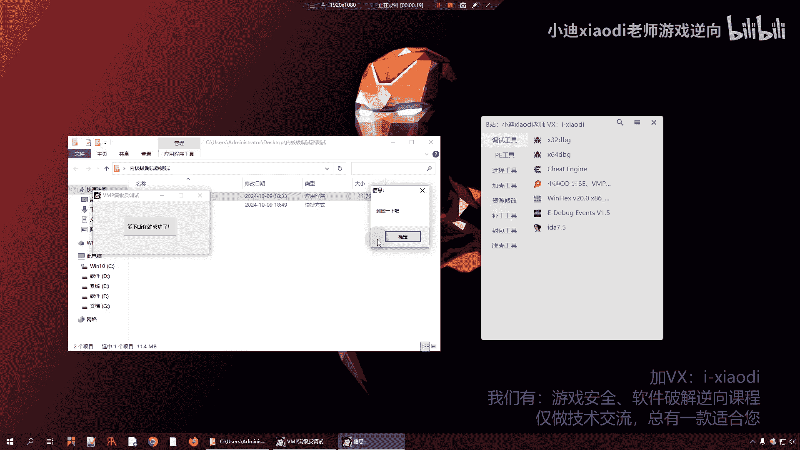
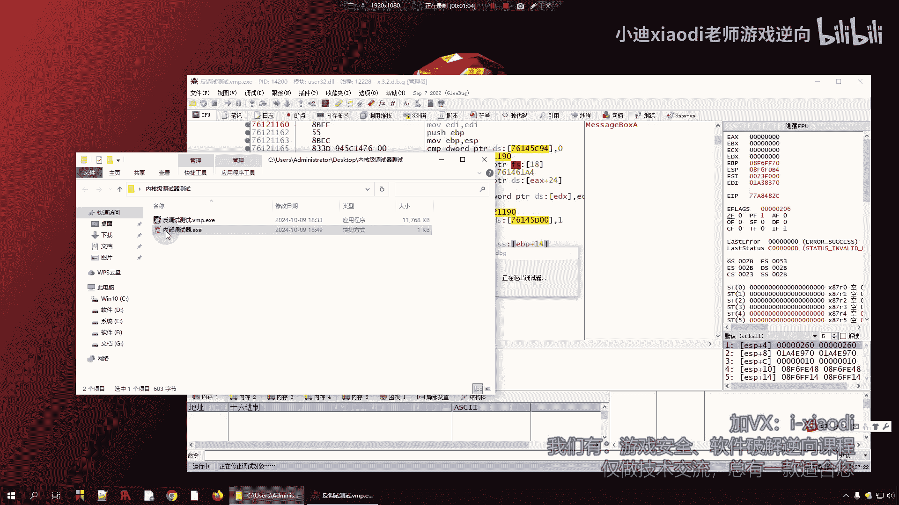
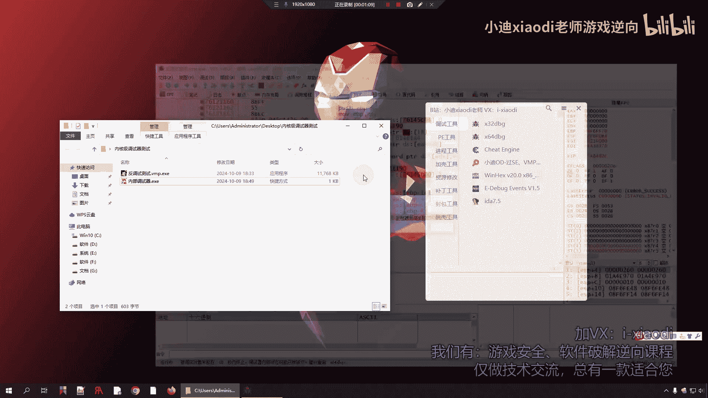
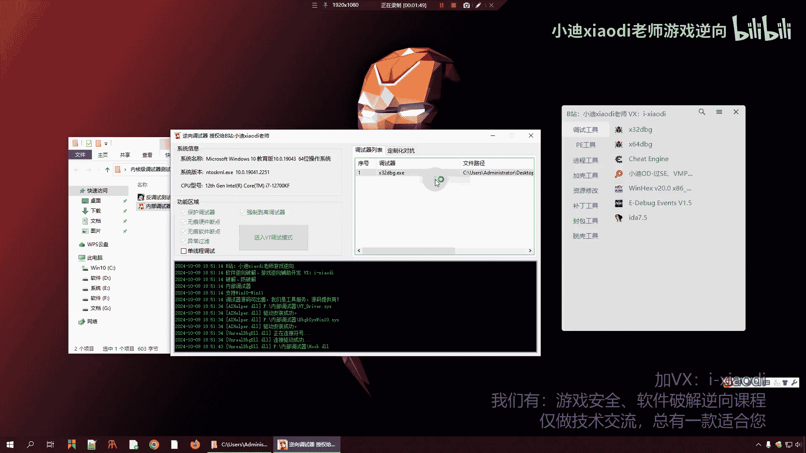
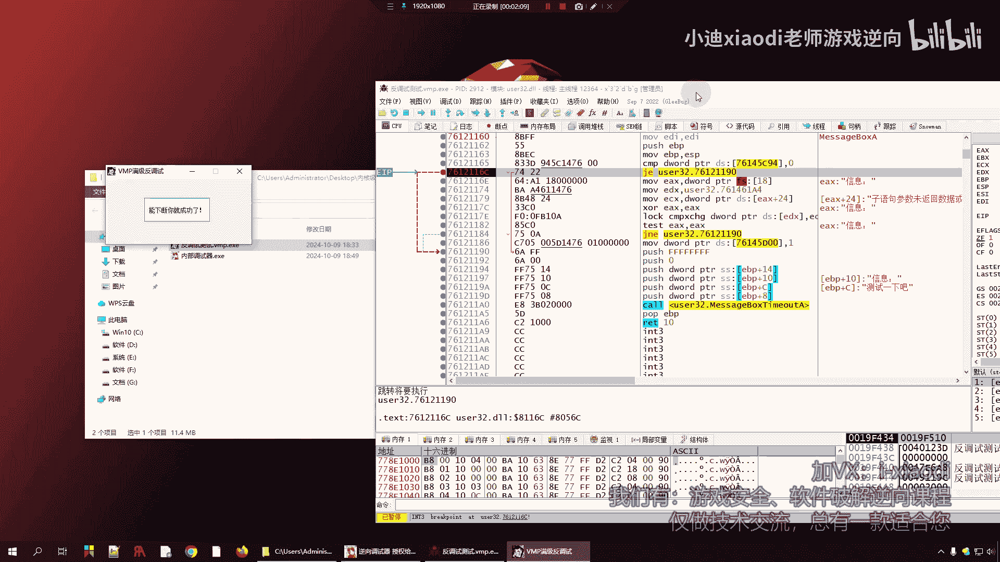
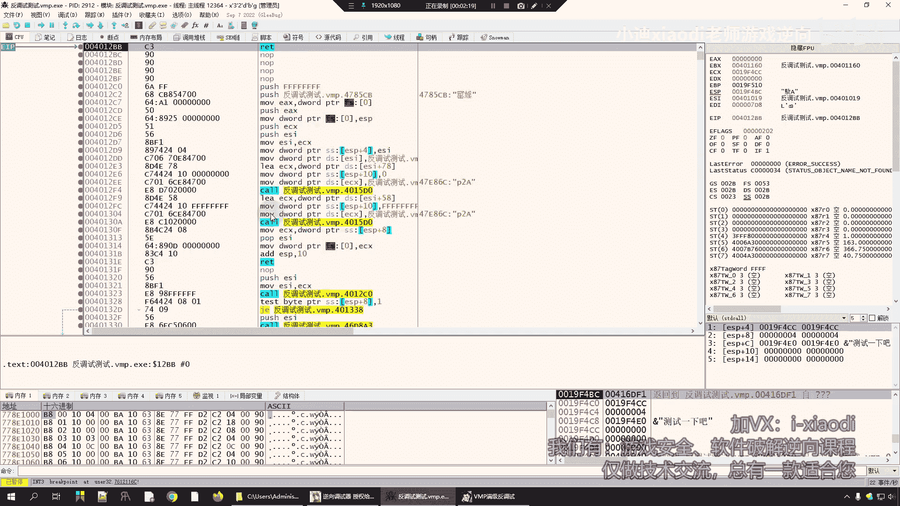
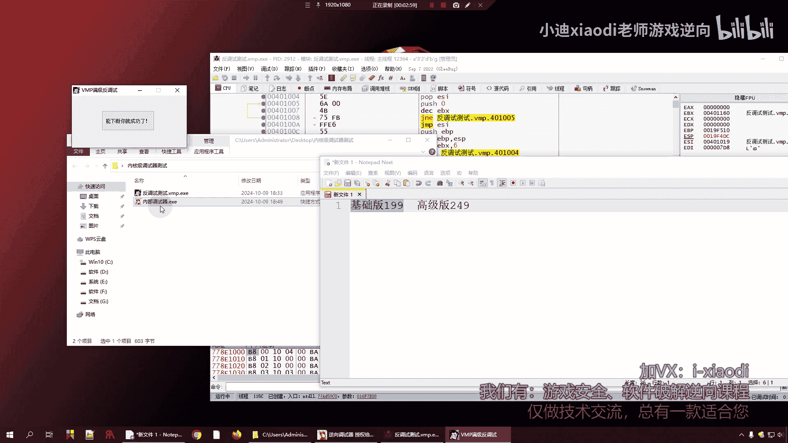

## 软件逆向与反调试实战教程：00：课程概述与学习目标 🎯

各位读者，我是小李老师。本教程对应视频编号 BV1tt2AY5Erc，主题是软件逆向破解中的内核 VT 级别调试器，也就是内部调试器的用法。在本节课中我们将要学习内部调试器如何绕过 VMP、TMD、SE 等强壳的反调试，并把它整理成一套初学者能看懂的实操流程。这个内容属于游戏安全、软件安全、网络安全和 CTF 比赛里的基础技能，理解调试器和反调试之间的关系，对后续分析程序行为很有帮助。

本节先说明整体目标：先看一个满级反调试软件如何让普通调试器失败，再看内部调试器如何连接驱动、附加进程、下断点并稳定运行。核心思路可以用下面的代码表示：

```text
破解入口 = MessageBoxA 断点
普通调试器失败 = 反调试触发 -> 闪退
内部调试器成功 = VT调试模式 + 驱动连接成功 + 附加进程 + 断点命中
```

上一段已经把课程目标讲清楚，下一节我们进入演示环境，看看普通调试器为什么会失败。

## 软件逆向与反调试实战教程：01：普通调试器被反调试拦截 🧪

上一节我们介绍了课程目标和核心思路，本节中我们来看看演示环境和普通调试器的实际失败过程。演示对象是一个带有反调试功能的软件，而且它的反调试强度很高，可以理解为满级反调试。当点击软件里的按钮时，程序会弹出一个信息框，所以如果要破解这个软件，一个自然思路就是给信息框相关的 API 下断点，让程序在弹出信息框之前暂停。

普通调试器是 DBG，它也带有一些反反调试插件，用来绕过 VMP 或其他强壳的插件。演示中已经把这些插件都配置完成，包括界面上看到的额外插件，也都已经配上。接下来就是尝试下断点，看看配置插件后能不能正常拦截程序。以下是本节演示步骤：



- 准备一个带有满级反调试的目标软件。
- 点击目标软件按钮，确认它会弹出信息框。
- 根据信息框行为，确定要下 MessageBoxA 断点。
- 使用普通 DBG，并配置绕过 VMP 等强壳的反反调试插件。
- 在任意位置打一个断点，尝试对 MessageBoxA 下断。
- 点击目标按钮，观察程序是否暂停。

实际结果是，断点打上后点击按钮，程序直接闪退。可以看到反调试已经起作用，普通调试器即使带了插件，在这个演示里仍然被拦截。这说明不能只靠普通调试器硬碰，遇到强壳反调试时需要换思路。

> 结论：普通调试器加反反调试插件仍有失败可能，反调试触发后表现为直接闪退。

看到失败后，不能就这么简简单单放弃，肯定不行。下一节我们使用内部调试器，并说明加入高级版软件安全逆向破解社区后可免费授权、永久使用该工具。

## 软件逆向与反调试实战教程：02：内部调试器准备与启动 🛠️

上一节我们看到了普通调试器被反调试拦截，本节中我们来看看内部调试器如何准备和启动。内部调试器是高级版软件安全逆向破解社区提供的工具，加入社区的朋友可以免费授权并永久使用。它的作用是可以过一切强壳的反调试，所以这里用它来完成演示。先运行这个调试器，启动过程需要稍等一下。

运行起来后会出现调试器界面。接着点击调试器列表，在列表里鼠标右键添加工具包中的 DBG 软件。添加完成之后，首先要点击进入 VT 调试模式，这一步是内部调试器的关键。点击后界面会提示连接驱动成功，看到这个提示就说明驱动连接完成。然后对着调试器鼠标右键点击启动，界面会提示调试器启动成功。启动成功后，把调试器最小化即可，后面再回到目标软件操作。以下是内部调试器的准备步骤：



- 运行内部调试器，等待界面出现。
- 点击调试器列表，鼠标右键添加工具包中的 DBG 软件。
- 添加后点击进入 VT 调试模式。
- 确认提示连接驱动成功。
- 对调试器鼠标右键点击启动。
- 确认提示调试器启动成功。
- 将调试器最小化，准备附加目标软件。

核心流程可以用下面的代码概括：



```text
内部调试器 -> 添加 DBG -> 进入 VT 调试模式 -> 驱动连接成功 -> 右键启动 -> 启动成功
```

> 结论：VT 调试模式连接驱动成功，是内部调试器能够继续工作的前置条件。

准备工作完成后，下一节我们运行目标软件，把调试器附加到进程上，并验证断点和单步是否正常。

## 软件逆向与反调试实战教程：03：附加目标与断点验证 🔍

上一节我们完成了内部调试器的启动，本节中我们来看看如何附加目标软件并验证断点。先运行目标软件，然后在软件里点击文件，再点击附加，让内部调试器挂到目标进程上。附加完成后，再次对 MessageBoxA 下断点。此时可以看到断点已经下上，点击目标按钮后程序能够断下，说明内部调试器已经绕过了前面的反调试拦截。

断下之后还可以使用快捷键继续分析。按 Ctrl+F9 可以执行到返回，按 F8 可以进行单步分析，这些操作都没有问题。按 F9 运行、按 F8 单步时，程序不会出现丝毫崩溃。继续运行程序，也没有出现崩溃或闪退。这样就从实际操作上验证了内部调试器在这个场景中的稳定性。以下是本节验证步骤：

- 运行目标软件。
- 在目标软件中点击文件，再点击附加。
- 对 MessageBoxA 下断点。
- 点击目标按钮，确认断点可以命中。
- 使用 Ctrl+F9 执行到返回。
- 使用 F8 进行单步分析。
- 使用 F9 运行程序，观察是否崩溃或闪退。

关键操作可以写成下面的代码：



```text
附加目标进程 -> bp MessageBoxA -> 断点命中
Ctrl+F9 = 执行到返回
F8 = 单步
F9 = 运行
```

> 结论：内部调试器附加目标后，MessageBoxA 断点可命中，F8、F9、Ctrl+F9 操作稳定，程序没有崩溃或闪退。

以上内容就是内部调试器的使用方法。下一节我们说明版本和工具获取方式，并解释基础版与高级版的区别。

## 软件逆向与反调试实战教程：04：版本与工具说明 💰



上一节我们验证了内部调试器可以稳定断下程序，本节中我们来看看版本和工具说明。当前加入高级版软件安全逆向破解社区，基础版价格为 199，高级版价格为 249。高级版社区成员会获得这样一个内部调试器，方便在强壳反调试场景下进行调试。这个工具的价值在于把复杂的过反调试流程简化，让初学者也能按步骤完成操作。

除内部调试器外，也有其他方法。基础版也有类似的过反调试方法，但操作比较麻烦。如果拿到这个工具，使用起来会更简单。以下是版本与工具要点：

- 基础版价格为 199。
- 高级版价格为 249。
- 高级版社区成员可获得内部调试器。
- 基础版也有类似过反调试方法，但流程更麻烦。
- 使用现成工具可以降低操作难度。

价格和工具关系可以用下面的代码表示：

```text
基础版 = 199
高级版 = 249
高级版社区成员 -> 内部调试器
```

> 结论：高级版提供内部调试器，基础版也有类似方法但更麻烦，使用工具会更简单。

到这里，工具准备、启动、附加和验证流程都已经讲完。下一节我们对整篇教程做一次总结，把关键步骤再串一遍。

## 软件逆向与反调试实战教程：05：课程总结与回顾 ✅

前面几节我们依次学习了普通调试器失败、内部调试器启动、附加目标验证断点以及版本工具说明，本节中我们对整篇教程做总结。本节课中我们一起学习了内部调试器绕过强壳反调试的完整流程：先确认目标软件会弹出信息框，再确定 MessageBoxA 断点思路；普通 DBG 即使配置反反调试插件仍可能被拦截并闪退；随后使用内部调试器进入 VT 调试模式，连接驱动成功并启动；最后附加目标进程，下 MessageBoxA 断点，使用 Ctrl+F9、F8、F9 进行验证，程序没有崩溃或闪退。以下是本教程要点回顾：

- 反调试软件可能表现为点击按钮后直接闪退。
- 信息框场景可以从 MessageBoxA 断点入手。
- 普通 DBG 配置插件后仍可能失败。
- 内部调试器需要先进入 VT 调试模式并连接驱动。
- 附加目标后可以正常下断、单步和运行。
- 高级版社区提供内部调试器，基础版也有类似方法但更麻烦。



整体流程可以再压缩成下面的代码：



```text
目标按钮 -> 信息框 -> MessageBoxA 断点
普通 DBG -> 反调试触发 -> 闪退
内部调试器 -> VT模式 -> 驱动成功 -> 启动 -> 附加 -> 断点命中 -> 稳定运行
```

今天的内容就是这些，下期再见。

