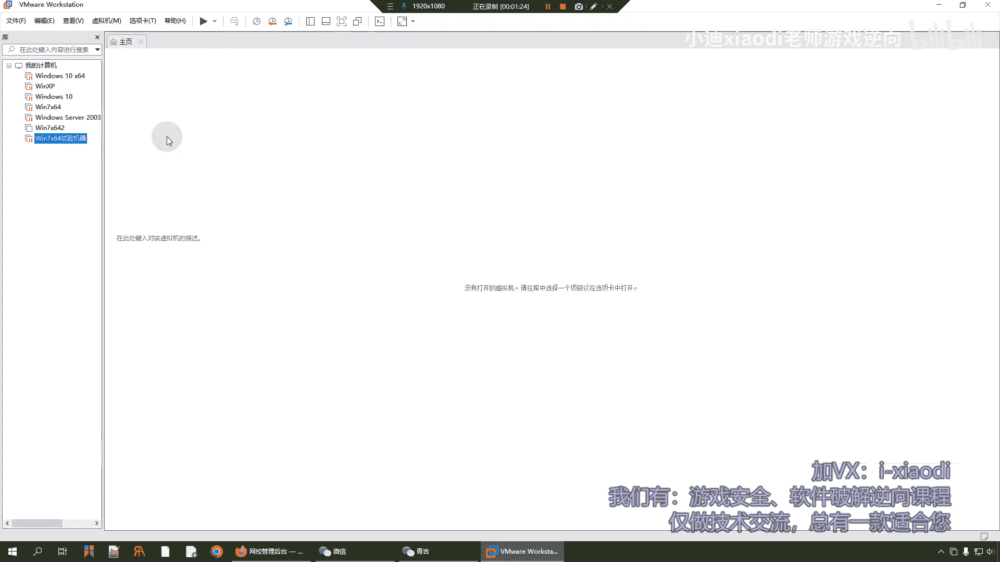
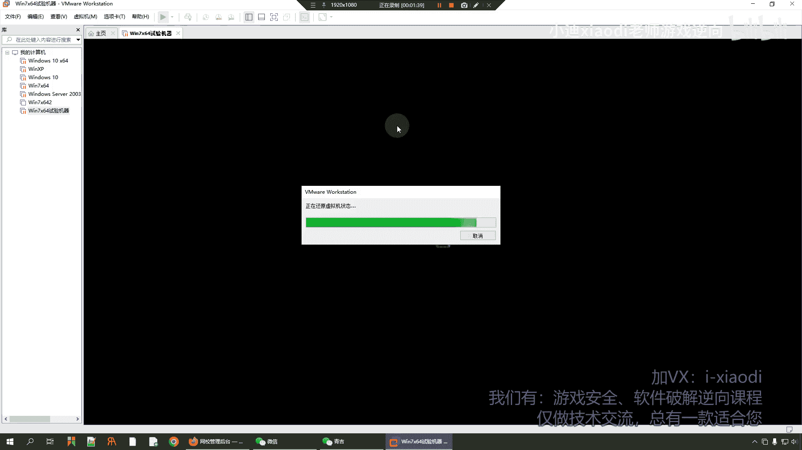
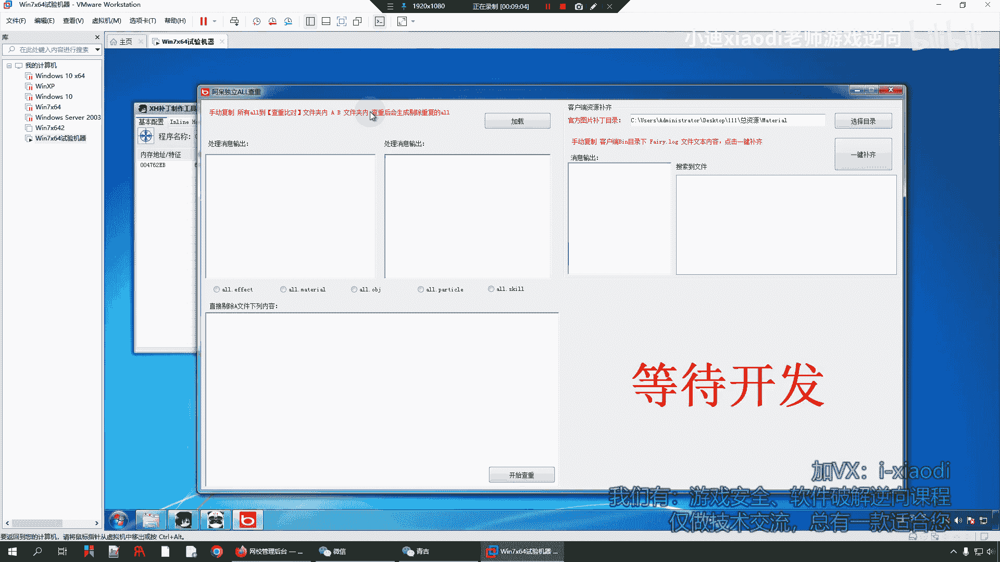

# 🧰 软件逆向破解实战教程：01：某网络验证VMP壳与反调试带壳破解爆破

在本节课中我们将要学习某网络验证程序的VMP壳识别、反调试处理以及带壳补丁爆破。本次课程由小李老师代替阿伟老师讲解，因为阿伟老师临时有事；这是一次临时加餐，已经与阿伟老师沟通，他今天没有时间。课程声音处于录制状态，讲解时会关闭相关窗口，保持环境干净。之前第六章已经讲过带VMP壳如何打补丁，本课重点放在实战中遇到反调试时如何处理，并用阿呆综合工具（二代综合工具）完成演示。通过本节内容，初学者可以理解“带壳程序先打补丁、再处理反调试”的基本思路。

## 📌 软件逆向破解实战教程：02：VMP壳特征与工具准备

上一节我们说明了本课目标和课程背景，本节中我们来看看VMP壳的基本特征以及需要准备的工具。

VMP壳不需要专门研究它的完整破解方法，实际处理时直接打补丁就可以。唯一需要重点关注的是程序遇到反调试时怎么处理；阿伟老师的内部视频也提供过一些讲解。实战对象是阿呆综合工具，也就是文中提到的二代综合工具。我们先打开`ESin`查看程序壳信息，壳版本可能是3.0或5.0。VMP壳的典型特征是其他区段比较正常，但会多出两个区段：`VMP0`和`VMP1`，这两个区段带有VMP特征。需要注意，区段名字可以随意更改，所以不能只看名字，还要结合区段结构判断。

以下是识别VMP壳时可以观察的特征：

```text
正常区段 + VMP0 + VMP1
```

区段名可能被修改，因此要结合多信息判断。

确认壳特征后，还要实战分析程序是否带有反调试，并查看如何处理。这是临时加餐内容，阿伟老师今天没有时间。课程声音正在录制，讲解前会关闭无关窗口。

## 🔍 软件逆向破解实战教程：03：附加调试器与反调试配置



上一节我们认识了VMP壳的区段特征，本节中我们来看看调试工具如何配置，以及附加前要处理的反调试细节。

先查看阿呆综合工具（二代综合工具）的位置，打开之前已经破解好的版本查看效果。运行破解版后可以看到程序界面，说明破解有效。该程序带有VMP壳，再次查看壳信息确认是VMP壳。处理时先打开调试工具，点击插件进行配置。需要先配置一个插件，它有助于对抗VMP的反调试，但并不是完全有效，仍需实际测试。



以下是附加调试器前需要完成的配置顺序：

1. 先运行程序，再执行附加；程序启动可能较慢，需要耐心等待图标出现。

2. 程序界面出来后，点击“文件”，再点击“附加”，然后双击目标进程。

3. 附加成功后还有设置要做：程序可能出现异常，需要点击“选项”，进入异常设置，选择“不暂停”。

4. 先配置异常规则并保存，再去附加；否则可能出现闪退。

5. 登录界面打开软件后不要乱点，避免触发额外逻辑。

> 注意：先配置异常处理规则，再附加调试器；这是避免闪退的小细节。

完成附加和异常配置后，接下来定位程序主模块和窗口。

## 🧭 软件逆向破解实战教程：04：定位易语言启动窗口与功能窗口

上一节我们完成了调试器附加和反调试配置，本节中我们来看看如何在易语言程序中定位启动窗口。

附加后点击“符号”，双击切换到程序主模块。查看程序语言，可以看到这是E语言程序。对于E语言程序，可以搜索当前模块的匹配特征，搜索内容为`FF25`，点击整块勾选，再点击确定。随后随便双击搜索结果，就能看到载入窗口相关代码；阿伟老师之前也讲过这个载入窗口。接下来要确认程序到底有几个窗口，这里看到的是启动窗口的载入。

以下是定位窗口时可以采用的步骤：

1. 在插件中点击专门针对易语言的工具。

2. 点击`open window`，可以看到多个窗口。

3. 其中`OBG搬运工`是启动窗口，其他窗口应该是功能窗口。

4. 先尝试地址`5201648C`，对它打补丁即可。

定位到启动窗口后，下面进入补丁制作。

## 🩹 软件逆向破解实战教程：05：制作第一个补丁（5201648C）

上一节我们定位了启动窗口和功能窗口，本节中我们来看看如何为地址`5201648C`制作带壳补丁。

该程序是TMD壳，处理方式是打补丁。可以使用`xH工具`打补丁，找到程序后拖入工具。第二步记录地址并复制；先不复制选区，先查看需要修改的位置。随后用`push`方式处理：在`push`位置把地址改为`5201648C`，输入时注意大小写。修改后可以看到字节数组发生变化，这说明指令已经被改写。接着先复制地址，再在二进制数据中复制对应字节，然后点击“添加”。

以下是第一个窗口补丁的操作流程：

```asm
; 关键位置改写为
push 5201648C
```

1. 在`push`位置写入`5201648C`，确认字节数组变化。

2. 复制地址，再通过二进制复制得到对应字节。

3. 点击“添加”，保存这条补丁记录。

4. 点击`inline hook`；带壳程序需要解码。

5. 勾选并双击`create window eA`，含义是在创建窗口时进行解码。

6. 生成补丁，回到综合工具，把补丁命名为`text1`，测试能否运行。

运行`text E`并点击测试；如果程序已经启动，先关闭再测试。所有窗口破解都采用类似方式，可以对每个窗口单独破解。

## 🧩 软件逆向破解实战教程：06：制作第二个补丁（5201A214）

上一节我们完成了第一个窗口地址的补丁，本节中我们再来破解第二个窗口地址`5201A214`。

在工具中可以看到地址`5201A214`，点击确定。然后修改这条地址，在鼠标右键菜单中选择“二进制复制”，地址仍然是这个地址。点击“添加”，把上一个补丁条目删除，只保留一个条目，界面中只留下与`14A2`相关的记录，显示为`14A20152`。随后再次生成补丁，把补丁保存为`text2.exe`，点击保存并提示配置保存成功。

以下是第二个窗口补丁的操作流程：

```text
补丁地址：5201A214
保留条目：14A2（界面显示 14A20152）
补丁文件：text2.exe
```

1. 定位地址`5201A214`并点击确定。

2. 右键选择“二进制复制”，复制该地址对应字节。

3. 点击“添加”，删除上一个条目，只保留`14A2`相关条目。

4. 生成补丁并保存为`text2.exe`，确认配置保存成功。

两个补丁都生成后，最后验证运行效果并总结思路。

## ✅ 软件逆向破解实战教程：07：验证效果与课程总结

上一节我们完成了两个窗口补丁的制作，本节中我们来看看补丁运行效果，并对整节课程做总结。

正常测试时先关闭程序，再关闭程序窗口。先运行`t1`，这是刚才保存的破解版，可以看到界面出现。然后运行第二个破解版，界面同样出现。这个案例就是VMP壳的带壳破解。整体思路比较简单：使用`push`创建法，因为该程序刚好可以用这种方法。关于`push`创建法，阿伟老师已经讲过，可以查看他的相关内容。

以下是验证补丁效果时可以观察的结果：

1. 运行第一个破解版`t1`，程序界面正常出现。

2. 运行第二个破解版，程序界面也正常出现。

3. 两个窗口分别破解成功，说明按窗口单独打补丁的思路有效。



本节课中我们一起学习了VMP壳特征识别、反调试配置、易语言启动窗口定位、`push`创建法补丁制作以及两个窗口地址的单独破解。核心流程可以概括为：

```text
破解入口 = 启动窗口载入地址
补丁流程 = 定位窗口 → 记录地址 → 改写 push 地址 → 二进制复制字节 → inline hook 解码 → 生成补丁
```

本次课程到此结束，下期再见。

