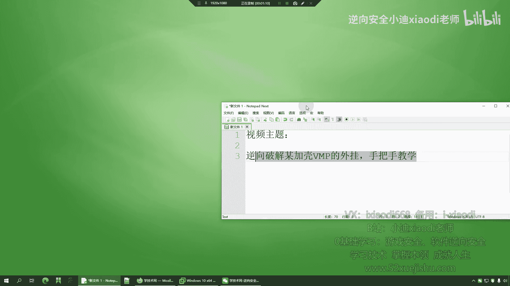
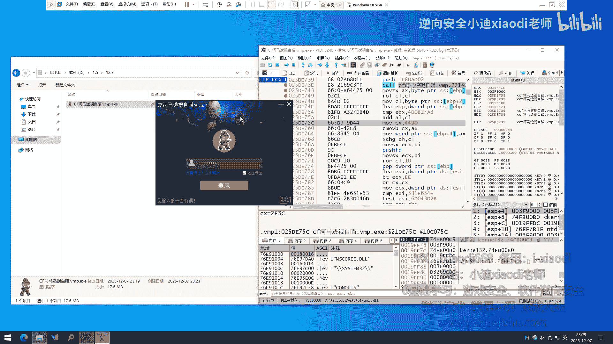
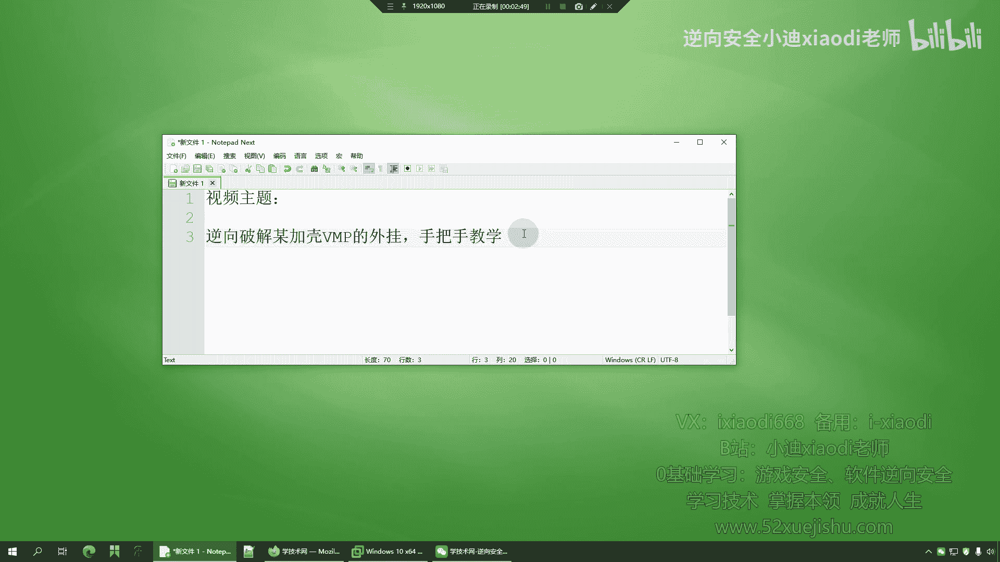
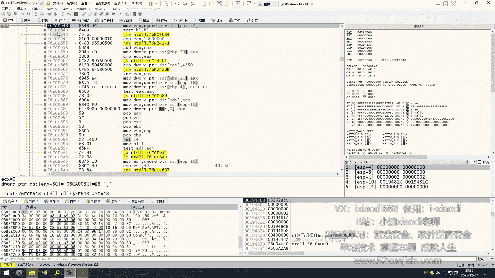
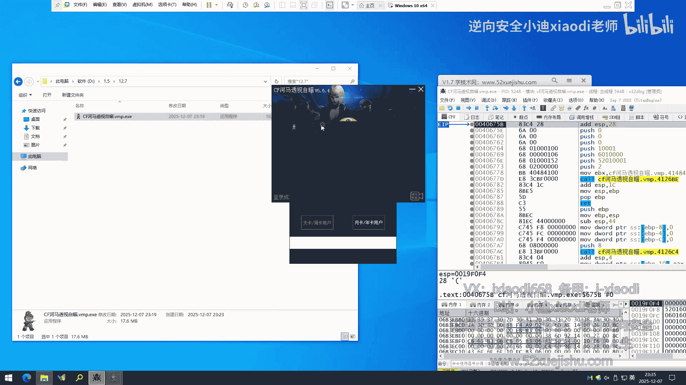
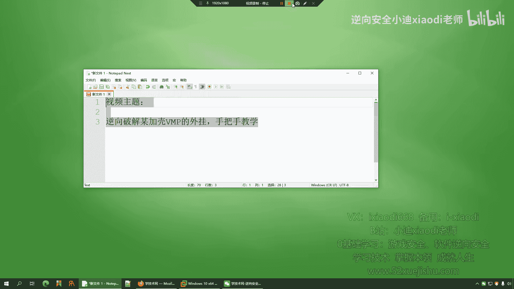

# 🧭 软件逆向破解实战：01：课程概述与学习目标

课程由小迪老师讲解，主题是继续学习软件逆向破解。不少同学会疑问，逆向能做什么。简单说，逆向可以分析一些小软件的行为，也可以理解软件的保护与验证流程。课程中提到“白嫖”这种文艺说法，用来形容部分人希望免费使用外挂或小软件的想法，这类想法可以理解，但学习逆向更应建立在合法授权和理论基础之上。课程以某VMP加壳外挂网络验证案例为背景，使用x64dbg类调试工具做手把手教学，目标是让初学者理解调试分析的基本流程和思路。

本节先说明课程定位。上一节没有内容，本节中我们来看看课程概述与学习目标。课程会展示学员学习效果，提到“双击内存”案例，但该案例具体含义没有展开。课程也说明，如果想学习相关内容，可以参考网站中最新更新的内容，学习效果和当前价格可以咨询了解。课程不展开无关内容，直接进入主题。以下是本节需要了解的目标列表。

- 理解软件逆向破解的学习场景和合法边界。
- 认识VMP壳的基本概念和调试分析工具。
- 理解信息框提示与控件文本提示的差异。
- 学习断点、单步跟踪和错误分支定位的基本思路。
- 明白逆向思路需要理论和技术储备支撑。

本节最后强调一个核心观点：逆向不能只照搬别人的操作，需要理解流程和原理。下面进入案例背景。

---

# 🧭 软件逆向破解实战：02：案例背景与VMP壳认识

上一节我们说明了课程目标和学习边界，本节中我们来看看案例背景与VMP壳。课程案例中出现一个“CF河马透视自瞄”样本，后缀为“.VIP”，暂时不知道这个后缀的具体含义。课程使用PE工具ExeInfoPE查看软件信息，把样本拖入工具即可查看保护情况。工具显示VMProtect保护，这说明软件有壳，也有保护，属于很多人比较害怕的VMP壳。

简单说，壳可以理解为软件外面加的一层防护。外挂软件加壳后，分析难度会提高。VMP是较强的一种壳，所以不少人看到VMP会望而生畏。课程的目标是围绕这个案例做实战分析，但本教程仅用于合法授权、教学靶场和自建软件的学习，不提供针对真实软件、外挂或网络验证的绕过与破解操作细节。以下是本节的概念列表。



- 案例样本：CF河马透视自瞄，后缀“.VIP”。
- 查看工具：ExeInfoPE，用于查看PE文件信息。
- 保护信息：VMProtect，说明样本加壳。
- 学习态度：VMP难度较高，需要理论和技术储备。

本节用公式描述软件保护的基本概念，方便初学者理解。概念公式如下。

```text
原始程序 + 壳/保护层 -> 加壳后的程序
```

本节结束前说明，认识壳只是第一步。下一节我们来看看调试工具的准备和基本配置。

---

# 🧭 软件逆向破解实战：03：调试工具准备与程序运行观察

上一节我们认识了VMP壳和案例样本，本节中我们来看看调试工具准备与程序运行观察。课程使用x64dbg类调试工具，原文提到“叉32DBG”。打开工具后先做配置，点击插件，找到相关选项，启用VMProtect相关支持，再点击应用和OK。配置完成后，把程序拖入工具并运行，等待程序跑起来。

程序运行后，点击登录，界面提示“您的卡密有误”，同时软件处于正常运行状态。课程特别提到一个疑问：为什么这个软件没有信息框。之前讲过的案例常有信息框，但并不是所有软件都会用信息框。有的软件不用信息框，而是把提示文本设置到标签或控件上。以下是本节观察要点列表。

- 工具配置：在插件选项中启用VMProtect相关支持。
- 程序加载：把样本拖入调试器并运行。
- 行为观察：点击登录后提示“您的卡密有误”。
- 界面特点：没有信息框，提示可能来自控件文本。

本节给出控件提示的概念代码，帮助理解界面文本更新。代码如下。

```c
// 概念示意：验证结果被设置到界面控件
control.text = "您的卡密有误";
```

本节说明，界面提示不一定来自弹窗，也可能来自控件文本。下一节我们来看看如何定位这类文本更新逻辑。



---

# 🧭 软件逆向破解实战：04：定位控件文本更新与断点分析

上一节我们观察到提示来自控件而不是信息框，本节中我们来看看如何定位控件文本更新。课程指出，这类提示的本质是标签或控件，程序把文本设置到控件上，因此会用到界面文本更新相关API，例如SetWindowText。课程使用Ctrl+G跳转到相关API，再使用F2设置断点。断点就是代码执行到该位置时中断的点。



点击登录后，程序果然断在断点处。此时可以看到正在查验卡密等信息。继续运行后，界面出现“您的卡密有误”，说明相关代码已经执行。课程解释，这段代码会从服务器拉取数据，判断卡密是否有误，再把内容设置到界面。由此可知，校验逻辑应该在更靠前的位置。以下是本节分析步骤列表。

- 使用Ctrl+G跳转到文本更新相关API。
- 使用F2设置断点。
- 点击登录，观察程序是否中断。
- 继续运行，确认错误提示出现。
- 判断校验逻辑位于文本更新之前。

本节用流程公式描述验证与显示的先后关系。公式如下。

```text
输入卡密 -> 服务器校验 -> 返回结果 -> 更新控件文本
```

本节说明，定位到显示逻辑后，需要继续向前追踪校验逻辑。下一节我们来看看返回上层和错误分支的观察。

---

# 🧭 软件逆向破解实战：05：返回上层与错误分支观察

上一节我们定位到控件文本更新，本节中我们来看看返回上层与错误分支观察。课程使用Ctrl+9返回，再使用F8继续返回，逐层回到更上层的调用位置。返回到某一层后，可以看到“您输入的卡密有误”这类错误提示逻辑，并对该位置做注释，标记为代码错误逻辑。

课程观察到一个跳转箭头，说明该跳转可以跳过错误逻辑。课程在授权靶场中演示了“把跳转改为跳过”的思路，但本教程不提供针对真实软件的具体二进制修改步骤，也不提供用于绕过网络验证的可操作细节。学习重点是理解错误分支如何形成，以及为什么要从显示逻辑向前追踪。以下是本节理解要点列表。

- Ctrl+9用于返回上层。
- F8用于单步执行和继续返回。
- 错误提示对应错误分支。
- 跳转可能决定是否进入错误分支。
- 真实软件中不应绕过授权验证。

本节用伪代码描述错误分支的概念，不涉及具体修改。代码如下。

```c
if (server_result == invalid) {
    show("您的卡密有误");
} else {
    show("登录成功");
}
```

本节说明，看到跳转不等于理解流程。下一节我们来看看为什么照搬操作容易失败。

---

# 🧭 软件逆向破解实战：06：理论基础与调试流程的重要性

上一节我们观察到错误分支和跳转关系，本节中我们来看看理论基础与调试流程的重要性。课程指出，逆向破解看起来简单，把跳转改成跳过就可能得到结果，但真正学习时必须掌握相关理论和技术。否则学会一个样本只是照葫芦画瓢，换一种情况可能就不会。缺少知识储备就没有思路，思路建立在理论基础之上。

课程运行程序并尝试强制跳转后，点击登录，程序断在“正在查验卡密”。继续运行后，程序一直不往下执行，说明刚才的逻辑仍有问题，后面还有校验。课程强调，不要只看别人视频里改几处就成功，别人成功不代表自己能成功，因为分析流程没有录出来。以下是本节学习提醒列表。

- 只学操作步骤，换样本容易失去思路。
- 理论基础决定分析方向。
- 调试需要一步一步跟踪。
- 程序卡住可能说明后面还有校验。
- 分析流程比单个修改结果更重要。

本节用公式描述“操作”和“理论”的关系。公式如下。

```text
逆向能力 = 工具操作 + 理论基础 + 分析流程
```

本节说明，理论不足会导致流程断裂。下一节我们来看看继续单步跟踪和封包数据观察。

---

# 🧭 软件逆向破解实战：07：单步跟踪与封包数据观察

上一节我们强调理论和流程的重要性，本节中我们来看看单步跟踪与封包数据观察。课程重新打点，点击登录后程序断下，下方出现“149”这类数据。课程判断它可能是封包数据。一般来说，这类封包数据改成0容易成功，但课程实际尝试二进制编辑，把149改成000后运行仍然不行，说明逻辑还在后面。

课程继续点击登录，使用F8单步执行，观察哪里没有加载出预期逻辑。过程中看到CMP 0等比较逻辑，也看到跳过某些判断的情况。课程提到“MS点VIP”相关逻辑不能随便跳过，否则登录进不去。继续往下走，程序出现登录成功。以下是本节观察列表。

- 断点后查看疑似封包数据。
- 课程讨论将封包值改为0的思路。
- 实际修改后仍不成功，说明后面还有校验。
- 使用F8单步执行观察比较和跳转。
- 某些判断不能跳过，否则登录流程中断。

本节用流程公式描述单步跟踪的观察方式。公式如下。

```text
断点 -> 单步执行 -> 观察比较/跳转 -> 判断分支作用 -> 继续跟踪
```

本节说明，封包修改不是万能方法，需要结合后续逻辑。下一节我们来看看登录成功判断和流程完整性。

---

# 🧭 软件逆向破解实战：08：登录成功判断与流程完整性

上一节我们观察到封包数据和单步跟踪结果，本节中我们来看看登录成功判断与流程完整性。课程指出，不能随意让关键判断跳走，一跳可能导致登录成功流程消失。需要判断哪些跳转必须保留，哪些分支会导致失败。课程在授权靶场中演示了将某些指令改为无效代码的思路，但本教程不展开具体NOP操作，也不提供真实软件中的破解步骤。

课程继续单步执行，观察到1970年这类时间值。课程尝试把年份改为2970，继续运行后，时间出现，功能也出现。程序卡了一下后继续运行，最终出现成功界面，显示“2970年，感谢您购买本辅助。目前软件处于更新中”，还有官网到期时间2970年。课程用夸张说法表示可以用到孙子的孙子的孙子的孙子。以下是本节理解要点列表。

- 关键判断影响登录流程是否完整。
- 无效指令的思路是让某段代码不执行。
- 时间值可能与授权到期时间相关。
- 修改年份后需要继续运行验证流程。
- 成功界面包含购买提示、更新状态和到期时间。



本节用伪代码描述授权时间概念，不涉及真实修改。代码如下。



```c
if (current_time < expire_time) {
    allow_use();
} else {
    deny_use();
}
```

本节说明，流程完整性比单点修改更重要。下一节我们来看看课程总结和学习建议。

---

# 🧭 软件逆向破解实战：09：课程总结与学习建议

上一节我们完成了登录成功判断和流程完整性的讨论，本节中我们来看看课程总结与学习建议。课程表示，今天的内容是手把手教学，基本覆盖了分析过程中碰到的问题，也讲解了逆向分析中的一些猜想和拓展。课程提到，如果大家对内容感兴趣，喜欢小迪老师讲解的内容，可以加入限时特价，具体可以自行查看。小迪老师期待加入，并说下期再见。

本教程最后再次强调合法边界：软件逆向学习应使用合法授权软件、教学靶场或自建程序，不用于破解真实软件、外挂或绕过网络验证。以下是本节课总结列表。

- 认识了VMP壳和VMProtect保护信息。
- 了解了x64dbg类工具的配置和程序运行观察。
- 理解了信息框与控件文本提示的差异。
- 学习了断点、返回上层、单步跟踪的基本思路。
- 明白了错误分支、关键跳转和流程完整性的关系。
- 认识到理论基础和分析流程比照搬操作更重要。



本节课中我们一起学习了软件逆向破解实战的入门流程，围绕某VMP加壳外挂网络验证案例，理解了工具准备、控件文本定位、断点分析、单步跟踪、错误分支观察和授权时间概念。课程也说明了学习效果、网站内容、价格咨询和限时特价信息。学习逆向需要坚持合法授权，重视理论基础，逐步建立自己的分析流程。下期再见。

