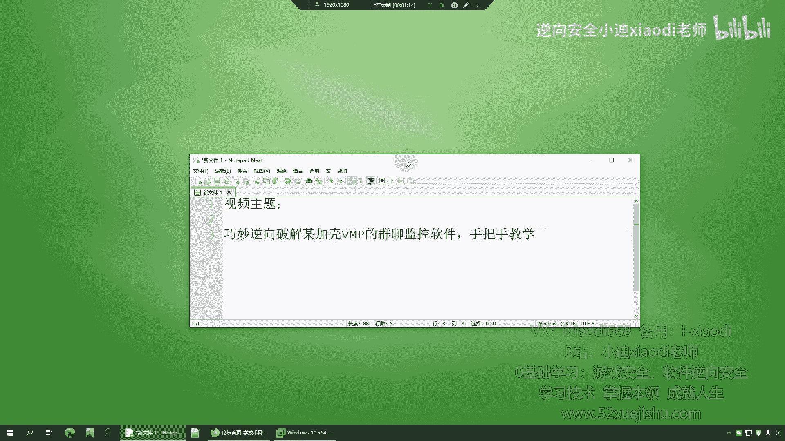
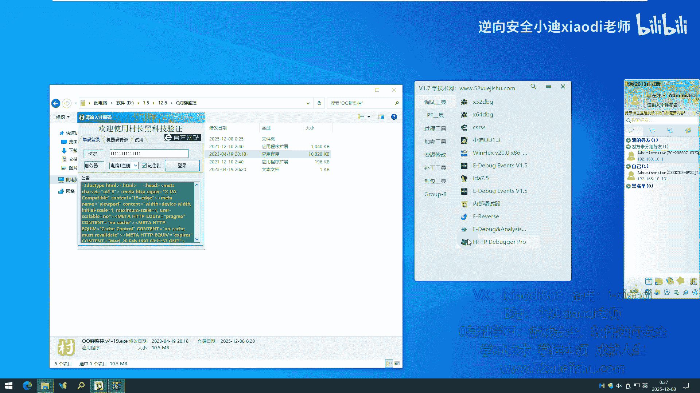
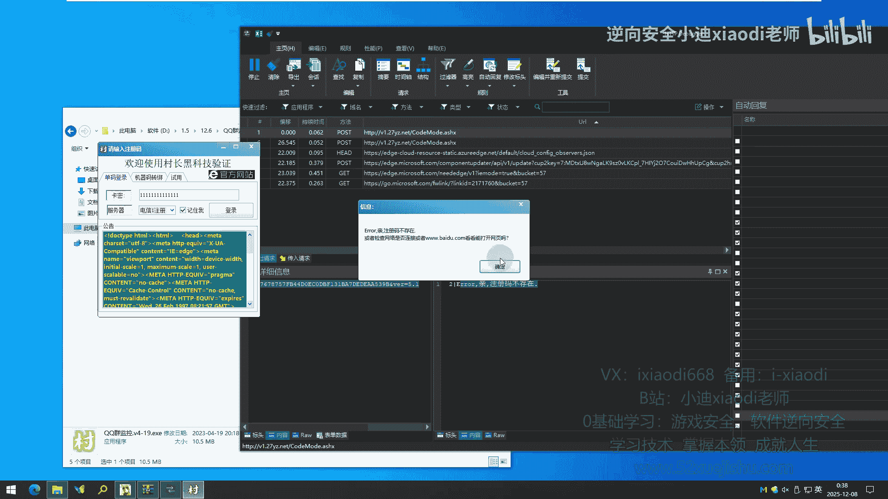
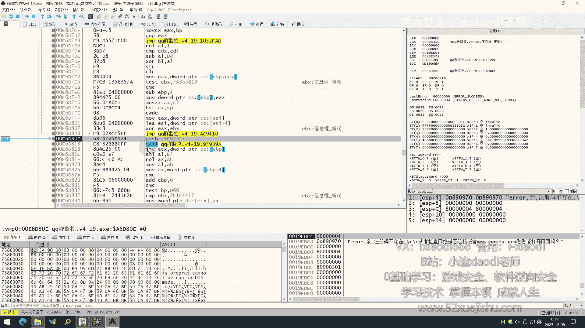
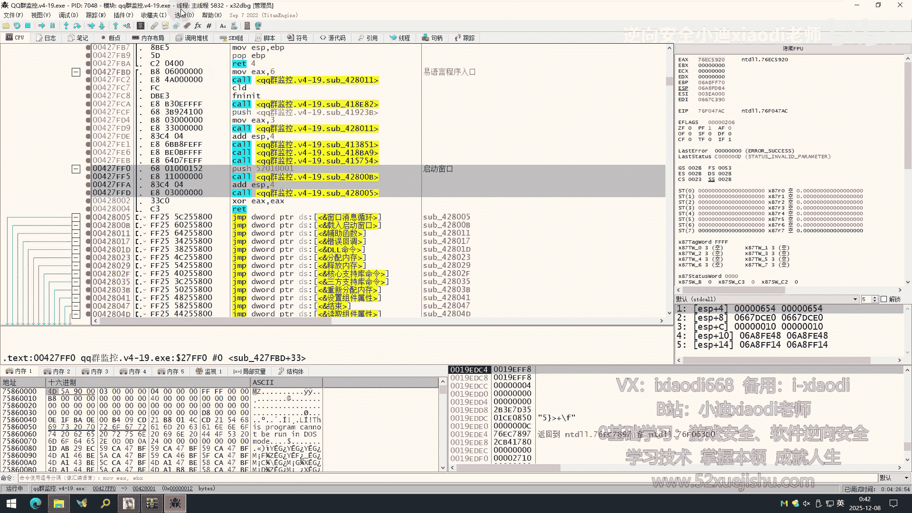
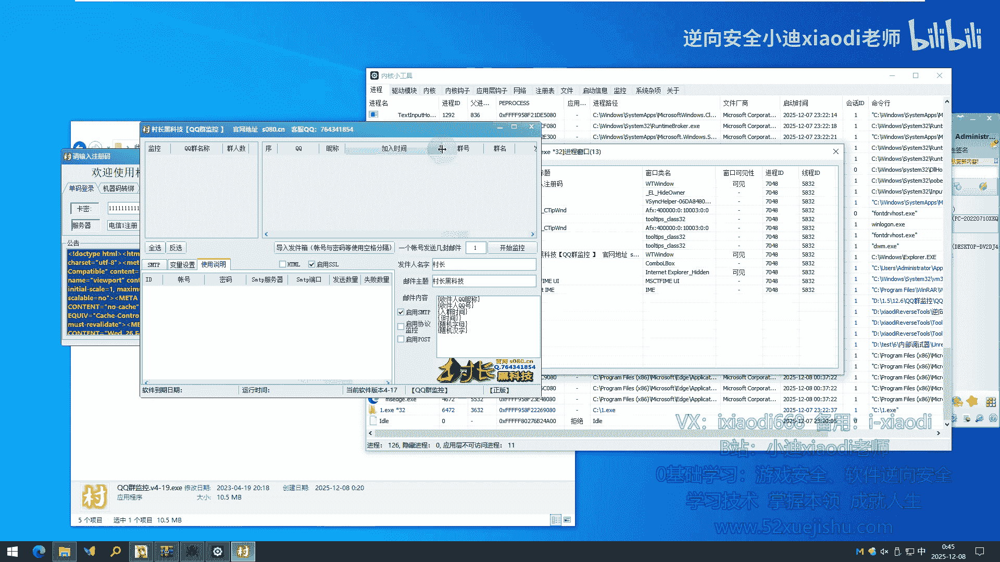

# 🧰 软件逆向破解实战：01：课程概述与案例引入

在本节课程中，我们将要学习软件逆向破解实战中的一个综合案例：一款加了VMP壳的群聊监控软件，并围绕查壳、网络验证抓包、x64dbg调试、代码虚拟化、窗口分析和隐藏窗口激活等内容展开。大家好，我是小迪老师，本节继续讲软件逆向破解。有不少同学疑惑，为什么逆向破解有这么多人听，它能做什么；实际用途之一就是能够分析一些小软件。今天我们就来分析一款加了VMP壳的群聊监控软件，分析过程比较巧妙，也很有意思，后面会逐步展开。

先看大家的学习效果。有同学做了一个DMA辅助，界面上出现了`bypassing success`和`initialization success`，英语可以修一修，但含义是破解成功，说明学习有成效。恭喜大家学有所成。客套话不多说，如果大家想学习相关逆向内容，想取得类似学习效果，可以加入我们的内容，当前只需要249。如果想交流，可以点击论坛社区，论坛社区里有很多优秀帖子和文章，大家可以自行阅读。客套话不多说，直接进入主题，进行巧妙分析。

以下是学习效果与课程说明信息：

- 学习效果案例：有同学做了DMA辅助，出现`bypassing success`、`initialization success`，说明破解成功，学习有成效；英语可以修一修，恭喜大家学有所成。



- 课程说明：想学习相关逆向内容、想取得类似效果，可以加入我们的内容，当前只需要249；想交流可以点击论坛社区，社区里有很多优秀帖子和文章，可以自行阅读。

上一节内容完成了课程引入，本节中我们来看看拿到软件后的第一步：查壳和程序信息识别。

# 🔎 软件逆向破解实战：02：查壳与识别新版VMP

拿到一个软件后，先看它是什么程序。这个案例是QQ群监控软件，听起来像要监控你，先不讨论它如何监控。我们打开PE工具和ESEin Information工具，把程序信息提取出来。工具显示`unknown unknown`，意思是未知；同时显示`99% pack protected`，也就是99%被保护。上一节课程中，工具能够直接查出VMP壳，但这个程序查不出来，原因是它使用了新版VMP。

新版VMP可以这样看：打开starPE，把程序拖过来，点击区段，可以看到`VMP0`、`VMP1`，而且还多了一个东西。多出来的东西可能是作者额外加入的，具体是什么未知；但区段里有特征`VMP0`和`VMP1`，它仍然是VMP，只是加入额外内容后，导致ESEin Information工具查不出信息。没有关系，肉眼能够看出来即可。

以下是查壳时可用的一种特征判断思路：

```text
区段特征：VMP0 + VMP1 => 疑似VMP加壳
工具结果：unknown unknown + 99% pack protected => 可能被保护
```

查壳只能提供线索。接下来要分析程序行为，先把程序运行起来，再看它的网络验证和界面表现。

# 🌐 软件逆向破解实战：03：运行软件、抓包与网络验证分析

上一节我们识别了VMP特征，本节中我们来看看程序运行后的表现。先把程序运行起来，出现`fire corrupt`，说明文件被感染；我重新解压，因为我的电脑上有感染木马，比较吓人；重新解压后再运行。当大家出现这个提示时，就要知道电脑有感染病毒。程序运行后，公告界面直接花了，村长黑科技村长跑路了，公告废了；网站应该也废了、跑路了，显示`not found`，已经没了。



接下来输入卡密，随便输入后点击登录。程序返回错误，提示“注册码不存在，检查网络”。我的网络没事，能打开网页，所以问题不是网络，而是对方跑路了还不承认。先抓包，用抓包工具打开，电脑有点卡。点击登录，发现这是一个网络验证，重新操作；点击登录，取消勾选，因为之前测试过一些东西；重新点击登录。看到POST方法，验证地址是`v1.27yz.net`，这就是它的访问地址。查看访问内容，程序把数据进行加密后发送到服务器；查看返回内容，包含“注册码不存在”，这是典型网络验证。它还有信息块，所以可以从信息块下手，一步一步看能不能突破。

以下是本案例中网络验证的基本流程：

```text
客户端加密数据 -> POST https://v1.27yz.net -> 返回“注册码不存在/检查网络”
```

网络验证只是外层表现，真正分析还要进入调试器。下面我们进入x64dbg，观察断点和代码虚拟化。



# 🧠 软件逆向破解实战：04：x64dbg断点与代码虚拟化

上一节抓包确认了网络验证，本节中我们来看看如何用x64dbg下断点并理解代码虚拟化。打开x64dbg（原文称DBA），点击文件，点击附加，点击登录。然后下断点，先按错快捷键，重新按`Ctrl+G`，输入`MessageBoxA`，在这里打一个断点，再点击登录。程序断下来后，可以看到“注册码不存在”或者“检查网络”的提示，查看能不能行，然后返回，按`F9`、`F8`，再按`F8`，按`F9F8F9F8`，走到这一层。

走到这里容易看花眼，这就是大家感到害怕的原因：代码虚拟化。什么是虚拟化？假如这段代码是米饭，原本是米饭，或者现在看到的是米饭，实际上它不是米饭，而是篮球。也就是说，你以为的加法实际上是减法，你看到的代码通通可能是假的，这就是代码虚拟化。可以用下面的公式理解：



```text
看到的指令（如加法） ≠ 实际执行语义（可能是减法）
```


分析到这一层有两个方案。第一，直接分析虚拟机，研究虚拟代码怎么执行；它有一套虚拟机，有虚拟流程执行，虚拟流程有架构，可以按照架构找到处理最终位置，尝试找到判断，把值改一下，这种方案比较麻烦。还有其他方法，就是绕过。软件肯定有窗口，可以用窗口暴力破解法进行分析。

以下是两个分析方向的简要说明：

- 方案一：直接分析虚拟机执行流程，按虚拟流程架构定位最终处理位置，尝试找判断并改值，工作量较大。

- 方案二：从窗口入口绕过，利用窗口暴力破解法分析程序界面和功能窗口，寻找隐藏或未激活窗口。

上一节提到窗口入口，本节中我们来看看如何用窗口工具定位隐藏窗口。

# 🪟 软件逆向破解实战：05：窗口分析与隐藏窗口定位

代码虚拟化比较麻烦，所以转向窗口分析。点击符号，先切换到程序主模块，看到代码很干净，说明作者留下了一些蛛丝马迹，虽然有点心眼，但不多。点击插件，使用插件“村长黑科技”，查看软件。界面提示“请输入注册码”，没有看到运行状态，这个也没有，那个也没有，程序一共有三个窗口。

换一个工具，点击插件，点击小迪5.0，点击开始分析，再点击窗口组件，这里比较详细。查看`F01`，看不出来；查看`17`，说明`17`对应什么，可能是卡密。再看试用登录，查看登录按钮，刚登录在哪，没看到登录；查看按钮`_试用`，试用在这儿，显示“试用没激活”。没激活说明这个窗口就是这个窗口，这个窗口说明它还有一个功能窗口；功能窗口控件比较多，应该是功能窗口。

`5201001`这个值要敏感。易语言程序的第一个窗口，或者启动窗口，默认是这个窗口。搜索当前模块，匹配特征`FF25`，这个内容以前讲过，不再讲；双击切换过来，这里就是启动窗口，是易语言程序入口。启动窗口启动谁？启动`5201001`；再来看一眼，启动`520101`，启动黑科技，但并没有显示黑科技，而是显示一个注册相关的东西。说明程序一运行的时候，应该把这个窗口启动出来，记住它是一个窗口；程序一运行这个窗口应该出来，但现在看不到，说明它隐藏了，可以理解。

以下是窗口定位时可以用到的判断链：

```text
进程 -> 窗口列表 -> 目标窗口5201001 -> 隐藏/未激活
```

隐藏窗口不一定不能用，可以把它揪出来。下面我们看看如何显示并激活隐藏窗口。

# 🔓 软件逆向破解实战：06：激活隐藏窗口与功能验证




上一节定位到隐藏窗口，本节中我们来看看怎么把窗口显示出来。点击进程工具，有一个内核小工具，运行它；运行后找到QQ群监控，鼠标右键点击查看，查看进程的窗口，看到“村长黑科技”。鼠标右键直接显示窗口，窗口出来了。现在窗口处于冻结状态，村长不让我点，村长比较坏；不让我点，说明窗口冻结了，冻结了得激活。鼠标右键激活窗口，激活完后我点了，窗口可以动了，还可以用。导入发件箱，所有功能都可以用，然后就可以监控。村长跑路了，这个软件可能具备一定时效性。

以下是窗口显示与激活的操作顺序：

- 使用内核小工具查看目标进程窗口，右键选择显示窗口，把隐藏窗口显示出来。

- 窗口显示后如果处于冻结状态，右键选择激活窗口，之后窗口可以移动并可以使用。

- 激活后测试导入发件箱等功能，确认功能可用后即可监控。

窗口激活验证了绕过思路。接下来回看软件实现，理解它背后的API逻辑，并做课程总结。

# 📌 软件逆向破解实战：07：API实现思路与课程总结

上一节完成了隐藏窗口激活和功能验证，本节中我们来看看软件功能背后的API思路。你也可以分析这个软件怎么实现，它相关API基本调用网上已知API。比如群员总数，应该是通过QQ的API获取到的；成员总数、群成员有新增，无非是判断数量，重新拉取群成员，拉取群成员，判断QQ号；这些都是已知API，然后进行读取。这种软件写起来可能比较繁琐，但难度并不是特别大。



以下是功能实现思路的一个简化表达：

```text
群成员总数 = QQ API读取；新增判断 = 当前数量与上次数量比较
```

整个过程说明，山重水复疑无路，柳暗花明又一村。总有方法，只要不放弃，就有方法把它搞开，理解这个意思即可。本节课程中我们一起学习了VMP加壳群监控软件的查壳、运行表现、网络验证抓包、x64dbg断点、代码虚拟化理解、窗口分析、隐藏窗口显示与激活，以及API实现思路。想学习相关内容、想系统了解逆向、破解、软件开发、脱壳、汇编、易语言破解专题，感兴趣可以加入永久学习。人生没有白学的课，每节都算数，最好的开始就是现在。下期再见。

