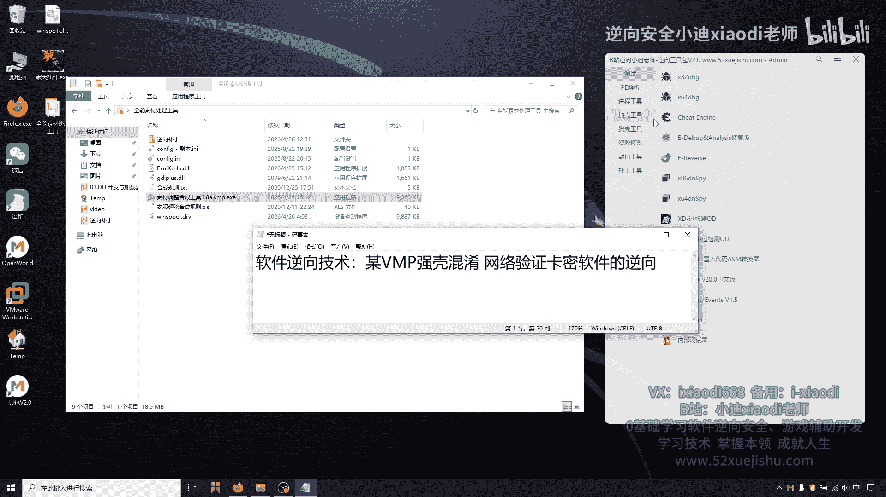

# 软件逆向破解技术：第1章：VMP强壳代码混淆破解卡密网络验证软件实战 🔐

在本节课中，我们将要学习一个软件逆向破解的完整实战案例。这个案例涉及VMP强壳、代码混淆以及卡密网络验证这三块硬骨头。很多初学者一看到VMP壳就发怵，但实际上，只要思路正确，这些难题都是可以解决的。

## 1.1 逆向工程能做什么？🔍

大家好，我是小迪老师。今天这个视频，我们来讲一个软件逆向破解的案例。有不少同学都纳闷过：你讲逆向，那么多人听你讲，这个逆向到底能干什么？实际上，逆向工程这个技术，就是用来分析一些小软件的。很多看似神秘的程序，在逆向分析面前都会逐渐暴露出自己的内部逻辑。今天我们演示的，就是这样一个很典型的分析过程。

## 1.2 案例背景：VMP强壳加代码混淆 📦

了解了逆向工程能做什么之后，我们来看一下今天这个案例的具体背景。今天我们讲的内容，是很多人都感兴趣的一个话题，那就是带VMP强壳的软件。这种软件不仅加了壳，而且代码还做了混淆处理。面对这种程序，你怎么去破解？怎么去逆向？这个技术到底能不能实现？答案当然是可以的。

今天要讲的案例，是一个网络验证卡密软件。卡密验证，简单来说，就是软件把用户输入的卡号密码发送到服务器，由服务器来验证真伪。这种案例也是大家非常感兴趣的。这种内容都包含在我们的社区视频学习内容中，大家可以看到，前面提到的这些技术都是实打实包含在课程里的。所以说，大家想要学习，想要获得这样的学习效果，都是没有问题的。

## 1.3 工具准备：用ESinPE查壳 🛠️


了解完案例背景，接下来我们要做的第一件事，就是识别这个软件到底加了什么壳。首先，我们来看一下这个软件的一些基本信息。用什么工具来看？打开我们的工具包，找到ESinPE。这个ESinPE就是一个查壳工具，或者说，它是一个查看软件信息的工具。


查壳工具的基本原理，可以用下面这段伪代码来描述：

```text
查壳原理 = 读取 PE 文件的入口点特征码，与已知壳的特征码进行比对
```

以下是使用ESinPE查壳的完整步骤：

- 打开ESinPE工具。这个工具打开的时候会有一点慢，它需要一些时间加载，请稍等一下。
- 工具界面出来之后，把目标软件直接拖到ESinPE窗口上。
- 拖动之后，界面就会显示出壳的信息。我们可以看到，这个软件的壳是VMProtect 3.0到3.5.0。
- 这个VMProtect，简称为VMP，就是很多朋友感到非常头疼的那款壳。

看到这个结果，大家现在应该明白，为什么这个案例有难度了。不过壳再强，也是有办法应对的。

## 1.4 调试环境：自带插件处理VMP壳 🚀


确认了是VMP壳之后，我们接下来就要准备好调试环境，让程序先跑起来。那这个壳，用我们工具自带的插件就可以处理。这里要说明一下，工具里都带有一些配套的插件，功能非常强大。

配备好这些工具和插件之后，你就可以直接把目标程序拖过来，进行调试分析了。以下是启动调试并运行程序的完整流程：

- 把加壳程序载入调试器，工具会自动识别并处理VMP壳的干扰。
- 点击运行，让程序跑起来。这里需要多操作一次，再点一下运行。
- 这时候可以看到效果：程序是带反调试的，但是我们已经把反调试绕过了。
- 反调试被绕过之后，这个程序就成功运行起来了。


程序运行起来之后，会弹出一个提示框，内容写着“服务器未开启测试登录功能”。这个提示，其实就是程序的一个测试登录功能。点击确定，程序就退出了。这样一个现象，其实给了我们非常关键的线索。

## 1.5 下断点：拦截第三个信息框 🎯

上一节我们说到，程序运行时弹出了信息框。这其实是一个非常显著的特征。这个软件有信息框，而且一共有三个信息框。面对这种情况，我们可以利用信息框来下断点。

准确来说，我们可以在第二次信息框弹出的时候进行下断。这样，等第三个信息框弹出来的时候，程序就会断下来，我们就能成功拦截到它。下面我们就来实际操作一下。

```c
// MessageBoxA 是信息框对应的 Win32 API 函数
// 我们要对它设置断点，从而拦截信息框的弹出
int MessageBoxA(
    HWND   hWnd,      // 父窗口句柄
    LPCSTR lpText,    // 消息框文本
    LPCSTR lpCaption, // 消息框标题
    UINT   uType      // 消息框样式
);
```

以下是拦截第三个信息框的详细步骤：


- 第一次运行起来，第一个弹窗出现了，这是第一次弹窗。
- 好，第二次弹窗也出现了，这就是第二次弹窗。
- 这个时候，我们可以在调试器中找到MessageBoxA这个函数，它就是信息框对应的断点位置。
- 对MessageBoxA下断之后，点击确定，继续运行。
- 程序断下来了。断下来之后，我们就可以进行回溯分析了。

看到这里，你应该理解了这个思路：信息框本身不是重点，重点是通过它找到幕后的调用代码。

## 1.6 回溯分析：找到调用来源 🔄

成功拦截到第三个信息框之后，下一步就是回溯分析。上一节我们断在了MessageBoxA上，本节我们沿着调用链往上追。按Ctrl+F9，来回顾一下程序执行流程，看看究竟是哪一段代码调用了“服务器未开启测试登录功能”这个提示。

到了这一步，我们其实可以简单地设想一下：如果说我们绕过了这个提示，是不是就能够直接登录进软件了？没错，思路就是这样。我们下面就来实际操作一遍完整的回溯过程。刚才不小心点错了，我们稍等一下，重新来一遍。

以下是完整的回溯操作流程，按键顺序非常重要，不要按错：

1. 运行程序，第一次弹窗出现。
2. 第二次弹窗出现。
3. 第三次弹窗弹出的时候，按Ctrl+F9。
4. 点击确定，然后按F8跳出来。
5. 接着再按Ctrl+F9，再按F8跳出来。

这些快捷键的含义，可以用下面的代码来描述：

```text
Ctrl+F9 = 执行到函数返回处
F8      = 单步执行（跳过函数调用）
```

配合这两个快捷键，我们就能沿着函数调用链，向上回溯到真正执行验证逻辑的地方。

## 1.7 遭遇VMP VM混淆 🌀


回溯追到这里，我们遇到了一个难缠的东西。走到这一步之后，很多同学就开始头疼了。你会发现，这里的代码突然之间就看不懂了，也看不明白了。之前明明还能顺着调用关系追，到这里却像走进了迷宫。这个看不懂的东西，就是VMP的VM混淆，它属于代码混淆的一种。

VM混淆的实现原理，可以用下面的示意图来描述：

```text
原始代码: mov eax, 1
VMP处理后: 转换为自定义虚拟机的字节码，由VM解释器循环执行
```

具体来说，VMP会把正常的机器码转换成自定义的虚拟机字节码，然后由VMP自己的虚拟机解释器来执行。所以，调试器里看到的都是杂乱无章的指令。如果这时候你选择去硬刚这些指令，那是刚不开的。但是，用我们之前讲过的相关技术，是可以绕过的。面对混淆，硬碰硬不是办法，寻找逻辑缝隙才是正路。

## 1.8 编写补丁绕过限制 💾

上一节我们说到，VMP的VM混淆可以通过相关技术绕过。下面，我们就给大家看一下绕过的实际效果。我们不仅绕过了这个限制，而且还顺手写了一个补丁。这个逆向补丁的操作逻辑，简单来说，就是修改程序的关键跳转，让验证逻辑永远走“通过”这条路。

以下是补丁核心原理的伪代码描述：

```text
if (验证通过) { 跳转到登录成功逻辑 }
else            { 跳转到登录失败逻辑 }

补丁方案：把“验证失败跳转”的指令改成 NOP 填充，或者强制 JMP 到成功分支
```

实际的操作过程如下：

- 把这个写好的逆向补丁复制出来。
- 把补丁文件粘贴到目标软件的目录下面。
- 运行这个补丁，补丁会修改目标程序的机器码。
- 补丁运行是需要一点时间的，耐心等待片刻。
- 看到没有？软件就直接打开了。
- 我们再来试一次：数三下，等那个加载的圈转完。
- 转完之后，软件就完整加载出来了。

加载成功之后，我们看到，软件的所有功能都处于一个正常的状态，并没有因为被破解而出现功能缺失。你也可以继续去加载一些其他内容，整个程序都是可以正常工作的。


## 1.9 总结与延伸 📝

补丁生效之后，软件已经可以正常运行。最后，我们来总结一下今天的内容。从查壳、调试、下断、回溯，到绕过VM混淆并编写补丁，我们一起完成了一个完整的VMP加壳软件的破解流程，每一步都有了直观的认识。


这个案例也说明了这样一个道理：这类技术并不是不可逾越的。所以，大家在碰到VMP壳或者各种加壳软件的时候，不要害怕，冷静分析，总有办法。如果你想学习相关的内容和技巧，想独立去分析软件，获得更多的技术能力，那么可以联系小迪老师加入。



大家也可以来到我们的网站，www.52学技术.com，在这里直接就可以开通会员。开通之后，随时都可以学习。网站下方还有一些直播回放，如果有感兴趣的，可以自己去看一看。会员社区的学习氛围，大家也可以自己去了解一下。总的来看，学习效果都是非常不错的。

本节课中，我们一起学习了查壳工具ESinPE的使用方式、MessageBoxA断点的下法、Ctrl+F9与F8的回溯技巧，以及面对VMP混淆时的绕过思路。希望大家在以后遇到类似软件时，能够学以致用。我们下期再见。
