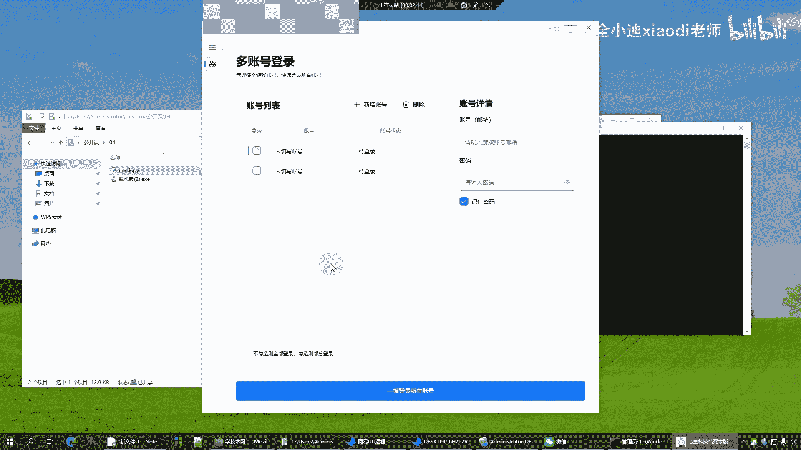
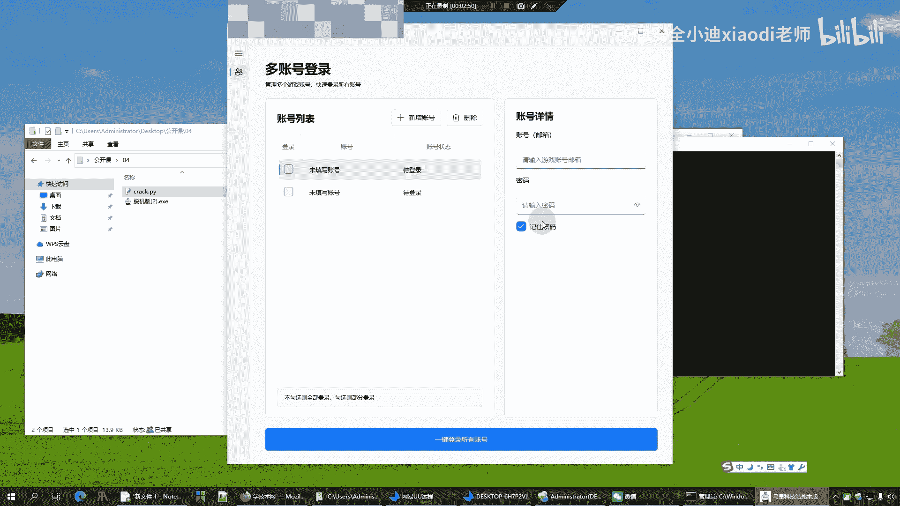
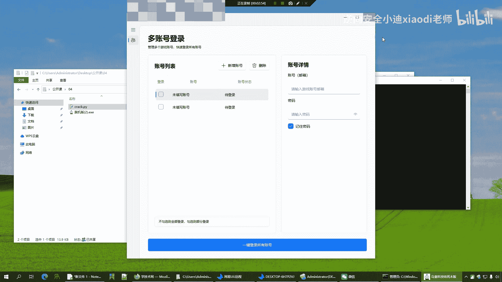

# 🧭 软件逆向破解技术：第1章：课程概述与演示目标

本课程由小迪老师讲解，继续软件逆向主题。在本节课中我们将要学习软件逆向的基本用途、山寨逆向赛尔号辅助破解的公开演示、伪造卡密与突破网络验证的思路，以及TMD壳、反调试、代码混淆、封包解析和本地服务端互通等基础概念。课程主题是山寨逆向赛尔号辅助破解，涉及伪造卡密、突破网络验证，也关联二进制安全逆向、游戏安全、软件安全、网络安全、CTF比赛必备基础和封包技术。这是一次公开演示，演示对象是某赛尔号网络验证卡密辅助，也就是一个辅助外挂。

有同学会疑问，学习逆向能做什么。实际上，逆向技术可以用于分析一些软件。这个软件可以是一些外挂，也可以是一些工具，或者说一些病毒木马，都是可以进行分析的。只要这个软件对于你来说有研究分析价值，你就可以运用这个技术。以下是逆向分析对象的一个简单概念描述：

```text
逆向分析对象 ∈ {外挂, 工具, 病毒, 木马, 其他有研究分析价值的软件}
```

上一节我们概述了课程目标，本节继续看看演示背景。这个软件大家在周一、星期一的时候已经在群里发了，一直找人去搞，一直也没有搞定。小迪老师本身也比较忙，所以到今天才有时间看。这个软件现在已经破解掉了，这是破解的一个效果，待会儿我们就来看一下。如果大家想要学习相关知识，都可以联系小迪老师。下面继续演示。

# 🔍 软件逆向破解技术：第2章：保护分析与TMD壳

第1章我们介绍了课程目标和演示背景，本节来看看分析软件时的第一步，也就是先看软件的保护情况。一般去分析软件的时候，都是先看一下这个软件的保护情况。这个软件是1个TMD的壳。稍微有点基础，或者稍微接触过，或者你是一个菜鸟，可能会知道TMD壳。这个壳非常强大，它有反调试，而且还有代码混淆。也就是说，你在分析代码的时候，往往会碰到那种不认识的指令，进而就无法分析了。

学习这些内容之后，这些东西就迎刃而解了。这些知识是新手到菜鸟再到大牛的一个进阶之路。你想要突破那个瓶颈，就得学习这些内容。以下是TMD壳保护特征的简单公式描述：

```text
保护 = TMD壳 + 反调试 + 代码混淆
```

上一节我们说明了保护分析的重要性，本节继续进入实际演示。废话不多说，直接来演示。在这边有一个破解的脚本，所以我在这里直接打开控制台，然后去执行这个破解脚本。这个破解脚本是用Python写的，把内容粘贴过来，回车，现在就开始伪造服务器了。稍等一下，伪造成功。

# 🧩 软件逆向破解技术：第3章：山寨逆向与网络验证绕过原理

上一节我们进入了演示流程，本节重点说明山寨逆向的核心概念。此时已经伪造成功，然后随便输入卡密，点击登录，就登录上来了，所有功能都可以用了。它只有登录之后，才会显示那些功能的界面。那么原版的软件是怎么样的呢？我们来看一下原版的软件，我运行拖机版。软件运行比较慢。原版是这样的，界面中可以看到类似“假似听”的内容，存在断章取义行为，可能是他的一个代理，这个外挂都有代理，还有售后。然后这个QQ信息，我后期打码，打个马赛克。

如果卡密不正确，我点击登录，它会提示登录失败，卡密不正确或已过期。为什么刚才我能够正常登录，现在不能登录了呢？因为我刚才应用了一个网络验证山寨的技术。什么是山寨呢？以下是山寨逆向的核心定义：

> 山寨就是把软件连接的目标服务器改成本地服务器，让客户端转向本地伪造服务端，从而实现本地开卡、本地登录，绕过平台验证。

这个定义可以用一个简单公式表示：

```text
原目标服务器地址 -> 本地地址 127.0.0.1
```

例如，软件连接的是199.9.9.9，那么就改成127.0.0.1。一般来说，就是把远程地址改成本机地址。然后只需要把服务端相关的这些数据封包自己解析，在本地解析，写一个服务端来解析。解析完之后，这个软件就获取到了内容，然后就可以进行本地互通，实现本地服务器到客户端的数据互通。这样就能够实现另类的一种破解。

上一节我们定义了山寨逆向，本节继续把演示效果和原版提示对应起来。以下是山寨逆向中需要理解的关键点：

- 山寨不是修改卡密本身，而是改变客户端连接的目标服务器地址。

- 客户端原本连接远程验证服务器，山寨后连接本地伪造服务端。

- 本地服务端需要解析客户端发来的封包数据，并返回构造好的响应。

- 客户端获取响应后，就可以完成本地登录和功能界面解锁。

- 这种方式可以实现本地开卡、本地登录，绕过原平台验证。

# 💻 软件逆向破解技术：第4章：演示流程与登录效果

上一节我们理解了山寨逆向的基本原理，本节回到演示流程，看看伪造服务器和登录效果如何呈现。演示时，我直接打开控制台，执行用Python写的破解脚本，把内容粘贴过来，回车，开始伪造服务器。稍等之后，伪造成功。此时随便输入卡密，点击登录，就登录上来了，所有功能都可以用了。这个软件只有登录之后，才会显示那些功能的界面。

以下是演示流程的概念化伪代码，只用于说明各步骤之间的关系：

```python
# 概念示意，不是完整利用代码
目标地址 = "199.9.9.9"
本地地址 = "127.0.0.1"
客户端连接(本地地址)
响应 = 本地服务端解析并构造(封包)
客户端收到响应后进入功能界面
```

上一节说明了演示成功的效果，本节对比原版软件和卡密失败提示。原版软件运行时比较慢，界面中可以看到类似“假似听”的内容，存在断章取义行为，可能是他的一个代理。这个外挂都有代理，还有售后。QQ信息后期会打码，打成马赛克。如果卡密不正确，点击登录会提示登录失败，卡密不正确或已过期。



# ⚠️ 软件逆向破解技术：第5章：原版对比与卡密失败提示

上一节看到了成功登录的效果，本节进一步对比原版软件的表现。原版软件运行拖机版时比较慢，界面上有一些提示信息，例如存在断章取义行为，可能是他的一个代理。外挂通常都有代理，也有售后。QQ信息后期会打码，打成马赛克。卡密不正确时，点击登录会提示登录失败，卡密不正确或已过期。



以下是卡密校验提示的简单逻辑描述：



```text
if 卡密无效:
    提示“登录失败，卡密不正确或已过期”
```

刚才能够正常登录，现在不能登录，是因为刚才应用了网络验证山寨技术。也就是说，客户端连接的目标服务器被改成本地，本地伪造服务端返回了验证成功的结果。以下是山寨前后请求路径的对比：

- 山寨前：客户端连接远程验证服务器，由远程平台判断卡密是否有效。

- 山寨后：客户端连接本地127.0.0.1，由本地伪造服务端解析封包并返回结果。

- 山寨前卡密无效时，远程平台返回登录失败提示。

- 山寨后本地服务端可以构造验证成功响应，使客户端进入功能界面。

# 🔄 软件逆向破解技术：第6章：本地服务端与封包互通

从卡密失败提示可以引出本地服务端与封包互通，本节把这个过程讲清楚。山寨的核心是把软件连接的目标服务器改成本地，例如把199.9.9.9改成127.0.0.1。然后需要把服务端相关的数据封包自己解析，在本地解析，写一个服务端来解析。解析完之后，软件就获取到了内容，然后就可以进行本地互通，实现本地服务器到客户端的数据互通。这样就能够实现另类的一种破解。

以下是本地服务端与客户端互通的概念流程：

```text
客户端 -> 本地伪造服务端 -> 解析封包 -> 构造响应 -> 客户端收到响应 -> 登录成功
```

这个视频就是讲一下这个演示。如果大家想要学习，可以来到3W.52学技术点com加入。学习交流群都是有会员群的，大家的学习交流氛围非常之棒。以下是本节需要记住的几个概念：

- 目标服务器地址改成本地地址，是山寨逆向的关键入口。

- 本地服务端要能够解析客户端封包，并返回客户端能够识别的响应。

- 客户端收到响应后，才会显示登录后的功能界面。

- 本地服务器到客户端的数据互通，是另类破解能够成立的基础。

# 📚 软件逆向破解技术：第7章：学习路径与课程总结

前面讲完了保护分析、山寨逆向、演示流程和封包互通，本节总结学习路径和课程收尾。如果大家想要学习相关知识，都可以联系小迪老师。想要学习相关内容，可以来到3W.52学技术点com加入，学习交流群都是有会员群的，大家的学习交流氛围非常之棒。这个视频讲的就是某赛尔号网络验证卡密辅助的逆向演示。

本节课中我们一起学习了软件逆向的基本用途、TMD壳与反调试代码混淆、山寨逆向的核心定义、伪造卡密与突破网络验证的演示思路、原版软件对比、卡密失败提示、本地服务端与封包互通，以及从新手到菜鸟再到大牛的学习路径。本期内容到此结束，下期再见。
