## 软件逆向破解技术：01：🎯 课程概述与学习目标

在本节课中我们将要学习软件逆向破解技术，并围绕“手把手绕过某PDF编辑软件一机一码授权”这个案例展开。课程由小迪老师以公开课形式讲解，主题涉及卡密和网络验证，也关联二进制安全逆向、游戏安全、软件安全、网络安全、CTF比赛必备基础和封包技术等方向。课程来源信息可记录为下面的引用。

> BV1CGT46eEjv

很多同学会问：软件逆向到底是干什么的。用大白话说，软件逆向就是分析一些小软件，看它们怎样判断授权、怎样处理卡密、怎样做网络验证；学过这套技术之后，就可以去研究这些授权逻辑，也可以尝试突破。为了把后面的操作讲清楚，先把本课程反复出现的核心概念列出来。

- **软件逆向**：分析程序运行时的数据和代码，理解它怎样做判断。
- **卡密/网络验证**：软件用来确认用户是否有授权的凭证或联网校验。
- **一机一码**：卡密和机器码之间存在对应关系，可用公式表示为 `卡密 + 机器码 -> 绑定关系`。
- **字符串**：程序里的文本内容，例如 `license`、`expired`、`incorrect`。

上面这些概念会在后续操作中反复出现。课程不展开无关内容，直接进入主题；下一节先运行目标软件，观察授权失败时到底显示了什么。

## 软件逆向破解技术：02：🧭 运行软件并观察授权现象

上一节我们介绍了课程目标和核心概念，本节中我们来看看目标软件运行后的授权表现。先运行这个PDF编辑软件，观察它会给出什么提示；运行起来后，它提示 `your license key is invalid`，意思是许可证密钥不对。此时需要获取license，或者执行demo版本；demo就是试用版本，可以先试用一下。

继续观察界面，标题栏上显示 `not registered`，意思是尚未注册。点击Help菜单可以看到注册入口，注册时需要输入卡密；输入卡密后点击OK，这个授权就会和当前机器绑定。换句话说，卡密实际上和机器码存在对应关系，这种对应关系通常称为“一机一码”，可写成 `卡密 + 机器码 -> 绑定关系`。

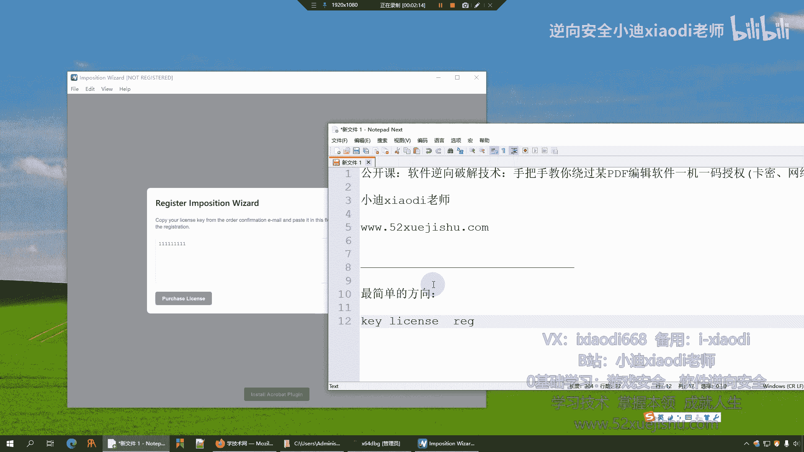

那么怎样绕过授权？一般从最简单的方向切入，也就是字符串。字符串就是文本，程序界面和提示里能看到的关键文本都可能成为线索。观察注册相关界面后，可以优先关注下面这些文本线索。

- `license`
- `注册`
- `copy your license key`
- `K`
- `LICEN`
- `license`

这些文本里，注册入口也关键，但权重比较高的通常是 `K` 或 `license`。确定线索之后，就可以分析运行中的程序；下一节使用调试器把目标进程附加起来，再从内存里查找这些字符串。

## 软件逆向破解技术：03：🛠️ 使用x64dbg附加进程并查看模块

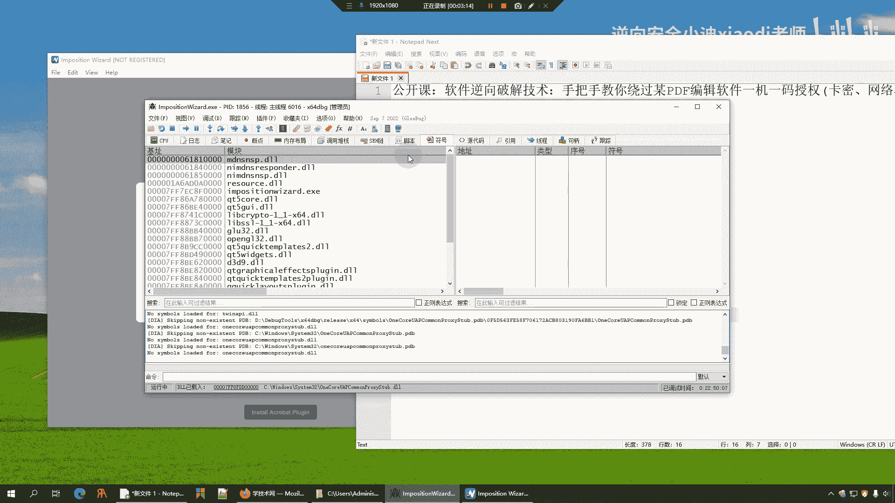

上一节我们找到了字符串线索，本节中我们来看看怎样用工具进入程序内部。对于这样一个软件，它肯定是运行起来的；程序运行起来以后，所有东西都会加载到内存，因此可以在内存中发现相关数据。要查看内存里的数据，可以借助x64dbg这个工具；课程中已经准备好该工具。

工具和目标软件要建立联系，操作方式是点击“文件”，再点击“附加”，选择已经运行起来的程序。运行起来的程序一般称为进程，进程就是正在进行中、运行中的程序。随后在列表中找到目标程序，标题和图标应保持一致，确认一致后点击附加。

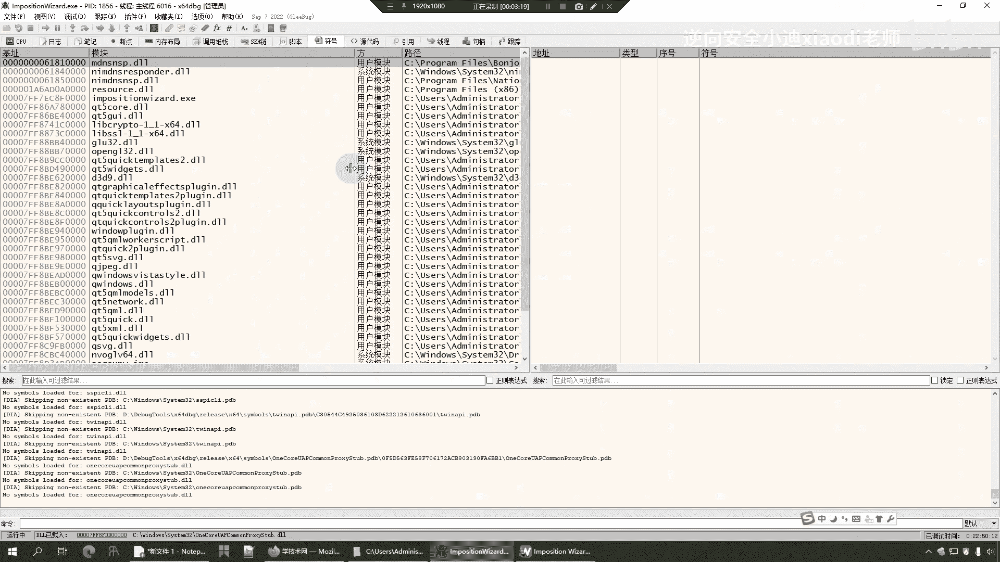

附加成功后，点击“符号”可以查看程序相关的一些第三方库调用了哪些东西，也能看到程序本身是谁，以及本身相关的一些信息和地址；这类内容称为模块，简单了解即可。如果要分析程序，就双击模块进入程序代码，这里看到的就是内存中的代码。附加和查看模块可以按下面步骤理解。

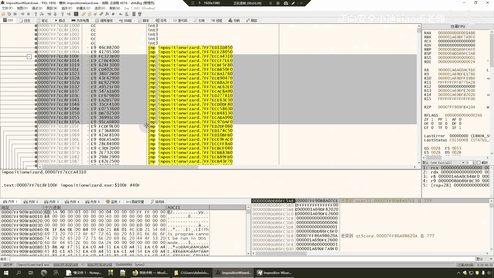

- 先启动目标PDF编辑软件。
- 打开x64dbg调试器。
- 点击“文件”，选择“附加”。
- 在进程列表中选择标题和图标一致的目标进程。
- 点击“符号”查看模块信息。
- 双击模块进入程序代码区域。

进入代码区域后，下一步就是定位授权相关文本；下一节搜索当前模块的字符串，把内存中与授权有关的提示找出来。

## 软件逆向破解技术：04：🔎 搜索字符串定位授权判断代码

上一节我们进入了程序代码区域，本节中我们来看看怎样通过字符串找到关键判断位置。分析代码时，一般直接搜索当前模块的字符串，这样可以把内存中相关的一些字符串信息搜出来。搜索时输入 `license`，工具会进行智能过滤；可以搜索整个单词，也可以增加一些单词来缩小范围。

当输入 `LICEN` 而不输入后面的 `SE` 时，某些结果会被过滤掉；通过增添或减少字母，可以扩大或缩小过滤区间，也可能得到更好的一些结果。例如某条结果比上面的结果更有效，因为它写了 `Key too old`，表示密钥太老；`Key expired` 表示密钥过期；`incorrect` 表示不正确；另外还有结果也表示过期。这些提示对定位授权逻辑很有用。

觉得某条字符串有用时，双击它就能来到该字符串所在位置，这里是程序的代码区域。可以看到字符串旁边有注释，说明该字符串的内存地址是类似 `7FF...B88` 的地址；引用这个字符串地址的代码就是当前这一行，这一行代码的地址类似 `7FF...DA51`。不管数据还是代码，都由内存地址标识，所以学习时要看内存地址。可以用代码形式表示这种关系。

```text
字符串地址：0x7FF...B88  ->  "Key expired"
引用代码地址：0x7FF...DA51  ->  引用上述字符串的指令
```

搜索结果中可重点留意下面这些提示文本。

- `Key too old`
- `Key expired`
- `incorrect`
- `expired`

定位到字符串后，往上看代码还会发现一些小箭头；下一节解释这些小箭头就是跳转，并说明怎样用断点和标志位改变跳转结果。

## 软件逆向破解技术：05：🧩 理解跳转、断点与ZF标志位

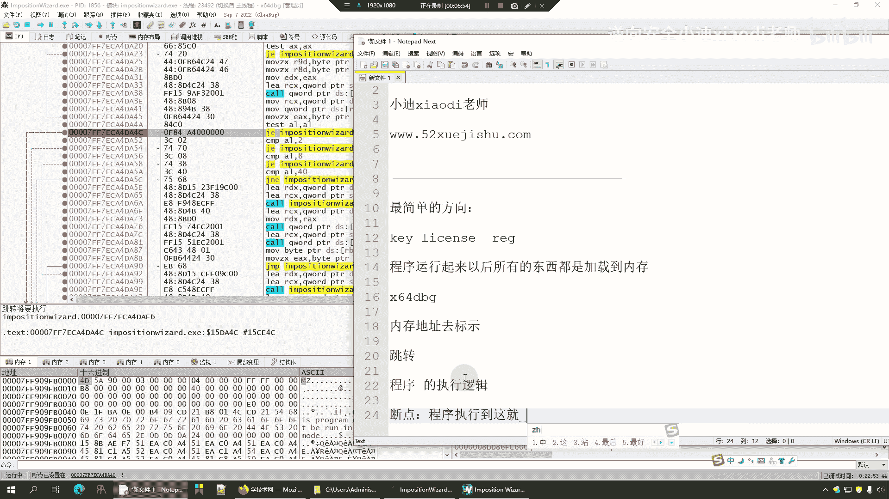

上一节我们通过字符串定位到了授权判断附近，本节中我们来看看跳转、断点和ZF标志位。代码里的小箭头就是跳转；程序执行逻辑不是完全线性的，它会做判断和决策。可以用生活里的例子理解：今天要吃饭，吃完饭后要去打球；如果没有吃饱，就可能不去打球。人生中很多事情要做决策，程序也是如此，它也会根据条件决定走哪条路。

从某个位置开始，程序做出一系列决策，决策特别多，感觉像走到人生十字路口。此时可以按F2打断点；断点就是程序执行到该位置就中断的点。断点触发后，程序的执行状态会由运行中变成暂停。点击OK后，程序果然断了下来。

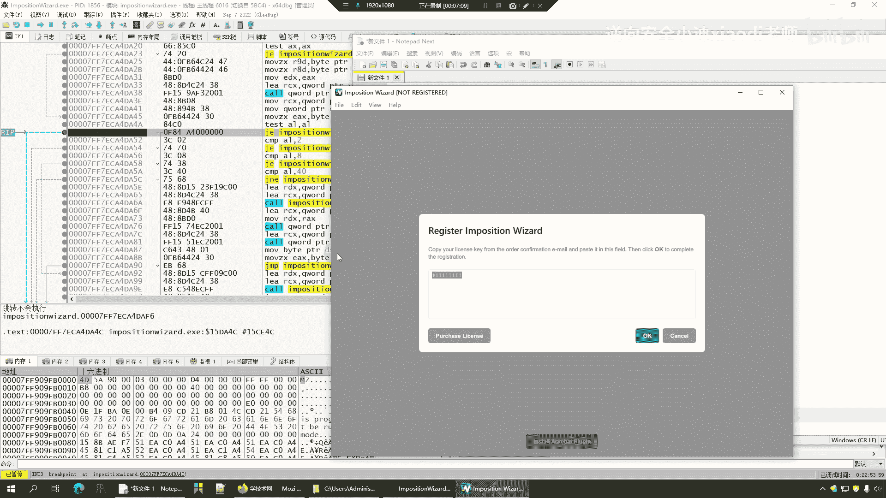

现在输入的是错误注册码；错误注册码下，这个跳转不会执行。逆向就是反过来想：错误注册码不跳，那么正确注册码可能就要跳；因为这里包含“密钥太老”“密钥过期”“不正确”等重要判断。要让正确逻辑跳转，需要理解ZF标志位，这个标志位可以控制 `JE` 跳不跳。其关系可用伪代码表示。

```text
if (ZF == 1) {
    JE 跳转
} else {
    JE 不跳转
}

// 从授权逻辑角度理解
if (license_valid) {
    执行跳转
} else {
    不执行跳转
}
```

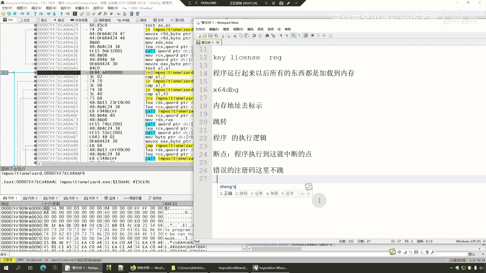

这个知识点后续课程还会展开，这里先记住：ZF标志位会影响JE是否跳转。双击该跳转指令后，可以让跳转将要执行；下一节点击运行，观察程序是否变为注册成功。

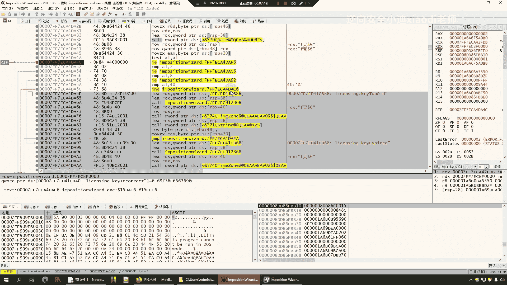

## 软件逆向破解技术：06：✅ 执行跳转并验证注册效果

上一节我们修改了跳转的执行条件，本节中我们来看看运行后的实际效果。此时程序仍是暂停状态，需要让它从暂停变为执行，才能看到效果；点击小三角执行一下，再观察程序界面。执行后可以看到注册成功，标题栏里“未注册”的标记消失了，这说明注册已经成功。

整个过程就是这样：一个跳转，甚至没有修改原始代码，只是在工具里把这个跳转改了一下，程序就破解成功。软件逆向技术就是这样有趣，一个跳转就能改变授权判断结果。验证时可按下面顺序观察。

- 错误注册码下，跳转不会执行。
- 双击跳转指令后，让跳转将要执行。
- 点击小三角运行程序。
- 观察未注册标记是否消失。
- 未注册标记消失，说明注册成功。

到这里，核心绕过流程已经完成；下一节对课程内容做总结，并说明进一步学习方向和课程信息。

## 软件逆向破解技术：07：📚 课程总结与进阶学习方向

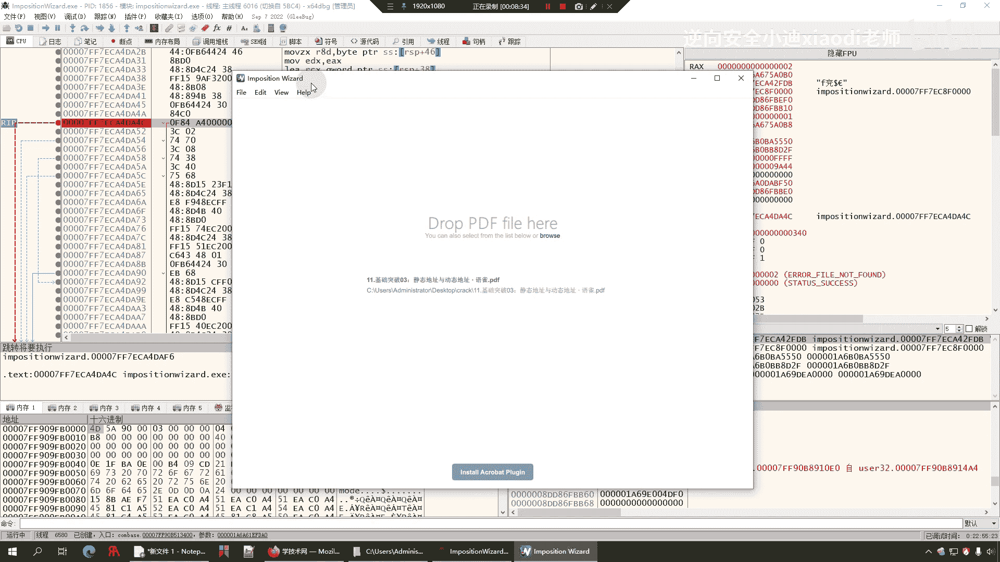

上一节我们完成了跳转修改并验证了注册效果，本节中我们对课程做总结，并介绍进一步学习方向。课程最后进行了介绍：如果想学习软件安全逆向的深入内容，例如脱壳、木马免杀、DLL注入、程序开发，以及在公司里做二进制客户端安全等，这边都有对应技术。现在处于AI时代，用AI结合工具自动化进行逆向分析也是可行的。

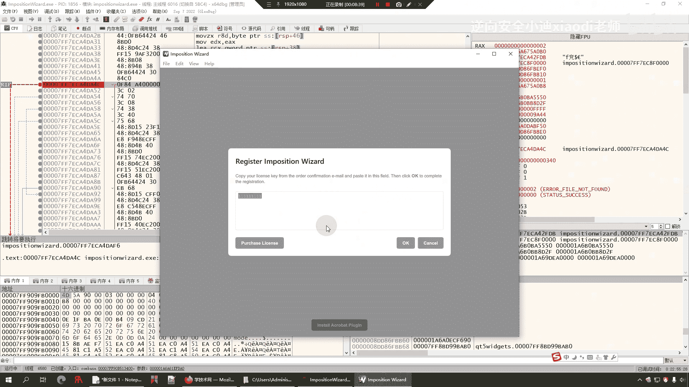

如果想继续深入学习，可以关注下面这些方向与报名信息。

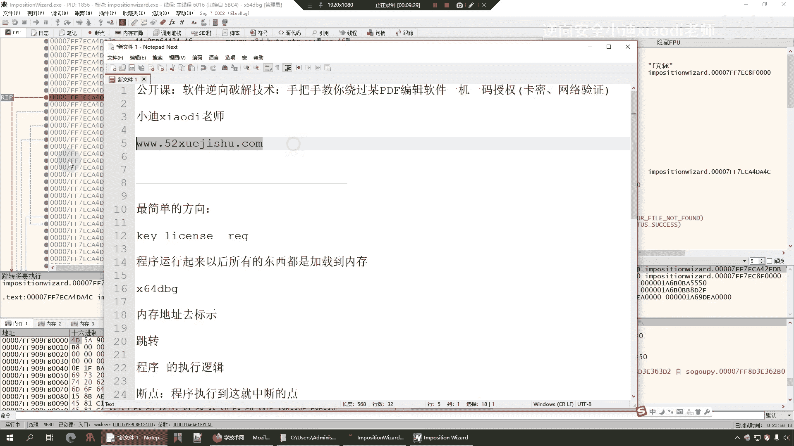

- 脱壳
- 木马免杀
- DLL注入
- 程序开发
- 二进制客户端安全
- AI结合工具自动化逆向分析
- 课程价格299元
- 联系小金老师，可在网站下单，也可以联系课程方

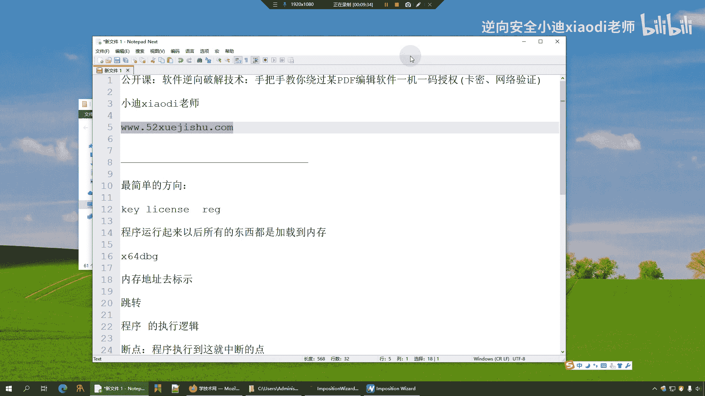

本节课中我们一起学习了软件逆向破解技术的基本概念，观察了PDF编辑软件的授权失败现象，理解了卡密与机器码的一机一码关系，使用x64dbg附加进程并查看模块，通过搜索字符串定位授权判断代码，理解了跳转、断点与ZF标志位，修改跳转后运行程序并验证注册成功，最后了解了进阶学习方向和课程信息。本课程内容到此结束，下期再见。

