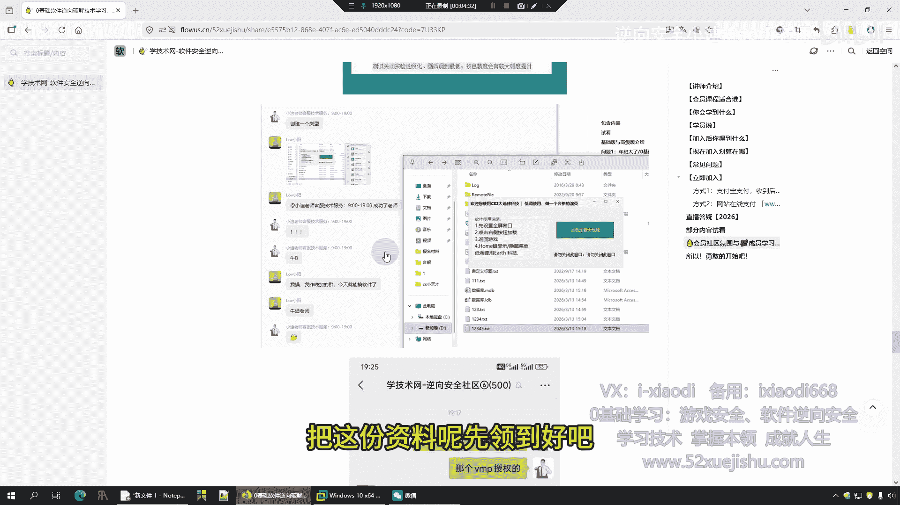

# 软件逆向破解技术：01：课程概述与案例目标 🧭

在本节课中我们将要学习软件逆向破解技术在打击外挂场景中的一次实践，核心案例是某卡密网络验证外挂软件的逆向分析。最近很多同学想跟着我们学习软件安全逆向技术，这门技术能做什么，直白地说，就是能够分析一些小软件，并把它们的运行逻辑、保护方式和验证流程弄清楚。今天这个案例就是某外挂网络验证卡密软件的逆向破解，下面观察未破解与已破解的差异。

本节先说明案例目标：一方面看未破解软件在卡密正确、未过期和过期时的不同表现；另一方面看破解完成后的效果；同时从报错信息判断程序开发语言，并引出后续的Python程序分析与代码剖析。教程会把原文中的演示过程和学习说明整理成一条清晰路线。


上一节我们说明了案例目标，本节中我们来看看未破解软件的实际表现。

# 软件逆向破解技术：02：未破解软件的表现 🔍

手头拿到的是一个网络验证外挂软件，它属于卡密软件，卡密数据放在这个软件里面。运行之后，如果卡密正确，或者卡密没有过期，这个软件可以正常使用。下面用伪代码表示卡密验证的核心逻辑：

```text
if 卡密正确 and 卡密未过期:
    软件正常使用
else:
    后台无明显反应
    软件无法运行
    提示无法登录
```

如果卡密已经过期，后台看起来没有什么反应，软件就运行不起来。再次测试时，可以看到这个软件运行非常迟钝、响应非常迟缓，随后提示无法登录。下面是未破解状态下的观察要点列表，便于初学者抓住现象：

- 卡密正确且未过期时，软件可正常使用。
- 卡密过期时，后台无明显反应。
- 软件运行不起来，并提示无法登录。
- 运行过程非常迟钝、非常迟缓。

从这些现象可以看到，卡密网络验证会先检查授权状态，再决定是否让软件继续运行。上一节我们观察了未破解表现，本节中我们来看看破解完成后的效果以及报错信息带来的线索。

# 软件逆向破解技术：03：破解效果与Python程序识别 🧩


破解完成之后，效果需要实际运行确认。已破解版本运行时仍然会出现报错，并报出相应错误。通过这个报错，可以推断该软件是使用Python开发的。下面是识别思路：

```text
运行软件 -> 出现报错 -> 分析报错特征 -> 推断为Python程序 -> 针对Python程序进行逆向分析
```


因此可以针对性地对这种Python程序进行破解，这也是学习内容中的一个环节。这些也都是课程中要学习的内容，学习内容有很多，后期可以自己查看。上一节我们介绍了破解效果和语言识别，本节中我们来看看已破解版本如何通过脚本完成突破。

# 软件逆向破解技术：04：动态内存劫持与登录突破 🚀

已破解的情况是：操作者编写了一个破解脚本，运行时只需要启动脚本即可。动态内存劫持脚本一启动，软件就登录上了，点击确定后即可完成突破。核心过程可以用下面的代码表示：


```text
启动动态内存劫持脚本
-> 修改/劫持关键内存状态
-> 绕过卡密校验
-> 登录成功
-> 点击确定完成突破
```


这样就把软件破开了。未破解版本与已破解版本在核心对象上是同一个东西，例如可以看到文件 `L-G-通用.pyc`。下面是该环节的关键点列表：

- 已破解版本通过破解脚本运行。
- 动态内存劫持脚本启动后即可登录。
- 点击确定后完成突破。
- 核心对象相同，文件示例为 `L-G-通用.pyc`。

上一节我们完成了登录突破，本节中我们来看看代码剖析与重构思路。

# 软件逆向破解技术：05：代码剖析与重构思路 🧱

实际上已经把这个软件的所有代码都剖析出来了，剖析出来之后，可以自己再去重构一个同样的软件，效果是一模一样的。下面是代码剖析与重构的流程：


```text
提取程序文件/字节码
-> 反编译或静态分析
-> 还原关键逻辑
-> 重构同类软件
-> 验证效果是否一致
```

这个过程体现了软件安全逆向技术的魅力所在。上一节我们介绍了代码剖析与重构，本节中我们来看看加入学习后可以学到的内容以及适合人群。

# 软件逆向破解技术：06：学习内容与适合人群 🎯

如果加入学习，可以学到很多内容，课程方面推荐直接一步到位选择高级版。下面列出适合人群和学习方向：

- 学过汇编，但不知道怎么上手实战的同学。
- 想学习脱壳、软件破解、互克封包技术，但网上资料太散太乱的同学。
- 想系统学习网络验证卡密软件防护和破解的同学。
- 参加比赛的同学也可以学习。
- 想一个月速成并看见效果的同学也可以。

这些方向覆盖了从基础到实战的多个环节，适合不同阶段的学习者。上一节我们介绍了适合人群，本节中我们来看看学习效果与课程服务说明。

# 软件逆向破解技术：07：学习效果与课程服务说明 📈

大家的学习情况与学习效果都很好。有学员加入一天就取得了非常不错的效果，有同学加入一周也取得了不错的效果，还有同学加入不到一个月同样取得了不错的效果。加入后能够学到什么，都列在课程介绍里。下面说明为什么选择我们的课程：

- 买一本书可能需要100到200元，内容讲不完整，还要自己猜坑。
- 其他平台同类课程可能需要好几百、上千甚至几千元，学完之后还不提供答疑。
- 我们这里只需要299元，体系完整，持续更新。
- 提供专属社群答疑，只需要付一次费，技术跟你一辈子。
- 当前价格是299元，涨价不另外通知。
- 零基础可以学习，课程永久有效，不会过期。
- 有问题随时问，我们有专属微信群。
- 小李老师在哔哩哔哩不定期为大家直播答疑。
- 工具不需要二次付费，加入会员学习之后，所有工具全部提供。

从课程服务角度看，费用、答疑、更新和工具支持都包含在说明中。上一节我们说明了课程服务，本节中我们来看看报名方式与资料领取。

# 软件逆向破解技术：08：报名方式与资料领取 💳

可以在网站支付，网站为 `3W点52学技术点com`，可以直接在网站点击开通。下面是报名与资料领取步骤：

- 打开网站 `3W点52学技术点com`。
- 在网站中点击开通。
- 剩余内容可以自行查看。
- 课程介绍会放在评论区，可以自行查看。
- 先把这份资料领到。

完成上述步骤后，就可以继续了解课程内容并领取资料。上一节我们介绍了报名方式，本节中我们对整节课程进行总结。

# 软件逆向破解技术：09：课程总结 ✅

本节课中我们一起学习了软件逆向破解技术在打击外挂场景中的实践案例，包括未破解软件在卡密正确、未过期和过期时的不同表现，破解完成后通过动态内存劫持脚本完成登录突破，通过报错信息推断Python开发，剖析代码并重构同类软件，以及课程学习内容、适合人群、学习效果、课程服务、报名方式和资料领取说明。

> 核心流程可以概括为：观察未破解现象 -> 识别程序语言 -> 使用脚本突破验证 -> 剖析代码 -> 重构验证。



本期内容到这里，下期再见，拜拜。

