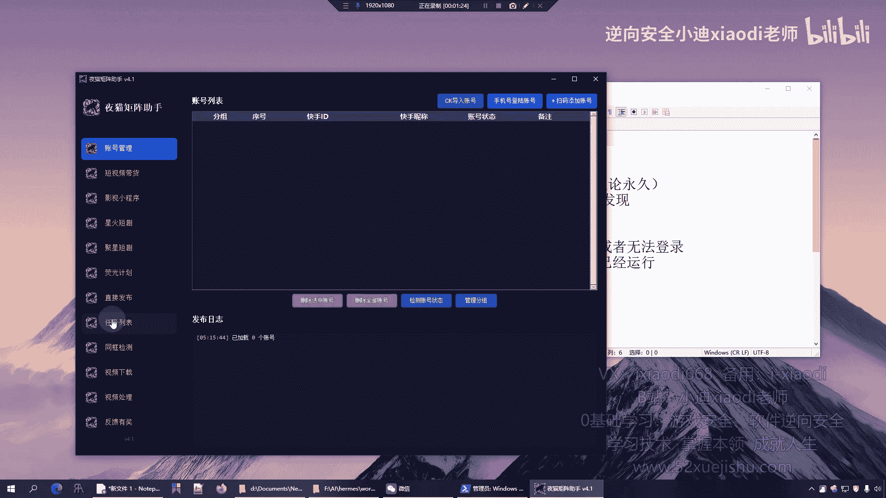

# 🛡️ 软件逆向与安全防护基础：01：课程概述与原始素材整理


在本节课中我们将要学习如何把一段原始素材整理成初学者能看懂的安全教程。原始素材包含一个视频标题和若干歌词句子，主题涉及软件逆向、VMP、网络验证、卡密、山寨服务器、二进制安全、游戏安全、软件安全、网络安全、CTF和封包技术。我们会先逐句保留原文含义，再用大白话解释这些概念，并说明合法授权与防护视角。需要说明的是，本教程只做概念科普和防护提醒，不提供绕过授权、盗版或搭建山寨服务器的具体操作步骤。


上一节我们说明了课程目标和合规边界，本节中我们来看看原始素材需要怎样逐句保留。原始素材以中文为主，其中“い”为日语假名，单独出现时没有完整词义，按原样保留。以下是原始素材中需要逐句保留的句子，按原顺序列出。


> 软件逆向破解技术：某VMP视频矩阵助手软件逆向破解，网络验证卡密破解，山寨服务器【二进制安全逆向，游戏安全，软件安全，网络安全，CTF比赛必备基础，封包技术】--BV18zg16zE2U-
>
> 🎼萤火开。
>
> 🎼忘记。
>
> 🎼画中一人。😊，
>
> 🎼你承诺。
>
> 🎼谁把思念情？😊，
>
> 🎼感谢。
>
> 🎼只想留住时间。😊，
>
> 🎼你蠢。
>
> 🎼我天空。
>
> 🎼爱只给我。
>
> 🎼剩下诉生。😊，
>
> 🎼一可夜。😊，
>
> 🎼我心在你看那。😊，
>
> 🎼流水三0千几人。😊，
>
> 🎼你就陪。
>
> 🎼不有是多。
>
> 🎼说怎陌生。😊，
>
> 🎼い。
>
> 🎼曾雪落。
>
> 🎼其实。
>
> 🎼可是无人。
>
> 🎼欢你。


上一节我们把原始素材完整保留下来，本节中我们来看看VMP和逆向的基础概念。VMP可以理解成一种软件保护外壳，它会把原本的程序指令转换成虚拟机字节码，再交给内置解释器执行。逆向则是从程序的外部表现出发，理解程序逻辑、数据流和校验过程。对初学者来说，先建立“输入、代码逻辑、环境状态共同决定程序行为”的整体认识，比急着操作工具更重要。下面用一段概念公式描述这种关系。


```text
程序行为 = 输入 + 代码逻辑 + 环境状态
VMP保护流程（概念示意）：
原始程序指令 -> VMP加壳/虚拟化 -> 虚拟机字节码 -> 内置解释器执行
```


上一节我们认识了VMP和逆向的基本轮廓，本节中我们来看看网络验证与卡密系统在授权视角下是什么样子。网络验证通常由客户端发起请求，服务端检查授权信息，然后返回可用功能或受限状态。卡密只是授权凭证的一种表现形式，正规软件会配合签名、时间戳、服务器校验和日志记录。学习这部分知识时，重点应放在理解校验流程和防护设计，而不是寻找绕过方法。下面用一段概念代码描述授权校验的基本思路。


```text
授权校验（概念示意）：
if (verify(license, server_signature) == true) {
    开放正常功能
} else {
    进入受限模式
}
```


上一节我们讲了网络验证的授权校验思路，本节中我们来看看山寨服务器的风险和识别方法。山寨服务器可以简单理解为客户端连接到了错误的服务端地址，进而收到仿冒响应。它的风险包括数据泄露、授权异常、更新被劫持和欺诈行为。识别时要核对域名、证书、签名和官方公告，不要轻信来源不明的服务器地址。下面用一段流程公式描述这种风险路径。


```text
客户端 -> 错误服务器地址 -> 仿冒响应 -> 数据/授权风险
```


上一节我们识别了山寨服务器的风险，本节中我们来看看二进制安全、游戏安全、软件安全、网络安全、CTF和封包技术之间的关系。这些方向并不是彼此孤立的，二进制安全关注程序底层行为，软件安全关注应用整体防护，网络安全关注通信与边界，游戏安全关注客户端与服务端配合，CTF比赛常用这些基础知识做综合训练，封包技术则帮助理解网络交互过程。以下是这些技术方向的简单说明，方便初学者建立整体印象。


- 二进制安全：关注程序指令、内存、调试和漏洞成因。
- 软件安全：关注授权、完整性、更新和防护策略。
- 网络安全：关注协议、流量、边界和身份校验。
- 游戏安全：关注客户端逻辑、服务端校验和异常行为识别。
- CTF比赛：用题目形式训练逆向、取证、协议分析和漏洞理解。
- 封包技术：关注请求包、响应包和会话状态的变化。


其中封包分析可以用一个简单公式来理解，网络交互不是孤立的一条数据，而是请求、响应和会话状态共同组成的整体。


```text
请求包 + 响应包 + 会话状态 = 一次网络交互
```


上一节我们梳理了相关技术地图，本节中我们来看看合法学习路径和常见防护建议。学习这些内容应当在授权环境、公开靶场和CTF题目中进行，先学编程和汇编基础，再学调试器、协议分析和日志分析，最后理解服务端校验与客户端防护的配合。以下是建议的合法学习路径，按由浅入深的顺序列出。


- 学习C语言、汇编基础和操作系统基础。
- 学习调试器基本操作和程序运行流程。
- 学习网络协议、抓包分析和日志阅读。
- 在公开靶场和CTF题目中练习逆向与协议分析。
- 阅读正规软件的安全设计文档，理解授权与完整性校验。




以下是软件和网络侧常见的防护思路，用于识别风险而不是攻击系统。


- 使用代码完整性校验，发现异常修改时进入受限模式。
- 使用证书校验和域名校验，降低连接到错误服务器的风险。
- 使用服务端签名、时间戳和重放保护，减少伪造请求。
- 保留审计日志，便于发现异常授权和异常网络行为。
- 只在合法授权环境中进行逆向和安全测试。


上一节我们给出了合法学习路径和防护建议，本节中我们来做一个总结回顾。本节课中我们一起学习了如何逐句保留原始素材，并在此基础上理解了VMP、逆向、网络验证、卡密、山寨服务器、二进制安全、游戏安全、软件安全、网络安全、CTF和封包技术的基本概念。我们重点强调了授权学习和防护视角，不提供绕过授权、盗版或搭建山寨服务器的具体操作步骤。掌握这些基础后，可以继续在合法靶场和CTF题目中训练分析能力。
