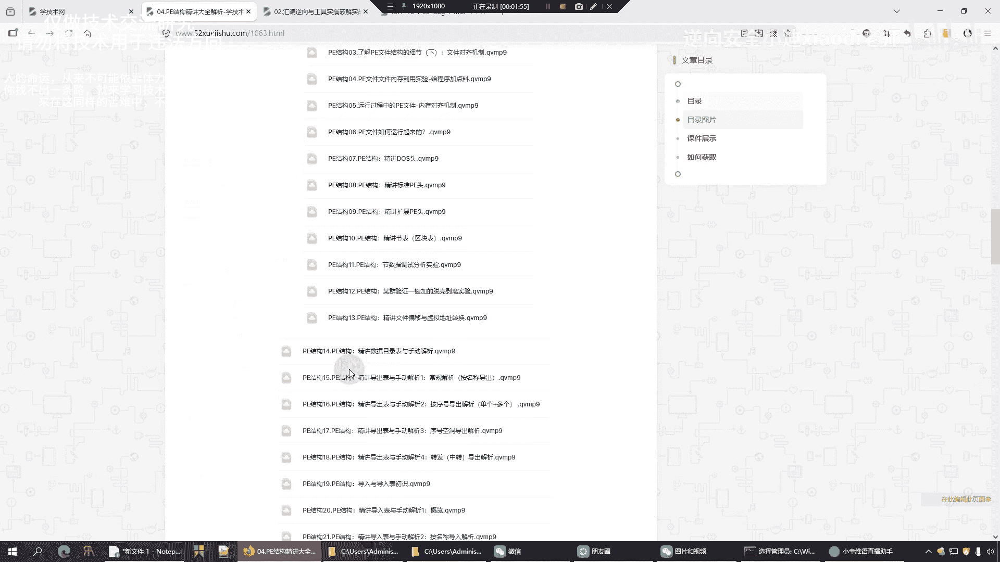

# 🧩 软件逆向破解技术：01：一机一码授权模型与合规分析基础

在本节课中我们将要学习软件逆向工程里常见的一机一码授权模型，理解机器码、授权码和校验逻辑之间的关系，同时明确合法学习与合规分析的边界。课程不会提供绕过授权的操作步骤，而是把原始素材中的标题和歌词内容整理成可读的文字记录，并用大白话说明相关概念。这样安排是为了让初学者先建立整体认识，再去看具体名词时不容易迷路。

## 🎯 课程背景与原始素材说明

上一段我们说明了本课程的目标和边界，本节中我们来看看原始素材到底包含哪些内容。原始素材是一段课程标题加上片头歌词，标题涉及“软件逆向破解技术”“某直播助手逆向破解”“一机一码破解”，还关联二进制安全逆向、游戏安全、软件安全、网络安全、CTF比赛基础、封包技术等方向，并带有BV号。歌词部分与技术内容没有直接关系，但按照要求，后文会逐句保留其字面含义。为了先建立技术框架，可以用下面的公式理解一机一码的基本关系：

```text
machine_code = Hash(cpu_id + disk_id + mac_address)

license_valid = Verify(license_code, machine_code, public_key)
```

上面的公式用大白话解释就是：系统先把硬件信息做哈希得到机器码，再用公钥或约定算法验证授权码是否与机器码匹配。理解这个关系后，再看机器码、授权码和校验逻辑就不会觉得抽象。


> 🛡️ 合规提示：软件授权机制的分析应在获得授权的环境中进行。本教程只讨论概念、防护思路和合法分析流程，不提供绕过授权、修改授权或规避一机一码校验的操作步骤。

## 🧱 一机一码的基本概念

上一节我们说明了课程背景和合规边界，本节中我们来看看一机一码的基本概念。以下是一机一码授权模型中最常见的几个名词，先用大白话列出来，后面再结合公式理解。


- **机器码**：根据电脑硬件信息生成的一串标识，可以理解为“这台机器的身份证”。
- **授权码**：软件作者发给用户的凭证，通常和机器码绑定，换一台机器就可能失效。
- **绑定关系**：授权码与机器码之间的对应关系，核心目标是让授权只在指定机器上有效。
- **授权校验**：软件运行时检查授权码是否有效、是否匹配当前机器码的过程。
- **保护目标**：防止授权码被复制到其他机器，防止校验逻辑被轻易修改，防止授权信息被伪造。

这些概念看起来多，其实可以归成一句话：机器生成身份证，作者发凭证，软件做校验，三者共同完成一机一码授权。


## 🛡️ 合法分析流程

上一节我们介绍了一机一码的基本名词，本节中我们来看看合法授权分析中建议遵循的流程。以下是合法授权分析中建议遵循的步骤，重点在记录现象和理解机制，而不是绕过校验。

- 明确授权范围：先确认自己是否有权分析目标软件，避免在未授权环境中操作。
- 识别保护类型：观察软件是否使用机器码、授权文件、联网校验或本地校验。
- 记录正常现象：记录授权成功和失败时的提示、文件变化和运行表现。
- 理解校验模型：用公式或伪代码描述“输入机器码、输入授权码、输出校验结果”的关系。
- 设计防护思路：从开发者角度思考如何让授权码更难伪造、让校验更难被替换。
- 整理学习结论：把分析结果写成防护建议或学习笔记，不形成绕过授权的操作手册。


这套流程的核心是先理解再防护，而不是一上来就修改程序。对初学者来说，先把授权模型画清楚，比直接看汇编代码更容易入门。

## 🎼 原始素材句子整理与直白释义


上一节我们介绍了合法分析流程，本节中我们来整理原始素材中的文字内容。以下是原始素材中课程标题和片头歌词的逐句整理，其中表情和语气词已删除，歌词部分只按字面含义做直白释义，不作为技术结论。

- “软件逆向破解技术：某直播助手逆向破解，一机一码破解【二进制安全逆向，游戏安全，软件安全，网络安全，CTF比赛必备基础，封包技术】--BV1NmNd67EqB-”：这是原始课程标题，意思是课程围绕某直播助手的逆向破解与一机一码主题，关联二进制安全逆向、游戏安全、软件安全、网络安全、CTF基础、封包技术，并带有BV号。
- “停舟又寒山”：停船靠岸又见寒山，表达旅途中的山水画面。
- “樱花满天”：樱花铺满天空，描述景色。
- “一起哼起冷风纷酒色”：一起在冷风中哼歌，酒色与风声交织。
- “我我们是”：按字面整理为“我们这些人”或“我们自身”。
- “倦过认间开手间”：按字面理解为疲惫地经过人间、松开手间，语义带有歌词化表达。
- “或唱落生山浅”：或者歌唱落生山浅，表达一种随景而唱的画面。
- “你的是”：按字面整理为“你的东西”或“你所拥有的”。
- “飘缱绻万杯”：飘散着缠绵的情绪，像万杯酒一样铺开。
- “烦恼”：表达烦恼的情绪。
- “都用此”：把前面的情绪或事物都用在这里。
- “时黄传绕”：时光泛黄，传说萦绕，表达回忆感。
- “是不”：按字面整理为“是不是”或“是否”。
- “此舍寒风吹过我”：这间屋舍的寒风吹过我。
- “当初”：回忆当初。
- “萤火中”：在萤火之中。
- “时光弃”：时光被丢弃或时光流逝。
- “画中一人”：画里面只有一个人。
- “承诺”：表达承诺的含义。
- “谁把思”：谁把思念留下或谁在思念。
- “我担心”：表达担心。
- “只想留住时间”：只想把时间留住。
- “你船”：你的船。
- “我知”：我知道。
- “在这门外”：在这扇门外。
- “盛下走过”：盛下走过，按字面理解为从某处走过。
- “这是”：按字面整理为“这就是”或“这是”。
- “一生月”：一生的月光，表达时间与月色。
- “我我”：按字面整理为“我”。
- “心在你刹那”：心在你那一刹那。
- “如水三千敌人”：像水一样面对三千敌人，带有歌词化夸张表达。

以上列表保留了原始素材中每一句可读文字的含义；其中歌词与技术内容没有直接关系，放在这里是为了完整记录素材。下一节我们回到技术概念，用公式和代码回顾核心校验模型。


## 🧾 核心概念公式回顾

上一节我们整理了原始素材文字，本节中我们来看看一机一码校验的核心概念。下面的公式用大白话表示：系统先把硬件信息做哈希得到机器码，再用公钥或约定算法验证授权码是否与机器码匹配。

```text
machine_code = Hash(hardware_info)

license_valid = Verify(license_code, machine_code, public_key)
```

公式里的`Hash`表示把硬件信息变成固定长度的字符串，`Verify`表示校验授权码是否有效。初学者可以把`machine_code`理解成机器身份证，把`license_code`理解成作者签发的通行证，把`license_valid`理解成校验结果。理解这三个变量，就理解了一机一码授权模型的主干。



## ✅ 总结

本节课中我们一起学习了软件逆向工程里的一机一码授权模型，包括机器码、授权码、绑定关系和授权校验这些核心概念，也了解了合法分析流程和合规边界。课程还逐句整理了原始素材中的课程标题和片头歌词含义，并强调歌词部分只按字面记录，不作为技术结论。最后我们回顾了`machine_code = Hash(hardware_info)`和`license_valid = Verify(license_code, machine_code, public_key)`这两个核心表达。希望初学者先建立整体认识，再继续学习防护思路和合法分析笔记。
