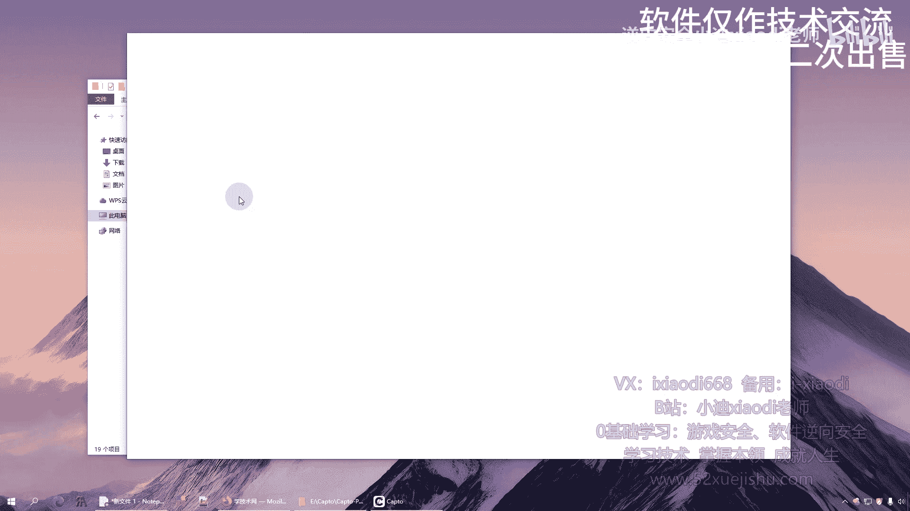
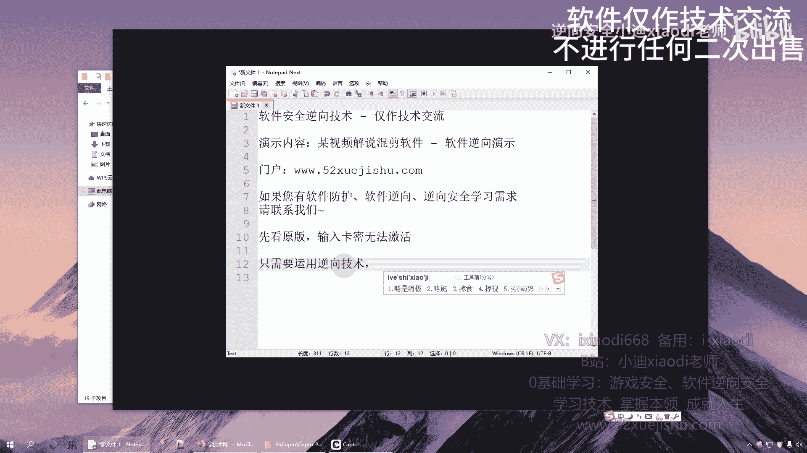
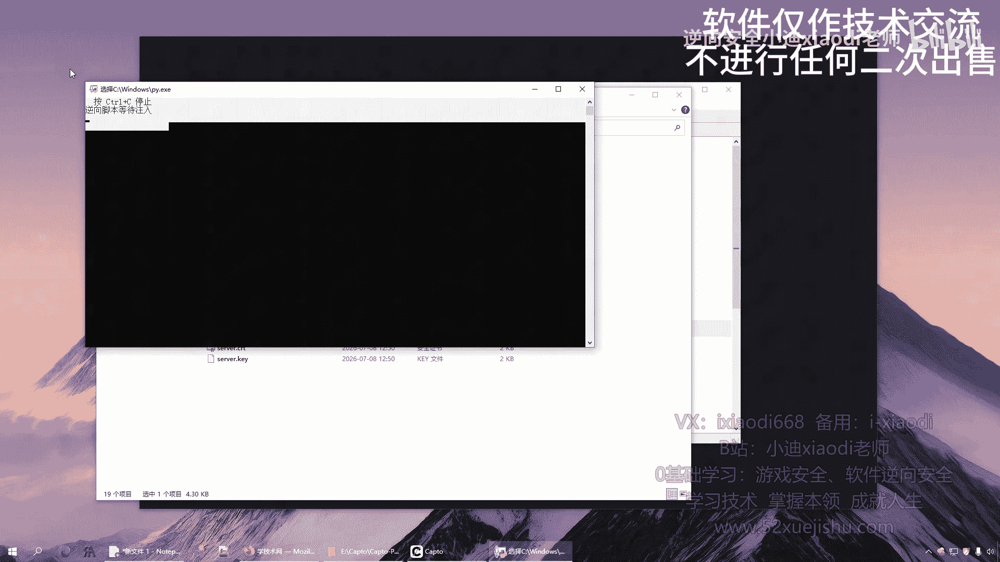
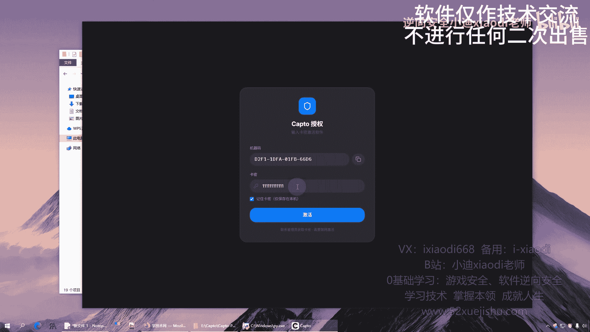
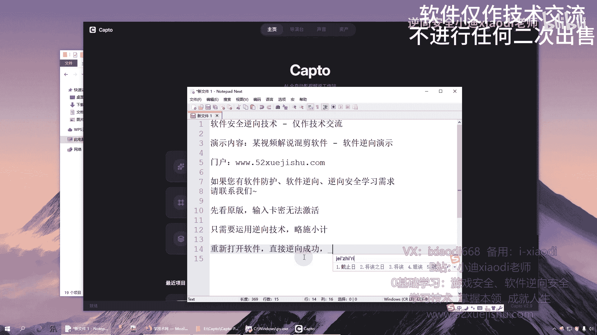
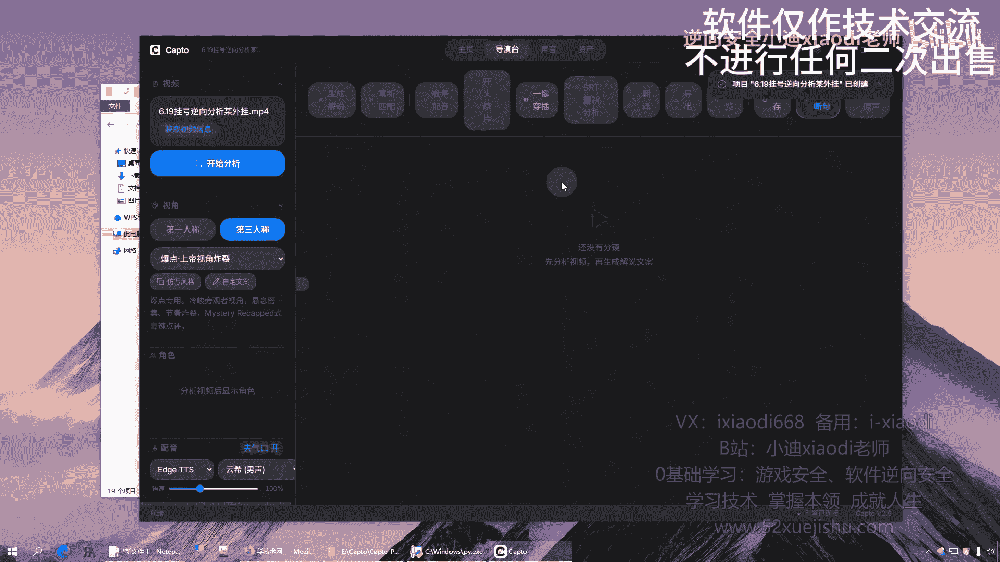
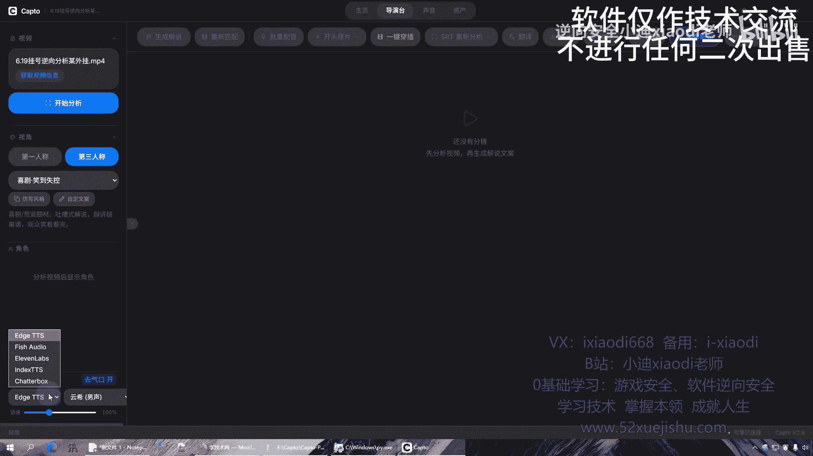
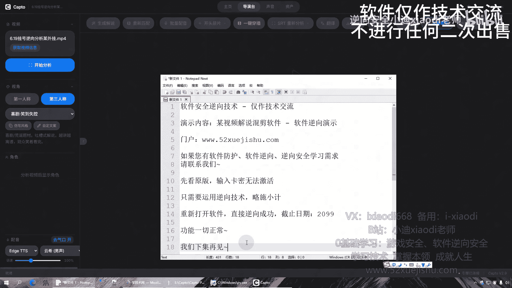

# 🛡️ 合法逆向工程与软件安全基础：00：课程总览

在本节课中我们将要学习合法逆向工程与软件安全的基础概念，包括二进制安全、软件安全、网络安全、CTF 比赛基础和封包技术的基本理解。原文素材的标题涉及“软件逆向破解技术：某视频解说混剪软件破解（伪造卡密、突破网络验证）”，还标注了二进制安全逆向、游戏安全、软件安全、网络安全、CTF 比赛必备基础和封包技术等方向。这个标题表达的是对某类视频混剪软件进行逆向分析，并尝试伪造卡密、绕过网络验证的主题。本教程不会提供伪造卡密、绕过网络验证或破解真实软件的可操作步骤，因为这类行为可能违反授权、侵犯软件许可，甚至带来法律和安全风险。教程只从合法授权测试、防御视角和 CTF 学习角度整理相关概念。原文后半部分还包含若干歌词式短句，这些短句语义不连贯，无法构成技术步骤；教程会在说明节中逐句记录，便于核对。下面从原文素材说明和学习边界开始。

# 🧭 合法逆向工程与软件安全基础：01：原文素材说明与学习边界

上一节我们介绍了课程总览和安全边界，本节中我们来看看原文素材本身包含哪些信息，以及为什么要把“破解”主题转化为合法学习主题。原文素材本身已是中文，因此不存在逐句翻译问题；教程按中文整理。原文标题逐句记录如下。

> 软件逆向破解技术：某视频解说混剪软件破解（伪造卡密、突破网络验证）【二进制安全逆向，游戏安全，软件安全，网络安全，CTF比赛必备基础，封包技术】--BV1xVM56uE2B-

这个标题用大白话说，就是有人想研究某视频混剪软件的授权机制，并通过伪造卡密、突破网络验证来绕过限制，同时涉及逆向、游戏安全、软件安全、网络安全、CTF 和封包等方向。原文后续还有一组歌词式短句，逐句记录如下。

> 🎼我的。🎼你也如此。🎼沉默。🎼我是最。

> 🎼你是。🎼不记。🎼会有。🎼去。

> 🎼不是。🎼只是。🎼的全。



> 🎼心。

> 🎼我前。🎼瞬间。🎼不一。

> 🎼珍惜。🎼所有。🎼我一。🎼这忧愁。

这些短句只是原文素材的一部分，语义零散，不能当作技术步骤，也不能据此推导出任何破解流程。本教程能做的，是把标题中的技术名词当作安全学习对象，讲清楚概念、边界和防御思路。为了便于初学者记住学习边界，可以用下面这个公式描述合法学习范围。

```
可学习内容 = 授权环境 ∧ 合法目标 ∧ 不绕过授权校验
```

以下是本教程遵守的边界列表，这些边界是所有后续内容的前提。



- 不提供伪造卡密的方法。
- 不提供突破网络验证的步骤。
- 不提供针对真实软件的可操作破解流程。
- 只讨论授权测试、防御加固、CTF 练习和基础原理。
- 只使用隔离环境和合法样本进行学习。

明白边界之后，下一节我们来看看逆向工程本身是什么，以及初学者应该怎样用大白话理解它。

# 🔍 合法逆向工程与软件安全基础：02：逆向工程是什么

上一节我们说明了原文素材和学习边界，本节中我们来看看逆向工程的基本概念。逆向工程不是“随便破解软件”，而是通过观察程序行为、分析输入输出、理解程序逻辑，来判断软件在什么条件下允许访问、在什么条件下拒绝访问。用大白话说，就是先看软件收到什么、经过什么判断、最后给出什么结果。可以用下面这个公式描述软件行为的基本组成。

```
软件行为 = 输入 + 程序逻辑 + 环境条件
```



在合法授权环境中，分析者常常把程序的关键判断抽象成伪代码。下面这段代码只表达“检查通过才放行”的概念，不针对任何真实软件。

```
result = check(input)
if result == true:
    allow()
else:
    deny()
```

以下是逆向学习中常见的三类基本活动，这些活动都需要在授权范围内进行。

- 静态分析：不运行程序，阅读反汇编或中间表示，理解代码结构。
- 动态调试：在隔离环境中运行程序，观察寄存器、内存和调用过程。
- 协议观察：在授权环境中观察程序与服务器之间的数据交互，理解验证流程。

这些活动本身是中性技术，关键在于使用场景是否合法。初学者应当先理解“输入、判断、输出”这条主线，再学习工具使用和报告记录。下一节我们来看看网络验证与卡密系统通常要解决什么问题。



# 🔐 合法逆向工程与软件安全基础：03：网络验证与卡密系统的安全目标

上一节我们介绍了逆向工程的基本思路，本节中我们来看看网络验证和卡密系统的安全目标。用大白话说，网络验证就是软件到服务器问一句：“这个用户能不能用？”服务器说能，软件才放行；服务器说不能，软件就拒绝。卡密则是授权凭证的一种形式，它需要和用户、有效期、权限范围等信息绑定。合法访问可以用下面这个公式描述。

```
合法访问 = 凭证有效 ∧ 服务端校验通过 ∧ 权限未越界
```

从防御视角看，服务端不能只相信客户端传来的结果，而要对凭证做完整性和有效性校验。下面这段伪代码表达的是签名校验和过期时间检查的概念。

```
token = HMAC(secret, user_id + expire_time)
server_ok = verify(token, secret) and now <= expire_time
```



以下是卡密与网络验证系统常见的安全目标，这些目标帮助初学者理解系统设计。

- 保密性：密钥和敏感数据不能暴露给未授权方。
- 完整性：授权凭证不能被随意篡改。
- 可用性：正常用户能够稳定完成验证。
- 审计性：验证失败和异常请求能够被记录。
- 最小权限：用户只能获得被授权的功能范围。

理解这些目标后，就能明白为什么“伪造卡密”和“突破网络验证”属于高风险行为：它们直接冲击授权校验和完整性保护。下一节我们来看看 CTF 与授权测试中的学习路径。

# 🧪 合法逆向工程与软件安全基础：04：CTF与授权测试中的学习路径

上一节我们介绍了网络验证的安全目标，本节中我们来看看 CTF 和授权测试中应该怎样学习。CTF 是网络安全竞赛的一种形式，它提供合法题目和隔离环境，适合练习逆向、抓包、调试和报告复现。用大白话说，CTF 就像有裁判的安全练习场，题目允许你分析，真实软件却不允许你随意绕过授权。学习产出可以用下面这个公式概括。

```
学习产出 = 静态分析 + 动态调试 + 协议理解 + 报告复现
```



以下是授权测试和 CTF 学习中应当养成的习惯，这些习惯能让学习更稳。

- 先确认授权范围，再开始任何分析。
- 使用虚拟机或隔离环境，避免影响真实系统。
- 只分析题目样本或明确授权的软件。
- 记录输入、输出、判断点和复现步骤。
- 把发现整理成报告，而不是传播破解结果。

这些习惯看起来基础，但能避免很多风险。初学者常把“会使用工具”当成目标，其实更重要的是理解流程、保留证据、写清结论。下一节我们换个角度，从防御方看看卡密和网络验证应该怎样加固。

# 🧱 合法逆向工程与软件安全基础：05：从防御视角理解卡密与网络验证



上一节我们介绍了 CTF 与授权测试的学习路径，本节中我们来看看防御方如何设计更稳的卡密和网络验证。用大白话说，防御方要假设客户端可能被分析、请求可能被重放、凭证可能被篡改，因此关键判断要放在服务端，并且要有日志和限速。风险可以用下面这个公式帮助理解。

```
风险 = 威胁 × 漏洞 × 暴露面
```

下面这段伪代码表达的是限速和日志记录的基本概念，不针对任何真实系统。

```
if request_rate > quota:
    block()
log(event)
```

以下是防御视角下常见的加固方向，这些方向适合初学者建立系统思维。

- 服务端校验：关键授权判断不能只放在客户端。
- 签名与时效：凭证要带签名、过期时间和绑定信息。
- 限速与风控：异常请求要限速、拦截和记录。
- 日志审计：验证失败和异常行为要可追踪。
- 最小权限：功能权限按需发放，避免一次授权过大。
- 安全更新：密钥和算法要支持轮换和升级。



从防御视角看，逆向分析的价值之一是帮助发现设计薄弱点，但发现之后应当通过授权渠道报告和修复，而不是直接绕过。下一节我们对整个课程做总结。

# ✅ 合法逆向工程与软件安全基础：06：课程总结

本节课中我们一起学习了合法逆向工程与软件安全的基础内容。我们首先说明了原文标题涉及“某视频解说混剪软件破解、伪造卡密、突破网络验证”等主题，原文后续歌词式短句语义零散，不能整理成技术步骤；教程只做概念性、防御性和 CTF 学习角度的整理。然后我们介绍了逆向工程的基本思路，也就是从输入、程序逻辑和环境条件去理解软件行为；接着介绍了网络验证与卡密系统的安全目标，包括凭证有效、服务端校验和权限边界；又介绍了 CTF 与授权测试中的学习路径，强调授权、隔离环境和报告复现；最后从防御视角讨论了服务端校验、签名时效、限速风控、日志审计和最小权限。可以用下面这个公式概括安全能力。

```
安全能力 = 知识 + 授权 + 边界 + 报告
```

需要记住，伪造卡密、突破网络验证和破解真实软件不属于本教程提供的操作内容。合法学习的重点是理解原理、遵守授权、在隔离环境中练习，并把发现用于防御和修复。
