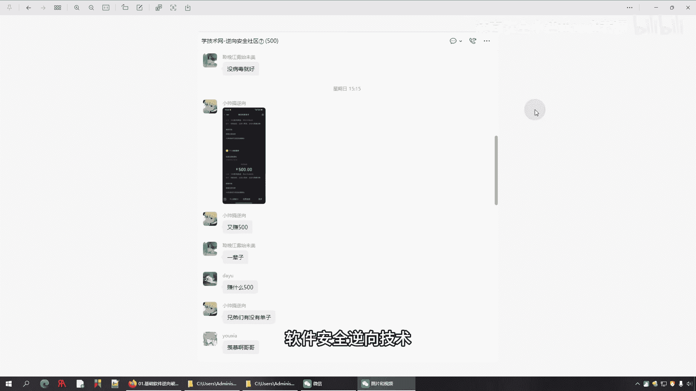
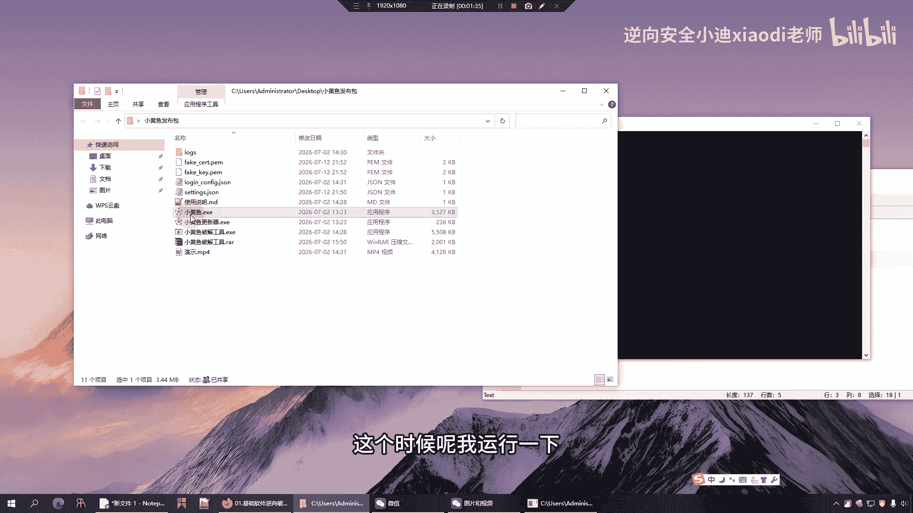
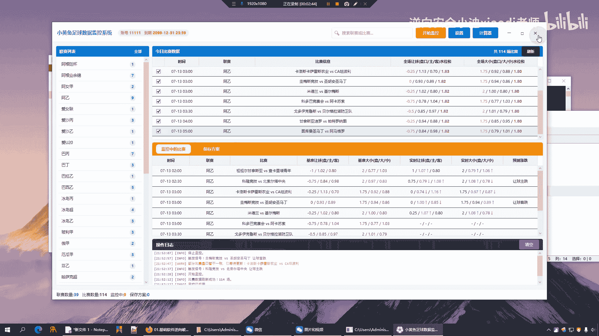
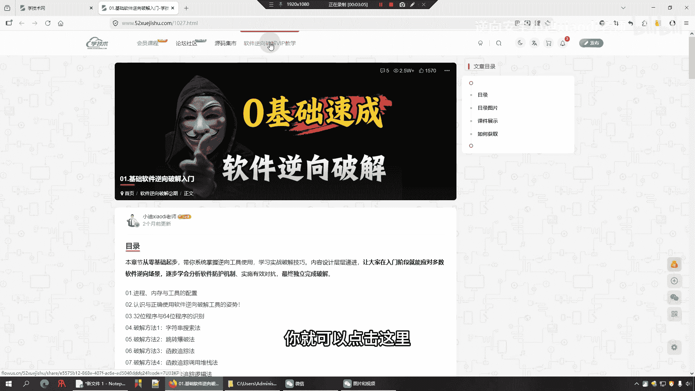

# 🛠️ 软件逆向破解技术：第一章：某足球数据监控软件逆向破解（伪造卡密、突破网络验证）

大家好，我是小迪老师。在今天这节课中，我们将学习软件逆向工程的实际应用，通过一个完整的案例演示——某足球数据监控软件的逆向破解，来直观地了解逆向技术到底能够做什么。演示的核心目标是伪造卡密、突破网络验证，最终让一款需要账号充值才能使用的软件直接登录成功，并且完整使用所有功能。这节课的内容覆盖二进制安全逆向、游戏安全、软件安全、网络安全、CTF比赛基础以及封包技术等多个方向，可以说是软件安全领域非常经典的一课。


## 🔍 1. 逆向工程到底能干什么

在动手之前，我们先来搞清楚一个基本问题：逆向到底能干什么？很多初学者看到逆向课程这么热门，心里多少都会犯嘀咕，讲个逆向，怎么就有那么多人听？这个逆向到底能干什么？

实际上，软件逆向就是去分析一些小软件的内部运行逻辑。比如说，可以分成这么几种场景来理解：

- 你使用的某款软件突然跑路了，你想弄清楚它到底是怎么运作的
- 有一款软件，你运营起来之后发现它需要账号登录，而且你还得给账号充值才能解锁完整功能
- 你自己编写了一款软件，你想知道这款软件的防护性如何，会不会被别人轻易破解

就拿第二个场景来说，我们完全可以做一个测试：通过逆向分析，找到这款软件的验证逻辑漏洞，看看能不能不注册、不充值就正常使用。这就引出了本节课要做的演示。

当然，这里必须强调一点，这个技术是一把双刃剑：

> 希望大家仅将这项技术用于技术交流，不要去做任何非法的传播。如果软件是你自己写的、自己开发的，那么你可以通过逆向技术清楚地了解到软件的防护性如何，从而有针对性地加固，真正保障你的软件不受侵害。

### 🧠 1.1 逆向破解的核心原理

用大白话来说，绝大多数软件的登录验证都可以简化成一条判断语句：卡密对不对、账号有没有充值、授权有没有到期。逆向破解做的事情，就是找到这条判断语句，然后修改它的结果。核心思路可以用下面的公式描述：

```
破解结果 = 分析验证逻辑 + 定位关键判断 + 篡改返回结果 + 绕过网络验证
```

再来看一段伪代码，对比一下破解前后的登录逻辑差异：

```python
# 破解前的登录验证逻辑
def login(账号, 卡密):
    result = 网络验证(账号, 卡密)   # 向服务器发起验证请求
    if result == True:
        return "登录成功"
    else:
        return "卡密无效，请充值"

# 破解后的登录验证逻辑
def login(账号, 卡密):
    result = 网络验证(账号, 卡密)
    # 篡改判断逻辑，无论服务端返回什么，都直接放行
    return "登录成功"
```

一句话总结：只要软件的验证逻辑写在客户端，并且判断结果可以被修改，那么它就存在被破解的可能。理解了这一点，后面的演示看起来就会非常清晰。


## 🔎 2. 本次演示的目标软件

了解了逆向的基本原理之后，我们来看看今天要动手的目标软件。本节课选择的演示对象是一款足球数据监控软件。这款软件的运营模式很简单：用户需要注册账号，登录之后还要对账号进行充值，才能使用软件的监控功能。

我们要做的测试非常简单，就是直奔主题：不注册账号、不进行充值，直接登录成功，并且确认软件的所有功能都能正常使用。通过这个演示，大家就能直观地感受到软件逆向技术到底能够实现什么效果：一个依赖卡密和网络验证的软件，在伪造卡密、突破网络验证之后，会变成什么样子。


## ⚙️ 3. 准备工作与学习环境

明确了目标之后，接下来就是要做一些准备工作了。在开始正式的破解操作之前，我们先来介绍一下整个演示环境。整个演示过程需要准备的东西并不多，以下是本次实验需要准备的材料：

- 目标软件：某足球数据监控软件，需要登录账号才能使用完整功能
- 破解工具：小黄鱼破解工具，用于对目标软件进行逆向分析和内存修改
- 运行环境：Windows操作系统，能够正常运行上述两个程序

另外，小迪老师的团队还运营着一个学技术网门户网站。大家可以直接打开这个网站，去查看一下里面的内容。网站里的所有课程内容都可以点击进去，点击之后就能看到详细的课程目录，而且配套的课件制作得非常精美，很适合初学者进行系统化的学习。

以下是网站门户提供的主要内容：

- 课程目录：点击任意课程，即可查看完整的章节结构
- 精美课件：每一节课都配备了高质量的课件，方便课后复习
- 联系老师：可以通过网站联系到小迪老师，咨询相关学习内容


## 🔓 4. 破解过程实战演示

准备工作完成之后，下面正式进入今天的重头戏：破解过程演示。整个演示流程分为三步：运行破解工具、启动目标软件、登录验证。下面我们一步步来看。

### 🛠️ 4.1 运行小黄鱼破解工具



首先，运行小黄鱼破解工具。工具运行起来之后，我们直接开启破解。此时工具会在内存层面扫描目标软件的验证相关代码，定位到登录判断函数并修改它的逻辑。这个过程很快，界面上随即提示破解成功。

这个步骤在技术上的本质，可以用下面的执行流程来描述：



```
启动破解工具 → 附加目标进程 → 定位验证函数 → 修改判断逻辑 → 破解成功
```

### ▶️ 4.2 启动目标软件并登录

破解成功之后，紧接着运行足球数据监控软件。软件启动之后，我们可以看到，登录界面并不需要注册账号，我们也不去输入任何卡密，直接点击登录按钮。由于验证逻辑已经被破解工具修改，软件直接就登录成功了。换句话说，账号注册和卡密验证这两个环节，已经被完全绕过。

### ⏰ 4.3 查看到期时间

登录成功之后，我们再来确认一下软件的授权状态。软件界面上有一个到期时间的显示项，我们看了一下，显示的时间是2099年12月31日。看到这个时间，基本就可以确定到期限制已经被解除了，软件从按时间付费变成了永久可用的状态。


## ✅ 5. 软件功能完整测试

登录成功只是第一步，功能验证才是关键，所以我们接着来测试软件功能。为什么要做这一步？因为如果只是登录进去了，功能却全部被锁定，那这个破解就没有任何意义。那么这个软件到底能不能用？我们来实际测试一下。

首先，尝试开启足球监控功能，点击界面上的开始监控按钮。点击之后，软件立刻开始监控数据，界面上开始出现实时滚动的数据流。接着，我们继续观察一下其他的数据模块，可以看到各个模块都在持续地正常工作。

以下是我们在测试过程中观察到的功能表现：

- 实时数据监控：开始监控之后，界面持续展示最新的足球实时数据，数据一直处于滚动更新状态
- 涨跌预测：左下角出现了涨跌预测信息，预测内容会随着实时数据的变化而更新
- 比赛结果推送：正在进行的比赛，其比赛结果也会实时推送出来
- 赔率计算：软件还支持赔率计算功能，输入的赔率值会实时计算并显示结果

关于赔率计算，这里再多说一句。软件会根据实时数据动态调整赔率，本质上是一个跟随数据波动的实时计算过程，可以用公式简单表示为：

```
赔率 = f(实时比赛数据)
```

测试中我们输入了0.95这个赔率值，可以看到计算结果随之产生了相应的变化，说明这个功能也是正常的。确认基础功能正常之后，我们继续等待了一段时间，也可以再添加一些其他的监控数据，软件都会正常响应。总之，经过完整的测试可以确认：这款软件的所有核心功能都是可以正常使用的。

实际上，这个结果恰恰反映了软件逆向技术的妙用所在。同时，对于开发者来说，这也暴露了一个非常严重的问题：验证逻辑全部依赖客户端，服务端没有任何强校验，所以破解者只需要修改一处判断，整个付费体系就形同虚设。这也是为什么正规软件需要在服务端做验证、加代码混淆、绑卡密和设备，目的就是提高破解成本。




## 📚 6. 学习资源与学员成果

功能验证完毕，如果你对这项技术产生了兴趣，那么可以看看下面的学习资源。如果大家想要深入学习相关技术，可以随时联系小迪老师。以下是一些获取学习资源的途径：

- 哔哩哔哩：小迪老师的B站账号名称是"逆向安全"，直接搜索即可找到
- 官方网站：访问学技术网门户，可以查看课程介绍和详细内容
- 学员交流群：加入学员群，和其他同学一起交流学习心得，互相促进

说到学员群，我们顺便来看一下大家的学习效果。目前我们有多个学员交流群，其中五群已经满员了，七群也满员了，还有另一个群同样是做逆向方向的。从整体来看，大家的学习效果都是非常不错的，具体成果可以从以下几个方面看出来：

- 游戏安全方向：有学员利用逆向技术分析游戏的安全防护机制，并成功落地应用
- CTF比赛方向：有学员利用逆向技术参加各类安全比赛，打出了非常不错的成绩
- 技术接单方向：有学员通过逆向技术接单，赚到了一些收入，也没有遇到什么问题

从这些成果可以看到，软件逆向技术的应用范围非常广。无论你是想入门网络安全、参加CTF比赛，还是想给自己开发的软件做安全测试，这门技术都值得好好学习。我们非常欢迎大家前来学习软件安全逆向技术。另外，如果想在网站上查看课程介绍的话，只需要点击网站首页的对应入口，就可以看到完整的介绍内容了。


## 🏁 7. 总结

最后，我们来总结一下本节课的全部内容。本节课中我们一起学习了软件逆向破解技术的完整流程，以某足球数据监控软件为案例，演示了从破解工具运行到登录成功，再到功能验证的全过程。以下是本节课的核心要点回顾：



- 逆向工程的核心思路是分析验证逻辑、定位关键判断、篡改返回结果、绕过网络验证
- 演示中使用了小黄鱼破解工具，成功修改了目标软件的网络验证逻辑
- 破解之后无需注册账号和充值，直接登录成功，到期时间显示为2099年12月31日
- 软件的核心功能全部正常可用，包括实时监控、涨跌预测、比赛结果推送和赔率计算
- 逆向技术的应用场景包括游戏安全、CTF比赛、技术接单等，但使用时必须注意合法合规

以上就是今天全部的课程内容。希望通过本节课的学习，大家能够对软件逆向技术有一个清晰的认识。如果对相关内容感兴趣，想进一步学习的话，欢迎联系小迪老师，也可以访问学技术网门户查看课程介绍。我们下期再见。

