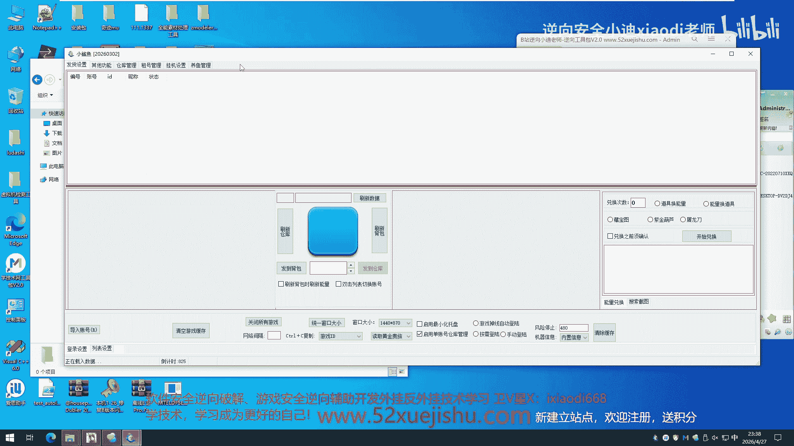

# 🧩 软件逆向破解技术：01：窗口爆破某高级游戏脚本卡密网络验证软件的实践


在本节课中，我们将要学习如何对某高级游戏脚本的卡密网络验证软件进行窗口爆破，重点理解常规窗口爆破思路在本例中为什么受限，以及如何通过倒查窗口消息循环、跟踪载入逻辑、下断点验证和打补丁来绕开限制。本节内容需要结合直播演示和实际调试来理解，单看文字不容易掌握，只有把常规思路和本例差异对照起来，才能看懂作者在窗口载入逻辑里设置的“小心机”。


## 🧭 软件逆向破解技术：01.1：常规窗口爆破思路与限制


上一节我们明确了本课的整体目标，本节中我们来看看常规窗口爆破一般怎么入手，以及本例为什么不能直接照搬。常规做法通常是从模块和特征码入手，先定位窗口相关代码，再寻找可以直接修改窗口ID的位置；但本例在入口处就表现出不同，所以需要先理解限制在哪里。

以下是常规窗口爆破中常见的观察点。


- 查找单机模块或当前模块，并匹配特征码 `FF25`，把它作为定位窗口相关逻辑的线索。
- 观察目标位置是否能直接 `push` 窗口ID；本例中可以看到，程序无法直接 `push` 窗口ID。
- 检查是否存在常规的载入启动窗口；本例没有那个载入窗口，因此不能按常规载入启动窗口的方法处理。
- 如果没有载入启动窗口，只按常规方法学习会学不到关键点，需要结合直播演示和实际调试来查看其他位置。

从这些观察点可以看出，本例不是简单的“找到 `push` 就改窗口ID”的题型。常规路径在这里走不通，所以接下来要换一种方式，从程序后部的窗口消息循环往前倒推。


## 🔍 软件逆向破解技术：01.2：从窗口消息循环倒推入口


上一节我们说明了常规 `push` 窗口ID思路在本例中受限，本节中我们来看看如何倒着分析函数，从窗口消息循环反推载入逻辑。函数前面有很多类似逻辑，直接顺着看容易迷失，因此可以采用倒查方式，把后部稳定的框架结构先标记出来。

以下是倒查时需要关注的要点。

- 查看函数后部时，可以发现窗口消息循环；此时应注释为“窗口消息”和“创建消息循环”。
- 窗口消息循环在语言框架中通常是必不可少的环节，这个位置不要随意改动。
- 继续观察函数内部取了哪些值，包括终结者、小鲨鱼、启动时间、文件名等；程序运行到这里，肯定要运行某些内容。
- 其中有一个关键点，原文称为“Q”，这个关键点非常关键，不要改动。
- 随后分析该函数并向下拉，查看这个函数有多大；同时会看到软件已经运行，是否需要再开一个实例也需要留意。

完成这些标记后，下一步就是继续往下翻，找到真正的载入位置。因为倒查的目的不是修改消息循环，而是借助它定位前面真正执行窗口载入的逻辑。


## 🎯 软件逆向破解技术：01.3：分析载入逻辑与卡密窗口 `1003`


上一节我们通过窗口消息循环建立了倒查锚点，本节中我们来看看载入逻辑最终落在什么地方，以及 `1003` 这个窗口号代表什么。继续向下翻并分析函数后，可以看到程序在这里执行了载入操作，而载入的目标正是卡密窗口。

以下是载入逻辑分析中需要理解的关键点。

- 在该位置可以看到程序执行载入，载入的是 `1003`；通过类似 `OpenWindow` 的调用打开窗口，`1003` 就是卡密窗口。
- 作者在这里设置了“小心机”，没有把载入窗口直接暴露成常规的 `push 窗口ID` 形式，而是通过自己的逻辑打开。
- 原先的常规思路是查看 `push` 窗口号，再查找当前模块并匹配到对应位置，然后修改窗口ID；但本例没有这个 `push`。
- 即使随便调一个以前知道的窗口号，也不能直接套用；一般程序会有载入启动窗口，可以通过载入启动窗口把窗口ID改掉，但本例没有载入启动窗口。
- 没有载入启动窗口时，就要看作者的逻辑是怎么改的；所谓“道高一尺，魔高一丈”，这种防破手段本身也可以成为破解线索。
- 继续倒着看时，对于语言框架来讲，最后一个窗口消息循环不要动；继续往下翻，就能翻到程序在这里执行载入的位置。

为了更直白地对比常规路径和本例路径，可以用下面的代码描述核心差异。

```text
常规窗口爆破路径：
查找当前模块 -> 匹配特征 FF25 -> 查找 push 窗口ID -> 修改窗口ID -> 进入目标窗口

本例路径：
查找当前模块 -> 匹配特征 FF25 -> 未发现 push 窗口ID -> 倒查窗口消息循环
-> 跟踪函数内载入逻辑 -> 命中 OpenWindow(1003) -> 验证并打补丁
```

理解了这个差异后，就需要通过断点和补丁验证 `1003` 载入点是否真的能控制程序进入。下一节将围绕这个验证过程展开。


## 🧪 软件逆向破解技术：01.4：用断点与补丁验证载入点


上一节我们定位到 `1003` 卡密窗口的载入逻辑，本节中我们来看看如何用断点和补丁验证这个位置是否有效。验证时可以先准备一个补丁，再找到“到这儿才开始载入”的位置，在该位置下断点并运行程序观察。

以下是验证载入点的操作步骤。

- 准备一个补丁并查找目标位置，确认程序到该位置才开始载入。
- 在载入位置下断点，运行程序，并先放开断点让程序走到目标处。
- 程序停在断点处后，查看当前窗口ID，确认其为 `1003`。
- 将相关校验或限制“干掉”，也就是打补丁处理；处理后可以看到程序似乎不受影响。
- 继续运行后程序能够进入目标窗口，说明该处补丁可以绕开限制。
- 最后需要自己复现并尝试打补丁验证，不能只看演示。

对应的验证流程可以用下面的伪代码表示。

```text
Breakpoint(载入点)
Run()
WaitUntil(程序停在载入点)
Assert(窗口ID == 1003)
Patch(校验或限制)
Continue()
Result: 程序进入目标窗口
```

完成断点验证后，还需要观察补丁后的功能表现和成本问题。下一节将补充说明补丁成本以及挂机导出、击杀记录等功能观察。


## 💰 软件逆向破解技术：01.5：补丁成本与功能观察


上一节我们通过断点和补丁验证了载入点，本节中我们来看看打补丁后的功能观察，以及关于逆向和维护成本的讨论。打上补丁后，可以继续观察软件的功能是否正常，例如挂机导出和击杀记录等界面或功能是否还能使用。

以下是本节涉及的观察点。

- 打补丁后观察软件功能，可以看到挂机导出和击杀记录等内容。
- 关于全况镜像或者人件成本比开发这个软件还大是否正常，这个问题有时确实会得到肯定回答，也就是有时确实会出现这种情况。
- 这样处理后，前面的限制就被绕开或“抛开”了，程序可以继续进入目标流程。

到这里，窗口爆破的主要流程已经串起来：先理解常规思路，再倒查消息循环，定位 `1003` 载入点，最后用断点和补丁验证。下面做一个整体总结。




## 📝 软件逆向破解技术：01.6：课程总结


本节课中我们一起学习了窗口爆破某高级游戏脚本卡密网络验证软件的实践。我们从常规窗口爆破思路出发，理解了本例无法直接 `push` 窗口ID、没有常规载入启动窗口的限制；随后通过倒查窗口消息循环，标记“窗口消息/创建消息循环”等关键位置，并分析函数内部的取值和运行逻辑；接着定位到 `1003` 卡密窗口的载入点，认识到作者通过自定义载入逻辑隐藏了常规窗口ID修改路径；最后用断点和补丁验证了载入点，并观察了挂机导出、击杀记录等功能以及补丁成本问题。整个过程中，核心是理解常规路径与本例路径的差异，并用调试和补丁把差异验证出来。
