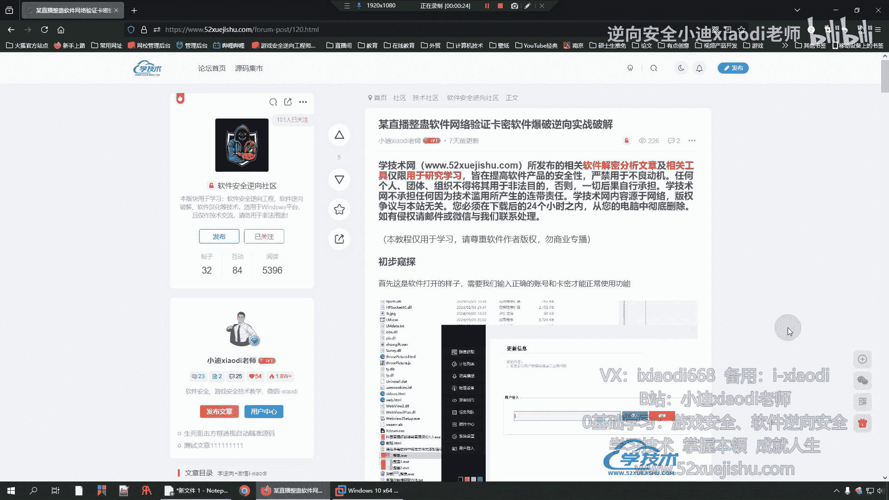
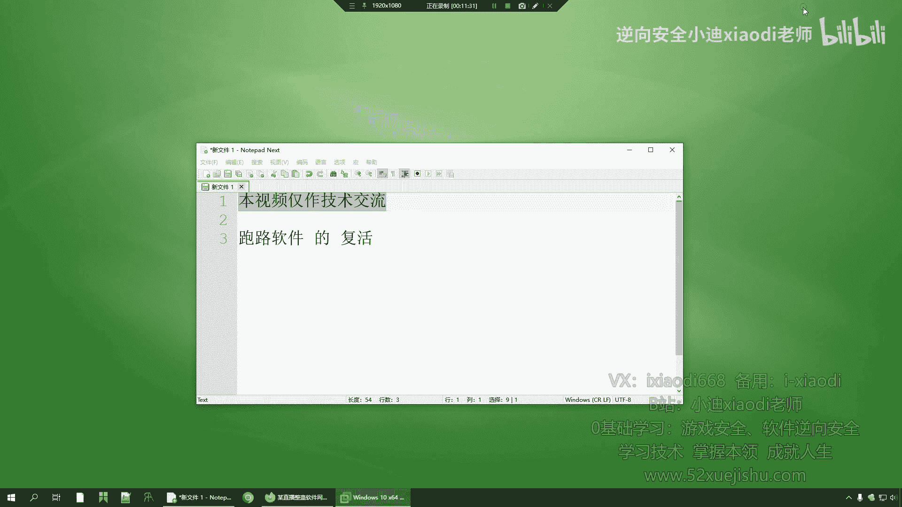

# 🧩 软件逆向破解技术：01：跑路卡密软件的复活实战分析

大家好，我是小迪老师。今天我们继续讲软件逆向破解。在本节课中，我们将要学习如何分析一款跑路卡密软件，并尝试让它恢复可用。很多同学会问，讲逆向破解有这么多人听，逆向破解到底能干什么。比如前段时间社区成员买了一个软件，这个软件前段时间还可以用；我们还写过一篇文章，教大家分析这个程序，并实现登录层面的突破。这些内容前面都讲过，最后再收一下。测试完成后没有发现问题，软件可以正常使用。但是这款软件这段时间跑路了。很多朋友会碰到这种情况：自己买了一个软件，对方保证永久更新、永久存活之类，结果突然有一天就跑路了。遇到这种情况怎么办，就要用到今天的技术。这里先郑重说明。

> 郑重说明：本视频仅做技术交流。想学习相关内容可以联系咱们。





完成说明后，下面进入案例背景。

## 🧭 软件逆向破解技术：02：案例背景：卡密软件跑路后为什么卡死

上一节我们说明了课程目标和免责声明，本节来看看这款软件跑路后的具体表现。这个软件需要输入卡密，其他所有功能都要点击登录后才可以使用。但是点击登录时，不管你是正版卡、盗版卡，还是过期卡、未过期卡，现在都已经没有用，因为服务器已经跑路，服务器连不上。这样软件就会卡住，整个界面出现未响应。可以用下面的关系来理解。


\[
\text{登录失败且服务器不可达} \rightarrow \text{登录流程等待} \rightarrow \text{界面未响应}
\]

这种情况比较难搞，它是一款直播间互动软件。软件变成这样很头疼，本来买了一个软件，结果成了这样。接下来看一下分析好的软件效果。分析好的软件是这个，点击登录后软件就可以用，可以正常使用，还会加载一些东西。这个软件本身的功能肯定都可以用，只不过登录服务器这一块被限制，也就是服务器跑路了。明白这个背景后，下一节开始做分析准备。

## 🛠️ 软件逆向破解技术：03：分析准备与定位登录逻辑

上一节我们确认了问题出在登录服务器连接环节，本节来看看分析前要做什么，以及怎样定位登录逻辑。首先打开这个程序，再打开我们的工具。工具只有两个，应该是上面这个，先看一下是不是。上面这个里面还有一个，先不管它。我们运行“TV成空2”，然后附加，接着切换到程序主模块。这个操作前面都讲过，属于老生常谈的操作。它肯定会连接服务器，这一点可以盲猜；服务器相关内容实际上在文章里也讲过了。所以我们要找服务器连接的部分。为了把后续跟踪讲清楚，下面先列出本例的准备动作。

下面是本例中用到的准备动作。

- 打开目标程序“TV成空2”。
- 打开逆向分析工具，选择上面的工具入口。
- 附加到目标程序。
- 切换到程序主模块。
- 在代码中向上翻，寻找登录入口和服务器连接相关代码。

完成准备后，我们往上翻。需要注意，这个函数代码写得比较长，要翻到最开始登录的位置，然后单步向下跟踪。大家不要着急，耐心一点。可以看到这个位置就是登录的头部函数，也可以理解为登录代码的头部。比如登录的所有代码都从这里开始执行。系统中和课程中有非常系统的讲解。接下来在这里打断点，然后点击登录。可以看到程序断下来了，说明点击登录时断在这里，这里就是登录代码。这个定位关系可以写成下面这个式子。

\[
\text{关键位置}=\text{登录入口函数头部}+\text{服务器连接调用}
\]

定位到入口后，下一节开始单步跟踪，观察数据如何流向服务器。

## 🔍 软件逆向破解技术：04：单步跟踪：从Token到服务器连接

上一节我们定位到了登录入口并打下断点，本节用F8往下单步跟踪执行。一直按F8即可。继续按F8时发现流程直接退出，这说明那个地方肯定有猫腻。所以要跟得慢一点。这个位置点击登录后，F8慢一点，一点一点走，走到这里，继续走，继续走，没有问题，继续走，小心一点。跟踪过程中会生成一些Token之类的登录数据，也会看到soft、安全之类的字样。继续走，可以看到card、卡相关的内容，后面应该跟卡相关，先不用管它。此时已经感觉接近关键逻辑，日期也出来了。跟踪到这里时，原文用“今天是个好日子，心想离诗而懂能成”来形容当时的判断。继续走，可以看到开始登录，服务器连接大概是这样。继续走，date相关的服务器数据开始返回。这里数据很多，感觉程序即将把数据发到服务器。跟踪路径可以概括为下面这个式子。

\[
\text{跟踪路径}：\text{登录}\rightarrow \text{Token/日期/Card 数据}\rightarrow \text{服务器连接}
\]

注意，当F8走到这个位置时，程序跑起来了，这里非常关键。程序跑起来后卡死。走到这里程序卡死，说明这个函数有问题。问题函数已经暴露，下一节就把它处理掉并验证功能。

## 🧱 软件逆向破解技术：05：关键补丁：NOP掉卡死函数并验证

上一节我们跟踪到某个函数会导致程序卡死，本节看看怎样干掉这个函数。处理方法非常简单：在这里鼠标右键，直接二进制NOP掉。NOP掉就是什么都不执行，以后这个位置什么都不做，这样程序就不会卡死。随后打一个补丁，把补丁命名为“听云整某某整蛊666”。补丁的基本思路如下。

```asm
; 补丁思路（伪汇编）
call 服务器连接函数
; 若该调用导致程序卡死，可改为：
nop
nop
nop
nop
nop
```

整个补丁流程可以写成下面的公式。

\[
\text{补丁流程}=\text{定位关键调用}\rightarrow \text{二进制NOP}\rightarrow \text{保存补丁}\rightarrow \text{重启验证}
\]

完成补丁后，关闭程序，再重新运行。可以看到程序现在已经连接服务器。点击登录，登录可以成功。补丁完成后，可以按下面的项目逐项检查功能是否恢复。

下面是补丁后的功能验证项目。

- 点击登录，确认登录流程可以通过。
- 查看物理设备、任务队列、拆单制作等功能是否正常。
- 查看系统设置是否可以打开。
- 查看弹幕获取功能，语音播报是否可以正常开启。
- 检查保存设置是否可以正常保存。

验证时，物理设备、任务队列、拆单制作功能正常，系统设置可以打开，弹幕获取也进行了查看，语音播报可以正常开启，保存设置可以正常保存。到这里，跑路卡密软件的复活流程就完成了。下面做课程总结。


## ✅ 软件逆向破解技术：06：课程总结



前面我们完成了案例背景、登录定位、单步跟踪、NOP补丁和功能验证，本节做总结。本节课中我们一起学习了跑路卡密软件的复活实战分析：先确认软件卡死是因为登录服务器连接不可达，再通过附加程序、切换主模块、定位登录入口、打断点、F8单步跟踪，找到导致卡死的服务器连接相关函数，最后用二进制NOP处理并打补丁，验证登录和主要功能。今天讨论的软件可不可以复活，答案是可以复活，但有一定概率。想学习相关内容，欢迎加入咱们。下期再见。

