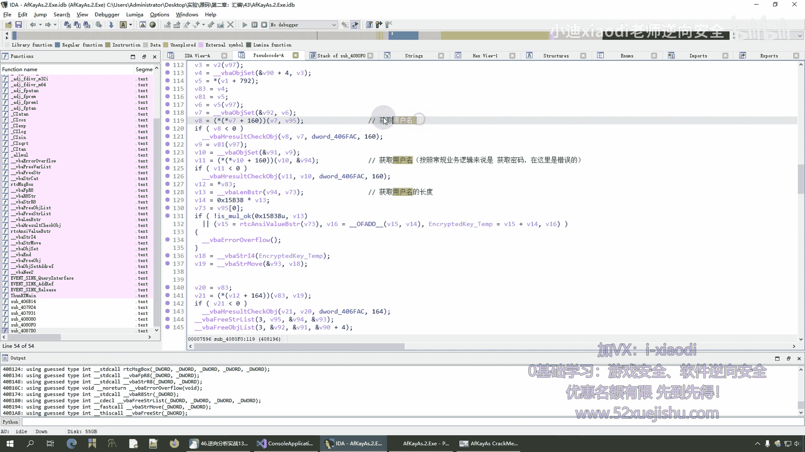
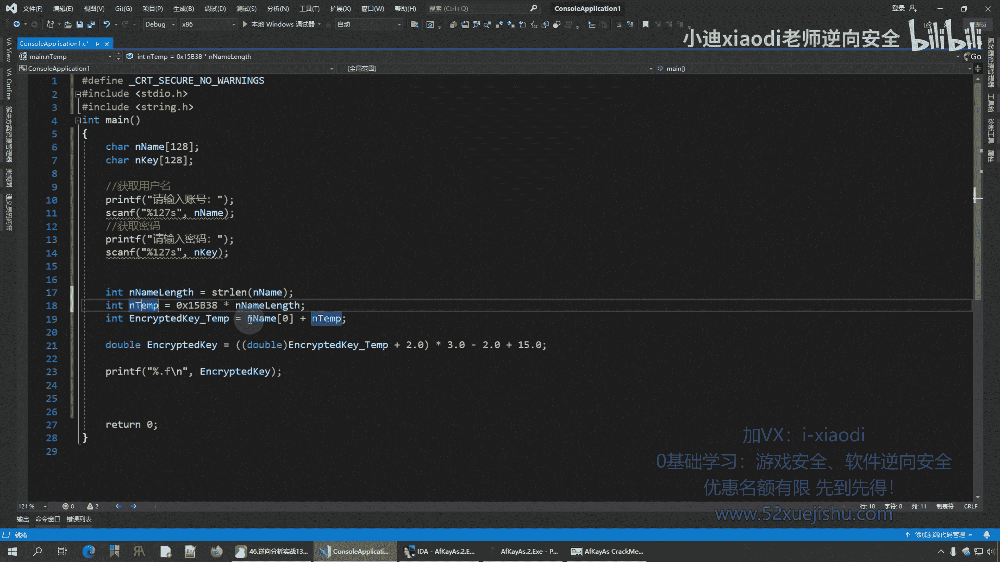
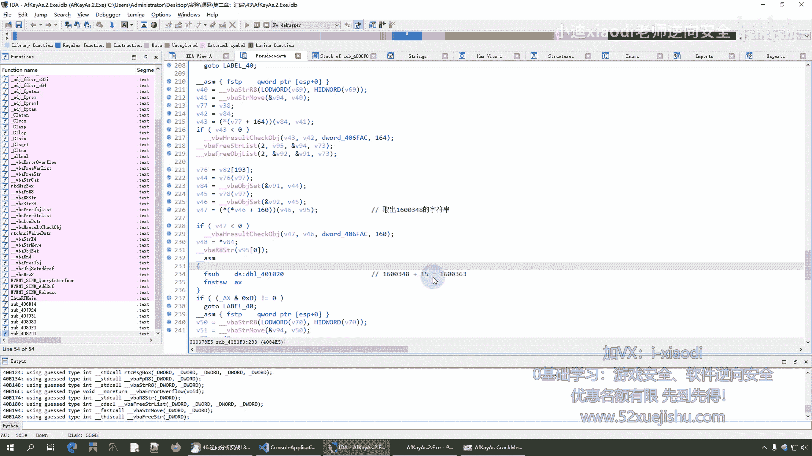
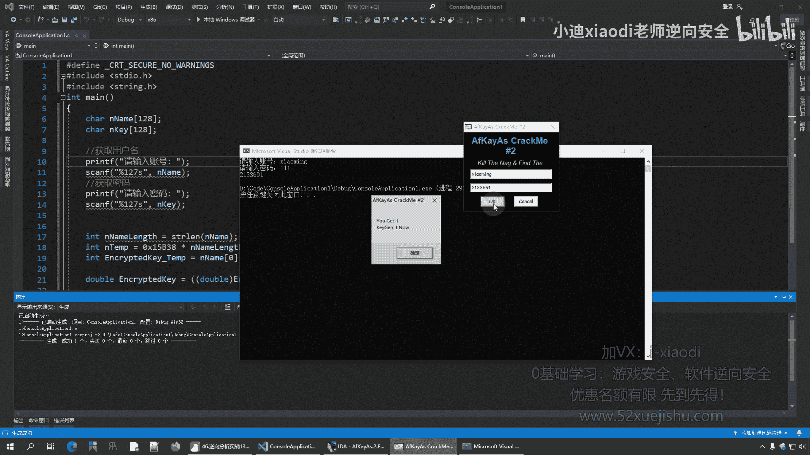
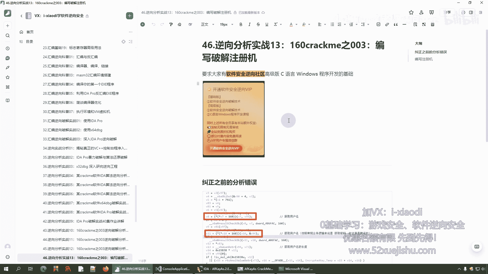

# 🧩 软件逆向破解注册机编写实战：003：一人一码破解

## 📌 软件逆向破解注册机编写实战：003.1：课程概述与基础要求


大家好，我是小李老师。在本节课中我们将要学习如何编写破解注册机，对应 160crackme 之 003 的一人一码破解实战，也涉及游戏安全、软件安全、网络安全和 CTF 比赛基础。本节课要求大家具备软件安全逆向社区高级版、C 语言和 Windows 程序开发基础。尚未加入的朋友可以抓紧加入，优惠名额不多。


初学者在看这类逆向分析时，容易把业务逻辑当成真实逻辑，所以需要结合调试器观察运行结果。下面会先纠正之前的分析错误，再通过动态调试还原算法，最后写出注册机并验证。接下来进入下一节，先纠正之前按业务逻辑推测产生的错误。


## 🔍 软件逆向破解注册机编写实战：003.2：纠正业务逻辑推测错误


上一节我们概述了课程目标，本节中我们来看看之前分析中的错误推测。首先纠正之前的分析错误。之前我们按业务逻辑推测：这里获取用户名，那边应该获取密码。这种推测符合常规业务逻辑。但通过动态分析发现，推测错误。动态调试的好处是能直接看到程序运行时的真实数据，比单纯看汇编更可靠。以下是动态调试中得到的关键结论：


- 查看函数地址，地址是 4081CD。在 4081CD 设置断点，断下来后发现它获取的仍然是用户名。因此这个函数获取的仍然是用户名，V94 里面存放的是用户名。
- 因此这个位置获取的不是密码长度，而是用户名长度。然后用用户名长度乘以这个数字，得到 V14。接着加上 V15。V15 来自 V73，V73 是 V95，V95 仍然是用户名首字符。


到这里，获取用户名和用户名长度的过程已经清楚。接下来进入下一节，看看确认后的变量如何组成密码算法。


## 🧮 软件逆向破解注册机编写实战：003.3：还原注册机计算逻辑




上一节我们通过动态调试确认了变量来源，本节中我们来看看密码算法如何还原。首先输入账号，然后输入密码。接着用用户名长度乘以这个数字，得到临时数据。再把临时数据加上用户名首字符，得到临时加密 K。这个临时加密 K 首先要加上 20，得到的结果再乘以 30。最终计算出一个数据后，再减去 20，得到的数据再加上 15。最终这个结果就是密码。把这些步骤拆开后，整个注册机算法就不复杂了，本质就是几个常数和一个用户名首字符参与运算。为了更直观，核心计算可以写成下面的公式。


```text
临时数据 = 用户名长度 × 这个数字
临时加密K = 临时数据 + 用户名首字符
密码 = ((临时加密K + 20) × 30 - 20) + 15
```


所以代码应该这样写：首先把临时加密 K 加上 20，得到的结果再乘以 30，减去 20，再加上 15。由于它是双精度浮点数，最终这个加密 K 使用 double 类型。然后在这里进行打印。接下来进入下一节，看看如何把公式写成注册机代码并验证。


## 💻 软件逆向破解注册机编写实战：003.4：编写注册机代码并测试


上一节我们还原了计算公式，本节中我们来看看注册机代码的编写和测试。根据上面的公式，可以把注册机代码写成下面这样。这里保留变量含义，方便初学者对照前面的分析。写代码时要注意类型，涉及小数就用 double，打印时按需要格式化。


```c
double K = strlen(username) * number + username[0];
double password = (K + 20) * 30 - 20 + 15;
printf("%.0f\n", password);
```


代码完成后进行测试。比如现在想知道小明的密码是多少。把“小明”复制一下，然后运行这个程序。程序运行起来后，输入“小明”，随意输入密码，这个都无所谓，然后回车。这个时候密码就输出为 2133691。切换到目标程序，把密码粘贴过来，点击 O，就破解成功。以下是测试验证的步骤：


- 复制“小明”作为用户名。
- 运行注册机程序，输入“小明”。
- 随意输入密码后回车，得到密码 2133691。
- 切换到目标程序，粘贴密码，点击 O，破解成功。


到这里，注册机编写和验证已经完成。接下来进入下一节，看看分析过程中需要记住的提醒。




## ⚠️ 软件逆向破解注册机编写实战：003.5：核心逻辑要用动态调试确认




上一节我们完成了代码和测试，本节中我们来看看核心逻辑的确认方法。最后再提醒大家，有的时候按照经验去推测逻辑，它可能是错误的。所以在一些核心逻辑上，最好还是通过 DBG 去动态调试，看一下这个函数到底真实是做什么用的。不能只靠业务逻辑想象，因为编译器优化、变量复用和代码结构都会让表面逻辑产生偏差。分析核心逻辑时多验证一次，可以避免后面写出错误注册机。下面是本节需要记住的提醒。




> 提醒：按照经验推测逻辑可能出错。核心逻辑最好通过 DBG 动态调试，确认函数真实用途。


接下来进入最后一节，对整节课做总结。


## ✅ 软件逆向破解注册机编写实战：003.6：课程总结




上一节我们强调了动态调试的重要性，本节中我们对整节课做总结。本节课中我们一起学习了如何编写一人一码破解注册机。我们纠正了之前按业务逻辑推测“这里获取密码”的错误，通过 4081CD 断点确认函数获取的是用户名，V94 是用户名。随后确认该位置获取的是用户名长度，并用用户名长度乘以一个数字得到 V14，再加上来自 V73、V95 的用户名首字符得到临时加密 K。核心公式是 `密码 = ((临时加密K + 20) × 30 - 20) + 15`，代码中使用 double 类型并打印结果。最后用“小明”测试得到 2133691，粘贴到目标程序点击 O 后破解成功。核心提醒是：经验推测可能错误，核心逻辑要用 DBG 动态调试确认。下一期再见。

