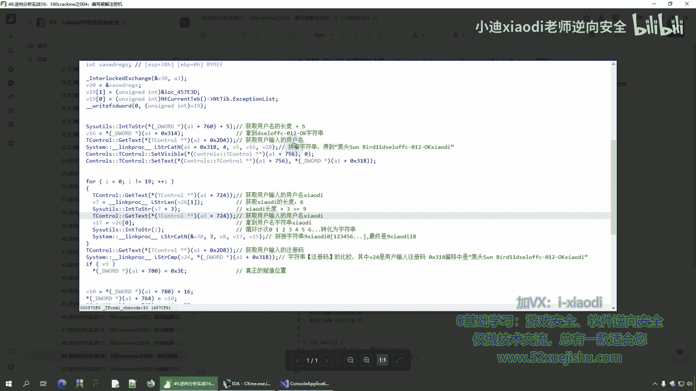
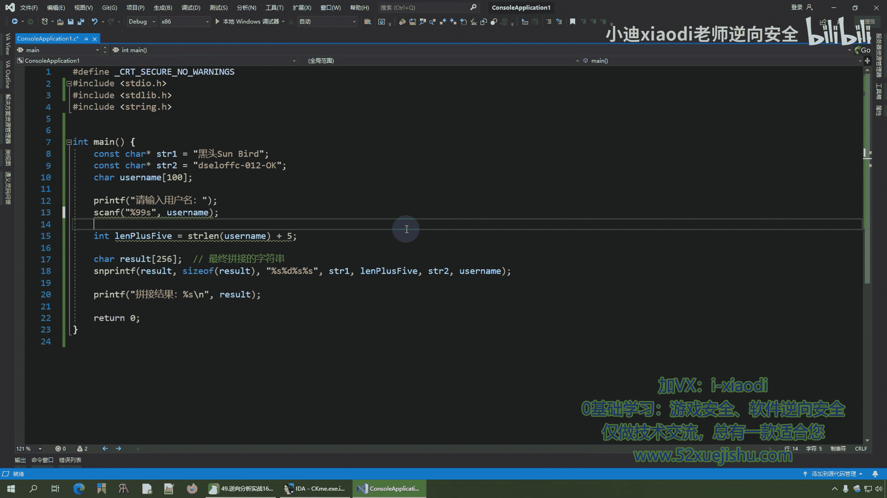

# 🔧 软件逆向破解实战：160crackme之004：编写破解注册机

大家好，我是小迪老师。今天我们讲解 160crackme 004 如何编写破解注册机。在本节课中，我们首先要搞清楚注册机的编写逻辑，然后按照这个逻辑写出对应的 C 语言代码，最后再拿一个真实用户名测试注册机能否成功破解。这个过程其实就是把原程序内部的生成算法完整地模拟一遍。

## 🧠 回顾注册码生成逻辑

在写代码之前，我们必须先明确一个基本概念：注册机的逻辑并不是凭空想出来的，而是根据原程序的解密逻辑推导出来的。说得更直白一点，原程序怎么生成注册码，注册机就怎么生成注册码。只有把原程序生成注册码的步骤完全搞清楚，注册机才能产生可用的注册码。下面我们回顾一下这个生成逻辑，方便接下来直接照着写代码。

整个生成逻辑可以拆成四个非常简单的步骤：

- 第一步：获取用户名的长度，在长度基础上加 5，得到一个数值结果。
- 第二步：把固定字符串 `"黑头"` 和上一步的数值结果拼接起来。
- 第三步：把上一步得到的拼接结果再与另一个固定字符串 `str2` 拼接起来。
- 第四步：最后把用户名拼接到整个字符串的末尾。

也就是说，注册码的结构可以浓缩成下面这个公式：

\[
注册码 = "黑头" + (用户名长度 + 5) + str2 + 用户名
\]

这里面的 `"黑头"` 是原程序中预置好的第一个固定字符串，`str2` 是原程序中预置好的另一个固定字符串。这个公式虽然看起来有点绕，但本质上就是按顺序把四个部分拼在一起。只要你按照这个顺序来，最后拼出来的注册码就一定和原程序算出来的一模一样。

## 💻 编写注册机代码

现在我们已经把注册码生成逻辑梳理清楚了，接下来就可以动手写代码了。代码的编写完全可以照着上面的公式来，先准备材料，再执行拼接，最后输出结果。整个过程并不复杂，关键是要注意拼接顺序和占位符的用法。

首先，定义两个常量字符串，用来存放公式中写死的两个固定字符串。其中第一个字符串就是 `"黑头"`，第二个字符串我们用 `str2` 来表示，它的具体内容需要从原程序中提取，所以先在代码里写成一个占位字符串。然后，再定义一个 `username` 字符数组，用来接收用户输入的用户名。用户输入之后，程序就可以用 `strlen` 函数计算出用户名的长度。在这个长度上加 5，就得到了公式中的“用户名长度 + 5”这个中间结果。


所有素材准备好之后，就可以进行拼接了。这里我们使用的函数是 `snprintf`。这个函数最大的好处是能够一次性格式化好几个不同类型的值，并把格式化之后的结果写入我们指定的字符数组。使用的时候，我们需要把结果放在一个字符数组里，然后填入这个数组的大小，再提供格式字符串和对应的数据。具体代码如下：



```c
#include <stdio.h>
#include <string.h>

int main() {
    // 公式中的第一个固定字符串
    const char* str1 = "黑头";
    // 公式中的第二个固定字符串，具体值需要从原程序中提取
    const char* str2 = "???";

    char username[64];
    printf("请输入用户名: ");
    scanf("%s", username);

    int len = (int)strlen(username);
    int middle = len + 5;

    char code[128];
    // 按照 str1 + 中间结果 + str2 + 用户名 的顺序拼接
    snprintf(code, sizeof(code), "%s%d%s%s", str1, middle, str2, username);

    printf("注册码: %s\n", code);
    return 0;
}
```

代码中的格式字符串 `"%s%d%s%s"` 就是四个占位符的组合。第一个 `%s` 接收 `str1`，也就是 `"黑头"`；第二个 `%d` 接收整数 `middle`，因为中间结果是一个整数，所以这里要用 `%d`；第三个 `%s` 接收 `str2`，也就是原程序中的第二个固定字符串；第四个 `%s` 接收 `username`，也就是用户输入的用户名。这样，四个部分按照顺序被依次拼接到同一个字符数组 `code` 中，最终生成了完整的注册码。代码中的 `"???"` 需要替换成真实程序里的 `str2` 内容，这一步可以通过反汇编或者动态调试去确认。

## 🧪 测试注册机

代码写好了，接下来我们要立刻验证它是否正确。测试的方法其实非常简单，就是用一个真实的用户名去生成注册码，然后拿这个注册码到原程序中尝试破解。如果原程序接受了这个注册码，就说明我们的注册机没有问题。以下是具体的测试步骤：

- 在注册机运行界面上，输入一个测试用户名，比如 `小明`。
- 按下回车键，注册机会立刻输出 `小明` 对应的注册码。
- 把这个注册码复制下来，粘贴到 CrackMe 的输入框中。
- 点击验证按钮，在视频中演示的是双击图片，然后观察是否弹出成功提示。

可以看到，整个过程非常顺畅，`小明` 的注册码一出来，就能直接通过原程序的校验。这也就验证了我们前面写的注册机逻辑是正确的，完全还原了原程序的注册码生成过程。实际写注册机的时候，只要把同样的步骤套用到任意用户名上，都可以得到对应的合法注册码。



## ✅ 总结

本节课我们一起学习了 160crackme 004 的破解注册机编写方法。我们首先回顾了原程序的注册码生成逻辑，并用一个公式把它概括为：固定字符串 `"黑头"` 加用户名长度加 5，再加上另一个固定字符串，最后拼接用户名。接着，我们使用 `snprintf` 函数实现了这个生成逻辑，写出了完整的注册机代码，最后用用户名 `小明` 进行了实际测试，成功得到了注册码并通过了验证。这就是今天全部内容，下一集再见。
