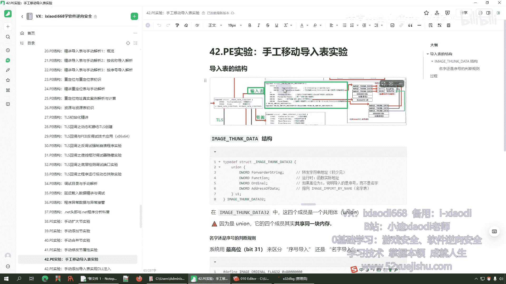
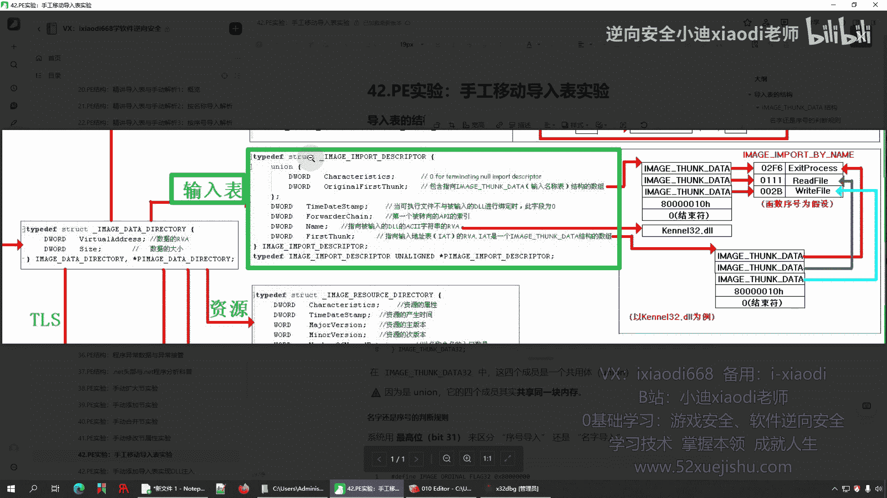
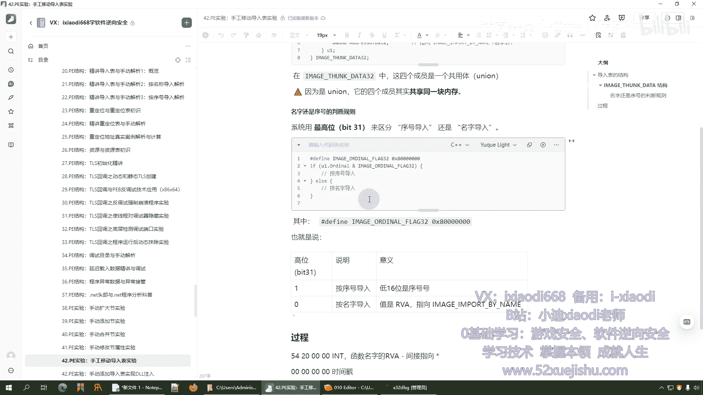
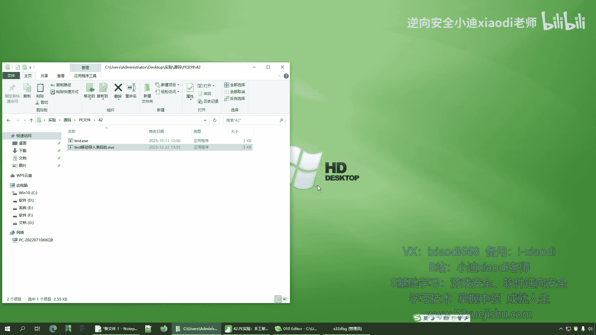
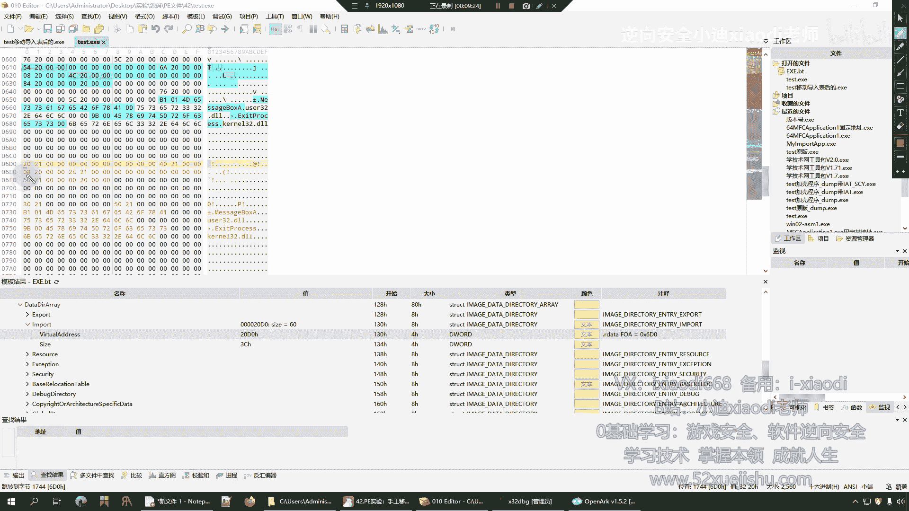

# 软件逆向破解：第42讲：手工移动导入表与IAT修复实验

## 🧠 概述



本节课中，我们将学习PE文件导入表的手工移动操作与IAT修复实验。通过本实验，你将理解导入表的数据结构、导入表在PE文件中的位置关系、IAT（导入地址表）的工作机制，并掌握手工移动导入表时需要注意的关键点。实验准备了两个程序——一个是移动导入表之后的版本，一个是原始版本，两者表面看不出差别，只有通过工具从内部查看才能发现差异。我们将会实际动手操作，把一个程序的导入表从原来的位置移动到新的位置，并确保程序仍然可以正常运行。

## 📋 PE导入表结构回顾

在动手操作之前，先回顾一个重要的基础知识点：PE导入表的结构。上一个实验中我们已经详细讲解过这部分内容，这里再简单梳理一遍，方便后续操作时你能跟上思路。

### 导入表结构定义

导入表由一个或多个`IMAGE_IMPORT_DESCRIPTOR`结构体组成，每个结构体的大小为20字节，对应一个DLL文件。多个DLL的导入表结构在内存中是连续存放的。



以下是`IMAGE_IMPORT_DESCRIPTOR`结构体的C语言定义：



```c
typedef struct _IMAGE_IMPORT_DESCRIPTOR {
    union {
        DWORD Characteristics;    // 0字节偏移，指向INT（Import Name Table）
        DWORD OriginalFirstThunk; // 指向INT（名称表）的RVA
    } DUMMYUNIONNAME;
    DWORD TimeDateStamp;          // 时间戳，一般为0
    DWORD ForwarderChain;         // 转发链，一般为0
    DWORD Name;                   // 指向DLL名称字符串的RVA
    DWORD FirstThunk;             // 指向IAT（Import Address Table）的RVA
} IMAGE_IMPORT_DESCRIPTOR;
```

### 各成员含义

导入表的第一个成员指向INT（Import Name Table），也就是名称表。INT中存放的是函数名称的RVA。第二个成员是时间戳，第三个成员是转发链，这两个成员在通常情况下都是0，所以说这两个不需要过多关注。第四个成员是指向DLL名称字符串的RVA。最后一个成员是IAT的RVA，即导入地址表。



来看一下结构中各个“地址”指向的内容：

1. OriginalFirstThunk（INT）指向一个数组，数组中的每个元素指向一个`IMAGE_IMPORT_BY_NAME`结构体。
2. `IMAGE_IMPORT_BY_NAME`结构体开头是一个WORD类型的序号，后面是函数名字符串。
3. Name成员指向DLL名称字符串，例如“user32.dll”。
4. FirstThunk（IAT）指向一个数组，程序运行时，加载器会将真实函数地址写入这个数组。
5. 导入表以一个全零的`IMAGE_IMPORT_DESCRIPTOR`结构体作为结束标志。

一个DLL对应一个20字节的导入表结构，两个DLL就是40字节。这些结构在内存中是连续存放的。每个DLL都对应这样一个表的结构，一个DLL对应一个导入表描述符。

### 导入表结束标志

导入表以20个字节（即一个完整描述符大小）的全零数据作为结束标志。这是一个容易遗忘的知识点，需要特别注意——在移动或修改导入表时，这个结束标志必须保留，否则加载器无法判断导入表的边界。

## 🔬 实验准备

### 程序对比

现在我们准备好了两个程序，一个是移动导入表之后的程序，可以当作参考答案来参考；另一个是原始程序。这两个程序都可以正常运行，表面上看不出任何区别。只有通过PE查看工具从内部去查看，才能看到它们之间的差异。

先看移动之后的程序。从扩展PE头中可以看到`ImportTable`的RVA是`20D0`，转换为文件偏移地址就是`6D0`。这个导入表是从`6D0`开始的，而上面的区域是空的。再看原始程序，导入表从`610`开始。这种差异能直接看到，说明导入表的确发生了移动。

### 操作思路

手工移动导入表的基本思路是：在当前导入表后面找到一块空白区域，把原有导入表数据完整地复制过去，再修改PE头中指向导入表的RVA值。与此同时，还需要处理INT、DLL名称、函数名称等数据的存放位置，因为原位置的数据可能在程序运行过程中被引用。

## 🔧 手工移动导入表

### 观察导入表数据

首先用十六进制编辑器打开程序，定位到导入表所在位置。看到第一个DLL的导入表结构，共5个成员，每个成员4字节，一共20字节。然后是第二个DLL的导入表结构，也是20字节。最后是20字节的全零数据，表示导入表到此结束。

位置分布如下：

1. 第一组`12345`：第一个DLL的导入表描述符，从`610`开始。
2. 第二组`12345`：第二个DLL的导入表描述符，从`624`开始。
3. 结尾的`12345O`：20字节的全零结束标志。

### 复制导入表数据

选中第一个DLL的20字节导入表数据，点击编辑菜单中的“复制为十六进制文本”，粘贴到文本编辑器中。按照这个格式，分别加上中文注释，这样可以方便后续操作时对照参考。文本格式如下：

```text
0000: 2054 0000  // OriginalFirstThunk (INT) RVA = 0x2054
0004: 0000 0000  // TimeDateStamp = 0
0008: 0000 0000  // ForwarderChain = 0
000C: 205C 0000  // Name RVA = 0x205C
0010: 205C 0000  // FirstThunk (IAT) RVA = 0x205C
```

查看原来的数据：`2054`转换成文件地址是`654`，在`654`处存放的是另一个RVA值`205C`。`205C`转换成文件地址是`65C`，在`65C`处存放的是函数名称字符串。可以看到这里是一个间接存放的方式——INT项先指向一个地址，这个地址里再存放一个RVA，最后由这个RVA去指向函数名称。

### 选择新位置

现在需要选择一块空间来存放新的导入表。不能移动到会覆盖其他重要数据的位置。例如，如果移动到某些已有数据的位置，就会把后面的内容覆盖掉。后面的数据还需要作为参考，所以先不要动它。

选择在`6D0`这个位置开始。参考原来答案的位置，也使用`6D0`。需要40个字节的空间来存放两个DLL的导入表描述符，在十六进制编辑器中，两行就是8个字节的显示区域，40字节正好两行。为了后续能清楚地看到修改痕迹，先用`CC`填充目标区域，作为标记：

```text
CC CC CC CC CC CC CC CC
CC CC CC CC CC CC CC CC
```

### 填写新导入表

比较好修改的是两个DLL的TimeDateStamp和ForwarderChain，中间8个字节都是0，直接填入0即可。在`6D0`开始的区域填入第一个DLL描述符，其中：

- 前两个成员（时间戳和转发链）填0。
- 接着在`6D8`填入第二个DLL描述符。

接下来写第一个成员，也就是OriginalFirstThunk（INT）。INT指向函数名称表，需要找一块空间存放函数名称。函数名称前面有序号，序号的格式是`B101`，然后才是函数名`MessageBoxA`。在`730`位置写入函数名称是一个不错的选择，只要不覆盖掉导入表结束标志区域就行。

在`730`处写：

```text
B1 01 4D 65 73 73 61 67 65 42 6F 78 41 00
```

也就是序号`0x01B1`加上字符串`MessageBoxA`，以`00`结尾。

### 填写DLL名称

原程序中DLL名称是紧接着函数名称存放的。我们自己操作时，可以另起一行来写，看起来更加整洁。把`user32.dll`字符串写在函数名称后面的位置即可。

在函数名称后面的位置写入：

```text
75 73 65 72 33 32 2E 64 6C 6C 00
```

其中`75 73 65 72 33 32 2E 64 6C 6C`就是ASCII码的`user32.dll`，`00`是结尾符。

现在函数名称有了，DLL名称也有了，接下来就可以填写INT和IAT这两个成员了。

### 填写INT与IAT条目

先来看原始数据中的直接指向与间接指向的区别。原始数据中，`206A`转换成文件地址是`66A`。在这个位置存放的是直接指向函数名称的RVA。而INT项是间接指向——先指向一个地址，这个地址中再存放另一个RVA。

在新导入表中，第一个DLL的INT项需要填写为指向新的函数名称数组的RVA。在`740`位置写入的`2140`，就是`740`的文件地址RVA。

这里的数值换算规则如下：



```text
RVA = 文件偏移 + (内存起始地址 - 文件起始地址)
```

实际操作中，最方便的方法是使用PE工具来转换。例如`740`转换成RVA就是`2140`。

INT项填写结果如下：

```text
40210000  // 指向函数名称数组的RVA = 0x2140
```

IAT项填写时，需要注意IAT表的功能。来看看IAT（Import Address Table）的作用：

```c
// 程序加载前：IAT中存放的是与INT相同的RVA值
// 程序加载后：加载器将真实函数地址写入IAT中
```

先按照原值照抄，保持IAT指向的原位置不动。把第一个DLL的IAT值设为`2008`：

```text
08200000  // FirstThunk (IAT) RVA = 0x2008
```

### 修改PE头中的导入表RVA

在扩展PE头中，找到ImportTable的RVA字段，将其改为新导入表所在位置的RVA值。新导入表在文件偏移`6D0`处，对应的RVA是`20D0`。

修改值如下：

```text
D0200000  // ImportTable RVA = 0x20D0
```

## 🧪 运行测试

### 验证程序是否正常运行

修改完成后保存文件，运行程序。程序正常运行，说明移动后的导入表结构基本正确。

### 清空无用的原始数据

之前提到，原始INT指向的区域中，有些数据似乎已经没用了。通过排除法验证一下哪些数据可以清空。`2008`对应的文件地址是`608`，`2000`对应的文件地址是`600`。这一行的数据看起来很重要，不要动它。

把这些区域以外的数据覆盖为0，保存并运行，发现程序仍然不受影响。

### 分析程序运行机制

用调试器加载程序，定位到调用`MessageBox`的代码地址，看到`40102C`。这里通过`GEP`跳转到一个函数地址，这个地址是从`402008`读出来的。也就是说，代码中写死了从`402008`（文件偏移`608`）读取函数地址。

程序运行时，加载器会把真实的函数地址写入`402008`。如果修改了IAT的位置，代码仍然从`402008`读取，就会产生问题。

### IAT的修改实验

尝试修改第二个DLL的IAT项，把它指向新的IAT位置`2120`。保存并运行，程序无法运行了。原因如下：

1. 程序代码中写死了从`402008`读取函数地址。
2. 修改IAT位置后，加载器把函数地址写入`402120`。
3. 但代码仍然从`402008`读取，读到的数据是空的。

IAT修复的原理是：修改代码中对IAT地址的引用。如果确实需要移动IAT，那么必须同步修改所有引用旧IAT地址的代码位置。把`402008`改为`402120`，IAT修复就完成了。这也是脱壳过程中IAT修复的基础知识。

### IAT不需要清空

实验发现一个有趣的现象：IAT中原来的数据是`205C`时，程序正常运行。改为`88888888`后，程序依然正常运行。这是因为程序加载时，加载器会忽略IAT中原有的值，把真实的函数地址动态写入进去。

但有一点需要注意：IAT不能是空的。如果清空了IAT，加载器就无法正常处理。IAT中必须保留一些数据，格式不重要，但不能为空。

## 📝 总结

本节课中，我们一起学习了PE文件导入表的手工移动操作和IAT修复实验。我们回顾了导入表结构`IMAGE_IMPORT_DESCRIPTOR`各个成员的含义，理解了INT与IAT的区别。通过实际操作，我们把导入表从`610`移动到了`6D0`，并修改了PE头中的导入表RVA。同时学习了函数名称、DLL名称的存放方式，以及IAT在程序运行时的加载机制。

关键知识点总结如下：

1. 导入表描述符大小为20字节，每个DLL对应一个。多个DLL的导入表结构连续存放，并以20字节全零数据作为结束标志。
2. 导入表包含INT、时间戳、转发链、DLL名称、IAT五个成员，其中时间戳和转发链通常为0。
3. 移动导入表时，需要同时修改PE头中的ImportTable RVA值，并确保INT、DLL名称等数据在新的位置正确存放。
4. IAT中初始值可以是任意值，加载器会动态写入真实函数地址。但IAT不能清空，否则会影响加载器的正常处理。
5. 修改IAT位置时，必须同时修改代码中对旧IAT地址的所有引用，这就是IAT修复的原理。

课后你可以自行练习手工移动导入表操作，加深对PE文件结构的理解。

