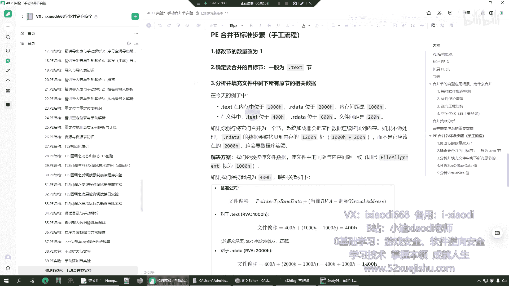
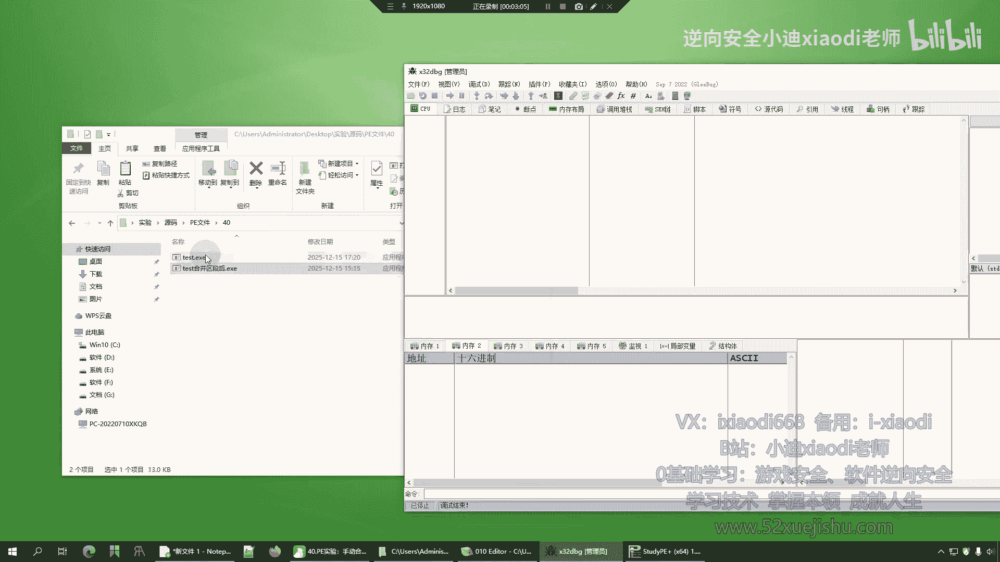
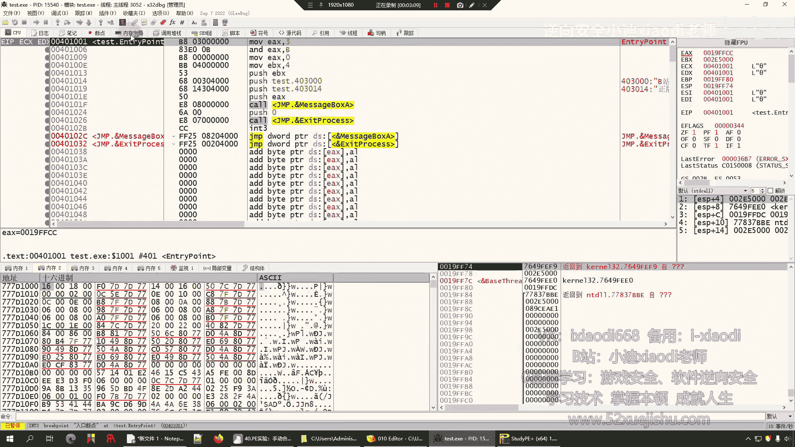

# 软件逆向破解与PE结构基础：01：手动合并节（区块）实验 🧩

在本节课中，我们将要学习第四日PE实验中的手动合并节（区块）实验。本课由小迪老师讲解，核心目标是把多个节的内容合并到一个节里，并保证程序仍然能够正常执行。可以把“节”先理解成程序里的不同抽屉：代码放在一个抽屉，只读数据放在一个抽屉，可读写数据放在另一个抽屉。合并节就是把几个抽屉里的东西搬到同一个抽屉里，同时修改PE结构里的地址和大小字段，让系统加载时还能找到正确的位置。

上一节内容先做一个回顾：前两节课讲了扩大节和添加节，这两个技术都适用于这样一种场景——我们想把自己的代码添加到目标程序上，但发现目标程序的空白区域不足，需要额外产生一些空白区域。因此，要么扩大节，要么添加节。

今天讲的合并节，乍一看和扩大节、添加节不相关，八个字打不着，但合并节有它独特的用处。下面进入合并节的典型应用场景，看看为什么要把多个节合并到一起。

## 软件逆向破解与PE结构基础：02：合并节的典型应用场景 🎯

上一节回顾了扩大节和添加节，本节来看看合并节到底用在哪里。合并节的典型应用场景，是把多个节的内容合并到一个节里，让PE看起来节的数量变少，结构更扁平。这样做可以方便加壳脱壳时手动修复，也可以用于对抗特征扫描，是免杀壳的方案之一。

以下是合并节的典型应用场景列表，方便初学者先建立整体印象。





- 把多个节的内容合并到一个节里，让PE结构看起来更扁平，节数量更少。
- 方便加壳脱壳过程中的手动修复。
- 用于对抗特征扫描。
- 作为免杀壳的方案之一。



课程里展示了两个程序：一个是原本的程序，点开区段可以看到正常的代码段、只读数据段和数据段，一眼就能看出来；另一个是合并之后的程序，点开区段会让人傻眼，容易懵，因为代码段在哪、数据段在哪、只读数据段在哪，按以前学习的理论知识似乎没办法分析。那怎么才能分析？必须知道它的原理：知道它是怎么合并的，就能了解怎么分开；分开以后有机会再讲，今天先讲合并技术。本课重点强化合并思路。合并节还有其他应用场景，大家可以自己简单看一看。

在了解合并节能用在哪里之后，本节继续看实验程序可以采用哪些合并策略。实验程序有三个节，因此有几个方案可以使用。

## 软件逆向破解与PE结构基础：03：合并策略与方案选择 📋

上一节介绍了合并节的典型应用场景，本节来看看实验程序有哪些合并策略。下面是三个可选方案，初学者可以先理解每个方案的思路，再重点掌握最常见的方案A。

- 方案A：把三个节全部合并到 `.text` 节。这是最常见的方案。
- 方案B：把所有可执行节合并，保留资源节独立。这个程序没有资源节，如果有资源节，就可以保持资源节独立，然后把所有可执行节进行合并。可执行节意味着这个区段、这个节有可执行属性。节的属性之前都讲过，大家可以跟着去看一看有没有程序符合，以及是否可以应用方案B。
- 方案C：单节化，把所有节合并为单一节。比如程序还有一个资源节，也把资源节合并到一个节里边。这种确实比较极端。一般来说，资源节保持独立就可以，所以最常见的还是方案A：把三个节全部合并到 `.text` 这一个节里。

合并时需要注意的重要数据，其含义大家可以自己回顾。PE合并节的标准步骤，本课先不按标准步骤讲；后期大家自己做实验时，可以按照标准步骤操作。这里先讲思路，因为思路清楚了，后面改字段和复制数据才不会乱。

接下来先观察正常程序的内存布局。正常程序运行起来后，把它拖过来，点击内存布局，就可以看到三个节在内存中的布局情况。

## 软件逆向破解与PE结构基础：04：观察正常程序的内存布局与计算新偏移 🔍

上一节确定了最常见方案是合并到 `.text`，本节先观察正常程序的内存布局，再计算合并后的新文件偏移。正常程序拖过来之后点击内存布局，我们记录三个节的情况。第一个是代码节 `.text`，它的文件偏移是 `400H`，运行后加载到 `1000H`。第二个是 `.rdata`，文件偏移是 `600H`，对齐后加载到 `2000H`。第三个是 `.data`，文件偏移是 `800H`，对齐后加载到 `3000H`。

以下是三个节的文件偏移与加载RVA记录，便于后续计算时对照。

```text
.text   文件偏移 400H  ->  加载RVA 1000H
.rdata  文件偏移 600H  ->  加载RVA 2000H
.data   文件偏移 800H  ->  加载RVA 3000H
```

现在的诉求是合并节：把 `.rdata` 节和 `.data` 节合并到 `.text` 节里边，这就是本实验的目标。接下来要想一想，这个东西加载到内存时是怎么加载的。如果都在 `.text` 节里边，它加载时就会按照 `.text` 节的顺序去加载。比如文件偏移 `400H` 加载到 `1000H`，`401H` 就加载到 `1001H`，`402H` 就加载到 `1002H`。也就是说，当把剩下两个节并到一个节里边时，它不再按照以前的节对齐方式走，而是按照合并后 `.text` 节的连续布局来走。

同时还有一个诉求：程序必须正常执行。代码里有 `403000`、`402008` 这种绝对地址，所以必须保证合并过去之后，以前这些地址仍然能够读取正确。以前 `.rdata` 的 `600H` 可能不再是 `600H`，这个文件偏移要改。按照 `402H` 变到 `1002H`、`401H` 加载到 `1001H` 的规律，最终还要保证它加载到 `2000H`。这个值可以通过差值来计算。

核心计算思路如下：运行时的RVA差值是固定的，文件中的新偏移等于 `.text` 的文件偏移加上原RVA与 `.text` 起始RVA的差值。

```text
新文件偏移 = .text文件偏移 + (原RVA - .text起始RVA)

.rdata：
差值 = 2000H - 1000H = 1000H
新文件偏移 = 400H + 1000H = 1400H

.data：
差值 = 3000H - 1000H = 2000H
新文件偏移 = 400H + 2000H = 2400H
```

因此，`.rdata` 节应该更新到 `1400H`，这样加载后差值是 `1000H`，最终能加载到 `2000H`。`.data` 节应该更新到 `2400H`，因为它的差值是 `2000H`，加载后最终能到 `3000H`。这样代码里的绝对地址，例如 `403000`、`402008`，读取时才能正确。原来的文件地址就变了，旧的节表项和旧位置就作废了。

以下是作废旧节相关内容和复制数据的基本步骤，操作时要注意文件只读状态。

- 把不再使用的旧节表项或旧位置用 `0` 覆盖作废。点击编辑，点击覆盖字节，用 `0` 覆盖，这些内容通通没用，后边不用看。如果文件是只读，需要先关掉只读，或者重新加载文件后再操作。
- 以前 `.rdata` 的数据在 `600H`，需要把 `600H` 的数据复制到 `1400H`。先查看 `600H` 处确实有数据，点击编辑，复制为16进制文本，然后跳转到 `1400H`。
- 如果 `1400H` 没有可粘贴的范围，需要添加新的字节。点击编辑，点击插入字节，可以指定结束地址。最少要容纳 `2400H`，并且 `2400H` 后还要有原来 `200H` 字节的内容，所以最少要到 `2600H`。到 `1400H` 后点击编辑，粘贴16进制文本，`1400H` 处就有数据了。
- 再复制 `800H` 处 `.data` 的数据，这里放的是一些字符串数据。点击编辑，复制为16进制文本，跳转到 `2400H`，点击编辑，粘贴16进制文本。这样两个节的数据就有了。

数据复制完成之后，程序一运行，就会按照合并后的流程加载：`1400H` 加载后对应到 `2000H`，`2400H` 加载后对应到 `3000H`。之所以要这样处理，是因为代码里有明显的绝对地址，它加的就是绝对地址，所以这些绝对地址的值一定要读取正确。

数据复制完成后，还要修改其他一些地方。下面进入PE头和节表字段的修改，这是保证程序能正常运行的关键步骤。

## 软件逆向破解与PE结构基础：05：修改PE头与节表字段并运行验证 🛠️

上一节完成了数据复制和新偏移计算，本节修改PE头与节表字段。先改必改的地方：标准PE头里现在有几个节？现在只有一个节，因此把 `NumberOfSections` 改成 `1`。然后再看第一个区段，第一个区段里边有一些东西需要改。

以下是需要检查和修改的PE字段列表，初学者可以按顺序逐项对照。

- `NumberOfSections` 改为 `1`。
- `VirtualAddress` 不用改，仍然从 `1000H` 开始加载。先复制下来，不用动。因为合并到 `.text` 后，它还是从 `1000H` 开始加载，以前是 `1000H`，现在还是 `1000H`，不用管它。
- `PointerToRawData` 没有问题，因为 `.text` 从 `400H` 开始，`400H` 还是那些数据，不用动。
- `SizeOfRawData` 有问题，因为整个数据的大小变了。`.text` 从 `400H` 开始，`PointerToRawData` 是 `400H`。整个 `SizeOfRawData` 必须能够容纳最后一个节的新文件偏移加上内容大小。最后一个节的新文件偏移是 `2400H`，里边还有原来的 `200H` 字节大小，所以总大小是 `2600H`，再减去起始的 `400H`，中间大小最少是 `2200H`，因此 `SizeOfRawData` 改成 `2200H`。
- `VirtualSize` 也要改。`VirtualSize` 是节在内存中的真实大小。`VirtualAddress` 从 `1000H` 开始，运行后最后一个节会映射到 `3000H`，里边还有 `200H` 字节的内容，所以大小需要到 `3200H`，再减去起始的 `1000H`，结果也是 `2200H`。如果想偷懒，这两个字段可以改成一样的，直接把 `VirtualSize` 改成跟 `SizeOfRawData` 一样，`200H` 可以不用单独算。

核心字段计算可以写成下面的形式，方便对照记忆。

```text
SizeOfRawData = (2400H + 200H) - 400H = 2200H

VirtualSize = (3000H + 200H) - 1000H = 2200H
```

改完这些字段后，按 `Ctrl+S` 保存，然后运行程序，程序可以正常运行。最后还有一些小结尾：`.text` 这个节名可以改，改了之后可以混淆别人。比如把 `.text` 改成 `.SVNP`，按 `Ctrl+S` 保存，再把程序拖过来查看，会看到节名已经变化，示例中看到的是 `.SMP` 等名称，效果跟课程演示一样。

本节课中我们一起学习了手动合并节（区块）实验：先理解合并节的典型应用场景，再分析合并策略，观察正常程序的内存布局，计算 `.rdata` 和 `.data` 合并到 `.text` 后的新文件偏移，复制节数据，修改 `NumberOfSections`、`SizeOfRawData`、`VirtualSize` 等PE字段，最后保存并运行验证。如果想真正学会，就按照这个流程自己走一遍；如果想偷懒，就按照这些步骤逐项修改。本课内容到此结束，下期再见。

