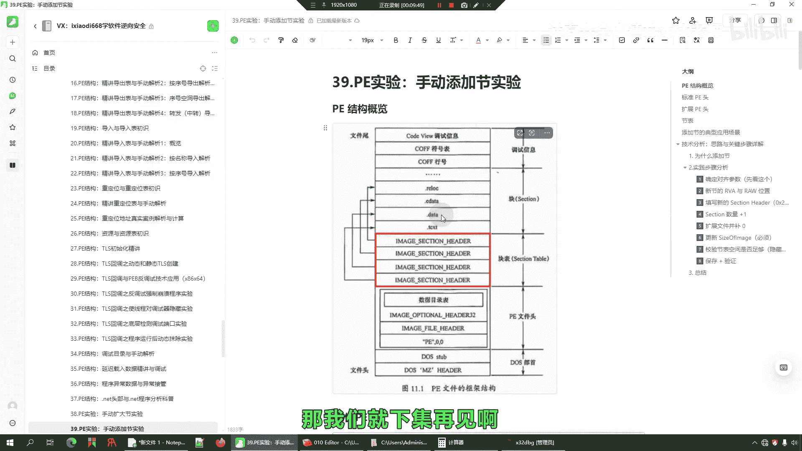

# 🧪 软件逆向破解：加壳脱壳，PE结构基础：第39讲：手动添加节（区块）实验


本讲由小迪老师讲解，是第39讲 PE 实验中的“手动添加节实验”。上节课讲解的是手动扩大节实验，本节课讲解添加新区段。为什么要扩大节，或者为什么要添加节，原因和插入自己的代码有关：当目标节的空白区域不足时，就需要处理节空间问题。针对这种情况，通常有两个解决方案，一个是添加新的区段，另一个是扩大现有节。上节课已经讲解了扩大现有节，本节课重点讲解添加新区段。

上节课已经讲过典型应用场景，这里不再重复复述，建议自行回顾上节课内容。能理解上节课的扩大节实验，说明已经具备继续完成本实验的基础，因此不需要再带着重新看一遍。下面直接进入实验步骤。


## 🧭 软件逆向破解：加壳脱壳，PE结构基础：第39讲：实验目标与核心概念回顾


在正式修改 PE 文件之前，需要先明确本实验的目标：在现有 PE 文件中手动增加一个新区块，并保证程序仍然可以正常加载和执行。这个实验看起来只是增加一个节，但它涉及节表数量、节表项字段、文件偏移、内存偏移、文件大小和镜像大小等多个字段，因此每一步都需要按照 PE 结构规则处理。


本节先明确几个核心概念。节表项大小固定为 40 字节，也就是 0x28 字节。虚拟地址 RVA 必须按照内存对齐值对齐，文件偏移必须按照文件对齐值对齐。可以用下面的公式表示。


```text
节表项大小 = 40 字节 = 0x28

VirtualAddress = n × SectionAlignment
PointerToRawData = m × FileAlignment
```


其中，`SectionAlignment` 是内存对齐值，`FileAlignment` 是文件对齐值。修改 RVA 和文件偏移时不能随意填写数字，必须是各自对齐值的整数倍。以下是本实验需要重点关注的核心参数。


- `SectionAlignment = 0x1000`，表示内存对齐值为 0x1000。
- `FileAlignment = 0x200`，表示文件对齐值为 0x200。
- 节表项大小为 40 字节，前 8 字节是节名称，最后 4 字节是节属性。

完成核心概念确认后，本节还需要说明一个口述简写问题。为方便讲解，后文会把十六进制 `0x200` 简称为 `200`，阅读时按十六进制理解即可，不需要纠结这个简写。接下来进入实际操作。


## 🧱 软件逆向破解：加壳脱壳，PE结构基础：第39讲：第一步——确定对齐参数并修改节数量


上一节明确了实验目标和核心概念，本节开始第一步操作。先把第39讲实验程序拖入 PE 工具，查看扩展 PE 头中的关键字段，包括 `ImageBase`、`SectionAlignment`、`FileAlignment` 和 `SizeOfImage` 等信息。原文示例中可以看到内存对齐值为 `0x1000`，文件对齐值为 `0x200`，`SizeOfImage` 示例为 `0x21000`。这些值后面都会用到，尤其是 RVA 和文件偏移，必须按照这些对齐值填写。

以下是查看扩展 PE 头时需要确认的字段。


- `SectionAlignment = 0x1000`，决定虚拟地址 RVA 的对齐规则。
- `FileAlignment = 0x200`，决定文件偏移的对齐规则。
- `SizeOfImage = 0x21000`，后续插入数据后需要在这个值基础上增加 `0x200`。
- `ImageBase` 也需要查看，用于理解程序加载后的基址环境。

确认对齐参数后，下一步是修改标准 PE 头中的节数量。找到标准 PE 头中的 `NumberOfSections` 字段，原文示例当前有 3 个节，如果要添加一个新区段，就需要把 3 改成 4。以下是第一处需要修改的头部字段。


- 字段名称：`NumberOfSections`。
- 原值：`3`。
- 新值：`4`。
- 作用：告诉 PE 加载器当前文件一共有 4 个节表项。

完成这一步后，PE 头中已经声明会多出一个节，但还没有真正的节表项和数据。下一节需要把新区段的节表项添加到节表区域。


## 🏷️ 软件逆向破解：加壳脱壳，PE结构基础：第39讲：第二步——添加节表项


上一节修改了节数量，本节需要添加真正的节表项。点击最后一个区块查看节表结构，一个节表项占 40 字节。因为每行显示 16 字节，两行是 32 字节，再加 8 字节就是 40 字节。理解这 40 字节的组成，是手动添加节的核心。以下是节表项的字段组成和本实验填写示例。


- 前 8 字节：节名称，例如填写 `SVMP`。
- 接下来 4 字节：`VirtualSize`，示例填写 `0x38`。
- 接下来 4 字节：`VirtualAddress`，示例填写 `0x4000`。
- 接下来 4 字节：`SizeOfRawData`，示例填写 `0x200`。
- 接下来 4 字节：`PointerToRawData`，示例填写 `0xA00`。
- 接下来两个 4 字节：填写 `0`，这些字段已经弃用，可以不用关心。
- 接下来两个 WORD：也没有实际用途，可以不用关心。
- 最后 4 字节：`Characteristics`，示例填写 `0x60000020`。

先看节名称。前 8 字节是块名，名称不能超过 8 字节，超过 8 字节会被截断，因此起名字时不要太长。原文示例使用 `SVMP`，可以理解为 `super protect` 的缩写。填写时把 `SVMP` 放入前 8 字节，剩余位置补零即可。

接着看 `VirtualSize`。这个字段表示节在内存中的大小，原文示例填写 `0x38`。这个值在演示中可以比较宽松地填写，因为程序运行后会按照内存对齐值 `0x1000` 向上对齐。也就是说，加载时关注的是对齐后的结果，因此示例直接填写 `0x38`。以下是该字段的填写位置和示例。


```text
VirtualSize = 0x38
```

然后看 `VirtualAddress`。这个字段是虚拟地址 RVA，必须按照 `SectionAlignment` 对齐，也就是必须是 `0x1000` 的整数倍。原文示例中原来是 `0x3000`，可以填成 `0x4000`。以下是该字段的示例。


```text
VirtualAddress = 0x4000
```

接着看 `SizeOfRawData`。这个字段表示节在文件中占用的原始数据大小。原文示例填写 `0x200`，如果后续数据不够，也可以适当加大，例如 `0x400`。本实验先填 `0x200` 作为演示。十六进制编辑器中按小端显示时，`0x200` 对应 `00 02 00 00`。以下是该字段的示例。


```text
SizeOfRawData = 0x200
```

再看 `PointerToRawData`。这个字段指向本地区块数据在文件中的起始偏移。原文示例中，最后一个 `data` 节的起始地址是 `0x800`，大小是 `0x200`，因此结束位置是 `0x800 + 0x200 = 0xA00`。因为各节数据在文件中是连续存放的，所以这个结束位置就是新区段 `SVMP` 的起始位置。因此 `PointerToRawData` 填写 `0xA00`，小端显示为 `00 0A 00 00`。以下是偏移计算示例。


```text
0x800 + 0x200 = 0xA00
PointerToRawData = 0xA00
```

完成前 36 字节后，还剩下最后 4 字节，也就是节属性 `Characteristics`。如果希望这个新区块能够存放并执行代码，可以参照已有代码块的属性填写。原文示例中填写的是 `0x60000020`，这个属性可以让区块具备可执行属性。以下是属性示例。


```text
Characteristics = 0x60000020
```


如果忘记了属性含义，可以直接抄已有代码块的属性，这是最直接的做法。到这一步，节表项已经基本添加完成，但还没有插入真正属于新区段的数据，因此程序仍然不能算完成。下一节需要补齐文件数据，并调整镜像大小。


## 🗃️ 软件逆向破解：加壳脱壳，PE结构基础：第39讲：第三步——插入节数据并修改SizeOfImage


上一节完成了节表项的填写，本节需要插入真正的新区段数据。虽然节表头中的属性、RVA、文件偏移和节数量都已经修改，但文件尾部还没有实际数据，因此需要补上数据。具体做法是拖到文件最后，在十六进制编辑器中执行插入操作，插入 `0xA00` 个字节位置处的新数据，插入大小为 `0x200` 字节。以下是要插入的数据说明。


- 插入位置：文件尾部，也就是原文件最后一个节的结束位置。
- 插入大小：`0x200` 字节。
- 原因：前面手动把 `SizeOfRawData` 设置为 `0x200`，因此文件中需要补上同样大小的数据。
- 插入内容：本实验先补零即可。

插入完成后，文件整体变大了，因此还需要修改扩展 PE 头中的 `SizeOfImage`。原文示例中 `SizeOfImage` 原值为 `0x21000`，插入 `0x200` 字节后，需要在这个值基础上增加 `0x200`，也就是改为 `0x21200`。以下是修改公式。


```text
SizeOfImage = 原 SizeOfImage + 0x200
示例：0x21000 + 0x200 = 0x21200
```

修改完成后，使用 `Ctrl + S` 保存文件。保存后关闭文件，再重新拖入 PE 工具查看，可以看到新区段已经加进去了。接着可以使用 StudyPE 查看区段，确认新区段存在。以下是可以进行的验证操作。


- 重新拖入 PE 工具，查看节数量是否变为 4。
- 使用 StudyPE 查看区段，确认 `SVMP` 区段已经出现。
- 使用 x32dbg 打开程序，查看内存布局，确认新区段被加载。
- 运行程序，确认程序仍然可以正常执行。

原文验证结果显示，内存布局中新区段加载完整，结构标准、工整，程序也可以正常运行。这个结果说明手动添加节实验已经成功。后续还会讲解如何在这个新区块中写入一段代码并让它执行，以及如何更改入口点，使程序先执行我们写入的代码，再执行程序原本的代码。这是完整的思路，也是一些壳和木马常见思路的基础，因此这些基础操作需要先掌握。


## ✅ 软件逆向破解：加壳脱壳，PE结构基础：第39讲：本节总结


本节课中我们一起学习了 PE 结构基础中的手动添加节实验。开头回顾了上节课的扩大节实验，并说明了插入代码时目标节空白区域不足时，可以选择扩大现有节或添加新区段。本实验按照步骤确定了内存对齐值 `0x1000` 和文件对齐值 `0x200`，把标准 PE 头中的节数量从 3 改为 4，然后填写了 40 字节的新节表项，包括节名称 `SVMP`、`VirtualSize`、`VirtualAddress`、`SizeOfRawData`、`PointerToRawData` 和 `Characteristics`。



随后，我们在文件尾部插入了 `0x200` 字节数据，并按照公式 `SizeOfImage = 原值 + 0x200` 修改镜像大小。保存后重新加载验证，StudyPE 可以看到新区段，x32dbg 可以看到完整内存布局，程序也可以正常执行。本节课的内容到这里结束，后续可以在此基础上继续学习写入代码、修改入口点和壳相关思路。
