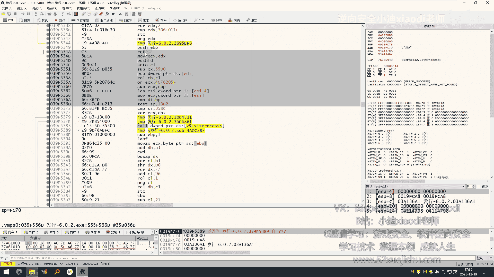

# 🧭 软件逆向破解：01：课程概述与技术交流

在本节课中我们将要学习软件逆向破解的实战案例，本次课程主题是“实战某外挂破解：VMP+代码VM混淆之一线生机”，视频编号为BV1gRqSBJEDk-。我是小迪老师，本课程继续讲解软件逆向破解。有同学会疑惑，为什么软件逆向课程有较多听众，以及逆向到底能做什么。实际上，逆向可以用于逆向分析，也可以用于破解一些小软件。课程内容仅做技术交流。


> 本课程内容仅用于技术交流与学习。

课程还会展示学习效果和群聊交流氛围。交流人群包括兴趣爱好者、博士研究生，以及学习网络安全专业的大学生。若需查看相关内容，可以进入官网，点击聊天记录即可查看。点击“社区氛围成员学习效果”可以了解课程内容。若有相关疑问，可以在文档中找到答案。

以上是课程概述和技术交流说明。下面进入案例背景与学习资料部分。


# 🎯 软件逆向破解：02：案例背景与学习资料

上一节说明了课程定位和交流入口，本节我们看看本次案例的来源、学习资料与实验目标。这个案例的文章已经写过，文章中展示了破解成功后的界面，第二章内容写得较好。该游戏外挂由群员开发，用于测试强度。群员通过学习课程内容完成开发，课程中也有外挂开发相关内容。若不想看视频，可以直接到社区文章里查看，本课程按照该文章讲解。

以下是本案例涉及的文章、开发背景与学习方式。


- 本案例文章已经完成，包含破解成功界面与第二章分析内容。
- 游戏外挂由群员开发，目的是测试强度，群员也学习了课程内容。
- 课程同时包含外挂开发内容，学习时可以结合文章和视频。
- 若不看视频，可到社区文章查看，课程按文章讲解。
- 录制当天是冬至，因此这是最新视频而非过期视频；讲师祝大家冬至快乐，能在家团团圆圆吃饺子。


看完案例来源后，我们需要回到实验程序本身。接下来观察软件运行时的行为。


# 🕵️ 软件逆向破解：03：观察程序行为与退出机制

上一节介绍了案例文章与学习资料，本节我们来看实验程序的行为。程序运行后会出现弹窗，提示“请添加白名单”。点击确定输入后，程序退出，这就是软件行为。分析时要重点关注软件行为，因为软件行为中暗藏机会，稍不留意就会错过重要信息。

以下是程序退出时常见的函数与提示差异。


- 点击确定按钮后程序退出，常见导致退出的函数是`ExitProcess`或`TerminateProcess`，这类知识需要积累。
- 程序也可能人为制造崩溃，崩溃同样可以看出来。
- 崩溃退出与程序直接退出的提示不同：崩溃会提示异常发生在哪里，正常退出则直接退出。
- 点击确定后调试器显示“调试结束已停止”，说明程序正常退出；异常崩溃会显示异常字符串。
- 异常相关内容在内部视频中有讲解，需要平时积累。

在逆向分析中，程序每一个可见动作都值得记录，因为关键线索往往不在界面文字里，而在动作发生前后的调用关系里。把行为链条串起来，后续下断点和看堆栈才有明确目标。观察到退出行为后，下面用工具分析程序，并定位验证窗口。

# 🧰 软件逆向破解：04：工具分析与窗口定位

上一节分析了退出行为，本节我们使用工具分析程序。先更换分析工具，使用老工具包即可。将程序拖入工具后点击运行，该工具包可以直接运行程序。程序运行后先分析窗口，点击符号切换到程序主模块。

以下是工具分析窗口与定位验证窗口的主要步骤。


- 在主模块中看到`XOREXESright`，这是易语言特征，说明程序是易语言程序。
- 点击插件，找到小D5.0，点击开始分析。
- 点击窗口控件，可以看到程序只有一个窗口。
- 需要对应这个窗口与弹窗的共同点：弹窗只有确定输入和取消，而外挂窗口明显不同。
- 外挂窗口似乎被隐藏或尚未加载，该窗口应是外部窗口，可能是网络验证给程序加上的外部验证窗口。
- 处理思路是干掉验证窗口，干掉后外挂窗口就能加载出来。
- 干掉验证窗口仍需观察行为：点击确定输入时程序退出，因此在`ExitProcess`处下退出断点。

完成窗口和断点定位后，下一步查看调用堆栈，识别混淆代码。

# 🧱 软件逆向破解：05：调用堆栈与混淆代码识别

上一节定位了验证窗口和退出断点，本节查看调用堆栈。点击调用堆栈后，只看程序模块，不看系统模块和其他模块。第一层已经被混淆。混淆的含义是代码完全变乱，例如下面的代码就是混淆后的假代码，这类代码没有分析价值。

以下是调用堆栈中逐层观察的结果。

- 第一层被混淆，示例代码包括`or ecx, 4C76205F`和`test esp, 13B2`，这些是混淆后的假代码，不必分析。
- 点击调用堆栈查看第二层，即倒数第二层，双击进入后同样被混淆，也没有分析价值。
- 再点击调用堆栈查看第三层，第三层很有意思，出现GMP相关标记，原文提到“GMP上面有个”。
- 分析位置从“坑”里出来后，出来的地方就是当前观察点。

```asm
; 混淆代码示例，仅用于识别，不具备直接分析价值
or ecx, 4C76205F
test esp, 13B2
```

核心概念可以概括为：混淆会降低代码可读性，但程序行为仍然存在。

\[
\text{混淆代码}\Rightarrow \text{可读性下降，但行为线索仍可追踪}
\]

识别出第三层堆栈后，需要从出口位置向上查看关键跳转。接下来尝试利用条件跳转突破程序。

# 🔍 软件逆向破解：06：关键跳转与突破

上一节识别了混淆代码和第三层堆栈，本节查看出口位置附近的关键跳转。从出来的地方往上看，可以发现一个跳转直接跳过某个位置，另外还有一个条件跳转也可以跳过该位置。先在这里下断点进行尝试，然后倒着重启程序，点击运行，程序会断在这里。



以下是关键跳转的尝试步骤与观察结果。

- 程序断在这里后，如果代码继续执行，会来到某个位置，该位置会继续跳转。
- 观察跳转目标，若让程序跳转，会直接来到另一个位置。
- 两个路径的区别在于某处进行了一些计算。
- 先运行程序，程序会显示某个结果；再重启程序，程序又断在这里。
- 不让程序执行计算，双击`ZF`标志位，让条件跳转跳过计算，按F7单步执行，可以看到没有进行计算。
- 再次运行程序，程序直接进入软件界面。

关键突破点可以概括为：出口位置附近的条件跳转看起来没有问题，但恰恰包含一些小型运算；跳过该运算后，程序可以直接突破。

\[
\text{破解点}=\text{关键条件跳转}+\text{ZF标志位控制}
\]

```asm
; 核心思路示意
; 执行计算路径 -> 进入原路径
; 跳过计算路径 -> 直接进入软件界面
```

因此，攻破该软件的关键跳转就在出口位置往上看。今后分析时不要放弃任何机会，也不要放过任何蛛丝马迹。

# 🏁 软件逆向破解：07：总结与后续学习

本节课中我们一起学习了软件逆向破解的实战案例，包括课程定位与技术交流、案例文章与学习资料、程序行为与退出机制、工具分析与窗口定位、调用堆栈与混淆代码识别、关键跳转与突破。课程强调观察软件行为、积累常见退出函数、识别易语言特征、查看调用堆栈、理解代码混淆，并利用条件跳转和`ZF`标志位完成突破。本次课程全部内容到此结束，下期再见。若想学习相关内容，可以联系课程方。

