# 软件逆向破解：实战强制更新废除与卡密破解

## 😊 概述

在本节课中，我们将学习如何使用软件逆向破解技术，废除某款外挂软件的强制更新机制，并进一步破解其卡密网络验证。很多朋友可能都遇到过这样的情况：一个软件本来用得好好的，结果公司非要强制更新，更新完反而更难用了。如果你也遇到过这种情况，那么本节课的内容正好适合你。

我们首先要明白，这个逆向技术到底能干什么。简单来说，逆向破解技术就是帮助我们分析一些小软件的内部逻辑。你可以通过它来破解软件的登录权限，或者废除一些烦人的功能限制。当然，这些技术仅限自己使用和技术交流，不能传播，这一点需要特别注意。

在日常使用场景中，有些软件会有强制更新机制，让用户不得不升级到新版本，但新版本可能并不好用。本次视频就是要教大家如何用逆向技术把这个强制更新给废掉。接下来，我们会手把手地演示整个过程，确保初学者也能跟上节奏。

我是本次视频的作者小迪老师，如果需要进一步学习相关内容，可以通过下方联系方式加我微信。另外，我们的网站上有会员课程，点击后即可观看全部教学视频。网站中目前有几百集课程，涵盖了逆向破解、游戏安全、软件安全、CTF比赛基础等多个领域。如果你想与更多人交流，可以访问我们的论坛社区，在综合板块可以看到近期学员发布的技术文章。社区里有很多人学有所成并分享了他们的经验，平时可以多去参考学习。

OK，废话不多说，直接进入今天的正题。

## 📦 一：案例背景与软件类型分析

本节课中，我们先来认识一下今天要破解的目标程序。这是一个外挂软件，它的作者可能出于某种原因跑路了。这个外挂在更新后一直停留在某个版本，但程序检测到新版本后，又会反复弹出更新提示，陷入了死循环。因此，我们需要把它的强制更新逻辑给干掉。

很多人可能好奇，为什么一个跑路的外挂还能继续使用？要想搞清楚这个问题，我们首先要了解这个外挂是什么类型的软件。其实它是一个**涂色外挂**。

**涂色外挂**的定义可以这样理解：

> **涂色外挂 = 仅基于屏幕图像和文字识别，模拟用户操作，不参与游戏内存数据运算的自动化脚本。**

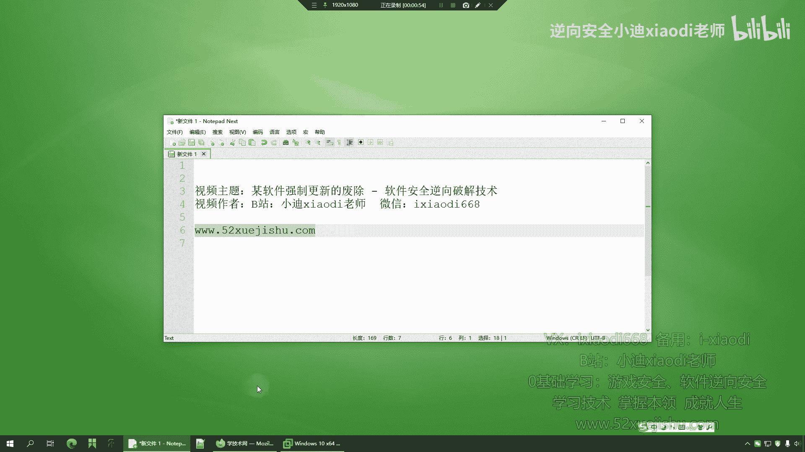

我们可以用公式来表示这个外挂的工作特性：

\[
\text{涂色外挂} = f(\text{屏幕图像匹配}, \text{文字OCR识别}) \Rightarrow \text{自动化点击操作}
\]

它不与游戏服务器或其他客户端进行内存数据交换，因此在很多情况下，即使作者的服务器停止运营，软件的本地功能依然可以正常工作。这就是为什么还有破解价值的原因。

上一节我们了解了这个外挂的基本特性，那么本节中，我们来看看如何用调试工具来观察它的行为。

## 🔧 二：动态分析与调试检测绕过

白这个外挂虽然作者跑路了，但弹窗依然存在，说明它内部有条件判断来决定是否弹窗。要进行动态分析，我们需要用调试器来运行它。这里以OD（OllyDbg）为例，演示整个分析过程。

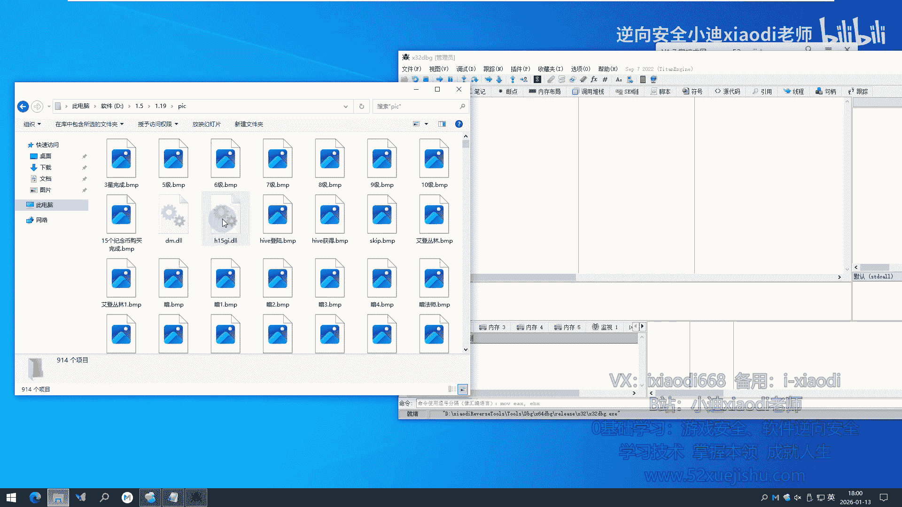

一般的分析思路如下：

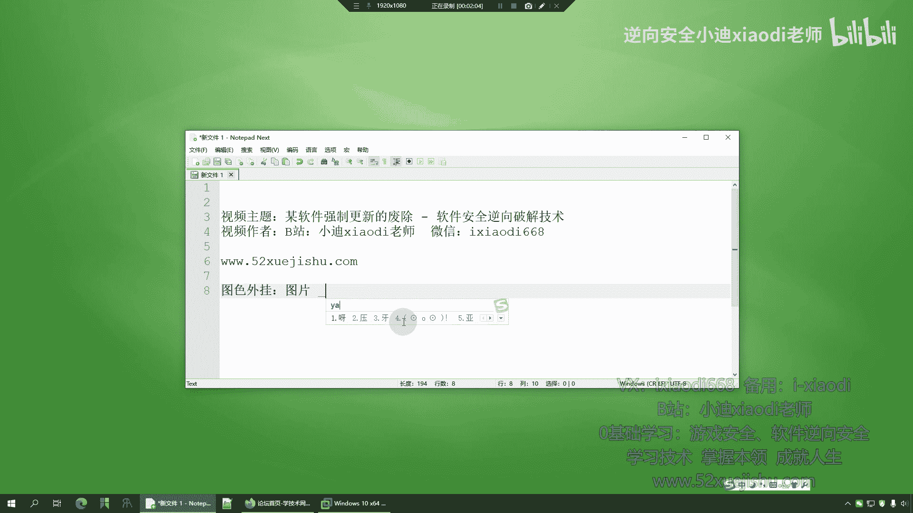

- **使用 `OD` 加载目标程序**，让程序在调试器中运行。
- **对弹窗函数下断点**，找到关键的调用位置。

我们可以在OD中按下快捷键 `Ctrl+G`，输入以下弹窗API名称：

```asm
MessageBoxA
```

这就是我们在程序里所下的**断点**。运行程序后，程序会停在弹窗函数处，此时我们先按 `Ctrl+F9` 执行到返回，看看程序爆出了什么提示。

大家看，这个时候程序弹出了一个“非法工具”的提示，并且调试器直接被中断了。这说明什么？说明这个外挂带有**反调试机制**，即它检测到了我们的调试行为，或者说检测到了调试器的存在，从而主动终止了程序的运行，防止我们分析它的内部逻辑。

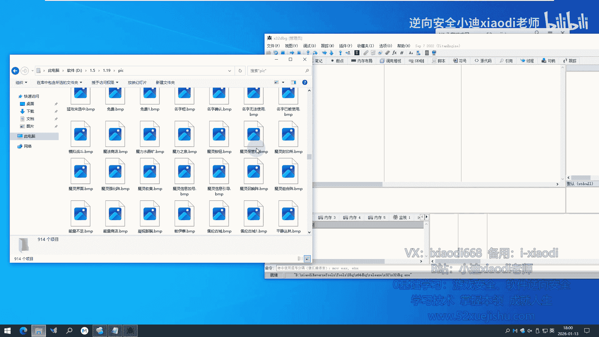

这个反调试机制的检测流程可以表示为：

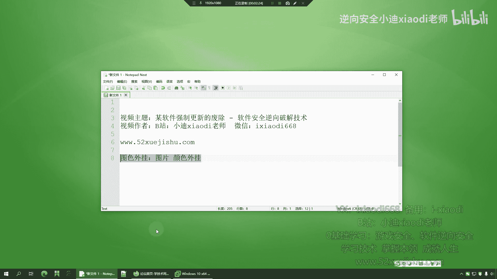

\[
\text{程序行为} \rightarrow \text{检测调试器特征} \rightarrow \text{是} \Rightarrow \text{弹出"非法工具"} \rightarrow \text{终止}
\]

那么怎么绕过这个反调试机制呢？方法非常简单。我们只需要回到调试器，点击菜单栏的“调试”，然后在子菜单中选择“高级隐藏调试器”，启用隐藏功能即可。这个选项的作用是让调试器隐藏自身的痕迹，从而欺骗目标程序的反调试检测。

这个绕过逻辑用公式表达就是：

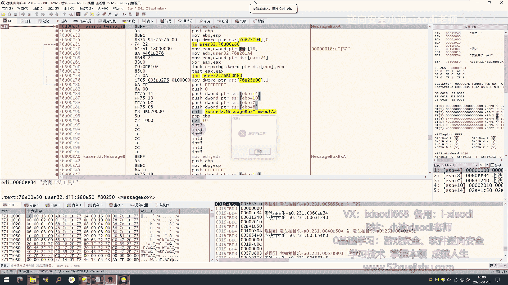

\[
\text{隐藏调试器} \Rightarrow \text{反调试检测失效} \Rightarrow \text{程序继续正常运行}
\]

我们在OD中打开这个选项后，再重新运行程序，按 `Ctrl+F9` 执行到返回。这个时候大家可以发现，弹窗正常弹出来了，并没有出现“非法工具”的提示，说明我们的调试器已经被成功隐藏了。

好的，本节中我们绕过了反调试机制，找到了弹窗的位置。那么下一节中，我们要分析这个弹窗附近的代码，寻找关键的跳转指令来跳过更新。

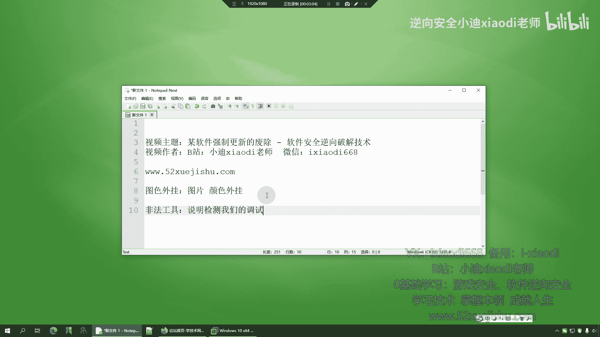

## 🧬 三：定位关键跳转与废除强制更新

上一节我们成功绕过了反调试机制，并让程序在弹窗处断下。现在，我们关闭这个弹窗，在调试器中单步跟踪这段代码。大家看这一步的操作流程。

按下 `Ctrl+F9` 执行到返回，然后按 `F8` 单步。如果还没到达关键位置，就再按 `Ctrl+F9`，继续按 `F8` 单步调试。

经过几次跟踪之后，我们可以找到一个**关键的跳转指令**。大家看屏幕上的汇编代码，这里是不是有一个 `JE` 指令？ `JE` 是一个条件跳转指令。

在汇编语言中，`JE` 的意义是当零标志位 `ZF=1` 时，跳转到指定地址。我们用公式描述如下：

\[
JE = \begin{cases}
\text{跳转}, & \text{如果 } ZF = 1 \\
\text{不跳转}, & \text{如果 } ZF = 0
\end{cases}
\]

大家可以看汇编代码左边的这个箭头，它是虚线的，代表这是一个条件跳转，也就是说“是否跳转”取决于上一条指令的执行结果。而我们要做的就是改变这个跳转行为，让程序无条件跳过整个更新逻辑。

怎么做呢？我们直接在调试器中找到这个 `JE` 指令，将它修改为 `JMP`。 `JMP` 是无条件跳转指令，不管条件如何，它都会跳走。也就是说，我们把“可能跳”改成“一定跳”，这样程序就会无条件地跳过更新代码。

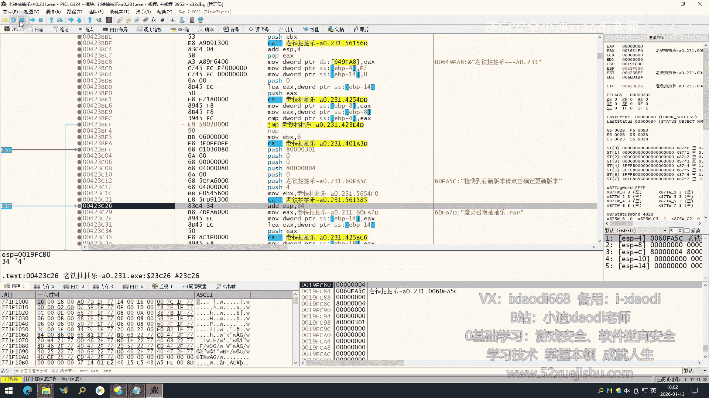

修改后的逻辑变为：

\[
JMP = \text{无条件跳转} \Rightarrow \text{跳过更新过程} \Rightarrow \text{程序不再强制更新}
\]

修改完之后，我们需要保存这个修改，让它对程序文件本身生效。点击调试器工具条上的“创可贴”图标，选择“修补文件”，然后将修改后的程序保存到硬盘上。修补完成后，重新运行被修补过的文件，可以看到，程序直接进入了主界面，并没有再弹窗提示更新。至此，强制更新机制已被成功废除。

到这里，我们已经成功废除了这个外挂的强制更新。但是运行程序时才发现，它又提示“卡号不存在”。这说明作者的服务器还在运行，因为程序仍在使用网络验证。下一节我们来破解这个卡密验证。

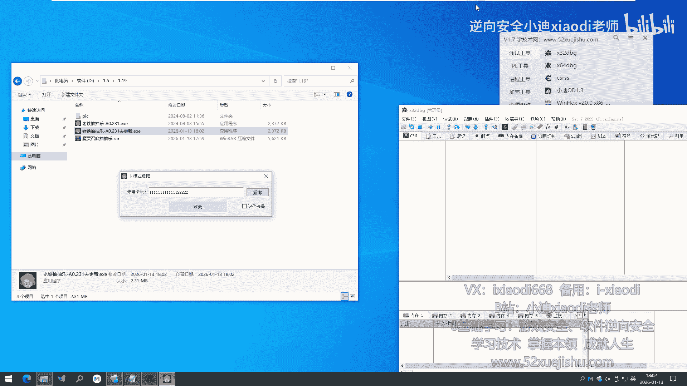

## 🛡️ 四：网络验证识别与卡密破解思路

强制更新废除了，但程序启动后出现了“卡号不存在”的提示。这说明它还在联网校验用户卡号，也就是卡密。这意味着服务器并没有完全关闭，而是在进行网络验证。这种验证方式被称为**网络验证**。

这个外挂的验证流程是这样的：

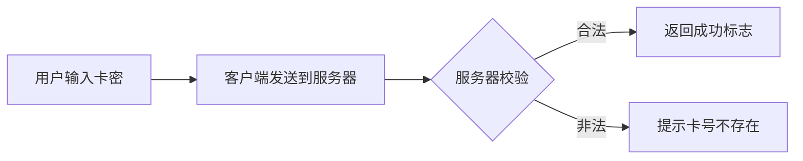

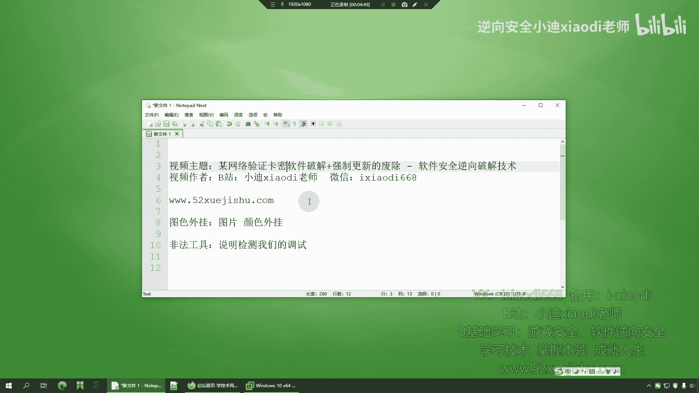

我们可以用公式表示：

\[
\text{验证结果} = \text{服务器查询数据库对应卡密和状态}
\]

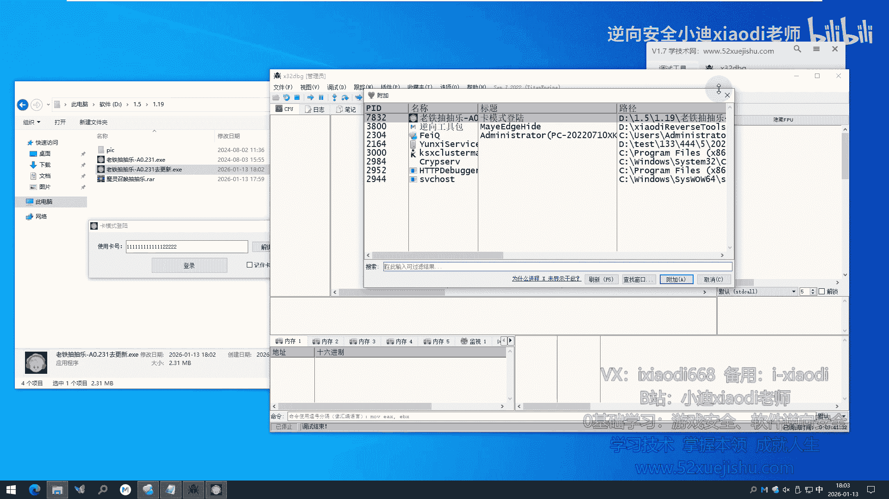

接下来我们要怎么分析这个网络验证呢？最简单的办法是让程序在调试器中运行，然后查看它的字符串列表。在OD中加载程序，按下右键，选择“中文搜索引擎”，然后搜索“字符串”。如果程序有反调试机制，就用我们之前学过的方法先隐藏调试器再运行。

我打开这个程序的字符串列表，很快就发现了一个关键的特征字符串。这个程序的验证组件是“异盾”。异盾是一个常见的网络验证系统，我们之前在内部视频课程中已经详细讲解过它的破解方法。大家可以到我们的网站找到相关课程，这里就不重复展开了。总之，我们用之前讲过的异盾破解方法，很容易就解决了这个程序的卡密验证问题，最终程序成功进入主界面，功能完全正常。

为了让大家亲自动手实践这个完整的破解过程，我会把这个软件打包发给大家，大家可以按照今天的方法自己去尝试操作。

## 🎓 总结

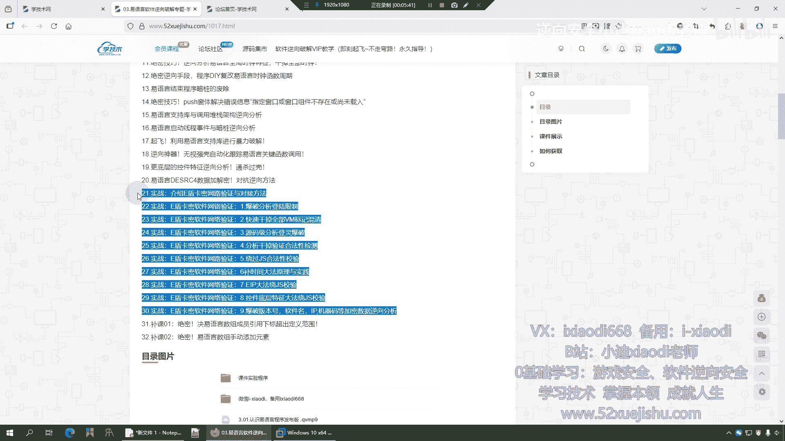

本节课我们一起学习了软件逆向破解的完整实战流程。我们从分析软件类型开始，确认了这是一款涂色外挂；接着使用OD进行动态调试，并绕过了程序的反调试检测。在找到关键跳转后，我们将条件跳转`JE`修改为无条件跳转`JMP`，从而废除了程序的强制更新机制。随后，我们又通过分析字符串定位到异盾网络验证，并使用之前课程中讲过的方法成功破解了卡密验证。

回顾整个破解思路，核心过程可以概括为：

\[
\text{废除更新} = \text{反调试绕过} + \text{修改关键跳转}
\]

\[
\text{卡密破解} = \text{定位网络验证组件} + \text{针对性分析}
\]

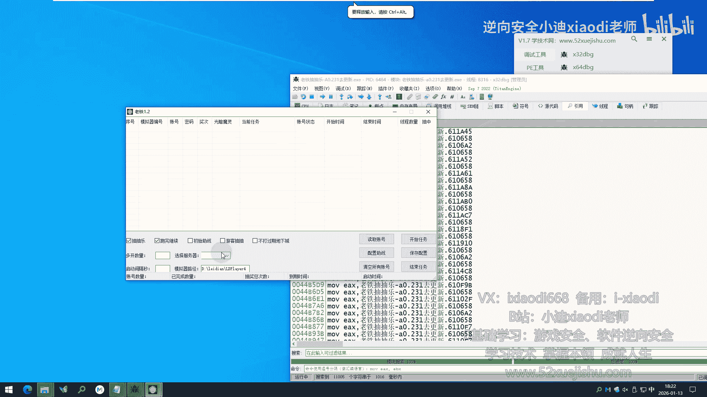

课程中涉及的技术点包括反调试绕过、断点设置、单步跟踪、汇编指令修改、补丁保存，以及网络验证组件分析。这些不仅仅是针对这一款外挂，很多软件的更新提示和验证逻辑都可以用类似的方法来分析和处理。

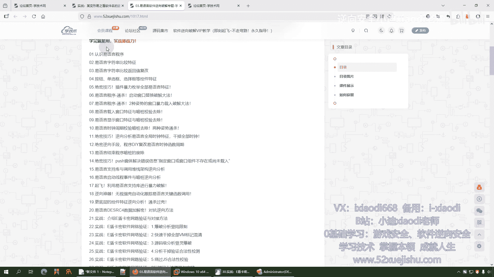

如果大家想深入学习相关知识，欢迎随时联系我们，关注我们的网站和社区教程，我们下期再见。拜拜。

