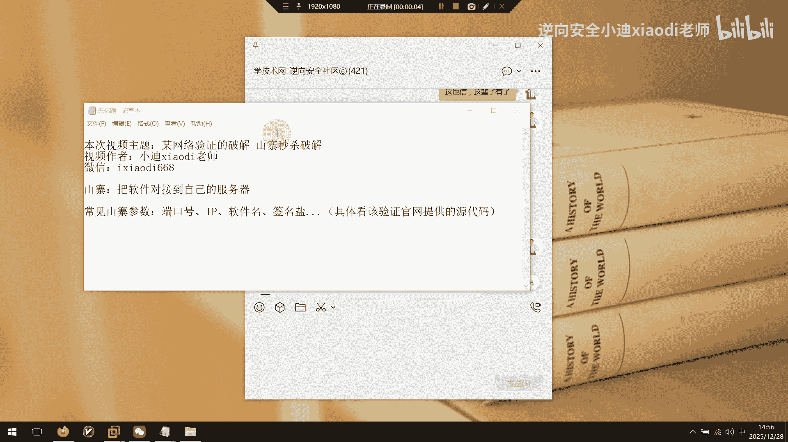
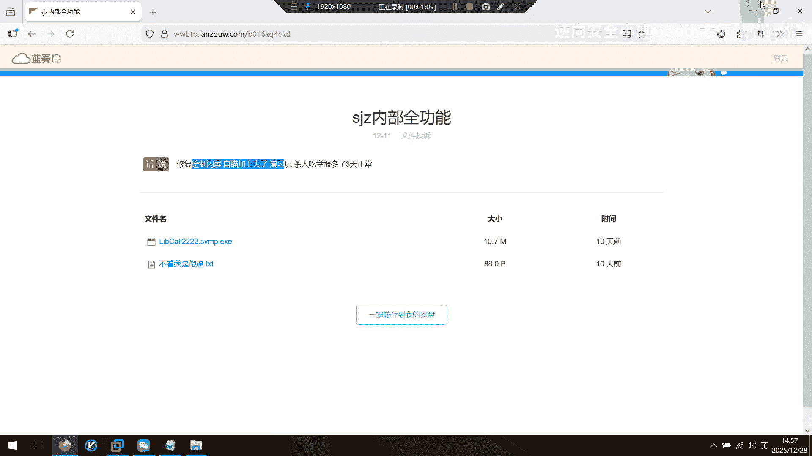
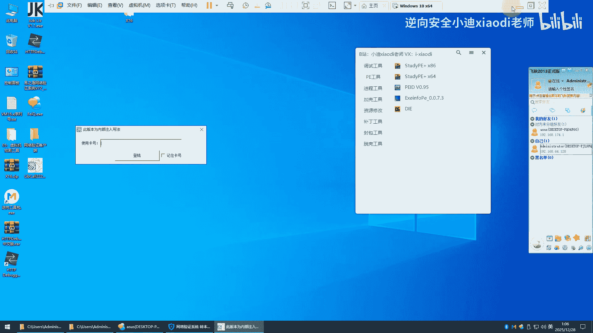
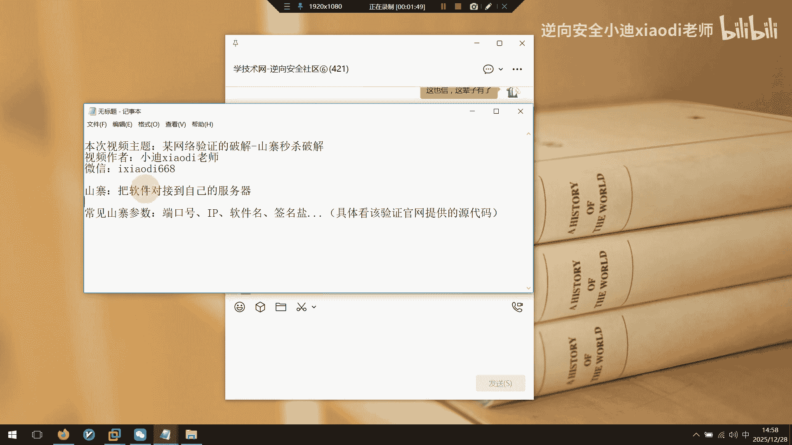
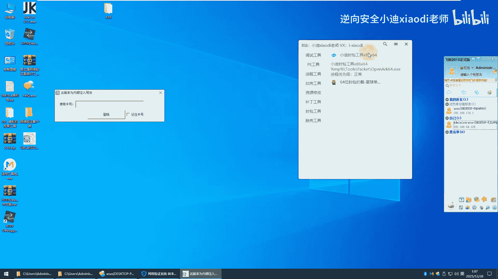
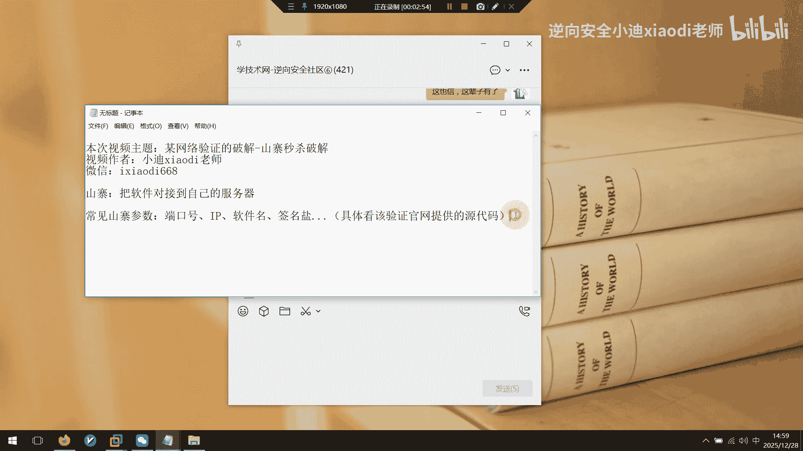
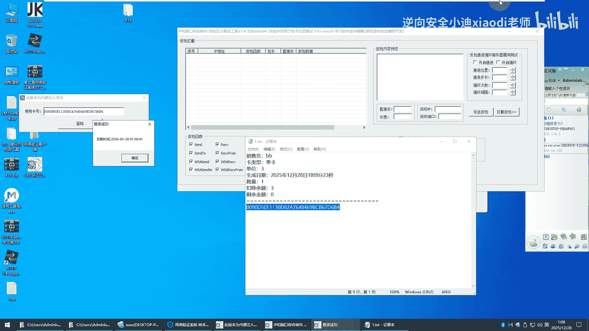
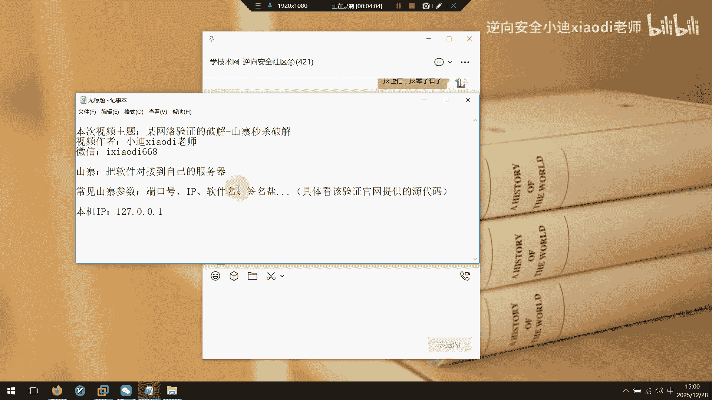

# 🧩 软件逆向破解：01：某外挂山寨破解实战

## 📌 课程概述



在本节课中我们将要学习某网络验证的破解思路，重点整理“山寨秒杀破解”的实战流程。课程内容来源于一个视频案例，视频由“全程员”发来的链接引出；他提到网盘里的这款软件已经“跑路”，所以我们围绕这个样本进行分析。下面会先认识目标软件和它的基本特征，再说明如何判断原验证服务器是否不可用，最后演示把软件连接参数替换到本地服务器上的思路。整个教程尽量用直白的大白话解释，方便初学者理解每一步在做什么。

## 🎯 案例来源与目标软件

上一节我们说明了课程背景，本节中我们来看看目标软件是什么。这个软件名为“SJZ 内部全功能”，其中“SJZ”应该是最近比较火的一款游戏简称，也就是“三角洲”相关名称；从界面和功能信息看，它加上“字描”等内容后，应该属于游戏辅助、游戏外挂一类软件。软件压缩包或目录里面还有一个文档，文档内容先不展开看。文档里作者还有一些自夸或调侃的说法，例如声称“自己是我们的孩子”，并声称能“过玄武磐石”；这些说法不要傻乎乎地直接相信。

文档里还强调了一个使用顺序：先开游戏，再开辅助，并且辅助采用内部注入方式。这个顺序对破解判断很重要，因为如果最终要验证破解是否成功，就需要先启动游戏，再启动辅助，然后观察辅助是否真正生效。换句话说，破解流程不是只看登录框，而要放到实际运行环境中确认结果。接下来我们就进入虚拟机环境，看看软件本身的结构。

## 🧱 初步观察软件区段

上一节我们认识了目标软件的用途和运行顺序，本节中我们来看看它在文件结构上的特征。虚拟机环境已经准备好，这里展示的就是目标软件。我们先把软件拖入分析工具，然后点击查看“区段”；对比之后可以发现，它多出了一个区段，而其他区段的代码大小基本正常。多出来的这个区段，初步判断是“网络验证一键加”相关的内容。

这个多出的区段先不用急着处理，也不用在这里反复纠结，最后还是要运行软件来观察效果。运行起来以后会出现一个登录框，这个框的样式非常眼熟，之前已经讲过很多遍类似的破解方法。对于这种界面，最简单的一种思路就是“山寨”。下面我们先解释山寨的核心概念。



## 🛠️ 山寨破解思路

上一节我们观察到登录框和额外区段，本节中我们来看看“山寨”到底是什么意思。山寨就是把软件原本连接的网络验证服务器，替换成我们自己的服务器；软件以为自己在连接原验证服务器，实际却连接到了我们搭建的服务端。常见需要替换的参数包括端口号、IP、软件名、签名等，具体要查看该网络验证官网提供的源代码，这部分需要自己翻资料确认。

可以用一个简单关系来描述山寨的核心：

```text
山寨破解 = 将软件内的原验证参数替换为自有服务器参数
```



这些参数一般以易语言写成的验证程序较多，当然使用 C/C++ 等语言编写的验证程序也存在，语言本身不影响思路。关键是把参数替换掉，因为相关参数通常会在内存中存放。下面我们通过抓包和登录测试，判断原服务器是否真的跑路。

## 🌐 验证原服务器是否跑路

上一节我们理解了山寨的核心是替换验证参数，本节中我们来看看如何确认原服务器状态。软件原本可能连接某个服务器，因此可以使用封包工具抓包，观察它是否还能正常通信。我们先随便输入一个卡密，然后点击登录；如果程序卡死，或者提示“连接服务器失败”，就说明这个软件对应的验证服务确实已经跑路。

这个判断过程很直接：先看登录请求有没有正常响应，再看客户端是否报错。确认原服务器不可用之后，就可以考虑山寨方案。接下来需要把本地服务器架设起来，并用封包工具把软件进程的通信目标改到本地。

## 🖥️ 搭建本地服务器并替换参数



上一节我们确认了原验证服务器不可用，本节中我们来看看如何搭建本地服务并替换参数。先架设一个本地服务器，本地 IP 通常使用 `127.0.0.1`；原文口述中先提到过 `127.0.6.1`，随后明确本机 IP 是 `127.0.0.1`，实际以本机回环地址为准。可以用下面的形式理解连接目标：

```text
软件连接目标 = IP + 端口 + 软件名 + 签名等参数
```

然后找到封包工具，选中游戏进程或该软件进程，并注入到 `x86` 环境。工具中默认填写本地地址，端口号需要改成我们本地服务端使用的 `9003`，因此在这里输入 `9003`，再点击启动相关功能。接着在本地服务端里开一张“G 卡”，也就是生成卡号；系统会询问是否保存到本地，可以选择保存到桌面，点击保存后保存成功，这个卡号就是我们的卡密。

以下是本步骤涉及的关键参数示例，方便初学者对照理解：



- `IP`：本地回环地址 `127.0.0.1`



- `端口`：本地服务端端口 `9003`

- `架构`：注入目标为 `x86`

- `卡密`：由本地服务端生成的测试卡号

这些参数替换完成后，就可以回到软件登录框进行验证。

## ✅ 登录验证与破解结果

上一节我们完成了本地服务端搭建和参数替换，本节中我们来看看最终验证结果。把刚才生成的卡密复制出来，粘贴到登录框中，然后直接点击登录；如果界面提示登录成功，就说明山寨流程已经打通，软件被成功破解。山寨可以说是最简单的一种软件逆向破解方法，人人都能学习，核心操作就是把别人的参数替换成自己的参数。

对于这个软件来说，只需要替换一个 IP 就可以完成山寨；但有的软件还需要额外分析端口号，有的还需要分析软件名或者签名。相关分析方法在内部视频中都有讲解，学习时要活学活用，不要只记一个固定步骤。以下是山寨破解的通用流程概括，便于复习：

- 判断原验证服务器是否可用

- 搭建本地验证服务器

- 找到并替换 IP、端口等参数





- 生成测试卡密并登录验证

## 📝 课程总结

本节课中我们一起学习了某网络验证外挂的山寨破解案例，内容包括目标软件识别、区段观察、原服务器跑路判断、本地服务器搭建、参数替换以及登录验证。整个流程的关键可以概括为：先确认原验证不可用，再把软件连接参数替换到自己的服务器，最后用本地生成的卡密验证登录结果。山寨是最简单、最容易入门的一种思路，但不同软件需要分析的参数可能不同；本案例只需要替换 IP，其他案例可能还要分析端口、软件名或签名。本期内容到这里结束，想学习相关内容可以联系课程方，下期再见。

