# 🧩 软件逆向破解实战：01：课程概述与外挂样本说明

在本节课中我们将要学习软件逆向破解的一个实战案例，主题是某外挂软件的变形壳脱壳、去混淆与破解。先说明课程背景：小迪老师继续讲解软件逆向破解，不少同学会疑惑，逆向为什么有吸引力，它能做什么。直白地说，逆向可以分析一些小软件，尤其是一些恶意软件，例如外挂软件。外挂属于恶意软件，会危害游戏平衡。本视频围绕外挂相关的变形壳脱壳、去混淆与破解展开。关于前面的变形壳脱壳与去混淆内容，论坛已经更新，可以自行翻阅。这一部分相当于后续的破解技术讲解，原文称“夏季破解”。

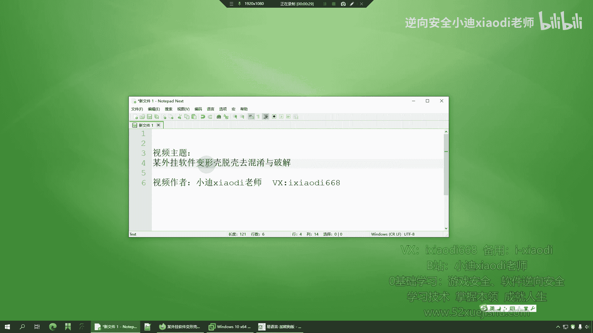

上一节说明了课程主题，本节我们来看看样本的外在信息和交流边界。该外挂软件已经做过脱敏处理。运行后会出现一个界面，界面中包含“文件”“关于”等区域，具体用途不明确。界面中的QQ群信息已经去掉，这是脱敏工作的一部分。样本中有“变态功能”标价每月100元，还有“远程攻击”等功能；另有“通用功能”标价每月50元，价格较高。

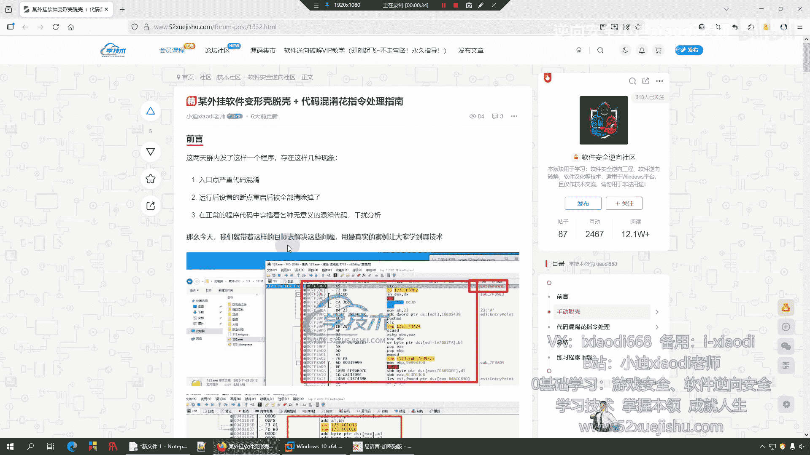

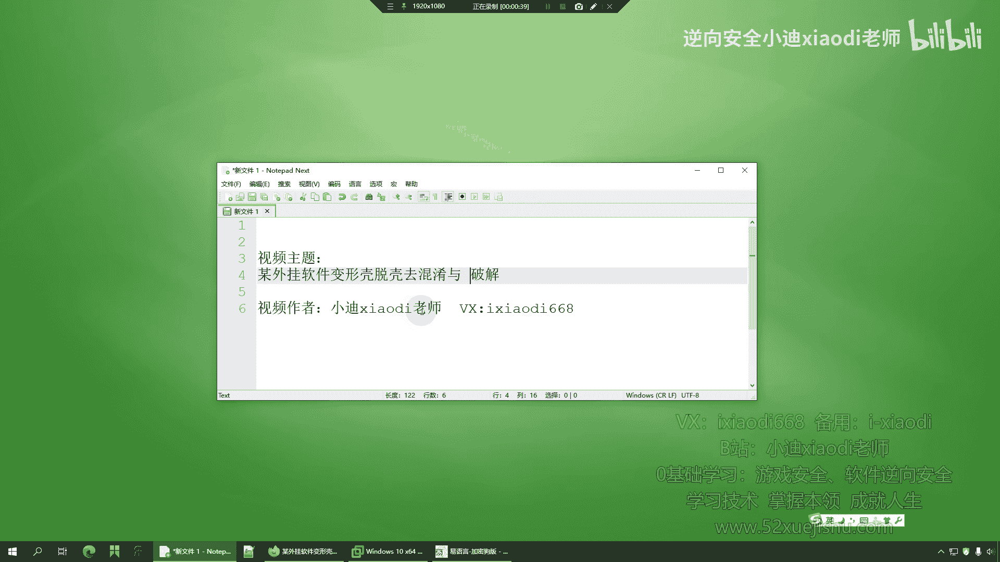

需要明确的是，本内容本着技术交流的目的展开，因此不会讲解得特别彻底。学完这些内容后，应该能够看懂整体思路。会员课程中有“易语言软件逆向破解专题”，其中全面讲解了易语言的破解方法。这个外挂也是易语言程序，所以可以使用已经讲过的技术，这是一类通用性技术。

以下是本节需要记住的样本与课程信息列表，便于初学者先建立整体印象。

- 样本类型：外挂软件，属于恶意软件，危害游戏平衡。
- 主题：变形壳脱壳、去混淆与破解。
- 前期内容：论坛已更新变形壳脱壳与去混淆内容，可自行翻阅。
- 样本状态：已脱敏，QQ群信息已移除。
- 功能价格：变态功能每月100元，通用功能每月50元，远程攻击等功能在内。
- 技术路线：使用易语言软件逆向破解专题中的通用技术。
- 交流边界：以技术交流为目的，不展开特别彻底的操作。


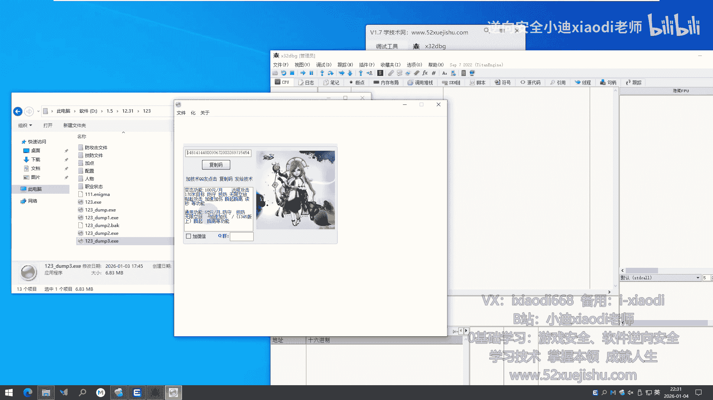

# 🧭 软件逆向破解实战：02：样本运行与窗口功能观察

上一节我们介绍了样本背景和课程边界，本节我们来看看程序运行后的窗口与功能分布。先确认一个前提：当前程序的外壳已经脱掉。接下来打开工具包，找到`x32dbg`并运行，把目标程序拖入`x32dbg`。随后点击插件，点击小D5.0开始分析，让工具分析这个外挂程序调用了哪些函数、哪些库，并查看它的窗口。

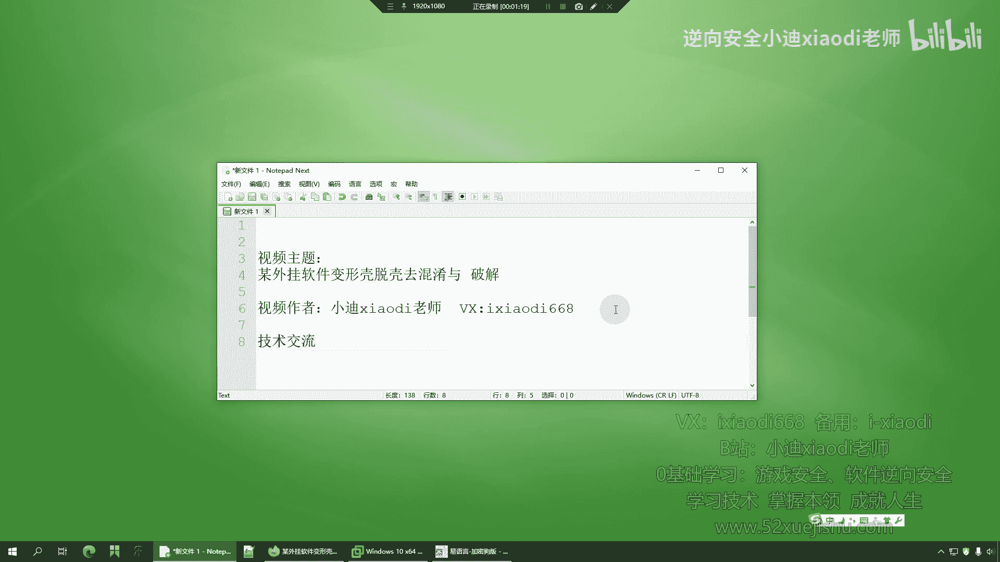

通过窗口观察可以发现，这个外挂有几个窗口。窗口名称在原文中不够清晰，包括类似“时钟_祝符”“记抄表_祝符”的窗口，具体用途不明确，可能与外挂功能相关。另一个窗口是主窗口，名称类似`520100013个01个1`。主窗口应该是核心窗口，因为外挂功能都集中在这里。

以下是观察到的窗口与判断列表，帮助理解后续切入点。

- 窗口一：名称类似“时钟_祝符”，用途不明确。
- 窗口二：名称类似“记抄表_祝符”，可能与外挂功能相关。
- 主窗口：名称类似`520100013个01个1`，是核心功能窗口。
- 当前状态：壳已脱掉，可使用调试器继续分析。


# 🔍 软件逆向破解实战：03：使用x32dbg定位易语言程序入口

上一节我们观察了窗口，本节我们来看看如何定位易语言程序的入口。第一步是在当前模块中搜索匹配特征`FF25`。搜索到后双击过去，查看该位置。之前已经讲过，这里是易语言程序的入口。这个入口对应的窗口就是程序入口窗口，也是外挂的功能窗口，名称类似`52013001个1`。

核心定位概念可以用下面的代码表示：

```text
搜索当前模块特征：FF25
双击匹配位置 -> 查看易语言程序入口
入口窗口 -> 功能窗口 52013001个1
```

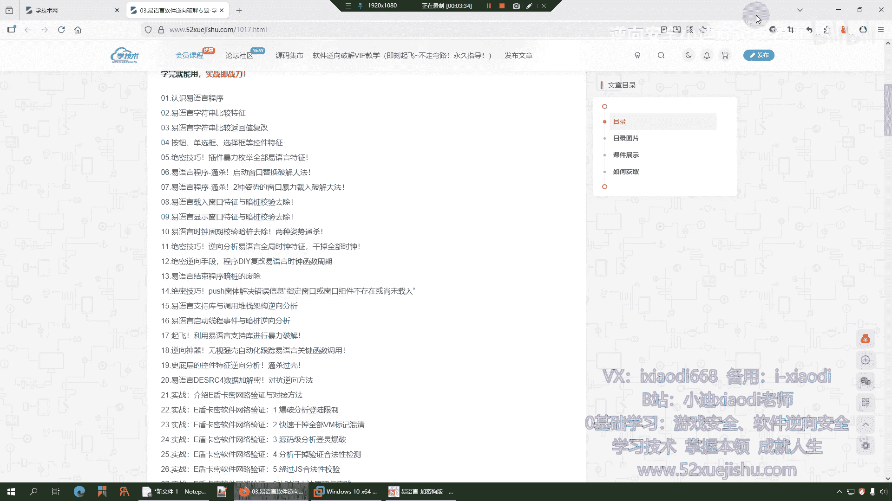

不过这里会出现一个问题：单独运行程序时，那些控件并没有显示出来。再使用工具开始分析，稍等后点击窗口控件，可以看到里面明明有很多控件，但界面上没有显示。这说明程序做了一件操作：控件隐藏。

控件隐藏的核心概念可以用公式表示：

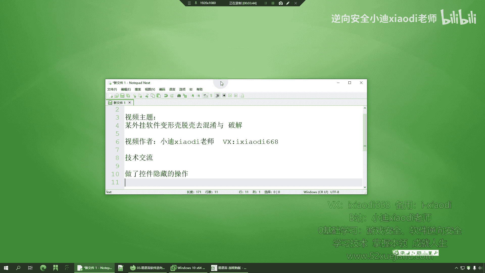

\[
控件.可视 = 假 \quad \Rightarrow \quad 控件隐藏
\]

\[
控件.可视 = 真 \quad \Rightarrow \quad 控件显示
\]


# 🛠️ 软件逆向破解实战：04：控件隐藏与组件属性断点修改

上一节我们判断程序做了控件隐藏，本节我们来看看易语言中控件如何隐藏，以及如何通过断点修改状态。对易语言来说，控件隐藏有固定命令。可以写一个简单demo：一个窗口，两个按钮；在“启动窗口创建完毕”之后，让控件“可视”等于“假”，也就是不可见。

核心代码可以表示为：

```text
启动窗口创建完毕：
    控件.可视 = 假
```

这个操作最终会导致调用“设置组件的属性”。也就是说，如果程序对控件进行隐藏，最终会执行设置组件属性的相关代码。这个切入点很好找，本质上就是隐藏操作。接下来在入口处按`F2`打 breakpoint，让程序跑起来，程序会中断在这里。先关掉刚才额外打开的程序。此时查看`ESP+14`，这里可以看到组件属性是如何设置的，以及当前状态。

断点观察的核心概念可以用下面的代码表示：

```text
F2 下断点
程序中断后观察：ESP+14
查看组件属性设置状态
```

运行过程中会出现一些状态值，例如`141411`、`141`、`18`、`48`、`0`、`1`等。部分与时间或显示相关的值可以暂时不管，`18`和`48`也可以先不处理。关键规律是：`0`表示不显示，`1`表示显示。

以下是断点状态值的处理思路列表，便于按步骤操作。

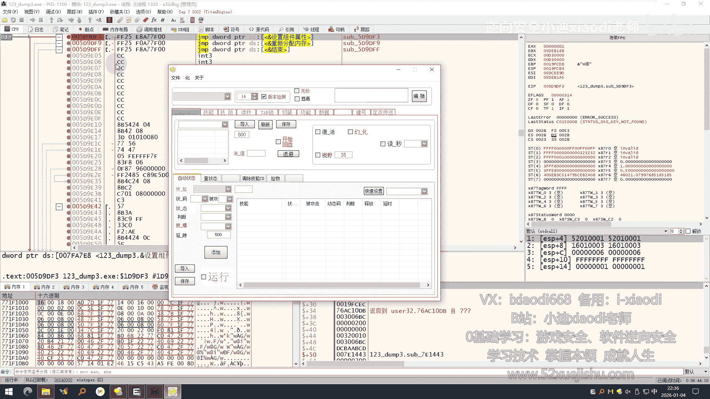

- 先运行并观察`ESP+14`处的状态值。
- `141411`、`141`等显示相关值先不处理。
- `18`、`48`等值先不处理。
- `0`表示不显示，`1`表示显示。
- 尝试把`0`改成`1`，继续运行观察效果。
- 程序跑起来后控件仍然显示，说明在设置组件属性时，原本的`1`要改成`0`才正确，因为程序会主动把控件显示出来。
- 重启程序后，对多个状态值分别取反：原本为`1`的改为`0`，原本为`0`的改为`1`。
- 其中有一个`1`可能是让用户注册的提示，当前为`1`表示显示，把它改成`0`让它不显示。
- 类似`11`改为`1`再改为`0`，`110`改为`1`，`0`改为`1`，逐一处理。
- 忽略`18`、`48`等无关值，运行后界面恢复正常。
- 最后放开断点。


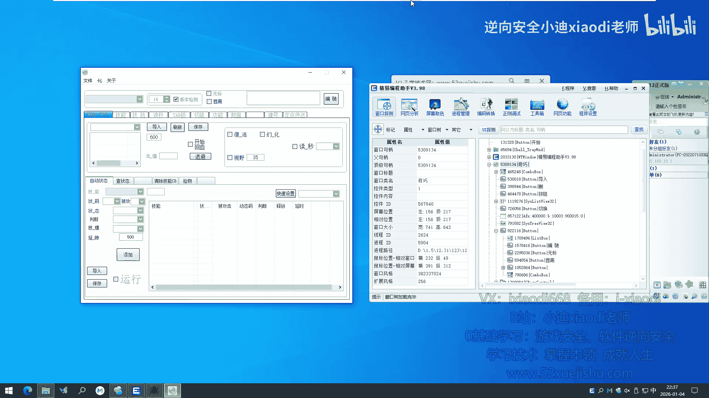

# 🔓 软件逆向破解实战：05：按钮解禁与程序可用性恢复

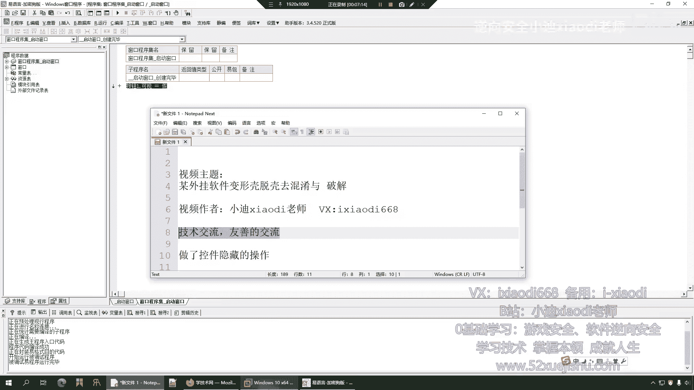

上一节我们通过修改组件属性状态让界面恢复正常，本节我们来看看窗口无法点击的问题如何解决。此时还有一个问题：窗口没有办法点击。作者的设计一环扣一环。如果作者看到这个视频，可以自行修复并加强程序。这里再次说明，本内容用于技术交流，是友善交流，不用于恶意用途。

解决方法是：把程序拖入工具，点击“其他”，再点击“解禁所有按钮”。原因是作者把按钮禁止了，所以无法点击；解禁之后就可以点击。点击按钮后可以看到可以点击，辅助功能也可以使用。程序退出后，安装流程可以自行查看，程序还有一个安装过程；安装结束后的处理位置，原文称“废处”，可以自行学习。

以下是恢复程序可用性的操作列表，便于按顺序理解。

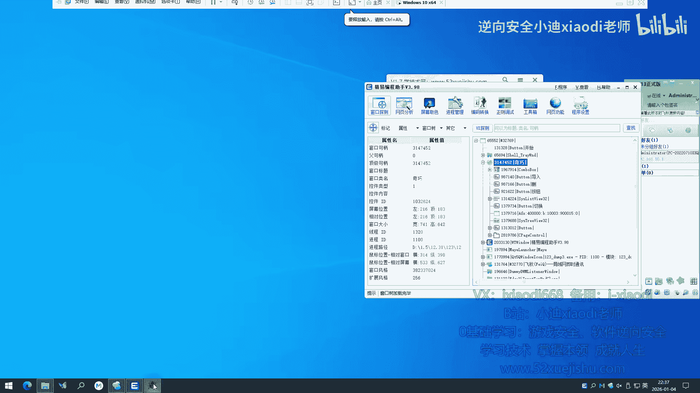

- 将程序拖入工具。
- 点击“其他”。
- 点击“解禁所有按钮”。
- 按钮原本被禁止，因此无法点击。
- 解禁后按钮可点击，辅助功能可用。
- 程序退出后，安装流程可自行查看。
- 安装结束后的处理位置可自行学习。


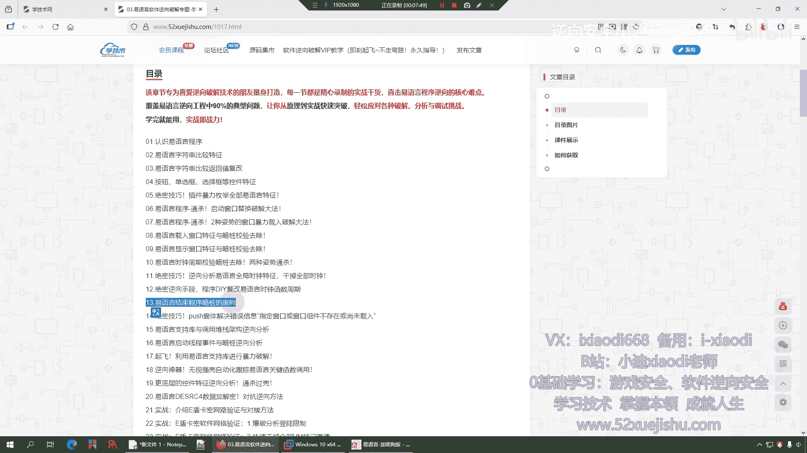

# ⏱️ 软件逆向破解实战：06：二次校验与时钟干扰

上一节我们恢复了按钮可用性，本节我们来看看程序中的二次校验和时钟干扰。当前功能已经破开，但程序还有一些二次校验。二次校验可以使用本集内容处理掉。程序还有一个时钟周期，用来阻碍程序人员分析。

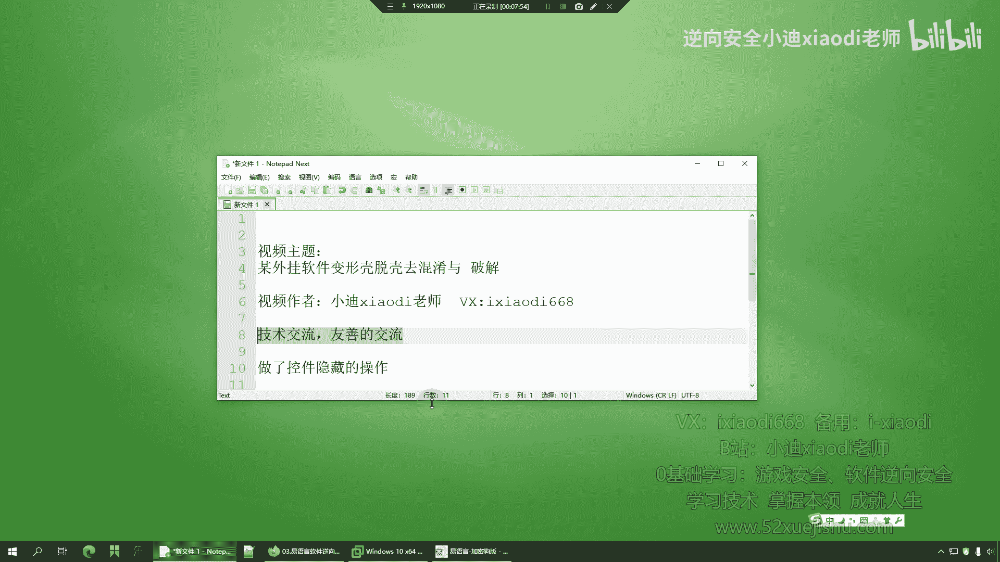

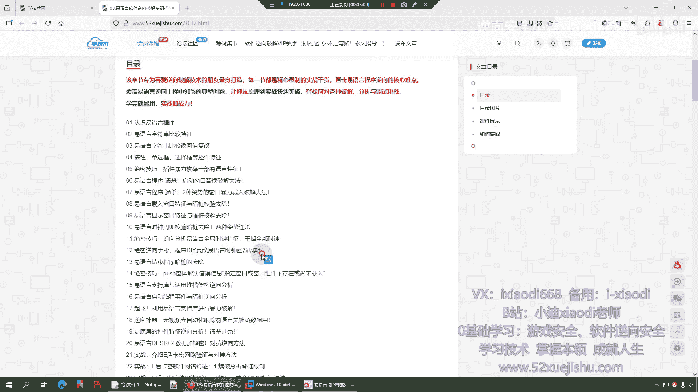

可以这样观察：使用PUSH大法（原文称“P须大招”）打 breakpoint。刚开始是窗口创建完毕，此时程序有一个时钟。跟进去可以看到一个空时钟，它什么事都不干，目的就是干扰分析。如果在控件上打断点，这个时钟会干扰分析。

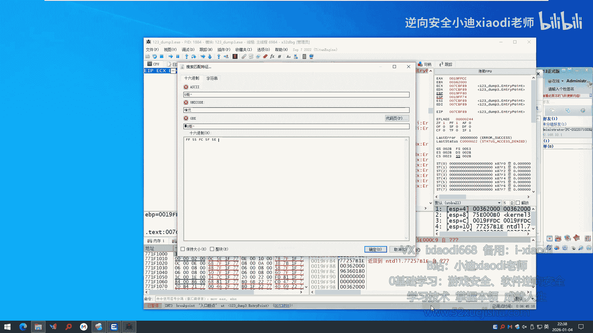

时钟干扰的核心概念可以用代码表示：

```text
窗口创建完毕 -> 启动时钟
时钟周期事件 -> 空操作
空操作目的 -> 干扰分析人员判断
```

以下是程序保护点与学习方向列表，帮助整理后续思路。

- 二次校验：可使用本集内容处理。
- 时钟周期：空时钟干扰分析。
- 控件断点：可能被时钟干扰。
- 作者掌握的技术较多。
- 包括针对壳做处理。
- 包括代码混淆。
- 社区论坛帖子中已给出完整解决方案和讲解，可自行学习。


# 🎓 软件逆向破解实战：07：总结与学习路径

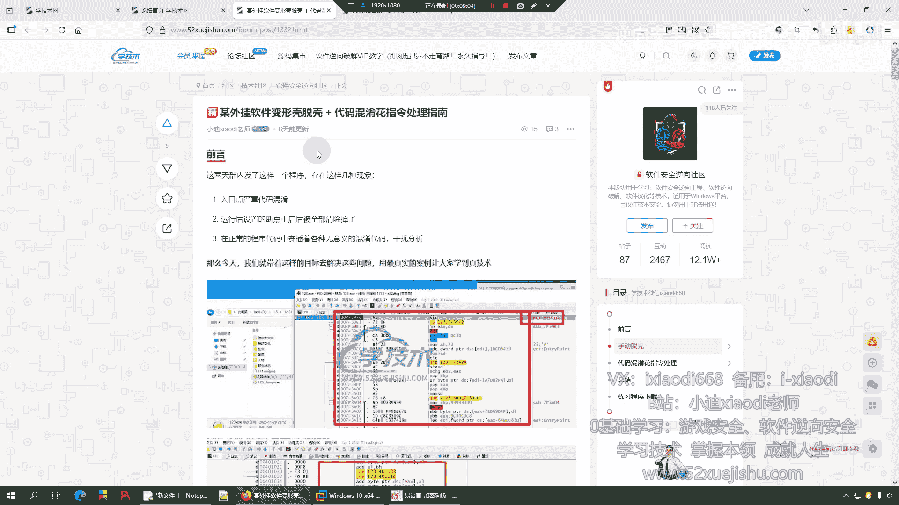

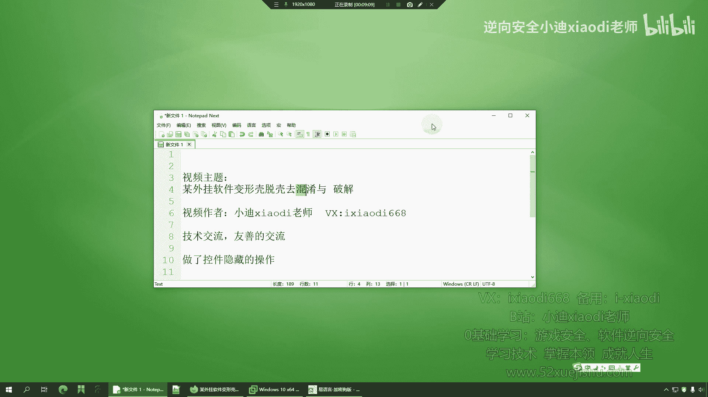

上一节我们梳理了二次校验和时钟干扰，本节我们对整个案例做总结。本节课中我们一起学习了软件逆向破解实战中的某外挂软件变形壳脱壳、去混淆与破解流程。我们了解了外挂样本的背景和脱敏情况，观察了程序窗口与主窗口功能分布，使用`x32dbg`搜索`FF25`定位易语言程序入口，判断并修改了控件隐藏相关的组件属性状态，通过解禁按钮恢复程序可用性，并分析了二次校验与空时钟干扰。

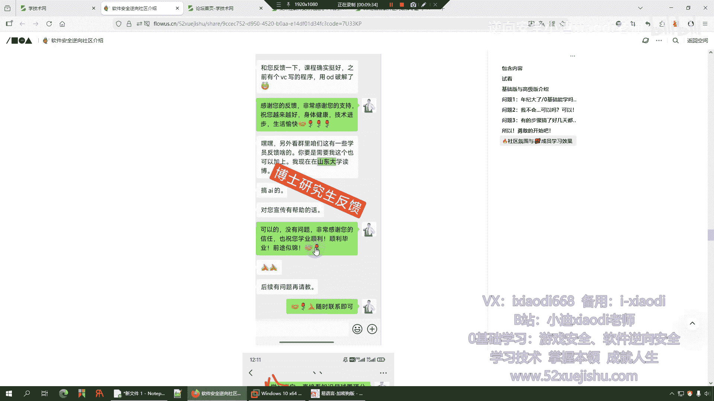

如果想学习相关知识，可以联系课程方。想看试看内容可以点击指定入口，想看聊天记录可以点击指定入口，学习效果都可以看到，群内也有问必答。课程结束时说明下期再见。

