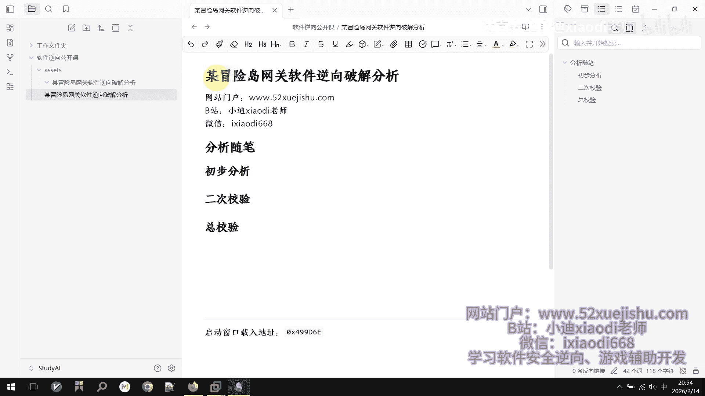
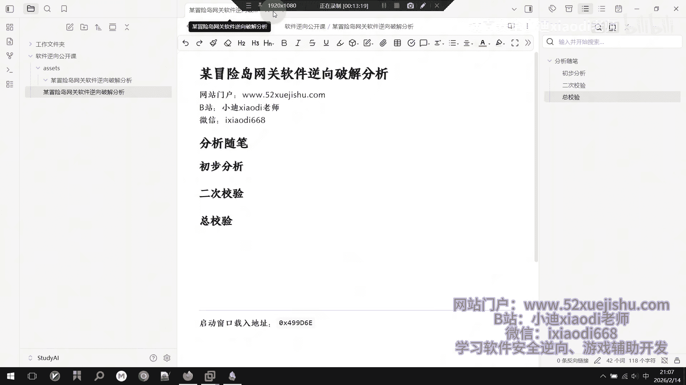

## 🧭 软件逆向破解：01：课程概述与逆向分析的应用场景

在本节课中，我们将学习软件逆向破解的基本思路，并以某冒险岛网关外挂软件为例，完整走一遍授权提示分析、信息框断点、跳转修补、二次校验处理、E语言数组越界错误定位、窗口载入事件单步调试以及错误函数处理的过程。课程由小李老师讲解，会尽量把每一步拆开说明，方便初学者跟上。软件逆向这件事，在读书人口中叫“逆向分析”，在坏人手中叫“破解”，但底层技术点是一样的，都是分析程序行为、定位关键判断、理解代码逻辑。

学习逆向分析后，可以分析手头日常使用的软件，也可以帮助他人分析小游戏或小软件。可以开发一个程序，把源代码交给对方，或者发送一个小工具，这就是技术变现，也是零花钱的来源。技术学好后，还可以接一些较大的单子，原文示例中定金为200，尾款为600。为了把流程讲清楚，课程会从目标软件运行现象开始，再逐步定位校验点。下面进入目标软件和第一次授权校验的分析。




## 🔍 软件逆向破解：02：目标软件与第一次授权校验

上一节我们介绍了逆向分析的用途和变现场景，本节我们来看看目标软件的运行现象以及第一次授权校验的处理方式。运行目标软件后，程序提示“尚未授权，请联系作者”。这说明程序中存在授权校验，并且会通过信息框提示用户。关于该软件如何分析，原文提到可以点击论坛社区，再点击综合，往下翻，相关帖子已经发布，本视频是补录内容。相关帖子位置如下。

> 论坛社区 → 综合 → 往下翻；帖子已发布，本视频为补录。

了解帖子位置后，回到程序本身。既然程序会弹出信息框，那么信息框通常就是MessageBox。处理思路是给MessageBox下断点，然后回溯分析。第一次校验的定位与修补流程如下。

1. 将程序拖入调试器，在MessageBox相关位置按F2设置断点，断点会变成红色。
2. 断点的含义是：程序执行到指定地址时会暂停，方便观察后续代码。
3. 按Ctrl+F9，让程序执行到函数体尾部附近；执行完成后点击确定。
4. 按F8出口，再重复Ctrl+F9和F8，逐步回到关键代码层。
5. 到关键代码后，可以看到程序执行到弹窗位置，弹出“尚未授权，请联系作者”。
6. 代码块中存在JMP，JMP表示无条件跳转。如果代码从上面执行下来，经过该位置时会无条件跳到下边，导致弹窗分支不被执行。
7. 必然存在一个跳转跳到了当前行，可以往上翻查找虚线小箭头，找到跳转来源。
8. 将这个跳转改为不跳，方式是鼠标右键选择二进制，再用NOP填充。
9. NOP表示空操作，什么都不做；这样代码会逐行向下执行，直接跳过校验分支。
10. 保存修补文件，命名为Crack1，退出后运行修补后的程序。

核心概念可以用下面的代码描述。

```text
断点 = 程序执行到指定地址时暂停
JMP  = 无条件跳转
NOP  = 空操作，不执行有效动作
修补方式：JMP 跳转指令 -> NOP
```

完成上述操作后，第一次初步校验被绕过。运行Crack1时，程序提示“未找到”。原文说明，由于软件由他人提供，没有正版授权，因此不知道它具体要找什么。点击确定后，程序又提示“授权信息不正确”，说明还存在第二次校验。上一节我们处理了第一次授权提示，本节我们继续分析第二次校验的跳转来源和修补方式。

## 🧩 软件逆向破解：03：第二次授权校验与查找引用

第二次校验同样会弹出信息框，因此可以按照第一次的思路，在信息框位置下断点，再回溯分析，找到跳转并删除跳转。第二次校验的操作步骤如下。

1. 将程序拖入调试器，同样在信息框相关位置下断点，然后运行程序。
2. 第一次断下来时先不分析，因为这次断下的是友情提示，不是“授权信息不正确”。
3. 再点击运行，让程序断在“授权信息不正确”的提示位置。
4. 按Ctrl+F9和F8重复回溯，直到看到关键代码。
5. 代码附近可以看到“无限制”字样。原文表示不确定“无限制”具体是什么内容。
6. 往上翻时可以看到同样的套路：存在一个跳转跳到当前行，代码逐行执行后会走到授权提示位置。
7. 如果往上翻看不到跳转来源，可以选中当前行，鼠标右键选择“查找引用”，再选择“选定的地址”。
8. 原文选定的地址是491060，查找后可以看到JNE 491060，这个跳转就是跳到授权信息不正确分支的罪魁祸首。
9. 双击该引用回到跳转位置，再进行修补。修补方式是右键二进制，用NOP填充。
10. NOP填充后，代码会逐行向下执行，不再跳到授权信息不正确分支。
11. 保存修补文件，命名为Crack2，然后运行第二次破解后的程序。

第二次校验涉及的核心指令如下。

```text
JNE 491060   ; 不相等时跳转到 491060
修补方式：JNE 491060 -> NOP
```

原文还提到，程序下面还有很多“授权协议不正确”的提示，说明它存在多次校验。当前先不管这些后续校验，先把第二次校验处理掉。保存Crack2并运行后，程序出现新的错误提示。上一节我们通过查找引用处理了二次校验，本节我们来看看新出现的E语言数组越界错误。

## 🐞 软件逆向破解：04：E语言数组越界错误分析

运行Crack2后，程序先提示“未找到”，点击确定后又出现新的错误。这个错误是E语言本身的代码框架错误，因为该程序使用E语言开发。如果了解E语言开发程序的相关知识，就能看出这是E语言架构错误。错误代码为1，运行时出错，错误信息是“数组成员引用下标超出定义范围”。下面用大白话解释数组和下标越界。

数组就是一组数据的组合。程序通过下标访问数组成员，类似通过编号或ID访问某一条数据。数组下标访问可以写成下面的形式。

```text
Array[index]

越界条件：index >= length(Array) 或 index < 0
空数组：length(Array) = 0，访问第一个成员也会出错
```

原文举例说明：当程序访问第九个成员时，如果数组里没有9个成员，就会访问不到；数组可能只有3个成员，也可能只有0个成员。如果数组里没有任何成员，访问第一个成员就会出错。这就是“数组成员引用下标超出定义范围”的含义。理解错误信息后，下一步是找到错误从哪个位置产生。上一节我们解释了数组越界错误，本节我们来看看如何通过窗口载入事件定位错误位置。

## 🧱 软件逆向破解：05：定位窗口载入事件与单步调试

程序运行时出现“未找到”错误弹窗，随后又出现架构错误弹窗。此时需要观察窗口是否已经加载出来。原文判断窗口还没有加载出来，也就是窗口将要加载但尚未加载时弹出了错误，最终导致窗口没有加载。处理思路是使用窗口载入事件，在窗口载入函数头部下断点并单步执行。内部视频已经讲解过窗口载入事件，这里不再展开，直接给出相关地址：499D6E。原文操作时把程序拖入调试器，并跳转到499D61地址，这里就是找到的窗口载入事件位置。定位窗口载入事件和单步调试的步骤如下。

1. 将程序拖入调试器，跳转到窗口载入事件相关地址499D61。
2. 运行程序，程序会停在窗口载入事件附近。
3. 按F8单步执行。当前位置是函数头，也就是窗口载入函数的头部。
4. 继续按F8单步执行。如果执行太快，可以重新运行并放慢速度，避免错过关键位置。
5. 一步步向下走，观察程序在哪个位置出错。
6. 找到出错位置后进行处理。处理方式可以是补正版数据，也可以直接把出错逻辑干掉。
7. 如果功能不正常或不完整，就需要补数据。有时仍然需要正版授权，因为没有正版授权就缺少数据，不能随意猜测。
8. 原文强调不能瞎猜数据，例如正版数据是7654321，不能随便写成ABCDEFG。
9. 继续单步执行，程序没有退出，说明还没有走到最终错误位置。
10. 继续向下执行，直到“未找到”友情提示出现，紧接着错误弹窗也出现。
11. 这说明两个错误是挨着的，问题就在附近的CALL里。CALL就是函数调用，说明该函数有问题。

窗口载入事件和单步调试的核心概念如下。

```text
窗口载入事件：窗口加载时执行的函数
F8：单步执行
CALL：调用函数
```

定位到有问题的CALL后，就可以进入最后的处理阶段。上一节我们通过窗口载入事件找到了出错函数，本节我们来看看如何用NOP处理错误函数并完成破解。

## ✅ 软件逆向破解：06：处理错误函数并完成破解

既然CALL调用的函数有问题，就可以用NOP填充把该函数调用干掉。原文说明，干掉后有没有功能另说，先处理掉错误，再观察程序表现。有时做逆向分析不要先纠结后果，可以先处理，出现问题再解决。收尾处理步骤如下。

1. 在出错的CALL位置右键选择二进制，用NOP填充。
2. 点击修补文件，将新文件命名为Crack3。
3. 保存修补文件，关闭调试器。
4. 运行Crack3，程序窗口可以正常打开。
5. 点击确定后进入程序界面。
6. 程序界面中可以让宠物习惯多开内挂，里边有很多外挂功能。

处理错误函数的核心操作如下。

```text
CALL 出错函数 -> NOP 填充
```

完成这一步后，目标软件的主要校验和错误提示已经被处理，程序可以进入界面。前面几节我们完成了从授权校验到错误函数处理的全过程，本节我们对课程内容进行总结，并给出后续学习建议。

## 📚 软件逆向破解：07：课程总结与学习建议

本节课中，我们一起学习了某冒险岛网关外挂软件的逆向破解分析流程。课程从软件运行提示“尚未授权，请联系作者”开始，使用MessageBox信息框断点定位第一次授权校验，通过查找跳转来源并用NOP填充绕过校验。随后处理第二次授权校验，通过“查找引用”定位JNE 491060，再用NOP填充去除跳转。之后分析E语言数组越界错误，理解“数组成员引用下标超出定义范围”的含义，并通过窗口载入事件和F8单步执行定位出错CALL，最后用NOP填充处理错误函数并完成Crack3。



如果希望继续学习相关知识，可以到官网查看课程内容。官网有大量课程，包含上百级、几百集的内容，也包含PE文件结构、脱壳加壳、语言逆向破解等方向。对脱壳加壳感兴趣可以学习相关课程，对语言逆向破解感兴趣也可以继续深入。官网还有文章可以阅读，讲解清晰。本视频内容一刀不剪，课程到此结束，下期再见。

