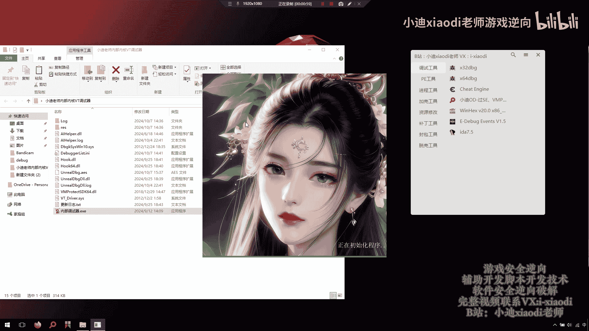
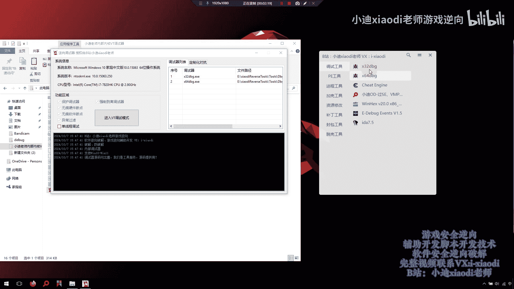
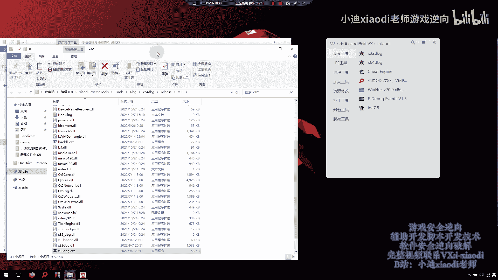
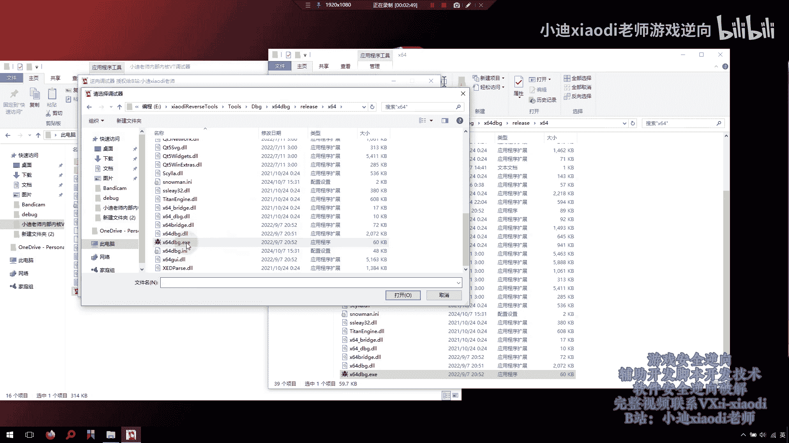
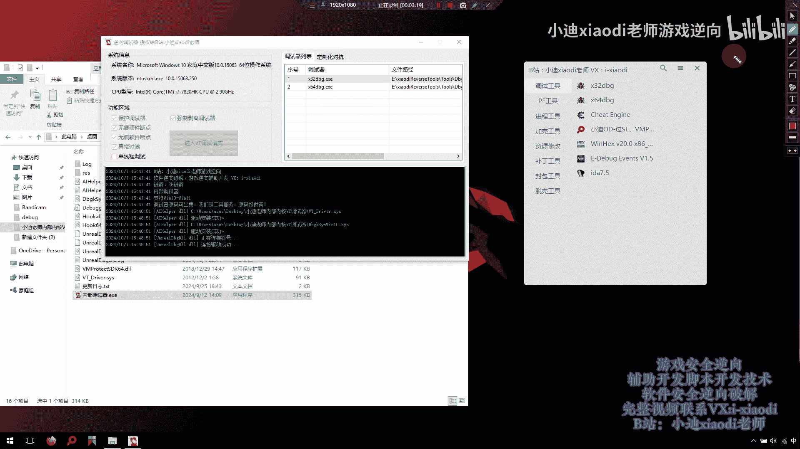
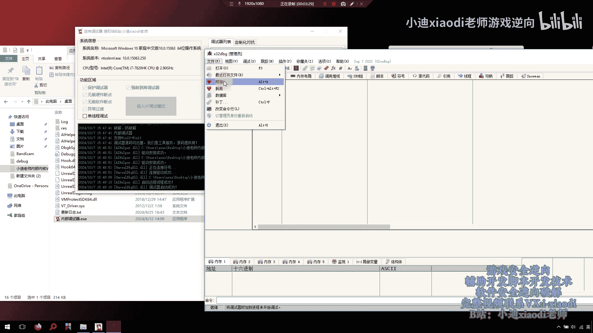
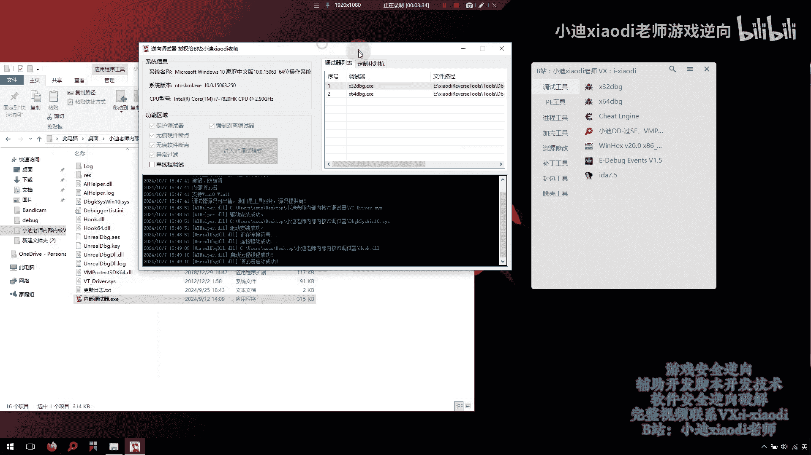
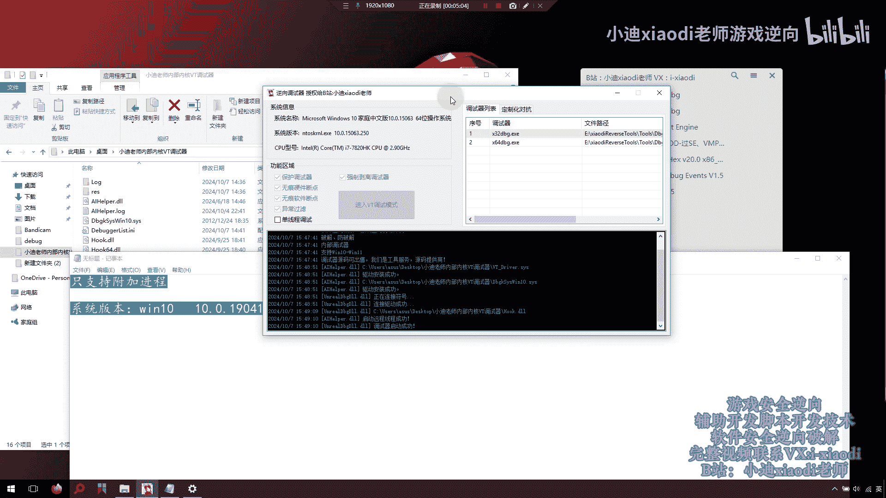

## 🛡️ 强壳反调试绕过基础：01：课程概述

在本节课中我们将要学习如何使用内部调试器绕过 TMD、VMP、SE 等强壳的反调试。大家好，我是小李老师。今天围绕一个很实用的流程展开，目标是把工具跑起来、配置好，然后能够附加到目标进程上进行调试分析。这里先把整体思路说清楚，后面再一步一步操作。

上一节我们介绍了课程目标，本节中我们来看看为什么需要这个工具。分析 VMP 强壳时，如果能够附加成功，说明已经比较成功；但附加之后去打断点，再进行单步调试分析，程序就会崩溃，这就是强壳针对调试器的检测。这个现象可以用一个简单关系描述：

```text
成功附加 + 设置断点/单步调试 → 程序崩溃 = 反调试检测生效
```



因此，普通调试方式容易触发检测。工具包中虽然有能过强壳的 OD，但它毕竟不是 CE，也不是 DBG，局限性较大。今天使用的内部调试器可以通杀所有 VMP、TMD 等强壳的反调试，想怎么调试就怎么调试。下面进入实际使用流程。

## 🧰 强壳反调试绕过基础：02：首次运行与授权

上一节我们说明了反调试检测的现象，本节中我们来看看第一次运行内部调试器时要做哪些准备。第一步是把内部调试器运行起来。第一次运行时可能出现意外情况，常见现象是没有正版授权 K 文件，于是会弹出错误提示。

当出现这个错误提示时，点击确定后，剪贴板中会出现一串授权码。这个授权码需要发送到我的微信上，也就是发到我的微信，然后由我给内部社区成员授权。收到授权码后，我会发给你一个 K 文件，你把 K 文件粘贴到对应目录下即可。完成这一步后，再次运行工具，稍等一下，内部调试器就会运行起来。

运行起来后会出现工具界面。界面出来并不代表马上可以调试，还需要完成调试器配置。以下是首次运行与授权流程的要点，供你按顺序检查：

- 第一次运行内部调试器，确认是否出现授权错误提示。
- 点击确定后，从剪贴板取得授权码。
- 将授权码发送到我的微信，申请内部社区成员授权。
- 收到 K 文件后，把 K 文件粘贴到工具目录下。
- 重新运行内部调试器，等待界面正常出现。



## ⚙️ 强壳反调试绕过基础：03：添加调试器路径



上一节我们完成了首次运行和授权准备，本节中我们来看看如何添加调试器。工具运行后会显示界面，使用方法并不复杂。先点击调试器列表，然后添加调试器。这里务必添加我们自己的调试器，因为这个调试器专门处理过；如果使用其他调试器，可能出现意外情况，出现意外我这边不负责。

添加调试器时，要找到调试器的路径。在工具包中找到调试器路径的方法很简单：鼠标右键，打开文件所在位置，然后找到对应程序。找到路径后，鼠标右键点击添加，把路径粘贴过来，双击即可添加进去。64 位调试器也是一样，找到它的路径后添加，并把 x64dbg 添加上。以下是添加调试器的操作顺序：

- 点击调试器列表。
- 选择添加调试器。
- 右键工具程序，打开文件所在位置，确认调试器路径。
- 将路径粘贴到添加位置并双击完成添加。
- 按同样方式添加 64 位调试器，并把 x64dbg 添加进去。



这里再强调一次，调试器要使用工具包中提供的版本。上一节我们完成了添加调试器，本节中我们继续进入调试模式。添加完成后，第二步是点击进入 VT 调试模式，点击对应按钮进入该模式。出现“正在连接符号、连接驱动成功”的提示后，就表示连接成功。

## 🚀 强壳反调试绕过基础：04：进入 VT 调试模式与附加进程



上一节我们添加了调试器，本节中我们来看看如何启动调试。进入 VT 调试模式并看到连接符号、连接驱动成功的提示后，就可以鼠标右键点击启动。启动之后，就可以大胆地去分析目标程序，也可以大胆地附加进程。

当前工具只支持附加进程，不支持直接打开进程，因此操作时要理解为“附加”而不是“打开”。以下是启动与附加阶段的注意事项：



- 点击进入 VT 调试模式。
- 确认出现“正在连接符号、连接驱动成功”的提示。
- 鼠标右键点击启动。
- 使用附加进程的方式分析目标程序。
- 不要使用打开进程的方式，因为当前只支持附加进程，不支持打开。



到这里，基本使用流程已经走通。上一节我们完成了附加进程的操作说明，本节中我们来看看系统版本和注意事项。最后讲注意事项，第一项是只支持附加进程，不要打开，不支持打开，只支持附加进程。第二项是系统版本要求，系统版本要在 Windows 10 10.0.19041.4291 以上；课程中也提到 10.0.19041 以及 3291 以上，实际使用时以工具要求为准。简单表示如下：

```text
仅支持：附加进程（Attach）
不支持：打开进程（Open）
系统要求：Windows 10，版本不低于 10.0.19041.4291
```

## ✅ 强壳反调试绕过基础：05：系统版本检查与课程总结

上一节我们说明了附加进程和系统版本要求，本节中我们来看看怎样查看系统版本。系统要是 Win10，并且版本达到要求。查看方法是点击系统，点击关于，查看系统版本号。例如当前演示电脑显示 15063.250，这个版本不适合，因为它是 1703 版本，属于非常古老的 Win10 系统，不支持该工具；这里只是演示查看方法。

如果你的系统是 Win10 10.0.19041.4291 以上，那么电脑就是支持的。以下是系统版本检查要点：

- 确认系统为 Windows 10。
- 点击系统，再点击关于。
- 查看版本号是否达到 10.0.19041.4291 以上。
- 版本过低时不要继续使用该工具，例如 15063.250 这类老版本不适合。

后续这个工具真正发挥作用时，例如用它调试 VMP、TMD 这类强壳反调试，相关视频后面再发布。今天的视频重点只是一个简单、实用的使用流程，先把工具运行、授权、添加调试器、进入 VT 调试模式、附加进程和系统版本检查这些基础步骤掌握好。



本节课中我们一起学习了内部调试器绕过 TMD、VMP、SE 等强壳反调试的基本流程，包括首次运行与授权、添加调试器路径、进入 VT 调试模式、附加进程以及系统版本检查。大家按照流程操作，就能完成基础配置和调试准备。本次内容到这里，下集再见，拜拜。

