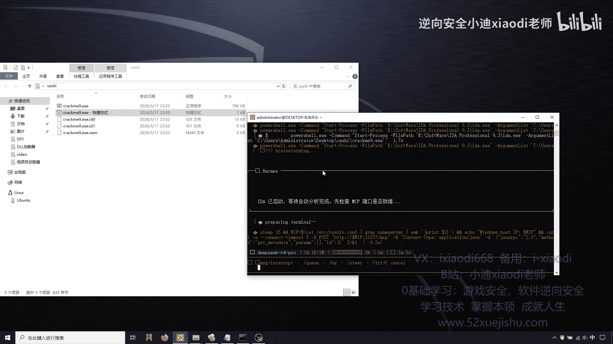
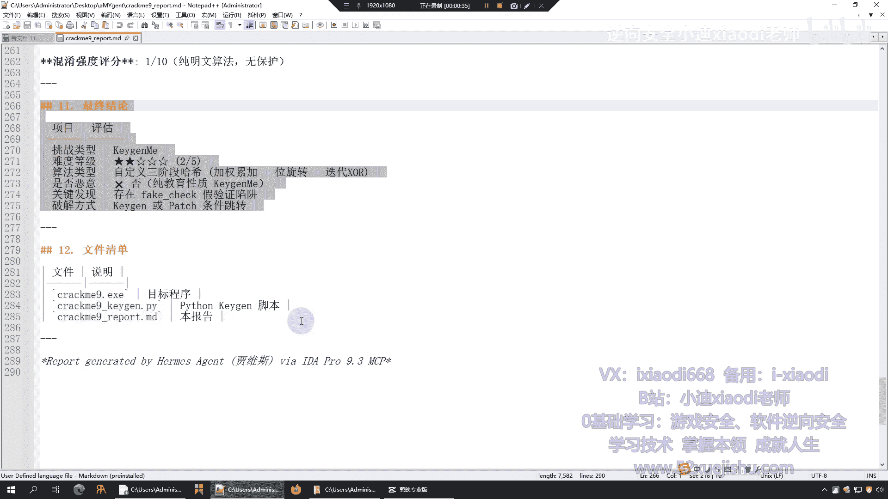

🤖 AI辅助软件逆向：第一章：智能体自动逆向入门 🚀

本课程将介绍如何用AI智能体自动完成软件安全逆向破解。在本节课中，我们会先聊聊手动逆向为什么辛苦，再解释什么是AI智能体，然后拆解IDA与MCP的协作原理，最后给出一个可以上手的搭建方案。所有概念都用大白话讲，不需要你有深厚底子。哪怕你只听说过IDA，也能跟上节奏。

😫 手动逆向的痛点

先说手动逆向的痛点。第一次打开一个几十MB的二进制文件，IDA显示的是一大片汇编代码，程序逻辑被拆成无数小函数。你要记地址、记跳转、记参数类型，稍不留神就陷入茫茫代码海洋。

以下是过去逆向时最让人崩溃的三个场景：

- 代码量爆炸：大型软件动辄几十万个函数，逐个看完不现实，只能靠搜索和运气。
- 交叉引用迷路：函数间调用关系像一团乱麻，跳进去再跳出来，经常忘了自己最初要找什么。
- 重复劳动严重：命名、注释、恢复栈结构，这些机械操作占用了大量时间，而真正烧脑的逻辑分析反而没精力做。

这些痛点意味着，只要有工具能自动完成一部分机械工作，逆向速度就能大幅提升。智能体恰好就是这样的工具。

🤔 什么是AI智能体逆向？



前面我们提到机械工作太多让人头疼。现在要讲的，正是一种解决思路。

AI智能体不是简单的聊天机器人，而是一个能独立分析、做决定并调用工具的程序。在逆向场景里，它被赋予一个明确任务，比如“找出check函数中比较的常量”，然后它自己盯着IDA输出，不断尝试，并把发现记录下来。

它的核心循环可以抽象为下面这段伪代码：

```python
while not task_finished:
    current_state = ida.get_state()          # 获取当前反汇编窗口、注释、函数列表
    next_action = llm.reason(current_state)  # 根据状态推理下一步动作
    result = ida.execute(next_action)        # 执行跳转、重命名、设置断点等操作
    memory.store(result)                     # 把结果存到备注里
```

这段代码值得多看两眼。智能体逆向的本质就是反复执行“观察-推理-执行-记忆”的循环。AI不会一次就找到答案，但可以用这个循环把整个二进制文件翻个底朝天。


🔌 IDA与MCP的集成原理

知道了智能体循环后，还有一个关键问题：它怎么操作IDA？答案就是MCP。

MCP是Model Context Protocol，一般译作模型上下文协议。你可以把它看成是AI界的USB接口，用来把AI模型和外部软件连接起来。IDA提供IDAPython脚本接口，MCP服务器包装这些接口，暴露出一套AI可以直接调用的工具。整个过程像一条数据流水线：

用户 → AI助手（MCP客户端） → MCP服务器 → IDAPython → IDA数据库

比如AI想给一个函数重命名，可以这样发起调用：

```json
{
  "tool": "ida.rename_function",
  "arguments": {
    "address": "0x401000",
    "new_name": "check_serial"
  }
}
```

MCP服务器收到请求后，执行对应IDAPython代码，然后把执行结果返回给AI。这样一来，AI就像多了一双能操控IDA的手，可以从头到尾自己推进逆向流程。

🛠️ 搭建智能体逆向环境

原理搞清楚了，下面进入动手环节。整个搭建过程不需要手写复杂协议，只需要借助现成SDK和插件。

以下是五个核心步骤：

- 准备环境：安装Python 3.9以上版本和IDA Pro 8.0以上版本，推荐使用IDA 8.3，兼容性问题最少。
- 安装MCP SDK：在命令行输入 `pip install mcp`。这个库负责处理AI客户端与服务器之间的标准通信。
- 添加IDA的MCP插件：把对应的Python脚本复制到IDA的插件目录。脚本的作用是在IDA内部开启一个本地服务，等待外部指令。
- 配置客户端：在AI客户端的配置文件里写入服务器路径，参考下面这份JSON配置：

```json
{
  "mcpServers": {
    "ida": {
      "command": "python",
      "args": ["ida_mcp_server.py"],
      "env": {
        "IDA_PATH": "C:/Program Files/IDA Pro 8.3/idat64.exe"
      }
    }
  }
}
```

- 启动验证：重新启动AI客户端，发送“打开sample.exe并自动定位check函数”。如果配置正确，AI会开始自动操作IDA，并不断输出分析过程。

这里多说一句：很多人担心配置太复杂，其实大部分工作已经被封装好了。你只需要把上面几项填进去，剩下的通信细节交给MCP处理。

🎯 实际应用场景

环境搭好之后，这套自动逆向方法能帮上什么忙？下面我们结合常见领域展开说。



- CTF比赛：逆向题经常使用各种混淆技术，把flag校验逻辑藏得极深。AI智能体可以通过反复重命名和标注，把关键路径绘制出来，大大缩短找flag的时间。
- 游戏安全：分析游戏外挂时，经常要找攻击判定、伤害计算等关键call。智能体能快速扫描函数交叉引用，定位核心代码。
- 恶意软件分析：恶意样本脱壳后，代码混乱，行为隐蔽。AI智能体可以高亮危险API调用，结合行为日志给出清理建议。

这些应用都有一个共同点：代码量大，逻辑隐藏深，单靠人工去啃会浪费大量时间。智能体正好能分担这部分压力。

✅ 总结

本节课中，我们一起学习了AI智能体辅助逆向的基本框架。我们列举了手动逆向的三大痛点，理解了智能体通过“观察-推理-执行-记忆”循环来自动分析，还弄清了MCP如何把IDA变成AI可操作的工具。之后，我们给出了搭建环境的详细步骤，并讨论了CTF、游戏安全和恶意软件分析中的实际应用。

真正的逆向工作从来不是复制粘贴，但AI智能体的加入，确实让那些重复性劳动变得不像以前那么痛苦。下一步，你可以拿一个简单的CrackMe程序做实验，让它自己跑一遍，你会看到AI是如何一步步逼近答案的。本节内容就到这里，下一节我们继续讲具体逆向案例。

