在本节课中我们将要学习一个完整的逆向分析流程：从拿到一个外挂卡密软件开始，先判断它使用了什么保护，再识别它属于哪类网络验证，接着查端口、找软件名，最后完成山寨本地化、生成卡密、登录并修改时间。整套流程面向初学者，尽量用大白话说明每一步在做什么，以及为什么这样做。需要说明的是，下面的内容只用于安全学习和 CTF/软件安全基础研究，实际测试时要遵守法律法规和授权范围。整个教程会按照从初步识别到本地化实战的顺序展开，每一节都会说明上一节留下了什么问题，以及本节要解决什么问题。

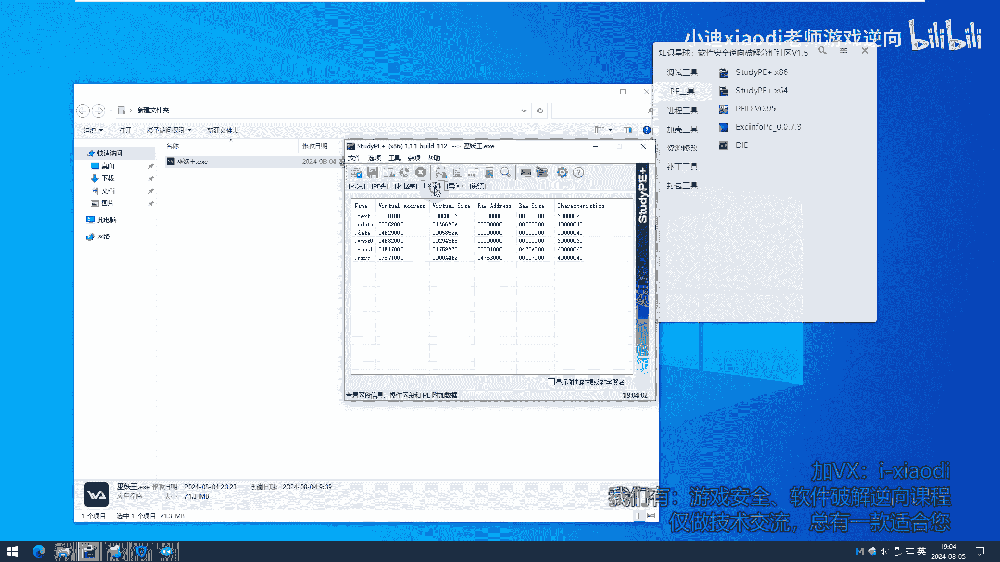

## 🧩 逆向外挂卡密软件全流程：01：初步查看程序与记录VMP区段

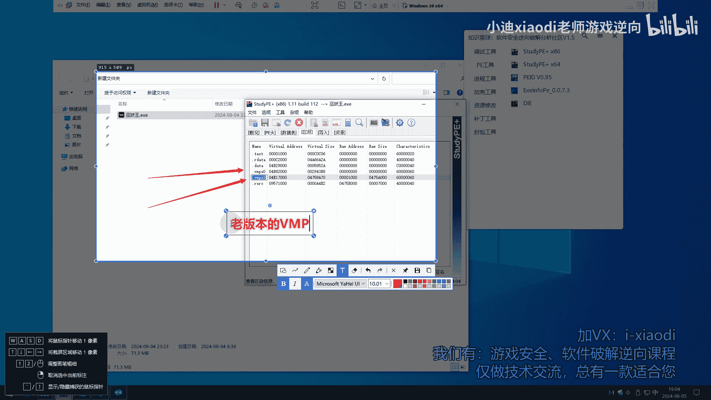

上一节我们明确了课程目标，本节中我们来看看拿到程序后的第一步：用工具查看它的区段，并记录软件防护特征。这个视频分析的是某盾软件的逆向山寨本地化。当前还不知道它具体是什么盾，只知道要逆向它，并做本地化操作。拿到这样一个程序后，第一步是打开工具包里的 s大PE，把程序拖进去。拖进去后点击区段，查看整体区段情况。

在区段里可以看到两个 VMP 字样，也就是有两个 VMP 区段。这种特征一般说明它是老版本的 VMP。这里要记录下来：老版本 VMP 的特点是有两个带 VMP 字样的区块或区段。进一步拓展一下，如果有三个 VMP 字样区段，那就是新的 VMP。这样我们就初步看到了软件防护情况。这个判断看起来简单，但后面选择分析思路时会用到，所以不要跳过。

以下是本节需要记录的核心判断规则：

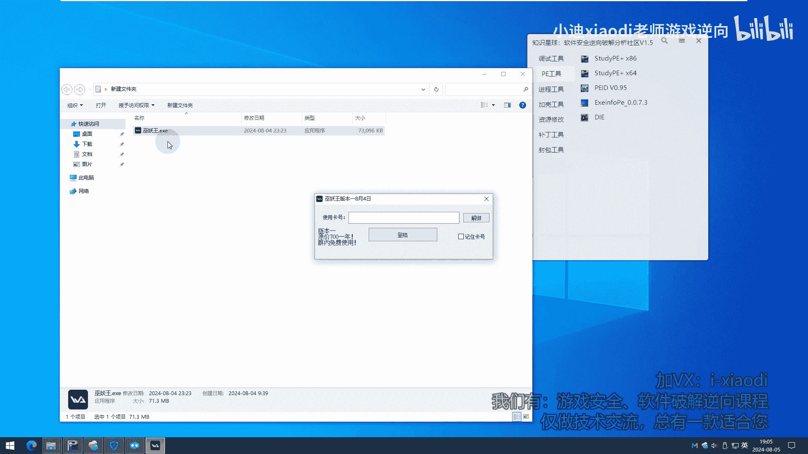

```text
VMP区段数量 == 2  -> 老版本VMP
VMP区段数量 == 3  -> 新版本VMP
32位程序 -> 使用x86版本工具
64位程序 -> 使用x64版本工具
```

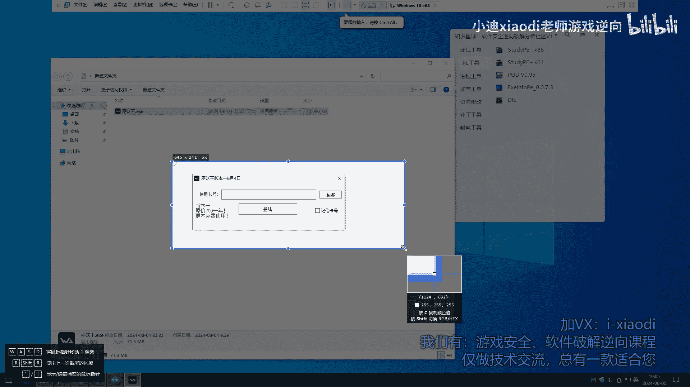

完成区段记录后，我们继续看程序运行后的界面，因为界面往往能暴露它使用的网络验证类型。

## 🖥️ 逆向外挂卡密软件全流程：02：运行程序并判断网络验证类型

上一节我们记录了 VMP 区段特征，本节中我们来看看运行程序后的界面，并通过界面初步判断网络验证。第二点就是运行这个程序，看它大概的界面。实际上，类似软件看得多了，通过界面也能看出它是一个网络验证。界面里有一个编辑框，用来输入卡密，点击登录，并记录卡号。

这种界面一般对应什么样的网络验证？通常长这样的界面，可能是一只盾、异之盾、云盾等。异盾和异之盾还是有一点差别，这类软件版本特别多。具体来说，应该是异之盾这个作者最先开源的。之后云盾等各类软件抄来抄去，就出现了各种花里胡哨的盾。实际上它们都是一个老祖宗，也就是同一个作者先把源代码开放、免费发布出去，然后其他人拿过来改名字就开始卖。国内有这种拿来主义，世界上其他地方的人也可能这样做，觉得有免费的东西就可以改一改、二次修改再卖钱。这个软件也是二次更改后再去卖，它可能说群内免费使用。那到底是不是异之盾？第三步可以查看端口号来进一步确认。

以下是本节用于判断的观察点：

- 界面中有卡密输入编辑框。
- 点击登录会记录卡号。
- 界面风格类似一只盾、异之盾、云盾等网络验证。
- 异之盾作者最先开源，其他版本可能是二次修改。
- 该软件可能声称群内免费使用，但仍可能是二次修改后售卖。

看完界面后，我们不能只靠外观下结论，所以下一节要通过封包工具查看它实际连接的端口号。

## 🔌 逆向外挂卡密软件全流程：03：抓包查看网络验证端口号

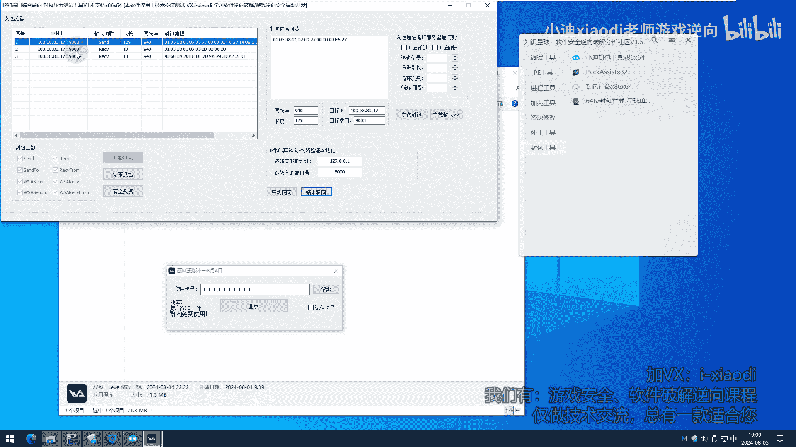

上一节我们通过界面做了初步判断，本节中我们来看看如何用封包工具抓取端口号。查看网络验证端口号时，使用工具包里的封包工具。点击封包工具，找到对应工具，在里面往下拖，找到目标程序“巫妖王”，然后鼠标右键点击注入 DLL。这里要先确认程序位数。刚才其实已经看过，但可以再看一眼。它是 32 位 PE 文件，所以要用 x86 版本；64 位 PE 文件则用 x64 版本。这一点要记录：x32 程序用 x86 工具，x64 程序用 x64 工具。

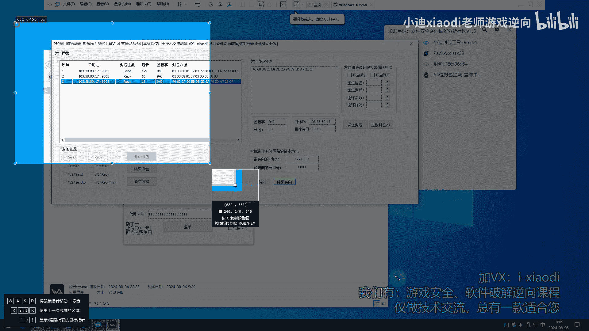

因为它是 x32 程序，所以使用 x86 版本，双击打开即可，然后关掉。接着点击开始抓包。这个时候可以随便输入一些内容，然后点击登录。程序提示卡号不存在，同时可以看到它连接的端口号是 9003。9003 这个端口要熟悉起来。发现端口号是 9003 后，就可以进一步判断它是什么盾。结合前面的界面和源码特征，它是一只盾，也就是异之盾这一类。

以下是抓包时需要记录的关键信息：

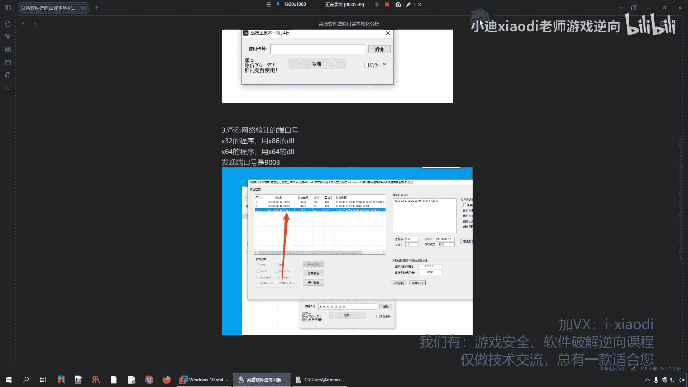

```text
目标程序：巫妖王
程序位数：32位PE
使用工具：x86版本封包工具
抓包操作：开始抓包 -> 随便输入 -> 点击登录
返回提示：卡号不存在
连接端口：9003
```

知道端口是 9003 后，下一步就可以去下载相关源码，确认这个端口是不是异之盾的默认端口。

## 📦 逆向外挂卡密软件全流程：04：下载异之盾源码并确认默认端口

上一节我们抓到了端口 9003，本节中我们来看看源码里如何确认这个端口。遇到这种盾，建议学习一下 E 语言，或者把 E 语言下载下来。然后去下载异之盾的源代码，也可以下载各种叉叉盾的源代码。比如打开卡模式登录例子，双击查看，瞅一眼。查看驱动部分和登录部分，可以看到代码结构基本一样。点击登录，就能看到代码怎么写的。异之盾默认端口就是 9003。现在已经知道异之盾默认端口是 9003，那么基本也能判断这个程序就是异之盾程序，因为界面也基本一模一样。

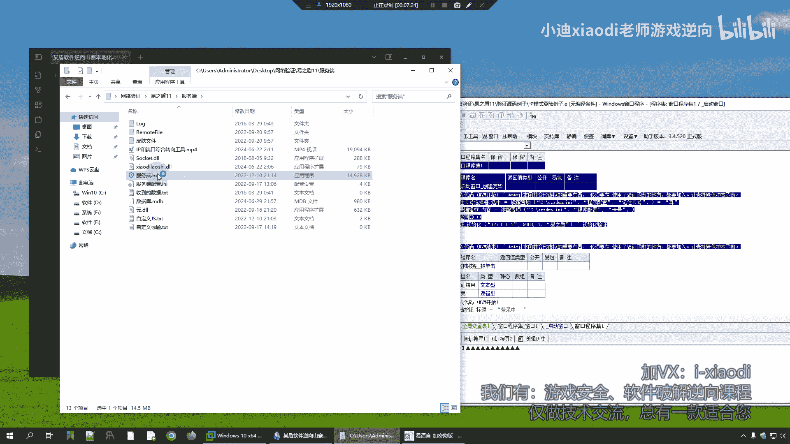

以下是源码确认时需要观察的内容：

- 下载 E 语言或相关源码环境。
- 下载异之盾源代码。
- 打开卡模式登录例子。
- 查看驱动部分和登录代码。
- 点击登录查看代码逻辑。
- 确认异之盾默认端口为 9003。

确认它是异之盾后，接下来就进入山寨本地化流程。本地化需要服务端和软件名等信息，下一节先看服务端。

## 🗄️ 逆向外挂卡密软件全流程：05：准备服务端并理解本地化所需信息

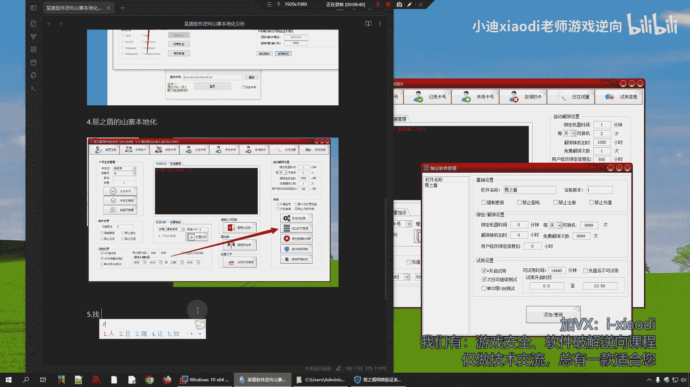

上一节我们确认了异之盾默认端口，本节中我们来看看山寨本地化需要哪些东西。接下来就是山寨流程，也就是异之盾山寨本地化。做山寨本地化需要什么？先去看服务器。这个软件作者提供了一个服务端，运行起来后可以看到默认端口是 9003，这就是服务端软件。服务端可以生成卡号，也可以管理版本号和独立软件管理。这些内容后面会单独发给你。

对于一个程序来说，它想连接服务器，比如这个客户端想连接服务端，就需要提供准确的信息。一般来说需要提供准确的版本号，还需要软件名字。软件名字在哪里查看？在独立软件管理里。这里要截图记录，独立软件管理是最重要的。点开独立软件管理，里面还没有软件名。现在还不知道软件名，但本地化需要软件名，所以下一步要用 OD 或 DBG 这类调试器去找软件名。

以下是本地化前需要明确的信息：

```text
服务端默认端口 = 9003
客户端连接服务端需要：
1. 准确的版本号
2. 软件名字
软件名字位置 = 独立软件管理
```

服务端准备好后，软件名还不知道，所以下一节用调试器搜索字符串，尝试找出软件名。

## 🔍 逆向外挂卡密软件全流程：06：用调试器搜索软件名“通用卡”

上一节我们知道了本地化需要软件名，本节中我们来看看如何通过调试器找软件名。先把之前的窗口关掉，重新运行程序。然后点击调试工具，找到 x32DBG。点击文件，点击附加，找到“巫妖王”，点击附加。窗口有点小，可以按住 Ctrl 键，再滑动鼠标滚轮放大。然后点击符号，双击“巫妖王”。接着鼠标右键点击搜索，点击当前模块，点击字符串。这样就会搜索当前模块的字符串，有概率把软件名字搜出来。现在耐心等待，稍等一下，已经开始出现一些内容。

放大后可以看到一些关键字符串。这里看到一个网址：群点 8047167 点 XYZ。看到这样一个网址，就要想到去看源代码。查看异之盾源码时，可以看到网址最终会被解析成一个 IP 地址。网络验证要连接时，就需要一个 IP 地址，域名在这里充当 IP 地址的作用。紧接着后面是端口号、默认版本号和软件名。既然这里有一个域名，那么旁边必定有一个软件名字。所以看到“通用卡”这个东西时，就要想到它极大概率就是软件名。因此初步猜测“通用卡”就是软件名。记录一下：软件名是通用卡。找软件名的方法就是搜索字符串，然后点击引用过来查看。在这里截图记录软件名。

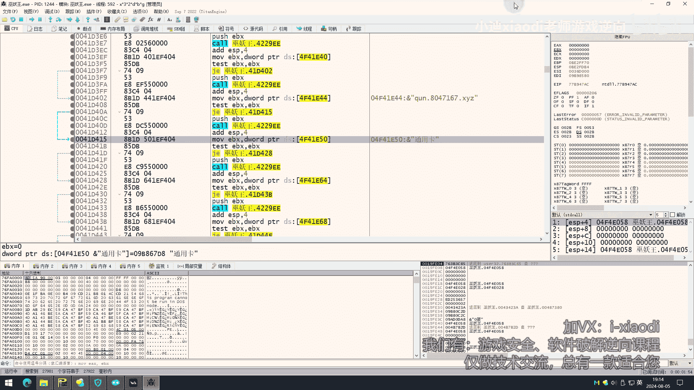

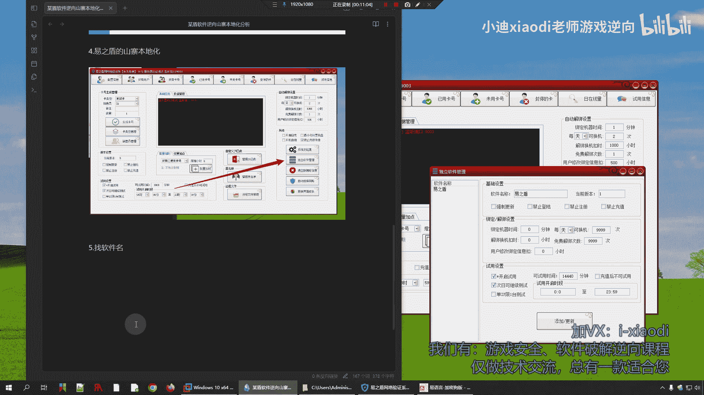

以下是本节搜索与记录的关键点：

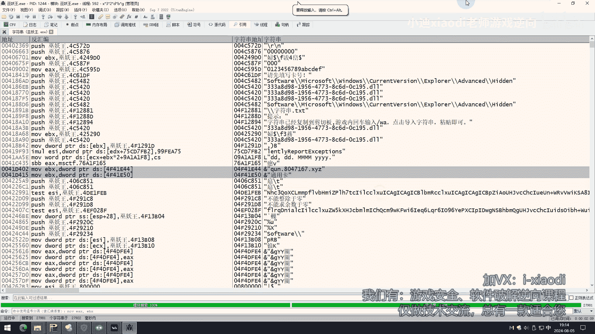

```text
调试器：x32DBG
操作：文件 -> 附加 -> 巫妖王 -> 符号双击 -> 右键搜索当前模块字符串
发现域名：群点8047167点XYZ
域名作用：最终解析为IP地址
邻近信息：端口号、默认版本号、软件名
初步判断软件名：通用卡
```

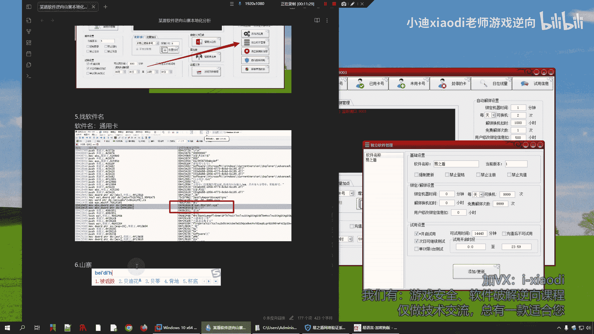

完成软件名确认后，就可以开始山寨本地化实战。下一节会从服务端添加软件、生成卡密开始操作。

## 🧪 逆向外挂卡密软件全流程：07：山寨本地化实战之添加软件与生成卡密

上一节我们找到了软件名“通用卡”，本节中我们来看看如何在山寨服务端里添加软件并生成卡密。先把这个程序关掉，全部关掉，重新来一遍。假如没有“通用卡”这个软件，就鼠标右键删除，更新一下，删一下。现在没有这个软件了怎么办？很简单，先运行服务端 exe，服务端配置全部默认，不用管。运行之后啥也没有，点击独立软件管理，在这里输入“通用卡”，开启试用，然后直接点击添加。这样“通用卡”这个软件就添加进去了。

添加进去之后，点击卡类型管理，在这里添加一张“通用卡”的卡密。卡类名称填“通用”，价格随便填 1111111111，卡类时间填 11 个小时，卡位前缀给一个 TY，附加属性不用管，绑定数量填 1，附加属性填 1，无卡选项不用管。配置大概就是这样，然后点击添加。现在“通用卡”就上去了，显示加 11 小时。接着在卡类型里选择“通用卡”，找到通用卡销售员，销售员可以用老板号，生成数量填 5，然后点击生成卡号。提示保存时点击取消，不用保存到本地，再点击所有卡号，这样通用卡的卡密就生成出来了。

以下是生成卡密时的操作清单：

- 运行服务端 exe，配置保持默认。
- 打开独立软件管理。
- 输入软件名“通用卡”。
- 开启试用并点击添加。
- 打开卡类型管理。
- 卡类名称填“通用”。
- 价格随便填 1111111111。
- 卡类时间填 11 小时。
- 卡位前缀填 TY。
- 附加属性不用管，绑定数量填 1，附加属性填 1。
- 点击添加。
- 卡类型选择“通用卡”。
- 销售员使用老板号。
- 生成数量填 5。
- 点击生成卡号，取消保存到本地，再点击所有卡号。

卡密生成后，下一节就要把客户端的数据转向本地服务端，让登录请求由我们自己的服务端处理。

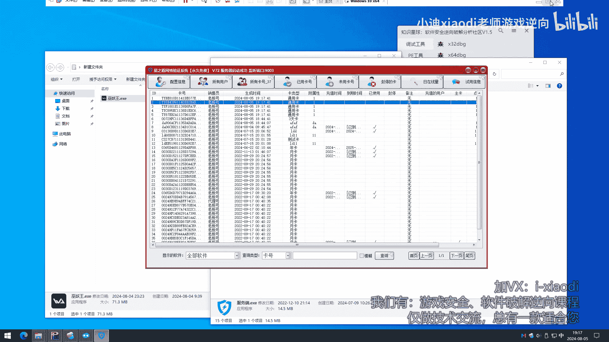

## 🔁 逆向外挂卡密软件全流程：08：启动本地转向并完成登录

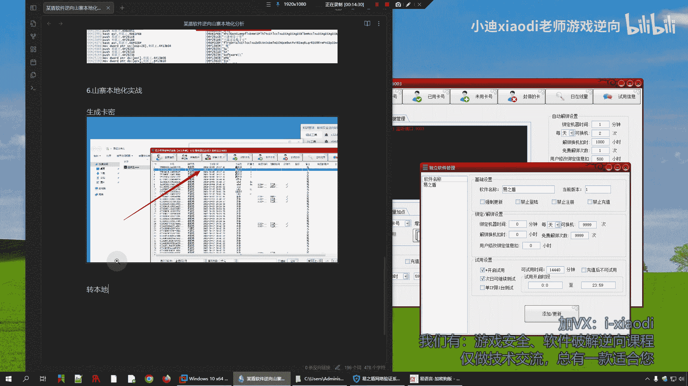

上一节我们生成了卡密，本节中我们来看看如何把程序转到本地服务端并登录。转本地要用工具。先运行目标程序，打开工具包，点击封包工具，找到对应工具。程序已经运行后，找到“巫妖王”，可以鼠标右键刷新进程，然后右键注入 DLL，选择 x86 版本，注入成功。接下来非常关键，把这个窗口关掉，文件夹最小化。端口是多少？端口是 9003。IP 不用改，使用本机 IP 127.0.0.1。端口改成 9003，然后点击启动转向。

这里注意：如果没有启动转向，鼠标右键复制卡号并点击登录，会提示卡号不存在。接下来启动转向本地，也就是让软件的所有数据都交给本地服务端处理。点击启动转向，看到开启成功。然后点击登录，就能登录上。送多少时间？送 11 小时，本来就是送 11 小时。查看已用卡号，卡号前缀是 TY，这个卡号已经用了。卡号还可以增减时间，比如增加 9999 小时，到期时间会到 2036 年。界面没有及时更新不用管，重新来一遍即可。

以下是本地转向与登录的关键配置：

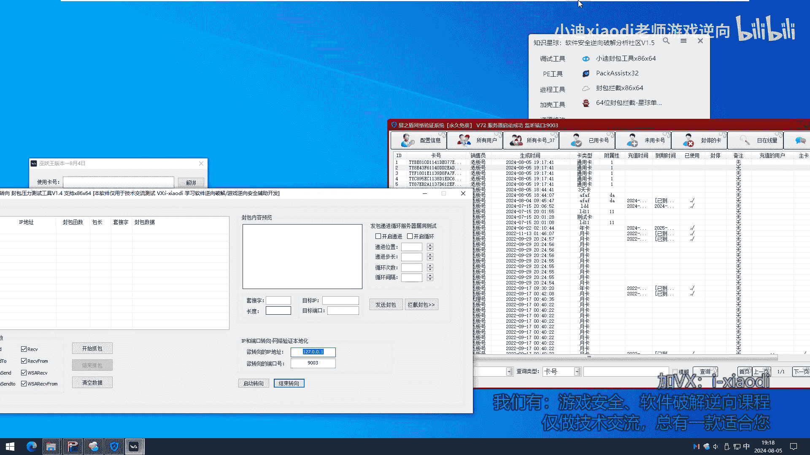

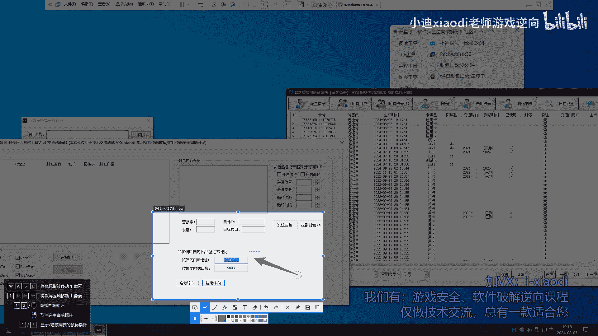

```text
本地IP = 127.0.0.1
端口 = 9003
操作顺序：
1. 运行目标程序
2. 封包工具注入x86版本DLL
3. IP保持127.0.0.1
4. 端口填9003
5. 点击启动转向
6. 点击登录
```

完成登录后，下一节重新验证时间修改效果，并观察程序加载和设置情况。

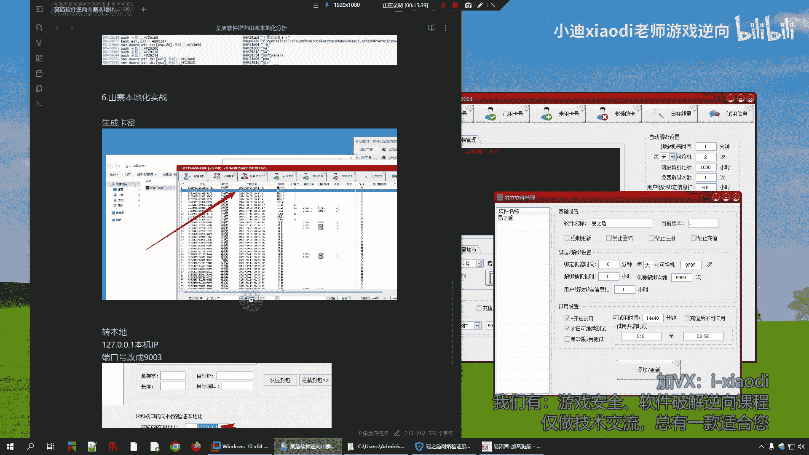

## ⏱️ 逆向外挂卡密软件全流程：09：修改时间并验证本地化效果

上一节我们完成了本地登录，本节中我们来看看修改时间后的验证效果。重新来一遍：运行软件，刷新“巫妖王”，注入 x86 版本，端口保持 9003，点击启动转向。然后还是使用刚才那个卡密，点击登录，可以看到显示 4167 天 1 小时 58 分 56 秒。这个时间就是增加 9999 小时后的效果。接着点击启动一键红，程序开始加载，等待与服务器通讯。查看设置，没有什么问题。整体大概就是这个样子。

以下是验证时需要观察的结果：

```text
时间修改公式：
到期时间 = 当前时间 + 9999小时
验证显示：4167天1小时58分56秒
启动一键红后：开始加载并等待通讯
设置检查：无明显问题
```

到这里，本地化登录和时间修改的基本效果已经验证完成。最后还要说明风险和使用注意事项。

## 🧾 逆向外挂卡密软件全流程：10：风险提示与课程总结

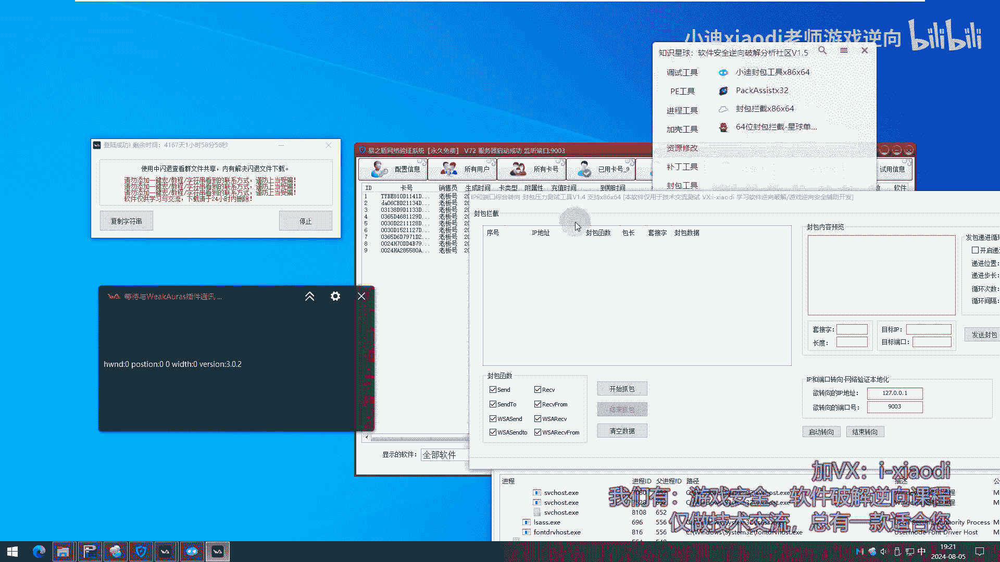

上一节我们验证了本地化效果，本节中我们来看看风险提示和整体总结。这个程序里还留有微信等联系方式，自己用比较好，但留下微信风险比较大。整个视频流程比较清晰，从第一步到最后一步的分析逻辑都是这样。一定要多看多练，见得多了自然就熟悉了。这个视频到这里就结束了。

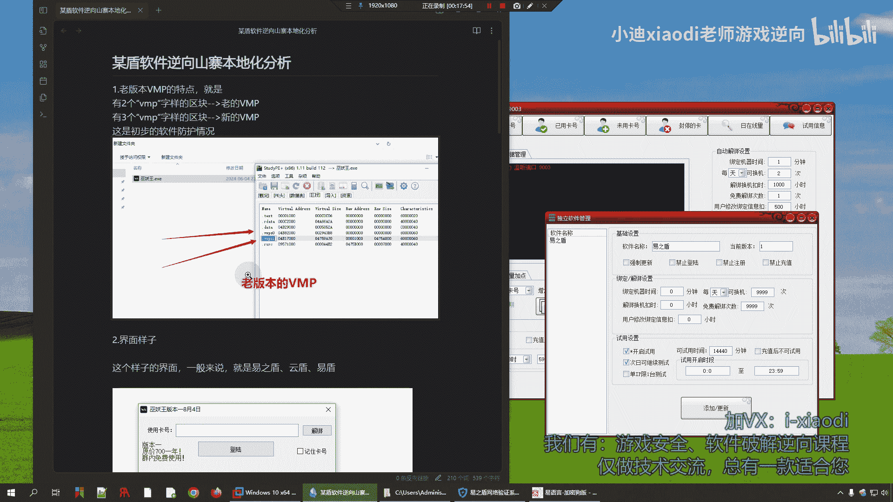

本节课中我们一起学习了逆向外挂卡密软件的完整分析流程：先用 s大PE 查看区段，通过两个 VMP 区段判断老版本 VMP；再运行程序观察界面，初步判断网络验证类型；接着用封包工具抓包，确认端口为 9003；然后下载异之盾源码，确认默认端口；之后准备服务端，理解客户端连接需要版本号和软件名；再用 x32DBG 搜索当前模块字符串，找到软件名“通用卡”；随后在服务端添加软件、生成 11 小时卡密；最后通过封包工具注入 x86 版本 DLL，把 IP 设置为 127.0.0.1、端口设置为 9003，启动本地转向并完成登录，还验证了增加 9999 小时后到期时间显示为 4167 天 1 小时 58 分 56 秒。整个流程的核心是逐步确认特征、找到关键信息，再用本地服务端替换原验证流程。再次提醒，这些技术只应在合法授权和网络安全学习环境中使用。

