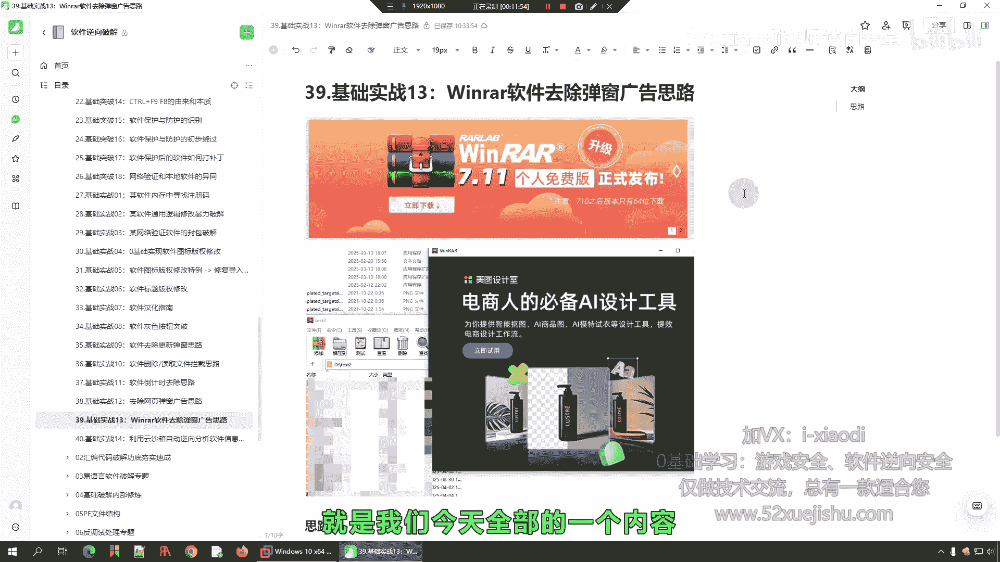

## WinRAR弹窗广告逆向分析实战：01：课程概述与软件行为观察 🧭

在本节课中我们将要学习WinRAR弹窗广告的逆向分析思路，对应视频编号BV1kLdqYXEay-，内容标签包括2025软件黑客、逆向破解、网络验证、Crackme、山寨、封包等方向。课程重点不是做破坏性破解，而是从技术交流的角度观察软件行为、定位弹窗相关接口、使用调试器下断点、通过调用堆栈找到关键跳转，并修改标志位实现广告弹窗绕过。WinRAR是一款优秀的压缩解压缩软件，并且提供个人免费版，因此不需要大费周章地做破坏性破解技术。我们只是基于技术交流的理想信念，分享去除弹窗广告的思路以及实现细节。本节先观察软件的大概行为，为后续下断点做准备。


> 本课程内容仅用于技术交流与学习，不鼓励对软件进行破坏性破解。

上一段说明了课程目标，下面列出本课程需要先明确的几个边界和观察重点。

- 只讨论去除弹窗广告的分析思路和实现细节，不展开破坏性破解。
- 先观察软件运行后打开了哪些窗口，再决定后续调试方向。
- 广告窗口与浏览器广告弹窗不同，需要从应用程序自身窗口入手分析。

明确这些边界后，我们进入软件行为观察。现在已经下载好软件，找到安装路径并运行。运行起来后，首先会弹出原生的功能窗口，这个窗口就是软件的功能窗口，用来执行压缩和解压缩等相关功能。


同时，软件还会打开一个非常大的广告窗口，这个广告窗口应该就是软件靠广告挣钱的方式，因此我们仍然只做技术交流。这个广告窗口肯定是跟应用程序窗口一致的，都是程序自己的窗口，它不是一个浏览器。如果是浏览器广告，软件通常会打开微软浏览器或者谷歌浏览器之类的浏览器，所以它跟浏览器那种广告弹窗截然不同，它是内置的应用程序窗口。

广告窗口里会显示具体广告内容，例如“100万高清视频”。关掉广告再运行，广告内容可能变成“de一波se电脑版”这类内容，这种广告内容肯定是假的。广告区域点一下会打开一个网页，因此初步分析这个广告应该是一个网页或者一个图片链接。总之它肯定是靠动态链接去调整的，因为每次打开都不一样，所以它肯定也是有一个链接的。现在广告又显示“电商人的必备AI设计工具”。这就是大概的软件行为。

观察到这里，下一步自然会想到：软件要弹窗，就应该去调用某种接口。下面列出本课程接下来要围绕的核心问题。

- 软件弹窗会调用怎样的Windows API。
- 如何用调试器在接口调用处中断。
- 如何从调用堆栈回到程序自身的逻辑。


第一节我们观察了软件行为，本节中我们来看看弹窗背后的接口。之前讲到过Windows API，API全称是Application Programming Interface，也就是应用程序编程接口。程序员想要实现相对应的一些功能，例如要载入窗体，就需要调用相对应的Windows API或者应用程序编程接口。载入窗体常见的接口有两个，一个是CreateWindowExA，一个是CreateWindowExW。通过测试，这个软件实际应用的是W版本。大家可以自行下载去测试，后续也可以带大家操作一遍。


下面用代码表示这两个常见接口的名称，方便初学者先记住目标。

```c
HWND CreateWindowExA(...);
HWND CreateWindowExW(...);
```

明确目标接口后，我们进入正式分析。首先要确定软件的位数，用PE查看工具把程序拖过来，可以看到它是64位PE文件，因此要选择x64dbg，因为x64dbg对应64位PE文件。然后打开x64dbg。这个软件是在执行过程中弹窗，不是在运行一段时间后才弹出来，所以要做简单设置：点击选项，勾选入口断点，让程序刚开始加载时先中断下来，这样就有机会下断点。

在正式下断点前，先把之前所有的断点清空，删除全部。因为之前可能有一些断点，为了保证视频演示的原始性，需要把断点清掉，然后从头开始。下面列出这一阶段的调试准备步骤。

- 用PE查看工具确认程序是64位PE文件。
- 选择x64dbg打开程序。
- 在选项中勾选入口断点，让程序启动时先中断。
- 清空已有断点，保证从干净状态开始分析。

调试准备完成后，我们来看看如何通过断点判断软件调用了哪个接口。先对CreateWindowExA下断点，目的是带大家从零体验逆向分析流程。在接口位置按F2打一个断点，可以看到断点变成红色就表示打上了，然后运行程序。程序跑起来后并没有中断下来，说明这个程序并没有调用CreateWindowExA这个接口，因此把程序关掉即可。接着再拖过来，对CreateWindowExW下断点，按F2打一个断点并运行。可以看到程序中断下来了，程序状态是已暂停。

这个中断说明软件确实调用了W版本接口。软件的执行流程是先把主窗口或者功能窗口加载出来，然后才加载广告窗口，所以需要不停点击运行，直到功能窗口先加载出来，才具备观察广告窗口的时机。点击过程中功能窗口还没有出来，继续点击，数到三二一后功能窗口出来了，这一步并非严格推导，而是凭经验尝试点出来的。功能窗口出来后程序依然是中断的，因为它即将要弹广告窗口，这说明弹窗具备一个流程，也具备先后顺序。

上一节我们介绍了如何用断点确认接口调用，本节中我们来看看如何定位广告窗口的具体调用位置。继续点击运行，再点击运行，注意观察界面。这里可以看到类似网页广告的内容。接下来要看返回地址，界面上有“返回到”这一项，也就是说当弹窗执行完之后，它会返回到某个位置。可以看到它返回到这个位置，这里就是调用CreateWindowExW的一个位置。于是可以在这里打一个断点继续分析，这个位置可以看到类似9B754这样的地址。

同时还需要把刚才的CreateWindowExW入口断点去掉，因为现在已经找到一个关键点，其他断点暂时不管，就从这个关键点开始运行。程序中断到关键点后，点击调用堆栈。调用堆栈就是程序一层一层调用函数的记录，像顺着楼梯往回找。要看WinRAR这个模块，因为这个模块名跟程序名一致，说明程序自己的代码都在这个模块里面。调用堆栈里有些东西属于系统领空，系统领空的代码先不看，主要看程序自己的模块，而且最好偏外层去看。

上一节我们定位到了广告窗口调用点，本节中我们来看看调用堆栈与外层逻辑分析。下面列出从调用堆栈往外层分析时需要注意的点。

- 只重点关注与程序名一致的模块，例如WinRAR模块。
- 系统领空的调用先不作为主要分析对象。
- 从比较外层的调用关系里寻找关键跳转。
- 找到可疑跳转后，用断点验证它是否控制广告窗口。

在调用堆栈里继续往外层看，可以看到一些关键跳转。再看这一层，当某个call执行完之后，这里有一个跳转，这个跳转极可能是比较关键性的跳转。为了验证它，可以在这个跳转位置打一个断点，然后运行。先把这个程序关掉，重启一下，再运行，可以看到程序执行到这个跳转位置。此时可以通过修改ZF标志位去控制它的逻辑。

上一节我们验证了关键跳转，本节中我们来看看如何修改ZF标志位绕过弹窗。ZF是CPU里的零标志位，可以理解为记录上一次计算结果是不是0的小旗子，修改ZF后条件跳转的判断结果会发生变化，现在就可以跳过这个函数的执行。下面用公式和伪代码表示这一步的核心逻辑：条件跳转是否发生，会受到标志位影响。

\[
\text{条件跳转结果} = f(\text{ZF}, \text{其他标志位})
\]

```asm
; 条件跳转指令会参考ZF等标志位
; 修改ZF后，jz/jnz等条件跳转的判断结果会变化
jcc target
```


修改标志位并跳过函数执行后，再运行程序。可以看到程序此时运行起来了，而且没有广告弹窗，说明广告弹窗已经被绕过了。这就是绕过的方法。接下来复习一遍实现过程：首先要找到关键位置，关键位置不是一开始的入口处，而是前面定位到的调用位置。然后点击调用堆栈，这个程序是逐层执行的，所以要往外层去找那些最顶层的、控制程序执行逻辑的代码。程序是一个函数套着一个函数，当双击某个位置时，就说明我们是从对应的call里面执行出来的。双击这个位置，说明我们是从这个call里面执行下来的。这个call对应的就是广告逻辑，它刚好有一个跳转，可以跳过这个广告函数，因此可以更改这个跳转去实现广告弹窗的绕过。至于打补丁的具体做法，本节不讲，之前讲过其他程序的打补丁方式，本次仍然仅做技术交流。



上一节我们完成了广告弹窗绕过，本节中我们来做课程总结。本节课中我们一起学习了WinRAR弹窗广告的逆向分析思路：先观察软件运行后功能窗口和广告窗口的加载顺序，再根据弹窗行为想到Windows API中的CreateWindowExA和CreateWindowExW，确认软件实际调用W版本后，用x64dbg设置入口断点、清空断点并下接口断点，随后通过返回地址定位广告窗口调用点，借助调用堆栈逐层往外找到关键跳转，最后修改ZF标志位跳过广告函数执行，实现弹窗绕过。课程还强调了只做技术交流，不展开破坏性破解，也不展开打补丁的具体操作。大家回去之后可以自己实践一遍，下期再见。

