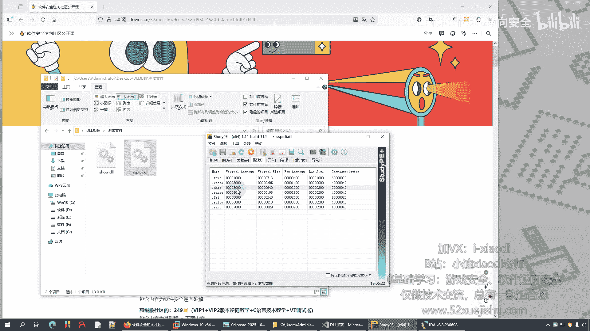
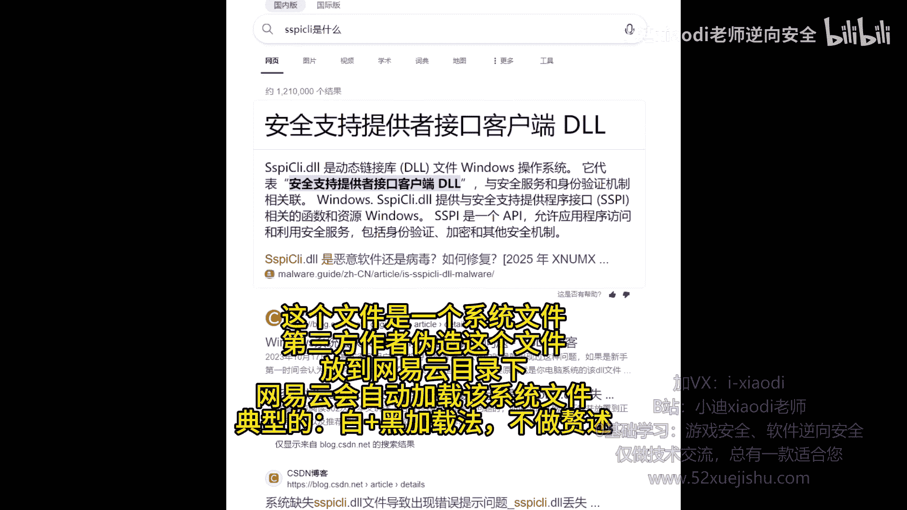
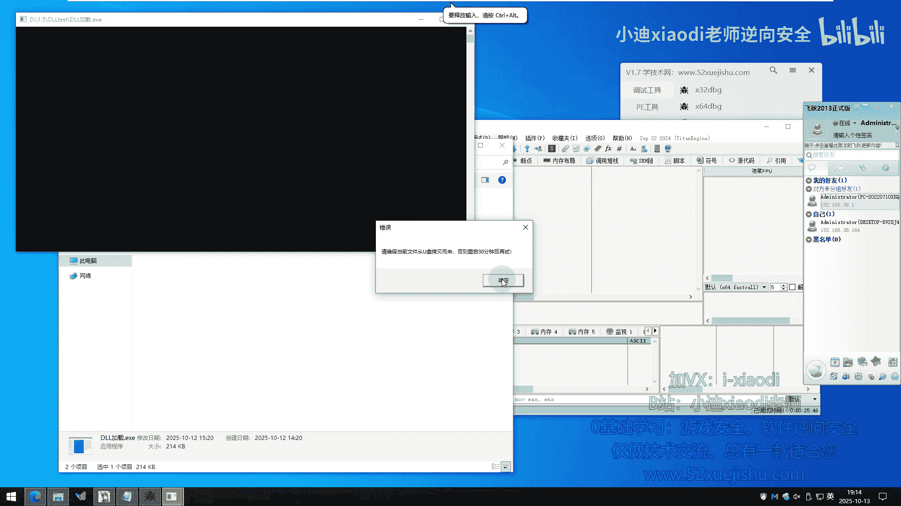
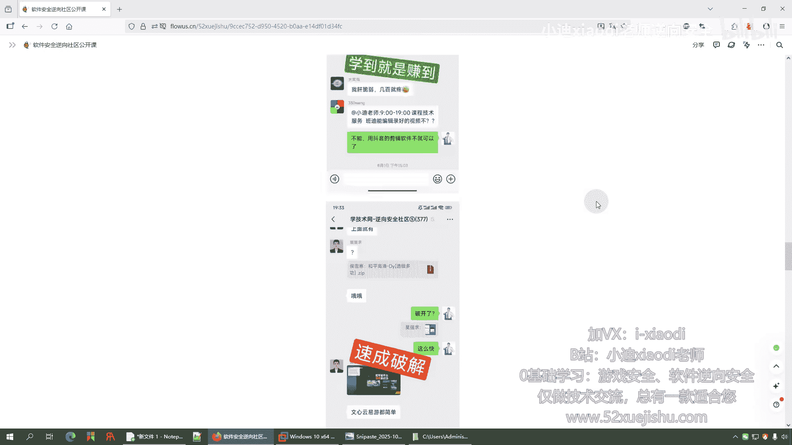

## 🧭 逆向破解实战：01：课程概述与目标

本节课程是软件安全逆向社区公开课，由小迪老师讲解，课程编号为BV1YW42zqEhb。课程分析一个依赖网易云程序运行的白加黑卡密软件，目标是绕过网络验证中的群验证。在本节课中我们将要学习样本文件分析、加载链定位、加载器伪造、群验证弹窗定位与绕过等内容。收到社区成员投稿，投稿内容说明两个文件需要放进网易云音乐目录，再启动网易云，网易云会替换成它的程序启动，启动后出现启动弹窗；软件登录时会验证微信是否绑定，注册时必须开启微信，每次登录也要开启微信，验证微信版本为3.9。本节实战的核心目标是绕过这个弹窗验证。下面先给出投稿中的关键信息，便于后续分析对照。

> 社区成员投稿内容为：两个文件需要放进网易云音乐目录，再启动网易云，网易云会替换成它的程序启动，启动后出现启动弹窗。软件登录时会验证微信是否绑定，注册时必须开启微信，每次登录也要开启微信，验证微信版本为3.9。

上一段交代了样本背景和验证条件，本节后续会围绕“两个文件如何配合运行”展开。为了把目标说清楚，以下是本课程要完成的任务列表。

- 分析投稿中的两个文件，确认它们各自的作用和加载关系。

- 确认网易云为什么会加载第三方文件，以及核心逻辑落在哪个文件。

- 编写或复现一个加载器，验证核心文件能够独立运行。

- 定位登录时的群验证弹窗，并通过调试跳过验证，观察后续提示变化。

完成这些任务后，就能理解这个白加黑卡密软件的运行方式，也能掌握群验证弹窗的基本绕过思路。下一节我们先从两个样本文件的外观和区段信息入手，看看它们分别是什么类型、是否有保护。

## 🔍 逆向破解实战：02：样本文件初步分析

上一节我们明确了课程目标和投稿信息，本节来看看两个文件的初步特征。先分析SSP文件：把它拖入分析工具后，可以看到它是一个64位P文件，区段正常，属于普通程序，没有明显保护。这个文件本身是系统文件，第三方作者伪造了这个文件并放到网易云目录下，网易云会按系统文件的方式自动加载它。这个现象说明加载入口可能被第三方文件接管，后续需要重点分析SSP的行为。以下是SSP文件的初步特征列表，便于快速回忆。

- 文件类型：64位P文件。

- 区段情况：区段正常，普通程序，没有明显保护。



- 文件身份：系统文件，但由第三方作者伪造。



- 放置位置：网易云目录。

- 加载方式：网易云自动加载这个系统文件。

SSP的初步特征说明它更像一个“入口壳”，真正逻辑可能还在另一个文件中。接着分析第二个文件：把它拖入分析工具后，可以看到区段里存在1233个异常区段，导出表里有两个用途不明显的函数，这两个函数应该是程序作者设置的两个函数。借助DIE工具进一步分析，发现保护器为VMpro，说明程序有保护，属于作者自己开发。此时需要思考两个文件如何运转，以及它们之间的加载顺序。一个推测是：SSP是第三方作者写的假系统文件，用来诱骗网易云加载SSP，SSP再主动加载受点DLL。这个推测是否正确，需要打开IDA分析验证。因为推测是SSP主动加载受点DLL，所以应优先分析SSP的行为逻辑。以下是第二个文件的初步特征列表，便于和后面的IDA结论对应。

- 区段情况：存在1233个异常区段。

- 导出表：有两个用途不明显的函数，应该是作者设置的两个函数。

- 保护器：DIE识别为VMpro，说明程序有保护。

- 开发来源：推断为程序作者自己开发。

- 待验证关系：SSP是否主动加载受点DLL。

到这里，样本外观分析已经完成，我们得到了“SSP可能是入口、受点DLL可能是核心”的推测。下一节将用IDA验证加载链，重点看SSP被网易云加载后到底做了什么。

## 🧩 逆向破解实战：03：加载链推测与IDA验证

上一节我们根据文件特征推测SSP会加载受点DLL，本节用IDA验证这个推测。将SSP拖入IDA，点击OK，等待分析完成，再按F5查看伪代码。分析后可以发现，SSP基本上只做一件事：当SSP被网易云加载后，它通过LoadLibrary函数进一步加载受点DLL，并从受点DLL中获取函数A的地址，然后执行这个函数。这个行为说明SSP只是加载入口，真正的核心文件是受点DLL，因此后续分析重点应放在受点DLL上。整个加载链可以用下面的公式描述。

```text
网易云音乐主程序 -> SSP（伪造系统文件） -> LoadLibrary("受点.dll") -> 获取函数A地址 -> 执行函数A()
```

从公式可以看到，SSP负责转接，受点DLL负责核心逻辑。为了便于初学者理解，以下是IDA验证后得到的加载链要点列表，后续伪造加载器会直接复用这些要点。

- 网易云加载SSP。

- SSP通过LoadLibrary加载受点DLL。

- SSP从受点DLL中获取函数A的地址。

- SSP执行函数A。

- 真正核心文件是受点DLL，所以分析受点DLL即可。

既然核心文件是受点DLL，就可以编写一个伪造的受点DLL加载器，直接调用受点DLL并执行函数A，用这种方式验证加载链。伪造思路是复制SSP中的调用代码，新建一个C项目，包含windows头文件，写一个函数，把代码添加到项目中，删掉不用的代码，格式化后生成加载器。生成成功后找到生成的文件，把文件发送到虚拟机分析。下一节进入虚拟机运行这个加载器，观察它是否能复现SSP的作用。

## 🛠️ 逆向破解实战：04：伪造加载器验证

上一节我们确认了SSP的加载链，本节编写并运行一个伪造加载器。按照前面的思路，复制SSP中的调用代码，新建C项目，包含windows头文件，写函数并加入代码，删除无用代码，格式化后生成。生成成功后找到文件，发送到虚拟机。虚拟机运行这个程序后，程序会调用LoadLibraryA函数加载受点DLL，作用和SSP代码一样，然后再执行函数A。加载器的核心调用可以用下面的代码概括。

```c
LoadLibraryA("受点.dll");
// 从受点DLL获取函数A地址后执行函数A
```

运行加载器后，首先出现启动弹窗。社区成员说明这个弹窗正常，可以无视，点击确定即可。随后程序开始执行，说明加载器没有问题，程序能够跑起来。为了验证登录流程，随便输入内容并点击登录，程序有短暂卡顿，随后提示“please enter group and try again”。这个提示说明存在群验证，可能是微信群之类的验证；从表现看这是一个信息框，后续可以通过MessageBoxA或MessageBoxW下断点并回溯分析。以下是运行加载器后观察到的现象列表，便于进入下一节定位弹窗。

- 启动弹窗出现，社区成员说明该弹窗正常，可以无视。

- 点击确定后程序开始执行，说明伪造加载器可运行。



- 输入内容并点击登录，程序有短暂卡顿。

- 出现提示“please enter group and try again”，说明存在群验证。

- 该提示是信息框，可通过MessageBoxA/W下断点回溯。

到这里，伪造加载器已经成功复现了SSP的作用，群验证弹窗也已经暴露出来。下一节将围绕这个信息框定位验证代码，并尝试修改跳转让登录跳过群验证。

## 🎯 逆向破解实战：05：群验证弹窗定位与绕过

上一节我们通过登录提示确认了群验证信息框，本节定位弹窗并绕过验证。先点击确定关闭提示，然后开始分析：点击文件，点击附加，附加到带有加载功能的主进程，因为这个主进程加载了受点DLL。附加成功后，跳转到MessageBoxA和MessageBoxW函数，分别打上断点。随后点击登录按钮，程序会中断下来，按Ctrl+F9，可以看到“please enter group and try again”提示，说明已经到达验证相关逻辑。点击确定，再按F8一下，当前位置就是弹出错误弹窗的位置。接着向上翻找，看是否存在可以跳过错误弹窗的跳转。向上查找后发现一个位置可以跳过弹窗，给这个位置备注“可以跳过”。然后在这个位置改成强制跳转，让程序直接跳过弹窗，运行起来观察效果。整个定位与绕过流程可以用下面的公式描述。

```text
登录 -> MessageBoxA/W 断点 -> Ctrl+F9 回溯 -> F8 定位弹窗 -> 向上找跳转 -> 修改为强制跳转（JMP）
```

为了把操作步骤讲清楚，以下是群验证弹窗定位与绕过步骤列表，每一步都对应前面的调试动作。

- 点击确定关闭提示，点击文件并选择附加。

- 附加到带有加载功能的主进程。

- 跳转到MessageBoxA和MessageBoxW，分别打上断点。

- 点击登录按钮，程序中断后按Ctrl+F9。

- 看到“please enter group and try again”提示，点击确定。

- 按F8一下，定位到弹出错误弹窗的位置。

- 向上翻找可跳过错误弹窗的跳转，并备注“可以跳过”。

- 将该位置改成强制跳转，运行程序。

- 先让启动弹窗走一走，再点击登录。

修改后运行程序，点击登录会提示“卡密不存在”，说明已经直接跳过群验证。再次点击登录并输入321，仍然提示“卡密不存在”，说明绕过群验证后的流程已经进入卡密校验阶段。以下是修改后观察到的结果列表，用于确认绕过效果。

- 点击登录后提示“卡密不存在”，说明群验证被跳过。

- 输入321后点击登录，仍提示“卡密不存在”。

- 本次实战的群验证弹窗绕过目标已经达成。

本节完成了群验证弹窗的定位和绕过，也观察到了绕过后的提示变化。下一节对整节课程做总结，回顾样本加载链和绕过思路。



## 📌 逆向破解实战：06：总结

上一节我们完成了群验证弹窗的绕过，本节回顾整节课程。本节课中我们一起学习了依赖网易云程序运行的白加黑卡密软件分析流程：先确认两个样本文件，SSP是第三方作者伪造的系统文件，会被网易云自动加载；第二个文件受点DLL存在异常区段和VMpro保护，是核心文件。随后通过IDA验证加载链为“网易云 -> SSP -> 受点DLL -> 函数A”，并编写伪造加载器验证核心文件能够独立运行。最后通过MessageBoxA/W断点、Ctrl+F9回溯、F8定位弹窗、向上查找跳转并改成强制跳转，成功跳过群验证，登录提示变为“卡密不存在”。如果希望学习更多软件安全逆向技能，欢迎加入软件安全逆向社区。我是小迪老师，下期再见。

