# 🔧 逆向软件破解基础教程：02：软件通用逻辑修改暴力破解

在本节课中，我们将学习软件通用逻辑修改暴力破解的分析方法。掌握该方法后，你就能理解常规软件暴力破解的核心思路。本次内容旨在强调汇编代码学习的重要性，同时演示如何通过分析关键跳转和修改代码逻辑，让软件始终走向成功验证的流程。如果你没有扎实的汇编基础，建议先补足再继续，否则你将无法从小白跨越到菜鸟，再从菜鸟成长为大佬。

## 🔍 一、观察：先看软件现象

破解的第一步不是动手，而是观察。观察的目的是了解软件在正常运行时的行为表现，这对后续判断关键代码位置非常重要。

假设我们有一款软件，我们运行起来后，屏幕上会弹出一个窗口。点击窗口最左边的按钮，就会进入今天要研究的核心区域，那里要求我们输入一串用户名和密码。输入完成后，点击检查按钮，程序会把用户名和密码的校验结果以弹窗的形式呈现，弹窗内容要么是成功，要么是失败。这个现象就是我们分析的起点。

## 💭 二、思考：分析行为背后的函数与流程

观察完现象后，我们就要开始思考。思考主要围绕几个方面展开。

### 程序调用了哪些Windows API函数

首先，我们要思考这个程序的行为调用了哪些Windows函数。比如，程序能读取我们输入的用户名和密码，那么它一定调用了获取编辑框内容文本的函数。又比如，按钮点击后会弹出结果窗口，那么它肯定调用了弹窗相关的函数。如果你对相关函数不太熟悉，可以借助 x32dbg 里的插件来辅助定位。

这个插件只能在调试过程中使用。操作步骤如下：

1. 用 x32dbg 附加这个进程。
2. 点击“符号”标签，切换到程序的主模块。
3. 点击“插件”菜单，找到 API 函数断点相关插件。
4. 点击设置断点，此时会弹出一个窗口，窗口里用中文注释了各种 Windows 函数对应的功能。

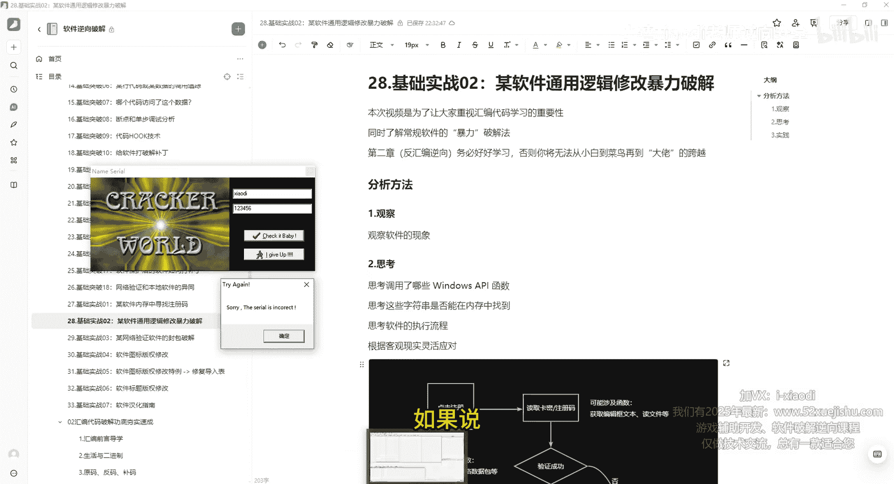

依据实际情况，我们可以为该插件设置对应的 API 断点。例如，如果程序会弹出对话框，那么可能与消息框相关；如果程序需要获取文本，那么大概率是获取控件文本相关。大家可以根据自己的场景做相应的尝试。

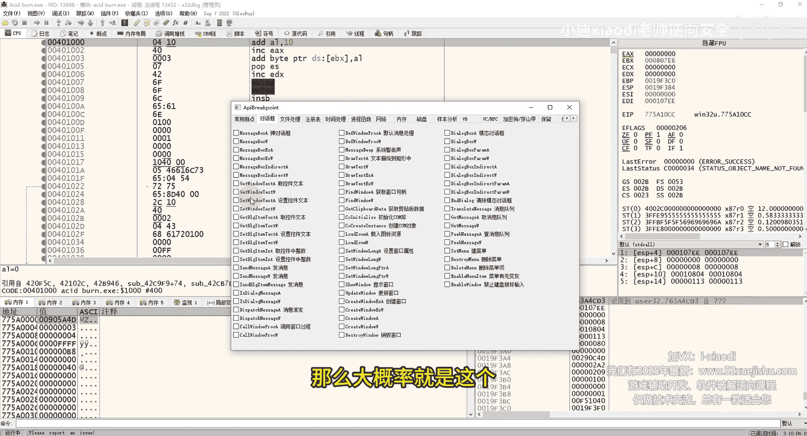

### 关键字符串能否在内存中找到

我们要思考的第二个问题是：软件中出现的字符串，能否在内存中找到？例如打开程序后，我们输入的账号和密码，能否在内存中被搜到？如果能搜到，后续有没有突破点呢？这一点之前已经讲过，这里不再赘述。而这次我们要尝试的是，弹窗中出现的提示字符串，能否在内存中找到。

每一次尝试都会带来新的机会，所以不要怕麻烦。如果字符串能被搜到，我们就可以通过它定位到关键代码区域。

### 软件的执行流程是怎样的

紧接着，我们需要梳理软件的执行流程。流程可以用以下伪代码来表示：

```text
点击按钮 -> 获取编辑框文本（卡密或注册码） -> 验证逻辑 -> 验证成功 -> 弹出成功提示
                                         \-> 验证失败 -> 弹出失败提示
```

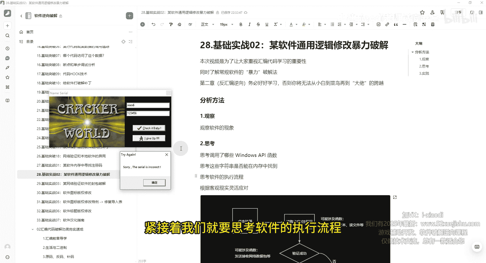

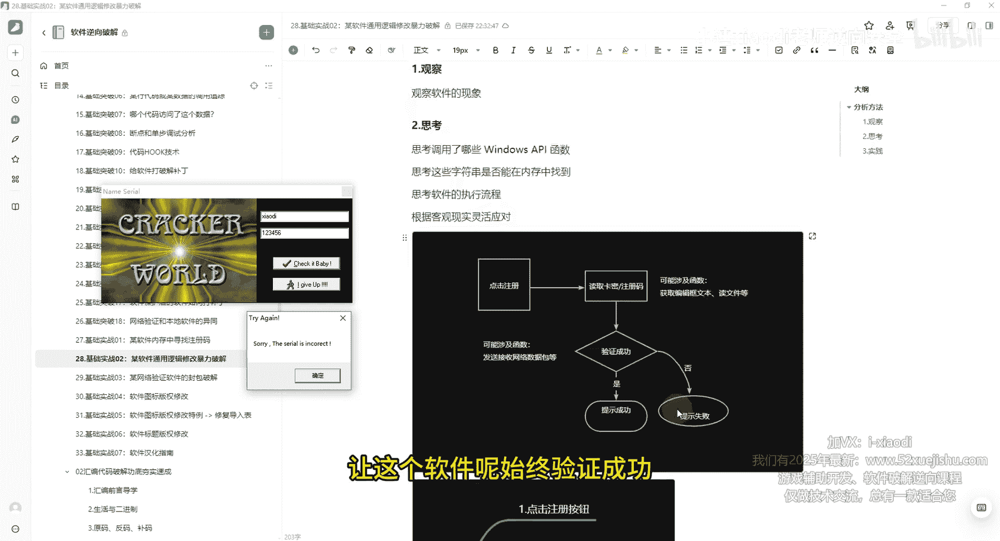

现在我们已经知道验证失败时的表现。通过绘制流程图，我们可以清楚地知道自己处于分析链条的哪一个环节，这样会让逆向分析更有方向感。一旦定位到当前环节，我们就可以通过技术手段回溯到上一层的关键位置，然后修改相关逻辑或重要数据，让软件始终验证成功，最终实现破解。

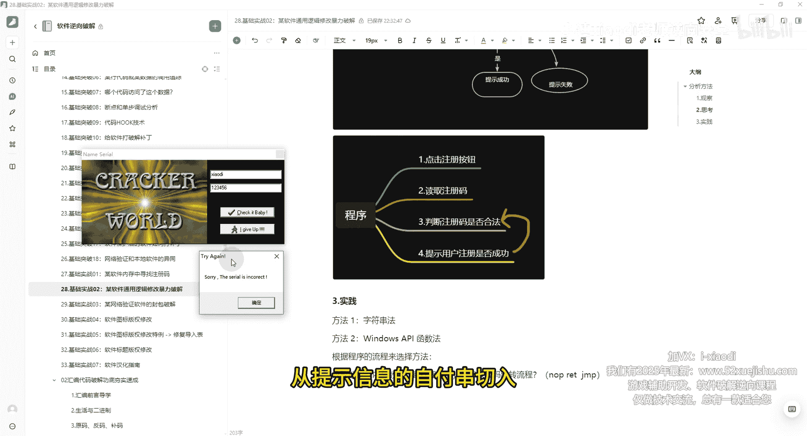

## 🔨 三、实践：两种暴力破解方法

思考清楚了，我们就趁热打铁，动手实践两种方法。这两种方法分别是“字符串法”和“Windows API函数法”。

### 方法一：字符串法

#### 搜索关键字符串

今天我们从提示信息的字符串入手。在 x32dbg 中，点击“符号”切换到程序的主模块，然后右键搜索当前模块的字符串。接着，因为提示信息是“sorry”开头的，我们直接输入 `sorry` 进行搜索。

搜索结果出现了两个地址。这里要特别说明一下：这两个地址虽然都指向同一个字符串，但调用该字符串的代码位置不同，所以我们需要挨个尝试。

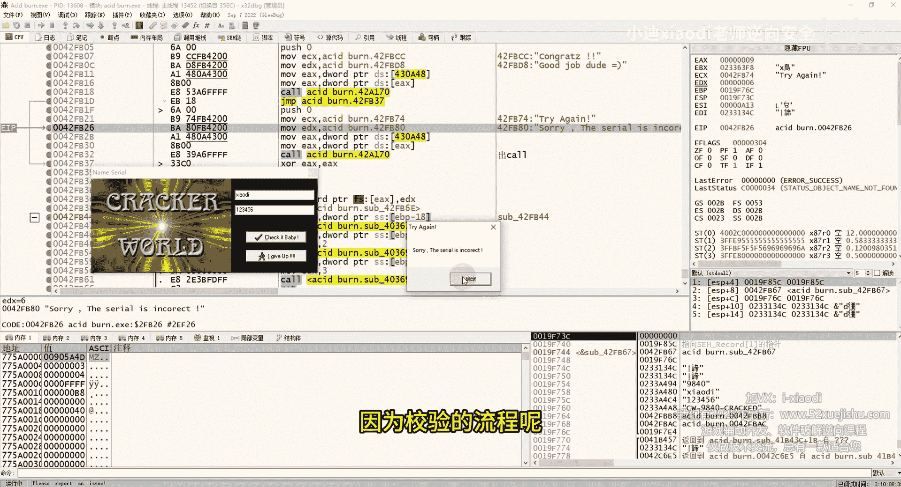

#### 第一处调用点

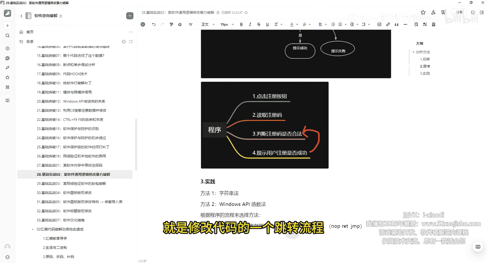

我们先来看第一处。双击跳转到第一处的代码位置后，按 F2 打下一个断点。然后点击程序中的按钮，观察弹窗时程序有没有中断下来。结果发现程序没有中断，这说明这段代码并没有被执行，也就是说第一处并不是我们的关键代码位置。

#### 第二处调用点

既然第一处不是，那么第二处就更有可能。我们在第二处按 F2 打上断点，再点击按钮，这次程序就断下来了。这说明第二处才是关键代码位置。因为校验流程的最终结果会走到这边的代码。

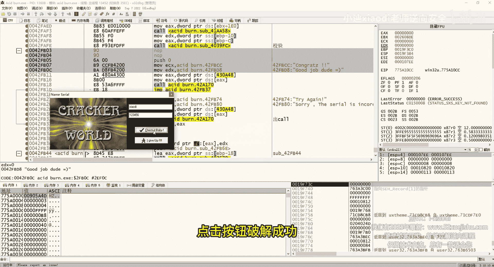

#### 修改跳转逻辑

找到关键位置后，我们可以根据程序的流程来选择破解方法。可以选择修改数据，也可以修改代码跳转流程。今天的场景比较适合第二种，也就是修改条件跳转。

我们来观察这段代码的上方，会发现这里恰好有一个条件性的跳转指令。这个跳转有两个去向：一个是跳到破解失败的代码位置，另一个则是落入成功代码的位置。那么，我们只要“干掉”这个条件跳转，让程序无条件地执行成功代码，就能达到破解效果。

具体操作是：在跳转指令上鼠标右键，选择“二进制”中的“用 NOP 填充”。NOP 是空操作指令，用 NOP 填充后，原来的跳转就被去除了，程序会自然向下执行成功流程。操作完成后，我们再点击按钮测试，弹窗直接显示破解成功。这就是字符串法的完整效果。

### 方法二：Windows API函数法

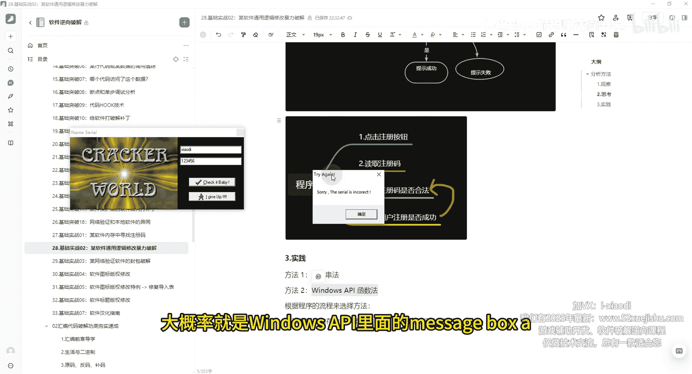

第二个方法是利用 Windows API 函数断点来定位。这个软件有弹窗，而弹窗大概率是调用了 Windows API 里的 `MessageBox` 函数。我们打开 x32dbg，点击“符号”，切换到程序主模块，然后按 Ctrl+G 输入 `MessageBox`，就会看到相关函数列表。我们点击 `MessageBoxA`，按确定，然后按 F2 打一个断点。

接下来点击程序中的按钮，程序就会在弹窗处中断下来。如果中断成功，就说明这个软件确实调用了该函数。中断后，我们需要返回到上一层，方法是按 Ctrl+F9 运行到函数返回处，再按 F8 单步返回到调用 `MessageBoxA` 的上一层代码。

#### 逐层回溯关键跳转

我们回到上一层后，先按 Ctrl+F9 执行到函数的末尾，此时弹窗会出现，我们点击弹窗，再按 F8 即可继续向上返回。可以看到，上面这一层确实就是刚才调用 `MessageBoxA` 的位置。接下来我们就观察这一层有没有关键跳转或关键逻辑。

如果没有发现，继续按 Ctrl+F9 然后 F8 再返回更上一层。更上一层依然什么也没有，那我们就继续往上回溯。终于，我们发现了一些端倪：上方出现了“成功”之类的提示字符串，而旁边还有一个跳转，这个跳转恰好能够跳到失败的位置。也就是说，只要修改这个跳转，就可以让程序不走失败分支。

#### 修改并测试

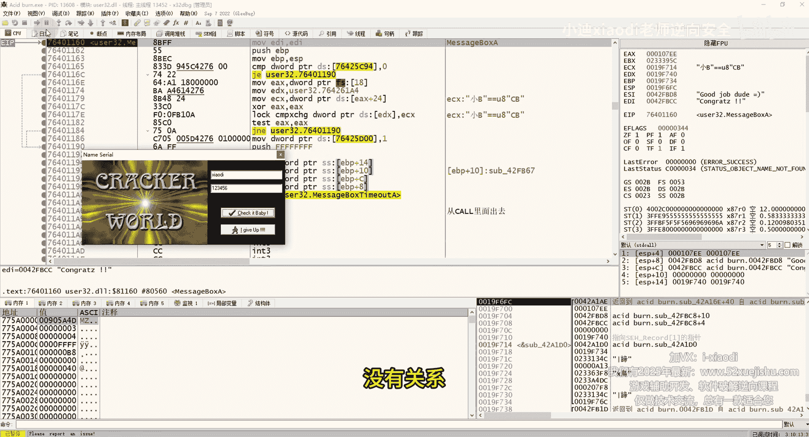

操作和之前类似：在跳转指令上鼠标右键，选择“二进制”中的“用 NOP 填充”。填充完成后，我们运行程序，点击按钮，虽然程序会先中断一次，没关系，继续运行即可。最终结果是，弹窗显示破解成功。

## 🧠 四、两种方法的关系与灵活运用

通过上面的实践，大家会发现这两种方法实际上是殊途同归的。它们最终都是要定位到关键分支，然后通过修改指令让程序走向成功路径。

但我们需要掌握它们各自的适用条件。字符串法并不是永远有效的，因为某些字符串可能是临时生成的，或者由服务器下发的，直接搜索根本搜不到。即使能搜到，搜索到的字符串也可能与代码没有直接调用引用关系。遇到这种搜不到或者搜不到关键引用的情况，我们就可以改用 Windows API 函数法。

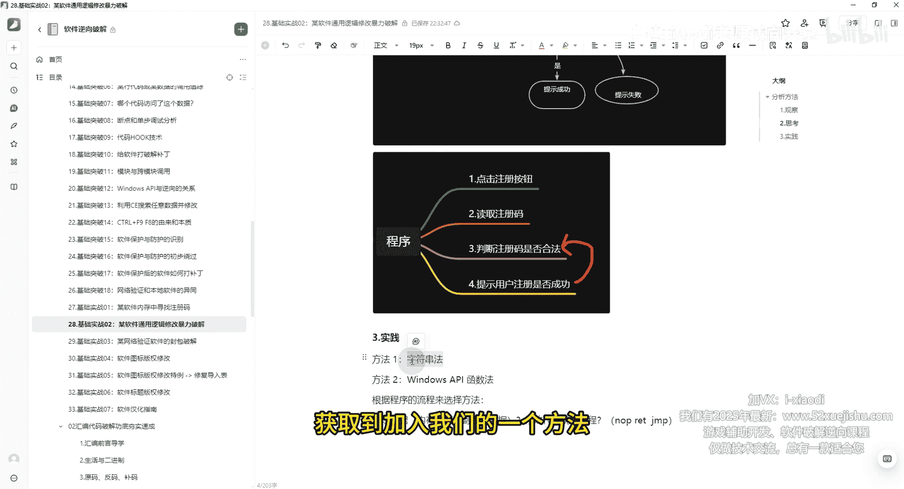

只要大家灵活运用这两种方法，就可以克服绝大多数软件验证逻辑带来的困难。本节课程的全部内容到此就结束了。本节课中，我们一起学习了软件通用逻辑修改暴力破解的两大核心方法，分别是基于字符串定位和基于 Windows API 函数定位，并且都通过修改关键条件跳转实现了破解。如果你对软件安全和逆向破解感兴趣，欢迎联系我们，你可以在评论区或者视频右下角获取加入方式。我们下节课再见。
