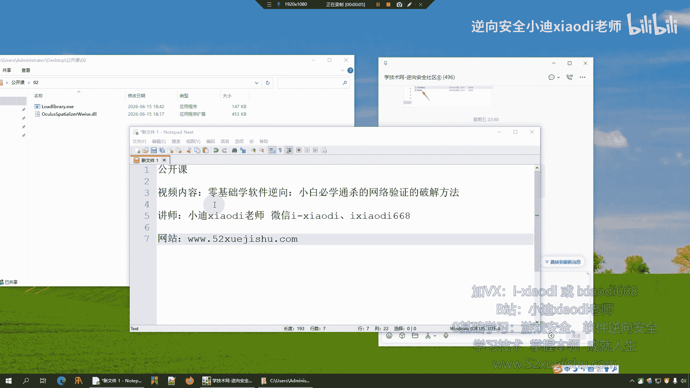
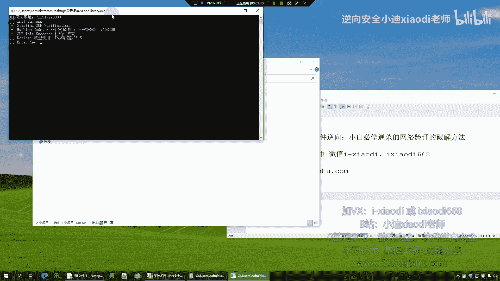
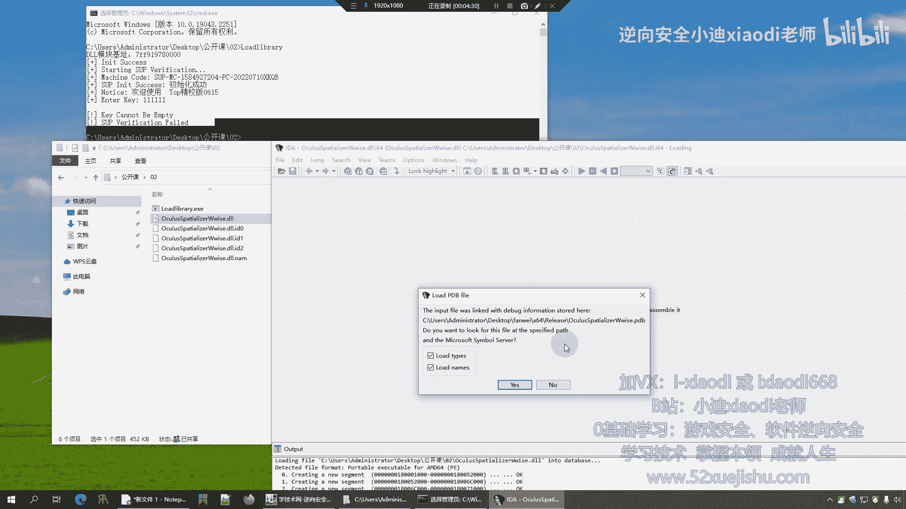
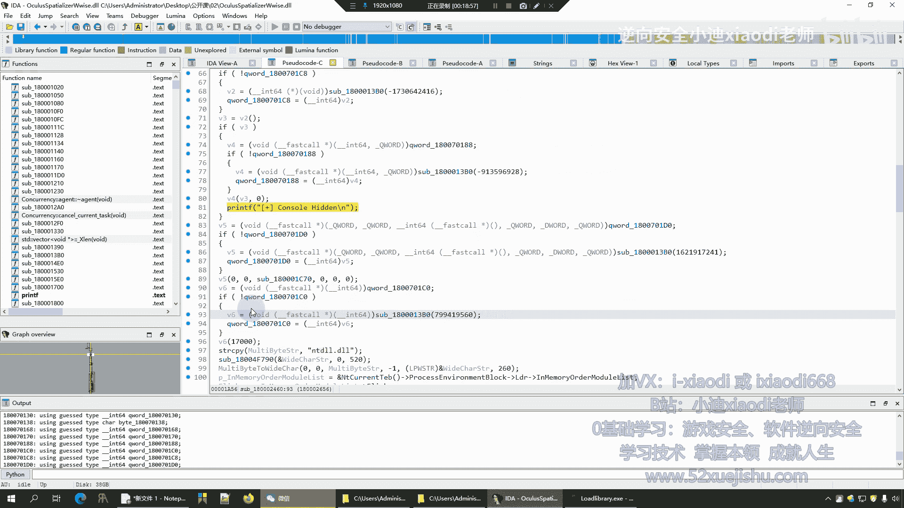
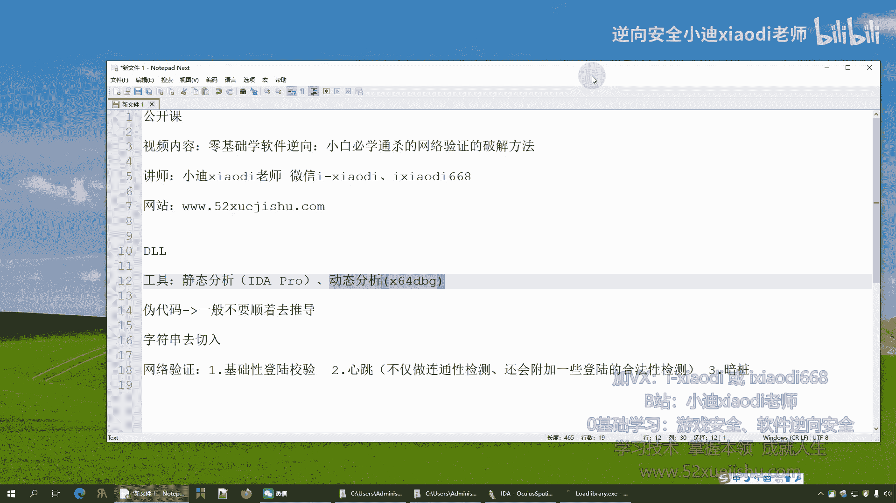

# 零基础学软件逆向：第1章：外挂卡密网络验证破解方法

## 🎯 课程概述

在本节课中，我们将学习如何破解一款三角洲游戏辅助外挂的卡密网络验证。这是一个公开课的视频内容，主要面向零基础的小白用户，让你掌握通杀的网络认证破解方法。我们会使用一个真实的案例，也就是前几天大家在群里交流的一款三角洲外挂程序，来演示完整的逆向分析过程。

需要说明的是，我（小迪老师）的电脑上没有安装三角洲游戏环境，所以没办法直接运行这个外挂来演示实际效果。不过没关系，我会给大家讲解一个完整的分析思路，大家在自己电脑上可以跟着去学习和操作。这个外挂的效果大概是一个范围攻击的功能，具体效果大家可以自己去看一下。

## 🔧 第1节：认识目标程序

拿到一个外挂程序，首先需要判断这个程序的基本信息和架构。那么第一步该怎么做呢？其实，拿到这种外挂程序，我们通常会用到一个叫做StudyPE（也就是starPE，应该是作者口误）的工具，去查看这个程序是多少位（32位还是64位）的应用程序。这个信息相当重要，因为它决定了我们要用什么样的工具去分析，以及后续的调试方式会有差异。

另外，我们还需要看这个程序有没有加防护壳，也就是常说的“加壳”保护。加壳是软件作者用来保护程序不被分析的一种手段，如果程序加了强壳，分析起来难度就会大很多。但这个外挂呢，它没有加任何防护，就特别适合新手小白进行学习。所以我们借助这样一个案例，让新手小白去掌握这些逆向分析的技能。

## 📂 第2节：加载DLL文件

这个外挂是以DLL（动态链接库）形式存在的，而不是一个独立的EXE程序。那么我们怎么去分析一个DLL程序呢？其实非常简单，不要被DLL这个形式吓到。

DLL本质上也是一种可执行程序，只不过这种可执行程序依赖于外部的EXE程序来加载它。DLL不能直接双击运行，需要由其他程序调用。因此，我们需要自己动手写一个小工具，去调用Windows系统提供的`LoadLibrary`这个函数。`LoadLibrary`就是专门用来加载DLL文件的系统API函数，通过它我们就能把DLL加载到自己的进程空间中，从而运行和调试它。

关于如何编写这个加载工具，课程里面都有详细的讲解，大家可以自己去看一下。这里我们就直接演示。我们把DLL加载进我们自己写的程序之后，就可以输入K（卡密）来验证了。

正常输入卡密的话，程序会给出一个提示然后退出，这一切看起来没什么问题。但如果你输入的内容特别长，程序会直接闪退。这就有意思了。为什么会闪退呢？这实际上是作者没有做输入长度的判断，导致缓冲区溢出了。一段输入数据超出了程序预留的存储空间，覆盖了内存中其他重要的数据，程序自然就崩溃了。这说明外挂作者的编程基础还有待提高。

除了用自己写的小工具之外，我们也可以在命令行中加载这个DLL。具体做法是，在相应位置输入`CMD`并回车，然后把DLL文件拖到命令行窗口中再回车。这样也能加载这个DLL程序。如果你用CMD这种方式来操作，就不会看到闪退的情况，原因在于我们打开的是Windows系统自带的一个控制台窗口，它会把完整的提示信息显示出来，这样我们可以更清楚地看到程序运行时的反馈信息。

## 🛠 第3节：静态分析与动态分析工具

分析外挂软件需要用专业工具，那么市面上常用的工具大致分为两类：一类是静态分析工具，另一类是动态分析工具。

静态分析工具的代表是IDA Pro。静态分析的意思就是你不需要运行这个软件，直接把程序文件丢进去，就能分析它的代码逻辑和结构。它直接从二进制文件中解析出程序的指令，是逆向工程中最常用的利器。

动态分析工具的代表则是x64dbg。动态分析就是把程序运行起来之后，动态地去调试和分析。在程序运行过程中去观察每一个步骤，区别在于你可以看到每一行代码在真实运行状态下的数据变化，比如寄存器里存了什么值、内存中的数据是什么、跳转是否生效等。这些信息可以非常直观地展示给我们，帮助我们理解程序的行为。

## 🔍 第4节：使用IDA Pro进行静态分析

我们先用IDA Pro来给大家分析一下这个外挂程序。打开IDA Pro，点击“GO”按钮，然后把目标DLL文件拖拽到IDA窗口中，点击OK。它会弹出一个提示，问你是否加载PDB文件。PDB是一个调试符号文件，我们在开发程序的时候通常都会生成那种文件。

借助这个提示，我们可以推导出外挂作者在开发这个程序时的项目位置和名称。大家可以看到，这里显示了外挂作者的盘符，然后是桌面（desktop），说明他是在桌面上新建了一个名称为“范围的文件夹”，然后在里面开发了这样一个外挂项目。因为我们拿到的是别人开发的软件，所以并没有它的PDB文件，这里直接点击“No”就可以了。

进入程序之后，首先映入眼帘的是`DLL Entry Point`。这个东西相当于程序的大门，我们分析的是一个DLL程序文件，它的大门就是代码起始的位置。接下来我们可以按F5键，直接看到一个伪代码。什么是伪代码呢？它并不是真实的原始代码，而是工具通过一系列推导给我们翻译出来的代码。它可以帮助我们快速了解程序的逻辑结构，而不用逐条去看汇编指令。

我们看一下这个伪代码，会发现这里有两个函数调用。首先看第一个调用，它大概是在获取系统时间相关的信息（`GetSystemTime`或者类似函数），并没有涉及核心外挂功能。核心逻辑应该在另一个调用里。我们回到主函数，会看到大概有三个函数调用。我们挨个看一下。

第一个被调用的函数比较可疑，因为它出现在一个条件判断语句里面。我们点进去看看，会发现里面又嵌套了好几个函数调用。这种嵌套调用层级比较深，直接顺着看下去会让人感觉一头雾水，很难分清哪一层是真正关键的部分。像这样直接顺着一个个函数追进去，看多了很容易迷路。其实碰到这种情况不用着急，记住一个原则：我们是在做逆向，逆向就要反着来。

既然要反着来，我们就需要一个切入点。最常用的切入点就是通过搜索字符串来定位关键代码。按`Shift + F12`打开字符串窗口，我们能看到程序中使用到的所有字符串常量。这里看到它的字符串列表相当丰富。

我们可以看到，其中包含可能用到的一些加密算法名称，还有个“SUP”字符串可能是某个网络验证平台的名称。相关的一些操作也能看到，比如“code”代表机器码，“card”是卡密相关的代码。这些字符串基本上是在拼接访问服务器的网址路径，还有“oftware”是软件版本信息。

再往下看还有大量关于网络验证的初始化和验证逻辑相关的字符串。找到这些关键字符串后，我们就可以选择其中一个作为切入点来深入分析。双击这个字符串，它会跳转到字符串在代码段中的地址位置。接着按`X`键查看这个字符串的交叉引用，即哪些代码地方用到了它。引用有很多个，我们通常挑选最上面的那个。

按F5查看伪代码，看看这段代码是如何调用这个字符串的。这个函数总体来说比较大，里面包含了“code”、“session token”、“card key”等很多参数，看起来是一个非常完整的卡密验证函数。接下来我们看看是谁调用了这个验证函数，同样有两个调用者，先看上面那个。

这样一路追查下去，就来到了`180`这个位置。再往前看，走到这里可以看到一个“success”和一个“message”字符串，这表明登录成功的分支在这里。这边还有个“heartbeat”字符串，也就是心跳。现在很多网络验证都有心跳机制。网络验证不仅要做基础性的登录校验，在登录成功后还会持续发送心跳包。

什么是心跳呢？拿我自己来举例子，我这会儿坐在电脑前给大家讲课，我是活着的，所以有心跳。有心跳就证明这个人活着。软件的心跳也是一样的道理，它用来表明你的连接是处于连通状态的。不过，这个心跳除了做连通性检测之外，还会附加做登录合法性的检测。也就是说，服务器会定期检查这个连接是否还是一个有效的、已获授权的会话。

所以这里我们就要留个神了：如果我们在登录上去之后，发现程序有二次校验，那就是心跳在搞鬼。像这种心跳检测，我们可以直接给它干掉了，它本质上是一种持续的验证机制。我们先不管这些，先往上看，看看它到底是怎么做校验的。继续往上翻，这里有一个调用，点进去之后看不太出来具体逻辑，再看它的引用，发现另一个位置也有一个调用。这个函数整体上也看不出太多信息。我们继续往上翻，找到最开始的验证位置。看到的这一段大概就是初始化的位置。因为这边有个`IP`相关的引用，这边还有一些类似软件编码、客户端编码之类的字符串常量。

面对一个未知的程序，我们的一个重要技能就是学会去猜测。这里基本可以断定是一个初始化的操作。网络验证的初始化操作，我们可以给它重命名，比如叫`INIT`。然后，再往下看，就看到了输入K的提示，然后读取我们输入的卡密。如果卡密为空，程序会提示“empty”。这个打印提示的操作在代码中出现了很多次，基本可以断定它是一个打印输出函数。我们可以给它重命名为`print`，方便后续浏览代码时更容易理解。

这里校验卡密为空，这边是“login failed”即登录失败。查看这个函数的名字，可以断定它是一个登录函数，即`login`。再往下翻，可以看到一个叫`heartbeat`的线程函数。这里应该是在创建线程，可能是创建一个后台线程的函数，我们给它起个名字叫`create_thread`。这里面就是线程的执行地址。也就是说，登录成功后会创建一个心跳线程来持续发送心跳包。

如果后期心跳导致连通性问题，比如掉线，或者说登录合法性校验失败导致程序退出，那该怎么办呢？解决办法就是把心跳检测干掉。干掉的方法其实非常简单，关键在于理解这段判断逻辑的写法。

先看它怎么判断登录结果的。它用了`if (!result)`这样的逻辑，也就是非操作。如果登录返回值是一个`0`，取非（取反）之后就变成`1`，条件成立，就会执行登出或退出操作了。如果登录的返回值是一个`1`，取反之后就变成`0`，条件不成立，就不会走退出的分支。所以无论如何，我们可以修改返回值：把`login`这个函数的返回值改成`1`，取反后为`0`，那么退出的代码分支就不会执行了。

那么如果它有心跳检测怎么办呢？也很简单，直接把心跳函数干掉就可以。让它不执行任何代码。如果心跳函数执行相关代码的话，里面可能会有`ExitProcess`这类调用的。`ExitProcess`就是结束当前进程的函数，会让程序退出。我们不想让程序退出，所以需要找到这个位置。这种在特定条件满足时让程序退出的逻辑，通常被大家叫做“暗桩”。暗桩就是程序里埋伏的一些意外退出或反调试的机制。

经过这些分析，我们心里大概就有谱了：先输入卡密，然后程序会调用登录函数进行校验。我们只要让它登录成功就可以了。登录成功之后，程序就会继续执行相关的外挂功能。然后它会走一个心跳相关的线程，但创建线程这个函数里没有其他的危险操作了，它只是调用了一个返回值之类的。看到没，没有其他隐藏逻辑。所以整体来说，这个外挂还是比较好处理的。

## 🐞 第5节：使用x64dbg进行动态分析

为了讲解得更全面一些，接下来我们再讲一下动态分析的方法。动态分析就是我们把程序运行起来，然后附加调试器去观察它的运行状态。

先把程序运行起来，然后打开我们的x64dbg调试器。点击“文件”，选择“附加”来附加到目标进程。附加成功之后，点击“符号”标签。因为我们要分析的是那个DLL，所以从符号列表里切换到目标DLL模块。然后按`Shift + F`去搜索某个关键字符串。

搜索到字符串之后，找到引用这个字符串的位置，按F2打一个断点。断点设置好之后，让程序跑起来，中断到断点位置，然后回车。好，现在程序就中断到断点位置了。

在x64dbg里逆向分析、调试和破解都是非常方便的。你看到代码里有一个跳转指令，我们需要想一下要不要让它跳。如果说不跳的话，程序就会提示“K can be empty”。如果说跳的话，它就会跳到另一个分支，接着执行。继续往下走，这里又出现一个跳转指令，我们要想一下要不要让它跳。如果不跳，它就会走到“login failed”失败分支。如果跳的话，就会跳到“login success”登录成功。这里肯定要让它跳的，我们要让程序走成功路径。所以在这儿就让它跳过去。

紧接着来到了下一步，到这一步我们可以和前面IDA里分析的结果进行对比。在IDA里，走到这个位置后，接下来的代码就要开始调用心跳函数了。这个心跳函数的地址是`21C0`，现在在x64dbg中也能看到这个地址。也就是说，接下来要开始执行心跳逻辑了。

那这个心跳怎么处理呢？我们直接把这个地址记下来，会发现心跳内部无非就是做一些判断：如果某些值不符合条件，就退出进程。它没有调用其他有危险操作的函数。所以心跳处理起来还是比较简单的。我们直接把这个心跳函数体全部清空掉。操作方式是：鼠标右键，选择“二进制”，然后用NOP填充。NOP是汇编语言中的空指令，执行它什么都不做，只是占一个位置。

这样整个函数就只剩下开头和结尾，中间的核心检测代码全部被填充成空指令了。填充完之后，心跳检测就形同虚设，我们可以放心大胆地让它执行了。好，那就让程序继续执行，看它会不会往下走。这时程序提示线程创建失败之类的小问题，不用管它，继续让它跳转就行，让它跳到执行成功的那条路上。

接着继续回车运行。好，这时候程序就运行起来了。不过你会发现，这个程序运行后隐藏了窗口，我们看不到了。这是怎么回事呢？这是因为程序自身有一段逻辑，当登录成功之后，它会隐藏自己的主窗口。这样一来，它就在后台默默运行外挂功能了。

我们来看看进程列表，可以看到这个程序还在正常运行，只是窗口隐藏了。这个程序仍然在正常运行，只不过缺少游戏环境，所以看不到实际的辅助效果。但毫无疑问，程序的核心逻辑已经成功跑起来了，破解的目的也就达到了。

## 📝 总结

本节课我们一起学习了零基础软件逆向中破解外挂卡密网络验证的完整方法。我们了解了静态分析工具（IDA Pro）和动态分析工具（x64dbg）的基本用法，掌握了通过字符串搜索定位关键代码的技巧，学会了分析登录验证和心跳机制的实现方式。我们还介绍了如何通过修改程序跳转逻辑或NOP填充关键函数来绕过验证，从而实现程序的破解。这个案例是比较适合新手入门学习的，因为它没有加壳且逻辑相对简单。通过这个案例，大家应该能掌握这种宏观分析的思路，在面对其他类似的软件时，也有一个基本的分析框架。这节课的内容就到这里，我们下期再见。
