# 🧭 零基础学软件逆向：01：课程概述与学习目标


在本节课中我们将要学习如何训练AI智能体来自动化做软件逆向，并整理一套初学者能看懂的流程。这个流程包括自动分析卡密程序、定位关键代码、识别成功失败分支、修补文件、用x32dbg重新加载验证，以及把类似思路扩展到游戏机制和关键寻址。课程对应的视频编号是BV14uja65E9q，标题还涉及二进制安全逆向、游戏安全、软件安全、网络安全、CTF比赛必备基础和封包技术，这些内容都属于后续可以继续深入的方向。


为了把目标说清楚，下面列出本节课的学习目标。


- 理解AI智能体在逆向分析中的定位：它不是替代人理解全部原理，而是模拟人手工分析并完成重复步骤。


- 掌握自动化逆向的基本流程：分析程序、找关键位置、识别分支、修补、重载验证。


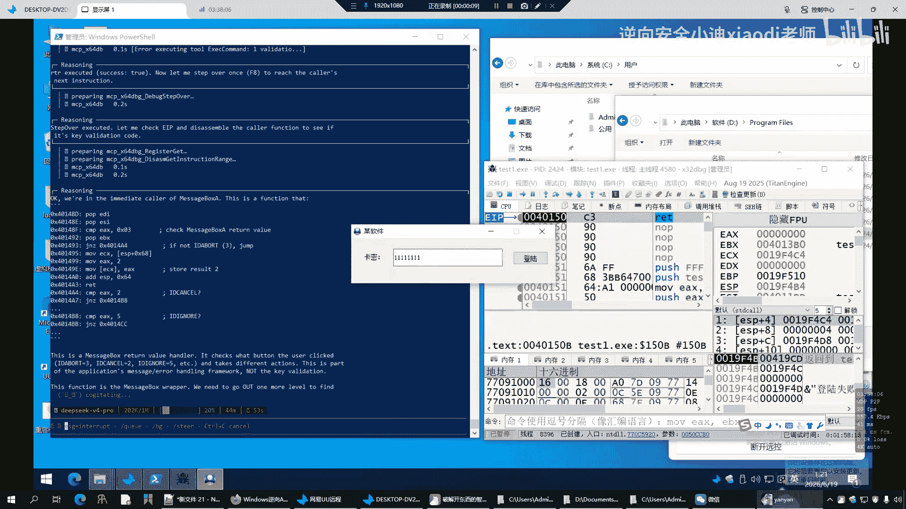

- 了解调教智能体的实际测试方式：通过多轮测试和JY软件界面的实战调试来观察效果。


上一节是概述，从这里开始进入实际训练场景，下面看看这次测试是在什么背景下进行的。


## 🤖 零基础学软件逆向：02：AI智能体自动化逆向的训练场景


上一节我们说明了课程目标，本节中我们来看看这次AI智能体训练的具体场景。当前正在训练这个AI智能体去自动化做逆向，它正在自动分析一个卡密程序，可以看到它已经进入自动化分析状态。这个场景是给会员搭建和调教智能体的第二轮测试，准确来说是第三轮测试；第二轮测试效果还可以，第三轮测试做的是一个JY软件界面的实战调试。


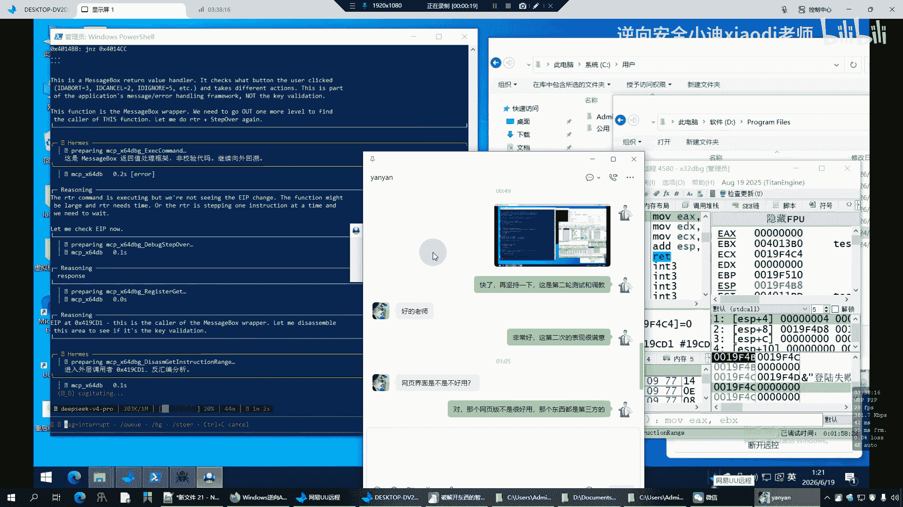

在实际逆向分析中，经常需要在一层一层的函数中做代码分析，所以这种函数层级分析非常有必要。现在智能体已经来到对应位置，它接下来应该要找到关键代码的位置，可以看到它正在朝这个方向推进。它模拟的是人手工分析的方式，整个流程由它自己完成，然后它找到了成功和失败的分支，接下来要看它能不能把这个软件破解掉。


为了便于初学者理解，下面是这次训练场景中的核心流程。


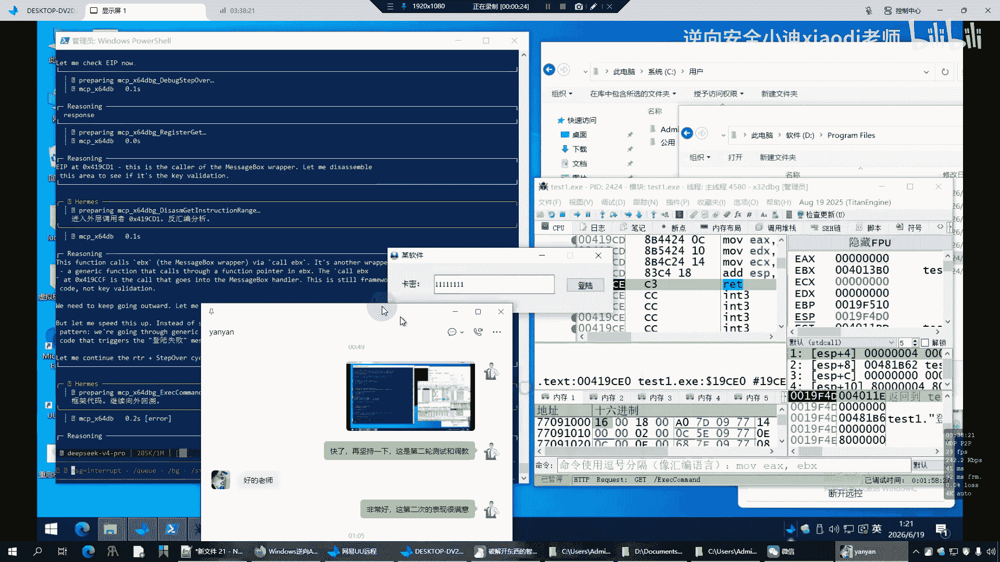

```text
训练AI智能体
→ 自动分析卡密程序
→ 进入JY软件界面实战调试
→ 逐层分析函数代码
→ 定位关键代码位置
→ 识别成功/失败分支
```


上一节介绍了训练场景，本节继续看函数层级分析和关键代码定位时，智能体到底在做什么。


## 🔍 零基础学软件逆向：03：函数层级分析与关键代码定位


上一节我们了解了训练测试的背景，本节中我们来看看函数层级分析和关键代码定位的思路。初学者可以把逆向分析想成顺着函数调用关系一层层往下查，每一层都看看代码在做什么，最后找到真正影响判断的关键位置。视频里智能体来到目标位置后，应该就是要找到关键代码位置，这一步是后续破解和验证的基础。


核心概念可以用一个简单公式来描述，公式表达的是从函数调用链和计算器表达式出发，回溯并定位关键地址。


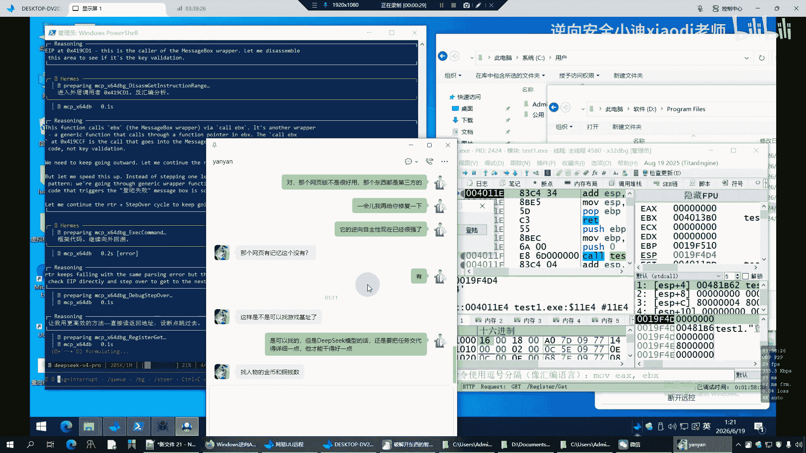

$$
关键地址 = 回溯(函数调用链,\ 计算器表达式)
$$


下面列出这一节需要把握的几个要点。


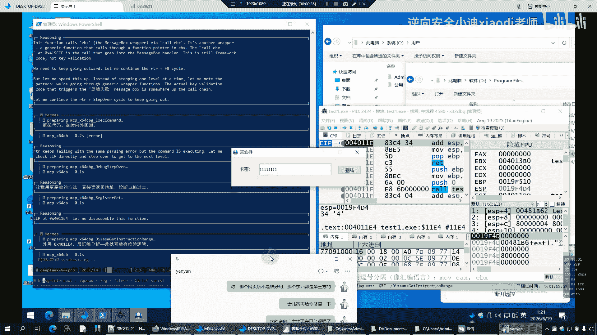

- 逆向分析经常要逐层进入函数，查看每一层的代码逻辑，不能只看最外层。


- 智能体会模拟人手工分析，把整个分析流程自动跑完，减少重复操作。


- 定位关键代码位置后，才方便判断成功分支和失败分支在哪里。


- 如果目标是找游戏机制，可以先定位一个关键位置，再让智能体读取某个计算器，并逐层回溯自动寻找基地址；这些操作只要经过调教就可以完成。


上一节讲了如何定位关键代码，本节继续看智能体找到成功失败分支之后，如何进行破解验证。


## 🧩 零基础学软件逆向：04：成功失败分支识别与破解验证


上一节我们介绍了关键代码定位，本节中我们来看看智能体怎样识别成功失败分支并做破解验证。视频中智能体已经找到成功和失败的分支，接下来要观察它能否把软件破解掉。它继续执行流程，完成修补并重新加载，说明它认为自己已经破解完成，因此要做最后的修补操作。这个过程像做完作业、考完试后再检查结果一样，智能体会回到验证环节看最终效果。


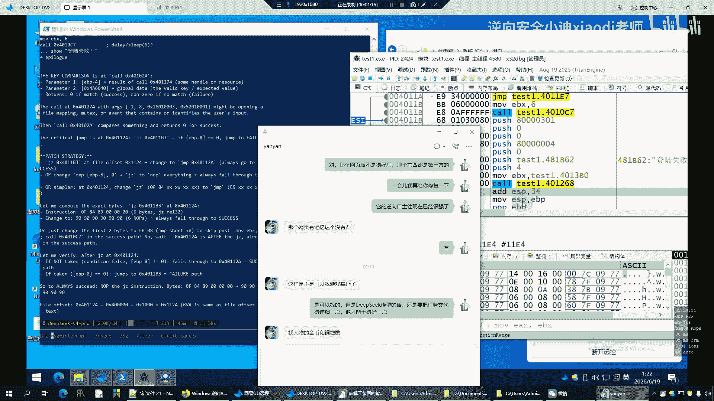

破解结果可以用一个简单判断来表示，登录验证通过就说明这次破解成功，登录验证不通过就说明还需要继续分析。


$$
破解结果 =
\begin{cases}
成功, & 登录验证通过 \\
失败, & 登录验证不通过
\end{cases}
$$


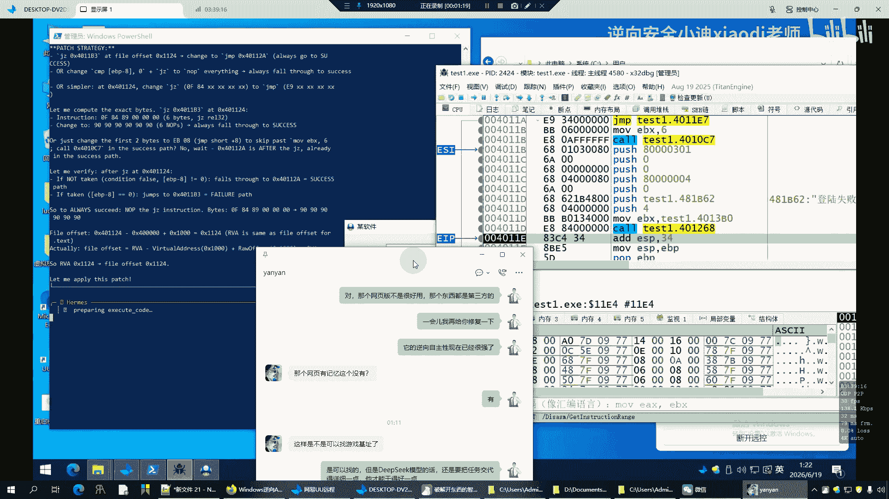

为了把验证过程说清楚，下面列出这一节的关键步骤。


- 智能体找到成功失败分支后，尝试完成破解。


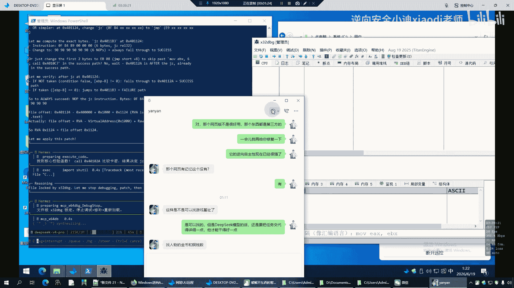

- 它进行修补并重新加载，认为自己已经完成破解，所以做最后修补。


- 它重新加载x32dbg进行验证，检查内存中的补丁是否生效，这个过程很智能。


- 验证时它让我们输入信息，我们输入后点击登录，登录成功说明破解成功。


- 登录成功就表示这次自动化破解验证搞定，流程闭环完成。


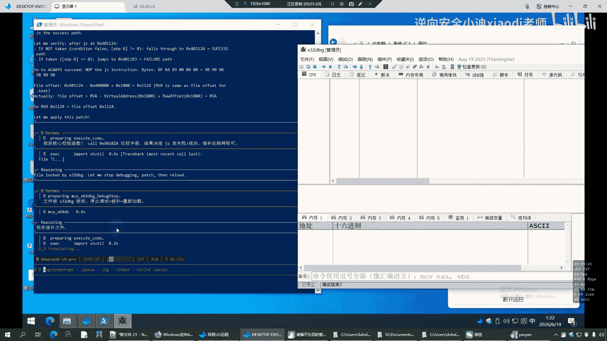

上一节完成了破解验证，本节继续看修补文件和x32dbg内存补丁验证的细节，方便初学者把流程串起来。


## 🛠️ 零基础学软件逆向：05：修补文件与x32dbg内存补丁验证


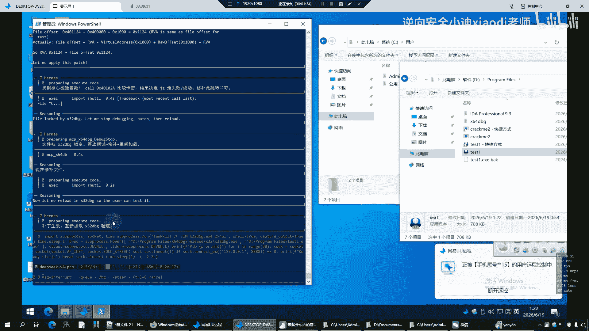

上一节我们看到了登录成功的验证结果，本节中我们来看看修补文件和x32dbg内存补丁验证在整个流程中的位置。智能体在判断自己完成破解后，会做最后修补，然后重新加载x32dbg，目的就是验证内存中的补丁是否真正生效。这个步骤很关键，因为只在文件层面修改还不够，还要看运行时的内存状态是否按预期变化。


下面列出修补与验证环节的注意点。


- 修补文件是破解流程的最后动作之一，表示智能体认为关键逻辑已经处理完成。


- 重新加载x32dbg是为了做运行时验证，检查内存补丁是否生效。


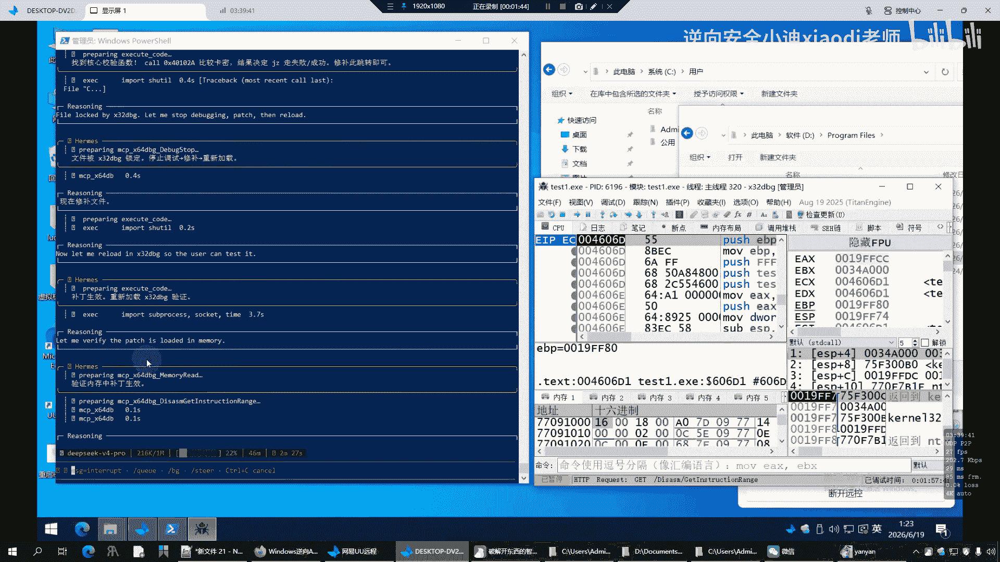

- 验证通过后，再回到软件界面输入信息并点击登录，用登录结果确认破解效果。


- 登录成功说明自动化分析和修补流程形成了闭环，不只是停留在代码阅读层面。


上一节讲完了修补和验证，本节把思路扩展到游戏机制和关键寻址，看看同一套调教方法还能用在哪里。


## 🎮 零基础学软件逆向：06：游戏机制与关键寻址的自动化思路


上一节我们完成了软件破解验证，本节中我们来看看游戏机制和关键寻址的自动化思路。视频提到，如果大家想找游戏机制，可以先定位到一个关键位置，然后让智能体去读取某一个计算器，再每一层去回溯，自动寻找基地址。这些操作都可以通过调教完成，包括植物大战僵尸或一些游戏里的关键寻址，智能体都可以去完成。这个思路和前面的软件逆向分析是相通的，都是先找关键点，再顺着调用关系回溯。


下面列出游戏场景中的自动化思路。


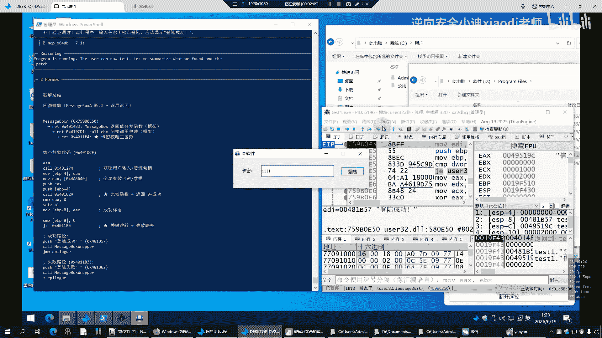

- 先定位游戏中的关键位置，把它作为分析的起点。


- 让智能体读取某个计算器，配合逐层回溯去找基地址。


- 通过调教让智能体模拟自动化分析，把重复的寻址步骤跑起来。


- 植物大战僵尸等游戏的关键寻址可以作为练习场景，观察智能体能否完成类似流程。


上一节把思路扩展到游戏寻址，本节做课程总结，并说明后续联系和调教方式。


## 📚 零基础学软件逆向：07：课程总结与延伸联系


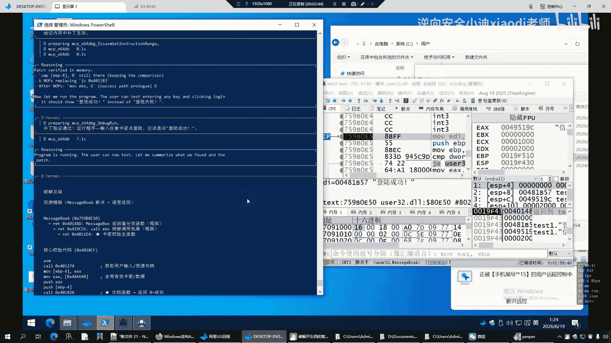

上一节我们介绍了游戏机制和关键寻址的自动化思路，本节做最后总结。本节课中我们一起学习了如何训练AI智能体自动化做软件逆向，包括自动分析卡密程序、进入JY软件界面实战调试、逐层分析函数代码、定位关键代码位置、识别成功失败分支、修补文件、重新加载x32dbg验证内存补丁，以及输入信息点击登录确认破解成功。整个过程模拟人手工分析，由智能体完成主要流程，经过调教后还可以扩展到游戏机制和关键寻址等场景。


为了便于后续继续学习和交流，下面列出联系与延伸说明。


- 如果有调教需求，可以在哔哩哔哩主页联系小李老师。


- 也可以访问网站3W点52学技术点com，主页上有相关信息。


- 调教比较累人，想让AI更好用、更智能，可以找小迪老师做调教。


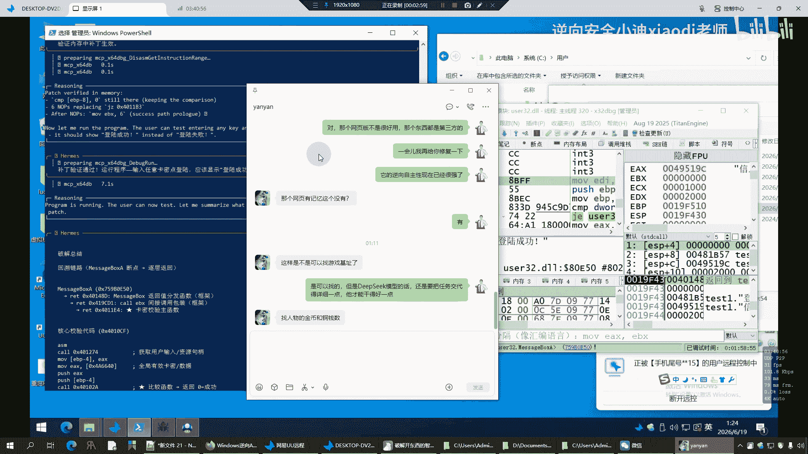

- 本次视频内容到这里结束，下个视频再见，拜拜。


本节课中我们一起学习了AI自动化软件逆向的训练、分析、破解验证和寻址扩展思路，也了解了调教智能体的实际测试方式。后续可以把这套流程当作入门框架，再逐步补充汇编、调试器和游戏寻址等基础知识。

