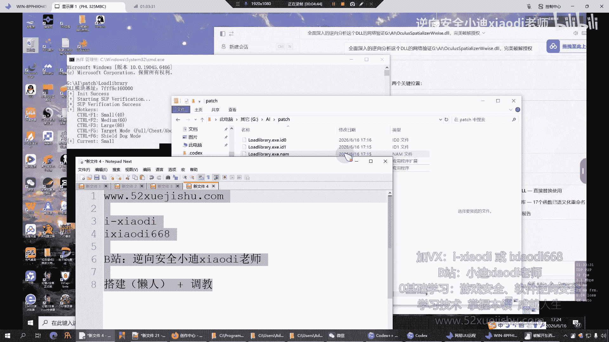

# 🔍 零基础学软件逆向：01：AI自动化逆向分析演示与智能体调教

在本节课中我们将要学习一次AI自动化逆向分析演示，内容围绕AEI（原文如此）自动化逆向分析自动破解、智能体调教、分析报告生成、破解版DL（原文如此，指DLL）输出以及加载器验证结果展开。为了便于初学者理解，本教程会把原文中的口语表达整理成书面教程，同时保留原文每一句话的含义。需要说明的是，本教程仅用于授权教学演示环境，不应用于未授权目标。原文还包含某外挂卡密网络验证软件演示的课程标签和视频编号，这些信息会在后文保留。

## 🎯 零基础学软件逆向：01-1：课程概述与演示目标

上一节我们说明了本教程的记录范围，本节中我们来看看这次演示的目标和整体流程。原文开头提到，今天继续给同学们搭建AEI自动化逆向分析自动破解这个东西。接下来我们看这个东西，进行一次全面深入的逆向分析，只用简单提示词就完美破解授权，也不需要其他操作，让智能体去破解。待会我们来看调教效果，目前还在调教过程中，智能体还在分析，我们来看一下。为了让初学者更容易理解，可以把智能体看成一种能够自己思考、分步执行任务的AI程序；把提示词看成给智能体下达任务的自然语言说明。

以下是本次演示目标的关键点，先列出这些内容，方便后文对照。

- 继续搭建AEI自动化逆向分析自动破解环境。
- 对目标进行全面的逆向分析。
- 使用简单提示词实现授权破解演示。
- 不需要其他操作，让智能体去破解。
- 待会观察调教效果。
- 目前仍处于调教过程中。
- 智能体还在分析。

用公式描述这个演示流程，可以写成下面这样。

\[
\text{自动化逆向演示流程}=\text{提示词}\rightarrow\text{智能体分析}\rightarrow\text{定位验证逻辑}\rightarrow\text{生成报告}\rightarrow\text{输出DL}\rightarrow\text{加载器验证}
\]

介绍完演示目标后，下一节我们来看智能体在调教过程中的具体观察结果。

## 🤖 零基础学软件逆向：01-2：调教过程与智能体分析观察

上一节我们介绍了演示目标和流程公式，本节中我们来看看调教过程中的观察结果。原文提到，智能体已经找到心跳暗装验证。这里的心跳暗装验证，可以理解为软件运行过程中偷偷检查授权状态的一段逻辑。可以看到智能体思考速度非常快，可以看到不再exist process。智能体也找到安装了，跟昨天一样聪明，一样聪明。它不仅做逆向破解，还会生成完整的分析报告。这是我自己电脑里的东西，我自己电脑也在跑AI智能体，现在也在跑。稍等。破解版DL已生成，生成位置还不知道，可能是这个，一会提供报告。我们暂停一下，但时间蛮久，暂停一下。

以下是调教过程中的观察点，先简要说明这些现象，再逐条列出。

- 智能体已经找到心跳暗装验证。
- 智能体思考速度非常快。
- 可以看到不再exist process。
- 智能体也找到安装了。
- 跟昨天一样聪明。
- 一样聪明。
- 不仅做逆向破解，还会生成完整分析报告。
- 这是我自己电脑里的东西。
- 我自己电脑也在跑AI智能体，现在也在跑。
- 稍等。
- 破解版DL已生成。
- 生成位置还不知道。
- 可能是这个。
- 一会提供报告。
- 暂停一下。
- 时间蛮久。
- 暂停一下。

用伪代码描述这一阶段的观察流程，可以写成下面这样，仅表示流程含义，不提供具体破解实现。

```text
提示词 -> 智能体持续分析 -> 找到心跳暗装验证 -> 识别exist process状态 -> 找到安装 -> 生成分析报告 -> 生成破解版DL
```

介绍完调教过程中的观察结果后，下一节我们来看报告完成后的拷贝、加载器验证和最终结果。


## 📄 零基础学软件逆向：01-3：报告生成、DL拷贝与验证结果

上一节我们观察了智能体分析过程和破解版DL生成情况，本节中我们来看看报告完成后的操作和验证结果。原文提到，现在智能体把报告完成了，破解的位置也给我们分析出来了。然后这个DL我们就拷贝出来，拷贝到这边，这个先不管，先把它还原成以前的名字。回收站这里有一个加载器，把这个加载器拷贝过来。登录成功了，可以看到，也是破解开了，破解开了。然后去执行一下，破解完成，这个verification。success成功，就是验证成功，破解成功。确认，调教完成。这个过程中，加载器可以理解为负责把目标程序加载起来并触发验证流程的工具，verification表示验证环节。


以下是报告完成后的操作和结果列表，先说明这些步骤，再逐项列出原文含义。

- 报告已经完成。
- 破解位置已经分析出来。
- DL拷贝出来。
- 拷贝到这边。
- 这个先不管。
- 先还原成以前的名字。
- 回收站这里有一个加载器。
- 拷贝加载器。
- 登录成功，可以看到。
- 也破解开。
- 破解开。
- 去执行一下。
- 破解完成。
- 这个verification。
- success成功。
- 验证成功。
- 破解成功。
- 确认。
- 调教完成。

用一段简短代码表示验证结果的含义，可以写成下面这样。

```text
登录 -> 加载器加载 -> verification -> success -> 验证成功 -> 破解成功
```

介绍完验证结果后，下一节我们来看本次调教的次数、不同模型的随机性以及联系方式说明。

## 🧩 零基础学软件逆向：01-4：调教次数、随机性与联系方式

上一节我们完成了报告、拷贝和验证结果的整理，本节中我们来看看调教次数、随机性和联系方式。原文提到，这次调教完成了，他给智能体拉了1234，拉了4次，拉回来了。所以大家想调教，有需要安装智能体可以联系小迪老师，可以给大家调教不同智能体。不同的智能体、不同的AI大模型具有随机性，针对某个特定方向就需要调教。不调教，智能体就没有办法一次性把这个东西破解开，大概就是这个意思。

以下是调教与联系相关的内容，先给出简短介绍，再逐条整理。


- 调教完成。
- 给他拉了1234，拉了4次，拉回来。
- 所以大家想调教。
- 需要安装智能体可以联系小迪老师。
- 可以给大家调教不同智能体。
- 不同智能体、不同AI大模型有随机性。
- 针对特定方向需要调教。
- 不调教。
- 无法一次性破解开。
- 大概就是这个意思。
- 我的微信是I杠小迪。
- 备用微信是嗨小迪66。
- 联系方式如果风控，会发在上面。
- 大家来网站就可以。
- 或者看B站主页也可以。
- 闭想安全。
- 小迪老师。

用公式描述调教效果与随机性，可以写成下面这样。


\[
\text{调教效果}=\text{模型能力}\times\text{特定方向调教}\times\text{随机性}
\]

介绍完联系方式后，下一节我们保留原文中的课程标签和视频编号信息。

## 📌 零基础学软件逆向：01-5：课程标签与视频信息

上一节我们整理了调教次数和联系方式，本节中我们来看看原文包含的课程标签与视频编号。原文结尾提到，这个视频就是今天演示的全部内容，想搭建、想调教，搭建也接，搭件（原文如此）就是懒人用，不想搭我来给你搭，有一个时间成本，然后加调教。搭建加调教都可以给大家做，你搭建好了，我也可以给你调教。视频到这里。

以下是课程标签与视频编号信息，先说明这是原文保留内容，再列出对应条目。

- 二进制安全逆向。
- 游戏安全。
- 软件安全。
- 网络安全。
- CTF比赛必备基础。
- 封包技术。
- 视频编号BV14dj36pEJ6。

> 零基础学软件逆向：解放双手！AI自动化逆向破解！某外挂卡密网络验证软件演示【二进制安全逆向，游戏安全，软件安全，网络安全，CTF比赛必备基础，封包技术】--BV14dj36pEJ6-

介绍完全部内容后，我们在最后对本教程进行总结。



## ✅ 零基础学软件逆向：01-6：课程总结

本节课中我们一起学习了AI自动化逆向分析演示的完整记录，包括课程概述与演示目标、调教过程与智能体分析观察、报告生成与DL拷贝、加载器验证结果、调教次数与随机性说明、联系方式以及课程标签和视频编号。原文中每一句话的含义都已整理到对应小节中，口语语气词已删除，核心流程用公式和伪代码进行了概括。通过这次整理，初学者可以直白地理解整个演示的流程结构，同时明确本教程仅用于授权教学演示环境。

