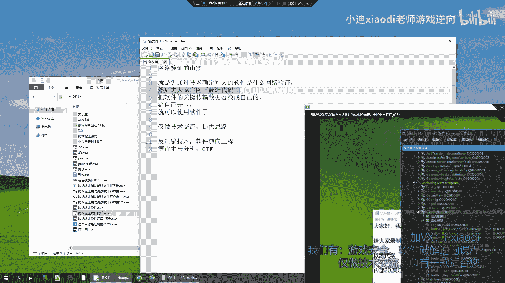
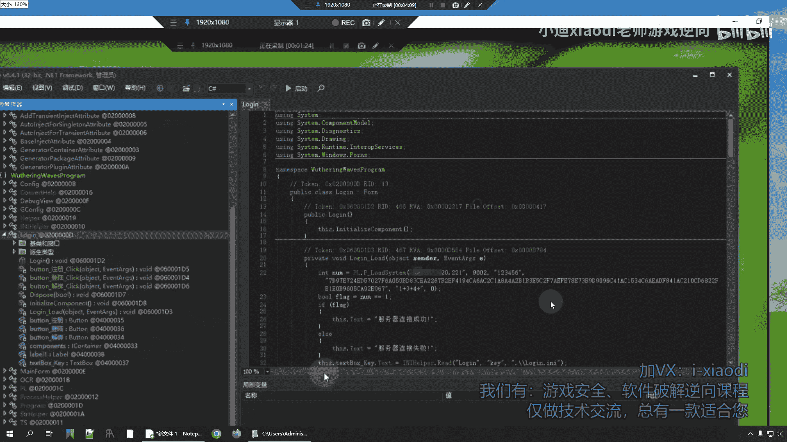
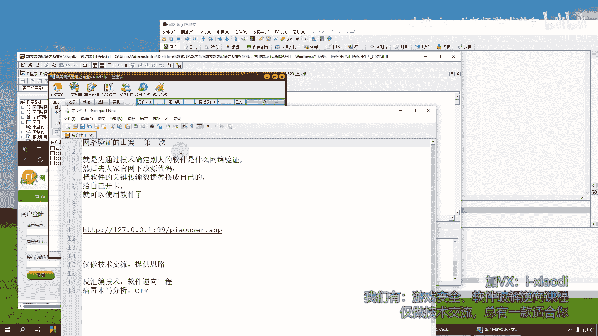

# 软件逆向安全：第1章：飘零网络验证山寨方法 🛠️

大家好，我是小李老师，欢迎加入软件安全逆向破解社区。有不少朋友纳闷，为什么那么多人听你讲逆向？逆向到底能干什么？在本节课程中，我们将学习网络验证山寨，并且通过一个完整的飘零网络验证案例来演示整个山寨过程。通过这节内容，你会明白逆向工程的实际用处，也能掌握网络验证山寨的基本思路。

## 逆向工程能做什么

首先，从我们这里可以学到反汇编技术。学会反汇编技术之后，你就能对某些软件进行逆向工程，这就是软件逆向工程。另外，有些朋友可能热衷于病毒木马分析，这属于萝卜青菜各有所爱。学会反汇编技术并掌握一些工具的使用后，你就能对病毒木马进行分析了。当然，病毒木马分析也是安全公司的一项必备技能，属于职业化的方向。

再比如，有些同学喜欢打CTF比赛。学会反汇编技术之后，也有利于在CTF中取得好成绩。我们这边的基础课程讲得很全面，从国内来说，我认为是比较全面的，而且价格非常便宜，物美价廉。最后提醒一句：我们所有的内容仅做技术交流，给大家提供一个思路。

## 什么是网络验证山寨



接下来回到今天的正题——网络验证山寨。先解释一下名词：什么是网络验证山寨？简单说，就是先通过技术手段，确定别人的软件使用了什么网络验证。比如我使用了一款软件，这里随便找一个例子：这是一个网络认证软件。要确定它的验证方式，需要拿调试工具去分析。方法其实很简单：打开调试工具，附加到目标程序，点击符号切换，搜索当前模块的字符串。也就是说，在字符串中查看有没有网络验证相关的信息。

例如，这里有一个“DFZS999top半B点SD”，它可能就与网络验证相关，也可能是网络验证服务器的地址。然后在字符串中查看有没有有用的信息，比如密钥。你现在可能看不出什么，但待会儿就会明白——实际上软件内会存在一些关键信息。如果你能根据字符串特征判断出是哪款网络验证，就可以用百度搜索这些字符串。一旦确定是哪款验证，就去搜索该网络验证的官网，然后下载源代码。拿到源代码后，把软件中的关键数据替换成自己的，就可以自己开卡使用软件了。再次强调，这仅供技术交流。



## 飘零网络验证的特征

今天我们讲的网络验证是飘零网络验证。为什么要讲它？因为内部视频第20集中，阿伟（某位社区成员）给我们带来了飘零网络验证的爆破演示。飘零网络验证的登录界面非常具有特征：比如“飘零.system”，不同编程语言的写法可能不同，但你能确定的是，里面有一个“1+3+4”。这个“1+3+4”是非常典型的飘零网络验证特征，一般出现在4.0以后的版本中。

我没有最新版本，因为这东西是收费的，作者不可能用爱发电。绝大多数网络验证都分免费版和付费版：免费版基本就是等着被破解，付费版安全性相对高一些，但世界上不存在绝对安全的系统。

在代码中，`LoadSystem` 应该是连接服务器的函数。这里有一个端口，程序通过端口去连接服务器，直接连可能连不上。旁边可能是一个密码，比如 `123456`。另一个字段不太清楚，但应该是网络验证用的信息。然后还有 `1+3+4`，通过 `PL` 标识也能看出这是飘零的缩写。登录成功之后，程序会提示“连接服务器成功”，然后读取账号密码等信息。这段演示在内部视频中已经破解掉了。如果你想深入学习，仅看公开课是不够的，需要加入内部视频课程才能学到实际操作。

## 飘零4.0代码结构

现在关闭示例，正式开始讲解飘零网络验证。这里准备了一份飘零网络验证4.0的源代码。之前我们已经讲过客户端和管理端，这里还多了一个代理端。代理端是给销售人员用的，不用管它，可以直接删掉。我们只需要关注管理端和客户端。管理端实际上是运行在服务器侧的东西，依赖于服务器；客户端则是我们本地使用的软件，也就是你下载到的别人那个软件。

先打开客户端源代码。启动窗口就是登录界面。启动窗口执行完毕之后，会启动线程，进行网络初始化。我们看一下网络初始化在做什么。可以看到，这里有一个 `1+3+4`。看到这种字符串，就有极大概率可以判定这是飘零网络验证。飘零网络验证的前面会有一个初始化引擎，用于连接服务器，旁边可能是连接服务器的密码。服务器地址可以是一个网页，也可以是一个IP地址，不同版本写法不同。我们讲的4.0版本没有端口，但最新版通常会提供IP地址和端口，有了端口就可以连接。4.0版本没有端口，所以只能大概讲解一下逻辑。

如果你想要刚才图片里的那个版本，可能需要付费购买官方正版。而今天讲的是山寨技术，做山寨必须有源代码才能研究。源码中还会有一些配置项，比如“飘零破解零”、调试模式 `10086`、禁止多开等等，这些都可以修改。

## 架设本地服务器

当前源码使用 `飘user.SP` 文件，但这个文件不能用，我们换一个。这里有一个ESP代码本地调试工具，把它打开。这个工具就是服务器，有时候可以把电脑当成一个小型服务器使用。架设好之后，来看网络验证是怎么连接服务器的。假设这个服务器在遥远的美国，我们让客户端连接这个地址。这里直接连接 `飘user.SP`，不连接网页。点击后里面什么也没有。让它连接这个地址，应该能直接连上。点击登录，提示“账号不能为空”，并且没有任何信息框。因为没有信息框，你就无法通过下信息框断点来破解。那服务器到底有没有连上？如果不架设服务器，程序会提示“连接网络或连接SP文件失败”，这说明确实存在服务器连接动作。因此，我们要先把服务器架设起来。这个本地服务器也是飘零的，同样包含 `1+3+4`。此时登录会提示“登录不正确”。这个端就是客户端。

## 管理端与会员添加

接着，你还能下载到一个管理端。打开管理端的 `Pme.SP` 文件，服务器已经架设好了，运行并登录，管理后台就会出来。在系统首页可以看到系统用户，并且有权限设置，还有三天卡、一天卡、三周卡等套餐。尝试登录后，可以看到管理员、代理商等角色。我们进入会员管理，它支持绑定机器码。添加会员用户时，需要填写完整信息，比如到期时间。举个例子：用户名填“小迪”，密码填“123”，到期时间先不填会新增失败，提示“请完善你的信息”。我们把到期时间从6月2日修改为7月2日，修改成功后，小迪就可以登录了。登录后，程序会显示到期时间。这就是一个完整的网络验证过程。现在我们是使用源码来操作的。

## 山寨完整实操

有管理端的源代码，我们可以下载到管理端。但如果辅助程序是别人的外挂，我们并不知道它的功能。假设它连接的服务器地址为 `233.0.0.1:99`，后面还有一串密钥，以及验证特征 `1+3+4`。我们观察一下，现在生成一个程序，称为“辅助程序”，假设它就是别人的外挂。运行辅助程序，它会连接服务器。这个服务器我们看不见摸不着，甚至可能已经跑路了。此时打开调试工具，点击文件、附加，切换过来（这些操作之前讲过，应该非常熟练），搜索当前模块的字符串。往下走，可以看到一个服务器地址。切换过去，在内存中右键转到这里，用十六进制查看。这里就是连接的服务器地址，还能看到 `19930516`，这可能是外挂连接的密钥。另外还能看到 `1+3+4`，说明用的正是飘零网络认证。

```text
修改前：233.0.0.1:99  密钥：19930516
修改后：127.0.0.1 飘user.SP
```

怎么山寨？既然外挂已经跑路，我们直接把它连接的服务器地址改成我们自己的即可。我们自己的地址是 `127.0.0.1 飘user.SP`。在这个位置右键，选择二进制编辑，只需把地址改成 `127`，点击确定，然后直接打补丁。补丁文件保存为 `辅助程序1.exe`，补丁已经应用。关闭原程序再试，运行后直接初始化成功，这个程序就被我们破解了。

现在还没有账号，怎么办？可以下载管理端来添加。管理端代码在上面，我们修改管理端的连接密码，使其与客户端同步。 `1+3+4` 保持不变。然后用管理员账号密码登录管理端，在会员管理中添加一个会员，比如小迪，密码123。此时，辅助程序（外挂程序）就可以用了。输入小迪和123，点击登录，直接成功。这就是网络验证的山寨。

## 注意事项与总结

网络验证山寨要注意一点：必须通过技术手段确定对方是什么网络验证，然后去官网下载源代码，最后把关键传输数据替换成自己的。网络验证本身分很多版本，飘零就有很多种。你需要查看或购买才能知道全部版本，也可以咨询作者有哪些版本可选。比如你想保护自己的软件，给它加个付费功能，就可以去咨询作者。



这就是网络验证的一个简单思路。第一次接触网络验证山寨，非常宝贵的经历。本次以飘零网络验证为例，讲了完整山寨过程。再次强调，以上内容仅做技术交流，欢迎大家加入软件安全逆向社区，下集再见。
